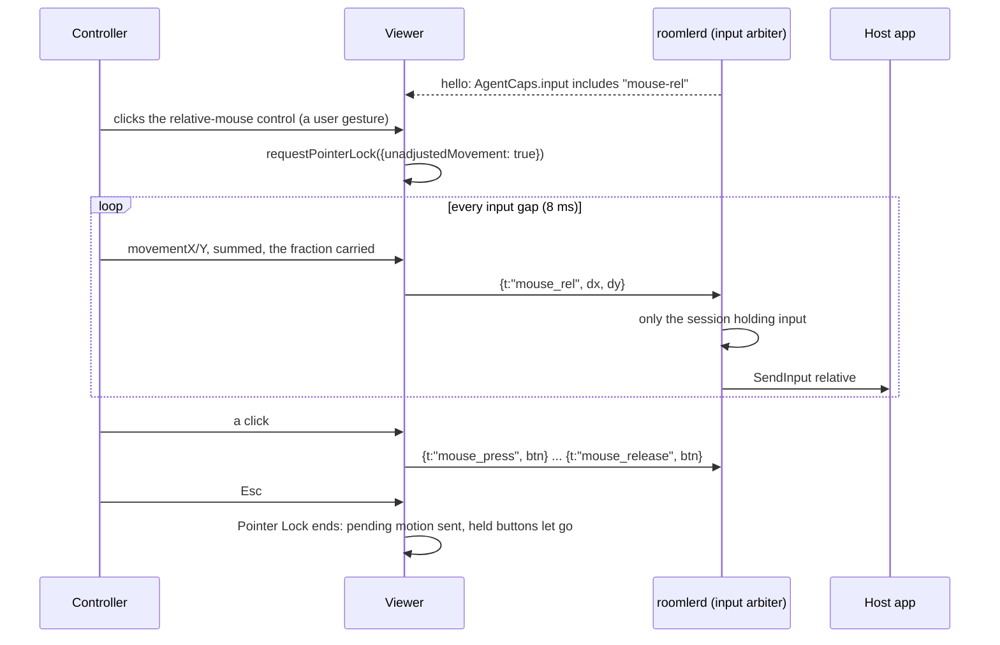

# Relative mouse — Pointer Lock for apps that capture the pointer

> **Status** (FR-109, [#2333](https://github.com/gjovanov/roomler-ai/issues/2333); spec:
> [`docs/fr/FR-109-relative-mouse.md`](fr/FR-109-relative-mouse.md))
>
> | Phase | What | State |
> |---|---|---|
> | P1 | the wire, the gate, Windows hosts (the user worker and SystemContext), the viewer's control | shipped in 0.4.140, but there a Windows relative move went out ABSOLUTE (enigo's default, below). The fix (#2352) is field-green on a candidate on both Windows paths, and rides the next agent release |
> | P2 | Linux (a relative uinput device, XTest, the portal) and macOS | not built |
> | P3 | switching on by itself when the host hides its cursor | not built |

## Why it exists

Every pointer move Roomler sends is **absolute**: `mouse_move {x, y, mon}`, normalised to the monitor, so
the host can change resolution mid-session without a resync. That is right for a desktop and wrong for
an app that **captures the pointer**: a 3D or CAD viewport, a game camera, anything that hides the cursor
and recentres it every frame. Such an app reads how far the mouse moved, not where it is. With absolute
moves the controller's cursor reaches the edge of the stage and the motion stops, while the app sees a
pointer pinned at the centre.

Relative mode sends the mouse's movement instead. The browser provides it through **Pointer Lock**, so
nothing is installed on the controlling side.

## How a session uses it

## The wire

| Frame | Fields | Meaning |
|---|---|---|
| `mouse_rel` | `dx`, `dy`: whole counts | move by this much from wherever the pointer is ([`mod.rs:229`](../agents/roomlerd/src/input/mod.rs#L229)) |
| `mouse_press` | `btn` | press **where the pointer is** ([`mod.rs:237`](../agents/roomlerd/src/input/mod.rs#L237)) |
| `mouse_release` | `btn` | let go where the pointer is: #1945's frame, unchanged |

- **Whole counts.** The viewer sums `movementX/Y` over the input gap and sends only whole counts, carrying
  the fraction to the next send ([`relativeMouse.ts:42`](../ui/src/composables/relativeMouse.ts#L42)
  `createRelAccumulator`). A high-DPI mouse moving slowly reports fractions, and rounding each one away
  would stall it. A fractional `mouse_rel` is a viewer bug: it does not parse, and the agent drops it
  with a debug line, as it drops any frame it cannot read.
- **A click must not move the pointer.** `mouse_button` carries a position, and every backend moves there
  before the button. In relative mode the viewer has no position to send, because the host app owns the
  cursor. So it presses with `mouse_press` and releases with `mouse_release`, neither of which moves.
- ⚠️ **Both frames are gated at both ends.** An older agent cannot parse them. The agent advertises
  `mouse-rel` in `AgentCaps.input` only where its injector carries relative motion
  ([`mod.rs:171`](../agents/roomlerd/src/input/mod.rs#L171) `advertises_mouse_rel`, appended at every
  announcement, [`signaling.rs:6157`](../agents/roomlerd/src/signaling.rs#L6157)). The viewer offers the
  control only to an agent that says so, matched by equality
  ([`relativeMouse.ts:17`](../ui/src/composables/relativeMouse.ts#L17) `agentSupportsRelativeMouse`).

## Per host

| Host | Relative motion | A press where the pointer is |
|---|---|---|
| Windows, user worker | `SendInput` with `MOUSEEVENTF_MOVE` and no `ABSOLUTE` ([`enigo_backend.rs:193`](../agents/roomlerd/src/input/enigo_backend.rs#L193)) | [`enigo_backend.rs:200`](../agents/roomlerd/src/input/enigo_backend.rs#L200) |
| Windows, SystemContext | the same `dispatch`, on its desktop-bound thread | the same |
| Linux, system install (uinput) | **P2**: the device is an absolute tablet by design; a relative device comes beside it ([`uinput_backend.rs:474`](../agents/roomlerd/src/input/uinput_backend.rs#L474) drops it) | ✅ [`uinput_backend.rs:466`](../agents/roomlerd/src/input/uinput_backend.rs#L466) |
| Linux, Wayland portal | **P2**: `NotifyPointerMotion` exists, this path does not carry it yet ([`portal/input.rs:159`](../agents/roomlerd/src/capture/portal/input.rs#L159)) | ✅ [`portal/input.rs:152`](../agents/roomlerd/src/capture/portal/input.rs#L152) |
| Linux X11 (XTest), macOS | **P2** | — |

⚠️ **On Windows, enigo has to be told to send a relative move as relative.** enigo 0.6's default
(`windows_subject_to_mouse_speed_and_acceleration_level = false`) turns `Coordinate::Rel` into an
ABSOLUTE move to cursor + delta, so that pointer acceleration does not apply. Raw input then sees an
absolute event and no motion, and a game sees nothing. Agent 0.4.140 shipped that way: ten `mouse_rel`
frames reached the host as 0 relative counts and 10 absolute events (the spec's §8 row 5). Every enigo
the agent builds now starts from one helper with the flag set
([`enigo_backend.rs:112`](../agents/roomlerd/src/input/enigo_backend.rs#L112) `enigo_settings`), and a
test locks it.
The visible cursor then follows pointer speed and acceleration, as a real mouse does; the raw deltas are
the counts sent.

Until P2, Linux and macOS agents **do not advertise** `mouse-rel`, so no viewer offers relative mode to
them. The presses above exist because each backend's match is exhaustive and must decide.

## The viewer

- **The control** is a toolbar button, shown only for an agent that advertises `mouse-rel`
  ([`RemoteControl.vue:3101`](../ui/src/views/remote/RemoteControl.vue#L3101) `relativeMouseOffered`).
  Pointer Lock needs a user gesture, and the click is one.
- **Entering** asks for raw, unaccelerated deltas (`unadjustedMovement`). A browser that rejects the option
  gets plain Pointer Lock ([`useRemoteControl.ts:5966`](../ui/src/composables/useRemoteControl.ts#L5966)
  `enterRelativeMouse`).
- **While locked**, every pointer move is a delta into the accumulator
  ([`useRemoteControl.ts:10129`](../ui/src/composables/useRemoteControl.ts#L10129)), and a hint at the
  bottom of the picture says how to get the pointer back.
- **Leaving** is Esc, the browser's own rule. Under Keyboard Lock in fullscreen, Esc reaches the host, so
  the browser wants it held, and the hint says so. Leaving sends the motion still gathered and lets go of
  any held button where the pointer is, before moves turn absolute again
  ([`useRemoteControl.ts:11000`](../ui/src/composables/useRemoteControl.ts#L11000)). An absolute button-up
  there would throw the host's cursor to an old position.
- A blur or a hidden tab releases held buttons with `mouse_release` in relative mode, never with a
  position.

## The arbiter

`mouse_rel` is movement: only the session holding input injects it, the same as `mouse_move`. A
`mouse_press` is held like any press ([`arbiter.rs:380`](../agents/roomlerd/src/input/arbiter.rs#L380)),
so a session that ends mid-drag still has its button released, where the pointer is. Every injected
relative event notes remote input, so keep busy and display match read it as the controller's, not a
person's.

## Switching it off

| Where | How |
|---|---|
| The device | `ROOMLERD_INPUT_MOUSE_REL=0` (or `false`, `no`, `off`): the agent stops advertising `mouse-rel` ([`mod.rs:163`](../agents/roomlerd/src/input/mod.rs#L163)) |
| One browser | `localStorage['roomler-rc-relative-mouse'] = 'off'` hides the control |

## What it does not do

- It never reads input on the host. The agent only injects; there is no hook and no raw-input reader in
  `roomlerd` (FR-92's rule). A unit test scans the relative-mouse code for any of them
  ([`input/mod.rs:618`](../agents/roomlerd/src/input/mod.rs#L618) `fr109_relative_mouse_reads_no_input`).
- No ghost cursor in relative mode: other viewers see the host's own cursor in the picture.
- The host's pointer speed and acceleration settings are not changed.

## Related

- [FR-109](fr/FR-109-relative-mouse.md): the spec, the phases, the field log.
- [`remote-control.md` §6](remote-control.md): the input plane this rides on.
- [FR-92](fr/FR-92-keep-busy.md): the no-hooks rule.
