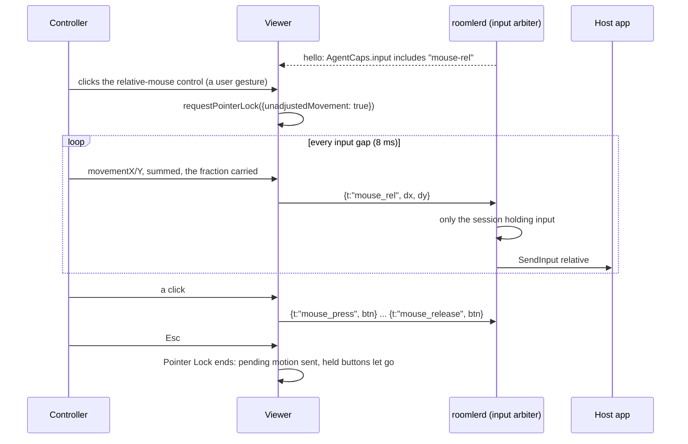
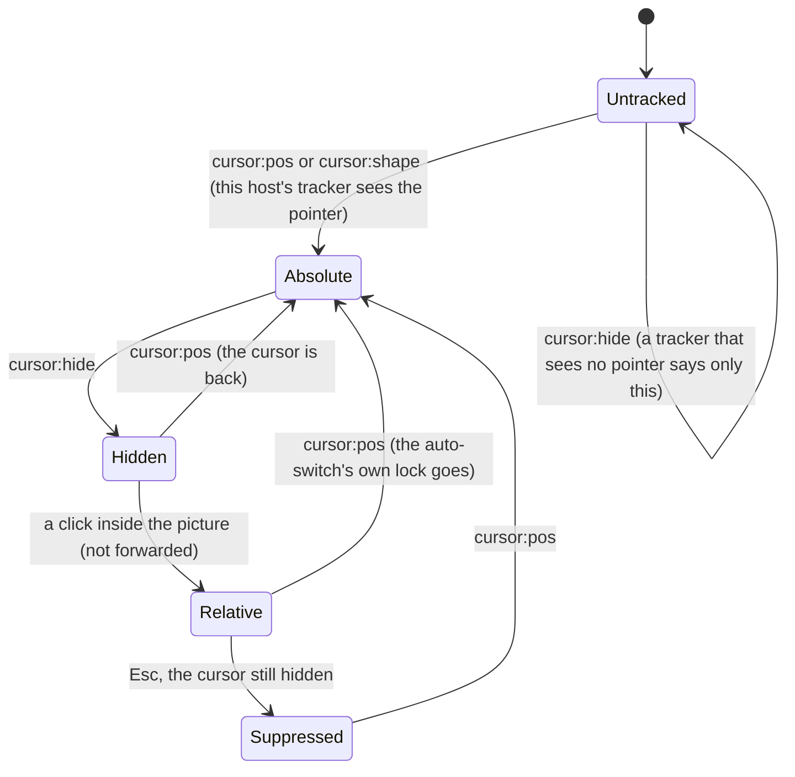

# Relative mouse — Pointer Lock for apps that capture the pointer

> **Status** (FR-109, [#2333](https://github.com/gjovanov/roomler-ai/issues/2333); spec:
> [`docs/fr/FR-109-relative-mouse.md`](fr/FR-109-relative-mouse.md))
>
> | Phase | What | State |
> |---|---|---|
> | P1 | the wire, the gate, Windows hosts (the user worker and SystemContext), the viewer's control | shipped in 0.4.140, where a Windows relative move went out ABSOLUTE (enigo's default, below). **0.4.141 carries the fix (#2352)**, field-verified on its released bytes on both Windows paths |
> | P2 | Linux (XTest, a relative uinput device, the portal) and macOS | X11 through enigo's XTest (P2a), a relative uinput pointer for system installs (P2b), per-user Wayland through the RemoteDesktop session, the portal's or mutter's (P2c), and macOS through enigo's CGEvent motion in a GUI session with the Accessibility grant (P2d): all shipped, **field-verified on the released 0.4.143**, the first release to carry all four (FR-109 §8 rows 36–39) |
> | P3 | switching on by itself when the host hides its cursor | merged and live since the 2026-10-17 promote (the operator settled the spec's decision 1: enter on the next click), with a rule P2 made necessary: a hide counts only after the host has reported its pointer. Field-verified on the live viewer, the locked host included (FR-109 §8 rows 34–35) |

## Why it exists

Every pointer move Roomler sends is **absolute**: `mouse_move {x, y, mon}`, normalised to the monitor, so
the host can change resolution mid-session without a resync. That is right for a desktop and wrong for
an app that **captures the pointer**: a 3D or CAD viewport, a game camera, anything that hides the cursor
and recentres it every frame. Such an app reads how far the mouse moved, not where it is. With absolute
moves the controller's cursor reaches the edge of the stage and the motion stops, while the app sees a
pointer pinned at the centre.

Relative mode sends the mouse's movement instead. The browser provides it through **Pointer Lock**, so
nothing is installed on the controlling side.

## How a session uses it

## The wire

| Frame | Fields | Meaning |
|---|---|---|
| `mouse_rel` | `dx`, `dy`: whole counts | move by this much from wherever the pointer is ([`mod.rs:358`](../agents/roomlerd/src/input/mod.rs#L358)) |
| `mouse_press` | `btn` | press **where the pointer is** ([`mod.rs:366`](../agents/roomlerd/src/input/mod.rs#L366)) |
| `mouse_release` | `btn` | let go where the pointer is: #1945's frame, unchanged |

- **Whole counts.** The viewer sums `movementX/Y` over the input gap and sends only whole counts, carrying
  the fraction to the next send ([`relativeMouse.ts:42`](../ui/src/composables/relativeMouse.ts#L42)
  `createRelAccumulator`). A high-DPI mouse moving slowly reports fractions, and rounding each one away
  would stall it. A fractional `mouse_rel` is a viewer bug: it does not parse, and the agent drops it
  with a debug line, as it drops any frame it cannot read.
- **A click must not move the pointer.** `mouse_button` carries a position, and every backend moves there
  before the button. In relative mode the viewer has no position to send, because the host app owns the
  cursor. So it presses with `mouse_press` and releases with `mouse_release`, neither of which moves.
- ⚠️ **Both frames are gated at both ends.** An older agent cannot parse them. The agent advertises
  `mouse-rel` in `AgentCaps.input` only where its injector carries relative motion
  ([`mod.rs:178`](../agents/roomlerd/src/input/mod.rs#L178) `advertises_mouse_rel`, appended at every
  announcement, [`signaling.rs:6809`](../agents/roomlerd/src/signaling.rs#L6809)). The viewer offers the
  control only to an agent that says so, matched by equality
  ([`relativeMouse.ts:17`](../ui/src/composables/relativeMouse.ts#L17) `agentSupportsRelativeMouse`).

## Per host

| Host | Relative motion | A press where the pointer is |
|---|---|---|
| Windows, user worker | `SendInput` with `MOUSEEVENTF_MOVE` and no `ABSOLUTE` ([`enigo_backend.rs:193`](../agents/roomlerd/src/input/enigo_backend.rs#L193)) | [`enigo_backend.rs:200`](../agents/roomlerd/src/input/enigo_backend.rs#L200) |
| Windows, SystemContext | the same `dispatch`, on its desktop-bound thread | the same |
| Linux, system install (uinput) | ✅ **P2b**: a second, relative-only pointer beside the absolute tablet (`REL_X`/`REL_Y` plus buttons), made on the first `mouse_rel` ([`uinput_backend.rs:470`](../agents/roomlerd/src/input/uinput_backend.rs#L470) `open_rel_device`; the frame at [`uinput_backend.rs:564`](../agents/roomlerd/src/input/uinput_backend.rs#L564)). libinput adds it as a pointer on GNOME and KDE and hands relative-pointer clients its unaccelerated deltas, the counts sent | ✅ [`uinput_backend.rs:555`](../agents/roomlerd/src/input/uinput_backend.rs#L555) |
| Linux, per-user Wayland (the RemoteDesktop session) | ✅ **P2c**: the session's own relative call, which names no stream ([`portal/input.rs:163`](../agents/roomlerd/src/capture/portal/input.rs#L163)): the portal's `NotifyPointerMotion` ([`portal/input.rs:470`](../agents/roomlerd/src/capture/portal/input.rs#L470)), or `NotifyPointerMotionRelative` on mutter's own session, where FR-93 routes GNOME's input ([`portal/input.rs:499`](../agents/roomlerd/src/capture/portal/input.rs#L499)). Both move the pointer by exactly the counts sent | ✅ [`portal/input.rs:155`](../agents/roomlerd/src/capture/portal/input.rs#L155) |
| Linux X11 (enigo, XTest) | ✅ **P2a**: XTest relative motion (`XTestFakeRelativeMotionEvent`, enigo's `Coordinate::Rel`, [`enigo_backend.rs:193`](../agents/roomlerd/src/input/enigo_backend.rs#L193)), which an XI2 raw reader sees 1:1 | ✅ the same `dispatch` |
| macOS (the per-user agent) | ✅ **P2d**: enigo's `Coordinate::Rel` posts a `MouseMoved` CGEvent (a `…Dragged` one with a button held) at the cursor plus the delta, with the event's delta fields set to the counts sent ([`enigo_backend.rs:193`](../agents/roomlerd/src/input/enigo_backend.rs#L193)). The session's event stream carries each event with exactly that delta, and an app reads it as `NSEvent`'s `deltaX`/`deltaY`, also with the cursor decoupled from the mouse the way a game decouples it | ✅ the same `dispatch` |

⚠️ **On Windows, enigo has to be told to send a relative move as relative.** enigo 0.6's default
(`windows_subject_to_mouse_speed_and_acceleration_level = false`) turns `Coordinate::Rel` into an
ABSOLUTE move to cursor + delta, so that pointer acceleration does not apply. Raw input then sees an
absolute event and no motion, and a game sees nothing. Agent 0.4.140 shipped that way: ten `mouse_rel`
frames reached the host as 0 relative counts and 10 absolute events (the spec's §8 row 5). Every enigo
the agent builds now starts from one helper with the flag set
([`enigo_backend.rs:112`](../agents/roomlerd/src/input/enigo_backend.rs#L112) `enigo_settings`), and a
test locks it.
The visible cursor then follows pointer speed and acceleration, as a real mouse does; the raw deltas are
the counts sent.

A Linux agent advertises `mouse-rel` **only while the session a controller would open now carries it**. It
decides when the caps are announced, which is before any session
([`mod.rs:292`](../agents/roomlerd/src/input/mod.rs#L292) `linux_injector_carries_rel`):
- **uinput**, below the compositor, carries it for any session, Wayland or X11. That is uinput opted in
  (`ROOMLERD_UINPUT=1`) with the device openable, the brief planning the DRM arm that a system install's
  automatic capture (FR-95) pairs with uinput, or such a capture already alive
  ([`mod.rs:206`](../agents/roomlerd/src/input/mod.rs#L206) `uinput_would_inject`). A capture alive only
  during a session would come too late for the hello, which is why the plan counts.
- **A RemoteDesktop session** carries it on a Wayland desktop whose capture plans the portal or mutter arm
  with input that reaches the desktop (the brief's `input_reach` is `full`). While that session is live the
  arbiter hands it every event before any injector, and its own relative call moves the compositor's
  pointer as any pointer moves.
- **enigo** carries it on a real X11 desktop its input reaches, read from the cached desktop brief. On a
  Wayland desktop XTest reaches only Xwayland clients.

The brief is at most a minute old, and the heartbeat re-announces the caps when it changes, so the word
follows the session: a desktop whose input reaches only Xwayland takes it back.

A macOS agent advertises it **in a GUI session with the Accessibility grant**
([`mod.rs:268`](../agents/roomlerd/src/input/mod.rs#L268) `macos_injector_carries_rel`). The root
LaunchDaemon has no WindowServer to post into, yet its permission check can still answer "granted" (FR-80).
Without the grant macOS drops every posted event, and the enigo the agent ships refuses to start. Both are
read at every announcement, so a grant given while the daemon runs is announced by the next heartbeat.

The presses above exist because each backend's match is exhaustive and must decide.

⚠️ **On macOS an absolute move carries its delta reversed.** enigo sets an absolute move's delta fields to
the cursor minus the target, so a +51 px move reads −51 (FR-109 §8 row 30). An app that turns by the
deltas of absolute moves turns the wrong way. Relative mode sends the delta the right way round, one more
reason to use it for such an app.

⚠️ **The relative pointer settles before its first frame**, as the tablet does, because udev and libinput
enumerate a new device asynchronously and anything written before that reaches nobody. Frames sent while it
is being made wait and then arrive together: the spec's §8 row 17 read all ten in one burst, none lost.

⚠️ **A RemoteDesktop session's motion never passes libinput,** so `libinput debug-events` sees none of it,
and a Linux agent reports `cursor:pos` only from DRM capture. The spec's §8 rows 20–23 read it two other
ways. The lab's fullscreen GTK probe logged ten steps of exactly +50 for 10 × `{dx: 50}`, through mutter on
GNOME and through the portal on KDE. The cursor embedded in the stream moved the same distance. On KDE the
session can need the person at the screen to approve it first (Plasma's input-devices prompt, then the
portal's dialog), and relative motion waits for that like every other event.

⚠️ **On a real Xorg an absolute move reaches a raw reader as a jump.** Xorg raises an XI2 RawMotion for an
absolute XTest move too, but its valuators carry the pointer's **position**, not a delta. The spec's §8
row 12 read 640, 653, 667, … for a pointer crossing the screen, so a game that reads raw motion takes
each absolute move as a large jump. In relative mode the same probe read the deltas sent, 100 each (row
13). Xvfb, by contrast, raises no RawMotion for an absolute move at all (row 4).

## The viewer

- **The control** is a toolbar button, shown only for an agent that advertises `mouse-rel`
  ([`RemoteControl.vue:3324`](../ui/src/views/remote/RemoteControl.vue#L3324) `relativeMouseOffered`).
  Pointer Lock needs a user gesture, and the click is one.
- **Entering** asks for raw, unaccelerated deltas (`unadjustedMovement`). A browser that rejects the option
  gets plain Pointer Lock ([`useRemoteControl.ts:6333`](../ui/src/composables/useRemoteControl.ts#L6333)
  `enterRelativeMouse`).
- **While locked**, every pointer move is a delta into the accumulator
  ([`useRemoteControl.ts:10775`](../ui/src/composables/useRemoteControl.ts#L10775)), and a hint at the
  bottom of the picture says how to get the pointer back.
- **Leaving** is Esc, the browser's own rule. Under Keyboard Lock in fullscreen, Esc reaches the host, so
  the browser wants it held, and the hint says so. Leaving sends the motion still gathered and lets go of
  any held button where the pointer is, before moves turn absolute again
  ([`useRemoteControl.ts:11678`](../ui/src/composables/useRemoteControl.ts#L11678)). An absolute button-up
  there would throw the host's cursor to an old position.
- A blur or a hidden tab releases held buttons with `mouse_release` in relative mode, never with a
  position.

## Switching on by itself (P3)

An app that captures the pointer usually hides the cursor first. The agent already says so on the cursor
channel (`cursor:hide`), so the viewer can offer relative mode without the toolbar:

- **The click that switches is the gesture, not input**
  ([`useRemoteControl.ts:10838`](../ui/src/composables/useRemoteControl.ts#L10838)). Forwarded as an
  absolute press, it would first jump the captured pointer to where the click happened. Its button-up is
  swallowed too.
- **The cursor coming back** is the next `cursor:pos` after a `cursor:hide`, not `cursor:shape`, which
  arrives only when the shape changes ([`useRemoteControl.ts:6354`](../ui/src/composables/useRemoteControl.ts#L6354)
  `onHostCursorShown`). It ends a lock the auto-switch took. A lock the person took from the toolbar stays
  theirs until Esc.
- **Esc while the cursor stays hidden** leaves relative mode and holds it off until the cursor shows again
  ([`useRemoteControl.ts:11692`](../ui/src/composables/useRemoteControl.ts#L11692)). Otherwise a host that
  keeps its cursor hidden, fullscreen video for one, would trap the person on every click.
- ⚠️ **Never while the host is locked.** The lock screen hides the cursor too
  ([`relativeMouse.ts:108`](../ui/src/composables/relativeMouse.ts#L108) `shouldAutoEnterRelative`
  checks `rc:host_locked`). Field-verified on the live viewer (FR-109 §8 row 34). With the cursor tracked
  and then hidden on a locked Windows host, the click stayed a click; unlocked through the viewer in the
  same session, the same click entered relative mode.
- ⚠️ **Only after this host has reported its pointer** on the channel, a `cursor:pos` or `cursor:shape`
  ([`useRemoteControl.ts:6288`](../ui/src/composables/useRemoteControl.ts#L6288) `hostCursorTracked`). A
  tracker that sees no pointer (a Linux host without DRM capture, macOS) sends one `cursor:hide` when the
  channel opens and nothing after it. Those Linux hosts advertise `mouse-rel` since P2, so without this rule
  their first click would take the pointer. The price is small: a Windows session that starts with the
  cursor already hidden switches only after the cursor has shown once, and until then the toolbar control
  works.
- Switched off in one browser with `localStorage['roomler-rc-relative-auto'] = 'off'`; the toolbar control
  still works.

## The arbiter

`mouse_rel` is movement: only the session holding input injects it, the same as `mouse_move`. A
`mouse_press` is held like any press ([`arbiter.rs:380`](../agents/roomlerd/src/input/arbiter.rs#L380)),
so a session that ends mid-drag still has its button released, where the pointer is. Every injected
relative event notes remote input, so keep busy and display match read it as the controller's, not a
person's.

## Switching it off

| Where | How |
|---|---|
| The device | `ROOMLERD_INPUT_MOUSE_REL=0` (or `false`, `no`, `off`): the agent stops advertising `mouse-rel` ([`mod.rs:167`](../agents/roomlerd/src/input/mod.rs#L167)). On macOS it goes in the per-user agent's `EnvironmentVariables` in `~/Library/LaunchAgents/com.roomler.agent.plist`, and takes effect after a `launchctl bootout` and `bootstrap` of `gui/<uid>` (FR-109 §8 row 33) |
| One browser | `localStorage['roomler-rc-relative-mouse'] = 'off'` hides the control |
| One browser, the auto-switch alone | `localStorage['roomler-rc-relative-auto'] = 'off'` ([`relativeMouse.ts:68`](../ui/src/composables/relativeMouse.ts#L68)): relative mode stays manual, and the toolbar control still works |

## What it does not do

- It never reads input on the host. The agent only injects; there is no hook and no raw-input reader in
  `roomlerd` (FR-92's rule). A unit test scans the relative-mouse code for any of them
  ([`input/mod.rs:846`](../agents/roomlerd/src/input/mod.rs#L846) `fr109_relative_mouse_reads_no_input`).
- No ghost cursor in relative mode: other viewers see the host's own cursor in the picture.
- The host's pointer speed and acceleration settings are not changed.
- Not measured on macOS: an app that reads the GameController framework (`GCMouse`). It reads the mouse
  devices themselves, not the event stream injection posts into, and the lab has no real mouse to compare
  against.

## Related

- [FR-109](fr/FR-109-relative-mouse.md): the spec, the phases, the field log.
- [`remote-control.md` §6](remote-control.md): the input plane this rides on.
- [FR-92](fr/FR-92-keep-busy.md): the no-hooks rule.
