# Remote Control — Architecture & Design

> Adds TeamViewer / RustDesk-style unattended remote desktop access to roomler-ai, reusing the existing mediasoup SFU, WebSocket signaling, and COTURN cluster. Targets sub-150 ms input-to-glass latency on LAN, sub-300 ms over WAN.

> **One device in N orgs, N users on one host, events from every org:** see
> [`multi-org.md`](./multi-org.md) — the `[[orgs]]` config, per-org supervisors,
> tenant address blocks + the renumber runbook, concurrent sessions and the
> InputArbiter, and cross-org `device:presence`.

## 1. Goals & Non-Goals

**Goals**

- View and fully control a registered remote machine (Windows / macOS / Linux) from any modern browser, no client install on the controller side.
- One unified room model: a "remote control session" is just a special room kind, so it inherits auth, multi-tenancy, RBAC, presence, chat, recording, and notifications for free.
- Prefer P2P via WebRTC when ICE allows; fall back to TURN over the existing COTURN cluster; never proxy raw input through the application server.
- Multi-monitor, clipboard, file transfer, and a "view-only" guest mode out of the box.
- Audit everything (session start/stop, input events optional, file transfers, clipboard direction). File transfers and clipboard direction are the device's report, kept in `transfer_activity` since FR-101 P3 (§11.3a).

**Non-goals (v1)** — *historical; most of these have since shipped.* SYSTEM-context
control (lock screen, UAC, pre-logon) landed as the Windows SystemContext service
(§19, [operator-systemcontext-smoke.md](operator-systemcontext-smoke.md)); boot-time
access follows from the service modes; headless Linux hosts get a **virtual
desktop** created by the agent. Still true today:

- Mobile agents (iOS/Android as the controlled device). Mobile as controller is fine — it's just a browser.
- Rendering an X11 login greeter on Linux (the virtual-desktop path sidesteps it).

## 2. Where this fits in the existing stack

The current stack already gives us 80% of what's needed:

| Existing piece | What we reuse |
|---|---|
| Rust + Axum 0.8 backend | New `crates/remote_control` for session/agent state, plus routes module |
| MongoDB + 18 collections | New collections: `agents`, `remote_sessions`, `remote_audit` |
| WebSocket handler (presence, signaling) | New message namespace `rc:*` for agent registration and control signaling |
| mediasoup 0.20 SFU + WorkerPool | New router kind `RemoteControlRouter` with one video producer (screen) + bidirectional `SCTP` data channels |
| COTURN cluster (`coturn.roomler.live`) | Same TURN credentials path; agent fetches short-lived creds from the API |
| JWT + httpOnly cookies | Agent uses a long-lived **agent token** (separate audience claim); controllers use the existing user JWT |
| Vue 3 + Pinia + mediasoup-client | New view `RemoteControl.vue`, new store `remoteControl.ts`, new composable `useRemoteControl.ts` |
| Notifications | "X requested control of your machine" goes through the existing notification bell |

The only genuinely new component is the **native agent** (a separate Rust binary that ships per-OS) and a thin signaling extension on the server.

> **See also — the `roomler` subsystem.** A sibling of remote-control that reuses the same agent binary, `rc:*` signaling, and coturn cluster, but for **TCP port-forwarding** (operator's `127.0.0.1:<port>` → agent → an internal service) rather than screen capture + input. Its data plane defaults to **QUIC** (`quic-v1`, quinn) with a WebRTC-data-channel fallback, and crosses corporate NAT / firewalls via the same direct → TURN(UDP) → TURNS/TCP tier walk. The server negotiates `quic-v1` only for agents new enough to speak it (≥ rc.104). Operator guide: [`docs/tunnel-install.md`](./tunnel-install.md).

> **See also — the L3 overlay & its Windows firewall override.** The `overlay-l3` feature evolves the tunnel into a Tailscale-style per-tenant WireGuard+DERP mesh (Wintun NIC `roomler`, overlay IPs `100.64.0.0/10`). On a GPO-locked Windows host the corporate Defender Firewall drops unsolicited inbound on the overlay adapter; the agent overrides this by programming the Windows Filtering Platform directly (a LUID-scoped, high-weight hard-permit sublayer) from its LocalSystem service. Design, limits (callout/IPsec), and the `ROOMLERD_WFP_PERMIT` disable: [`docs/overlay-wfp.md`](./overlay-wfp.md).

## 3. High-level topology

At a glance — session establishment and where the data actually flows:

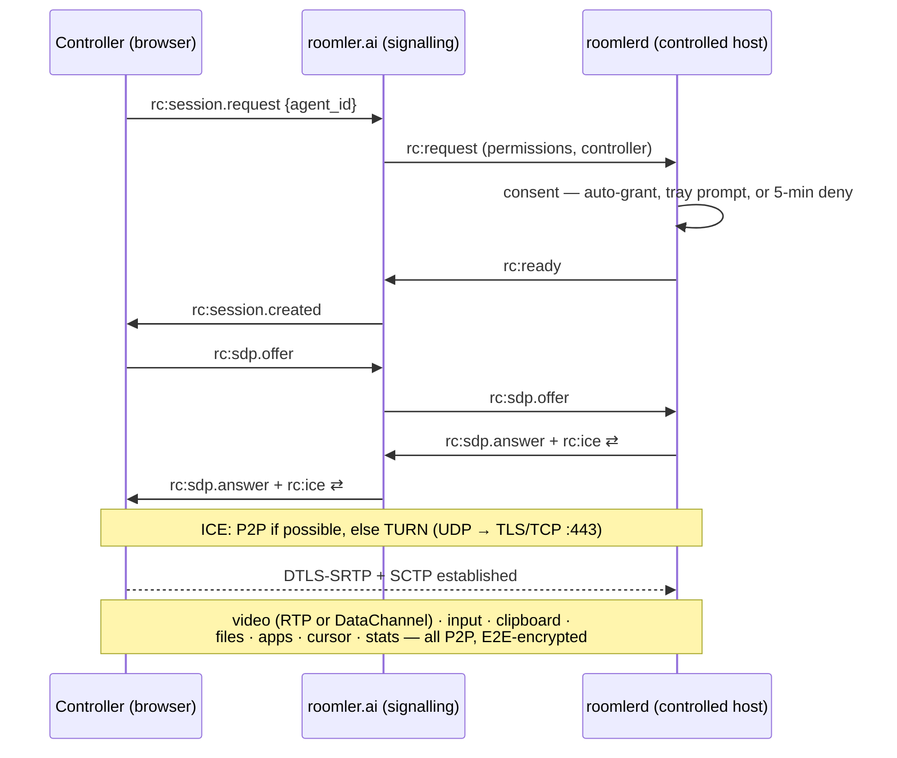

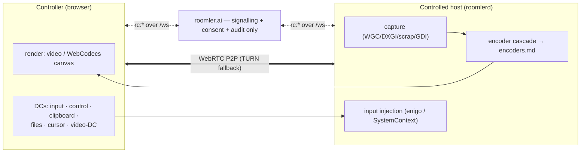

The original wire-level view:

```
  ┌──────────────────────────┐                                     ┌────────────────────────────┐
  │  Controller (browser)    │                                     │  Controlled host (agent)   │
  │  Vue 3 + mediasoup-client│                                     │  Rust binary (Tauri tray)  │
  │                          │                                     │  scrap | wgpu | enigo      │
  │  ┌─────────────────────┐ │                                     │  ┌─────────────────────┐   │
  │  │ <video> screen      │◄┼──── RTP H.264 / AV1 (recv) ────────►│  │ capture+encode loop │   │
  │  │ DC: input  (ULR)    │─┼──── SCTP ord/unord ────────────────►│  │ enigo input service │   │
  │  │ DC: control (rel)   │◄┼──── SCTP reliable ─────────────────►│  │ control state       │   │
  │  │ DC: clipboard (rel) │◄┼──── SCTP reliable ─────────────────►│  │ clipboard sync      │   │
  │  │ DC: filexfer (rel)  │◄┼──── SCTP reliable ─────────────────►│  │ chunked file xfer   │   │
  │  └─────────────────────┘ │         (P2P or via TURN)           │  └─────────────────────┘   │
  └────────────┬─────────────┘                                     └────────────┬───────────────┘
               │                                                                │
               │ WSS  (signaling: SDP-equivalent, ICE, session control)         │ WSS
               │                                                                │
               └─────────────────────► Roomler API (Axum) ◄─────────────────────┘
                                       ├─ rc_signaling::Hub
                                       ├─ mediasoup RemoteControlRouter
                                       └─ MongoDB (sessions, agents, audit)

                                              ▲
                                              │ TURN credentials (REST API)
                                              │
                                       coturn.roomler.live
```

The application server **never sees raw input or pixels** — those flow over the WebRTC PeerConnection between agent and controller, either P2P or relayed by TURN. The server only does signaling, authorization, mediasoup routing setup, and audit logging.

## 4. The agent

A standalone Rust binary, distributed as `roomlerd` per OS. Two operating modes:

1. **Attended** — user runs `roomlerd --pair` from the tray, gets a one-time PIN, types it in the controller UI. PIN is good for 10 minutes, single use.
2. **Unattended** — agent registers once with an `enrollment_token` (issued by an org Admin via the existing org settings UI), persists a per-machine `agent_token`, and stays connected to the API via WebSocket whenever the user is logged in.

### 4.1 Why a native binary (and not just `getDisplayMedia` + browser)

`getDisplayMedia` works for *attended screen sharing* (which roomler already has via `produce`). It cannot:

- run when no browser tab is open,
- inject mouse/keyboard into other apps,
- read/write the system clipboard,
- access multiple displays distinctly,
- enumerate windows for window-only sharing,
- bypass DRM-protected surfaces with hardware capture paths,
- survive browser tab crashes.

So: native agent for the *host*, browser for the *controller*. This is the same split RustDesk uses, and Chrome Remote Desktop, and Parsec.

### 4.2 Agent crate layout

> 🗄️ **The original design sketch, kept for its intent; the code's layout
> differs.** Capture is `capture/{wgc_backend, scrap_backend, drm_backend,
> x11_damage}.rs` plus `capture/portal/`, and a Mac captures through `scrap`'s
> CoreGraphics `CGDisplayStream` (`capture/scrap_backend.rs:8`): there is no
> ScreenCaptureKit code. Encode is `encode/{ffmpeg/, mf/, openh264_backend,
> libvpx}.rs` with the rate-control modules beside them, VideoToolbox among
> FFmpeg's encoders ([encoders.md](encoders.md)). The packaging is under
> `agents/roomlerd/packaging/` and `agents/roomlerd/wix/`.

```
agents/roomlerd/
├── Cargo.toml                 # workspace member of the main repo
├── src/
│   ├── main.rs                # tray/CLI entry
│   ├── config.rs              # ~/.config/roomler/config.toml
│   ├── enrollment.rs          # one-shot enrollment → agent_token
│   ├── signaling.rs           # WSS to roomler API, rc:* protocol
│   ├── peer.rs                # webrtc-rs PeerConnection wrapper
│   ├── capture/
│   │   ├── mod.rs             # trait ScreenCapture
│   │   ├── windows.rs         # WGC (Windows.Graphics.Capture)
│   │   ├── macos.rs           # ScreenCaptureKit
│   │   ├── linux_wayland.rs   # PipeWire via xdg-desktop-portal
│   │   └── linux_x11.rs       # XShm fallback
│   ├── encode/
│   │   ├── mod.rs             # trait VideoEncoder
│   │   ├── nvenc.rs           # NVIDIA HW
│   │   ├── amf.rs             # AMD HW
│   │   ├── qsv.rs             # Intel HW
│   │   ├── vt.rs              # macOS VideoToolbox
│   │   ├── mediafoundation.rs # Windows MF
│   │   ├── vaapi.rs           # Linux VA-API
│   │   └── openh264.rs        # SW fallback
│   ├── input/
│   │   ├── mod.rs             # trait InputInjector
│   │   ├── enigo_backend.rs   # default (uxn-cross-platform)
│   │   ├── windows.rs         # SendInput (handles UIPI / DPI)
│   │   ├── macos.rs           # CGEventPost (needs Accessibility)
│   │   └── linux.rs           # uinput (Wayland) / XTest (X11)
│   ├── clipboard.rs           # arboard + change watcher
│   ├── filexfer.rs            # chunked, resumable
│   ├── permissions.rs         # OS-specific consent dance
│   └── audit.rs               # local log + push events to server
└── installer/
    ├── windows.wxs            # MSI; auto-start at user login
    ├── macos.plist            # LaunchAgent (user, not Daemon, in v1)
    └── linux/
        ├── roomler.service         # systemd --user
        └── flatpak/...
```

`webrtc-rs` is the right peer-connection lib here — it's pure Rust, has matured a lot, and integrates cleanly with `tokio`. Using it on the agent side means a controller browser sees a regular WebRTC peer; the agent does not need to attach to mediasoup, it just dials the controller's `mediasoup-client` peer.

### 4.3 Why P2P, not always SFU

For 1↔1 remote control, mediasoup as a relay buys you *nothing* and adds a hop. So the agent and controller form a **direct PeerConnection** (P2P with ICE → TURN fallback). The mediasoup SFU only enters the picture when **multiple controllers** observe the same session (e.g., a support session shadowed by a senior engineer, or screen-sharing a remote-control session into a roomler call). In that case, the agent's stream is republished to a mediasoup `RemoteControlRouter` and other controllers consume from the SFU as view-only.

```
1 controller : 1 agent           → direct PeerConnection (best path)
N controllers : 1 agent          → agent → mediasoup → N consumers (view-only)
1 active controller + N watchers → split: 1 PC for input controller, SFU for watchers
```

This hybrid is exactly the `WorkerPool + RoomManager` pattern already in roomler — we just add a transport kind for "remote screen capture" and a one-producer router shape.

### 4.4 Whether a session may ride the overlay (#1882)

A session's ICE can find a pair over the WireGuard **overlay**, not just over the LAN, a direct path or TURN. That needs only the controller's browser to run on an overlay node, which an operator's laptop usually is. Whether that is allowed is **the device's call**: `AccessPolicy.rc_overlay`, set per device on the **Devices** page ("Remote desktop over the mesh" on the device's row), **off by default**.

**Why off.** A session on the overlay inherits the overlay's failure modes, and its carrier is invisible to rate control:

- **#1856:** a 3 ms route hole on a Mac killed RC sessions.
- **Hidden carrier:** a pair the mesh carries over DERP/TCP reads as `local_typ=Host, relay=false`, so ABR budgets for a direct path while the video crosses a TCP relay.

On the hotspot topology in #1882, the overlay was the *only* working pair. Off means that topology falls to TURN instead, as every Windows and Linux target already did for host candidates.

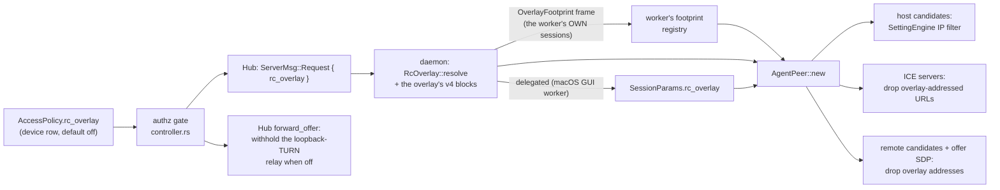

The overlay reaches a session's ICE three ways. The interface-name rule RC always had (`is_overlay_iface`: `roomler`, `roomler-*`, `roomler0`) covers only part of the first, so "off" needs one filter per way:

| How the overlay gets in | Filter (off) | Where |
|---|---|---|
| A **host** candidate on the overlay interface. On macOS that is a kernel-named `utunN`, which the name rule cannot see | `SettingEngine` IP filter: `RcOverlay::keeps_local` | `agents/roomlerd/src/peer.rs:386` |
| An **ICE server** on a mesh address: the loopback-TURN relay the Hub appends for a corp controller | Dropped from the session's servers (`RcOverlay::ice_servers`); the Hub also withholds it | `peer.rs:409`, `crates/modules/fleet/src/hub.rs:1700` |
| A **remote** candidate on a mesh address. The agent's srflx and relay sockets are bound to `0.0.0.0`, so a check to it routes into the TUN even though the agent offered no overlay candidate | Dropped when trickled, again after an mDNS name resolves, and from the offer SDP | `peer.rs:1516`, `peer.rs:1558`, `peer.rs:1484` |

"Overlay address" is **exact**: every v4 block this daemon's overlay routes (each org's `cidrs`, learned as each runtime brings its TUN up: `crates/tunnel-core/src/overlay_footprint.rs`, fed at `runtime.rs:2148`), plus the derived-v6 ULA `fd72:6f6f:6d6c::/96`.

> ⚠️ **Never the whole `100.64.0.0/10`.** That is real CGNAT space: an LTE modem, a cloud VPC's secondary range and Tailscale all hand out addresses in it, and a CIDR rule would silently strip their candidates. The footprint registry only ever grows, so a WS reconnect or runtime restart never opens a window in which an overlay address reads as foreign.

> ⚠️ **A supervised Mac's GUI worker runs no overlay** (FR-43: a GUI-session process cannot create a `utun`), yet it builds the peer for two kinds of session, and each needs the overlay's blocks by a different route:
>
> - **A session delegated from the daemon:** the daemon resolves the decision *with* its blocks (`signaling.rs:2642`) and sends both in `SessionParams.rc_overlay` (`delegate.rs:191`).
> - **The worker's OWN enrollment's sessions** (the per-user row) never cross the daemon, so the worker resolves them against its own footprint registry. The daemon fills it with `DelegateFrame::OverlayFootprint`: right after `Attached`, and again after a `Pong` whenever the set has grown (`delegate.rs:759`, `delegate.rs:796`; the worker side is `delegate_worker.rs:341`, wired at `main.rs:3814`). Measured on 0.4.122, before this frame existed: the user row's session logged `overlay_blocks=0` and still offered the `utunN` v4 address, while a daemon-row session logged `overlay_blocks=1` and offered no overlay candidate at all.
>
> A frame from an older daemon carries none and reads **off**, with an empty footprint: the derived-v6 ULA is still caught, the v4 utun address is not.

**Compatibility.** Each half defaults to off on its own, so mixed versions never turn the overlay on by accident:

| Server | Agent | Result |
|---|---|---|
| Older (no field) | New | Absent reads **off** (`signaling.rs:2434`, `serde(default)`) |
| New | Older | The old agent ignores the field and keeps its old behaviour, except the loopback-TURN relay, which the Hub now withholds |
| Cross-pod | | The relay envelope carries `rc_overlay`; absent reads **off** |

**What "off" does not cover.** It keeps overlay addresses out of the session; it does not override the host's own routing. A controller host using an **exit node**, or a route the mesh advertises for the browser's LAN (a **subnet router**), still sends ordinary internet or LAN traffic through the mesh. That traffic is the host's routing choice, not an overlay candidate.

**Verify on a device.** Each session logs one line, `rc ICE: overlay excluded (device policy rc_overlay=off, the default)` (or `allowed …`), with `overlay_blocks=N`. A dropped remote candidate logs at DEBUG. With `rc_overlay` on, nothing is filtered beyond the name rule, which is the behaviour from before the switch existed.

## 5. Capture & encode pipeline

### 5.1 Capture targets per OS

| OS | Primary API | Why | Fallback |
|---|---|---|---|
| Windows 10+ | `Windows.Graphics.Capture` (WGC) via `windows` crate | DXGI surface, no permission prompt for own session, handles DPI, supports per-window | DXGI Desktop Duplication |
| macOS | CoreGraphics `CGDisplayStream`, through `scrap` (`agents/roomlerd/src/capture/scrap_backend.rs:8`) | The one macOS capture path today: there is no ScreenCaptureKit code. It reports no damage, so every frame counts as changed | — |
| Linux, a host with scanout (X11 or Wayland) | **DRM/KMS** — the scanout plane read below the compositor (FR-36, opt-in `ROOMLERD_DRM_CAPTURE=1`) | Compositor-independent, needs no consent, sees the greeter and a locked screen — the unattended path | the portal, then X11 |
| Linux Wayland, **no** scanout (WSL2, containers, nested compositors) | **`xdg-desktop-portal` ScreenCast → PipeWire**, through a privilege-dropped helper in the user's session (FR-45, opt-in `ROOMLERD_PORTAL_CAPTURE=1`) — or `org.gnome.Mutter.ScreenCast` directly where no portal backend can run (`ROOMLERD_MUTTER_CAPTURE=1`, GNOME only, unattended). A **per-user** install in its own Wayland session with no key set switches these on by itself: mutter on GNOME, else the portal (FR-93 P2) | The only route a Wayland compositor sanctions; **attended** — a logged-in user and a consent dialog, never the greeter or a locked screen | X11 |
| Linux X11 | `XShm` via scrap, with XDamage deciding whether a frame is worth taking (FR-29) | Zero-copy via shared memory; on a headless box the daemon starts its own Xvfb (`ROOMLERD_VIRTUAL_DESKTOP=1`) | `NoopCapture` carrying the reason (§5.1a) |

The portal path, and macOS's Screen Recording grant, produce a system permission prompt the *first* time. That's a feature, not a bug — it's the user consent layer. The Linux arms, their order and their gates are [`linux-capture.md`](linux-capture.md).

### 5.1a When capture cannot open, the session says why (FR-80)

A capture backend that cannot open does not fail the session: the cascade
falls through to `NoopCapture`, the pump starts normally and encodes nothing.
The controller sees a black canvas and a stall, which describes the symptom
and names no cause. Since FR-80 the agent sends the cause instead.

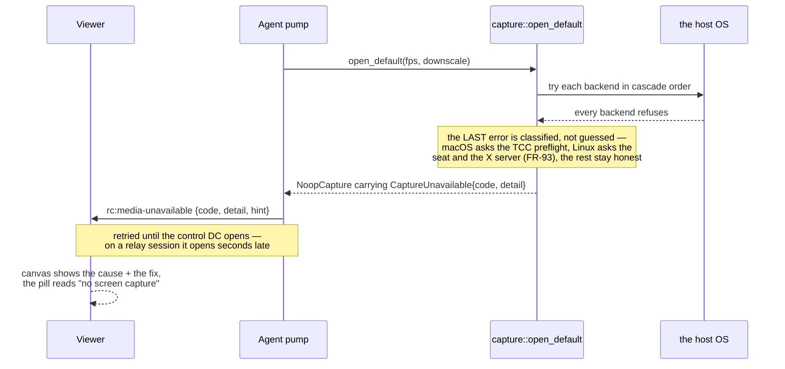

| `code` | Means | What the operator does |
|---|---|---|
| `permission` | The OS can capture; this process may not. macOS Screen Recording (TCC), a denied portal grant | Grant it on the host and reconnect. ⚠️ A macOS grant is bound to the binary's **code signature** — a signing-identity change invalidates it silently (2026-09-08: the Developer ID move did exactly that fleet-wide) |
| `no_display` | Nothing to capture — headless, no desktop session | Nothing. Shell, files and tunnels are unaffected |
| `not_built` | A signalling-only agent build, no capture backend compiled in | Install a full agent build |
| `backend_error` | The backend failed and the agent did not attribute it | Read `detail` (the backend's own words) and the agent log |
| `wayland_not_enabled` | FR-93: a Wayland desktop is showing, and every arm that could capture it is off on this device. Before FR-93 a per-user daemon streamed **black** here, and a system one said "headless" | Switch on the arm the `hint` names for this install: `drm_capture` + `uinput` on a system install, `portal_capture` (+ `mutter_capture` on GNOME) on a per-user one. See [`linux-capture.md` §1.1](linux-capture.md#11-a-wayland-desktop-with-nothing-switched-on-fr-93-p1) |

⚠️ **The `hint` sentence is composed by the AGENT, not the viewer**, because
only the host knows which OS it is on — the same reason the consent surface
names itself (FR-27). An older viewer that does not know a newer `code` still
shows its `hint`.

⚠️ **`rc:media-unavailable` is not a field on `rc:video-info`.** `video-info`
is built from a captured frame, so a session with no capture never reaches
it — which is exactly the hole this closes. Both are peer-to-peer control-DC
JSON, not `ClientMsg`/`ServerMsg` variants, so neither touches the server wire
or the composition baseline.

⚠️ **macOS fails this two different ways** and both are handled. Without the
grant, older macOS opened `CGDisplayStream` fine and delivered wallpaper-only
frames (`scrap_backend::primary` preflights and warns for that shape);
current macOS fails the open outright, which is what reaches the classifier
here.

⚠️ **A sleeping macOS display streams nothing, and fails nothing either.** The
stream opens, `capture: backend=scrap` logs, and then no frame ever arrives:
no encoder is built, and the viewer gives up after its no-picture window and
reconnects, in a loop. Field-hit 2026-10-15 on a MacBook whose display had idled
off while the machine stayed up (FR-55's keeper holds
`PreventUserIdleSystemSleep`, which keeps the **machine** reachable and lets the
display sleep, on purpose). The capture worker now takes
`power::DisplayAwake` for its whole life
(`agents/roomlerd/src/capture/scrap_backend.rs:140`,
`agents/roomlerd/src/power.rs:284`): `IOPMAssertionDeclareUserActivity` wakes
the display (`caffeinate -u`), and `PreventUserIdleDisplaySleep` keeps it on,
so a view-only session, which injects no input to count as activity, does not
go dark at the display-sleep timeout. Only capture takes it: an SSH session or
an `exec` must not light the screen. The two log lines that show it working:
`power: a viewer is watching — the display stays on while they do`
(`was_asleep=true`), then `capture: the first frame after waking the display`.
A locked Mac wakes to its lock screen, which is what the viewer sees.

⚠️ **A `CGDisplayStream` is released only after it reports `Stopped`.**
`CGDisplayStreamStop` is asynchronous, and upstream scrap released the stream
on the next line. A frame delivery CoreGraphics had already queued then ran
against the freed stream: `EXC_BAD_ACCESS` in SkyLight's
`_CGYDisplayStreamFrameAvailable`, on the `quadrupleslap.scrap` queue, right
after a session ended. Each crash took the GUI worker down and lengthened the
supervisor's restart backoff while the next viewer waited. The vendored fork's
`Drop` (`crates/vendored/scrap/src/quartz/capturer.rs:106`) now hands the
stream to a latch. It is released only once `Stopped` has arrived, from a
thread of its own, behind a barrier on the queue. A `Stopped` that never comes
leaks one stream instead.

### 5.1b What the hello promises, and the honest no (FR-97 P0c)

A word in the hello's `AgentCaps` is a promise: the viewer offers a control
because the device said it can serve it. Before FR-97 P0c several words were
compile-time constants, true of the build and false of the host: `opus` on
every Mac, which streams silence; clipboard image events on every Linux and
macOS agent, whose watchers never send them; `supports_clipboard` on a root
Linux daemon with no clipboard to reach. Nothing at all governed
Ctrl+Alt+Del. Since P0c the daemon takes out what the host cannot keep and
says why, in `AgentCaps.unavailable`
([`models.rs:534`](../crates/remote_control/src/models.rs#L534)).

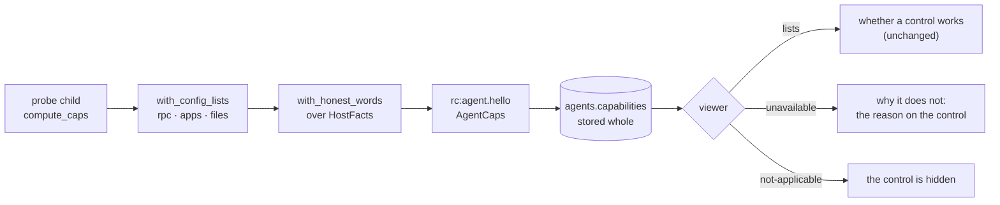

The decision is one daemon-side seam, `with_honest_words`
([`caps.rs:814`](../agents/roomlerd/src/encode/caps.rs#L814)), applied in
`detect()` ([`caps.rs:624`](../agents/roomlerd/src/encode/caps.rs#L624))
after the config lists, over plain `HostFacts`
([`caps.rs:636`](../agents/roomlerd/src/encode/caps.rs#L636)), so it runs and
is tested on every OS.

| Feature | When | What the hello says | What the viewer does |
|---|---|---|---|
| `audio` | the `audio` feature is built and the OS has no capture backend (macOS, until FR-97 P2a) | `audio` empty, so the daemon's session gate never adds a track ([`signaling.rs:3280`](../agents/roomlerd/src/signaling.rs#L3280)); `no-backend` | the receive-audio toggle is off, with the device's reason |
| `audio` | Linux with no way to the computer's sound (FR-97 P3c, §5.1c) | `audio` empty; `no-sound-server` (no Pulse client library), `no-session` (a root build without the session helper), or `no-monitor` (`ROOMLERD_AUDIO_SESSION=0` with nothing named) | the same |
| `clipboard` | a root Linux daemon with neither `DISPLAY` nor `WAYLAND_DISPLAY` ([`caps.rs:795`](../agents/roomlerd/src/encode/caps.rs#L795)) | `supports_clipboard: false`, no clipboard words; `no-session` | send, get and auto-sync are greyed, with the reason |
| `clipboard-image-events` | everywhere but Windows and (FR-97 P3e-3a) a Linux X11 session, whose watchers report copied images | the words stay: text syncs, and an image moves on request; `not-watched` | the auto-sync tooltip stops promising host images |
| `sas` | Windows, Linux | `keys-only`: the button types three ordinary keys. Windows' lock and sign-in screens ignore them; Linux desktops bind them, GNOME and KDE to log out. A Windows host that can send the real sequence advertises `input: sas` instead and drops this entry (P4a, §5.1e) | the button stays, and says what the keys reach |
| `sas` | macOS | `not-applicable`: the chord means nothing there | the button is hidden |

⚠️ **The lists still decide what works.** An empty `audio` list disabled the
toggle before P0c, and still does; `unavailable` adds the why. A viewer
that does not know the map works exactly as before.

⚠️ **An absent key never means "unavailable".** Agents before P0c send no map
at all; their lists say what they claim. The map is off the wire when empty,
and the server stores caps whole
([`agent.rs:461`](../crates/services/src/dao/agent.rs#L461)), so an older
server drops it and a newer one keeps it with no migration.

⚠️ **`not-applicable` is the only code that hides a control, and it is how
the viewer adapts to the OS without reading `agent.os`.** Every other code
leaves the control to the lists and adds the reason to it.

⚠️ **The reason is the agent's sentence, composed on the host**, as the FR-80
`hint` is (§5.1a): only the host knows what it is. The viewer shows it as
text, capped at a tooltip's length, never as markup.

⚠️ **The hello is a boot-time snapshot.** `detect()` is memoized for the life
of the process, so a root daemon started outside every session keeps its
`no-session` until it restarts, the same property Remote Apps' `status`
documents ([`remote-apps.md`](remote-apps.md)).

The keys are matched by equality (`Unavailable::KEYS`,
[`models.rs:557`](../crates/remote_control/src/models.rs#L557)) and the wire
shape is locked by `unavailable_wire_shape_is_locked`. FR-97's census
(`scripts/fr97-caps-census.sh`) counts the map by OS as `key:code`, beside
the words.

### 5.1c Session audio is the computer's sound, never a microphone (FR-97 P3c)

"Receive host audio" carries what the host plays. One rule, in
[`audio_source.rs`](../agents/roomlerd/src/audio_source.rs), decides what each
OS may open, and the session says why when it opens nothing.

| OS | What a session captures | Where it cannot |
|---|---|---|
| Windows | WASAPI loopback of the default output device | no output device, usual on a server or a VM with no sound device: `no_output` |
| Linux | the default output's monitor (`@DEFAULT_MONITOR@`) through Pulse's client library, in the daemon for a per-user install and through the seat user's helper for a root one (P3c-2, [`audio_source.rs:209`](../agents/roomlerd/src/audio_source.rs#L209)); a device named in `ROOMLERD_AUDIO_SOURCE` wins | no Pulse client library: the hello offers no track (`no-sound-server`, [`caps.rs:753`](../agents/roomlerd/src/encode/caps.rs#L753)); a root daemon with nobody at the screen: `no_session`; a named device that is not there: `source_not_found`; `ROOMLERD_AUDIO_SESSION=0`: P3c-1's rule, a named device or `no-monitor` |
| macOS | nothing yet (ScreenCaptureKit audio is FR-97 P2a) | the hello offers no track (`no-backend`, §5.1b) |

⚠️ **On Linux the default input is a microphone, and before P3c-1 it was the
only thing a session ever captured there.** cpal 0.15 has one Linux host,
ALSA, so it lists ALSA devices and never a sound server's sources. Measured
2026-10-17 on a PulseAudio host:

- the devices were exactly `pipewire`, `pulse` and `default`;
- the auto-pick, a name ending in `.monitor`, never matched, and neither did
  the documented `ROOMLERD_AUDIO_SOURCE=<sink>.monitor`;
- so every session fell back to `default`, and PulseAudio showed the capture
  on the microphone while the speakers' monitor stayed suspended.

P3c-1 removed that fallback ([`cpal_backend.rs:247`](../agents/roomlerd/src/audio/cpal_backend.rs#L247)).
A Linux host now offers no track until a device is named for it.

**Naming the device (a per-user daemon).** `ROOMLERD_AUDIO_SOURCE` takes an ALSA
device name, as `arecord -L` prints it, not a PulseAudio source. To capture the
speakers through PulseAudio or PipeWire's Pulse server, set both in the
daemon's environment and restart it:

```text
ROOMLERD_AUDIO_SOURCE=pulse
PULSE_SOURCE=@DEFAULT_MONITOR@
```

`PULSE_SOURCE` points the `pulse` device at the default output's monitor
(measured on the same host). Without it, `pulse` is the microphone again, by
the owner's own choice. Since P3c-2 nobody needs to name anything for the
speakers: the override is for a device the owner prefers.

**The monitor, without naming anything (P3c-2).** PulseAudio and PipeWire's
Pulse server both resolve the device name `@DEFAULT_MONITOR@` to the default
sink's monitor, so the agent records that through Pulse's own client library
([`pulse.rs`](../agents/roomlerd/src/audio/pulse.rs)). One route function
decides, for the hello and for every session alike:

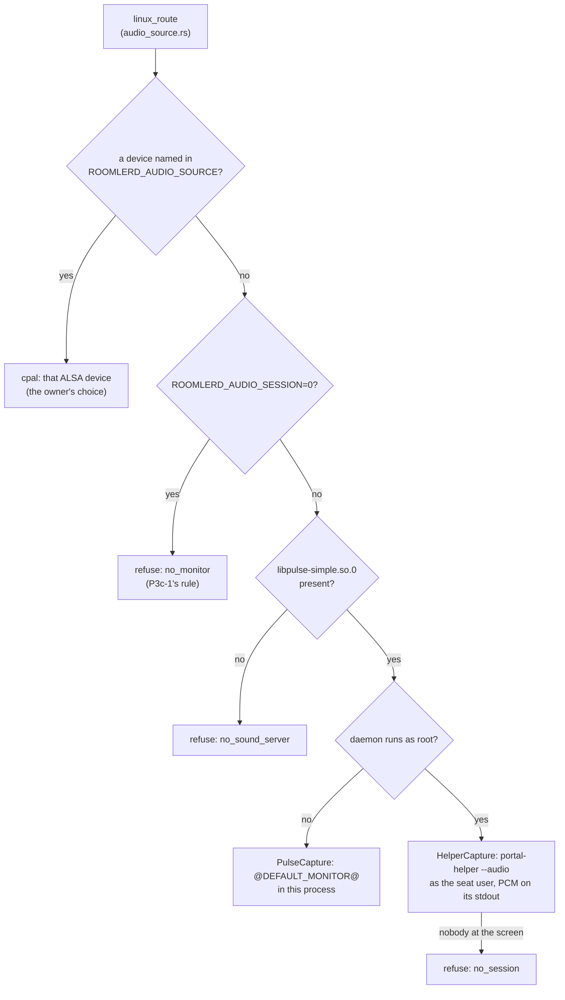

- **In the daemon** for a per-user install, which is already the session's
  owner ([`pulse.rs:369`](../agents/roomlerd/src/audio/pulse.rs#L369)). One
  plain thread owns the blocking `pa_simple` stream and hands 10 ms frames
  (48 kHz stereo s16, the encoder's own format) to the pump.
- **Through the seat user's helper** for a root daemon
  ([`pulse.rs:519`](../agents/roomlerd/src/audio/pulse.rs#L519)). It is the same
  `portal-helper` subcommand, session lookup and privilege drop that portal
  capture and keep-busy use. PulseAudio admits a client by uid or cookie, so
  root cannot record the session's server itself. The helper writes one marked
  line and then raw PCM on stdout ([`pulse.rs:443`](../agents/roomlerd/src/audio/pulse.rs#L443)).
  Closing the pipe stops it.
- **The library is loaded at run time** (`dlopen`), as libpipewire is. It is on
  nearly every desktop and on few servers. A link would stop the agent from
  starting on a host without it; this way only session audio says why.
- **The hello asks the disk, not the loader**
  ([`pulse.rs:124`](../agents/roomlerd/src/audio/pulse.rs#L124)). libpulse pulls
  a dozen libraries into whatever loads it, and a root daemon never needs them
  itself. A library somewhere unusual reads as absent: an honest no.
- **Kill switch:** `ROOMLERD_AUDIO_SESSION=0` puts Linux back on P3c-1's rule.

⚠️ **None of these routes is the default input.** Each one records the
default sink's monitor, or the device the owner named.

When the track cannot carry sound, the agent says why over the control channel:

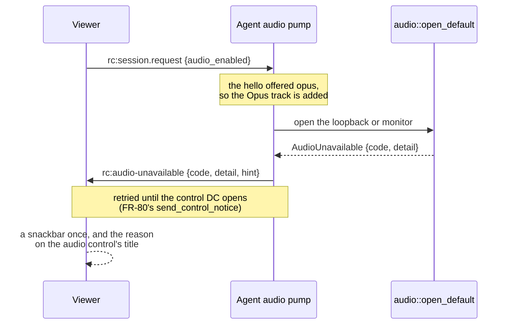

The pump ([`peer.rs:12978`](../agents/roomlerd/src/peer.rs#L12978)) sends it
from every exit: a capture that does not open, an encoder that does not start,
and a capture or encode that stops mid-session. The payload is built by
[`peer.rs:5486`](../agents/roomlerd/src/peer.rs#L5486); the viewer parses it
at [`useRemoteControl.ts:1493`](../ui/src/composables/useRemoteControl.ts#L1493)
and puts it on the toggle's title
([`RemoteControl.vue:3209`](../ui/src/views/remote/RemoteControl.vue#L3209)).

| `code` | Means |
|---|---|
| `no_monitor` | Linux: nothing among the capture devices is the computer's sound, and the default input is not opened |
| `source_not_found` | the device `ROOMLERD_AUDIO_SOURCE` names is not there, and no microphone is opened in its place |
| `no_output` | Windows: no output device to loop back |
| `backend_error` | the device failed to open, the Opus encoder did not start, or capture stopped mid-session; `detail` is the backend's own words |
| `not_supported` | an OS with no capture backend |
| `no_sound_server` | Linux: no Pulse client library, or no sound server would take the stream (`detail` carries libpulse's words, e.g. "Connection refused") |
| `no_session` | Linux: a root daemon with nobody signed in at the screen, so there is no session sound |

⚠️ **`rc:audio-unavailable` is its own message, not an `rc:media-unavailable`
code.** A viewer that predates it ignores it, where the video notice would put
"no screen capture" over a working picture. Like FR-80's notice, it is
control-DC JSON between the peers, so it touches neither the server wire nor
the composition baseline.

⚠️ **The recorder shares the route.** A recording's computer audio opens the
same loopback or monitor only. On Linux it takes `linux_route` too
([`child.rs:128`](../agents/roomlerd/src/recording/child.rs#L128)), and since
the recorder already runs as the person at the screen, it records the monitor
in its own process. Before P3c-2 it refused its start on every Linux host,
because the `.monitor` pick never matched.

### 5.1d A locked host, and a session that keeps the host awake (FR-97 P3b, P2d-1)

What the viewer is told when the host's screen locks, and what holds the
machine awake while a session is live, per OS:

| | Windows | Linux | macOS |
|---|---|---|---|
| The lock signal | the input desktop moves to `winsta0\Winlogon` (`lock_state`) | logind's `LockedHint` for seat0's active session, polled every 2 s ([`lock_state.rs:347`](../agents/roomlerd/src/lock_state.rs#L347)); GNOME, KDE and light-locker set it | the session dictionary's `CGSSessionScreenIsLocked`, or another user on the console, polled every 2 s ([`lock_state.rs:357`](../agents/roomlerd/src/lock_state.rs#L357)); only the GUI session's half can ask, so the root half says nothing |
| What the session does | paints the "Host locked" overlay and suppresses input: the worker can neither capture nor inject there | **nothing**: the lock screen is captured like any other screen, and input reaches it | **nothing**: no overlay, and input is not suppressed |
| `rc:host_locked` | `{locked}` | `{locked, input: "passes"}` ([`peer.rs:10005`](../agents/roomlerd/src/peer.rs#L10005)), retried until the control DC carries it | `{locked, input: "unknown"}`, the same way: whether the lock screen's password field takes injected keys is not measured |
| The viewer's chip | "input is suppressed" | "Your input reaches it, so you can type the password to unlock" | "The remote host is on its lock screen.", claiming neither way ([`useRemoteControl.ts:1426`](../ui/src/composables/useRemoteControl.ts#L1426) `hostLockedChipTitle`) |
| A request that waits for consent | `rc:consent.pending{host_locked}` (FR-34, §11.2) | not yet: the read is a `loginctl` run, which does not belong on the signalling loop | `rc:consent.pending{host_locked}`, from the same session dictionary ([`lock_state.rs:301-320`](../agents/roomlerd/src/lock_state.rs#L301-L320)) |
| Holding the machine awake while a session is live (FR-55) | `PowerCreateRequest` | a logind **block** inhibitor ([`power.rs:670`](../agents/roomlerd/src/power.rs#L670)): `sleep:idle` for a root daemon, `idle` only for a per-user one | `IOPMAssertion` |

⚠️ **The Linux and macOS hints are advisory and never the pump's `LockState`.**
The pump's overlay and the input path keep reading the Windows probe, which
says Unlocked on both. Feeding the hint there would blank a lock screen the
viewer can see and stop the very keystrokes that unlock it. On a Mac the
consent probe alone reads it (`probe_lock_state_service`), as on Windows.
`ROOMLERD_LOCK_HINT=0` turns the hint off on both.

⚠️ **The inhibitor is the FR-55 half, and it sits beside FR-93 P5h's.** P5h
holds a logind **delay** inhibitor during a session so that a sleep the person
chooses is announced to the viewer first ([`linux-capture.md`](linux-capture.md)).
The **block** inhibitor is FR-55's own design for Linux (`what="sleep"`,
`mode="block"`, [FR-55](fr/FR-55-always-reachable.md)): an idle timer must not
end a live session. What a desktop does with an explicit suspend or a closed
lid while a block is held is the desktop's and logind's own
(`LidSwitchIgnoreInhibited=` and the rest); the field cell measures the idle
case.

⚠️ **A per-user daemon gets `idle` only.** It runs outside every login
session, and logind's polkit policy grants a `sleep` block only to session
processes (`inhibit-block-sleep` is `allow_any=no`). It falls back to `idle`
and logs why. A desktop's own idle suspend may still end such a session; a
system install, the default, has both.

The inhibitor lives exactly as long as its fd: logind drops it when the fd
closes, so a daemon that crashes leaves nothing pinned. `systemd-inhibit
--list` shows it (`roomlerd`, `block`) only while a session or an SSH or exec
run is live.

### 5.1e Ctrl+Alt+Del that reaches the lock screen (FR-97 P4a)

The browser cannot capture Ctrl+Alt+Del, so the viewer has a button. Until
P4a it typed three ordinary keys. Apps on the desktop get those, but the
Windows lock and sign-in screens do not: they answer only the **secure
attention sequence** (SAS), which the kernel raises for the physical chord and
`SendSAS` raises for software. On a machine whose policy requires Ctrl+Alt+Del
at sign-in, the viewer could see the lock screen and never get past it.

`SendSAS(FALSE)` is honoured only from a **service process**, and only where
the `SoftwareSASGeneration` policy lets services. ⚠️ **Measured: the
SystemContext worker cannot call it for itself.** It runs as SYSTEM, but in the
person's session, a child of the service and not the service. Its own
`SendSAS(FALSE)` returned and logged, and the lock screen never moved. So the
SCM host, the service process in session 0, sends it, and the worker only asks.
The daemon offers the real sequence only when both of these hold:

| Condition | Where it holds | Read from |
|---|---|---|
| The worker **can ask the service** | the SystemContext worker of an SCM install: it is SYSTEM, the only account the relay lets signal, and the host handed it the relay (`--sas-event`). Not a per-user install, which has no service; not an attended worker, which runs as the signed-in person | the process's own token (`worker_role::probe_self`) and its argv |
| The **`SoftwareSASGeneration`** policy lets services | `1` (services) or `3` (services and Ease of Access). Absent, Windows lets only Ease of Access applications | `HKLM\SOFTWARE\Microsoft\Windows\CurrentVersion\Policies\System` |

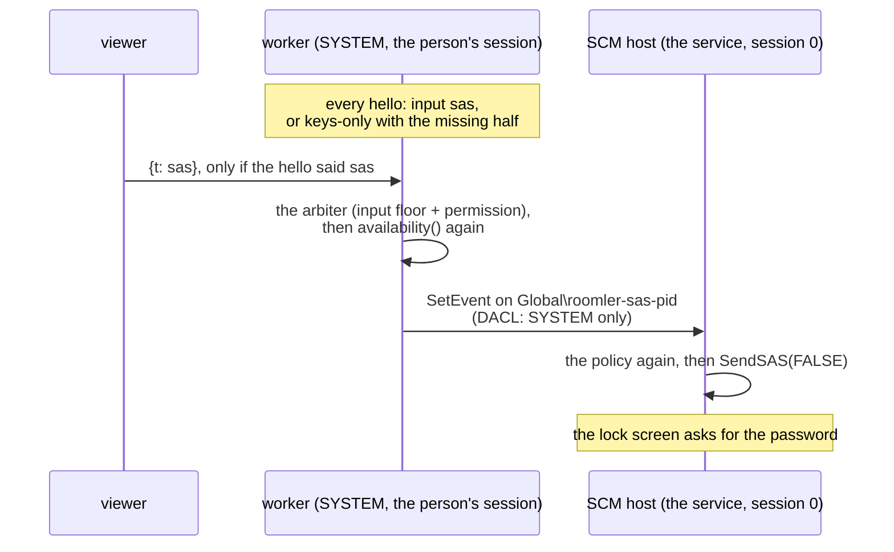

- **The decision is one pure function**
  ([`sas.rs:97`](../agents/roomlerd/src/input/sas.rs#L97)), compiled on every
  OS so the lanes that never run Windows tests check it. It is made at every
  announcement ([`signaling.rs:6819`](../agents/roomlerd/src/signaling.rs#L6819)),
  and the heartbeat re-announces the moment its answer changes, so a policy a
  GPO refresh changes reaches the server within a beat. Where it says no, the
  `keys-only` entry stays and its reason names the half that is missing.
- **The viewer sends `{t: "sas"}` only to an agent that advertises `sas`**
  ([`ctrlAltDel.ts:22`](../ui/src/composables/ctrlAltDel.ts#L22)): an older
  agent cannot parse the frame. The title then says the real one reaches the
  lock and sign-in screens.
- **The frame goes through the input arbiter like a key**, so it needs the
  input floor and the session's input permission, as typing does. The injector
  then checks again
  ([`enigo_backend.rs:277`](../agents/roomlerd/src/input/enigo_backend.rs#L277)):
  the policy can change between the hello and the click, and a viewer is not
  trusted to have read the hello.
- **The relay** ([`sas_relay.rs:43`](../agents/roomlerd/src/win_service/sas_relay.rs#L43))
  is one named, auto-reset event per host, `Global\roomler-sas-<host pid>`,
  whose protected DACL grants SYSTEM alone. A process that is not SYSTEM cannot
  even open it (a test pins this), so an attended worker cannot ask for a SAS
  and says `keys-only`. A SAS is what the physical chord raises: a SYSTEM
  process that asks for one gains nothing it lacked. Signals that arrive while
  one is being answered coalesce into one more, never a queue.
- **The host re-checks the policy before it sends**
  ([`sas.rs:139`](../agents/roomlerd/src/input/sas.rs#L139)), never trusting
  that the worker did.
- **`sas.dll` is loaded when the host sends, never imported**
  ([`sas.rs:224`](../agents/roomlerd/src/input/sas.rs#L224)). A binary that
  imports a DLL some Windows edition lacks does not start at all. It is loaded
  from System32 only (`LOAD_LIBRARY_SEARCH_SYSTEM32`), so a SYSTEM process can
  never load a copy planted beside the binary.
- ⚠️ **The policy is read, never written.** It is a security setting, and on
  a managed laptop it is the organisation's. Measured before the build
  (2026-10-18, read-only over `roomler exec`), the three corporate laptops in
  the fleet all set it to `1`.

### 5.2 Encoder selection

Picked at agent startup, redetected on GPU change:

```
priority order:
  1. HW: nvenc | qsv | amf | vaapi | videotoolbox | mediafoundation
  2. SW: openh264 (always available)
codec preference:  AV1  > H.265  > H.264
```

H.264 is the safe default — every browser decodes it. AV1 only if the controller's `RTCRtpReceiver.getCapabilities('video')` advertises it. We negotiate this in the SDP exchange.

### 5.3 Adaptive streaming

- Two-layer simulcast in SW (one full-res, one half-res) so the controller can switch instantly on bandwidth dips.
- `goog-remb` / TWCC feedback drives target bitrate; reasonable bounds: 600 kbps (idle) → 25 Mbps (4K motion).
- **Variable framerate, idle skip**: when nothing on screen changes (the capturer's per-frame `Damage`, `capture/mod.rs`: WGC's dirty regions, DXGI's no-new-frame, XDamage on X11; `scrap` on macOS reports none, so there every frame counts as changed), the encoder emits a 1 fps keepalive instead of a full 60 fps stream. This is the single biggest battery and bandwidth win.
- IDR on demand: the controller sends `{"t":"keyframe"}` over the control DC if it detects decode errors after a packet loss spike; agent issues an immediate keyframe.

## 6. Input injection

Three input planes, all over a single SCTP-unreliable data channel labeled `input`:

```rust
// shared schema, serialized as msgpack (smaller + faster than JSON)
#[derive(Serialize, Deserialize)]
#[serde(tag = "t")]
enum InputMsg {
    MouseMove   { x: f32, y: f32, mon: u8 },        // normalized 0..1 per monitor
    MouseButton { btn: Button, down: bool, x: f32, y: f32, mon: u8 },
    MouseRelease { btn: Button },                     // let go WHERE THE POINTER IS (#1945)
    MouseWheel  { dx: f32, dy: f32, mode: WheelMode },
    Key         { code: u32, down: bool, mods: u8 }, // USB HID usage code
    KeyText     { text: String },                    // for IME / unicode
    Touch       { id: u32, phase: TouchPhase, x: f32, y: f32 },
    Heartbeat   { seq: u64, ts_ms: u64 },
}
```

Key design choices:

- **Normalized coordinates** (0..1 per monitor index), not pixels. The browser doesn't know the agent's resolution, and the agent's resolution can change mid-session (laptop docking, etc.). The agent maps to absolute pixels using its current monitor geometry. An app that captures the pointer needs movement instead of a position: that is relative mode, `mouse_rel` and `mouse_press` under Pointer Lock ([relative-mouse.md](relative-mouse.md), FR-109). A finger on a touch screen is the mouse too, and the stage keeps every touch so the browser cannot cancel a drag halfway through and leave the host's button down ([touch-controls.md](touch-controls.md), FR-111). Its on-screen controls (rows of keys, a d-pad, a mouse stick) send the frames a keyboard and a mouse would, so they work with every deployed agent. ⚠️ The agent turns a pixel wheel into 100 px steps and rounds every frame on its own (`enigo_backend.rs` `wheel_to_steps`). So the viewer gathers pixel-mode wheel events and sends whole steps, carrying the rest and dropping the carry after a 400 ms pause (`useRemoteControl.ts` `onWheel`, #2367). Before that, a precision trackpad's or a high-resolution wheel's frames under 50 px scrolled nothing.
- **HID usage codes**, not browser key codes or X11 keysyms. Browser keyboard events expose `KeyboardEvent.code` which maps cleanly to HID; the agent maps HID → OS-native scan codes. This is the only way to get layout-independent behavior (a German controller pressing the physical "Z" key sends "Y" on a US-layout host *correctly*, because the host's layout interprets the scan code).
- **Unreliable DC, ordered=false, maxRetransmits=0** — input is real-time; a dropped move event is replaced by the next one a few ms later. Latency >> reliability.
- **A click moves first; a release-all never moves** (#1945). Every backend
  positions the pointer before a `MouseButton` event, so a click lands on its
  target even if the moves before it were coalesced away. The arbiter's
  release of what a closing session still holds is a `MouseRelease` instead,
  because it has no position worth moving to. It used to be a `MouseButton` up
  at (0,0), so a viewer that vanished mid-drag threw the host's cursor into the
  top-left corner: GNOME's Activities hot corner, or a macOS hot corner that
  may lock the screen. Each backend's no-move arm is locked by a test that
  records what it emits (`a_release_never_moves_the_pointer` in
  `enigo_backend.rs`, `uinput_backend.rs` and `capture/portal/input.rs`).
  ⚠️ **The page lets go first, when it can.** On blur or a hidden tab
  (`releaseHeldInputs`), and for a drag that ends outside the picture, the
  viewer sends a positioned button-up at `lastPointerNorm`, because an older
  agent does not know `MouseRelease`. That position must follow every pointer
  move. Updated only on press, it held the press point: a tab closed mid-drag
  snapped the host cursor back to where the drag began (FR-93 lab, the
  `close-mid-drag` oracle). The agent's release-all is the path for a page that
  cannot run any code at all (a crash, `crash-mid-drag`).
- **Mouse coalescing on the controller**, not the agent. The browser fires `pointermove` at up to display refresh rate; we coalesce to one msg per RAF (~16 ms), preserving the *last* position but dropping intermediate samples. Click/key events are never coalesced.
- **`enigo` is the default**, with OS-specific direct backends behind a feature flag for performance and edge cases (UIPI on Windows, IME composition on macOS, `uinput` on Wayland because XTest doesn't exist there).

### 6.1 The Wayland problem

Wayland has no equivalent of XTest. The supported path is `/dev/uinput`, which requires the agent to be in the `input` group (or have `CAP_SYS_ADMIN`). No package adds that group or a udev rule: uinput is an opt-in of a root (system) install, `uinput = true` (`agents/roomlerd/packaging/linux/README.Debian`). If permission isn't granted, the agent runs in **view-only** mode and the UI clearly says so.

As shipped: uinput is FR-36's arm (`ROOMLERD_UINPUT=1`, paired with DRM capture; host-global, it injects into whatever has focus). Where the compositor is **nested** — WSL2, a compositor inside another — uinput publishes events that nothing reads, so the only input path is the portal's RemoteDesktop interface riding the capture session (FR-45 P4, `ROOMLERD_PORTAL_INPUT=1`), and on GNOME the person at the screen must also flip the dialog's *Allow Remote Interaction* switch. A per-user Wayland session whose portal switched itself on (FR-93 P4b, KDE and other desktops without mutter) asks for remote control with no key set. Both are in [`linux-capture.md`](linux-capture.md#43-input-rides-the-same-session-p4).

**Saying so (FR-93 P1).** An injector that reaches nothing does not fail. XTest
into Xwayland *succeeds*, and moves only Xwayland's own pointer, which the
compositor ignores. Where Xwayland sends XTest through EI, it reaches no window
at all. GNOME 49 and later start Xwayland with `-enable-ei-portal`: measured on
GNOME 50, 0 events in a native window and 0 in an Xwayland one. KWin does it
with nothing on the command line. It hands Xwayland an EI socket in its
environment (`LIBEI_SOCKET=/proc/self/fd/N`) and gates XTest behind its own
prompt. Measured on Plasma 6.7: `xdotool` moved nothing and clicked nothing, even
in an X11 window, and the prompt helper failed to start. So each session works
out what its input will
reach (`input/reach.rs`), from the facts `input::open_default` decides from,
after capture has opened (a portal capture registers its input route as it
opens).

| The session finds | `reach` |
|---|---|
| a live portal RemoteDesktop route, or uinput that is on and opens | `full` |
| XTest on a real X server (Xorg, or the daemon's own Xvfb) | `full` |
| XTest on Xwayland | `xwayland_only` |
| XTest on an Xwayland that sends it through EI, read from that process: `-enable-ei-portal` on its command line (GNOME 49+), or a `LIBEI_SOCKET` in its environment (KWin) | `none` |
| … through KWin, and the person allowed roomlerd in **Legacy X11 App Support** (kwinrc `[Xwayland] XwaylandEisNoPromptApps`, or the global `XwaylandEisNoPrompt`) | `full` |
| no X display and no uinput · a build without an injector · a Mac without Accessibility | `none` |

⚠️ **A sandboxed per-user daemon cannot read Xwayland's environment.** Wherever
the user unit's sandbox applies (Fedora: always, #1997), the daemon runs in a
user namespace of its own. The kernel then refuses another namespace's
`/proc/<pid>/environ` (*Permission denied*), while `cmdline`, `comm` and `status`
read fine. There, two readable facts stand in:
- Xwayland's parent is `kwin_wayland`;
- that KWin is 6.1 or later, read from its library's file name
  (`libkwin.so.6.7.5`). 6.1 is the release that hands every Xwayland an EI
  socket (Plasma 6.1's changelog), so Plasma 5.27 stays `xwayland_only`.

From FR-93 P4b the per-user input path on Plasma is the automatic portal's
remote control: one dialog, its answer restored afterwards, and no settings to
change ([`linux-capture.md`](linux-capture.md#12-a-per-user-wayland-session-switches-itself-on-fr-93-p2-decision-d1)
§1.2). So a session whose reach still reads `none` there tells the person to
reconnect and allow remote control first. KWin's grant is the other path, and
the release binary already uses it. Measured on Plasma 6.7 with the viewer
oracle's `points` plan:

| kwinrc `[Xwayland]` | result |
|---|---|
| stock | 🔴 0 events: KWin's prompter could not start, so nothing got through |
| `XwaylandEisNoPromptApps=roomlerd` | ✅ every pointer target within 1 px, the click, the wheel, `hello 123`; 🔴 only Shift+A lost |

The name is the one Xwayland gives an X11 client's EI connection, the process
name. KWin applies the grant only once it has reloaded its options (System
Settings' Apply does that) **and** Xwayland has reconnected, which a new login
does. Until then the agent already says `full`, because it reads the file.

When `reach` is anything but `full`, the agent sends `rc:input-reach {reach,
reason}` once over the control DC, with the same retry-until-open as FR-80's
notice. A session that reaches everything sends nothing, and an older viewer
ignores the message. The viewer then shows a closable warning on any session
that has input: *"Your mouse and keyboard do not reach this device's desktop."*,
followed by the agent's reason, which names the key that would fix it.

On Linux the notice belongs to FR-93's P1, so P1's kill switch
(`wayland_aware = false`) sends none and asks no X server, as the agent did
before FR-93 (P1a, [`linux-capture.md`](linux-capture.md) §1.1). macOS and
Windows are always told: the switch is a Linux key.

### 6.1a Keep busy — a second input source (FR-92)

A controller with input can leave the host's pointer moving in a pattern so the
host stays active (`rc:keep-busy.*` on the control DC). It is **another input
source behind the same arbiter**, never a second injector: the arbiter refuses
its moves while any session holds a mouse button, and tells it about every
controller event it injects, so a remote person pauses it exactly as a local
one does. See [`keep-busy.md`](keep-busy.md).

### 6.2 Remote cursor

The agent does **not** render the cursor into the captured frame (it tells the OS "I'm capturing, hide the cursor"). Instead, it sends cursor shape + position over the `control` DC. The controller renders the cursor as a CSS overlay on top of the video. This eliminates the "delayed mouse" feeling that plagues lower-end remote desktop tools — the local cursor moves at native refresh, the video catches up.

## 7. Signaling protocol (`rc:*` namespace)

Extension to the existing WebSocket. All messages are JSON envelopes; the existing `WS Handler` routes by prefix.

### 7.1 Agent → server

```jsonc
// on connect, after WSS auth via agent_token
{"t":"rc:agent.hello", "machine":"linuxbox-9950x3d", "os":"linux", "displays":[...], "caps":{...}}

// answer to a controller's offer
{"t":"rc:sdp.answer",  "session":"sess_abc", "sdp":"..."}
{"t":"rc:ice",         "session":"sess_abc", "candidate":"..."}

// session-control replies
{"t":"rc:consent",     "session":"sess_abc", "granted":true}

// passive
{"t":"rc:agent.heartbeat", "rss_mb":124, "fps":58, "encoder":"nvenc-h264"}
```

### 7.2 Server → agent

```jsonc
{"t":"rc:request",   "session":"sess_abc", "controller":{"user_id":"u_1","name":"Goran"}, "permissions":["input","clipboard","files"]}
{"t":"rc:offer",     "session":"sess_abc", "sdp":"...", "ice_servers":[{"urls":"turn:..."}]}
{"t":"rc:ice",       "session":"sess_abc", "candidate":"..."}
{"t":"rc:terminate", "session":"sess_abc", "reason":"user_disconnect"}
```

### 7.3 Controller browser ↔ server

Same `rc:*` shapes; the controller is just the other peer. The server is a relay only for SDP/ICE, never for media.

### 7.4 Why not piggyback on mediasoup signaling

mediasoup-client speaks its own RPC for `transport.connect/produce/consume`. That's the right protocol when mediasoup is in the path, but for direct P2P agent↔controller it's overkill. We'd be paying for a router roundtrip just to swap SDP. So: a thin custom signaling layer for the 1:1 case, mediasoup signaling for the N-watcher case.

## 8. Data model additions

```rust
// crates/data/src/models/agent.rs
pub struct Agent {
    pub id: ObjectId,
    pub org_id: ObjectId,
    pub owner_user_id: ObjectId,
    pub name: String,                  // user-friendly: "Goran's Laptop"
    pub machine_id: String,            // stable hardware fingerprint (HMAC of dmi+mac)
    pub os: OsKind,
    pub agent_version: String,
    pub agent_token_hash: String,      // argon2 of the long-lived token
    pub status: AgentStatus,           // Online | Offline | Unenrolled
    pub last_seen_at: DateTime,
    pub displays: Vec<DisplayInfo>,    // refreshed on every connect
    pub capabilities: AgentCaps,       // hw encoders, has_input_perm, etc.
    pub access_policy: AccessPolicy,   // who from this org can request control
    pub created_at: DateTime,
}

pub enum AgentStatus { Online, Offline, Unenrolled, Quarantined }

pub struct AccessPolicy {
    pub require_consent: bool,         // user must click "Allow" each time
    pub allowed_role_ids: Vec<ObjectId>,
    pub allowed_user_ids: Vec<ObjectId>,
    pub auto_terminate_on_idle_min: Option<u32>,
}

// crates/data/src/models/remote_session.rs
pub struct RemoteSession {
    pub id: ObjectId,
    pub agent_id: ObjectId,
    pub org_id: ObjectId,
    pub controller_user_id: ObjectId,
    pub watchers: Vec<ObjectId>,       // view-only participants
    pub permissions: Permissions,      // input, clipboard, files, audio
    pub started_at: DateTime,
    pub ended_at: Option<DateTime>,
    pub end_reason: Option<EndReason>,
    pub recording_url: Option<String>, // optional; recorded as standard mediasoup recording
    pub stats: SessionStats,           // bytes, peak fps, avg rtt
}

// crates/data/src/models/remote_audit.rs
pub struct RemoteAuditEvent {
    pub session_id: ObjectId,
    pub at: DateTime,
    pub kind: AuditKind,               // Started, ConsentGranted, ClipboardWrite, FileSent, ...
    pub detail: Bson,
}
```

*(The original sketch. The clipboard and file kinds were never written to `remote_audit`: they
are the device's claims and live in `transfer_activity`, §11.3a.)*

Indexes (typical):
- `agents`: `{org_id:1, status:1}`, `{owner_user_id:1}`, `{machine_id:1}` unique per org
- `remote_sessions`: `{agent_id:1, started_at:-1}`, `{controller_user_id:1, started_at:-1}`
- `remote_audit`: `{session_id:1, at:1}` + TTL on `at` for org retention policy

## 9. New backend crates / modules

```
crates/
├── remote_control/
│   ├── src/
│   │   ├── lib.rs
│   │   ├── hub.rs            # registry: agent_id → WS, session_id → state
│   │   ├── session.rs        # state machine: Pending → AwaitingConsent → Active → Closed
│   │   ├── signaling.rs      # rc:* message routing
│   │   ├── consent.rs        # consent prompt + timeout
│   │   ├── permissions.rs    # what a controller is allowed to do this session
│   │   ├── sfu_bridge.rs     # publishes agent stream into mediasoup for N-watcher case
│   │   ├── turn_creds.rs     # REST API short-lived TURN creds (HMAC over coturn shared secret)
│   │   ├── worker_pick.rs    # THE shared FNV-1a coturn worker pick (invariant I6)
│   │   └── audit.rs
│   └── Cargo.toml
├── routes/
│   └── src/
│       └── remote_control.rs # /api/agents, /api/agents/:id/sessions, /api/agents/enroll
└── server/
    └── src/
        └── ws/
            └── rc.rs         # rc:* dispatcher → remote_control::hub
```

> **Same-worker TURN affinity (invariant I6).** With ≥2 coturn workers
> configured (`ROOMLER__TURN__WORKER_URLS`), `turn_creds::issue_for_session`
> puts one session-picked worker's URLs first in the creds issued
> independently to controller and agent, so both ICE stacks converge on the
> same worker — cross-worker relay↔relay drops under the dual-public-IP
> worker's SNAT asymmetry. The pick is the ONE shared `worker_pick`
> implementation (FNV-1a over the session key), also used by the overlay
> broker and overlay client; rationale + golden-vector locks:
> [`docs/overlay-nat-traversal.md`](./overlay-nat-traversal.md), "Worker
> co-location".

### 9.1 REST surface

| Method | Path | Purpose |
|---|---|---|
| `POST` | `/api/agents/enroll-token` | Admin creates a one-shot enrollment token (returns QR + CLI command) |
| `POST` | `/api/agents/enroll` | Agent exchanges enrollment token for `agent_token` |
| `GET` | `/api/agents` | List agents in current org (filtered by RBAC) |
| `GET` | `/api/agents/:id` | Agent detail incl. live status, displays |
| `PATCH` | `/api/agents/:id` | Rename, update access policy |
| `DELETE` | `/api/agents/:id` | Revoke (server-side token blacklist) |
| `POST` | `/api/agents/:id/sessions` | Request a new session (returns `session_id`; SDP exchange happens over WS) |
| `GET` | `/api/sessions/:id` | Session detail + live stats |
| `POST` | `/api/sessions/:id/terminate` | Force-end (controller, agent owner, or org admin) |
| `GET` | `/api/sessions/:id/audit` | Audit trail |
| `GET` | `/api/turn/credentials` | Short-lived TURN creds for browser & agent |

### 9.2 Hub state machine

```
                      consent.timeout (5 min)
        ┌─────────────────────────────────────┐
        ▼                                     │
  ┌──────────┐  request   ┌────────────────┐  │  granted   ┌─────────┐
  │ Pending  │──────────► │AwaitingConsent │──┴──────────► │ Active  │
  └──────────┘            └────────────────┘  denied        └────┬────┘
                                              ─────────►        │ ws_drop / terminate
                                              Rejected           ▼
                                                            ┌─────────┐
                                                            │ Closed  │
                                                            └─────────┘
```

A session is the only thing that can hold a mediasoup transport open in this subsystem; closing it tears down the routers and frees worker slots.

## 10. Frontend additions

```
ui/src/
├── views/
│   ├── Agents.vue                 # list + status per agent
│   └── RemoteControl.vue          # the actual session view
├── stores/
│   └── remoteControl.ts           # Pinia store
├── composables/
│   └── useRemoteControl.ts        # PeerConnection lifecycle, DC handlers
└── components/
    └── remote/
        ├── ScreenCanvas.vue       # <video> + cursor overlay + input handlers
        ├── MonitorPicker.vue
        ├── ToolBar.vue            # Ctrl-Alt-Del send, file, clipboard, quality
        ├── FileTransferPanel.vue
        └── ParticipantsBar.vue    # for multi-watcher sessions
```

`RemoteControl.vue` does the gnarly browser-side work:

- Captures `pointermove` / `pointerdown` / `wheel` / `keydown` / `keyup` on a focused, cursor-hidden surface.
- For mouse: requests pointer lock when entering "fullscreen control" mode so movement is unbounded.
- For keyboard: uses `KeyboardEvent.code` (HID-aligned), traps the browser's reserved combos with `navigator.keyboard.lock(['Tab','Escape',...])`. This is a real API and is how Discord/Parsec keep Tab/Esc from leaving the page.
- Coalesces mouse events to RAF cadence, sends keys immediately.
- Renders cursor shape + position from the `control` DC as an SVG overlay.

```ts
// useRemoteControl.ts (sketch)
export function useRemoteControl(sessionId: string) {
    const pc = new RTCPeerConnection({ iceServers: await fetchTurnCreds() });
    const inputDc    = pc.createDataChannel('input',     { ordered: false, maxRetransmits: 0 });
    const controlDc  = pc.createDataChannel('control',   { ordered: true });
    const clipDc     = pc.createDataChannel('clipboard', { ordered: true });
    const fileDc     = pc.createDataChannel('files',     { ordered: true });

    pc.ontrack = e => videoEl.srcObject = e.streams[0];

    // Signaling via existing WS
    ws.on('rc:offer',   ({ sdp }) => pc.setRemoteDescription({type:'offer',sdp})
                                       .then(() => pc.createAnswer())
                                       .then(a => { pc.setLocalDescription(a); ws.send({t:'rc:sdp.answer', sdp:a.sdp})}));
    pc.onicecandidate = e => e.candidate && ws.send({t:'rc:ice', candidate:e.candidate.toJSON()});

    return { pc, inputDc, controlDc, clipDc, fileDc };
}
```

## 11. Auth, consent, security

### 11.1 Tokens

| Token | Audience | Lifetime | Storage |
|---|---|---|---|
| User JWT | `aud=user` | 30 min, refresh 30 d | httpOnly cookie (existing) |
| Enrollment token | `aud=enroll`, `org_id`, `single_use=true` | 10 min | shown once in UI, copied to agent CLI |
| Agent token | `aud=agent`, `sub` = agent id, `tenant_id`, `gen` | 1 year; **renewed by the device** 180 days early, never rotated (FR-103) | the daemon's `config.toml`; the server keeps no copy, only the row's `token_gen` and the `exp` it last saw ([`device-credentials.md`](device-credentials.md)) |
| Session token | `aud=session`, `session_id`, perms[] | session duration | in-memory both sides |
| TURN creds | HMAC-SHA1 over coturn shared secret | 10 min | not stored |

**Every credential above reaches the server over TLS** (FR-101 P1b). The device dials
the URL in its config, and a plaintext one that is not loopback is read as
`https://` / `wss://` wherever it enters:
- enrollment, which always did this;
- every load of the config: `server_url`, `ws_url`, and each `[[orgs]]` entry's;
- the tunnel CLI's enrollment and config.

The rule is one function, `crates/remote_control/src/server_url.rs`.
[security-baseline.md](security-baseline.md) §4 has the entry-point table and the lab
escape, `allow_plaintext_server`, which the device owns.

### 11.2 Consent

> A session that may cover the device's screen says so on this prompt: "They may also cover this
> screen while they work." That is privacy mode (FR-99), which needs the device owner's own
> `privacy_mode_allowed`: [privacy-mode.md](privacy-mode.md). What the device then did with the
> curtain is its claim, kept in `privacy_activity` beside the grant
> ([privacy-mode.md § What is recorded](privacy-mode.md#what-is-recorded)).

Five modes, set per device (`AccessPolicy.consent_mode`, admin-set, default
`prompt`). The server resolves one per session and sends it to the agent as a
directive on `ServerMsg::Request`:

| mode | who is asked | window | agent behaviour |
|---|---|---|---|
| `auto` | nobody | — | grants immediately |
| `prompt` | whoever is at the device | **5 min** | raises an on-host prompt |
| `email` | the device OWNER, by approve-link | 5 min | waits; the SERVER resolves |
| `push` | the device owner, by web-push card | 5 min | waits; the SERVER resolves |
| `prompt_then_email` | **both, in parallel** | host 30 s / owner 5 min | prompts AND the server emails |

Plain `prompt` waits **5 minutes** (FR-34, field CORPLAP-1): a device set to it may
be LOCKED when a session starts, and the operator has to walk to the machine,
unlock, and only then can they see and approve — 30 s was not enough to arrive.
`prompt_then_email` keeps a SHORT (30 s) host half precisely because its emailed
link is the fallback; plain `prompt` has none, so its one window must be
generous. The on-host panel shows the remaining time as `m:ss`.

**A locked host (FR-34).** When a device set to `prompt` is LOCKED, the on-host
panel is on the (currently invisible) secure `Winlogon` desktop, so nobody can
see it until someone unlocks the machine. That is the intended flow — unlocking
proves physical presence, then you approve — not a bug, and the 5-min window
gives the operator time to reach the machine. So the controller does not sit in
a silent wait: the agent probes lock state at prompt time (`lock_state`) and, if
locked, sends `rc:consent.pending{host_locked}` over the signalling WS; the hub
relays it to the controller, whose "awaiting consent" screen becomes *"that
device is locked — unlock it on the machine, then approve."* Advisory only; it
never gates the outcome. (Rendering the panel on the secure desktop was
considered and rejected — modern Win11 restricts windows there, it is
`WDA_EXCLUDEFROMCAPTURE` so unobservable, and unlock-then-approve is the sounder
flow anyway.)

A Mac says the same since FR-97 P2d-1: its prompt (the panel, or the
companion's) is drawn in the console user's session, out of sight while that
session's screen is locked or another user has the console, and the GUI
session's half reads both from the session dictionary
([`lock_state.rs:301-320`](../agents/roomlerd/src/lock_state.rs#L301-L320)).
A Linux host does not say it yet (§5.1d).

`prompt_then_email` is "and", not "then" — the mail goes out at once. What is
sequential is the two windows: the host modal closes after the attended window
while the emailed link keeps the full async one, so a host nobody answers hands
over to the owner rather than ending the session. An explicit host **Deny** does
end it — the person at the machine said no.

**The owner shortcut.** Controlling a device you OWN resolves to `auto` before
the policy is read (`resolve_session_authz`), because unattended access to your
own headless boxes is the common case. ⚠️ That made the picker look broken on
any fleet where one person owns every device: the setting had no observable
effect and nothing on screen said so. `AccessPolicy.prompt_owner` (FR-27,
default off) opts the owner back in, and the Devices grid now labels the state
either way.

**The device has the last word.** The directive is a CEILING. A device with
`auto_grant_session = false` prompts even under an `auto` directive — the agent
resolves the two through `consent::strictest_of`. Same gate-4 principle as exec
and SSH: the device's own refusal survives a server that has been talked into
something. The floor defeats `auto` only; `email`/`push` do not auto-grant, so a
device that merely refuses to auto-grant has no standing to force a second
prompt onto the host.

How one session's consent is resolved, end to end — the server picks a
directive, the device takes the stricter of that and its own setting, and the
reason for a "no" survives to the controller:

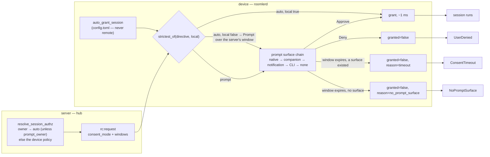

Field-verified 2026-09-25 on the WSL node (agent 0.4.102, API 0.4.101): with
`auto_grant_session = false`, the owner's own session — a server `auto` — ran as
a prompt for the full 300 s server window, found no surface and ended
`NoPromptSurface`, the controller told that nobody could be asked; with the
setting at its default the same request auto-granted in 1.5 ms. The run, both
halves, is in `docs/fr/FR-27-consent-surfaces-and-desktop-companion.md`'s log.

⚠️ **This surprises operators** (field, 2026-08-30): a device whose *server*
policy reads `consent_mode = auto` — including one you own — can still prompt on
every session, and nothing server-side fixes it. The reason is that
`auto_grant_session` lives in the device's own `config.toml`, and as a gate-4
floor it is **deliberately not remotely configurable** — a control plane that
could flip it would not be a floor. It **defaults to `true`** (auto-grant), so a
device that prompts has it explicitly set to `false`; that `false` overrides both
the `auto` directive *and* the owner shortcut. To change it, do so **on the
host** — `roomler config set auto_grant_session <true|false>` — then restart the
daemon (the config surface notes changes apply on the next start). Making a
device auto-grant is a device-owner decision the server cannot make for it.

**Prompt surfaces.** A chain, probed per prompt and logged per prompt
(`native`, `notified` and `have_surface` on one line):

1. **native** — the daemon draws the panel itself. Windows
   (`viewer-indicator`, and `WDA_EXCLUDEFROMCAPTURE` so the requester cannot
   see the Approve button), X11 (`viewer-indicator-x11`, an override-redirect
   window, no capture exclusion — X has no equivalent), macOS
   (`viewer-indicator-macos`, AppKit).
2. **companion** — `roomler-desktop`'s always-on-top consent window. The daemon
   starts it if it is not running (`companion::ensure_running`).
3. **notification** (Linux, FR-93 P6f) — the desktop's own notification with
   **Approve** and **Deny**, where the companion cannot show the question: none
   is installed, or there is no marker for it to read. Posted from inside the
   person's session by the session helper (`roomlerd portal-helper --notify`,
   `indicator/notify.rs`), at critical urgency: GNOME and KDE keep it on screen
   until it is answered, and show it under Do Not Disturb. Closing it is a Deny.
   The daemon takes it down when the question ends any other way.
4. **CLI** — `roomlerd consent --list` / `--approve`, which works everywhere.
5. **none** — reported as `no_prompt_surface`, not as a deny.

⚠️ **A click on a notification's body is not an answer** (FR-93 P6f). GNOME 50
removes a notification clicked on its body, and the removal arrives as a
dismissal. Read as one, a person who clicked to read the question had refused
it (measured in the lab). So the question carries the spec's `default` action:
the click then arrives first as `ActionInvoked(default)`, and the helper posts
the question again. Only a close with no `default` before it (the X, a swipe)
is a refusal, and both signals are read from one stream, in the server's order.

⚠️ A question a notification shows is marked `native` on the wire
(`PromptSurface::Notification`): every companion renders a marker whose surface
is not `native`, so a new word would have a companion that starts late ask the
question a second time. The helper's D-Bus work runs on a plain thread, because
zbus's blocking API panics on a runtime thread: the first candidate's helper
panicked there before it posted anything. Kill switch `ROOMLERD_NOTIFY_CONSENT=0`.

⚠️ **The X11 panel's unmap must be flushed** (FR-93 P6a). x11rb buffers
requests, and the panel's loop flushed only when it repainted, which it stops
doing once the prompt is gone. Until P6a an answered prompt therefore stayed on
screen, frozen on its countdown, with live-looking buttons: the decision was
recorded and the session ran beneath it. Measured on GNOME 50 and Plasma 6.7,
both through Xwayland; a real X server buffers the same way. The Xvfb lane now
proves that a dismissed prompt leaves the screen, as a second client sees it.

⚠️ **The X11 panel is drawn at the desktop's scale** (FR-93 P6i). On a scaled
Wayland desktop, Xwayland's root is in device pixels and an X11 client is
expected to scale itself. That is KDE's default and GNOME's at an integer
scale. Drawn at 1×, the panel came out at about 9-px text on a 4K desktop at
KDE's 2.7×, with its buttons a third of their size (measured on real hardware,
Plasma 6.6). It now reads `Xft.dpi` from the resources the desktop publishes
for X11 clients and shows the same drawing at `round(dpi / 96)`, between 1 and
4 (`scale`, `agents/roomlerd/src/indicator/x11.rs:82`). The drawing is painted
at 1× into a pixmap, scaled up nearest-neighbour, and written in requests the
server takes (`blit`, `:493`); a click maps back to the 1× layout. Measured:
KDE at `Xft.dpi` 259 draws at 3× and GNOME at 192 at 2×, the size of the
companion's own prompt, and **Approve** on the scaled panel granted the
session. At 1× nothing changes. `ROOMLERD_CONSENT_PANEL_SCALE` overrides the
scale; `1` is the kill switch. ⚠️ GNOME shows no X11 window during its
Activities overview, which it opens after every login, so a prompt raised
there is seen once the person leaves the overview.

⚠️ **The companion starts through the manager this daemon may use** (FR-93
P6b). A root daemon starts a system transient unit as the session's user
(`--uid=`). A per-user daemon starts it from its own user manager
(`systemd-run --user`). Before P6b a per-user daemon also asked the system
manager, which waited on polkit and failed after 25 s (*"Failed to start
transient service unit: Connection timed out"*), so a per-user host whose
native panel could not open had no prompt at all. "Already running" now means
the session user's own companion (`pgrep -u`), not anyone's.

⚠️ The `.pending` marker is written in ALL cases, because it is also what
`roomlerd consent --list` reads. `ConsentRequest.surface` is what stops the
companion from popping a second panel over a native one.

⚠️ **A virtual-desktop host declines the native surface, even though its X
display connects.**
<!-- RETIRED-NAME-ANCHOR: the LEGACY env spelling FR-21 P3 kept working, and
     the one every affected host actually carries in its systemd drop-in. -->
`ROOMLER_AGENT_VIRTUAL_DESKTOP=1` means the daemon started
the Xvfb itself so a headless box can be remote-controlled — so the display's
only viewer is a remote controller, which is the worst possible place to ask
"may this remote controller in?". Field-measured on mars, jupiter and the WSL
node 2026-08-29: unattended, the panel is drawn where nobody can see it and the
session dies `timeout` when the truth is `no_prompt_surface`; attended, viewer
A can click **Approve** on viewer B's request. `indicator/x11.rs` reads the
daemon's own configuration, not the display, so a real X session on the same
machine is unaffected and the banner path is untouched. Consequence for such a
host: use `email`/`push`, or answer with `roomlerd consent`.

⚠️ **macOS native requires tokio off the main thread.** AppKit delivers events
on the main run loop and `#[tokio::main]` parks it, so under
`viewer-indicator-macos` the runtime moves to a worker and `main` hands the
main thread to `NSApp`. That is why the feature is compiled by CI but not yet
in the macOS release build.
⚠️ **The macOS panel appears in the captured stream.** `NSWindowSharingNone` is
ignored by `CGDisplayStream`, which is what our capture uses. ⚠️ Since FR-27 the marker is written by **all three**
consent-bearing subsystems — remote control, Fleet-RPC `exec` and Roomler SSH —
carrying a `kind` so the modal does not describe a root command as "wants to
control this device". Before that only remote control wrote one, so an `exec` or
SSH prompt reached no UI at all. The daemon also starts the companion when a
prompt begins (`companion::ensure_running`), since nothing used to.

**A refusal says which refusal it is.** `rc:consent` carries an optional
`reason`; an absent one is an ordinary deny, which is what a bare
`granted: false` has always meant. ⚠️ Until FR-27 the agent's own prompt
timeout produced exactly that bare `false`, and the hub terminated it as
`EndReason::UserDenied` — so "nobody was at the machine" reached the controller
as "a human refused you". The three now end as `UserDenied`,
`ConsentTimeout` and `NoPromptSurface`, and the viewer renders a sentence per
case rather than the enum name.

⚠️ **The hub waits longer than the window it announces**
(`consent::CONSENT_VERDICT_GRACE`, 5 s). The agent's prompt window and the
hub's own fallback are set from the same `consent_timeout_secs`, so on every
non-answer they expire together and the hub's used to fire ~130 ms first —
measured on mars twice — throwing away the agent's reason and reporting every
`no_prompt_surface` as "nobody answered". The hub's timer is a backstop for a
dead agent, not a peer of a live one; the number on the wire is unchanged, so
the on-host prompt still stands for exactly the announced window.

⚠️ **A session that ends while its prompt stands takes the prompt with it**
(#1632). The controller closing the tab, switching device, or the server timing the
session out all reach the agent as `ServerMsg::Terminate`; the agent then cancels the
running prompt (`ConsentBroker::cancel` → `Decision::Cancelled`), which sends **no**
`rc:consent` — the server has already forgotten the session, and a `granted:false`
would be a refusal nobody made — and takes down the native panel and the companion's
`.pending` marker. Before this, the person at the machine was asked to decide about a
session that no longer existed until the window ran out. The cancel runs ahead of the
FR-43 delegation gate, because the prompt is always the daemon's even when the session
media was handed to the GUI worker.

⚠️ **So does a control socket that closes** (#2416). A server roll or a network drop
ends the agent's connection without any `Terminate`, and every session asked about on
that socket goes with it. A viewer that redials asks again under a new session id. On
0.4.141 the old panel stayed up, answerable, beside the new question; its Approve did
nothing (`outbound consent send failed (channel closed)`), and the person at the
screen saw two prompts for what was, to them, one request. Each prompt's task now races
its answer against its connection's own outbound channel
(`await_prompt_or_socket_end`, `agents/roomlerd/src/signaling.rs`). That channel's
receiver lives in the connection's loop, so it closes when the connection ends and never
before. The prompt is then withdrawn exactly as a `Terminate` withdraws it. The same
holds for an **exec** prompt (`roomler exec` with consent on), where it matters more: an
Approve on a stale panel would otherwise run the command for a caller no longer waiting
for it, and twice if that caller retried.

### 11.3 Recording & audit consent

If recording is enabled for the session, the controlled side gets a persistent banner (cannot be dismissed) and a red dot in the tray icon. Mirrors macOS's screen-recording indicator behavior; users have learned to look for it.

**FR-85 builds this** ([recording.md](recording.md) §10). A remote recording is made and stored **on the controlled device**, and the controller downloads it on demand over the session's P2P channel. The server stores only the facts. `Permissions::RECORD` survives the hub only when the controller may record (the device's owner, an `ADMINISTRATOR`, or the role bit `RECORD_REMOTE_SCREEN`) **and** the device's owner has switched remote recording on. Each refusal is named in `rc:session.created` and in the audit. The device then asks the host again (a session consented on the host gets a fresh "record this screen" prompt), and the indicator above is up **before the first frame**. On Windows it is the daemon's badge, pinned open and relabelled "Recording"; elsewhere it is the companion's banner, with a **Stop recording** button that keeps the session. With no surface to show it, the recording is refused. **The red dot** is the companion's tray icon: it turns red while any recording runs, this device's own or a controller's, from the same 750 ms poll the banner rides ([recording.md](recording.md) §7). The microphone is never a remote option.

### 11.3a What crossed the clipboard and file channels (FR-101 P3)

Clipboard and files travel peer to peer on their own data channels, so the server never sees a
transfer. What the org gets is the device's **account** of the traffic: how many transfers, how
many bytes, which way, and for a file a SHA-256 of its name. It never gets content, and never a
name. The hash still lets an auditor tell one file sent five times from five different files.

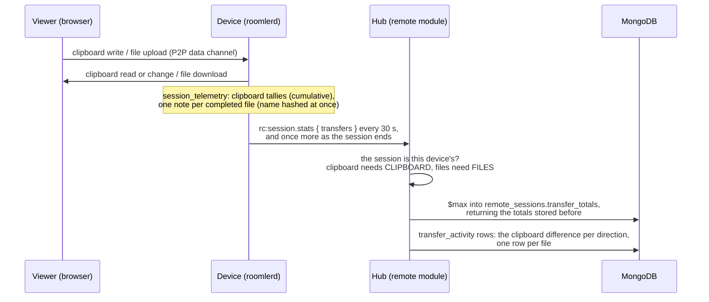

| Rule | Why |
|---|---|
| **A claim, kept apart from the decision**: rows go to `transfer_activity`, never `remote_audit` | `remote_audit` holds what the server decided, here the `CLIPBOARD` / `FILES` grant. A transfer is something a host that may be compromised reports, so it is a claim, as in `recording_activity` and `ssh_activity`. The four clipboard and file `AuditKind`s are left unwritten |
| **The session must be the reporting device's, and the grant must allow the traffic** | Otherwise a device could write about a session it does not hold, or claim traffic the session could not carry. The live session decides first; after it ends, its stored row decides |
| **The clipboard tallies are cumulative; the server keeps the difference** | A lost sample costs nothing, and a repeated one adds nothing. The totals sit in `transfer_totals`, outside `stats`, which `mark_ended` rewrites whole: a reset would count everything again |
| **A last sample as the session ends** (`rc:terminate`, or the host's Disconnect, sent before the terminate) | A session shorter than one 30 s sample would otherwise report nothing. It is skipped when the session's telemetry does not answer, because a sample of zeros could overwrite the live totals of a session the server has not ended yet. ⚠️ Pre-existing follow-up: on a supervised Mac (FR-43) the host's-Disconnect sample goes up the delegation channel for every session the worker's loop holds, its own included, so a worker's own session's last sample is dropped as another device's. FR-102 P9d moved the live samples onto the peer's own sender (§11.9); this one stays on the direct write ahead of its terminate |
| **A name hash must be 64 lowercase hex digits** | Free text there would let a host store the very name the hash keeps out. At most 256 files are kept per sample |
| **A renegotiated session keeps its readings** (a second offer for one session id builds a new peer) | The old peer's drop forgets its counters. The device carries the tallies and waiting notes over to the new peer, or its cumulative readings would restart below the server's stored totals and count nothing until they caught up |

⚠️ **An empty result is not proof that nothing crossed.** A compromised host can stay silent. A
session that dies with the control WS loses its last sample. A download stopped partway leaves no
row, because a file row is written when the transfer completes.

The trail is read at `GET /api/tenant/{tid}/transfer-activity/{agent_id}` under
`VIEW_REMOTE_AUDIT`. Like the recording trail, it still resolves for a removed device.

### 11.3b Clipboard, files and audio by policy (FR-101 P2)

An org and each device's owner can each switch the session's clipboard, file transfer and host
audio to `on` (the default), `ask` or `off`. The stricter of the two wins. Nothing changes for an
org or a device that sets nothing.

| | The org's switch (P2a) | The device's floor (P2b) |
|---|---|---|
| Stored in | `TenantSettings.rc_session` ([`tenant.rs:116`](../crates/db/src/models/tenant.rs#L116)) | `rc_clipboard`, `rc_files`, `rc_audio` in the device's `config.toml` |
| Set through | `GET`/`PUT /api/tenant/{tid}/rc-session-policy` ([`session_policy.rs:85`](../crates/modules/remote/src/session_policy.rs#L85), [`:104`](../crates/modules/remote/src/session_policy.rs#L104)); `PUT` needs `MANAGE_TENANT`, is partial, and reads values strictly. The org settings card "Remote session features" | the LocalAPI, from **the person at the console only** ([`localapi/src/lib.rs:3110`](../crates/localapi/src/lib.rs#L3110)); live, no restart |
| Pushable by a server | — | **never**: absent from `DesiredConfig`, so a compromised server cannot switch back on what the owner switched off |
| Reaches the session | in `rc:request.session_policy`, only when it restricts anything | advertised in `AgentCaps.session_policy` ([`models.rs:511`](../crates/remote_control/src/models.rs#L511)) and re-announced on the heartbeat when it changes |

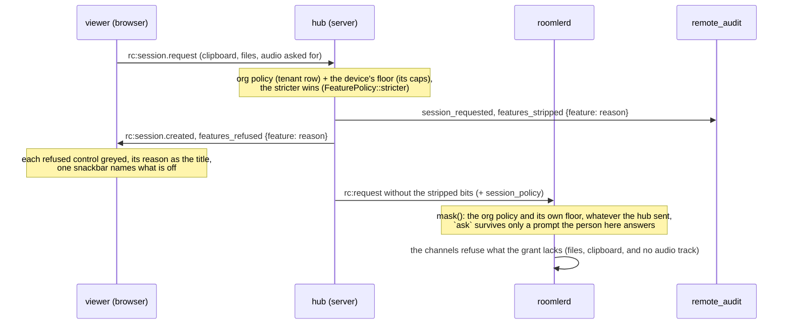

**What `ask` means.** A feature set to `ask` survives only a session that the person at the
device approves on a prompt naming it ("Approving also allows clipboard, file transfer and
audio.", [`session_policy.rs:183`](../agents/roomlerd/src/session_policy.rs#L183)). Every other
session goes without it, with a reason:

| Reason | When |
|---|---|
| `org_policy_off` | the org set `off`. It binds every controller, break-glass included |
| `device_policy_off` | the device's owner set `off` (when both say `off`, the org's is named) |
| `needs_consent` | `ask`, and nobody at the device is asked (`auto`, `email`, `push`, `prompt_then_email`) |
| `device_cannot_ask` | `ask`, but the agent does not advertise `session-policy`: one from before P2b grants whatever reaches it, so `ask` would mean `on` |
| `policy_unavailable` | the org's row could not be read. The session goes ahead without the features asked for |

- ⚠️ **The device enforces the floor itself.** The hub's strip is so the viewer can say why before
  the person clicks. The agent masks the grant ([`mask`, `session_policy.rs:128`](../agents/roomlerd/src/session_policy.rs#L128),
  applied at [`signaling.rs:3293`](../agents/roomlerd/src/signaling.rs#L3293)) the moment the consent
  mode resolves, before anything reads it. A request carrying `FILES` with no policy at all, as from a
  bypassed hub, is masked to no `FILES` when the floor says `off`
  (`the_device_floor_holds_when_the_server_sends_no_policy`). Field-verified on 0.4.136, with the red
  on 0.4.132 (FR-101 AC4).
- The hub decides in [`feature_grant`, `hub.rs:506`](../crates/modules/fleet/src/hub.rs#L506). The
  viewer reads `features_refused` into words naming whose decision it was
  ([`useSessionFeatures.ts:53`](../ui/src/composables/useSessionFeatures.ts#L53)). A reason it does
  not know still greys the control, so a newer server's refusal is never ignored.
- Audio is the request's `audio_enabled` flag, which is what the agent adds its track on; the
  `AUDIO` bit is read by nothing and is cleared with it.
- A change applies to sessions that start after it. Each watcher is a session of its own through
  the same path.

### 11.4 The reality of misuse

A remote-control feature is the most-abused capability in any product. Mitigations:

- **No silent install**. The agent installer always shows a consent screen and creates a tray icon.
- **Quarantine flag**: org admins can mark an agent quarantined, which blocks new sessions but keeps the agent registered.
- **Geofencing & impossible-travel**: log controller IP geo per session, surface anomalies in admin UI.
- **Mandatory audit retention** is configurable per-org but cannot go below 30 d for sessions.
- **No keystroke logging** in audit — only event counts. The controlled user's passwords typed during a session must not be persisted.
- **Tray icon cannot be hidden** by config; if you want covert monitoring, this is the wrong product.
- **Break-glass never records** (FR-85). An `ADMINISTRATOR` who skips consent with an `override_reason` is never granted `RECORD`, whatever their mask says: nobody at the machine agreed to the session, so a recording of it would be covert.
- **Break-glass never covers the screen** (FR-99, decision 1). The same session is never granted `PRIVACY` either (`privacy_refused` `break_glass`): it is the one session nobody at the device was asked about, and a curtain would hide it from the only person in a position to object. The hub reads break-glass from the authz gate's `override_reason`, which the cross-pod relay carries, so an owner pod applies the rule too.
- **An outsider is never recorded and never covers the screen** (FR-52 §10 and decision 13). A controller from outside the organization is never granted `RECORD` (`controller_not_allowed`) or `PRIVACY` (`privacy_refused` `outside_the_org`). The person at the device let a stranger in on a password, and is the only one placed to see what that stranger does. The device strips both again when it admits the session, so a compromised server cannot hand them back.
- **No prompt-bombing** (FR-101 P4a). A caller may send one device at most 60 session requests a minute, checked after the authz gate, so a caller who may not ask is refused by identity first. Past the ceiling the answer is `rc:error` `rate_limited`, which the viewer does not retry. Each request can put a consent prompt in front of the person at the device, and the control WS is outside the per-IP HTTP governor.

### 11.4a The device and the browser prove who they are (FR-100 P1–P2b)

The SDP is the only thing that says whose DTLS key is whose (webrtc-rs checks each side's certificate against
the fingerprint in the SDP), and the hub rebuilds every offer and answer frame around it. So whoever holds the
hub, its Redis, or a signalling leg could swap a fingerprint for their own, and the other side would complete
DTLS with them. FR-100 ties the answer to a key only the device holds, and the offer to a key only this browser
holds:

```mermaid
sequenceDiagram
  autonumber
  participant B as Viewer (browser)
  participant H as Hub (relays; records the verdict)
  participant D as Device (roomlerd)
  Note over D: P1a: one P-256 key per enrollment,<br/>peer-auth/&lt;tenant&gt;.json; the public half<br/>rides the hello and the device row
  Note over B: P2b: one P-256 key per user,<br/>non-extractable, in IndexedDB
  B->>H: rc:sdp.offer + peer_auth {nonce, key, sig}
  H->>D: relayed verbatim
  Note over D: P1c: verify the offer (role "offer", empty answer fp);<br/>look the key up for this user, remember it if new
  Note over D: P1b: sign the answer (role "answer",<br/>both fingerprints, the same nonce)
  D->>H: rc:sdp.answer + peer_auth {key, sig} + peer_auth_verdict
  Note over H: records the verdict on session_started<br/>(the device's word), relays the rest
  H->>B: rc:sdp.answer + peer_auth {key, sig}
  Note over B: P2a: verify BEFORE setRemoteDescription;<br/>pin the key per (user, device) on first use
  B-->>D: DTLS only with the certificates both signatures named
```

- **When the page asks** ([`shouldAskPeerAuth`, `peerAuth.ts:152`](../ui/src/utils/peerAuth.ts#L152)): an
  in-org session, to a device that advertises `peer-auth` (equality, never a prefix) and whose row carries a
  well-formed key, from a page that knows who is signed in (the signature names them) and can verify at all.
  An outsider's session is bound by [FR-52](fr/FR-52-cross-org-remote-access.md)'s MAC over the same
  fingerprints instead, under the key its password login produced. A non-secure origin has no
  `crypto.subtle`, and a page that cannot verify does not ask
  ([`peerAuthCanVerify`, `peerAuth.ts:138`](../ui/src/utils/peerAuth.ts#L138)), or every answer would read
  as a bad signature.
- **What the device signs** ([`peer_auth_transcript`, `signaling.rs:262`](../crates/remote_control/src/signaling.rs#L262);
  [`sign_answer`, `peer_auth.rs:265`](../agents/roomlerd/src/peer_auth.rs#L265)): the transcript above,
  ECDSA P-256 over SHA-256 as WebCrypto verifies it. The daemon signs at both places an answer leaves it, so a
  GUI worker that built the answer never holds the key.
- **What the page does with the answer** ([`judgePeerAuth`, `peerAuth.ts:267`](../ui/src/utils/peerAuth.ts#L267),
  [`applyPeerAuthVerdict`, `peerAuth.ts:358`](../ui/src/utils/peerAuth.ts#L358)), always before the answer
  is applied:

  | Verdict | The page |
  |---|---|
  | `first-use`: verified, by a key this browser had not pinned for this device | pins it, connects, toolbar **Verified** |
  | `pinned`: verified, by the pinned key | connects, toolbar **Verified** |
  | `key-changed`: verified, by **another** key | stops: `rc:terminate`, nothing shown or sent; both fingerprints in the message; **Trust the new key and connect** pins that one key on the person's click |
  | `bad-signature`: does not verify over this session (or the answer names no single certificate) | stops, the same way; nothing to trust |
  | `unsigned`: asked, no signature | connects, toolbar **Unverified** (a pod from before the field existed drops it mid-roll) |
  | `not-asked` | connects, exactly as before |

- **The pins** ([`storagePins`, `peerAuth.ts:201`](../ui/src/utils/peerAuth.ts#L201)) are public keys in this
  origin's `localStorage` (`roomler.peerAuth.pins.v1`, keyed `user:device`). A browser that refuses storage
  keeps them for the page's life, so the next visit is first use again, never a false alarm. The server's copy
  of the key (the device row) is a hint for the person to compare, never what the page trusts.
- **The kill switch** is per browser: `localStorage['roomler.peerAuth.ask'] = 'off'` stops asking.

> ⚠️ **What P2a does not stop yet.** An unsigned answer proceeds. An attacker in the signalling path who strips
> the nonce or the signature gets an **Unverified** session rather than a refusal. Refusing an unsigned answer
> from a device this browser has pinned is P3's `enforce`. And whoever serves the viewer's JavaScript can make
> the page say anything (FR-100 §1); this binding protects against the signalling path, not against the origin.

> ⚠️ A device that is reinstalled with its config wiped makes a new key, and every browser that pinned the old
> one stops at **key changed** until the person trusts the new one. That is the point: from the browser's side,
> a reinstalled device and an impostor look the same until a person compares the fingerprints.

**What uninstall leaves.** The key lives in the config dir, so it leaves with it.

| Path | The key file |
|---|---|
| `install.sh --uninstall`, Linux and macOS | removed with the config trees: `/etc/roomler`, the caller's and root's. Another account's tree is listed, not removed, and its key with it |
| `install.sh --uninstall --keep-config` | kept |
| Windows: the MSI, or `install.ps1 -Uninstall` | kept, exactly as they keep `config.toml` with the agent's credential |

A re-enrollment that finds the key keeps every browser's pin valid. One that had to make a new key reads as **key
changed** in every browser that pinned the old one, even when the server revives the same device row: a wiped
machine is a new identity until a person says otherwise.

**The other direction: the device judges the browser (P1c).** The daemon judges the browser behind every in-org
offer as it notes it ([`judge_offer`, `peer_auth.rs:220`](../agents/roomlerd/src/peer_auth.rs#L220)),
and the hub records the verdict on the session's `session_started` audit row
([`forward_answer`, `hub.rs:2151`](../crates/modules/fleet/src/hub.rs#L2151)). Nothing is refused
before FR-100 P3; the record is what the fleet's audit week is counted over.

| Verdict | Means | The device |
|---|---|---|
| `absent` | the offer carried no browser signature (every viewer before FR-100 P2b) | records it |
| `unknown` | a signature that verifies, by a key the device had not seen for this user | **remembers the key** and records it |
| `verified` | a signature that verifies, by a key remembered for this user; or an outsider FR-52 admitted | records it |
| `mismatch` | a signature that does not verify over this session | records it; the session runs (audit) |

- **The keys it remembers** live in `<config dir>/peer-auth/<tenant>.controllers.json`, beside the device key and
  with its protections: public keys only, 16 per user (the oldest goes first), 256 users. They are why a later
  `enforce` can ask only about a browser the device has never met.
- **The policy is the device owner's**: `roomler config set peer_auth off|audit` (default `audit`), live, and only
  from the person at the console. It is never pushable by the server, and `enforce` is refused by name until P3.
  `off` stops the judging, the remembering and the record; the device still signs its answers.
- **What the browser signs with (P2b)**: a key of its own, made on first use in IndexedDB per user, its private half
  non-extractable, so a script can sign with it while the page runs and never read it out
  ([`controllerKeyFor`, `peerAuth.ts:416`](../ui/src/utils/peerAuth.ts#L416)). The offer that asks (P2a) carries
  `key` and `sig` over the transcript with role `offer` and an empty answer fingerprint
  ([`offerAsk`, `peerAuth.ts:506`](../ui/src/utils/peerAuth.ts#L506)). A browser that cannot keep a key asks
  unsigned, and the device records `absent`: a key made per page would reach it as a new browser on every visit.

> ⚠️ **The verdict is the device's word, kept on the server's row.** `remote_audit` otherwise holds the server's
> own decisions, while a device's claims live apart (`transfer_activity`, `ssh_activity`, `privacy_activity`).
> `session_started.peer_auth` is the exception, on purpose: it describes the session's start, and the fleet's
> audit week counts it per session. The hub only checks that it is one of the four words; it cannot check the
> judgement behind it. A compromised device can misreport only its own trust decision, which it controls
> anyway. Read a `verified` as "the device says it knew this browser", never as "the server verified".

### 11.5 The host's Disconnect (FR-27 P10)

The person at the device can end a session from their own screen — the
Windows badge's **Disconnect** (§18.3) or the companion banner's
(`docs/desktop-companion.md` §12). Every one of those surfaces reaches the
same arm of the agent's signalling loop (`kill_rx`, `agents/roomlerd/src/signaling.rs`),
and that arm's job is to make the ending **final and attributed**: the viewer
is told who ended it and does not come back on its own. Since FR-101 P4b-2 the
same arm also ends a session that sat idle past its limit (`idle_rx`, §11.6),
the same way and under its own reason (`DeviceEnd`).

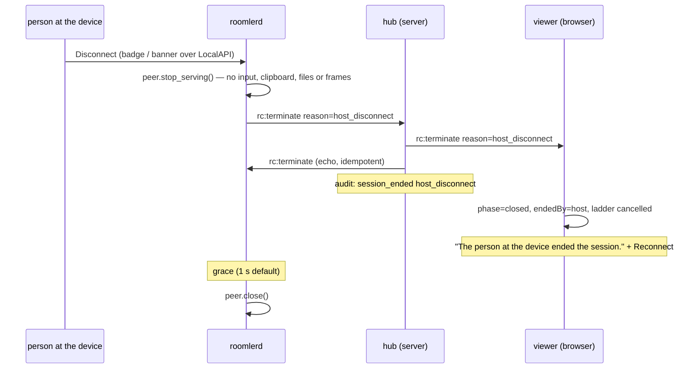

The order is the whole mechanism. Before P10 the agent closed the peer first
and told the server afterwards, and the browser's control data-channel
`onclose` won every time: it read the drop as an ordinary one, hung the old
session up itself and scheduled the reconnect ladder — so the audit said
`controller_hangup` and the viewer was back within ~3 s of being sent away
(measured on 0.4.119, 2026-10-08). Now:

| step | where | what holds it |
|---|---|---|
| control ends **at the click**: the channel handlers let go, the media pumps stop, and the input arbiter forgets the session (its next event is denied, anything it holds is released); no channel closes, so the browser sees nothing yet | `AgentPeer::stop_serving`, called by the `kill_rx` arm before it speaks; `close` repeats it | — |
| the agent says it **first** | the `kill_rx` arm; on a supervised Mac through the delegation link, like the session's answer | `a_host_disconnect_terminates_as_host_disconnect` |
| the hub forwards it to the controller **before** echoing it to the agent, and audits `SessionEnded { HostDisconnect }` | `Hub::terminate` | — |
| only the **device** may claim it: a controller's `host_disconnect` is recorded as `controller_hangup` | the hub's `rc:terminate` arm | `host_disconnect_is_the_devices_claim_only` |
| the viewer closes as "ended by the host", cancels the ladder, drops its replay args, then tears the peer down with the phase already `closed`, so the control DC's `onclose` stays quiet | `useRemoteControl.ts`, the `rc:terminate` handler | `FR-27 P10` in `useRemoteControl.spec.ts` |
| the bare connection closes after a grace, off the loop | `ROOMLERD_HOST_DISCONNECT_GRACE_MS`, default 1000, `0` = the pre-P10 timing, capped at the 5 s close budget | `host_disconnect_grace_is_bounded_and_switchable` |

⚠️ The grace holds the **transport**, never the session's powers. A grace
that kept the peer serving would hand the controller up to a second more of
the machine its owner had just taken back, so the arm stops serving first and
only the connection waits for the viewer to hear why.

**A stop at the screen takes the same arm** (FR-93 P6c). On a Linux desktop
the person at the screen can stop a screen share with the desktop's own
control: **Stop** on GNOME's screen-sharing pill, **End** in the menu of KDE's
screen-sharing tray icon. Before P6c the daemon reopened the capture behind
them, half a second later on GNOME. Now the media pump that lost its capture to
such a stop asks the session registry for the session's Disconnect
(`RcSessionRegistry::disconnect`, the companion banner's own path), the
followers of a shared pipeline first, and never reopens. The wire says
`host_disconnect`, the viewer is told who ended it, and a recording stops. How
the daemon tells a stop from a lock or a compositor crash is in
[`linux-capture.md`](linux-capture.md) §5.7.

Ordinary drops are untouched: `agent_disconnect` and `error` still
re-create the session, as do a failed peer and a control channel that closes
mid-session (the S3 ladder in `useRemoteControl.ts`, `scheduleReconnect`).
Reconnecting after a host Disconnect is an explicit click and a **new**
request, through consent like any other. It is the notice's **only** action.
Break-glass ("Force control") is not offered there: the person's Disconnect is an
explicit stop, and an override as the suggested next step would undercut it
(operator decision, 2026-10-10). Break-glass itself is unchanged. It is still on a
fresh page, still needs a reason, and is still audited and notified to the owner.

**Measured** on the macOS banner, 2026-10-09, agent 0.4.121 with the P10 image
(the FR-27 field log):
- the reason reached the viewer **72–86 ms** after the click;
- the transport closed **1.0 s** after it, exactly the grace;
- the viewer held **65 s** with no request;
- an explicit Reconnect connected in **2.4–3.5 s**;
- a later cut of the viewer's signalling socket was back in **6.3 s** with no click.

The same day on the **Windows badge** (capture-excluded, so the click was aimed by its
fixed geometry):
- the agent told the server **1 ms** after the click;
- the transport closed **1.03 s** after it;
- the viewer held **67 s** with no frame sent;
- an explicit Reconnect connected in **1.4 s**;
- a killed signalling socket was back in **0.95 s** with no click.

⚠️ Playwright's `context.setOffline` is not a drop: 10 s of it closed neither the
open `/ws` nor the WebRTC path, and the session streamed on. To test the ladder,
cut the socket.

⚠️ The wire is `rc:terminate`, unchanged; `host_disconnect` is a new
`EndReason` value. A pre-P10 **server** cannot decode the frame and drops it
(debug log, socket up): the session then ends when the peer closes and the
viewer reconnects as before — degraded, never broken, and locked by
`pre_p10_end_reason_rejects_host_disconnect_so_old_servers_drop_the_frame`.
A pre-P10 **viewer** treats the unknown reason as terminal (the retry list is
an allowlist) and simply shows no notice. The full matrix is in the FR-27 spec.

### 11.6 Sessions that end: the maximum length and the idle limit (FR-101 P4b)

> What the device does to its own screen when the last session ends (`lock_on_end`: `never`, `auto`,
> `always`) is FR-99 P3's: the device owner's setting, which an admin can make stricter (never looser)
> from the device's row, on an install that can unlock remotely: [privacy-mode.md § Locking when the
> session ends](privacy-mode.md#locking-when-the-session-ends).

An org can bound how long a session lasts, and how long it may sit idle. Both
are off by default. Both end the session as `idle_timeout`, the `EndReason`
every reader already knows, and name the limit in an additive `limit` field
on `rc:terminate` and in the `session_ended` audit row. An older agent, viewer
or pod reads the reason it knows and ignores the field.

The two limits are kept by different parties, because they see different
things:

| | Maximum length (P4b-1) | Idle limit (P4b-2) |
|---|---|---|
| Set by | the org (`rc_limits.max_secs`), on the org settings page | the org (`rc_limits.idle_secs`), on the same page, shortened by the device's own `AccessPolicy.auto_terminate_idle_minutes` ("Idle limit" on its row in the device list; the shorter wins) |
| Route | `GET`/`PUT /api/tenant/{tid}/rc-session-limits`, a minute to a day, `null` clears | the same route and range; a body naming one limit leaves the other alone |
| Kept by | the **hub**, from the moment the session goes live | the **device**: only it sees both the controller's input (peer to peer) and the screen |
| Who it binds | every agent and viewer already deployed | agents that advertise `idle-timeout`; the viewer is told the limit (`rc:session.created.idle_secs`) only for those |
| `limit` | `max_duration` | `idle`, honoured from the agent only, and only with `idle_timeout` |

```mermaid
sequenceDiagram
    participant V as viewer (browser)
    participant S as hub (server)
    participant A as roomlerd
    V->>S: rc:session.request
    Note over S: authz gate: idle = shorter of the org's and the device's
    S->>A: rc:request idle_secs (every agent)
    S->>V: rc:session.created idle_secs (only if the agent advertises idle-timeout)
    Note over A: session live: the idle clock starts
    loop no input and no significant screen change
        A->>A: tick (an eighth of the limit, between 0.25 s and 5 s)
    end
    A->>V: rc:idle ends_in_ms (control channel, a fifth of the limit before the end)
    Note over V: countdown banner; any input sent from here withdraws it
    Note over A: limit reached: the device-end arm, as for the host's Disconnect
    A->>A: peer.stop_serving()
    A->>S: rc:terminate idle_timeout, limit=idle
    S->>V: rc:terminate idle_timeout, limit=idle
    Note over S: audit: session_ended limit=idle
    Note over V: "The session ended after a period with no activity."
    Note over A: grace, then peer.close()
```

What counts as activity:

| Kind | Counts | Does not count |
|---|---|---|
| **Controller** (`session_telemetry`) | any input it sent, even when the lock screen suppresses it, and in a view-only session; the clipboard either way; file transfer, including a download's progress | the viewer's own automatic traffic: stats, keyframe requests, pings |
| **Screen** (`session_idle::ScreenActivity`) | change spread over at least 6 cells of a 32 × 18 grid (about 1 %) within 30 s: a scroll, a video, a line of typing, a window moved | the same few cells repainting forever: a clock (even with seconds), a blinking caret, a tray icon |

The screen leg samples each captured frame on the grid's lattice at most
once a second per screen (about 9k pixel reads), and costs nothing while no
live session has an idle limit.

⚠️ **The screen is one per process, not one per session.** On a host with two
monitors, one session's activity keeps another's alive, and a host whose
screen never stops changing (a video wall) never idles out. Both err toward
keeping a session someone may be using; the maximum length is their bound.

⚠️ **A limit sent is not a limit kept.** An agent older than P4b-2 ignores
`idle_secs`. The `session_requested` audit row records `idle_secs` and
`idle_enforced`, so a limit the org set that a device could not keep shows
up there.

### 11.7 A session the device cannot answer: `no_common_codec` (#2251)

On the WebRTC track (the RTP transport, no DataChannel) the track **is** the
picture: it sends the encoder's codec, and the browser must have offered it. A
browser that decodes none of the codecs the RTP track sends offers VP8, VP9 and
AV1 while the track sends H.264 (`pick_best_codec`'s fallback when nothing
intersects), HEVC or AV1. That is mainly a Firefox without its OpenH264 plugin:
Playwright and CI builds, a plugin disabled by policy, an offline install.
`create_answer` then fails ("RTPSender created with no codecs").

Until #2251 that ended the session as a bare `error`, which the viewer retries:
the same offer met the same failure again, and nobody was told why. Now the
agent refuses before it builds a peer, and the session ends once, with a reason.

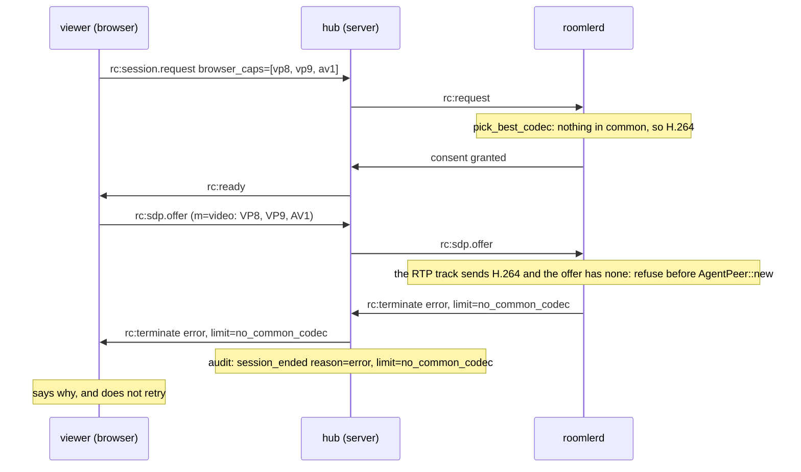

| | |
|---|---|
| Decided by | the **agent**, the one party holding both halves: the codec its RTP track sends and the offer (`rtp_track_unanswerable`, `agents/roomlerd/src/peer.rs:12899`). A DataChannel transport is never refused: its track is a placeholder and takes VP8 instead (#2231, `rtp_track_codec`, `:12877`). An offer with no `m=video` is answered without the track |
| Refused at | `rc:sdp.offer`, before the peer is built (`agents/roomlerd/src/signaling.rs:3819`). The warning names what the browser offered (`offered_video_codecs`, `peer.rs:12846`) |
| Wire | the existing `error` plus `limit: "no_common_codec"` (`LIMIT_NO_COMMON_CODEC`, `crates/remote_control/src/signaling.rs:104`). No new `EndReason`: an older server drops a frame that carries one it does not know (the FR-27 P10 lesson) |
| Hub | names it only from the agent and only with `error` (`device_end_limit`, `crates/modules/fleet/src/hub.rs:576`), on both ends' `rc:terminate` and in the `session_ended` audit row |
| Viewer | never retries it (`isRetryableTerminateReason`, `ui/src/composables/useRemoteControl.ts:316`) and says: *"This browser can't decode the video this device sends. Try Chrome, Edge or Safari, or turn on the OpenH264 plugin in Firefox's add-ons."* (`friendlyEndReason`, `:754`). An `rc:error` that arrives later for the same, already-ended session, from candidates still in flight, is ignored, so it cannot replace that sentence (`isFalloutOfEndedSession`, `:408`, #2326) |
| Tests | the predicate on recorded offers (`codec_cap_tests` in `peer.rs`); the field's own offer, which `create_answer` fails on, is the one it refuses (`agents/roomlerd/tests/dc_track_codec.rs`); who may name the code (`only_the_device_names_no_common_codec`, `hub.rs:4672`); the real agent through a real server, with an H.264 offer as the control (`crates/tests/src/rc_no_common_codec_tests.rs:147`) |

⚠️ **The consent prompt has already been answered** by the time the offer
arrives, so the person at the device approved a session that then cannot start.
The viewer could refuse before it asks, from its own `browser_caps` and the
device's codecs, but only with a second copy of `pick_best_codec` in the
browser. The agent's check stays the authority either way, because an older
viewer will still ask.

⚠️ **Both halves are needed.** A server without #2251 drops the code and sends
the bare `error`, which the viewer retries as before. An agent without it fails
`create_answer`, as before.

**Field-verified** on agent 0.4.139 with prod at `hosted-20261016-377f1d4`. A
Firefox 153 with no H.264 made one request and got one `error/no_common_codec`
2.4 s after Connect, and the sentence was still on screen 75 s later. Agent
0.4.138 had made 12 requests, each ending in a bare `error`. With prod at
`6812dee`, before #2326, the sentence had been replaced by the generic one.

### 11.8 The post-session rating (FR-102 P9b)

After a session of 30 s or more — measured in the viewer from its own request to the attempt's
terminal phase, a reconnect inside the attempt being the same attempt — the ended state offers a
thumbs up or down with optional reason chips (*lag*, *picture*, *mouse or keyboard*, *couldn't
connect*, *something else*), at most once a UTC day per browser, dismissible, inline beside the
Connect button, never a dialog, never focused, never a text field. Every gate fails toward not
asking (`ui/src/composables/rcSessionRating.ts`), and the server (`remote`,
`POST /api/tenant/{tid}/session/{sid}/feedback`) accepts one rating per session per party to
it (the controller and each watcher once), not before 30 s after the request, codes only, and
answers the empty 404 while
`ROOMLER__GROWTH__FEEDBACK=false`. Nothing here touches the session's data path: the rating is a
question asked after it. The rules, the row and the field plan:
[growth-observability.md](growth-observability.md#the-post-session-rating-p9b).

### 11.9 The carrier a session rides (FR-102 P9c)

Once a session reaches `Connected`, the agent records **what it rode** — `direct` · `turn` ·
`turn_local` · `overlay_direct` · `overlay_turn` · `derp` · `org_relay` · `unknown`
(`agents/roomlerd/src/session_carrier.rs`) — and carries it, additively, on every
`rc:session.stats` (`#[serde(default)]`). **Record, never decide**: it reads the nominated ICE
pair webrtc-rs already has and, when that pair rides the overlay, the overlay runtime's own
carrier for the peer (the same LocalAPI lookup the adaptive-bitrate probe makes); no path choice
changes. ⚠️ A relay kind the build does not know, a daemon older than the overlay field, a
tunnel/blocked/offline peer, or nothing learned is **`unknown`, never `direct`** — CLAUDE.md's
`is_direct()` trap, closed. It is read once after a 2 s settle (Chrome renominates relay→direct a
moment after `Connected`), and the server stores it on `remote_sessions.carrier`, beside `stats`
so `mark_ended`'s whole-`stats` write cannot reset it, only when the value is a short code (the
device is the only writer). Absent is unknown, never direct. The P9a freeze splits the day's
Active sessions by carrier, and the Quality tab and weekly roll-up show it. Rules, storage and
the field plan: [growth-observability.md](growth-observability.md#remote-desktop-quality-from-what-is-recorded-p9a).

**When it reaches the server (FR-102 P9d).** The observation lands ~2.5–6 s after `Connected`
(`NOMINATION_WAIT` 3 s + `SETTLE` 2 s + the LocalAPI budget). P9c sent the carrier only on the
heartbeat's free-running 30 s tick and in the end-of-session sample — and that last sample lands only
where the server still holds the session live: on the device-ended path (sent ahead of the device's
own `rc:terminate`), not on the controller-ended one, where `ended_at` is already set when the agent
hears the terminate and `merge_live_stats` matches nothing. So a session with no tick after the
observation — overwhelmingly a short one — recorded none, which the freeze reads as `unknown`. Since
P9d the observation signals the signalling loop the moment it lands (`agents/roomlerd/src/peer.rs:944`)
and the loop sends one `rc:session.stats` at once (`agents/roomlerd/src/signaling.rs:2224`), by the
same road the tick uses: the shared `send_one_session_stats` (`signaling.rs:6705`) queues the sample on
**the peer's own sender**, the FR-43 seam the peer was built with (`peer.rs:285`) — the loop's outbound
queue for its own session, flushed to the WS one hop later, or the delegation channel for a delegated
session, so a supervised Mac's sample reaches the server under the daemon's identity, the one the
session row carries, rather than up the GUI worker's own WS, where `merge_live_stats` would match
nothing and drop it. `try_send`, never an await: the loop that queues is the loop that drains, so a
full queue skips the round, hands the FR-101 file notes back, and the next tick retries. A session that
**outlives** the observation therefore records its carrier whatever its length. Only a session that
**ends before** the observation lands still records `unknown`: a pair was nominated, but the settle read
that names the carrier never ran. ⚠️ Not on that road yet: the device-ended last sample (§11.3a), which
must stay ahead of the terminate written directly after it. On a supervised Mac it still goes up the
delegation channel connection-wide, so a worker's **own** session's last sample is dropped as another
device's — a pre-existing follow-up; a fix needs the terminate on the same queue, or a per-session
delegation marker.

## 12. Performance targets & budget

| Stage | Target (LAN) | Target (WAN, RTT 30 ms) |
|---|---|---|
| Capture (frame ready → encoder in) | 2 ms | 2 ms |
| Encode (HW H.264, 1080p) | 4 ms | 4 ms |
| Network out → in (incl. TURN if any) | 5 ms | 50 ms |
| Decode (browser) | 5 ms | 5 ms |
| Composite + display | 16 ms (1 vsync at 60 Hz) | 16 ms |
| Input event → server-side queue | 0 (P2P) | 30 ms |
| Input injection → next frame captured | up to 16 ms | up to 16 ms |
| **End-to-end glass-to-glass** | **~50 ms** | **~120-180 ms** |

Two practical observations:

1. The single biggest WAN latency contributor is TURN relaying through a far-away region. Co-locate TURN with users; roomler already runs `coturn.roomler.live` — for a global rollout, deploy regional TURN endpoints and let the agent pick the lowest-RTT one at registration. **SHIPPED (multi-region relay PoPs, 2026-08)**: `ROOMLER__RELAY__REGIONS` declares regional coturn+DERP PoPs (`scripts/relay-pop/` provisions one per cheap VPS); agents advertising `supports_relay_regions` receive the region list (`rc:relay.regions`), time a STUN binding per PoP, and report (`rc:relay.probe_report`); the server derives a hysteresis-guarded `relay_home` per agent and issues every RC-session / overlay-pair / tunnel TURN grant from the nearest region (sticky per pair, same-worker pin preserved within a region). Regional DERP rides EdDSA admission tickets (`crates/derp-relay`, public-key-only PoPs) and is applied to force-DERP-pinned pairs; the ladder DERP tier stays central pending netmap self-home. Master gate `ROOMLER__RELAY__REGIONS_ENABLED` (default off = legacy single-region, byte-identical).
2. The single biggest CPU/battery contributor is encoding *unchanged frames*. Dirty-rect skipping is non-negotiable.

### 12.1 Time-to-first-frame — the connect timeline (FR-22)

The budget above is glass-to-glass once a session is up. The first thing every
session is judged on is the wait *before* that: operator, 2026-08-28 — *"in some
occasions it can take up to over 10 or even 15 secs to see the remote screen."*
FR-22 (#819) measured that wait, bounded it, put it in front of the operator,
and — since part 4 — persists it.

What the 10–15 s turned out to be, from ten consecutive agent-side sessions
(request → first ICE candidate 127–253 ms, → `video-bytes` DC open 0.95–2.25 s,
→ first pump heartbeat 2.5–4.7 s, no outliers): **not a slow connect.** One
silently lost attempt, unnoticed for the full `RC_SIGNALING_TIMEOUT_MS` = 15 s,
then a 250 ms ladder step and a normal ~3 s connect — ≈18 s. The 15 s was the
*cost* of a stall, never its *cause*, and the cause is still the open question
(the 2026-09-25 field read localized it, § below).

#### 12.1.1 The eleven marks, and who can see each

The viewer records one mark per wait, per attempt
(`ui/src/composables/rcConnectTiming.ts:31`; #821 added eight, #824 the three
pre-flight ones after a field repro showed the clock started too late). Each
name says what is being **waited on**, because the diagnostic question is
always *who didn't answer*.

```mermaid
flowchart LR
    subgraph pre["pre-flight — browser only"]
        ws[ws_ready] --> turn[turn_ready] --> probes[probes_ready]
    end
    probes --> req[request_sent]
    req -->|"requesting · 4 s bound"| sc[session_created]
    sc -->|"awaiting_consent · server-owned, never armed"| rdy[ready]
    rdy --> off[offer_sent]
    off -->|"negotiating · 15 s bound"| ans[answer]
    subgraph carrier["carrier — browser only, dominates a relayed connect"]
        pc[pc_connected] --> dc[dc_open] --> ff["first_frame = TTFF"]
    end
    ans --> pc
    classDef srv fill:#dbeafe,stroke:#2563eb,color:#1e3a8a;
    class sc,rdy,ans srv;
```

| mark | waits on | set at | server record | persisted (part 4) |
|---|---|---|---|---|
| `ws_ready` | the signalling socket — re-keyed and redialled when the device's org differs from the page's, up to `RC_PREFLIGHT_WS_WAIT_MS` (`useRemoteControl.ts:285`) | `connect()` pre-flight | — | ✅ |
| `turn_ready` | `GET /turn/credentials` | pre-flight | — | ✅ |
| `probes_ready` | the loopback-relay probe + the browser's decode-capability probes (cached since #861: 28 ms cold, 7 ms warm) | pre-flight | — | ✅ |
| `request_sent` | nothing — the instant `rc:session.request` left | `connect()` | — | ✅ |
| `session_created` | **one server hop**: the request reached a live hub | `rc:session.created` | `remote_audit` `consent_prompted` | ✅ |
| `ready` | a human, on a Prompt-mode device | `rc:ready` | `remote_audit` `consent_granted` | ✅ |
| `offer_sent` | the browser building its offer | after `setLocalDescription` | — | ✅ |
| `answer` | the agent receiving the offer and answering | `rc:sdp.answer` | `remote_audit` `session_started` (`crates/modules/fleet/src/hub.rs:1785`, `crates/remote_control/src/audit.rs:152`) | ✅ |
| `pc_connected` | ICE + DTLS | `RTCPeerConnection` `connected` | — | ✅ |
| `dc_open` | SCTP — the `video-bytes` DataChannel | DC `open` | — | ✅ |
| `first_frame` | the decode worker's first output frame | worker `first-frame` | — | ✅ |

Only the three blue marks have ever had a server record (`remote_audit`, 90 d),
so the server can see the consent band and the offer→answer band and **nothing
else**: not the pre-flight, not the requesting hop, and not the carrier phases
that dominate a relayed connect (a DERP-relayed LAN pair measured on 2026-08-29:
`answer` +214 ms, then `pc_connected` +1.2 s, `dc_open` +0.3–0.8 s,
`first_frame` +0.4 s of a 2.7 s TTFF).

⚠️ **Marks are per ATTEMPT, never per connect.** A recorder shared across the
ladder would let the fast retry overwrite the lost attempt's marks and report an
18 s connect as a 3 s one — hiding the exact defect being hunted. Each retry
calls `beginAttempt()` (`useRemoteControl.ts:8466`) and gets a fresh recorder.

⚠️ **An unreached mark is the finding.** The console line prints it as
`<name>:—` and the record omits the key; the first missing mark
(`firstMissingMark`, `rcConnectTiming.ts:87`) names the step that never
completed, and the three candidate causes — a half-open agent control WS, a
cross-pod split, a lost SDP frame on a reconnected WS — fail in **different
phases**. A single total could not tell them apart.

#### 12.1.2 The phase-aware bound (part 1)

One timeout used to guard two different questions. `signalingTimeoutFor(phase)`
(`useRemoteControl.ts:269`) is total over `RcPhase`, so a new phase must declare
its own bound instead of inheriting the ICE-sized one:

| phase | waits on | bound | why |
|---|---|---|---|
| `requesting` | one server hop, measured sub-second | **4 s** (`RC_REQUEST_TIMEOUT_MS`, `:164`) | guarding a sub-second hop with a 15 s timer is what made a lost request cost 18 s |
| `awaiting_consent` | a human | **never armed** | the SERVER owns `consent_timeout`; a client number here would abandon a session someone is about to approve |
| `negotiating` | ICE, which legitimately varies by network | 15 s (`RC_SIGNALING_TIMEOUT_MS`, `:163`, unchanged) | a corp-VPN host reaching a DERP relay is nothing like a LAN pair |
| everything else | nothing | never armed | terminal, or already connected |

A stall in `requesting` now recovers in 4 s + 250 ms (`RC_RECONNECT_LADDER_MS[0]`,
`:78`) + a normal ~3 s connect — under the 8 s acceptance budget, locked by a
unit test. ⚠️ **A stall in `negotiating` still costs 15 s by design**: that bound
is guarding ICE. ⚠️ **Mitigation, not diagnosis** — the bound shortens the cost
of the stall and explains nothing about it.

#### 12.1.3 An undeliverable request fails in well under a second (part 2 — already there)

The spec proposed making the server answer instead of the client guessing, on
the assumption the fast-fail was missing. Measured against the tree, it was not
— recorded rather than rebuilt:

```mermaid
sequenceDiagram
    participant V as Viewer
    participant P as API pod (rc hub)
    participant R as Redis presence
    participant O as Owner pod
    V->>P: rc:session.request
    P->>P: Hub::create_session (hub.rs:678)
    alt the agent is registered on this pod
        P-->>V: rc:session.created
    else AgentOffline here
        P->>R: agent_presence_foreign(agent) — 250 ms budget (controller.rs:139)
        alt a foreign pod holds a fresh presence record
            P->>O: relay the frame to the owner pod (PR-2)
            O-->>V: rc:session.created, via the relay
        else nobody holds it
            P-->>V: rc:error agent_offline (error_code, controller.rs:508)
            Note over V: a first connect fails fast with the reason;<br/>a mid-ladder attempt rides on (isRetryableRcErrorCode).<br/>No client timer was involved either way
        end
    end
```

The viewer surfaces the code (`rcErrorMessage`) — a first connect fails fast
with an attributable reason, and an attempt already inside the ladder advances
on it instead (`isRetryableRcErrorCode`, `useRemoteControl.ts:394`) — so the
undeliverable case never waits for any timer. ⚠️ **What the server genuinely
cannot see** is the case
actually observed in the field: a session that *reached* the agent, gathered
candidates at +160 ms, and then went silent. A live agent that stops answering is
not detectable by another server-side check — only the browser's marks can name
the phase it died in, which is what parts 3 and 4 are for.

#### 12.1.4 The verdict the operator sees (part 3b)

The console line is invisible during exactly the sessions this exists to
explain — nobody has devtools open when a connect takes 15 s — so
`describeConnectTiming()` (`rcConnectTiming.ts:279`) turns one attempt's marks
into a sentence in the app snackbar, naming which wait dominated in plain words,
with the short mark name in the tail so a reported snackbar is traceable without
devtools (`(stalled at answer)`).

| rule | why |
|---|---|
| **Consent is never named as "what was slow"** (`HUMAN_PACED`, `:240`) | `ready` is human-paced by design; blaming the operator's own approval is true, useless, and points them at themselves. Locked by a test, because the failure mode is a *confidently wrong* message, not a missing one |
| A normal connect says nothing (`CONNECT_SLOW_MS` = 7 s, `:247`) | above the measured healthy band, below the reported 10–15 s; a threshold inside the band trains people to dismiss the message |
| A retry is always notable, even when the total looks fine | the operator waited through a lost attempt either way — and that is the FR-22 signature |
| `afterDrop` changes the wording | `attempt > 1` has two causes that look identical in the counter: a request never answered, and a session that WORKED and then dropped. Field-found: the first wording named the wrong one |
| Stall warnings throttle (20 s, `:253`); resolutions never | a flapping path would bury its own message, but showing "it is failing" and suppressing "it finally connected" leaves a warning with no ending |
| Operator cancellation is silent | telling someone their own button press interrupted a connect is noise |

⚠️ **#822's snackbar never fired in the field**, twice over: the clock started at
the request while the operator waits from the click (fixed by the three
pre-flight marks), and the snackbar teleported to `<body>` while the viewer was
fullscreen, so it rendered outside the fullscreen element (fixed by `attach`).
Every test had agreed with the bug, because every fixture was hand-written from
the same wrong model of where the wait lives.

#### 12.1.5 Persisted marks (part 4) — where a stall's phase outlives the tab

Parts 1–3b left every mark in the browser. The 2026-09-25 field read found what
that costs: every server-visible stall in 90 d of `remote_audit` had aged past
the pod-log (~1 day) and `agent_logs` (7 d) windows, a stall in `requesting`
leaves **no server row at all** (the request never reached a hub), and
`agent_logs` held **zero** browser-source rows — `POST /api/log/browser`
(`crates/modules/fleet/src/agent_log.rs:170`, mounted at
`crates/modules/fleet/src/lib.rs:370`) had existed since rc.58 without a caller.

Part 4 is that caller (`ui/src/composables/rcConnectTimingUpload.ts`). When an
attempt ends — first paint, a phase bound firing, the operator cancelling, or
the ladder advancing past it — `logConnectTiming` (`useRemoteControl.ts:4368`)
posts **one record**: the console line, persisted.

```jsonc
// POST /api/log/browser  →  agent_logs, one batch, one line
{
  "tenant_id": "<page org hex>",            // the row's scope; membership is checked
  "source": "browser",
  "session_id": "<session hex>",            // ABSENT on a `requesting` stall — that absence is the phase
  "lines": [{
    "ts": {"$date": {"$numberLong": "1758826800000"}},   // canonical extended JSON, the shape bson::DateTime accepts
    "level": "INFO",                        // WARN for anything that did not paint
    "target": "rc.connect",
    "msg": "attempt 1 ttff 2736ms — ws_ready:+12 turn_ready:+64 … first_frame:+372",
    "fields": {
      "v": 1,
      "outcome": "first_frame",             // first_frame | abandoned | closed | retried
      "attempt": 1, "after_drop": false,
      "hidden": false,                      // true when the tab was hidden at any point during the attempt
      "stalled_at": null,                   // the first mark never reached, e.g. "answer"
      "ttff_ms": 2736,
      "agent_id": "<device hex>",
      "agent_org_id": "<device org hex>",   // only when it differs from tenant_id (FR-52 cross-org)
      "error_code": "agent_offline",        // only when an rc:error ended the attempt
      "marks": { "ws_ready": 12, "turn_ready": 76, /* … */ "first_frame": 2736 }   // absolute ms; unreached = absent
    }
  }]
}
```

| outcome | means | snackbar |
|---|---|---|
| `first_frame` | the attempt painted; `ttff_ms` is set | per the rules above |
| `abandoned` | a phase bound fired (`armSignalingTimeout`, `useRemoteControl.ts:4026`) | stall warning |
| `closed` | the operator hung up, the view unmounted, or a terminal `rc:error` failed it (`error_code` says which) | none |
| `retried` | the ladder advanced past a live attempt for another reason — a transient `rc:error` it rides, an ICE failure, dead air before the first frame (`scheduleReconnect`, `:7157`) | none |

⚠️ **`retried` closed a hole the console never had a line for.** Before part 4
such an attempt's recorder was replaced by the next `beginAttempt()` with no
trace, so "one record per attempt" was false for exactly the attempts the
server refused — and a refusal and a silence stop at the same missing mark.
`error_code` is what tells them apart.

⚠️ **`hidden` is a validity flag, not a curiosity.** Standing rule (2026-09-07):
viewer-paint timing from a hidden tab is invalid — `requestAnimationFrame` does
not run there, `first_frame` measures when the decoder produced a frame nobody
could see, and the media watchdog tears such a session down about every 30 s.
The 2026-09-25 self-measurement was blocked by exactly such a tab (the
automation browser, 0 rAF frames per second, window 0×0). **Filter
`hidden: false` before any paint-inclusive distribution.**

⚠️ **Best effort, by construction.** The POST is fire-and-forget with
`keepalive` (so the `closed` record of a tab the operator shut still leaves),
bypasses `api/client.ts` on purpose (its 401 handler would refresh-then-logout,
its 429/5xx handlers raise a snackbar), never retries, and caps itself at
`RC_CONNECT_UPLOAD_MAX_PER_MIN` = 12 per page under the API's 60 req/min per-IP
governor — a flapping ladder drops records rather than throttling the API the
session shares. A diagnostic must never become the incident.

⚠️ **Timing metadata only, by shape.** Ids must be ObjectId hex or they are
dropped; `error_code` must match the server's snake_case vocabulary or it is
recorded as `other`; `msg` is mark names and millisecond deltas. No URL, token,
message text or hostname can enter the record — locked by
`rcConnectTimingUpload.spec.ts`, and the exact JSON is locked to parse on the
route by `browser_connect_timing_record_parses` (`agent_log.rs:445`), because a
422 is swallowed like every other failure and would look like nobody connecting.

**Mining it** (`roomler2`, in the `mongodb-0` pod — credentials from the
`mongodb-secret`, never on a transcript). Retention is the collection's **7 d
TTL** (`lib.rs:475`, `crates/db/src/models/agent_log.rs:115`) — the same window
as the agent's own logs, and the pod log is shorter still — so a stall must be
mined within the week; `remote_audit` keeps its three marks for 90 d.

```js
// Which step do stalls die in, and did the server refuse or stay silent? Foreground tabs only.
db.agent_logs.aggregate([
  { $match: { source: 'browser', 'lines.target': 'rc.connect' } },
  { $unwind: '$lines' },
  { $match: { 'lines.fields.outcome': { $ne: 'first_frame' }, 'lines.fields.hidden': false } },
  { $group: { _id: { outcome: '$lines.fields.outcome', at: '$lines.fields.stalled_at',
                     code: '$lines.fields.error_code' }, n: { $sum: 1 } } },
  { $sort: { n: -1 } } ])

// Paint-inclusive TTFF per device: first attempts, foreground, no drop (MongoDB ≥ 7 for $percentile).
db.agent_logs.aggregate([
  { $match: { source: 'browser', 'lines.target': 'rc.connect' } },
  { $unwind: '$lines' },
  { $match: { 'lines.fields.outcome': 'first_frame', 'lines.fields.hidden': false,
              'lines.fields.attempt': 1, 'lines.fields.after_drop': false } },
  { $group: { _id: '$lines.fields.agent_id', n: { $sum: 1 },
              p: { $percentile: { input: '$lines.fields.ttff_ms', p: [0.5, 0.9], method: 'approximate' } } } } ])

// One stall, both ends: the browser's record and the agent's own upload share the session hex.
db.agent_logs.find({ session_id: '<hex>' }).sort({ created_at: 1 })
```

`session_id` is a **string** on both agent and browser batches; join it to
`remote_sessions._id` / `remote_audit.session_id` with `ObjectId(...)`. A
browser row with **no** `session_id` and `stalled_at: "session_created"` is the
one class the server can never count: a request that reached no hub.

#### 12.1.6 What the field read found (2026-09-25, prod `0.4.101`)

From `remote_audit` (90 d), consent excluded (`consent_granted` → `session_started`):

- **The healthy signalling band shows no slowdown attributable to #821** — p50
  116 → 143 ms, p90 216 → 293 across the boundary (n 6503 / 1809), a real shift
  that moves with which hosts connect in a window (last 7 d: p50 118, n 49) and
  that #821 has no mechanism to cause: it arms a client-side timer that never
  fires on a healthy connect.
- **The server-visible stall is in `negotiating`** — 34 of 8312 started sessions
  ≥ 3 s (0.41 %), ~17 ≥ 8 s, consent tiny on every one, clustered on the hosts
  whose control WS runs through a TLS-inspecting corporate middlebox or a WSL NAT
  (CORPLAP-1/2/3, NEO16, NEO16-WSL) while direct/LAN hosts stay p99 < 630 ms.
  Because it sits **before** `pc_connected` it is not the media carrier and not
  consent; it fits a **half-open agent control WS delaying offer delivery**
  (the "GREEN but `agent_offline`" class; agents ≥ rc.293 self-heal in ≤ ~2 min).

Both were localizations, not a traced mechanism — the explanatory logs had aged
out while the audit row survived, and the marks that name the phase were not
yet persisted. Part 4 changed that within two weeks of landing.

#### 12.1.7 The stall, traced end to end (2026-10-06, prod `0.4.116`)

The first fleet-wide census of the persisted records (7 d window, 1 654 browser
batches, 254 foreground `first_frame`s) found the FR-22 symptom in the data: **7
foreground connects of 14–19.5 s, every one `attempt=2, after_drop=true`, every
one spending +11.4…+16.3 s in `session_created → ready`.** Two were traced
through all three records — browser marks, `remote_audit`, the agent's own log:

```mermaid
sequenceDiagram
    participant B as Viewer
    participant H as API pod (hub)
    participant A as Agent (a corporate laptop)
    Note over A: MAJOR network change — "probing the control WS now"<br/>the WS is now half-open; the probe does not conclude
    Note over B,A: ~5 s later the live session's ICE pair moves — media stops
    B->>H: rc:terminate controller_hangup (the ladder, after the 4 s pc grace)
    B->>H: rc:session.request — attempt 2, after_drop
    H-->>B: rc:session.created (+24 ms) → mark session_created
    H--xA: rc:request written into the dead socket — never arrives
    Note over A: 19–22 s after its own probe: ws read → WSAECONNRESET<br/>(+5 s if the old peer's close overruns its budget)
    A->>H: redial · rc:agent.hello 1.6 s later
    H->>A: the pending rc:request — 54–70 ms after hello
    A->>H: rc:consent granted (AutoGrant, 0 ms)
    H-->>B: rc:ready → mark ready (+15 570 ms / +11 399 ms)
    Note over B,A: offer→answer ~200 ms · ICE 1.7–2.7 s · first_frame at 14–19.5 s
```

The browser's `session_created → ready` and the hub's `consent_prompted →
consent_granted` are the same interval **to the millisecond** (15 570 vs 15 571,
11 399 vs 11 400), so the wait sits between the hub pushing `rc:request` and the
agent answering — and the agent's log says why: its **control WebSocket was
half-open** from a host network-path change (default route moved) until the far
end's TCP reset arrived, **18.9–22.3 s after the agent had itself logged `MAJOR
network change — probing the control WS now`**. Once re-registered, the hub
delivered the pending request in 54–70 ms and AutoGrant consent took 0 ms.

| it is | it is not |
|---|---|
| the agent's half-open **control WS** after a path change, surviving until the remote reset | the session **slot** (no `agent_busy`; the consent broker ran the instant the request arrived) |
| visible only on **attempt 2**, because the event that killed the first session's media is the one that killed the socket | **consent** (0 ms once delivered) or the **carrier** (ICE came after, 1.7–2.7 s) |
| ~15 s because both ends are timers: 19–22 s of dead socket minus the 4 s pc grace, detection and the 250 ms ladder step | a server defect — the hub re-delivered the pending request within 70 ms of `hello` |

⚠️ **Why a server-only read mis-named the band.** The 09-25 read put the stall
in `negotiating` because `consent_prompted` is stamped when the hub *sends* the
request, not when the agent *receives* it. Only the browser marks can split
"sent" from "arrived", which is the reason part 4 exists.

The proposed fix (FR-22 Part 5, not built) is agent-side: after a MAJOR network
change, probe the control WS with a short deadline and redial on silence,
instead of waiting for the far end to reset it; and redial before a slow peer
close. Its kill switch, risks and fail-first are in
`docs/fr/FR-22-time-to-first-frame.md`.

### 12.2 Memory after a session ends (#2024)

A session is expensive while it runs: the libvpx VP9 4:4:4 encoder alone holds a
49 MB token buffer and a pool of 5 MB frames at 1280×800, and the capture, the
peer and the DataChannels add their own. All of it is **freed** when the session
ends. What used to stay behind is what **glibc** keeps of it.

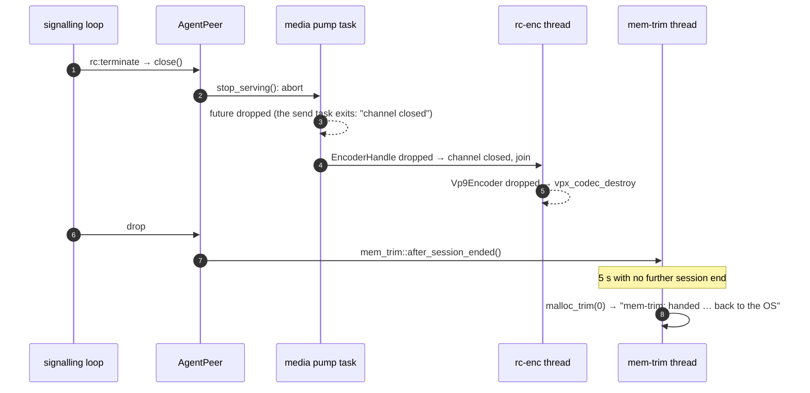

Each thread allocates from a glibc arena of its own (up to eight per core), and
every session encodes on **new** threads (`rc-enc-*`, libvpx's workers, the
capture worker). Freed memory stays mapped in the arena it came from, so each
session can strand its buffers in a different one. Measured on a 4-core KDE
system guest, idle 60 s after each of three 2-minute DRM sessions, with gdb's
`malloc_stats()`:

| idle after | RSS | anon RSS | glibc holds | **in use** | arenas |
|---|---|---|---|---|---|
| fresh daemon | 51 MB | 12 MB | 10 MB | **7.3 MB** | 12 |
| session 1 | 100 MB | 53 MB | 59 MB | **8.9 MB** | 32 |
| session 2 | 204 MB | 157 MB | 177 MB | **9.1 MB** | 32 |
| session 3 | 303 MB | 256 MB | 290 MB | **9.2 MB** | 32 |
| one `malloc_trim(0)` | **89 MB** | **42 MB** | 290 MB | 9.2 MB | 32 |

So `AgentPeer`'s drop (`agents/roomlerd/src/peer.rs:1739`) asks for a trim, and
`agents/roomlerd/src/mem_trim.rs:33` runs `malloc_trim(0)` once, on a short-lived
`mem-trim` thread, **5 s after the last session ended**. The delay lets the
encoder thread finish freeing (`encode/thread.rs:265` joins it), and sessions
ending together cost one trim. A trim takes each arena's lock in turn and nobody
waits for it. "glibc holds" does not fall after a trim, because the pages are
released with `MADV_DONTNEED` while the arena keeps the address space. RSS is the
number that falls.

| | |
|---|---|
| Where | Linux/glibc only (`malloc_trim` is a glibc extension). Windows and macOS were not measured |
| Kill switch | `ROOMLERD_MEM_TRIM=0` |
| Field signal | `mem-trim: handed the memory finished sessions freed back to the OS (#2024)` with `rss_before_mb`, `rss_after_mb`, `elapsed_ms` |

⚠️ **RSS is not the heap.** Read what is *in use* before calling anything a leak:
`sudo gdb -p "$(systemctl show -p MainPID --value roomlerd)" -batch -ex 'call (void) malloc_stats()'`
prints every arena's system and in-use bytes on the daemon's stderr, which is
`journalctl -u roomlerd`. A climbing RSS over a flat in-use is retention, and a
trim answers it. A climbing in-use is a leak, and a trim hides nothing of it.

⚠️ **A wrong turn worth keeping.** heaptrack's "leaked at exit" listing read as
one encoder kept per session, and the issue was filed that way. The sizes say
otherwise: the 49.41 MB at `vpx_codec_enc_init_ver` is **exactly one** token
buffer (50 × 80 macroblocks × (16·16·3 + 4) tokens × 16 B), and the 3.07 MB of
plane buffers is one encoder's Y, U and V. Neither is one per session. A local
probe then dropped encoders through every runtime call the pump makes
(`set_bitrate`, `set_max_quantizer`, runtime `cpu-used`, keyframes) and got back
every byte (0 KB per encoder in `mallinfo2`). The debug journal showed each pump
dropped 8 ms after its terminate.

## 13. Testing strategy

Reuse the existing 114 Rust integration test conventions plus Playwright E2E specs. New harness pieces:

- **`agent-headless`** test binary: a stripped-down agent that captures from a virtual framebuffer (Xvfb on Linux CI) and accepts injected input via stdin. Lets us assert end-to-end round trips in CI without a GPU.
- **Latency probe**: a Playwright test that draws a known pattern, sends a click, and asserts the agent received the click within budget.
- **Loss simulation**: `tc netem` in the test container to add 100 ms RTT, 2% loss, and verify the input/control DC behave correctly.
- **Multi-watcher SFU bridge**: spin up 3 mediasoup consumers against one agent producer, verify CPU stays bounded.

## 14. Rollout plan (historical — the original phasing, long since shipped)

| Phase | Scope | Calendar guess (solo) |
|---|---|---|
| **0. Spike** | webrtc-rs PoC on Linux: capture+encode → browser, view-only, no input | 1 week |
| **1. MVP** | Linux-X11 agent + browser controller, attended PIN pairing, mouse + keyboard, single monitor, no SFU bridge | 3 weeks |
| **2. Productize** | Windows + macOS agent, unattended enrollment, multi-monitor, clipboard, consent UI, audit | 5 weeks |
| **3. Scale** | SFU bridge for N-watchers, file transfer, recording, hardware encoders on all platforms, regional TURN | 4 weeks |
| **4. Polish** | Wayland, AV1, mobile-controller UX, RBAC integration with existing roles bitfield, installer signing | 3 weeks |

That's ~16 weeks for a properly hardened v1, which is in the right ballpark for what RustDesk took to mature.

## 15. Decisions worth flagging

- **`webrtc-rs` over wrapping libwebrtc** — pure Rust toolchain matches the rest of roomler, avoids a C++ build dependency, and the API surface we need (PC + DC + RTP send) is well-supported. The trade-off is fewer mature codec integrations; we route around that by encoding ourselves and feeding raw H.264 NALUs into a `TrackLocalStaticSample`.
- **Tauri for the tray, not Electron** — keeps the agent under 20 MB and the dependency tree close to the rest of your stack.
- **`enigo` as default, OS-specific only when needed** — same calculus RustDesk made; enigo handles 90% well, the remaining 10% (Wayland, IME, UIPI) needs direct backends.
- **One unified room kind, not a separate "remote" service** — keeps notifications, RBAC, presence, chat, and recording free. The cost is one new `RoomKind::RemoteControl` variant and the discipline to keep `remote_control` crate's surface narrow.
- **No SOCKS-style port forwarding in v1** — RustDesk has it; it's a security minefield and 90% of users don't need it. Add later if there's demand. *(Later arrived: forwards + SOCKS5 shipped as the policy-gated tunnel subsystem — [tunnels.md](tunnels.md).)*

## 16. Open questions (historical — all since resolved)

*Answers, with hindsight: (1) headless agents shipped — the Windows service +
SystemContext and Linux virtual desktops; (2) still a UX call, plumbing exists;
(3) recordings stayed on MinIO; (4) mobile controller ships with an on-screen
keyboard component.*

1. Do you want to allow **headless agents** (no logged-in user, e.g., a server in a rack)? That requires a system service, which is a much bigger blast radius. Recommend deferring past v1.
2. Should an in-progress remote control session be **shareable into a roomler call** as a screen share automatically? The plumbing supports it; it's a UX call.
3. **Recording storage**: piggyback on the existing MinIO setup, or push to S3-compatible per-org bucket? Existing MinIO is fine for v1.
4. **Mobile controller** keyboard UX is genuinely hard (no physical keys, lots of host-OS shortcuts to send). v1 should be view + tap-to-click only on mobile, full input on desktop browsers.

<!-- RETIRED-NAME-ANCHOR-BEGIN: §17-19 are historical appendices. They record what the
     product was called and what operators actually typed at the time (0.1.32 - rc.26),
     so rewriting `roomler-agent` to `roomlerd` here would falsify the record rather
     than update it. The CURRENT encoder reference is docs/encoders.md. docs/fr/FR-21 -->

## 17. Hardware encoder backends

> **Current reference: [encoders.md](encoders.md)** — the codec × platform matrix,
> selection cascade, rate control, and capture backends as they ship today. This
> section remains as the engineering record (probe designs, per-vendor failure
> modes) behind that summary.

### Current state (0.1.25)

On Windows, the default `Auto` cascade picks **openh264** — the
software H.264 encoder we've trusted since day one. The Windows
Media Foundation backend (`mf-h264`) is compiled in and functional
but **opt-in only** via `encoder_preference=hardware`, because on
mixed-GPU hosts (e.g. NVIDIA GeForce + Intel iGPU) it hits two
blockers that phase 3 will resolve:

1. **NVIDIA H.264 Encoder MFT** `ActivateObject` returns
   `0x8000FFFF` when the D3D11 device is bound to the default DXGI
   adapter (usually the Intel iGPU on hybrid laptops / desktops
   with both). NVENC MFT requires its D3D device to be created on
   NVIDIA's adapter specifically.
2. **Intel Quick Sync Video H.264 Encoder MFT** activates OK but
   is async-only. It ignores `MF_TRANSFORM_ASYNC_UNLOCK` and
   rejects `SET_D3D_MANAGER` with `MF_E_ATTRIBUTENOTFOUND`. Sync
   `ProcessOutput` returns `0x8000FFFF` on the first drain.

Phase 3 (DXGI adapter enumeration + `IMFMediaEventGenerator`
event loop + per-MFT probe-and-rollback) is a separate focused
work package. Until it lands, Auto → openh264 is the right call.

### Backend cascade

`encode::open_default(width, height, preference)` picks as follows:

| `preference` | Order tried |
|---|---|
| `Auto` (default) | **openh264** → Noop   (MF is opt-in until phase 3) |
| `Hardware` | Windows MF (experimental) → openh264 → Noop |
| `Software` | openh264 → Noop |

Selection is logged at INFO:

    INFO encoder selected: openh264 (software) width=1920 height=1080

and on every `media pump heartbeat`:

    INFO media pump heartbeat backend="openh264" frames_encoded=30 ...

### Per-session downscale behaviour

The capture layer runs a 2× box downsample on sources above
~3.5 Mpx when the active encoder is software (openh264 or MF SW).
Hardware encoders (when phase 3 lands) will skip the downsample so
they see native resolution. Logged at pump start:

    INFO media pump starting encoder_preference=Auto downscale=Auto

### Configuration

Three places, in decreasing priority:

1. **CLI flag**: `roomler-agent run --encoder hardware` (also
   accepts `auto`, `software`, `hw`, `sw`, `mf`, `openh264`).
2. **Env var**: `ROOMLER_AGENT_ENCODER=hardware`. Mostly for
   systemd-user / Task Scheduler entries where editing the TOML is
   less convenient.
3. **Config file** (`config.toml`): `encoder_preference = "hardware"`.

Invalid values fall through to `Auto` with a warning — a typo can
never prevent the agent from starting.

### Known hardware issues (to fix in phase 3)

Verification priority: NVIDIA → Intel iGPU → AMD.

| Vendor | Driver | Symptom | Workaround |
|---|---|---|---|
| NVIDIA (GTX 1650 + Intel UHD 630 mixed) | 560.x series | `NVIDIA H.264 Encoder MFT` `ActivateObject` returns `0x8000FFFF` (E_UNEXPECTED) because D3D11 device was created on the default adapter (Intel). Fix requires DXGI adapter enumeration + VendorId=0x10DE match. | Use `encoder_preference=software` (default) |
| Intel UHD 630 iGPU (Quick Sync) | same | `Intel® Quick Sync Video H.264 Encoder MFT` is async-only; ignores `ASYNC_UNLOCK`; first sync `ProcessOutput` returns `0x8000FFFF`. Fix requires `IMFMediaEventGenerator` event loop. | Use `encoder_preference=software` (default) |
| AMD | *(not yet tested)* | expected to behave like Intel QSV (async) | |

### Encoder smoke test

Release builds run `roomler-agent encoder-smoke --encoder hardware`
as part of the Windows CI job. It opens the preferred encoder at
640×480, feeds 10 synthetic frames, and fails the build if no
keyframe comes out or the cascade bottoms at `NoopEncoder`.

To reproduce locally:

    cargo build -p roomlerd --release --features full-hw
    target\release\roomler-agent.exe encoder-smoke --encoder hardware

With the `full-hw` build, the MF backend code is present but only
engaged when `--encoder hardware` is passed explicitly.

### Scaffolding already in place

The following phase-1-and-2 plumbing stays in the codebase ready
to be re-engaged once phase 3 adds the missing pieces:

- `create_d3d11_device_and_manager()` — builds a multithread-
  protected D3D11 device + `IMFDXGIDeviceManager`. Works but binds
  to default adapter.
- `activate_h264_encoder()` — `MFTEnumEx` with
  `MFT_ENUM_FLAG_HARDWARE | SORTANDFILTER | SYNCMFT`. Returns
  first-activating vendor MFT, falls back to MS SW.
- Async-mode probe via `GetAttributes().GetUINT32(MF_TRANSFORM_ASYNC)`
  + `MF_TRANSFORM_ASYNC_UNLOCK` attempt. Works for MFTs that honour
  unlock; doesn't for those that don't.
- `MFT_MESSAGE_SET_D3D_MANAGER` handoff, tolerant of rejection.
- `MF_E_TRANSFORM_STREAM_CHANGE` handling in the drain loop.
- Debug tracing at every `ProcessInput`/`ProcessOutput`.

### Phase 3 scope

Three pieces, each tractable on its own:

1. **DXGI adapter enumeration** — ✅ landed in 0.1.26 commit 2
   (`encode/mf/adapter.rs`). `CreateDXGIFactory1` →
   `EnumAdapters1` → vendor priority rank → `D3D11CreateDevice` on
   that specific adapter. The cascade then feeds the adapter-bound
   device to each enumerated H.264 MFT.

2. **Async event loop** — ⏳ commit 1A.2 (tracked; not yet needed
   on the RTX 5090 Laptop + AMD box since both vendors' MFTs
   honour `MF_TRANSFORM_ASYNC_UNLOCK`). Design: `QueryInterface`
   for `IMFMediaEventGenerator`, dedicated worker thread running
   `GetEvent` (blocking) → `METransformNeedInput` pulls the next
   input from an mpsc queue and calls `ProcessInput` →
   `METransformHaveOutput` calls `ProcessOutput` and pushes to
   another mpsc. `VideoEncoder::encode()` becomes a non-blocking
   pusher that drains available outputs. Intel QSV is the main
   target; cascade routes candidates that ignore `ASYNC_UNLOCK`
   to `MfInitError::AsyncRequired` today and logs them.

3. **Per-MFT probe-and-rollback** — ✅ landed in 0.1.26 commit
   1A.1 (`encode/mf/activate.rs` + `encode/mf/probe.rs`). Full
   pipeline init + one 480×270 NV12 black-frame probe per
   candidate; non-zero output within the existing 64-iteration
   drain cap is required. Additional hardening beyond the
   original scope: blanket `MF_TRANSFORM_ASYNC_UNLOCK` regardless
   of the reported flag (the MS SW MFT silently delegates to
   async HW and reports `is_async=false`), and tolerance for
   `SET_D3D_MANAGER E_NOTIMPL` (treats the candidate as a sync
   CPU MFT with no D3D binding — matches the "H264 Encoder MFT"
   entry that `MFTEnumEx` returns for the MS SW MFT).

Status: **Phase 3 commits 1 + 2 + 3 landed**. Auto cascade on
Windows now prefers MF-HW (commit 1A.3, 0.1.26) with
`ROOMLER_AGENT_HW_AUTO=0` escape hatch. Async pipeline (commit
1A.2) remains tracked for Intel QSV boxes.

Live verification (2026-04-20, Win11 + RTX 5090 Laptop + AMD
Radeon 610M): cascade enumerates 2 adapters + 5 H.264 MFTs, winner
is AMD Radeon 610M + H264 Encoder MFT, `encoder-smoke --encoder
hardware` produces 1 keyframe + 9 P-frames, total 4212 bytes over
10 frames. `encoder-smoke --encoder auto` picks `mf-h264` unless
`ROOMLER_AGENT_HW_AUTO=0` is set, in which case it picks
`openh264`.

### Future phases beyond Windows

> 🗄️ **Two of these shipped, by another route.** VideoToolbox (H.264, HEVC)
> and VAAPI are FFmpeg encoders in the hardware cascade, not a direct
> `VTCompressionSession` or `libva` backend ([encoders.md](encoders.md)). And
> no audio-input entitlement exists: `packaging/macos/entitlements.plist`
> carries only three hardened-runtime keys, all false, and there is no
> microphone usage string. The third item still stands.

Deferred per platform (as written):

- **macOS**: VideoToolbox `VTCompressionSession`. Sync-ish API,
  per-user `com.apple.security.device.audio-input` entitlement
  should already be covered by the existing signed .pkg build.
- **Linux**: VAAPI via `libva`. Intel + AMD on kernel drivers;
  separate NVENC path for NVIDIA.
- **GPU-side capture → encoder pipeline** (all platforms).
  `CLSID_VideoProcessorMFT` upstream of the encoder MFT on
  Windows so BGRA→NV12 never touches the CPU. A DXGI Desktop
  Duplication capture backend keeps frames as D3D11 textures
  end-to-end — removes the 900 MB/s of memory bandwidth we push
  at native 4K today.

## 18. Appendix — viewer controls + codec negotiation + DC handlers (0.1.32 → 0.1.35, historical)

Post-Phase-3 the subsystem grew three feature families. Commit-by-commit
detail is in `git log`. Summary:

### 18.1 Codec negotiation (0.1.28 → 0.1.30)

Agent advertises H.264 + HEVC + AV1 capabilities via `AgentCaps.codecs`
in `rc:agent.hello`. Browser advertises its decode caps in
`ClientMsg::SessionRequest.browser_caps`. Agent picks the best
intersection with priority `av1 > h265 > vp9 > h264 > vp8` and binds
the matching MF encoder + `video/H264|H265|AV1` track +
`set_codec_preferences` SDP pin. HEVC/AV1 activation failures are
fail-closed (black video + WARN, not silent bitstream substitution).
Caps probe-at-startup (0.1.30) filters codecs that enumerate-but-fail-
to-activate, so the browser never sees a bait-and-switch.

### 18.2 Data-channel handlers (0.1.31 → 0.1.33)

- **Cursor DC** (0.1.31): agent pumps `cursor:pos` + `cursor:shape` at
  ~30 Hz; browser paints the real OS cursor bitmap on an overlay
  canvas. Synthetic initials-badge is the fallback when no shape has
  been cached yet.
  **Native OS cursor (current):** `cursor:shape` gained an optional
  `css` keyword — the agent matches the live `HCURSOR` against the
  stock `IDC_*` set and, for standard cursors (I-beam→`text`,
  arrow→`default`, hand→`pointer`, resize variants…), tells the browser
  to render the viewer's real OS cursor via CSS `cursor:` on the video
  surface (zero-latency, pixel-perfect) instead of the streamed bitmap;
  app-custom cursors still use the bitmap (whose monochrome I-beam path
  now renders black + white-outline rather than the old solid-white
  blob). The WGC backend's in-video cursor bake-in
  (`SetIsCursorCaptureEnabled`) is disabled by default
  (`ROOMLER_AGENT_WGC_CURSOR=1` re-enables) so the low-latency overlay /
  CSS cursor is the single source with no double cursor. Additive +
  back-compat: old browsers ignore `css` and draw the bitmap.
- **Clipboard DC** (0.1.32): thread-pinned `arboard::Clipboard` worker;
  JSON protocol `clipboard:read` / `clipboard:write` /
  `clipboard:content` / `clipboard:error` with `req_id` round-trip
  for interleaved reads. Fixed in 0.1.34: `Clipboard` handle had a
  `Drop` impl that sent `Shutdown` on every clone drop, killing the
  worker on the first closure-captured clone release; dropped the
  `Drop` impl and rely on Sender refcount to end the `rx.recv()`
  loop naturally.
- **Clipboard protocol v2** (0.3.0-rc.227): auto-sync without the
  toolbar buttons. Additive messages on the same DC, gated by
  `AgentCaps.clipboard = ["ack","events","images"]`:
  `clipboard:write` gained an optional `id` → the agent acks with
  `clipboard:write-ack {id,bytes}` after the OS write (the browser
  gates its deferred Ctrl+V on this — fixes the stale-paste race
  where the keystroke on the unordered input DC beat the write);
  `clipboard:subscribe {events}` installs a host-side change watcher
  (Windows: `GetClipboardSequenceNumber` at 200 ms, one syscall when
  idle; elsewhere 1 Hz text-hash poll) that pushes `clipboard:event`
  / `clipboard:event-chunk` / image streams; PNG images flow both
  directions as `clipboard:img-begin` + binary frames (16 KiB up /
  64 KiB down) + `clipboard:img-end`, capped at 8 MiB and 4096×4096
  (header-checked pre-alloc). Wire text is canonical LF; the agent
  converts to the host convention (CRLF on Windows — LF-only text
  in `CF_UNICODETEXT` mis-renders in classic Win32 apps). Echo
  suppression: agent-side self-marks (post-write seq + FNV-1a-64
  content hashes) × browser-side echo gate, both hashing identical
  canonical bytes. The session's CLIPBOARD permission bit is now
  actually enforced (deny → `clipboard:error` stub handler). The
  browser's local→remote triggers are focus/visibility/2 s-focused
  poll/paste-intent; Settings → Session has the persisted
  "Clipboard auto-sync" toggle (default ON).
- **Clipboard v2.1 — html lane** (0.3.0-rc.229, caps += `"html"`):
  formatted text survives the round-trip. `clipboard:html-begin
  {id, html_bytes, text_bytes}` + binary frames (html UTF-8 then the
  plain-text alt) + `clipboard:html-end`, both directions, 4 MiB
  combined cap; the agent writes CF_HTML + CF_UNICODETEXT in ONE
  transaction via `arboard::set_html` (paste targets pick the richest
  they understand), the browser writes a two-format `ClipboardItem`.
  Watcher priority: html > text > image (html carries its own text
  alt). Echo marks hash the READ-BACK (the OS re-wraps CF_HTML);
  the browser echo gate became a 4-entry ring because one html state
  surfaces as two hashes (combined + text-alt via readText polling).
  Covers formatting, tables and WEB-HOSTED images; images EMBEDDED in
  local documents (Word ⌘A copies) are only reachable via native RTF
  — that's the local-agent rich-clipboard bridge (v2.2 below).
- **Clipboard v2.2 — native (RTF) lane + loopback bridge** (caps +=
  `"native"`, Windows agents). Full Word↔Word fidelity, EMBEDDED
  images included. The browser Clipboard API can't see RTF, so the
  VIEWER machine's own enrolled agent serves it over a loopback HTTP
  bridge — `GET/POST /rc-clipboard` on the EXISTING corp-relay-assist
  probe (`127.0.0.1:47989`, `rc_local_turn.rs`): GET → `NativePayload`
  JSON (base64 RTF + html + text, 204 when no RTF), POST → native
  write. The browser probes it once per connect; when present AND the
  remote agent advertises `native`, `syncLocalClipboardToRemote` reads
  local RTF and ships it as a `clipboard:native-begin` / binary frames
  (rtf ++ html ++ text) / `native-end` stream, 16 MiB cap; the remote
  agent writes it via clipboard-win raw `register_format("Rich Text
  Format")` + `set_without_clear` (html+text via arboard first, RTF
  appended without clearing). Remote→local applies through the bridge
  POST. Echo suppression: ONE process-shared clipboard worker
  (`Clipboard::shared()`) so a bridge write is never re-pushed by a
  co-hosted session watcher; RTF-byte hashes marked on both apply and
  push. Trust model = the TURN probe's: loopback-only bind + strict
  browser-origin CORS/PNA allowlist + no capability a local process
  doesn't already have (any local app can write the OS clipboard).
  Escape `ROOMLER_AGENT_CLIPBOARD_BRIDGE=0`. Without a local bridge
  (no viewer-side agent) the flow degrades to the v2.1 html lane.
- **The watcher on X11 (FR-97 P3e-3a)**: an X11 session gets Windows'
  sequence number in another form. XFixes reports every change of the
  CLIPBOARD selection's owner, which is what a copy is
  (`agents/roomlerd/src/clipboard.rs:632` `x11_gate`), so a tick whose
  counter did not move reads nothing (`clipboard.rs:1055`). That makes
  copied images affordable, and they are watched now, where before an
  image waited for the clipboard button; text no longer costs a read and
  a hash every second, and the worker ticks at Windows' 200 ms behind the
  gate (1 s without one). One counter per tick for every watcher
  (`clipboard.rs:607` `gate_tick`); with no watcher the gate is closed,
  because an X server buffers what a client does not read. Our own writes
  change the owner too, and the content hashes swallow them as before.
  `AgentCaps.unavailable["clipboard-image-events"]` goes away where the
  gate opens (`agents/roomlerd/src/encode/caps.rs:725`). ⚠️ Not under
  Wayland: the clipboard is the compositor's there, and Xwayland's copy
  of it is unmeasured. A broken gate connection drops back to text
  polling with images unwatched. Kill switch
  `ROOMLERD_CLIPBOARD_X11_WATCH=0`.
- **File DC** (0.1.33): browser drag/pick → `files:begin` →
  64 KiB ArrayBuffer chunks with `bufferedAmount` back-pressure →
  `files:end` → agent writes into the controlled host's Downloads
  folder. Filename sanitization + collision-safe rename + 2 GiB
  per-transfer cap. Since FR-84 D4 the folder is **`files_dir`** (live; `~`
  per the active user; a SYSTEM/root writer is confined to the active user's
  profile), shown and changed from the companion's Overview —
  [desktop-companion.md](desktop-companion.md) §9 has the rules. Since FR-97
  P3d a Linux system install writes the file **as** the person at seat0, into
  their Downloads, so it is born theirs (§9.1 there).
  Gated by `AgentCaps.files` — `upload · download ·
  download-folder · resume` always, `browse` only while
  `enable_remote_browse` is on. ⚠️ The list is assigned by the daemon in
  `encode::caps::detect()` (`with_config_lists` → `files_caps`), never by the
  caps-probe child:
  the child loads no config, so a `browse` computed there rode the flag's
  default and a device with browse disabled advertised it on every
  cache-miss boot (#1672 — the same hole [`remote-apps.md`](remote-apps.md)
  §4.3 closed for `apps`).
- **Remote Apps on the control DC** (FR-56, [`remote-apps.md`](remote-apps.md)):
  `rc:apps.list` / `rc:apps.focus` / `rc:apps.launch` and their `*.reply`,
  id-correlated like `rc:logs-fetch`, handled off-thread in
  `apps::handle_control_message`. Gated by `AgentCaps.apps` — `list · focus ·
  launch` when the agent could manage a desktop at hello time, `status` when
  it has a backend and will say honestly why not. The reply carries the
  honesty: `coverage` (`sources`, `unlisted`, `missing_tools`) on a host where
  the feature works, `unavailable: {code, reason}` where it does not.

### 18.3 Hotkey + viewer indicator (0.1.33)

- **Hotkey interception** in `useRemoteControl.ts::attachInput`:
  Ctrl/Cmd + A/C/V/X/Z/Y/F/S/P/R are locally `preventDefault`-ed
  while the pointer is over the viewer, still forwarded to the
  remote; outside the video the controller keeps normal browser UX.
  `Tab` + bare `Backspace` are globally intercepted.
  Ctrl+Alt+Del is exposed as a dedicated toolbar button — the
  OS reserves the real chord, the browser can't catch it.
- **Keyboard Lock (0.3.0-rc.227)** — the §10 design intent is now
  implemented: entering fullscreen calls `navigator.keyboard.lock()`
  (no args = all capturable keys) and `shouldPreventDefault` flips to
  suppress-everything, so Alt+Tab / Win / Ctrl+W / Ctrl+T / F-keys
  act on the REMOTE. Hold-Esc exits fullscreen (browser gesture,
  not cancellable); short Esc taps forward. Chromium-only,
  feature-detected; other browsers keep the pointer-inside policy.
  A toast + subtle pill INSIDE `.video-frame` (Vuetify overlays
  teleport to `<body>` and vanish in fullscreen) advertise the mode.
  **Ctrl+Alt+End** (RDP convention; plus the literal chord on
  Linux/macOS viewers) triggers `sendCtrlAltDel()` — AltGr carve-out,
  repeat-guarded, gated on pointer-over-viewer OR locked fullscreen.
- **Viewer-indicator overlay** (`viewer-indicator` feature, Windows
  only): originally one click-through window with a 6 px red border +
  "Being viewed by: …" caption. **Current design** = two topmost,
  capture-excluded windows. A **thin 2 px red border**, always on while
  a session is active (the passive "someone is watching" cue). A
  separate **interactive badge** — hidden until the viewee parks the
  pointer at the top edge for ~1.2 s (RDP / RustDesk-style reveal),
  **draggable** so it can be moved off content that needs reading,
  auto-hiding ~2.5 s after the pointer leaves — shows the controller's
  **initials avatar + display name** and a **Disconnect** button.
  Clicking Disconnect sends the session's `ObjectId` through an
  in-process channel to the signaling `select!`, which stops serving the
  session at once (`AgentPeer::stop_serving`: no more input, clipboard,
  files or frames), emits `ClientMsg::Terminate {reason: HostDisconnect}`
  and closes the bare peer after a grace (FR-27 P10, §11.5 — before P10 it closed first and
  said `AgentHangup` after, and the viewer reconnected); the server
  tears the session down, notifies the browser, and echoes `Terminate`
  back (the agent handler is idempotent). The overlay label is the
  controller's real `display_name`, resolved server-side at WS connect
  (fallback: login username). `SetWindowDisplayAffinity(WDA_EXCLUDEFROMCAPTURE)`
  keeps BOTH windows out of every screen-capture path (our WGC backend,
  DXGI Desktop Duplication, BitBlt, third-party tools), so neither the
  border nor the Disconnect button leaks into the RTP stream — and the
  viewer's injected input can't intentionally target what it can't see.
  Primary-monitor + DPI-naive today.

### 18.3.1 Keyboard-layout auto-switch + rc:layout (0.3.0-rc.227)

The "typing is dead until I press ALT+SHIFT on the remote" fix
(viewer German, remote Cyrillic-BG). `win_text::type_text` resolves
each char against the remote's ACTIVE layout; unreachable chars used
to drop straight to VK_PACKET (which conhost ignores). Now
`input::layout` (Windows + enigo-input):

- **Per-char auto-switch**: unreachable on the active layout → find an
  installed non-IME layout that CAN produce it (last-good-first) →
  post `WM_INPUTLANGCHANGEREQUEST` to the foreground window (the OS's
  own ALT+SHIFT) → verify-poll ≤100 ms → inject real VK+scancode under
  the new layout. Verify timeout → VK_PACKET + 3 s cooldown; ≤8
  switches/call. Kill switch `ROOMLER_AGENT_AUTO_LAYOUT=0`. Switch
  logs carry a script class only — never the char (passwords).
- **`rc:layout`** (control DC, agent→browser): active + installed
  layouts as opaque 8-hex HKL strings + BCP-47 tags, published on
  change (sampled on key events + every 32nd mouse event, on the
  injector thread — the desktop-bound one under SYSTEM-context).
  Drives the viewer's layout chip. The emitter task exits on DC
  send-failure (the layout watch is process-global and never closes).
- **`rc:layout.set {hkl}`** (control DC, browser→agent): the Settings
  picker. Validated against the CURRENT installed list (never
  activates arbitrary wire input); runs on a fresh desktop-rebound
  thread; the re-sampled `rc:layout` push is the implicit ack.
- **Caps**: `AgentCaps.layout = ["report","set"]` gates the UI.
- **FR-97 P3e, on both platforms:** `rc:layout.set` goes through the input
  arbiter, which refuses a session that may not type, and in exclusive mode
  anyone but the floor holder, as keep busy's switch does
  (`agents/roomlerd/src/input/arbiter.rs:810`). Before, a view-only session
  could switch the host's layout. And the current snapshot goes out once when
  the control DC opens (`agents/roomlerd/src/peer.rs:1259`): the emitter
  starts before the channel does, so the snapshot it starts with found no
  channel, and went out again only on the next change.

### 18.3.2 The keyboard layout on X11 (FR-97 P3e)

The same chip and picker on an X11 desktop, through the same two messages. On
Linux `input::layout` *is* `input::layout_x11`
(`agents/roomlerd/src/input/mod.rs:97`), so the peer's emitter
(`agents/roomlerd/src/peer.rs:1551`) and its `rc:layout.set` arm
(`agents/roomlerd/src/peer.rs:10605`) serve both platforms.

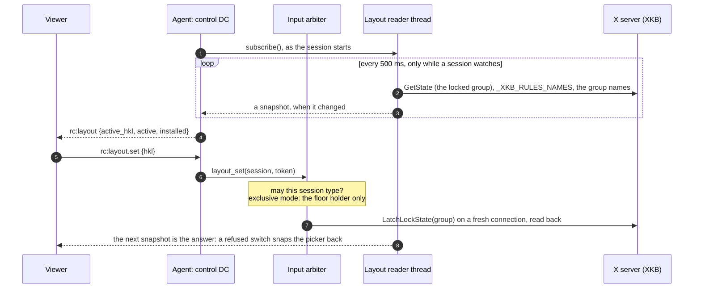

| | Windows (rc.227) | X11 (FR-97 P3e) |
|---|---|---|
| A layout is | an installed HKL | one of the keymap's XKB groups, at most four |
| The list | `GetKeyboardLayoutList` | the root window's `_XKB_RULES_NAMES`, and the keymap's names for its groups |
| The one in use | the foreground thread's HKL | XKB's locked group |
| The token (`hkl`) | the HKL, 8 hex | the layout's FNV-1a hash (8 hex) and its group (1 hex), so a click that arrives after the desktop changed its layouts is refused (`agents/roomlerd/src/input/layout_x11.rs:498`) |
| The tag (`active`) | BCP-47, from the LANGID | BCP-47 for a plain layout the table knows (`de` → `de-DE`, `layout_x11.rs:528`); otherwise the keymap's own name, `German (no dead keys)` (`layout_x11.rs:509`) |
| Read | on input events, on the injector thread | polled every 500 ms on a thread of its own, and only while a session watches (`layout_x11.rs:164`) |
| Switch | `WM_INPUTLANGCHANGEREQUEST` to the foreground window | `XkbLatchLockState`, then read back for up to 300 ms (`layout_x11.rs:360`) |
| Switch while typing | yes, per character | no: typing on X11 (`enigo.text`, over XTest) maps each character to a spare keycode, and reaches it on any layout |
| Offered | in every session | in an X11 session: `DISPLAY` set and no `WAYLAND_DISPLAY` (`layout_x11.rs:62`); `set` too, except under GNOME (`layout_x11.rs:79`, below) |
| Kill switch | `ROOMLERD_AUTO_LAYOUT=0` (the auto-switch only) | `ROOMLERD_X11_LAYOUT=0`: no `layout` in the hello, so no chip |

⚠️ **GNOME reports, and does not switch.** GNOME Shell keeps its own input
source on Xorg as well: an XKB group locked from outside it is back on GNOME's
own within 20 ms (measured on GNOME 46 through libX11's own `XkbLockGroup`,
the agent out of the loop; FR-97 §8), and GNOME has no public interface for
switching sources. Under `XDG_CURRENT_DESKTOP` naming GNOME (Ubuntu's,
Flashback, Budgie) the hello says `report` without `set`, so the viewer shows
the chip and no picker, and `rc:layout.set` is refused there too. The chip
does follow GNOME's own switch: Super+Space sent from the viewer moved it to
`de-DE` and back, with GNOME's indicator.

**Elsewhere the picker switches.** XFCE 4.18 on Xorg keeps a group locked from
outside it (measured the same way: held for 2 s, both ways), so its hello says
`set`. The picker is in the viewer's Settings, on the Session tab ("Remote
keyboard layout"). Clicking a layout there switched the host's XKB group, which
held (FR-97 §8).

⚠️ **GNOME configures one group more than it shows.** Its input sources `us,
de` reach XKB as `us,de,us`: the locale's layout appended for GNOME's own
shortcuts. Each layout is offered once, at its first group, and the locale
group in use reads as the layout it repeats.

⚠️ **Not under Wayland, nor on a system install.** Under Wayland the layout is
the compositor's, and no protocol the desktops share reads or sets it.
Xwayland's XKB group is a copy of what the compositor sends, and locking it
does not reach the compositor. A system install reaches the screen through DRM
and has no X connection (FR-113). Both leave `layout` out of the hello
(`agents/roomlerd/src/encode/caps.rs:854`), with no reason in `unavailable`:
there is no control to grey, so the chip does not appear, as before P3e.

### 18.4 Input fix — Windows VK path (0.1.34)

`hid_to_key` previously mapped letters/digits to `Key::Unicode(c)`.
enigo routes `Key::Unicode` through `KEYEVENTF_SCANCODE` on Windows,
a layout-sensitive path that drops modifier composition on
non-US / International layouts — producing `©` for Ctrl+C and
`^H` for Backspace in pwsh / Windows Terminal. Letters now route
through `Key::Other(VK_A..VK_Z)` and digits through
`Key::Other(VK_0..VK_9)` on Windows only; non-Windows continues to
use `Key::Unicode` because XTest / CGEventPost combine modifiers
with Unicode fine.

### 18.5 RustDesk-parity Tier A (0.1.33)

Shipped to close the `<video>`-based viewer's smoothness gap vs
RustDesk's native client on the HW path. Details in
`~/.claude/plans/floating-splashing-nebula.md`.

- **60 fps + native resolution** on the MF-HW path (`TARGET_FPS_HW=60`,
  `DownscalePolicy::Never` when `mf-encoder` is compiled in).
- **Bitrate ceilings lifted**: 0.10 → 0.15 bpp/s baseline, MAX 15 →
  25 Mbps, High-quality clamp 20 → 30 Mbps.
- **Codec override dropdown** in the UI; persists per browser;
  `filterCapsByPreference` narrows `browser_caps` before the
  `rc:session.request` so the agent can't pick the excluded codec.
- **Browser buffering to zero**: `jitterBufferTarget = 0`,
  `playoutDelayHint = 0`, `contentHint = 'motion'`,
  `requestVideoFrameCallback` keeps the tab hot + `play()` kicker
  rescues idle-optimizer pauses. Chrome still enforces a soft
  ~80 ms JB floor regardless — Tier B7 (WebCodecs canvas render)
  is the deferred structural escape.

### 18.6 Viewer scale + remote resolution (0.1.35)

- **Scale** (`RcScaleMode`): `adaptive` (default, `object-fit:
  contain` fit-to-stage), `original` (1:1 intrinsic pixels with
  scrollbars), `custom` (5-1000% CSS scale). Persisted per browser.
  Input coordinate mapper switches between `letterboxedNormalise`
  (adaptive) and the new `directVideoNormalise` (original/custom)
  so clicks land accurately in every mode. Cursor overlays
  (synthetic badge + real-OS-cursor canvas) are scale-aware via
  `cursorMapping()`.
- **Fullscreen** toggle: `requestFullscreen` on the stage element,
  `fullscreenchange` listener flips the icon, ESC exits natively.
- **Remote Resolution** (`rc:resolution` control-DC message): tells
  the agent to capture/encode at a specific size. Modes:
  `original` (native monitor), `fit` (match local stage ×
  `devicePixelRatio`, re-emitted on resize via `ResizeObserver`
  debounced 250 ms), `custom` (preset chips + free-form W×H).
  Persisted per-agent (keyed on `agentId`) so "Fit to local
  1920×1080" on my laptop doesn't bleed to my 4K desktop.

**No SDP renegotiation needed for resolution changes** —
H.264 / H.265 / AV1 all carry resolution in the SPS/VPS NALU;
browsers handle mid-stream size changes on the existing RTP track.
The agent's existing `encoder_dims != Some((w, h))` rebuild branch
already handles dim changes (docking, DPI toggle); `rc:resolution`
just writes a new target into the shared `TargetResolution` atomic
and `apply_target_resolution` downscales the captured frame via
`downscale_bgra_box` (CPU box filter, ~30 ms on 4K→1080p) before
encode. GPU `VideoProcessorMFT` path stays in the deferred 1C.3
bucket.

### 18.6.1 The viewer's pixel chain (FR-74 P4)

The codec is not the last thing that touches a remote pixel. After decoding, the
browser paints the frame into a CSS box and the compositor scales that box by
`devicePixelRatio`; in `adaptive` mode the FSR pass (`rc-fsr-render.ts`) renders
straight at the resulting screen size. Every step but the middle one is a resample,
and no encoder setting can undo a resample that happens after the encoder — which is
why "the text is blurry" was hunted as an encoder regression for a week when, on the
reporting laptop, a native 1920×1200 frame was being spread over 2018×1261 screen
pixels (a 1345×841 CSS stage at 150 % scaling).

```mermaid
flowchart LR
    F["decoded frame<br/>1920×1200"] --> B["CSS box<br/>adaptive: contain-fit to the stage<br/>original: frame size<br/>custom: frame × zoom"]
    B --> D["× devicePixelRatio<br/>(display scaling, browser zoom)"]
    D --> S["screen pixels<br/>2018×1261 → shown at 1.05×"]
    S -. "FSR (EASU+RCAS) sharpens<br/>an UPscale only" .-> S
```

The viewer now reports that factor as a pill beside the resolution — `1:1 pixels`
(within 0.1 %) or `shown at 1.05×` — computed by `displayScale()` in
`ui/src/composables/useRemoteControl.ts` (pure, unit-tested) exactly the way the FSR
sizing policy (`computeRenderTarget`) computes its fit factor, so the two never
disagree. Its tooltip, and the hint under Display → *Fit in my window*, say what the
number means and how to reach 1:1:

| you see | it means | 1:1 needs |
|---|---|---|
| `shown at 1.05×` | each remote pixel spread over 1.05 screen pixels (an upscale; FSR sharpens it) | **Custom zoom 100/dpr %** (66.7 % at 150 % scaling — the zoom keeps one decimal for this), or **Match remote display** so the host renders at the window's W×H |
| `shown at 1.50×` in `Original` | `Original` is 1:1 in **CSS** pixels; at 150 % display scaling that is 1.5× on screen — worse than `Adaptive` there, not better | as above |
| `shown at 0.53×` | the frame is larger than the window; fine detail is lost in the downscale | Custom zoom 100/dpr % (the frame will scroll), Resolution → Fit, or Match remote display |
| `1:1 pixels` | pixel-exact — the only state in which a settled frame can be compared to the host pixel for pixel (FR-74 AC1's method) | — |

⚠️ "1:1 Match host display" is a *request*: the host switches to the largest mode
that fits the window, which on a panel smaller than the window cannot match it. The
pill is the verification that button never had — read it after toggling. Since FR-108
the device also decides whether to switch at all (never a screen someone is using) and
answers every request, shown under the button: [`display-match.md`](display-match.md).

### 18.7 Diagnostics (0.1.34)

Added in response to the field-reported 7-8 fps case on a hybrid
RTX 5090 + Intel UHD 630 box:

- Media-pump heartbeat log now reports `avg_capture_ms` /
  `avg_encode_ms` per 30-frame window (reset per window so
  transient stalls don't smear over a long session).
- WGC `SharedSlot` tracks `arrived_total` + `dropped_stale` and
  logs `wgc: capture cadence arrived=N drops=M drop_ratio_pct=P`
  every ~120 arrivals. Low `arrived_total` means WGC itself is
  starving (iGPU scheduling); high `drop_ratio_pct` means
  consumer (encode) can't keep up.

Root cause of that specific 7-fps case: NVENC Blackwell
`ActivateObject` returns `0x8000FFFF` for H.264/HEVC/AV1 on RTX
5090 → cascade lands on Intel UHD 630 HEVC MFT → can't sustain
4K@30. Workaround: operator picks `Remote Resolution = Fit` (or
`Custom: 1920×1080`), agent CPU-downscales, UHD 630 HEVC holds 30-60
fps comfortably at that size. Proper fix deferred to Tier 1C.3
(GPU-side scale via `VideoProcessorMFT`).

## 19. Appendix — resilience cycle (0.1.50 → 0.1.54, historical; SystemContext follow-ons shipped through rc.26)

Multi-release hardening of the agent's lifecycle: persistent
diagnostics, OS-supervisor parity across Win/Linux/macOS, integrity-
verified updates, automatic rollback, and turn-key install. Five
patch releases shipped 2026-04-29 in a single push. Total of ~3700
LOC added, ~150 unit tests; 0 deferred to next cycle from the
P0 cut.

### 19.1 Failure-resilience P0 (0.1.50)

The five P0 phases that made the agent stop dying silently.

**Persistent file logging + panic hook** (`agents/roomlerd/src/
logging.rs`): daily-rolling appender via `tracing-appender` at the
platform data-local dir (`%LOCALAPPDATA%\roomler\roomler-agent\
data\logs\` on Win; `~/.local/share/roomler-agent/logs/` on Linux;
`~/Library/Application Support/live.roomler.roomler-agent/logs/`
on macOS). 14-day retention via prune-on-startup. `WorkerGuard`
held in a `OnceLock<WorkerGuard>` so the writer thread survives
process lifetime. Process-wide `std::panic::set_hook` writes a
sync `panic-<pid>-<unix>.log` with `Backtrace::force_capture()`
output BEFORE delegating to the previous hook — the sync write
is the belt-and-braces against the non-blocking appender's worker
not draining the queue before the OS reaps a panicking process.

**Windows Scheduled Task XML rewrite** (`agents/roomlerd/src/
service.rs::render_task_xml`): replaced `schtasks /Create /SC
ONLOGON ...` with `schtasks /Create /XML <utf-16-le-bom-tempfile>`.
Schema 1.2 (broadest universally-supported version, Win 7+).
Settings that were previously missing or wrong:
- `<RestartOnFailure><Interval>PT1M</Interval><Count>10</Count></RestartOnFailure>`
- `<MultipleInstancesPolicy>IgnoreNew</MultipleInstancesPolicy>`
- `<StopIfGoingOnBatteries>false</StopIfGoingOnBatteries>` (default
  is `true` — silently kills agent on laptop unplug)
- `<DisallowStartIfOnBatteries>false</DisallowStartIfOnBatteries>`
- `<StartWhenAvailable>true</StartWhenAvailable>`
- Belt-and-braces `<EventTrigger>` on EventID 12 (Microsoft-Windows-
  Kernel-General "operating system started") for kiosk auto-logon
  hosts where the LogonTrigger may fire before user session is
  fully ready

Brings Windows to parity with systemd `Restart=on-failure` (already
in `packaging/linux/roomler-agent.service`) and macOS launchd
`KeepAlive` (already in `packaging/macos/com.roomler.agent.plist`).

**Single-instance lock** (`agents/roomlerd/src/instance_lock.rs`):
prevents an interactive `roomler-agent run` from racing the
Scheduled-Task / systemd-launched copy in the same user session.
Win: `CreateMutexW` named `Local\RoomlerAgent-<sha-prefix12-of-
config-path>` (`Local\` namespace = per-session scope; SHA disambig
covers two enrolments on the same machine for the same user). Unix:
`flock(LOCK_EX | LOCK_NB)` on `$XDG_RUNTIME_DIR/roomler-agent-<id>.
lock` (or `~/.cache/...` fallback) with PID written for diagnostics.
Both kernel-released on process death, no stale-lock cleanup needed
after `kill -9`. Only `run` gates on the lock — `enroll`,
`service install/uninstall`, `caps`, `displays`, `encoder-smoke`,
`self-update` stay runnable alongside a live agent.

**Internal liveness watchdog** (`agents/roomlerd/src/watchdog.
rs`): process-singleton via `OnceLock<Arc<Watchdog>>`; pumps tick
via global `watchdog::tick("name")` free helpers (no parameter
threading). Per-pump thresholds — signaling: 90s (keepalive cadence
25s × 3 grace); encoder + capture: 30s (gated on session-active so
they ignore quiet idle periods between sessions). Async `run()`
loop wakes every 5s, scans, force-exits via `std::process::exit(2)`
(sentinel code distinct from 0 + 1) on stall — relies on the OS
supervisor to relaunch a healthy copy. Suspend handling: if a loop
iteration takes more than `SCAN_INTERVAL + 60s`, treat as wall-clock
jump (laptop close-lid → resume) and reset all pump heartbeats
instead of declaring a stall. **Watchdog-of-watchdog** runs on a
dedicated `std::thread` (the only `std::thread` in the codebase),
wakes every 30s, force-exits if the async watchdog hasn't bumped
its `AtomicU64` heartbeat in 60s — catches a fully-deadlocked
tokio runtime.

**Where a stall froze** (#2551). A tick says a pump is alive, not
where it is. The signaling loop awaits inside its `select!` arms,
so a stall is one arm whose await never returned, and the INFO log
is silent while it waits.
- Every arm therefore enters a named stage first
  (`watchdog::enter`, `agents/roomlerd/src/watchdog.rs:375`):
  `shutdown`, `keepalive`, `netchange`, `heartbeat`, `outbound`,
  `carrier_ready`, `consent`, `device_end`, `tunnel_reap`,
  `quic_setup`, `delegated`, and `ws.text` / `ws.ping` / `ws.pong` /
  `ws.close` / `ws.error` / `ws.other`
  (`agents/roomlerd/src/signaling.rs:1881` onwards).
- The connection's setup awaits too, with the pump already counting.
  It reads `setup`, and `setup.overlay` while the overlay runtime
  starts or re-attaches (`agents/roomlerd/src/signaling.rs:1496`).
  Only the loop waiting for its next event reads `select`.
- A `ws.text` arm is refined to the message it is handling, read
  from the JSON's `t` (`ws.text:rc:ssh.response`; `server_msg_tag`,
  `agents/roomlerd/src/signaling.rs:6416`). The dispatch awaits per
  message, so that is where a stall inside it shows.
- The `StageGuard` (`watchdog.rs:389`) puts the pump back to
  `select` when the arm's scope ends, however it ends. An arm that
  leaves early cannot leave its name behind for a later stall to be
  blamed on.
- The stall report then reads `signaling=93s@ws.text:rc:ssh.response`
  (`stall_summary`, `watchdog.rs:405`). The `name=Ns` prefix is
  unchanged, so a parser of the old line still finds the pump.
- ⚠️ Read it from the crash record, not only the log. The summary
  also goes into the crash sidecar that the next worker uploads
  (`agent_crashes.summary` on the server). The forced exit loses its
  own log line about 1 stall in 6, measured on a Windows dev box on
  2026-10-19.

**Token revocation grace** (`agents/roomlerd/src/signaling.rs`):
replaced the `AuthRejected → hard exit` branch with a backoff ladder
(`auth_backoff_for`): 30s → 60s → 5min → 1h capped. Server-side
JWT cache flushes during a deploy used to permanently break every
agent in the field; now they back off and rejoin within seconds.
After 3 consecutive 401s, raises `<config-dir>/needs-attention.txt`
sentinel via `notify::raise_attention` describing the situation +
recommending `roomlerd re-enroll --token <jwt>` (new CLI
that preserves `machine_id` + `machine_name` from the existing
config). Sentinel auto-cleared on auth recovery.

**One verdict for every loop that uses the token** (#2512): the
control socket is not the only thing a device dials with its token.
Its DERP dialer and its log uploader used to reach their own
verdicts. A device whose row was gone kept re-dialling `/derp` every
10 s and posting its logs every 5 s, while its control socket waited
out the ladder above. In the field that was 72 dials and 88 posts in
13 minutes, against 4 control-socket attempts. The control socket
now records the server's answer on the enrollment's `TokenSlot`
(`crates/agent-core/src/token_slot.rs`):

- a 401 on its upgrade marks the token refused;
- an accepted upgrade, or a new token (an FR-103 renewal, a token
  re-enrolled on disk), lifts it.

While the token reads refused, the DERP dialer does not dial
(`derp.rs`, `central_url_per_attempt`) and the uploader posts
nothing (`logs_upload.rs`). Both resume within one backoff step once
it lifts.

⚠️ The verdict is the control socket's alone. `/derp` answers 401 for
any lookup error, a Mongo blip included, so a dialer that believed
its own 401 would drop every device's DERP floor on one database
wobble. The uploader's own 401 now waits out its 60 s backoff, as
its doc always said. Before, it set that backoff and went straight
back to its 5 s tick.

### 19.2 Update-path hardening (0.1.51)

**Configurable update cadence**: `update_check_interval_h: Option<u32>`
config field + `ROOMLER_AGENT_UPDATE_INTERVAL_H` env var override.
Pure resolver `resolve_check_interval_with(env_value, cfg_value)`
extracted so tests don't race on process env. Defaults to the
existing 24 h built-in.

**Post-install watcher** (`agents/roomlerd/src/post_install.rs`):
new hidden CLI subcommand `roomler-agent post-install-watch
--installer-pid <pid> --installer-path <path> --expected-version
<tag>`. Spawned by `updater::spawn_installer_with_watch` as a
sibling of msiexec / dpkg / installer(8) just before the parent
agent exits to make room for the installer. Watcher polls the
installer PID (Win `OpenProcess` + `WaitForSingleObject`; Unix
`kill(pid, 0)` loop), captures the exit code, sleeps 2s for FS
settle, runs the new binary's `--version`, writes a typed JSON
outcome to `<log_dir>/last-install.json` with status
`InProgress` / `SucceededVerified` / `SucceededUnverified` /
`InstallerFailed` / `Timeout`. Operators + future agent startups
read the file to surface what actually happened to the upgrade.

**AgentConfig crash-tracking fields** (all `#[serde(default)]` for
back-compat — pre-0.1.51 configs continue to load, locked by
`old_config_without_new_fields_loads_with_defaults`): `last_known_
good_version: Option<String>`; `crash_count: u32`; `last_crash_unix:
u64`; `rollback_attempted: bool`; `last_run_unhealthy: bool`.

**Crash-loop detection**: at `run_cmd` startup, if
`last_run_unhealthy=true` (previous run started but never reached
`CLEAN_RUN_THRESHOLD_SECS=300` and didn't exit gracefully via
Ctrl-C), `record_crash_at` bumps the in-window counter
(`CRASH_WINDOW_SECS=600`). After 5 min of healthy signaling, a
background tokio task promotes the running version to
`last_known_good_version` and resets the counter via
`record_clean_run_at`. Ctrl-C handler also clears the unhealthy
flag (`mark_clean_shutdown`). When `should_rollback` returns true
(3 crashes within 10 min, target != current, !rollback_attempted),
the agent raises an operator-attention sentinel.

### 19.3 SHA256 verification + automatic rollback (0.1.52)

**SHA256 asset verification** (`updater::verify_sha256`): GitHub
Releases API exposes a `digest` field per asset of the form
`"sha256:<hex>"` (added late 2024). Forwarded by the proxy via
`AgentReleaseAsset.digest`. Agent computes SHA256 of downloaded
bytes via `sha2`, compares case-insensitive against the digest;
mismatched downloads NEVER touch disk. Refuses unsupported
algorithms loud (`sha512:...` etc) so a future GitHub format
change fails-loud rather than silently disabling verification.
Falls through to the existing `MIN_INSTALLER_BYTES` size floor
when digest is absent (pre-2024 releases or proxy that doesn't
yet forward the field).

**`updater::pin_version(tag)`**: fetches a specific release from
`https://api.github.com/repos/.../releases/tags/<tag>` directly
(bypasses the roomler-ai proxy because pinning is rare per-agent
crash-loop recovery, not a fleet-wide poll). Returns the same
`CheckOutcome::UpdateReady` shape as the regular update path so
the rest of the install flow composes.

**Automatic rollback execution**: when `should_rollback` fires AND
`last_known_good_version` is set AND it's different from current:
mark `rollback_attempted=true` FIRST (so a crash during the
rollback fetch can't loop us into another rollback) → save → call
`pin_version(format!("agent-v{target}"))` → on `UpdateReady`,
spawn the installer with the post-install watcher, exit so the
installer can overwrite the binary. Failure modes (Skipped,
UpToDate, spawn error) raise the operator-attention sentinel
with a remediation link to the GitHub releases page so the
operator can downgrade manually.

### 19.4 Schema 1.3+ regression fix (0.1.53)

0.1.50's `service install` shipped `<DisallowStartOnRemoteAppSession>`
and `<UseUnifiedSchedulingEngine>` inside a `<Task version="1.2">`
document — both are Schema 1.3+ Settings.* children. schtasks /XML
on Win10/11 correctly rejected the document with
`(39,7):DisallowStartOnRemoteAppSession: ERROR: The task XML
contains an unexpected node`. Field impact: anyone who tried
`roomlerd service install` after 0.1.50–0.1.52 saw the error
and kept their pre-0.1.50 ONLOGON task. Their *binary* had all the
in-process resilience features but their *Scheduled Task* still had
the bad battery defaults.

Fix: removed both elements (neither was load-bearing — the
resilience-critical settings are all Schema 1.2 native). Locked by
`xml_template_excludes_schema_1_3_only_elements` regression test
so a future "let me bump these back in" diff fails CI.

### 19.5 MSI auto-registers Scheduled Task (0.1.54)

WiX custom actions in `agents/roomlerd/wix/main.wxs`:

- `RegisterAutostart`: `FileKey='roomler_agent_exe'
  ExeCommand='service install' Execute='deferred' Impersonate='yes'
  Return='ignore'`. Sequenced `After='InstallFiles'` with condition
  `NOT (REMOVE="ALL")` so it runs on fresh install + repair +
  MajorUpgrade but skips during full uninstall.
- `UnregisterAutostart`: same shape with `service uninstall`.
  Sequenced `Before='RemoveFiles'` (the action shells out to the
  EXE so it must still be on disk) with condition `REMOVE="ALL"`
  so it only fires during full uninstall, not modify/repair.

perUser MSI runs in the user's token (no UAC, no SYSTEM
impersonation complications). `Return="ignore"` so an existing-
task ACL conflict (the rare Win11 quirk that bit the field on
2026-04-29 — see §19.7) doesn't sink the install.

Closes the UX gap that bit operators upgrading from 0.1.49 → 0.1.5x:
the new task XML shipped inside `service::install()` but the MSI
never ran it. From 0.1.54 onwards every install + upgrade refreshes
the task definition automatically.

### 19.6 CI hardening (during 0.1.54 cycle)

`continue-on-error: true` on the three `Cache cargo` steps in
`.github/workflows/release-agent.yml`. agent-v0.1.53 attempt 1
failed despite every build / smoke / artifact-upload step
succeeding — the post-job tar/zstd cache write returned non-zero,
which marked the whole job as failure and caused
`Publish GitHub Release` to skip. Attempt 2 (manual rerun) was
green. Cache is an optimisation, not a correctness gate.

### 19.7 Field gotcha: Win11 ACL-locked Scheduled Tasks

Discovered while validating 0.1.52 → 0.1.53: existing tasks
created via `schtasks /Create /SC ONLOGON` (the pre-0.1.50 path)
can develop a tightened ACL that denies even the owner Modify and
Delete rights without elevation. Symptom on devbox:
`Unregister-ScheduledTask` returns `HRESULT 0x80070005`
(E_ACCESSDENIED), and `schtasks /Create /XML /F` fails with
`Access is denied` even though the existing task's `Author` field
matches the current user. UAC token-filtering on Win11 is the
likely root cause (admin users run with a filtered non-admin token
by default; modifying certain scheduled-task properties requires
the unfiltered token).

**Recovery** (one-time, per machine that hits this):
```powershell
# Elevated PowerShell:
schtasks /Delete /TN RoomlerAgent /F

# Normal PowerShell (post-0.1.54):
& "$env:LOCALAPPDATA\Programs\roomler-agent\roomler-agent.exe" service install
```

After this, the freshly-created task has a normal ACL and future
upgrades can self-manage. From 0.1.54 onwards new installs never
hit this — only pre-existing locked tasks.

### 19.8 Phase 7 / 8 / Effort 2 cycle — shipped 0.1.55 → 0.1.58

The "next session" plan from §19.8's prior revision shipped on
2026-04-30 across four patch releases. Three closed cleanly; M3 + M5
of Effort 2 are queued for follow-up.

#### 19.8.1 agent-v0.1.55 — enrollment http→https normalization

Field bug: `roomler-agent enroll --server http://roomler.ai ...` failed
with `enrollment rejected (status 405 Method Not Allowed)`. Cause: the
production ingress 301-redirects plaintext to TLS; reqwest follows the
redirect but converts POST→GET (RFC 7231 historical behaviour for
301/302), and a GET on `/api/agent/enroll` is unmatched.

`enrollment::normalize_server_url` upgrades `http://` → `https://`
upfront with a warn log and stores the normalized form in the agent
config so `derive_ws_url()` also yields wss:// for the long-lived
signaling connection. Bonus security win: enrollment tokens never
leave the wire in cleartext.

#### 19.8.2 agent-v0.1.56 — Phase 7 heartbeat telemetry

Closes the "agent shows online forever after silent disconnect" gap.
Agents emit `ClientMsg::AgentHeartbeat { rss_mb, cpu_pct,
active_sessions }` every 30 s on the existing `/ws` connection; the
wire format already existed but neither side was using it.

Server (`crates/api/src/ws/remote_control.rs`) checks for the
heartbeat variant in the read loop and calls the new
`agents.touch_heartbeat(agent_id)` DAO method, which writes
`last_seen_at = now()`. Best-effort: a Mongo lag warns rather than
dropping the WS. With this in place, "agent online" can be defined as
`last_seen_at > now − 90 s` (3× cadence tolerance for one missed
tick).

Agent (`agents/roomlerd/src/signaling.rs`) adds a 30 s
`tokio::time::interval` arm to the connect_once `select!`. v1 sends
`rss_mb=0`, `cpu_pct=0.0` (process-self metrics deferred to a follow-
up that adds the `sysinfo` crate); `active_sessions = peers.len()`
straight off the per-connection peer map.

Backend deployed via buildhost rebuild → ArgoCD GitOps in the same cycle.

#### 19.8.3 agent-v0.1.57 — Phase 8 pre-flight checks

New `preflight` module runs three parallel probes right after config
load, before the signaling loop kicks in:

  - DNS via `tokio::net::lookup_host`. Hint: "check /etc/hosts, the
    system DNS resolver, or whether VPN is required".
  - TCP via `tokio::net::TcpStream::connect`. Hint: "check firewall
    outbound rules, corporate proxy / captive portal".
  - Clock skew via HEAD `<server>/health` + RFC2822 Date: parse.
    Warns past ±60 s. Hint: "JWT validation will fail past ±60 s;
    sync time (w32time / chronyd / ntpd)".

Non-blocking — each finding is a `warn!` with `hint=` field. Total
budget ~5 s wall (parallel join); 5 s per probe individually. Bad
URL surfaces a `BadServerUrl` finding rather than silently no-oping.

#### 19.8.4 agent-v0.1.58 — Effort 2 M1+M2 (Windows Service mode)

Optional opt-in alternative to the Scheduled Task auto-start, for
fleet / unattended deployments. Two milestones landed; M3 + M4 + M5
are deferred (see §19.8.5).

**M1 — service host skeleton** (`agents/roomlerd/src/win_service/
mod.rs`):

  - `install(exe_path)` registers `RoomlerAgentService` with the SCM
    (LocalSystem, AutoStart, OWN_PROCESS), launches via the agent's
    own hidden `service-run` subcommand on start.
  - `uninstall()` stops (best-effort 5 s) + deletes; tolerates
    ERROR_SERVICE_DOES_NOT_EXIST (1060) for idempotent rollback.
  - `status()` returns `InstalledStatus` enum.
  - `run_in_dispatcher()` is the SCM entry point. Hands the OS thread
    to `windows_service::service_dispatcher::start`.
  - SCM control handler accepts STOP + PRESHUTDOWN + SESSION_CHANGE, and
    answers STOP / PRESHUTDOWN with `STOP_PENDING` (§19.8.7, #2010).

CLI: `service install --as-service` / `service uninstall --as-service`
/ `service status --as-service`. Hidden top-level `service-run`
invoked by the SCM's StartService.

Crate: `windows-service = "0.7"` for the SCM lifecycle.

**M2 — session-aware worker supervisor** (`win_service/supervisor.rs`):

  - `active_console_session_id()` wraps `WTSGetActiveConsoleSessionId`;
    None for the 0xFFFFFFFF "no active session" sentinel.
  - `query_user_token(session_id)` wraps `WTSQueryUserToken`; tolerates
    ERROR_NO_TOKEN and returns None for the M3 SYSTEM-context case.
  - `unsafe spawn_in_session(token, exe, args)` calls
    `CreateEnvironmentBlock` + `CreateProcessAsUserW` with
    CREATE_UNICODE_ENVIRONMENT + CREATE_NEW_CONSOLE; attaches to
    `winsta0\default` desktop. Returns `OwnedProcess`.
  - `OwnedHandle` / `OwnedProcess` / `EnvBlock` RAII wrappers — no
    handle leaks even on `?` early returns.
  - `decide_spawn(active, current_worker_session) →
    {SpawnIn|KeepCurrent|Idle}` — pure state machine, exhaustively
    unit-tested without FFI.
  - `next_backoff(consecutive_failures)` — 2 s × 2^(n−1) capped at
    60 s, saturating against runaway counters; mirrors the
    Scheduled Task `RestartOnFailure` PT1M cap.
  - `run(exe, args, rx)` is the supervisor main loop on a dedicated
    OS thread. SCM session-change notifications swap the worker to
    the new active console user; worker crash respawns under backoff.

Crate: `windows-sys = "0.59"` for the raw Win32 FFI (
Win32_System_RemoteDesktop, _Threading, _Environment,
_StationsAndDesktops). Going through windows-sys (not the higher-
level `windows` crate) keeps service-mode independent of the
feature-gated MF / WGC compilation paths.

**M4 (MSI integration) deferred-by-design**: the agent MSI is
`InstallScope='perUser'` (no UAC), but `CreateService` requires admin
elevation. Auto-registering `RoomlerAgentService` from a perUser MSI
is impossible. Operators install the MSI normally, then run
`roomlerd service install --as-service` from an elevated
PowerShell. Future per-machine MSI flavour can revisit.

### 19.8.5 Where the cycle ended

Everything queued at the end of this cycle subsequently shipped: M3 pre-logon
SystemContext capture (rc.1–rc.7, hardened through rc.26 behind
`ROOMLER_AGENT_ENABLE_SYSTEM_SWAP`), M5 field verification, and the perMachine
MSI flavour (`wix-perMachine/`). The operator-facing verification procedure lives
in [operator-systemcontext-smoke.md](operator-systemcontext-smoke.md).

#### 19.8.6 Graceful worker stop (#1683)

The supervisor stops its worker with `TerminateProcess`
(`win_service/supervisor.rs`, `OwnedProcess::terminate`). A hard kill delivers no
console control event, so the worker's `terminate_signal()` — `pending()` on
Windows — never fired, and its `os_initiated_stop` arm never ran. Two things
were lost on every SCM stop: an **ephemeral** device never self-unenrolled (only
the server-side reaper collected it, after the TTL — the FR-51 promise held on
Linux only), and a deliberate stop was miscounted toward `crash_count` on the
next start (the #1040 wall, on Windows).

The fix is a per-worker **named stop event**
(`win_service/stop_event.rs`):

- The host **creates the event before it spawns each worker** and passes the
  name as a hidden `--stop-event <name>` argv (the same channel as
  `--supervisor scm`). The worker's Windows `terminate_signal()` waits on it and,
  when it fires, takes the exact `os_initiated_stop` arm a Unix SIGTERM takes.
- The worker **polls the event on the async runtime** — `WaitForSingleObject(h,
  0)` every `STOP_EVENT_POLL` (250 ms) — rather than parking a blocking task on
  it. Its `select!` has other arms (an update's internal shutdown, FR-84 D3's
  requested restart), and `main()` drops the runtime at the end of its
  `block_on`, which waits for every `spawn_blocking` task to *return*: a blocking
  wait that lost the select would have kept process exit waiting for a signal
  that never comes, so the worker never left on an auto-update and a requested
  restart never landed. The handle lives inside the future and closes when it is
  dropped; 250 ms of latency is nothing against the 8 s budget.
- On SCM Stop / Preshutdown the supervisor **signals the event, waits a bounded
  `WORKER_GRACEFUL_STOP_BUDGET` (8 s), then falls back to `TerminateProcess`**.
  The service accepts `SERVICE_CONTROL_PRESHUTDOWN` (180 s budget), so 8 s is
  comfortably inside the window while never letting a wedged worker hold up an OS
  shutdown; the reaper stays the backstop.
- **An update's own service stop never unenrolls.** The MSI stops the service
  while it replaces the binary; by then the worker that spawned `msiexec` has
  exited 0 and the host has respawned a fresh one (`decide_exit_reaction(0)` →
  `Respawn`), which receives that stop as an `os_initiated_stop`. The
  self-unenroll is therefore gated by the pure
  `updater::should_self_unenroll(ephemeral, os_initiated_stop, update_in_flight)`
  — true only for `(true, true, false)` — where `update_in_flight()` reads the
  `update-attempt` marker `spawn_installer_with_watch` touches (rollbacks
  included) against `UPDATE_STOP_WINDOW` (10 min; the MSI's stop can lag the
  spawn by minutes under EDR). A suppressed unenroll is logged by name. The gate
  is platform-neutral; Linux never needed it only because `dpkg -i` does not
  restart `roomlerd`.
- **A per-user install has no host to signal it.** Since FR-97 P4d, the
  Scheduled Task's daemon holds its own event, which `roomlerd service stop`
  signals, and hears sign-out and shutdown through a hidden window. Both reach
  this same arm (`docs/ephemeral-nodes.md`, "A per-user Windows install").
- **Security** — the event's DACL (`STOP_EVENT_SDDL`, a protected `D:P`) grants
  **only SYSTEM** `EVENT_ALL_ACCESS` (the sole principal that may `SetEvent`) and
  interactive users `SYNCHRONIZE` only (wait, never signal). A worker may run as
  SYSTEM (SystemContext) or as the signed-in user (attended); neither an
  unprivileged local user nor a second interactive user can stop — or unenroll —
  a SYSTEM worker through this event. The name is unique per spawn (host PID + a
  monotonic counter), so a restart never reopens a stale, possibly-signaled
  handle.
- **Degrades safely**: if the event can't be created the worker still spawns and
  the host hard-terminates as before; if the worker can't open/wait it, it falls
  through to `pending()` and the host's bounded wait times out into
  `TerminateProcess`. Only the whole-service shutdown signals the event — a
  session-change swap or crash-respawn still hard-kills, because the device is
  not leaving.

#### 19.8.7 The host says it is stopping (#2010)

§19.8.6 made an SCM stop last as long as the worker's graceful exit, which is
1.5–2.3 s in the field. Throughout that time the host kept reporting `RUNNING`.
PowerShell does not tolerate that. `Stop-Service` and `Restart-Service` wait for
`Stopped` in 2-second slices, and after each slice they accept only the pending
state. A service still `RUNNING` is a `StopServiceFailed`, and `Restart-Service`
then **never calls start**:

```mermaid
sequenceDiagram
    participant PS as Restart-Service
    participant SCM
    participant H as SCM host (service-run)
    participant W as worker
    PS->>SCM: ControlService(STOP)
    SCM->>H: Stop
    H->>SCM: STOP_PENDING (wait hint 20 s)
    H->>W: signal the stop event
    Note over PS: 2 s slice ends: STOP_PENDING,<br/>so keep waiting
    W-->>H: exits (graceful, bounded at 8 s)
    H->>SCM: STOPPED
    PS->>SCM: StartService
```

| The host reports while stopping | `Restart-Service` when the stop takes > 2 s |
|---|---|
| `RUNNING` (0.4.105 → #2010) | `StopServiceFailed`. The service stays **stopped**, and the device stays offline: the service has no SCM recovery actions |
| `STOP_PENDING` | warns "Waiting for service … to stop", waits, then starts it |

- `on_control` (`agents/roomlerd/src/win_service/mod.rs`) reports
  `stop_pending_status()` **before** it posts `Shutdown` to the supervisor. In
  the other order, a fast supervisor could report `STOPPED` first and then have
  it overwritten with a pending state for a process that is already gone. A
  recorder test pins the order.
- The wait hint is `supervisor::SHUTDOWN_BOUND` plus 10 s. The bound is one poll
  interval, plus the graceful budget, plus the terminate wait, so raising any of
  those raises the hint with it.
- ⚠️ Field case, CORPLAP-3 on 0.4.126: a stop took 2.31 s, and the SYSTEM task
  running `Restart-Service Roomler -Force` exited 1 that same second. The device
  was offline for 10 min 24 s. The same restart earlier that day took 1.74 s and
  came back 162 ms later. Because the failure depends on which side of 2 s a stop
  lands, it is intermittent.
- `roomler restart` never had this problem. Under the SCM the worker exits 0 and
  the supervisor respawns it in-process, so the service itself never leaves
  `RUNNING`. Prefer it remotely too: `roomler exec <host> -- roomler restart
  --no-wait`.
- ✅ Field-verified on 0.4.130 (CORPLAP-3). Ten milliseconds after Stop the state
  was `STOP_PENDING` with a 20 s wait hint. The stop took 2.29 s, and
  `Restart-Service` waited ("Waiting for service … to stop"), exited 0, and the
  service was back 2.47 s after the stop began.

#### 19.8.8 A host that dies comes back (#2087)

Until #2087 the `Roomler` service had **no SCM recovery actions**. A service host
that died left the device dark until the next reboot. Worse, a supervisor that
failed or panicked still ended with `STOPPED` and exit code 0, which looks like a
clean stop. A startup error before the supervisor existed did not report
`STOPPED` at all, so the SCM kept showing `RUNNING` for a host that did nothing.

```mermaid
flowchart LR
    End["host's run ends"] --> Asked{"Stop / Preshutdown<br/>was requested?"}
    Asked -- yes --> Zero["STOPPED, exit 0<br/>nothing restarts it"]
    Asked -- no --> Second{"a confirmed second<br/>flavour holds the lock?<br/>(#2465)"}
    Second -- yes --> Zero
    Second -- no --> NonZero["STOPPED, ServiceSpecific 1–5"]
    NonZero --> SCM["SCM failure actions:<br/>restart 5 s → 30 s → 60 s"]
    Crash["host process dies"] --> SCM
```

- `install()` writes the recovery actions when it registers the service:
  **restart after 5 s, 30 s, then 60 s** for every later failure, with the count
  reset after a day without failures. It also turns failure actions on for
  **non-crash failures**. Restart is the only action: never a reboot, never a
  command. The MSI's `RegisterService` runs the newly installed binary's `service
  install --as-service`, and a major upgrade recreates the service, so every
  device gets the actions with its next update.
- `exit_code_for` decides the code reported with `STOPPED`:

  | How the run ended | Exit code | The SCM then |
  |---|---|---|
  | A requested stop (Stop or Preshutdown from an operator, an MSI or the OS), whatever happened during it | `0` | leaves the service stopped |
  | The supervisor returned with no stop requested | `ServiceSpecific(1)` | restarts it |
  | The supervisor returned an error | `ServiceSpecific(2)` | restarts it |
  | The supervisor panicked | `ServiceSpecific(3)` | restarts it |
  | No supervisor at all (the worker path or the startup sequence failed) | `ServiceSpecific(4)` | restarts it |
  | The worker found the single-instance lock held, and the orphan check read every roomlerd process without finding an earlier host's worker: a second installed flavour (#2465, §19.8.9) | `0` | leaves the service stopped |
  | The same refusal, but some roomlerd process could not be read, so an orphan cannot be ruled out (#2465) | `ServiceSpecific(5)` | restarts it |

  ⚠️ A requested stop must stay `0`. With non-crash failure actions on, any other
  code would have the SCM undo an operator's, an MSI's or the OS's stop.
- netd's shutdown reap waits a bounded `NETD_REAP_WAIT` after `kill()` instead of
  an unbounded `wait()`. `SHUTDOWN_BOUND`, and with it §19.8.7's wait hint,
  includes that wait.

#### 19.8.9 A worker its host left behind (#2465)

#2087's recovery brings a dead host back. Its field check found what it brings
it back to: a host that dies (a crash, a `TerminateProcess`) does **not** take its
worker with it.

- The worker is in no job object, and it waits only on its stop event (#1683),
  which only a live host signals.
- So it keeps running, connected and holding the config's single-instance lock,
  and nothing supervises it.

Every host the SCM started next spawned a worker that lost that lock (`single-instance
lock held by another process; exiting`, exit 8). The supervisor's `Stop` arm read
that as a second installed flavour and stopped, and #2087 had made that stop a
failure, so the service flapped:

| After killing only the host | 0.4.132 (no recovery actions) | 0.4.143 (#2087, before #2465) |
|---|---|---|
| the SCM | 7034, no action. The service stays stopped, and `Start-Service` stops again at once | 7031: a new host at 5.4 s that stops 0.6 s later (7024), again at 30 s, then every 60 s |
| the device | online, through the orphan | online, through the orphan |
| a deliberate `Stop-Service` | cannot stop the orphan: the host that would signal its stop event is gone | the same |

```mermaid
sequenceDiagram
    participant SCM
    participant H as new host (service-run)
    participant O as orphaned worker
    participant W as new worker
    Note over O: its host crashed,<br/>it still holds the lock
    SCM->>H: restart after 5 s
    H->>H: orphan check: run --supervisor scm,<br/>this binary, not supervised here
    H->>O: TerminateProcess, not its stop event
    O-->>H: exited, the lock is released
    H->>W: spawn
    W->>W: takes the single-instance lock
    Note over W: the device reconnects
```

- **The rule** (`is_orphaned_worker`, `agents/roomlerd/src/win_service/orphan.rs:153`):
  a running `roomlerd.exe run --supervisor scm` that this host does not
  supervise. The SCM runs one host process per service, a host supervises one
  worker, and the check runs only while this host supervises none. So such a
  worker belongs to a host that is gone, or is one this host lost track of.
  - A Scheduled-Task worker (`run --supervisor task`), a hand-started `run`, the
    CLI, netd and the updater's helpers never match (`is_scm_worker_cmdline`,
    `orphan.rs:137`).
  - ⚠️ It is matched by the image **name** from the process list, never by the
    full path. An update replaces an exe that is in use by renaming it away, so
    an orphan that outlived an update no longer runs from the install path. A
    full-path rule would spare exactly that orphan, and the service would then
    stop cleanly beside it.
  - A unit test builds a command line from `worker_args`, so changing the worker's
    argv without the rule fails a test instead of silently disabling the reaper.
- ⚠️ **It is keyed on who spawned the worker, never on when.** Creation times are
  wall clock. On the vmtest guest whose clock had been corrected backwards by
  nine hours, the 0.4.132 orphan read as nine hours *younger* than the host that
  replaced it, so an "older than this host" rule would have left it running.
- **When it runs.** Once before the first spawn (`supervisor.rs:1291`). Again in
  the `Stop` arm (`supervisor.rs:1432`) before it gives up: if that pass ended an
  orphan, the supervisor respawns instead of stopping.
- **How the orphan ends.** `TerminateProcess` through the handle it was read
  with, waited on for up to 5 s (`terminate_and_wait`, `orphan.rs:353`).
  - Never its stop event: that is the OS-stop path, and an ephemeral device
    self-unenrolls on it.
  - One handle per process for the read and the kill, so a recycled pid is never
    hit.
  - The command line comes from `NtQueryInformationProcess(ProcessCommandLineInformation)`,
    which needs only `PROCESS_QUERY_LIMITED_INFORMATION` (`cmdline_of`,
    `orphan.rs:313`).
- **The redundant stop is clean again.** Suppose the `Stop` arm's pass finds no
  orphan and could read every roomlerd process. Then the lock is held by a second
  installed flavour: the supervisor returns `Redundant`, and the host ends with
  exit **0**, so the recovery actions leave the service stopped, as that arm
  always intended. #2087 had made this end `ServiceSpecific(1)`, a restart every
  minute.
  - If any roomlerd could not be read, the supervisor returns
    `RedundantUnconfirmed` and the host ends `ServiceSpecific(5)`. The SCM's retry
    then still recovers a lock held by a worker the check could not see.
- ⚠️ **The order of the two fixes matters.** A clean redundant stop *without* the
  reaper brings back the dark device: the orphan holds the lock, the service
  stops for good, and when the orphan later exits nothing starts the device
  again.
- ⚠️ The System log's 7024 renders a service-specific code through the Win32
  message table. So `ServiceSpecific(1)` reads "Incorrect function." and `5`
  reads "Access is denied." Neither is a real error: the host's own
  `service stopping outcome=… exit_code=…` line says why it stopped.
- **Out of scope:** the optional `netd` child (`overlay_netd`, off by default) can
  outlive a crashed host too. A hard kill could leave netd's network state behind,
  so it is not reaped here.

<!-- RETIRED-NAME-ANCHOR-END: end of the historical appendices (§17-19). -->
