# Remote Control — Architecture & Design

> Adds TeamViewer / RustDesk-style unattended remote desktop access to roomler-ai, reusing the existing mediasoup SFU, WebSocket signaling, and COTURN cluster. Targets sub-150 ms input-to-glass latency on LAN, sub-300 ms over WAN.

> **One device in N orgs, N users on one host, events from every org:** see
> [`multi-org.md`](./multi-org.md) — the `[[orgs]]` config, per-org supervisors,
> tenant address blocks + the renumber runbook, concurrent sessions and the
> InputArbiter, and cross-org `device:presence`.

## 1. Goals & Non-Goals

**Goals**

- View and fully control a registered remote machine (Windows / macOS / Linux) from any modern browser, no client install on the controller side.
- One unified room model: a "remote control session" is just a special room kind, so it inherits auth, multi-tenancy, RBAC, presence, chat, recording, and notifications for free.
- Prefer P2P via WebRTC when ICE allows; fall back to TURN over the existing COTURN cluster; never proxy raw input through the application server.
- Multi-monitor, clipboard, file transfer, and a "view-only" guest mode out of the box.
- Audit everything (session start/stop, input events optional, file transfers, clipboard direction). File transfers and clipboard direction are the device's report, kept in `transfer_activity` since FR-101 P3 (§11.3a).

**Non-goals (v1)** — *historical; most of these have since shipped.* SYSTEM-context
control (lock screen, UAC, pre-logon) landed as the Windows SystemContext service
(§19, [operator-systemcontext-smoke.md](operator-systemcontext-smoke.md)); boot-time
access follows from the service modes; headless Linux hosts get a **virtual
desktop** created by the agent. Still true today:

- Mobile agents (iOS/Android as the controlled device). Mobile as controller is fine — it's just a browser.
- Rendering an X11 login greeter on Linux (the virtual-desktop path sidesteps it).

## 2. Where this fits in the existing stack

The current stack already gives us 80% of what's needed:

| Existing piece | What we reuse |
|---|---|
| Rust + Axum 0.8 backend | New `crates/remote_control` for session/agent state, plus routes module |
| MongoDB + 18 collections | New collections: `agents`, `remote_sessions`, `remote_audit` |
| WebSocket handler (presence, signaling) | New message namespace `rc:*` for agent registration and control signaling |
| mediasoup 0.20 SFU + WorkerPool | New router kind `RemoteControlRouter` with one video producer (screen) + bidirectional `SCTP` data channels |
| COTURN cluster (`coturn.roomler.live`) | Same TURN credentials path; agent fetches short-lived creds from the API |
| JWT + httpOnly cookies | Agent uses a long-lived **agent token** (separate audience claim); controllers use the existing user JWT |
| Vue 3 + Pinia + mediasoup-client | New view `RemoteControl.vue`, new store `remoteControl.ts`, new composable `useRemoteControl.ts` |
| Notifications | "X requested control of your machine" goes through the existing notification bell |

The only genuinely new component is the **native agent** (a separate Rust binary that ships per-OS) and a thin signaling extension on the server.

> **See also — the `roomler` subsystem.** A sibling of remote-control that reuses the same agent binary, `rc:*` signaling, and coturn cluster, but for **TCP port-forwarding** (operator's `127.0.0.1:<port>` → agent → an internal service) rather than screen capture + input. Its data plane defaults to **QUIC** (`quic-v1`, quinn) with a WebRTC-data-channel fallback, and crosses corporate NAT / firewalls via the same direct → TURN(UDP) → TURNS/TCP tier walk. The server negotiates `quic-v1` only for agents new enough to speak it (≥ rc.104). Operator guide: [`docs/tunnel-install.md`](./tunnel-install.md).

> **See also — the L3 overlay & its Windows firewall override.** The `overlay-l3` feature evolves the tunnel into a Tailscale-style per-tenant WireGuard+DERP mesh (Wintun NIC `roomler`, overlay IPs `100.64.0.0/10`). On a GPO-locked Windows host the corporate Defender Firewall drops unsolicited inbound on the overlay adapter; the agent overrides this by programming the Windows Filtering Platform directly (a LUID-scoped, high-weight hard-permit sublayer) from its LocalSystem service. Design, limits (callout/IPsec), and the `ROOMLERD_WFP_PERMIT` disable: [`docs/overlay-wfp.md`](./overlay-wfp.md).

## 3. High-level topology

At a glance — session establishment and where the data actually flows:

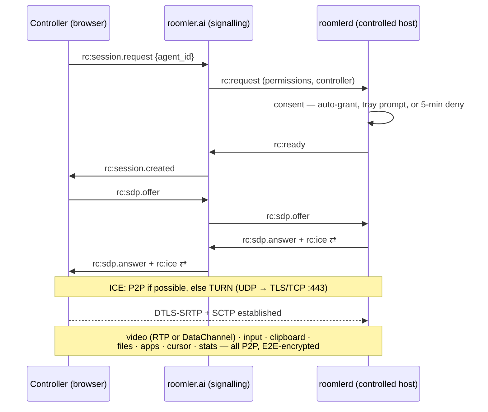

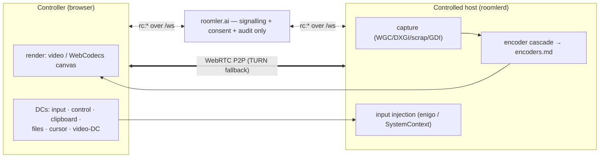

The original wire-level view:

```
  ┌──────────────────────────┐                                     ┌────────────────────────────┐
  │  Controller (browser)    │                                     │  Controlled host (agent)   │
  │  Vue 3 + mediasoup-client│                                     │  Rust binary (Tauri tray)  │
  │                          │                                     │  scrap | wgpu | enigo      │
  │  ┌─────────────────────┐ │                                     │  ┌─────────────────────┐   │
  │  │ <video> screen      │◄┼──── RTP H.264 / AV1 (recv) ────────►│  │ capture+encode loop │   │
  │  │ DC: input  (ULR)    │─┼──── SCTP ord/unord ────────────────►│  │ enigo input service │   │
  │  │ DC: control (rel)   │◄┼──── SCTP reliable ─────────────────►│  │ control state       │   │
  │  │ DC: clipboard (rel) │◄┼──── SCTP reliable ─────────────────►│  │ clipboard sync      │   │
  │  │ DC: filexfer (rel)  │◄┼──── SCTP reliable ─────────────────►│  │ chunked file xfer   │   │
  │  └─────────────────────┘ │         (P2P or via TURN)           │  └─────────────────────┘   │
  └────────────┬─────────────┘                                     └────────────┬───────────────┘
               │                                                                │
               │ WSS  (signaling: SDP-equivalent, ICE, session control)         │ WSS
               │                                                                │
               └─────────────────────► Roomler API (Axum) ◄─────────────────────┘
                                       ├─ rc_signaling::Hub
                                       ├─ mediasoup RemoteControlRouter
                                       └─ MongoDB (sessions, agents, audit)

                                              ▲
                                              │ TURN credentials (REST API)
                                              │
                                       coturn.roomler.live
```

The application server **never sees raw input or pixels** — those flow over the WebRTC PeerConnection between agent and controller, either P2P or relayed by TURN. The server only does signaling, authorization, mediasoup routing setup, and audit logging.

## 4. The agent

A standalone Rust binary, distributed as `roomlerd` per OS. Two operating modes:

1. **Attended** — user runs `roomlerd --pair` from the tray, gets a one-time PIN, types it in the controller UI. PIN is good for 10 minutes, single use.
2. **Unattended** — agent registers once with an `enrollment_token` (issued by an org Admin via the existing org settings UI), persists a per-machine `agent_token`, and stays connected to the API via WebSocket whenever the user is logged in.

### 4.1 Why a native binary (and not just `getDisplayMedia` + browser)

`getDisplayMedia` works for *attended screen sharing* (which roomler already has via `produce`). It cannot:

- run when no browser tab is open,
- inject mouse/keyboard into other apps,
- read/write the system clipboard,
- access multiple displays distinctly,
- enumerate windows for window-only sharing,
- bypass DRM-protected surfaces with hardware capture paths,
- survive browser tab crashes.

So: native agent for the *host*, browser for the *controller*. This is the same split RustDesk uses, and Chrome Remote Desktop, and Parsec.

### 4.2 Agent crate layout

> 🗄️ **The original design sketch, kept for its intent; the code's layout
> differs.** Capture is `capture/{wgc_backend, scrap_backend, drm_backend,
> x11_damage}.rs` plus `capture/portal/`, and a Mac captures through `scrap`'s
> CoreGraphics `CGDisplayStream` (`capture/scrap_backend.rs:8`): there is no
> ScreenCaptureKit code. Encode is `encode/{ffmpeg/, mf/, openh264_backend,
> libvpx}.rs` with the rate-control modules beside them, VideoToolbox among
> FFmpeg's encoders ([encoders.md](encoders.md)). The packaging is under
> `agents/roomlerd/packaging/` and `agents/roomlerd/wix/`.

```
agents/roomlerd/
├── Cargo.toml                 # workspace member of the main repo
├── src/
│   ├── main.rs                # tray/CLI entry
│   ├── config.rs              # ~/.config/roomler/config.toml
│   ├── enrollment.rs          # one-shot enrollment → agent_token
│   ├── signaling.rs           # WSS to roomler API, rc:* protocol
│   ├── peer.rs                # webrtc-rs PeerConnection wrapper
│   ├── capture/
│   │   ├── mod.rs             # trait ScreenCapture
│   │   ├── windows.rs         # WGC (Windows.Graphics.Capture)
│   │   ├── macos.rs           # ScreenCaptureKit
│   │   ├── linux_wayland.rs   # PipeWire via xdg-desktop-portal
│   │   └── linux_x11.rs       # XShm fallback
│   ├── encode/
│   │   ├── mod.rs             # trait VideoEncoder
│   │   ├── nvenc.rs           # NVIDIA HW
│   │   ├── amf.rs             # AMD HW
│   │   ├── qsv.rs             # Intel HW
│   │   ├── vt.rs              # macOS VideoToolbox
│   │   ├── mediafoundation.rs # Windows MF
│   │   ├── vaapi.rs           # Linux VA-API
│   │   └── openh264.rs        # SW fallback
│   ├── input/
│   │   ├── mod.rs             # trait InputInjector
│   │   ├── enigo_backend.rs   # default (uxn-cross-platform)
│   │   ├── windows.rs         # SendInput (handles UIPI / DPI)
│   │   ├── macos.rs           # CGEventPost (needs Accessibility)
│   │   └── linux.rs           # uinput (Wayland) / XTest (X11)
│   ├── clipboard.rs           # arboard + change watcher
│   ├── filexfer.rs            # chunked, resumable
│   ├── permissions.rs         # OS-specific consent dance
│   └── audit.rs               # local log + push events to server
└── installer/
    ├── windows.wxs            # MSI; auto-start at user login
    ├── macos.plist            # LaunchAgent (user, not Daemon, in v1)
    └── linux/
        ├── roomler.service         # systemd --user
        └── flatpak/...
```

`webrtc-rs` is the right peer-connection lib here — it's pure Rust, has matured a lot, and integrates cleanly with `tokio`. Using it on the agent side means a controller browser sees a regular WebRTC peer; the agent does not need to attach to mediasoup, it just dials the controller's `mediasoup-client` peer.

### 4.3 Why P2P, not always SFU

For 1↔1 remote control, mediasoup as a relay buys you *nothing* and adds a hop. So the agent and controller form a **direct PeerConnection** (P2P with ICE → TURN fallback). The mediasoup SFU only enters the picture when **multiple controllers** observe the same session (e.g., a support session shadowed by a senior engineer, or screen-sharing a remote-control session into a roomler call). In that case, the agent's stream is republished to a mediasoup `RemoteControlRouter` and other controllers consume from the SFU as view-only.

```
1 controller : 1 agent           → direct PeerConnection (best path)
N controllers : 1 agent          → agent → mediasoup → N consumers (view-only)
1 active controller + N watchers → split: 1 PC for input controller, SFU for watchers
```

This hybrid is exactly the `WorkerPool + RoomManager` pattern already in roomler — we just add a transport kind for "remote screen capture" and a one-producer router shape.

### 4.4 Whether a session may ride the overlay (#1882)

A session's ICE can find a pair over the WireGuard **overlay**, not just over the LAN, a direct path or TURN. That needs only the controller's browser to run on an overlay node, which an operator's laptop usually is. Whether that is allowed is **the device's call**: `AccessPolicy.rc_overlay`, set per device on the **Devices** page (**Mesh: off / auto / on** on the device's row), **off by default**. FR-128's `auto` lets each session decide for itself ([below](#auto-the-session-decides-fr-128)).

**Why off.** A session on the overlay inherits the overlay's failure modes, and its carrier is invisible to rate control:

- **#1856:** a 3 ms route hole on a Mac killed RC sessions.
- **Hidden carrier:** a pair the mesh carries over DERP/TCP reads as `local_typ=Host, relay=false`, so ABR budgets for a direct path while the video crosses a TCP relay.

On the hotspot topology in #1882, the overlay was the *only* working pair. Off means that topology falls to TURN instead, as every Windows and Linux target already did for host candidates.

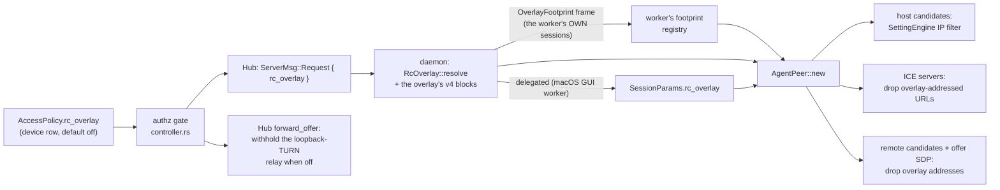

The overlay reaches a session's ICE three ways. The interface-name rule RC always had (`is_overlay_iface`: `roomler`, `roomler-*`, `roomler0`) covers only part of the first, so "off" needs one filter per way:

| How the overlay gets in | Filter (off) | Where |
|---|---|---|
| A **host** candidate on the overlay interface. On macOS that is a kernel-named `utunN`, which the name rule cannot see | `SettingEngine` IP filter: `RcOverlay::keeps_local` | `agents/roomlerd/src/peer.rs:497` |
| An **ICE server** on a mesh address: the loopback-TURN relay the Hub appends for a corp controller | Dropped from the session's servers (`RcOverlay::ice_servers`); the Hub also withholds it | `peer.rs:538`, `crates/modules/fleet/src/hub.rs:2407` |
| A **remote** candidate on a mesh address. The agent's srflx and relay sockets are bound to `0.0.0.0`, so a check to it routes into the TUN even though the agent offered no overlay candidate | Dropped when trickled, again after an mDNS name resolves, and from the offer SDP | `peer.rs:1901`, `peer.rs:1940`, `peer.rs:1866` |

"Overlay address" is **exact**: every v4 block this daemon's overlay routes (each org's `cidrs`, learned as each runtime brings its TUN up: `crates/tunnel-core/src/overlay_footprint.rs`, fed at `runtime.rs:2206`), plus the derived-v6 ULA `fd72:6f6f:6d6c::/96`.

> ⚠️ **Never the whole `100.64.0.0/10`.** That is real CGNAT space: an LTE modem, a cloud VPC's secondary range and Tailscale all hand out addresses in it, and a CIDR rule would silently strip their candidates. The footprint registry only ever grows, so a WS reconnect or runtime restart never opens a window in which an overlay address reads as foreign. **A daemon start does (#3359):** a session requested before the first runtime notes its blocks keeps an empty v4 list for its whole life, and on Windows the name rule can't help, because webrtc-util names every adapter `""`.

> ⚠️ **A supervised Mac's GUI worker runs no overlay** (FR-43: a GUI-session process cannot create a `utun`), yet it builds the peer for two kinds of session, and each needs the overlay's blocks by a different route:
>
> - **A session delegated from the daemon:** the daemon resolves the decision *with* its blocks (`signaling.rs:3911`) and sends both in `SessionParams.rc_overlay` (`delegate.rs:753`).
> - **The worker's OWN enrollment's sessions** (the per-user row) never cross the daemon, so the worker resolves them against its own footprint registry. The daemon fills it with `DelegateFrame::OverlayFootprint`: right after `Attached`, and again after a `Pong` whenever the set has grown (`delegate.rs:2162`, `delegate.rs:2206`; the worker side is `delegate_worker.rs:524`, wired at `app.rs:4966`). Measured on 0.4.122, before this frame existed: the user row's session logged `overlay_blocks=0` and still offered the `utunN` v4 address, while a daemon-row session logged `overlay_blocks=1` and offered no overlay candidate at all.
>
> A frame from an older daemon carries none and reads **off**, with an empty footprint: the derived-v6 ULA is still caught, the v4 utun address is not.

**Compatibility.** Each half defaults to off on its own, so mixed versions never turn the overlay on by accident:

| Server | Agent | Result |
|---|---|---|
| Older (no field) | New | Absent reads **off** (`signaling.rs:2532`, `serde(default)`) |
| New | Older | The old agent ignores the field and keeps its old behaviour, except the loopback-TURN relay, which the Hub now withholds |
| New, policy `auto` (FR-128) | Older than `rc-overlay-auto` | The Hub reads `auto` as `off` for it: no `rc_overlay_auto`, and no relay handed out |
| Cross-pod | | The relay envelope carries `rc_overlay`; absent reads **off** |

**What "off" does not cover.** It keeps overlay addresses out of the session; it does not override the host's own routing. A controller host using an **exit node**, or a route the mesh advertises for the browser's LAN (a **subnet router**), still sends ordinary internet or LAN traffic through the mesh. That traffic is the host's routing choice, not an overlay candidate.

**Verify on a device.** Each session logs one line, `rc ICE: overlay excluded (device policy rc_overlay=off, the default)` (or `allowed …`), with `overlay_blocks=N`, which reads 0 on a device with no overlay and, on a mesh device, marks a session from #3359's gap. A dropped remote candidate logs at DEBUG. With `rc_overlay` on, nothing is filtered beyond the name rule, which is the behaviour from before the switch existed.

#### `auto`: the session decides (FR-128)

`on` and `off` are each wrong somewhere:
- **`off`** relays a Mac's Chrome to a machine on its own network, every time. macOS denies Chrome's network helper the LAN, so the far relay is its only path ([FR-128](fr/FR-128-rc-overlay-auto.md) §2.2).
- **`on`** lets a relayed mesh carry the video over TCP.

With `auto`, the agent decides each session itself, **at its offer, before ICE gathers**. The peer then gets a plain on/off, filtered exactly as above.

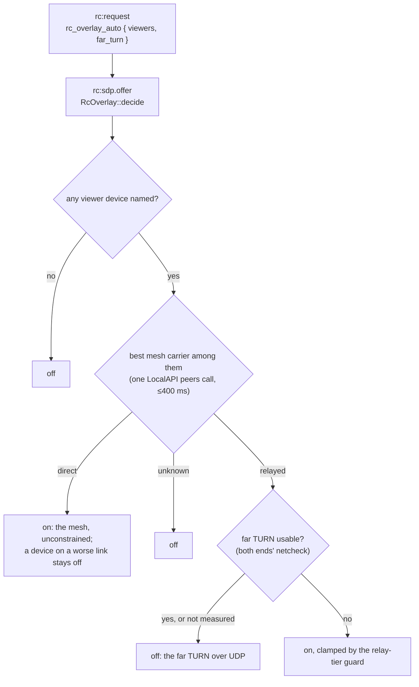

| Input | Where it comes from |
|---|---|
| that the agent decides at all | the `rc-overlay-auto` verb in `AgentCaps.rpc` (`crates/remote_control/src/models.rs:1196`), advertised while the kill switch is on (`agents/roomlerd/src/encode/caps.rs:4915`). The Hub sends `auto` to no other agent |
| that the policy is `auto` | `rc:request`'s `rc_overlay_auto`, sent with `rc_overlay: false`, so an agent older than the field reads off (`crates/remote_control/src/signaling.rs:2531`) |
| the viewer's devices | `RcOverlayAutoWire.viewers` (`crates/remote_control/src/signaling.rs:3769`): the `overlay_ip` of every loopback relay the Hub hands the browser, at most `LOCAL_RELAYS_MAX`, since FR-121 P3b hands over one relay per agent on the viewer's computer. The Hub fills it from the relays in the overlay range (`rc_overlay_auto_wire`, `crates/modules/fleet/src/hub.rs:145`) |
| the far TURN | `RcOverlayAutoWire.far_turn`: the last netcheck (`stun_udp`, since P2b alone) of the target and of the browser's best device, read by the server (below). The target folds its own netcheck in at the offer (D8, `own_far_turn`, `agents/roomlerd/src/rc_overlay.rs:768`). `None` = not measured, read as usable |
| the carriers | `mesh_carriers_of` (`agents/roomlerd/src/rc_overlay.rs:556`), one LocalAPI `peers` call for every viewer device: `Direct` direct, `Relay`/`Tunnel` relayed, anything else unknown. The best of them decides |
| the rule | `auto_allows` (`rc_overlay.rs:538`) |

Notes on the implementation:
- **It runs where the peer is built.** `RcOverlay::decide` (`rc_overlay.rs:224`) is called by the offer handler (`agents/roomlerd/src/signaling.rs:4674`), which a delegated macOS GUI worker runs too. The inputs cross to the worker inside `RcOverlay`.
- **A viewer device on a worse link stays off** (`exclude`, `rc_overlay.rs:70`). One computer can run several agents, each with its own relay: Windows and WSL, where the Windows agent is direct to its peers and the WSL one rides DERP (FR-121 P3b). A session that rides the mesh through the best one keeps every other one out of its ICE servers, its remote candidates and the offer's SDP. Otherwise ICE, which ranks relays by the order of their TURN servers, could pick the relay behind DERP.
- **It logs one line:** `rc ICE: overlay auto (FR-128) — the session may ride the mesh` (or `stays off`), with `viewers`, `carriers`, `far_turn` (the server's hint), `own_far_turn` (D8), `allow` and `exclude`.
- **Kill switch:** `ROOMLERD_RC_OVERLAY_AUTO=0` (`rc_overlay.rs:93`) makes `auto` behave as `off`. The device then stops advertising `rc-overlay-auto`, so the Hub reads its policy as `off` too.

**How the server feeds it.** The device row stores `auto` in a field of its own, `AccessPolicy.rc_overlay_auto` (`crates/remote_control/src/models.rs:1562`), beside `rc_overlay`. A pod or a page older than the field therefore reads `off`, never a row it cannot parse. On the **Devices** page it is the middle choice of **Mesh: off / auto / on** (`ui/src/components/admin/devicePolicy.ts:82`).

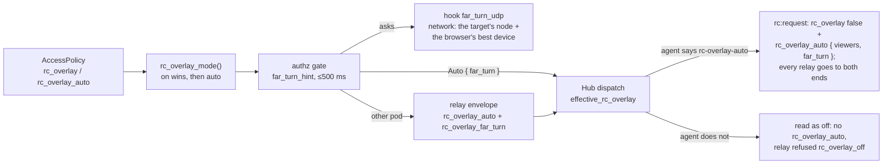

- **The mode** is `RcOverlayMode` (`models.rs:1592`). `rc_overlay_mode()` (`:1640`) reads `on` first, then `auto`, else `off`, the same order the page uses.
- **The far-TURN hint** comes from the authz gate (`far_turn_hint`, `crates/modules/remote/src/controller.rs:731`). It asks the hook registry (`far_turn_udp`, `crates/core/src/hooks.rs:168`) about the target and every device the browser runs on. `network` answers from each one's live overlay node, behind the same 60-minute freshness gate every consumer uses (`far_turn_reach`, `crates/modules/network/src/hooks.rs:190`).
  - **The browser's end is its best device** (`browser_reach`, `crates/modules/network/src/hooks.rs:217`). One that measured the far TURN alive decides, because a WSL agent with no UDP out says nothing about the Windows browser beside it. Otherwise one that measured it dead decides, so a device that was not measured cannot hide a dead one.
  - **The rule** is `far_turn_verdict` (`crates/modules/network/src/hooks.rs:231`): either end measured dead is `false`; both measured alive is `true`; anything else is not measured.
  - The gate waits at most 500 ms, then sends no hint. A slow read costs the hint, never the session.
- **Which devices are the browser's** follows the Hub's own precedence (`viewer_devices_of`, `controller.rs:696`). Probed descriptors win over named devices, and every one the Hub hands out counts, through the Hub's own `bounded_relays` and `named_devices` (`crates/modules/fleet/src/hub.rs:105`, `:126`). The browser sends them all: the first as `local_relay`, the rest as `local_relay_also` (`ui/src/composables/useRemoteControl.ts:4383`).
- **The target folds in its own netcheck** at the offer (D8): one LocalAPI `status` call beside the `peers` call (`own_far_turn`, `agents/roomlerd/src/rc_overlay.rs:768`). If that netcheck found no UDP out, the far TURN is dead whatever the server saw (`with_own_reach`, `:787`). This is what measures a Mac: its RC target is the GUI worker's row, and that row has no overlay node for the hook to find (`find_live_by_agent`, `crates/services/src/dao/overlay_node.rs:476`). The per-user half answers `status` itself, so it lends the root daemon's netcheck along with the rest of the machine's network fields (`with_machine_network`, `agents/roomlerd/src/person_socket.rs:305`).
- **The Hub** reads `auto` as `off` for an agent that does not advertise `rc-overlay-auto` (`effective_rc_overlay`, `crates/modules/fleet/src/hub.rs:2964`). It decides this once per request, for the relay and the session alike.
- **Under `auto` the Hub hands out the browser's relays** to both ends, as under `on` (`resolve_local_relay`, `hub.rs:3122`; `forward_offer`, `:2407`). The agent may yet take them, and it filters out itself whichever it leaves off the mesh.
- **Across pods** the relay envelope carries `rc_overlay_auto` and `rc_overlay_far_turn` beside the bool (`rc_overlay_to_relay`, `crates/modules/remote/src/relay.rs:591`; `rc_overlay_from_relay`, `:604`). An older pod reads only the bool, so `auto` reaches it as `off`.
- **Status:** live since 2026-10-29, on agents from 0.4.185 and server images from `hosted-20261029-2ae4ffd`. P2b (the hint reads `stun_udp` alone) and P2c's server half (D8: the browser's best device) are live since `hosted-20261030-ff00741`; P2c's agent half (the target's own netcheck) since agent 0.4.189. The field record is FR-128 §8.

> ⚠️ **Never "decide while gathering" by holding overlay candidates back.** A candidate that is held has still been gathered, and webrtc-rs pairs every gathered candidate. On a weak-host OS, checks from the overlay-bound socket to a browser's LAN address can come back over the mesh as a peer-reflexive pair. The session would then ride a relayed mesh exactly when `auto` had said no.

#### The carrier rank (FR-148 P4)

`auto` makes its choice once, before ICE gathers, and `on` never makes one. Either can leave a session on a mesh link that a relay carries over TCP, which is CORPLAP-2's case behind its VPN ([FR-148](fr/FR-148-path-measured-plan-follows.md) §2, AC22). The carrier rank orders the session's candidates instead of removing any. The mesh stays allowed, but unless the mesh link to the viewer's device is direct, every candidate only the mesh carries ranks below every TURN relay. The session then lands on TURN whenever TURN connects, and on the mesh when nothing else does. Nothing is held back (the warning above stands), and nothing restarts ICE: the order is set before gathering, and the browser, which controls the selection, follows it.

It ships off, behind a switch of its own, for FR-148's AC4 experiment:

| `ROOMLERD_RC_CARRIER_RANK` (config key `rc_carrier_rank`) | What a session does |
|---|---|
| `0`: the default, unset, or any other value | As before, byte for byte: no link is read, no `rc ICE: carrier rank` line is written, and every candidate is signalled as gathered |
| `prio` | The rank, by ICE priority alone |
| `1` | The rank, and each ranked-last candidate's `rc:ice` line also ends with ` network-cost 999`, the costliest value of the `network-cost` attribute, which Chrome reads into its own choice of pair |
| `route` | The rank as under `1`, and the route rank on top: the pair's route is the unit, not a candidate ([below](#the-route-rank-fr-148-p4-step-2)) |

**Turning it on for one device.** The person at the device runs `roomler config set rc_carrier_rank prio` (or `1`, or `route`), then `roomler restart`. The command takes `route` from agent 0.4.232. On 0.4.231 it refuses `route`, which the daemon still reads from the top-level line `rc_carrier_rank = "route"` in `config.toml` or from `ROOMLERD_RC_CARRIER_RANK=route` in its environment (a Windows service sees a new machine variable only after a reboot), each after a restart. The daemon's start line `config-backed env fallbacks registered` then lists `RC_CARRIER_RANK` when the config key set it; a variable is not listed there. `roomler config set rc_carrier_rank 0` and a restart undo it; a set variable wins over the key, so one set that way is removed instead. Remote config cannot set it ([remote-config.md](remote-config.md)).

**Where it is read.** Once per session, by the daemon, when the session is requested: `RankMode::read` (`agents/roomlerd/src/rc_overlay.rs:124`) in `RcOverlay::resolve_mode` (`:175`), beside `auto_enabled`. The value rides in `RcOverlay.carrier_rank` (`:84`) with the mesh's v4 blocks, which rank mode carries even when the mesh is allowed (`resolve_ranked`, `:181`). A delegated macOS GUI worker, which has neither the daemon's environment nor its config, so ranks the session the same way. Under `0` neither field is serialized, and the delegation frame is byte for byte what it was.

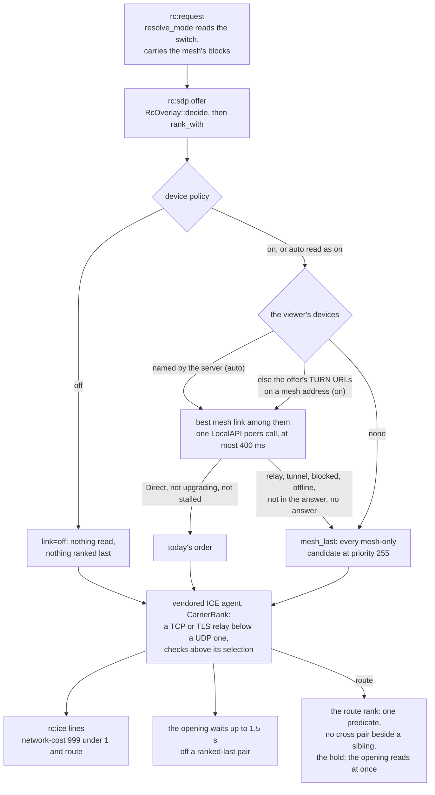

**The decision at the offer** (`RcOverlay::rank_with`, `rc_overlay.rs:248`, called from `decide`, `:224`):

| Input | In rank mode |
|---|---|
| the policy | `on` and `auto` both allow the mesh: `auto` behaves as `on`, its far-TURN hint is not read, and no viewer device is excluded. `off` stays off, and nothing is read. `ROOMLERD_RC_OVERLAY_AUTO=0` still makes `auto` an `off` |
| the viewer's devices | the ones the server named (`auto`), else every `turn:` or `turns:` URL among the offer's ICE servers whose host is a mesh address: each relay of the viewer is a TURN server on its device's mesh address, and under `on` the server names none (`viewer_devices`, `:284`) |
| the link | one LocalAPI `peers` call within 400 ms, the one FR-128's lookup makes (`mesh_links_of`, `:591`). The best device's link decides |
| the rule | only a `Direct` link that is neither `upgrading` nor `stalled` keeps today's order (`MeshLink::is_direct`, `:623`). Relayed, a tunnel, blocked, offline, not in the answer, no answer in time, and no viewer device known all rank the mesh last |

**The carrier order.** With `mesh_last`, the agent's own candidates get these priorities, where a priority is 2^24 × type + 2^8 × local + (256 − component). Ranked last is 255 for component 1 (`ranked_last_priority`, `crates/vendored/webrtc-ice/src/agent/agent_config.rs:265`), which no other candidate of the agent's can have:

| The agent's candidate | Switch `0` | Rank, link direct | Rank, link not direct |
|---|---|---|---|
| host on the mesh | 1,526,726,655 (type 90, the overlay-host override) | 1,526,726,655 | **255** |
| server-reflexive mapped to a mesh address (a STUN answer that crossed the mesh) | RFC 8445 | RFC 8445 | **255** |
| relay relayed at, or served from, a mesh address (the viewer's own relay) | 16,777,215 | as any relay, below | **255** |
| relay over UDP, any other | 16,777,215 | 16,777,215 | 16,777,215 |
| relay over TCP or TLS, any other | 16,777,215 | 8,388,607 (local preference 32767) | 8,388,607 |
| any other host or server-reflexive | RFC 8445 | RFC 8445 | RFC 8445 |

"Mesh" is exact here too: the carried v4 blocks and the derived-v6 ULA (`overlay_footprint::is_overlay_addr`), never the whole `100.64.0.0/10`. The priorities are set where the candidates are made (`host_priority`, `srflx_priority`, `relay_priority`, `crates/vendored/webrtc-ice/src/agent/agent_gather.rs:81`, `:92`, `:104`), so the pairs, the follow gate and the signalled line all read the same 255. A pair's priority is 2^32 × min(G, D) + 2 × max(G, D) + (G > D), so every pair with a ranked-last candidate on the agent's side ranks below every pair whose two candidates both rank above it: below every relay pair the browser can make, its TLS relay at local preference 1 (priority 511) included.

**The agent keeps checking.** Upstream's controlled agent sends no check after its first selection. A TURN client creates its permission for a peer only when it first sends to it, and the TURN server drops whatever arrives from a peer no permission covers. So a relay the agent gathered after its first selection never validated, and the browser could not move onto it (the vnet cell `without_the_rank_a_turn_pair_after_the_first_selection_never_validates`, `crates/vendored/webrtc-ice/src/agent/agent_carrier_rank_test.rs`). In rank mode the agent keeps checking every pair the follow gate would follow, on every tick of its loop and bounded as any check is (`check_pairs_above_selection`, `crates/vendored/webrtc-ice/src/agent/agent_selector.rs:249`, called at `:769`). A tick is 200 ms once connected too, and under `route`, while the selection rides the mesh, the bound is a budget of the pair's own ([phase B](#the-move-off-the-mesh-fr-148-p4-step-2-phase-b)). The two use one predicate, `outranks_on_a_real_path` (`:88`): the pair's remote is off the overlay range, and the pair ranks strictly above the selection. The agent therefore never validates a pair the follow gate (`should_follow_renomination`, `:57`) would refuse. Under `route` both read the route rank's predicate instead, with the mesh's own blocks (`AgentInternal::outranks`, `:152`; [below](#the-route-rank-fr-148-p4-step-2)).

**The opening's wait.** A data-channel pump starts from the pair it reads at its opening: its first constrained flag, which it re-reads every 5 s, and its rate memory's key and opening ceiling, which it keeps (`detect_constrained_transport` and `nominated_remote_ip`, `agents/roomlerd/src/peer.rs:2070`, `:2106`). The browser's move off a ranked-last pair comes a moment after its first selection, so a ranked-last pair waits for it, up to 1.5 s a connection (`opening_pair`, `agents/roomlerd/src/carrier_rank.rs:183`). The wait stops as soon as the selection moves, and at once when gathering has ended with no relay off the mesh, since nothing better can then come. The pump's two reads share one deadline (`opening_deadline`, `:167`). A pair that is not ranked last is read at once, so under `0`, and on a direct link, nothing waits. Under `route` nothing waits either: the ICE agent has held already (`opening=route`, [below](#the-route-rank-fr-148-p4-step-2)).

**The four lines.** Their fields are pinned by the cells beside them (`rc_overlay::tests`, `carrier_rank::tests`):

| Line | When | Fields |
|---|---|---|
| `rc ICE: carrier rank (FR-148 P4)` | once, at the offer, in rank mode (`log_rank`, `rc_overlay.rs:342`) | `session`, `carrier_rank`, `link`, `upgrading`, `stalled`, `viewers`, `viewers_from`, `read_ms`, `ranked_last`, `mesh_blocks` |
| `ICE: gathered local candidate` | every local candidate, under every switch (`gathered`, `carrier_rank.rs:61`) | `session_id`, `typ`, `protocol`, `address`, `port`, `related`, then P4's `priority` and `ranked_last` |
| `per-session ICE path detected (adaptive bitrate)` | once a data-channel pump, at its opening, under every switch (`path_detected`, `carrier_rank.rs:264`; under `route`, `log_path`, `:388`) | `relay`, `local_typ`, `local_proto`, `local_addr`, `remote_typ`, `remote_proto`, `remote_addr`, then P4's `waited_ms` and `opening` (`none`, `moved`, `nothing-to-wait-for` or `deadline`; `route` under `route`). Under `route` alone, then `route`, `hold_ms` and `hold_exit` ([below](#the-route-rank-fr-148-p4-step-2)) |
| `rc ICE: carrier rank, the mesh link 10 s on (FR-148 P4)` | about 10 s after the offer, when a viewer device was known (`log_link_again`, `rc_overlay.rs:744`) | `session`, `link_at_offer`, `link`, `upgrading`, `stalled`, `read_ms` |

A session that **moved** to TURN: its mesh link was relayed, its mesh candidates went out at 255, and the browser renominated onto TURN 412 ms into the opening. The lines below show the shape the cells pin, with documentation addresses:

```text
INFO rc ICE: carrier rank (FR-148 P4) session=<id> carrier_rank=prio link=relay upgrading=false stalled=false viewers=1 viewers_from=relay-urls read_ms=3 ranked_last=host,srflx,relay mesh_blocks=100.64.0.0/22,fd72:6f6f:6d6c::/96
INFO ICE: gathered local candidate session_id=<id> typ=host protocol=udp address=100.64.0.12 port=50123 related=:0 priority=255 ranked_last=true
INFO ICE: gathered local candidate session_id=<id> typ=relay protocol=udp address=203.0.113.7 port=61002 related=198.51.100.20:50124 priority=16777215 ranked_last=false
INFO per-session ICE path detected (adaptive bitrate) session_id=<id> relay=true local_typ=Relay local_proto=Udp local_addr=203.0.113.7:61002 remote_typ=Srflx remote_proto=Udp remote_addr=198.51.100.4:50000 waited_ms=412 opening=moved
INFO rc ICE: carrier rank, the mesh link 10 s on (FR-148 P4) session=<id> link_at_offer=relay link=relay upgrading=false stalled=false read_ms=2
```

A session that **stayed** on the mesh, because its link was direct: nothing ranked last, and nothing waited.

```text
INFO rc ICE: carrier rank (FR-148 P4) session=<id> carrier_rank=prio link=direct upgrading=false stalled=false viewers=1 viewers_from=relay-urls read_ms=3 ranked_last=none mesh_blocks=100.64.0.0/22,fd72:6f6f:6d6c::/96
INFO ICE: gathered local candidate session_id=<id> typ=host protocol=udp address=100.64.0.12 port=50123 related=:0 priority=1526726655 ranked_last=false
INFO per-session ICE path detected (adaptive bitrate) session_id=<id> relay=false local_typ=Host local_proto=Udp local_addr=100.64.0.12:50123 remote_typ=Host remote_proto=Udp remote_addr=100.64.0.9:50200 waited_ms=0 opening=none
INFO rc ICE: carrier rank, the mesh link 10 s on (FR-148 P4) session=<id> link_at_offer=direct link=direct upgrading=false stalled=false read_ms=2
```

A session whose link was relayed also stays on the mesh when no TURN pair connects: its first line reads as the moved one's, and its path line names the mesh pair with `opening=deadline` (`waited_ms` about 1500) or `opening=nothing-to-wait-for` (gathering ended with no relay off the mesh). That is AC23's case.

How to read them:

- **`opening`** says why the pump took its pair: `moved` is the rank at work; `none` with a relay is TURN at the first selection; `deadline` and `nothing-to-wait-for` on a mesh pair are a session that had nothing better. A move after the deadline is still followed, and the pump's 5 s re-read of the pair moves its ceiling with it; its rate memory's key stays the opening's.
- **`link=no-answer`** with `read_ms` near 400: the daemon's LocalAPI did not answer in time, and the session ranked the mesh last. `link=no-viewer` (`viewers=0 viewers_from=none`): no viewer device was known, and the same holds.
- **`mesh_blocks`** with no v4 block, only `fd72:6f6f:6d6c::/96`: the daemon had not learned its blocks when the session was requested (#3359's gap), so its v4 mesh candidates were not ranked last.
- **`link_at_offer=relay link=direct`** 10 s on: the link the offer read as relayed was direct a moment later, so that session would have been fine on the mesh. How often that happens is what the switch's default waits on.

#### The route rank (FR-148 P4 step 2)

`prio` and `1` rank candidates, and the field showed that a candidate's rank cannot see where a pair goes. In FR-148's field read 7 (#3953, D49), 11 of 13 sessions selected a pair whose remote was the viewer's relay on its device's mesh address. In **shape A** the agent's LAN host paired with that relay: no candidate of the pair was ranked last, yet its checks went into the mesh, because the destination picks the route. In **shape B** the agent's ranked-last mesh host paired with it, validated first, and the browser kept the first pair it validated. The switch's fourth value, `route`, makes the pair's route the rank's unit. Like the others it is off unless set: under `0`, `prio` and `1` the ICE agent gets no route rank (`CarrierRank::route` is `None`), and nothing below runs.

| D49 | Under `route` | Where |
|---|---|---|
| **1. One predicate** | A pair rides the mesh when its local candidate is ranked last or sits on a mesh address, or its remote sits on one. "Mesh" is the carried v4 blocks and the derived-v6 ULA, the addresses the carrier order reads, never the whole `100.64.0.0/10`. A name (an mDNS `.local`) is not the mesh's | `rides_the_mesh`, `crates/vendored/webrtc-ice/src/agent/agent_config.rs:183`, with the addresses `RcOverlay::ice_rank` hands it (`agents/roomlerd/src/rc_overlay.rs:318`) |
| **A2. Every reader reads it** | the follow gate, the checks above the selection, the opening and the carrier record. An address of the `/10` outside the blocks (a carrier's CGNAT, a corporate VPN) is a real path, and a pair whose local socket the mesh carries is not. Under `0`, `prio` and `1` each reads as built | `outranks_off_the_mesh`, `crates/vendored/webrtc-ice/src/agent/agent_selector.rs:106`, through `AgentInternal::outranks` and `follows_renomination` (`:152`, `:162`); `RTCIceTransport::route_read`, `crates/vendored/webrtc/src/ice_transport/mod.rs:106`, read by the opening (`agents/roomlerd/src/carrier_rank.rs:188`) and the carrier record (`agents/roomlerd/src/session_carrier.rs:367`) |
| **2. No cross pair beside a sibling** | no pair from a local candidate off the mesh to a remote on it while the session has a local candidate on the mesh or a TURN URL on the mesh. That route is then also a pair of the agent's own mesh candidates, which the rank ranks | `add_pair`, `crates/vendored/webrtc-ice/src/agent/agent_internal.rs:534`; `refuses_pair`, `:575` |
| **R1. No sibling** | a session with neither forms the cross pair: it is the route's only pair, and rule 3 holds it like any pair on the mesh. Such a session is a Linux agent (the name rule keeps `roomler0` out of its host candidates) given no relay of the viewer's | `settle_sibling`, `agent_internal.rs:589` |
| **3. The silent hold** | the controlled agent neither checks nor answers its pairs on the mesh while all three hold: less than 2.5 s since its checks started, no pair off the mesh selected, and a relay off the mesh can still come (an allocation on a TURN server off the mesh is still running, or a pair off the mesh has not failed). Every candidate is still signalled, and nothing restarts ICE | `holds_mesh_route`, `agent_internal.rs:668`; its checks skipped, `:494`; an inbound check dropped unanswered, `agent_selector.rs:876` |
| **4. The opening reads at once** | `opening=route`, `waited_ms=0`: ICE has held already, and a wait would only add to AC23 | `opening_pair`, `agents/roomlerd/src/carrier_rank.rs:183` |
| **5. The path line names the route** | `route`, `hold_ms` and `hold_exit`, read from the agent once, at the opening (`Agent::route_read`, `crates/vendored/webrtc-ice/src/agent/mod.rs:409`) | `log_path`, `carrier_rank.rs:388` |

**Where it acts.** The refusal and the hold need a mesh link that is not direct, the case in which the carrier order ranks the mesh last (`CarrierRank::route_engaged`, `agent_config.rs:215`). On a direct link `route` only keeps the follow gate and the checks above the selection off the mesh, and a session the mesh carries direct stays on it, as under `prio`.

**The sibling is fixed before any candidate exists.** D49 assumed that the host candidates are gathered before any remote arrives. They are not: webrtc-rs adds the offer's own candidates when it sets the remote description, before its gather starts; a trickled remote races the host gather; and the host gather lists its interfaces in no fixed order. So both halves of the sibling are read before the gather starts (`Agent::new`, `crates/vendored/webrtc-ice/src/agent/mod.rs:202`; `AgentInternal::new`, `agent_internal.rs:239`): "a TURN URL on the mesh" from the config, and "a local candidate on the mesh" from the interface list the host gather itself reads, through the same filters. A half is dropped only when the gather that was to make it ends without it (`settle_sibling`, called at `crates/vendored/webrtc-ice/src/agent/agent_gather.rs:237` and `:299`): no host on the mesh (its bind failed), or, when the whole gather ends, no server-reflexive or relay candidate on the mesh (the viewer's TURN server never answered). With no half left, the pairs refused so far are formed then, as R1 forms them. Whether a pair is refused never depends on the order the candidates come in.

**How the hold ends.** It is read again at every check the agent sends or receives:

| `hold_exit` | The hold stopped because | `hold_ms` |
|---|---|---|
| `real-selected` | a pair off the mesh was selected | from the checks' start to that selection |
| `nothing-real` | nothing off the mesh could still come: every allocation on a TURN server off the mesh had ended, and every pair off the mesh had failed. Before any selection, a pair off the mesh that forms later (the browser's far relay, trickled late) holds it again | from the checks' start to the stop |
| `bound` | `ROUTE_HOLD` (`agent_config.rs:117`), 2.5 s, passed since the checks started: AC23's 5 s, less a mesh pair's check and nomination after it, and a margin | 2500 |
| `none` | it never applied: the agent controlled, or the mesh link was direct | 0 |

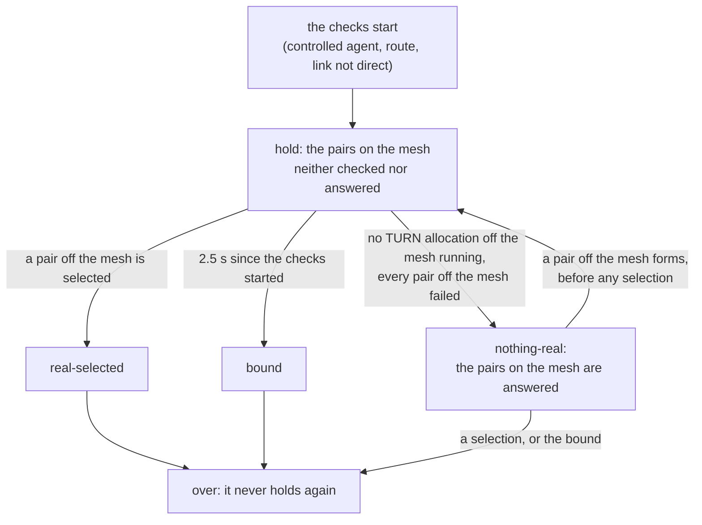

A selection or the bound ends the hold for good (`hold_ends_at_selection`, `agent_internal.rs:725`), so a pair that carries the session is always answered.

**The path line under `route`.** The same line, with `opening=route` and three fields after it. The far TURN won (either shape, TURN reachable):

```text
INFO per-session ICE path detected (adaptive bitrate) session_id=<id> relay=true local_typ=Relay local_proto=Udp local_addr=203.0.113.7:61002 remote_typ=Srflx remote_proto=Udp remote_addr=198.51.100.4:50000 waited_ms=0 opening=route route=turn hold_ms=266 hold_exit=real-selected
```

AC23's case, TURN blackholed: the hold ran to its bound, and the session opened on the viewer's relay over the mesh:

```text
INFO per-session ICE path detected (adaptive bitrate) session_id=<id> relay=false local_typ=Host local_proto=Udp local_addr=100.64.0.12:50123 remote_typ=Relay remote_proto=Udp remote_addr=100.64.0.9:50200 waited_ms=0 opening=route route=mesh-relayed hold_ms=2500 hold_exit=bound
```

`route` is the agent's read of the pair and, on the mesh, the overlay's carrier to the remote's peer, in the carrier record's words (`path_route`, `carrier_rank.rs:324`): `native` (off the mesh, no relay), `turn` (off the mesh, a relay at either end), `mesh-direct`, `mesh-relayed` (TURN or DERP), `mesh-org`, and `mesh-unknown` when the overlay cannot say. Under every other value the line is the one above, byte for byte (the cell `the_path_line_names_the_route_under_route_only`). The readers match it by its message and read its fields by name (`scripts/rc-path-report.cjs:357`, `rc-path-timeline.cjs:341`, `rc-shadow-report.cjs:124`), so the added fields change nothing for them. The carrier line keeps its words (D21); under `route` it decides "rides the overlay" by the same predicate ([§11.9](#119-the-carrier-a-session-rides-fr-102-p9c)).

**The kill switch.** `rc_carrier_rank` back to `1`, `prio` or `0` (or `ROOMLERD_RC_CARRIER_RANK`), then a restart; it is read once per session. Under every value but `route` the agent gets no route rank, and every branch above is a no-op: the vnet cells `kill_switch_under_prio_and_1_every_pair_is_formed_and_nothing_is_held` and `kill_switch_under_prio_shapes_a_and_b_still_open_on_the_mesh` hold that.

**The cells** (`crates/vendored/webrtc-ice/src/agent/agent_carrier_rank_test.rs`, on a vnet with a TURN server off the mesh and the viewer's relay on it):

| Cell | What it shows |
|---|---|
| `shape_a_the_opening_rides_turn_not_the_lan_host_paired_into_the_mesh`, `shape_b_the_opening_rides_turn_not_the_ranked_last_mesh_pair` | both field shapes open on TURN when TURN connects |
| `one_lan_the_native_pair_opens_with_no_hold_delay` | a LAN pair opens as fast as under `prio` |
| `ac23_a_refusing_turn_opens_on_the_mesh_at_once`, `ac23_at_the_products_hold_a_blackholed_turn_opens_on_the_mesh_within_5_s` | TURN refused: `nothing-real`; TURN blackholed, at the product's 2.5 s: `bound`, and on the mesh within 5 s |
| `r1_the_lan_hosts_pair_into_the_mesh_follows_the_sibling_not_the_order`, `r1_a_sibling_its_gather_never_made_is_dropped_and_the_refused_pair_formed`, `r1_without_a_sibling_the_pair_into_the_mesh_is_formed_held_then_answered` | R1, and the order the candidates come in |
| `a_peer_reflexive_remote_on_the_mesh_is_refused_with_a_sibling_and_held_without` | a peer-reflexive remote on the mesh |
| `a_far_relay_after_the_agents_relay_gather_holds_until_its_pair_fails` | the browser's far relay after the agent's relay gather ended |
| `the_hold_stops_at_its_bound_for_good`, `the_hold_stops_when_a_pair_off_the_mesh_is_selected`, `the_hold_never_holds_for_the_controlling_side_without_route_or_on_a_direct_link` | each way the hold ends, or never starts |
| `after_a_selection_on_the_mesh_a_late_far_relay_never_holds_it_again` | a selection, one on the mesh too, ends the hold for good: the pair that carries the session is always answered |
| `a2_under_route_the_follow_gate_reads_the_mesh_blocks_not_the_whole_range`, `a2_the_checks_above_the_selection_read_the_same_predicate` | A2 |

The roomlerd cells beside them pin the opening (`carrier_rank::tests::the_opening_reads_the_agents_route_at_once_under_route_only`, through a loopback TURN server), the path line, and the carrier record's agreement with the predicate (`session_carrier::tests::under_route_the_carrier_record_agrees_with_the_route_ranks_predicate`).

**What phase A leaves to later** (D49's phases):

- **A5.** The viewer does not yet say when its own gathering has ended. When the agent's relay gather has ended and no pair off the mesh exists yet, the hold stops at `nothing-real` though the browser's far relay may still come. When it comes, its pair holds the mesh again until it fails or the bound passes.
- **B.** A TURN that allocates after the bound, and the move off a mesh selection inside one ICE generation: built, [below](#the-move-off-the-mesh-fr-148-p4-step-2-phase-b).

#### The move off the mesh (FR-148 P4 step 2, phase B)

Phase A opens a session on the mesh when no TURN pair connects inside the hold: at its bound (`hold_exit=bound`), or once nothing off the mesh can come (`nothing-real`). A TURN relay that allocates later, such as the agent's own allocation held up by a middlebox, forms its pairs after that selection. As built, the agent followed the browser onto one only at the browser's next nomination after the agent's own check had validated the pair: on Chrome's round robin, a check every 2.4 s, that was 2.8 s after the relay. Phase B moves the session onto such a pair inside the same ICE generation, on the browser's first nomination. It acts under `route` alone, and only while the agent's selection rides the mesh by rule 1's predicate. With the selection off the mesh, and under `0`, `prio` and `1`, every branch below is a no-op.

| D49 phase B | While the selection rides the mesh | Where |
|---|---|---|
| **B1. A budget of its own** | every pair the follow gate would follow is checked on each tick of the agent's loop, 200 ms, up to 13 checks counted on the pair, then it fails. 13 checks span 2.4 s, inside the hold's 2.5 s bound: a pair that forms after the selection gets the hold's own time again for its far side to answer (the candidate's trip through signalling, the far TURN's permission for the agent's relayed address). A dead pair costs 13 checks, once. The browser's checks still reopen a failed pair: each is answered or nominates (B2), and triggers a check of the agent's | `check_pairs_above_selection`, `crates/vendored/webrtc-ice/src/agent/agent_selector.rs:249`, the budget at `:273`; `ROUTE_MOVE_CHECKS`, `crates/vendored/webrtc-ice/src/agent/agent_config.rs:130`; `CandidatePair::move_checks`, `crates/vendored/webrtc-ice/src/candidate/mod.rs:249` |
| **B2. Answer the nomination, move on the agent's own check** | a check of the browser's with USE-CANDIDATE on a pair the agent has not validated is answered with a success, and triggers the agent's own check (RFC 8445 §7.3.1.4), when the pair is off the mesh, its remote is an address, and the follow gate would follow it: one decision for the answer and for the move. The agent takes the nomination only when its own check of the pair succeeds (§7.3.1.5), so it never sends media on a pair it has not validated. Following nominations it had not validated is how Chrome steered the agent onto a half-blackholed pair on 2026-07-27, and SCTP died in every session. A later check of the browser's on the pair without USE-CANDIDATE withdraws the nomination. A pair on the mesh is never answered this way: during the hold, silence stays its only answer (rule 3) | `answers_before_validating`, `agent_selector.rs:221`; the answer, `:963`; the move, `:848`; the withdrawal, `:980`; `CandidatePair::nomination_pending`, `candidate/mod.rs:254` |
| **B3. The move is named** | one `session carrier moved` line at each change of the agent's selection after the opening | `follow_moves`, `agents/roomlerd/src/session_carrier.rs:523`; the line, `emit_moved`, `:583` |

**The checks already ran at 200 ms.** A connected agent does not wait for its 2 s keepalive to check: its loop starts each round at the check interval, 200 ms, and the keepalive interval can only shorten it (`crates/vendored/webrtc-ice/src/agent/agent_internal.rs:350`, `:352`). roomlerd sets no ICE interval of its own. So phase A's checks above the selection already ran every 200 ms. What they lacked was a budget: they spent the opening's, 8 checks (`max_binding_requests` is 7), and a pair whose far side had not answered by then failed until a check of the browser's reopened it. B1 adds the budget and no cadence code. As built, the cell `b1_a_dead_pair_above_a_selection_on_the_mesh_is_checked_at_the_check_cadence_within_the_budget` counted 8 checks about 215 ms apart; with B1 it counts 13, the last 2.6 s after the candidate arrived.

A late TURN, as the cells play it:

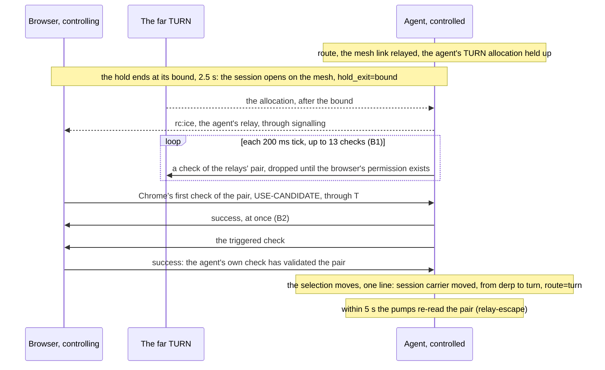

**The moved line.** Under `route` the observation that records the carrier also follows the session from its first pair (`observe`, `session_carrier.rs:427`, which starts `follow` at `:436`). It reads the selection every second (`MOVE_TICK`, `:84`), holding the peer weakly, until the peer is gone, closed or failed, and at each change of pair writes one line at `info`. The line's latency is never the media's: nothing waits on it, and no wire carries it. The recorded carrier, sent on `rc:session.stats`, stays the one read after the settle ([§11.9](#119-the-carrier-a-session-rides-fr-102-p9c)).

```text
INFO session carrier moved session_id=<id> from="derp" to="turn" route=turn relay_transport="udp" local_typ=Relay local_addr=203.0.113.7:61002 remote_typ=Srflx remote_addr=198.51.100.4:50000 overlay=None
```

| Field | What it says |
|---|---|
| `from`, `to` | the carrier the session left and the one it moved to, in the carrier record's words (D21): each by `carrier_on` with the agent's read of its pair and, for a pair on the mesh, the overlay's carrier for the remote's peer, asked at the move |
| `route` | the new pair's route, in the path line's words (`path_route`, `agents/roomlerd/src/carrier_rank.rs:324`) |
| `relay_transport`, `local_typ`, `local_addr`, `remote_typ`, `remote_addr`, `overlay` | the carrier line's fields, for the new pair, with its ports |

A pair the agent reads no route for ends the follow without a line, and under `0`, `prio` and `1` no follow starts.

**The constrained flag follows on its own.** Phase B builds the line only. A data-channel pump reads its constrained flag at its opening (`detect_constrained_transport`, `agents/roomlerd/src/peer.rs:2056`) and again every 5 s (`TRANSPORT_RECHECK_INTERVAL`, `:2121`; `current_pair_is_relay`, `:2182`), by one predicate: a relay at either end that is not the device's own fast TURN, or a remote on the mesh whose overlay carrier is not direct. A change writes `transport path changed mid-session — updating bitrate clamp (relay-escape)` with `was_relay` and `now_relay`. So within 5 s of a move, the flag is what the opening would have read on the new pair:

| The move | The flag before | After | What changes |
|---|---|---|---|
| mesh-relayed to TURN | on: the overlay carries the peer through TURN or DERP | on: a relay off the device | nothing, and no relay-escape line |
| mesh-relayed to native | on | off | the clamps lift |
| mesh-direct to native | off | off | nothing |
| TURN to native | on | off | the clamps lift |

The clamps: in the VP9 pump, the bitrate cap (`relay_max_bps`, 3 Mbps, against none), the buffered-amount watermark (256 KiB against `DC_BUFFERED_HIGH_BYTES`) and the worst-quality cap (`peer.rs:4419`); in the FFmpeg pump, everything it reads from the flag each frame (its rate ceiling and pipe estimate, its relay resolution cap, its queue budget and byte gate, its opener grace and IDR thrift) and, once a flip has held for two re-reads, its capture and encoder rebuilt at 30 or 60 fps, at most once a minute, under `rate_profile_rebuild` (`peer.rs:7753`). Its send depth and its rate memory's key stay the opening's. A relayed mesh and the far TURN read alike, so the move phase B exists for, mesh-relayed to TURN, keeps the clamp and changes the carrier under it. The cell `session_carrier::tests::the_constrained_flag_per_move_class` pins the table from the predicate's parts.

**The cells** (`crates/vendored/webrtc-ice/src/agent/agent_carrier_rank_test.rs`, on a vnet like phase A's; a stand-in for Chrome nominates with checks that carry USE-CANDIDATE):

| Cell | What it shows |
|---|---|
| `b1_the_budget_spans_the_holds_bound_at_the_check_cadence`, `b1_a_pair_above_a_selection_on_the_mesh_has_a_budget_of_its_own` | B1's numbers, and whose budget a pair spends: its own above a selection on the mesh under `route`; the opening's with the selection off the mesh and under `prio` and `1`; none under `0` |
| `b1_a_dead_pair_above_a_selection_on_the_mesh_is_checked_at_the_check_cadence_within_the_budget` | a live agent: 13 checks about 215 ms apart, then the pair fails |
| `b2_a_nomination_the_agent_has_not_validated_is_answered_and_taken_on_its_own_check` | one nomination moves the session: the answer, the triggered check, its success, then the agent's media |
| `b2_the_half_blackholed_pair_is_answered_never_taken_and_never_sent_on` | the agent's checks lost on the way: answered, never selected, nothing sent on it |
| `b2_with_the_selection_off_the_mesh_a_nomination_is_handled_as_built` | no move away from a real pair |
| `b2_one_decision_answers_only_a_pair_off_the_mesh_the_follow_gate_would_take` | the decision, row by row: a pair into or from the mesh, a selection off it, nothing selected, a name, a stale selection, a direct link |
| `b_a_turn_that_allocates_after_the_bound_opens_on_the_mesh_then_moves_once`, `b2_a_late_turn_moves_on_chromes_first_check_of_the_pair` | the late TURN: it opens on the mesh at the bound, read `hold_exit=bound`, and moves once: within 1.5 s of the agent's relay with Chrome checking every 480 ms, and within 1 s on Chrome's round robin, where as built it moved 2.8 s after the relay |
| `b2_kill_switch_under_prio_and_0_a_nomination_the_agent_has_not_validated_is_handled_as_built` | under `prio`, `1` and `0`: no answer, the triggered check, no move |

The roomlerd cells pin the line (`session_carrier::tests::the_moved_line_names_its_fields`, `under_route_each_selection_change_after_the_opening_writes_one_moved_line`, `a_move_to_another_port_at_the_same_address_is_a_move`), its absence without `route` (`without_route_nothing_follows_the_selection`) and the flag table.

**The kill switch** is phase A's: `rc_carrier_rank` back to `1`, `prio` or `0`, then a restart. Without the route rank a pair spends the opening's budget, a nomination the agent has not validated goes unanswered, `nomination_pending` is never set, and no follow starts.

**What phase B leaves.** B moves a session only onto a pair that ranks above its selection: phase A's follow gate. A pair's priority follows its lower candidate, so a selection on R1's cross pair, from the agent's LAN host, ranks above every pair through the agent's own TURN relay (16,777,215 at most, [the carrier order](#the-carrier-rank-fr-148-p4)). B does not move such a session onto the agent's relay, though D15 orders TURN above a relayed mesh. A5 stands as above.

### 4.5 How the viewer finds its own device's relay (FR-121)

The loopback relay the Hub appends is the viewer's OWN device's: a TURN server its agent hosts on loopback and on its
overlay address. The viewer learns of it one of two ways, chosen per connect by `localRelayPlan`
(`ui/src/composables/useRemoteControl.ts:4201`):

| | how | needs |
|---|---|---|
| **named** (FR-121) | Settings → "This browser runs on" names the person's own devices that advertise `local-relay`, one or more; the request carries `local_relay_from` (and `local_relay_from_also` for the rest), and the Hub answers on `rc:session.created` with the relay it holds from each device's `rc:agent.local_relay` report (`local_relay`, then `local_relay_also`), which the viewer adds with `setConfiguration` before its offer | nothing from the browser: no request to 127.0.0.1 |
| **probed** (before FR-121) | while no device is named, `fetch http://127.0.0.1:<port>/rc-local-turn` on every port of the band at once (`probeLocalRelays`, `ui/src/composables/useRemoteControl.ts:4073`); every descriptor that names one of the person's own devices fills the choice in, so the next connect is named (someone else's device keeps the probe: its relay would be refused as `not_your_device`) | Chrome's per-origin local-network permission, which a managed browser may forbid |

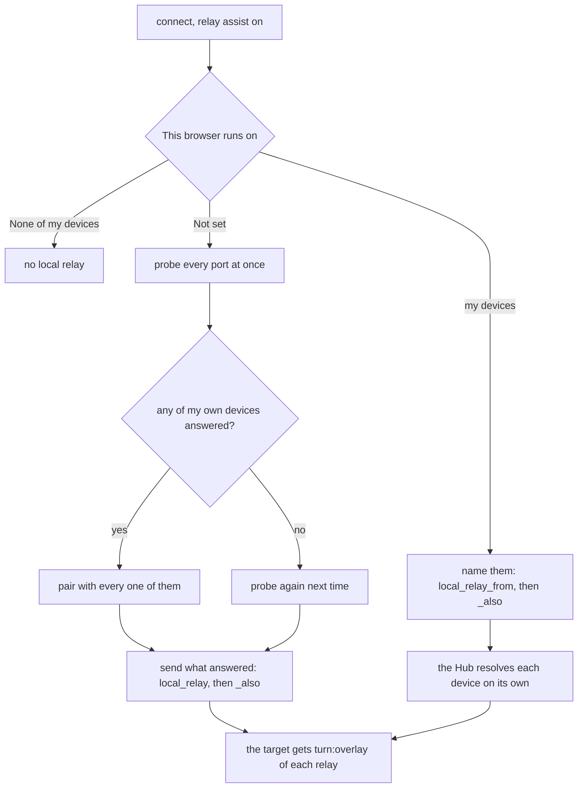

Chrome gates only the second. A public page's WebRTC reaches a TURN server on 127.0.0.1 without the permission
(FR-121 P0, measured on Chrome 155). The Hub hands a named device's relay over only to its owner, for a target in the
same organization whose `rc_overlay` is on, or `auto` on an agent that decides it (FR-128), and otherwise answers
`local_relay_refused`: `not_your_device`,
`other_network`, `device_offline`, `rc_overlay_off` or `same_device` (`resolve_local_relay`,
`crates/modules/fleet/src/hub.rs:3122`). The report lives in the Hub's memory with the agent's connection
(`set_agent_local_relay`, `crates/modules/fleet/src/hub.rs:3102`) and is never stored. ⚠️ It carries a live
credential, minted by the device and re-minted every 30 minutes, so nothing logs it.

> ⚠️ **On Chrome 156, a TURN server on 127.0.0.1 is no path from roomler.ai** (measured on neo16, 2026-10-29). There
> is no candidate and no error. Yet example.com reaches the same server, and roomler.ai reaches it on the device's
> overlay address (FR-121 §3.7). A named device's relay is handed over and the target allocates on it, but the browser
> gathers nothing from `turn:127.0.0.1:<port>` (`localRelayIceServer`, `ui/src/composables/useRemoteControl.ts:4502`),
> and the session rides the far TURN. Which address to hand the browser is FR-121's open decision 5.

**More than one agent on one computer (FR-121 P3b, #2774).** Windows and WSL under mirrored networking share
loopback, each agent with its own relay on its own probe port, and their overlay paths to a target can differ
completely: on neo16 the Windows agent is direct to every peer while the WSL one rides DERP, and a relay reached over
DERP carries no media. So the viewer takes every answer, not the first: it names every own device, the Hub resolves
each on its own (`named_devices`, `crates/modules/fleet/src/hub.rs:126`) and hands the target every `turn:` with the
offer (`crates/modules/fleet/src/hub.rs:2406`), at most `LOCAL_RELAYS_MAX` (4), and ICE checks a pair through each. A
target whose `rc_overlay` is off is refused that first (`crates/modules/fleet/src/hub.rs:3528`). Otherwise a refusal
is told only when no named device got a relay, and then it is the first one's.

> ⚠️ Chrome ranks its relay candidates by the order of its TURN servers, so among relays that all work, the first in
> port order wins, not the fastest. Port order is the agents' start order. Whether a slow relay can win that way is
> FR-121's open decision 4, measured by its AC9. On neo16 on 2026-10-29 it decided nothing: the WSL relay gave the
> browser no candidate at all (FR-121 §3.7).

> ⚠️ **The two directions can ride different pairs.** The agent keeps the first pair nominated. It follows a later
> nomination only to a non-overlay pair of higher priority, or away from a pair gone silent
> (`should_follow_renomination`, `crates/vendored/webrtc-ice/src/agent/agent_selector.rs:57`; under
> `rc_carrier_rank=route`, a pair off the mesh by the route rank's predicate, `:162`). Through a local relay,
> the video rides the relay's pair, but Chrome may send its own packets on another: on 2026-10-29 it sent input and
> the data channel's acks on the far TURN (FR-121 §3.7).

**The viewer's relay under the route rank (FR-148 P4 step 2).** Each relay the Hub hands the target is a `turn:` URL
on the viewer device's mesh address, so under `rc_carrier_rank=route` it is the session's sibling for D49's rule 2.
While the agent has it, it forms no pair from its LAN socket to the browser's candidate on that relay (the field's
shape A), its own allocation on the relay ranks last, and its pairs on the mesh stay unanswered until a pair off the
mesh is selected, nothing off the mesh can come, or 2.5 s pass (shape B;
[§4.4](#the-route-rank-fr-148-p4-step-2)). If that TURN server never answers and the agent has no host candidate on
the mesh either, the sibling is dropped when the agent's gather ends, and the pairs it held back are formed.

A browser paired with one device before P3b holds whichever agent answered first. On a later connect it looks once
more for the others, but only where Chrome says the loopback permission is already granted (`loopback-network`, or
`local-network-access` before Chrome split it), so the look never costs a prompt (`loopbackProbeIsSilent`,
`ui/src/composables/useRemoteControl.ts:4300`). It also waits for a connect whose device list vouches for the stored
device as the person's own (`mayLookAgain`, `ui/src/composables/useRemoteControl.ts:4246`): with another
organization in view, it could not tell the person's devices from anyone else's. The pairing widens to every own
device found, in probe order, and that connect names them, so the Hub checks each (`relayChoiceAfterProbe`,
`ui/src/composables/useRemoteControl.ts:4268`).

## 5. Capture & encode pipeline

### 5.1 Capture targets per OS

| OS | Primary API | Why | Fallback |
|---|---|---|---|
| Windows 10+ | `Windows.Graphics.Capture` (WGC) via `windows` crate | DXGI surface, no permission prompt for own session, handles DPI, supports per-window | DXGI Desktop Duplication |
| macOS | CoreGraphics `CGDisplayStream`, through `scrap` (`agents/roomlerd/src/capture/scrap_backend.rs:8`) | The one macOS capture path today: there is no ScreenCaptureKit code. It reports no damage, so every frame counts as changed | — |
| Linux, a host with scanout (X11 or Wayland) | **DRM/KMS** — the scanout plane read below the compositor (FR-36, opt-in `ROOMLERD_DRM_CAPTURE=1`) | Compositor-independent, needs no consent, sees the greeter and a locked screen — the unattended path | the portal, then X11 |
| Linux Wayland, **no** scanout (WSL2, containers, nested compositors) | **`xdg-desktop-portal` ScreenCast → PipeWire**, through a privilege-dropped helper in the user's session (FR-45, opt-in `ROOMLERD_PORTAL_CAPTURE=1`) — or `org.gnome.Mutter.ScreenCast` directly where no portal backend can run (`ROOMLERD_MUTTER_CAPTURE=1`, GNOME only, unattended). A **per-user** install in its own Wayland session with no key set switches these on by itself: mutter on GNOME, else the portal (FR-93 P2) | The only route a Wayland compositor sanctions; **attended** — a logged-in user and a consent dialog, never the greeter or a locked screen | X11 |
| Linux X11 | `XShm` via scrap, with XDamage deciding whether a frame is worth taking (FR-29) | Zero-copy via shared memory; on a headless box the daemon starts its own Xvfb (`ROOMLERD_VIRTUAL_DESKTOP=1`) | `NoopCapture` carrying the reason (§5.1a) |

> ⚠️ **Windows 11 24H2 and later throttle a WGC session to one frame per `MinUpdateInterval`, 16 ms by
> default: about 60 frames a second, whatever the screen does** (FR-119 P2b-15). Measured on neo16 (2560×1600 at
> 240 Hz, the screen changing about 180 times a second): 57.9 fps at the default, 188.6 fps at 1 ms. So above 60
> the backend lowers it to the largest whole number of panel refreshes inside the target's period, less 0.5 ms
> (`capture::gate::min_update_interval_100ns`). That is every second refresh for 120 on 240 Hz, because every
> delivered frame costs a full CPU readback, and every refresh for a rate the panel cannot divide, with the
> slot-first gate pacing the rest. At 60 and below Windows' default stays. Before this, every granted 120 or 144
> fps session on a Windows host was captured at about 58.

The portal path, and macOS's Screen Recording grant, produce a system permission prompt the *first* time. That's a feature, not a bug — it's the user consent layer. The Linux arms, their order and their gates are [`linux-capture.md`](linux-capture.md).

> ⚠️ **The end of a WGC capture must not end the apartment** (FR-85). The WGC worker joins the MTA and leaves it
> when its session closes. If that was the process's last MTA thread, COM unloads `GraphicsCapture.dll`, and
> whatever still runs in that module faults: `0xc0000005` in `GraphicsCapture.dll_unloaded`. So
> `wgc_backend::pin_mta` takes `CoIncrementMTAUsage` once per process and never
> gives it back. Measured on 0.4.197: a recorder child faulted during its remux and lost the recording
> (`docs/recording.md` §5), while a session's worker still held the module after five closed sessions, because
> something else holds the MTA there. Read on release 0.4.198: 24 recordings stopped over a moving screen, ten of them after 60 s or more, all saved, and Windows' Application log named no fault. 0.4.197 faulted once in 44, so that count is not a rate.

### 5.1a When capture cannot open, the session says why (FR-80)

A capture backend that cannot open does not fail the session: the cascade
falls through to `NoopCapture`, the pump starts normally and encodes nothing.
The controller sees a black canvas and a stall, which describes the symptom
and names no cause. Since FR-80 the agent sends the cause instead.

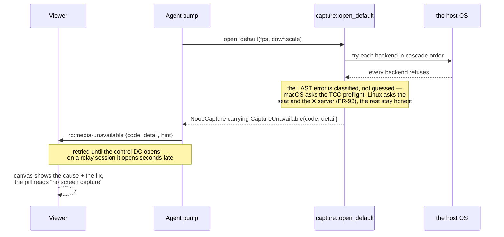

| `code` | Means | What the operator does |
|---|---|---|
| `permission` | The OS can capture; this process may not. macOS Screen Recording (TCC), a denied portal grant | Grant it on the host and reconnect. ⚠️ A macOS grant is bound to the binary's **code signature** — a signing-identity change invalidates it silently (2026-09-08: the Developer ID move did exactly that fleet-wide) |
| `no_display` | Nothing to capture — headless, no desktop session | Nothing. Shell and tunnels are unaffected. Files are too, except on a system install: a Linux one refuses reads with nobody at its screen (#3688), and a Mac's root daemon, which has no desktop session and says this code, declines file transfer (#3757, [desktop-companion.md §9.6](desktop-companion.md#96-a-macs-system-install-transfers-files-only-in-the-persons-session-3757)) |
| `not_built` | A signalling-only agent build, no capture backend compiled in | Install a full agent build |
| `backend_error` | The backend failed and the agent did not attribute it | Read `detail` (the backend's own words) and the agent log |
| `wayland_not_enabled` | FR-93: a Wayland desktop is showing, and every arm that could capture it is off on this device. Before FR-93 a per-user daemon streamed **black** here, and a system one said "headless" | Switch on the arm the `hint` names for this install: `drm_capture` + `uinput` on a system install, `portal_capture` (+ `mutter_capture` on GNOME) on a per-user one. See [`linux-capture.md` §1.1](linux-capture.md#11-a-wayland-desktop-with-nothing-switched-on-fr-93-p1) |

⚠️ **The `hint` sentence is composed by the AGENT, not the viewer**, because
only the host knows which OS it is on — the same reason the consent surface
names itself (FR-27). An older viewer that does not know a newer `code` still
shows its `hint`.

⚠️ **`rc:media-unavailable` is not a field on `rc:video-info`.** `video-info`
is built from a captured frame, so a session with no capture never reaches
it — which is exactly the hole this closes. Both are peer-to-peer control-DC
JSON, not `ClientMsg`/`ServerMsg` variants, so neither touches the server wire
or the composition baseline.

⚠️ **A retry sends the notice once.** `send_control_notice`
(`agents/roomlerd/src/peer.rs:6231`) bounds each attempt with a timeout, and on
a congested path the timeout cuts a send that is still waiting for room in
the SCTP queue. Such a send leaves nothing on the control channel (#3755):
no stream sequence number spent, nothing half-queued. So the next attempt is
the only copy the viewer reads, and every later control message still
arrives. Before the fix, a cut send left a gap in the ordered stream, and the
browser held every later control message behind it for the rest of the
session. The same holds for the idle warning and `rc:ended`, which have a
budget and no retry: cut, they are simply not sent. Details:
[`tunnels.md`](tunnels.md#%EF%B8%8F-a-send-cut-short-leaves-its-stream-whole-3755).

⚠️ **A viewer that shares another session's pipeline is told too** (#3260).
Two DC sessions of one host with the same profile share one capture and one
encoder ([`multi-org.md` §6](multi-org.md#6-p5--shared-floor-encoder-shipped-rc303-325)).
The second is a *follower*: it opens no capture, so it never reaches the check
that sends this message. Before #3260 its viewer had a black canvas and no
reason for the 10 s until its watchdog re-created the session. The new session
heard the reason only because, by then, the owner's loop had parked in
`NoopCapture` long enough for the pipeline to read as stale, so it opened a
capture of its own.

| Who | How it is told | Where |
|---|---|---|
| the owner's own viewer | `spawn_capture_unavailable_notice`, as before | `agents/roomlerd/src/peer.rs:6815` |
| the followers already on the pipeline | the owner calls `Pipeline::tell_unavailable`, which also keeps the reason | `agents/roomlerd/src/media_share.rs:665` |
| a viewer that joins later | `try_join` reads the kept reason under the same lock as the join, so a follower is told once either way | `agents/roomlerd/src/media_share.rs:943` |

Each follower's notice goes through the owner's retrying sender, under the
follower's own session. A follower joins while its peer is being built, before
it has any control channel.

⚠️ The two pumps tell the pipeline at different points, because they register
it at different points. The FFmpeg pump registers before it opens the capture,
so a viewer can join during a slow open. It tells the pipeline beside the
owner's own notice (`agents/roomlerd/src/peer.rs:6818`). The VP9 pump registers
after the open, so it tells the pipeline right after the registration
(`agents/roomlerd/src/peer.rs:4132`). `tell_unavailable` is a method on the
pipeline, so neither call can move above the registration.

⚠️ **A wait reaches them the same way** (#3423). A capture that waits on its
host told only the owner's viewer: FR-93's `rc:media-waiting`, for a portal
dialog, a locked screen, a display switched off or another user's session
([`linux-capture.md` §4.7](linux-capture.md#47-the-viewer-is-told-and-waits-fr-93-p2d-2)).
A follower's viewer got no frame and no reason, so its watchdog re-created the
session every 10 s for as long as the wait lasted, and each new session
followed the same silent pipeline. The pipeline now keeps the owner's notice as
one of two kinds (`OwnerNotice`, `agents/roomlerd/src/media_share.rs:170`). A
wait differs from a reason twice: it ends, and it has a deadline.

| | a reason (#3260) | a wait (#3423) |
|---|---|---|
| the owner tells the pipeline | when its open returns no capture (above) | when `CaptureWait::hold` tells the owner's own viewer, in the owner's loop (`agents/roomlerd/src/peer.rs:6065`), or from the wait hook of an open that runs after the registration (`shared_media_waiting_hook`, `agents/roomlerd/src/peer.rs:6137`) |
| the followers are told by | `Pipeline::tell_unavailable` | `Pipeline::tell_waiting` (`agents/roomlerd/src/media_share.rs:687`), through the same retrying sender as the owner's own notice |
| it is kept | until the owner's next frame, unless a wait replaces it | until the owner's next frame (`Pipeline::on_frame`, `agents/roomlerd/src/media_share.rs:708`), unless a reason replaces it |
| a later joiner hears | the reason | the time the wait has left, not the owner's whole wait, and nothing once that has run out (`try_join`, `agents/roomlerd/src/media_share.rs:943`) |

⚠️ **A frame clears a kept reason too.** Only `NoopCapture` carries one, and it
captures nothing, so a frame means a reopen found a capture after all: the
FFmpeg pump's transport flip reopens whatever it holds. Until #3423 the reason
outlived that, and a viewer that joined later was told there was no picture
while the picture moved.

⚠️ An open tells the pipeline only where the pipeline already exists: the
FFmpeg pump's first open (that pump registers first, so a viewer can join while
a portal dialog is up), its transport-flip and error reopens, and the VP9
pump's reopen. The VP9 pump's first open keeps the plain hook, because nobody
can follow it yet. Unchanged by #3423: an open blocks the owner's loop, so 10 s
into one the pipeline reads stale (rc.443), and a viewer that joins after that
evicts it and opens a capture of its own
([`linux-capture.md` §4.6](linux-capture.md#46-one-request-per-host-and-an-open-that-holds-no-worker-fr-93-p2d)).

⚠️ **A session open when the virtual desktop's X server exits is told too**
(#3671). The daemon starts its own virtual desktop again after an exit
([`linux-capture.md` §2.4](linux-capture.md#24-what-an-x-server-exit-does-to-everything-that-was-open-3671-3918)),
and every session registered at that moment gets, one stop grace (1 s) after
the exit, the reason a session opened while the desktop is down gets:
`backend_error`, with *this device's virtual desktop is down: its X server
(Xvfb) exited: … The daemon starts it again by itself; reconnect in a moment.*
(`down_detail_of`, `agents/roomlerd/src/virtual_desktop.rs:438`). The
supervisor reads who to tell on its own thread and sends one
`spawn_capture_unavailable_notice` per session on the daemon's runtime
(`sessions_told_via`, `virtual_desktop.rs:513`), so it never waits on a
channel. Only where the device's plan is the virtual desktop
(`capture::sessions_capture_the_virtual_desktop`,
`agents/roomlerd/src/capture/mod.rs:1646`); under an explicit `drm_capture` or
`portal_capture` arm, and with `ROOMLERD_VIRTUAL_DESKTOP_TELL_SESSIONS=0`,
nobody is told. **The viewer keeps that notice until the person connects
again, even if frames reach the session later** (a follower promoted, a
transport flip that reopens its capture): `mediaUnavailable` is cleared only
by a new connect (`ui/src/composables/useRemoteControl.ts:10106`), never by a
frame, so the overlay (`ui/src/views/remote/RemoteControl.vue:1394`) stays.
That is the point: such a session has no input of the new desktop until it
reconnects (§6.1c).

⚠️ **A shared pipeline is retired with the X server it read** (#3671). A
pipeline whose capture read the dead server would hand its last picture to
every new viewer of its profile. Where the device's plan is the virtual
desktop, the supervisor retires every registered pipeline
(`media_share::retire_all`, `agents/roomlerd/src/media_share.rs:1006`) after
the stop grace, before the sessions are told, and again once the restarted
desktop is up, which catches what registered while it was down (`retire_if`,
`virtual_desktop.rs:545`). A retired pipeline takes no joiner and its key is
free, so the next viewer of the profile runs a capture and an encoder of its
own on the new server. Its owner and its followers keep what they share and
are told with the rest; detaching a follower would send it back into an open
that is refused while the desktop is down. At most one `INFO` line a retire,
and only when it retired something. ⚠️ **The lock order is a pipeline's lock,
then the registry, never the other way round**: the spill gate counts the
registry while it holds a pipeline, so `retire_all` takes the entries out
under the registry's lock and closes each pipeline only after that lock is
released (`media_share.rs:997-1000`), and `try_join`'s refusal below lets the
pipeline's lock go before it takes the registry.

⚠️ **A pipeline whose owner is marked takes a joiner only when its capture
reads no X server** (#3918). A session open at an X server exit is marked
(§6.1c), and so is a session told that it has no picture of the virtual
desktop. A marked owner's capture may be reading the X server that went
away, so `try_join` refuses a new viewer of its pipeline, after the stale
owner's eviction (an owner silent for 10 s is evicted first, as before), unless
the capture is known not to read one (`media_share.rs:898`). The pipeline
knows that from what its owner published: `publish_video_info` reads the arm
that `rc:video-info` names (`names_a_capture_off_x`, `media_share.rs:823`)
before it takes the pipeline's lock and stores the payload and the fact under
one hold. It fails closed: `x11`, an arm this build does not know, a payload
without the field and one that is not JSON all read as an X client, and so
does a pipeline whose owner published nothing yet. Whether an arm reads an X
server is decided in one place with no wildcard
(`CaptureArm::reads_an_x_server`, `agents/roomlerd/src/capture/mod.rs:776`), and
the test `media_share::tests::every_capture_arm_is_decided_on_or_off_x_and_what_is_unknown_fails_closed`
walks every arm: a new `CaptureArm` does not compile until it is decided
there and beside the tests' list (`media_share.rs:2179-2188`). A refused
viewer runs a capture and an encoder of its own: one more of each, and on a
portal host without a restore token one more consent dialog. While the
owner's portal request is still pending, that viewer's open takes the request
over and the owner's open falls through to the virtual desktop
([#3945](https://github.com/gjovanov/roomler-ai/issues/3945)). After an FFmpeg
error reopen nothing publishes the capture again, so the refusal can last for
the pipeline's life. With `ROOMLERD_INPUT_X11_FOLLOW=0` nothing reads a mark,
and every pipeline takes joiners as before #3918. A Linux build without
`enigo-input` marks nothing and relies on the two retires. Pinned by
`media_share::tests::a_pipeline_whose_owner_has_no_picture_takes_no_joiner` and
`virtual_desktop::supervise_tests::with_another_arm_a_marked_owners_pipeline_takes_no_joiner`.

⚠️ **macOS fails this two different ways** and both are handled. Without the
grant, older macOS opened `CGDisplayStream` fine and delivered wallpaper-only
frames (`scrap_backend::primary` preflights and warns for that shape);
current macOS fails the open outright, which is what reaches the classifier
here.

⚠️ **On macOS the session question comes before the open** (#3260). A process
outside every login session, the root LaunchDaemon in session 0, has no window
server and never will, so it can never capture. The classifier always named
that case `no_display` (`classify_capture_failure`,
`agents/roomlerd/src/capture/mod.rs:2733`), but it asked only after the open had
failed, and there the open took 30 s to fail. Read on the released 0.4.200 on a
supervised lab Mac in FR-43's black-row layout (one root enrollment, no
per-user config), with one viewer on the daemon's row:

| seconds after the session started | |
|---|---|
| 0 | the pump starts |
| 10 | the viewer's watchdog re-creates the session: no frame, no reason |
| 30.0 | `no_display`, and "telling the controller", for that ended session |

Every re-created session waited the same 30 s, so each notice reached a session
already gone, and the page blamed the network
([FR-43](fr/FR-43-macos-single-enrollment.md), the black rows). `scrap_open`
(`agents/roomlerd/src/capture/mod.rs:5048`) now asks `tcc::has_gui_session`
first, through `open_in_session` (`agents/roomlerd/src/capture/mod.rs:5064`).
Where it answers no, nothing runs that waits on a window server: TCC's
preflight and request (`agents/roomlerd/src/capture/scrap_backend.rs:112`), the
display wake (`agents/roomlerd/src/capture/scrap_backend.rs:162`) and
`CGDisplayStream`. The refusal is an ordinary open failure, so the classifier
and the notice above are unchanged, and its warn line carries what the question
itself cost (`checked_in_us`). A supervised Mac's delegated sessions never reach
this open: its GUI worker captures, as before.

⚠️ **A sleeping macOS display streams nothing, and fails nothing either.** The
stream opens, `capture: backend=scrap` logs, and then no frame ever arrives:
no encoder is built, and the viewer gives up after its no-picture window and
reconnects, in a loop. Field-hit 2026-10-15 on a MacBook whose display had idled
off while the machine stayed up (FR-55's keeper holds
`PreventUserIdleSystemSleep`, which keeps the **machine** reachable and lets the
display sleep, on purpose). The capture worker now takes
`power::DisplayAwake` for its whole life
(`agents/roomlerd/src/capture/scrap_backend.rs:162`,
`agents/roomlerd/src/power.rs:539`): `IOPMAssertionDeclareUserActivity` wakes
the display (`caffeinate -u`), and `PreventUserIdleDisplaySleep` keeps it on,
so a view-only session, which injects no input to count as activity, does not
go dark at the display-sleep timeout. Only capture takes it: an SSH session or
an `exec` must not light the screen. The two log lines that show it working:
`power: a viewer is watching — the display stays on while they do`
(`was_asleep=true`), then `capture: the first frame after waking the display`.
A locked Mac wakes to its lock screen, which is what the viewer sees.

⚠️ **A `CGDisplayStream` is released only after it reports `Stopped`.**
`CGDisplayStreamStop` is asynchronous, and upstream scrap released the stream
on the next line. A frame delivery CoreGraphics had already queued then ran
against the freed stream: `EXC_BAD_ACCESS` in SkyLight's
`_CGYDisplayStreamFrameAvailable`, on the `quadrupleslap.scrap` queue, right
after a session ended. Each crash took the GUI worker down and lengthened the
supervisor's restart backoff while the next viewer waited. The vendored fork's
`Drop` (`crates/vendored/scrap/src/quartz/capturer.rs:106`) now hands the
stream to a latch. It is released only once `Stopped` has arrived, from a
thread of its own, behind a barrier on the queue. A `Stopped` that never comes
leaks one stream instead.

### 5.1b What the hello promises, and the honest no (FR-97 P0c)

A word in the hello's `AgentCaps` is a promise: the viewer offers a control
because the device said it can serve it. Before FR-97 P0c several words were
compile-time constants, true of the build and false of the host: `opus` on
every Mac, which streams silence; clipboard image events on every Linux and
macOS agent, whose watchers never send them; `supports_clipboard` on a root
Linux daemon with no clipboard to reach. Nothing at all governed
Ctrl+Alt+Del. Since P0c the daemon takes out what the host cannot keep and
says why, in `AgentCaps.unavailable`
([`models.rs:652`](../crates/remote_control/src/models.rs#L652)).

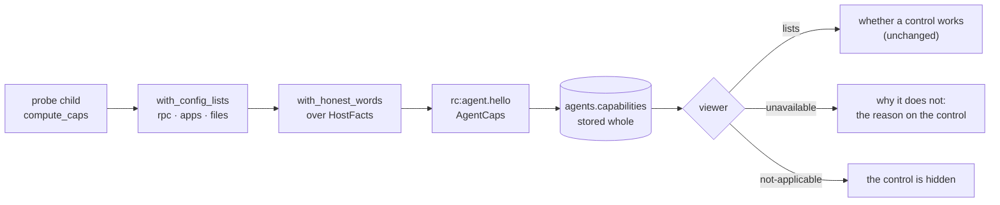

The decision is one daemon-side seam, `with_honest_words`
([`caps.rs:2982`](../agents/roomlerd/src/encode/caps.rs#L2982)), applied in
`detect()` ([`caps.rs:2488`](../agents/roomlerd/src/encode/caps.rs#L2488))
after the config lists, over plain `HostFacts`
([`caps.rs:2696`](../agents/roomlerd/src/encode/caps.rs#L2696)), so it runs and
is tested on every OS.

| Feature | When | What the hello says | What the viewer does |
|---|---|---|---|
| `audio` | the `audio` feature is built and the OS has no capture backend (macOS, until FR-97 P2a) | `audio` empty, so the daemon's session gate never adds a track ([`signaling.rs:3969`](../agents/roomlerd/src/signaling.rs#L3969)); `no-backend` | the receive-audio toggle is off, with the device's reason |
| `audio` | Linux with no way to the computer's sound (FR-97 P3c, §5.1c) | `audio` empty; `no-sound-server` (no Pulse client library), `no-session` (a root build without the session helper), or `no-monitor` (`ROOMLERD_AUDIO_SESSION=0` with nothing named) | the same |
| `clipboard` | a root Linux daemon with neither `DISPLAY` nor `WAYLAND_DISPLAY` ([`caps.rs:2963`](../agents/roomlerd/src/encode/caps.rs#L2963)) | `supports_clipboard: false`, no clipboard words; `no-session` | send, get and auto-sync are greyed, with the reason |
| `clipboard-image-events` | everywhere but Windows and (FR-97 P3e-3a) a Linux X11 session, whose watchers report copied images | the words stay: text syncs, and an image moves on request; `not-watched` | the auto-sync tooltip stops promising host images |
| `sas` | Windows, Linux | `keys-only`: the button types three ordinary keys. Windows' lock and sign-in screens ignore them; Linux desktops bind them, GNOME and KDE to log out. A Windows host that can send the real sequence advertises `input: sas` instead and drops this entry (P4a, §5.1e) | the button stays, and says what the keys reach |
| `sas` | macOS | `not-applicable`: the chord means nothing there | the button is hidden |
| `encoder-cells` | the capability probe's child died in an encoder cell and the host learned to deny it (#3267, [`encoders.md`](encoders.md#a-dead-child-costs-the-cell-it-died-in)) | `learned-deny`, naming each cell and how the child ended; `video_cells` and the other lists already leave them out | nothing: no control follows it, it is there for a fleet read |

⚠️ **The lists still decide what works.** An empty `audio` list disabled the
toggle before P0c, and still does; `unavailable` adds the why. A viewer
that does not know the map works exactly as before.

⚠️ **An absent key never means "unavailable".** Agents before P0c send no map
at all; their lists say what they claim. The map is off the wire when empty,
and the server stores caps whole
([`agent.rs:558`](../crates/services/src/dao/agent.rs#L558)), so an older
server drops it and a newer one keeps it with no migration.

⚠️ **`not-applicable` is the only code that hides a control, and it is how
the viewer adapts to the OS without reading `agent.os`.** Every other code
leaves the control to the lists and adds the reason to it.

⚠️ **The reason is the agent's sentence, composed on the host**, as the FR-80
`hint` is (§5.1a): only the host knows what it is. The viewer shows it as
text, capped at a tooltip's length, never as markup.

⚠️ **The hello is a boot-time snapshot.** `detect()` is memoized for the life
of the process, so a root daemon started outside every session keeps its
`no-session` until it restarts, the same property Remote Apps' `status`
documents ([`remote-apps.md`](remote-apps.md)).

The keys are matched by equality (`Unavailable::KEYS`,
[`models.rs:682`](../crates/remote_control/src/models.rs#L682)) and the wire
shape is locked by `unavailable_wire_shape_is_locked`. FR-97's census
(`scripts/fr97-caps-census.sh`) counts the map by OS as `key:code`, beside
the words.

### 5.1c Session audio is the computer's sound, never a microphone (FR-97 P3c)

"Receive host audio" carries what the host plays. One rule, in
[`audio_source.rs`](../agents/roomlerd/src/audio_source.rs), decides what each
OS may open, and the session says why when it opens nothing.

| OS | What a session captures | Where it cannot |
|---|---|---|
| Windows | WASAPI loopback of the default output device | no output device, usual on a server or a VM with no sound device: `no_output` |
| Linux | the default output's monitor (`@DEFAULT_MONITOR@`) through Pulse's client library, in the daemon for a per-user install and through the seat user's helper for a root one (P3c-2, [`audio_source.rs:217`](../agents/roomlerd/src/audio_source.rs#L217)); a device named in `ROOMLERD_AUDIO_SOURCE` wins | no Pulse client library: the hello offers no track (`no-sound-server`, [`caps.rs:2845`](../agents/roomlerd/src/encode/caps.rs#L2845)); a root daemon with nobody at the screen: `no_session`; a named device that is not there: `source_not_found`; `ROOMLERD_AUDIO_SESSION=0`: P3c-1's rule, a named device or `no-monitor` |
| macOS | since FR-97 P2a: ScreenCaptureKit's mix of every app, this process's own excluded ([`audio/sck.rs`](../agents/roomlerd/src/audio/sck.rs)), in a process with a window-server session. On a supervised Mac that is the GUI worker, and the root's row carries the worker's offer (`DelegateHost::effective_audio`); the root decides a delegated session's audio by it. 48 kHz stereo float, 20 ms buffers: Opus's own frame, nothing resampled. It hears the apps with the output muted | the root half itself: `no-session`; the kill switch `ROOMLERD_SCK_AUDIO=0` (forwarded to the worker): `switched-off` on the hello, `switched_off` from a capture; ScreenCaptureKit's own refusal (the Screen Recording grant): `backend_error` with its words |

⚠️ **On Linux the default input is a microphone, and before P3c-1 it was the
only thing a session ever captured there.** cpal 0.15 has one Linux host,
ALSA, so it lists ALSA devices and never a sound server's sources. Measured
2026-10-17 on a PulseAudio host:

- the devices were exactly `pipewire`, `pulse` and `default`;
- the auto-pick, a name ending in `.monitor`, never matched, and neither did
  the documented `ROOMLERD_AUDIO_SOURCE=<sink>.monitor`;
- so every session fell back to `default`, and PulseAudio showed the capture
  on the microphone while the speakers' monitor stayed suspended.

P3c-1 removed that fallback ([`cpal_backend.rs:247`](../agents/roomlerd/src/audio/cpal_backend.rs#L247)).
A Linux host now offers no track until a device is named for it.

**Naming the device (a per-user daemon).** `ROOMLERD_AUDIO_SOURCE` takes an ALSA
device name, as `arecord -L` prints it, not a PulseAudio source. To capture the
speakers through PulseAudio or PipeWire's Pulse server, set both in the
daemon's environment and restart it:

```text
ROOMLERD_AUDIO_SOURCE=pulse
PULSE_SOURCE=@DEFAULT_MONITOR@
```

`PULSE_SOURCE` points the `pulse` device at the default output's monitor
(measured on the same host). Without it, `pulse` is the microphone again, by
the owner's own choice. Since P3c-2 nobody needs to name anything for the
speakers: the override is for a device the owner prefers.

**The monitor, without naming anything (P3c-2).** PulseAudio and PipeWire's
Pulse server both resolve the device name `@DEFAULT_MONITOR@` to the default
sink's monitor, so the agent records that through Pulse's own client library
([`pulse.rs`](../agents/roomlerd/src/audio/pulse.rs)). One route function
decides, for the hello and for every session alike:

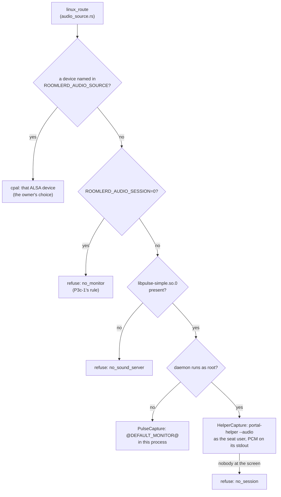

- **In the daemon** for a per-user install, which is already the session's
  owner ([`pulse.rs:369`](../agents/roomlerd/src/audio/pulse.rs#L369)). One
  plain thread owns the blocking `pa_simple` stream and hands 10 ms frames
  (48 kHz stereo s16, the encoder's own format) to the pump.
- **Through the seat user's helper** for a root daemon
  ([`pulse.rs:519`](../agents/roomlerd/src/audio/pulse.rs#L519)). It is the same
  `portal-helper` subcommand, session lookup and privilege drop that portal
  capture and keep-busy use. The session lookup waits 1.5 s at most, one walk
  of logind in flight for every caller, and without an answer in time the
  audio is a `backend_error` that gives the reason, never `no_session` (#3857,
  `docs/desktop-companion.md` §10.3). PulseAudio admits a client by uid or cookie, so
  root cannot record the session's server itself. The helper writes one marked
  line and then raw PCM on stdout ([`pulse.rs:443`](../agents/roomlerd/src/audio/pulse.rs#L443)).
  Closing the pipe stops it.
- **The library is loaded at run time** (`dlopen`), as libpipewire is. It is on
  nearly every desktop and on few servers. A link would stop the agent from
  starting on a host without it; this way only session audio says why.
- **The hello asks the disk, not the loader**
  ([`pulse.rs:124`](../agents/roomlerd/src/audio/pulse.rs#L124)). libpulse pulls
  a dozen libraries into whatever loads it, and a root daemon never needs them
  itself. A library somewhere unusual reads as absent: an honest no.
- **Kill switch:** `ROOMLERD_AUDIO_SESSION=0` puts Linux back on P3c-1's rule.

⚠️ **None of these routes is the default input.** Each one records the
default sink's monitor, or the device the owner named.

When the track cannot carry sound, the agent says why over the control channel:

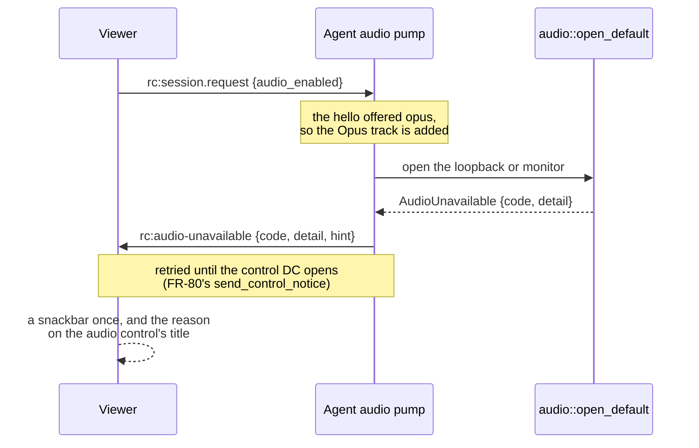

The pump ([`peer.rs:14408`](../agents/roomlerd/src/peer.rs#L14408)) sends it
from every exit: a capture that does not open, an encoder that does not start,
and a capture or encode that stops mid-session. The payload is built by
[`peer.rs:5769`](../agents/roomlerd/src/peer.rs#L5769); the viewer parses it
at [`useRemoteControl.ts:1750`](../ui/src/composables/useRemoteControl.ts#L1750)
and puts it on the toggle's title
([`RemoteControl.vue:3761`](../ui/src/views/remote/RemoteControl.vue#L3761)).

| `code` | Means |
|---|---|
| `no_monitor` | Linux: nothing among the capture devices is the computer's sound, and the default input is not opened |
| `source_not_found` | the device `ROOMLERD_AUDIO_SOURCE` names is not there, and no microphone is opened in its place |
| `no_output` | Windows: no output device to loop back |
| `backend_error` | the device failed to open, the Opus encoder did not start, or capture stopped mid-session; `detail` is the backend's own words |
| `not_supported` | an OS with no capture backend |
| `no_sound_server` | Linux: no Pulse client library, or no sound server would take the stream (`detail` carries libpulse's words, e.g. "Connection refused") |
| `no_session` | Linux: a root daemon with nobody signed in at the screen, so there is no session sound |

⚠️ **`rc:audio-unavailable` is its own message, not an `rc:media-unavailable`
code.** A viewer that predates it ignores it, where the video notice would put
"no screen capture" over a working picture. Like FR-80's notice, it is
control-DC JSON between the peers, so it touches neither the server wire nor
the composition baseline.

⚠️ **The recorder shares the route.** A recording's computer audio opens the
same loopback or monitor only. On Linux it takes `linux_route` too
([`child.rs:128`](../agents/roomlerd/src/recording/child.rs#L128)), and since
the recorder already runs as the person at the screen, it records the monitor
in its own process. Before P3c-2 it refused its start on every Linux host,
because the `.monitor` pick never matched.

### 5.1d A locked host, and a session that keeps the host awake (FR-97 P3b, P2d-1)

What the viewer is told when the host's screen locks, and what holds the
machine awake while a session is live, per OS:

| | Windows | Linux | macOS |
|---|---|---|---|
| The lock signal | the input desktop moves to `winsta0\Winlogon` (`lock_state`) | logind's `LockedHint` for seat0's active session, polled every 2 s ([`lock_state.rs:347`](../agents/roomlerd/src/lock_state.rs#L347)); GNOME, KDE and light-locker set it | the session dictionary's `CGSSessionScreenIsLocked`, or another user on the console, polled every 2 s ([`lock_state.rs:357`](../agents/roomlerd/src/lock_state.rs#L357)); only the GUI session's half can ask, so the root half says nothing |
| What the session does | paints the "Host locked" overlay and suppresses input: the worker can neither capture nor inject there | **nothing**: the lock screen is captured like any other screen, and input reaches it | **nothing**: no overlay, and input is not suppressed |
| `rc:host_locked` | `{locked}` | `{locked, input: "passes"}` ([`peer.rs:10711`](../agents/roomlerd/src/peer.rs#L10711)), retried until the control DC carries it | `{locked, input: "unknown"}`, the same way: whether the lock screen's password field takes injected keys is not measured |
| The viewer's chip | "input is suppressed" | "Your input reaches it, so you can type the password to unlock" | "The remote host is on its lock screen.", claiming neither way ([`useRemoteControl.ts:1595`](../ui/src/composables/useRemoteControl.ts#L1595) `hostLockedChipTitle`) |
| A request that waits for consent | `rc:consent.pending{host_locked}` (FR-34, §11.2) | not yet: the read is a `loginctl` run, which does not belong on the signalling loop | `rc:consent.pending{host_locked}`, from the same session dictionary ([`lock_state.rs:301-320`](../agents/roomlerd/src/lock_state.rs#L301-L320)) |
| Holding the machine awake while a session is live (FR-55) | `PowerCreateRequest` | a logind **block** inhibitor ([`power.rs:948`](../agents/roomlerd/src/power.rs#L948)): `sleep:idle` for a root daemon, `idle` only for a per-user one | `IOPMAssertion` |

⚠️ **The Linux and macOS hints are advisory and never the pump's `LockState`.**
The pump's overlay and the input path keep reading the Windows probe, which
says Unlocked on both. Feeding the hint there would blank a lock screen the
viewer can see and stop the very keystrokes that unlock it. On a Mac the
consent probe alone reads it (`probe_lock_state_service`), as on Windows.
`ROOMLERD_LOCK_HINT=0` turns the hint off on both.

⚠️ **The inhibitor is the FR-55 half, and it sits beside FR-93 P5h's.** P5h
holds a logind **delay** inhibitor during a session so that a sleep the person
chooses is announced to the viewer first ([`linux-capture.md`](linux-capture.md)).
The **block** inhibitor is FR-55's own design for Linux (`what="sleep"`,
`mode="block"`, [FR-55](fr/FR-55-always-reachable.md)): an idle timer must not
end a live session. What a desktop does with an explicit suspend or a closed
lid while a block is held is the desktop's and logind's own
(`LidSwitchIgnoreInhibited=` and the rest); the field cell measures the idle
case.

⚠️ **A per-user daemon gets `idle` only.** It runs outside every login
session, and logind's polkit policy grants a `sleep` block only to session
processes (`inhibit-block-sleep` is `allow_any=no`). It falls back to `idle`
and logs why. A desktop's own idle suspend may still end such a session; a
system install, the default, has both.

The inhibitor lives exactly as long as its fd: logind drops it when the fd
closes, so a daemon that crashes leaves nothing pinned. `systemd-inhibit
--list` shows it (`roomlerd`, `block`) only while a session or an SSH or exec
run is live.

### 5.1e Ctrl+Alt+Del that reaches the lock screen (FR-97 P4a)

The browser cannot capture Ctrl+Alt+Del, so the viewer has a button. Until
P4a it typed three ordinary keys. Apps on the desktop get those, but the
Windows lock and sign-in screens do not: they answer only the **secure
attention sequence** (SAS), which the kernel raises for the physical chord and
`SendSAS` raises for software. On a machine whose policy requires Ctrl+Alt+Del
at sign-in, the viewer could see the lock screen and never get past it.

`SendSAS(FALSE)` is honoured only from a **service process**, and only where
the `SoftwareSASGeneration` policy lets services. ⚠️ **Measured: the
SystemContext worker cannot call it for itself.** It runs as SYSTEM, but in the
person's session, a child of the service and not the service. Its own
`SendSAS(FALSE)` returned and logged, and the lock screen never moved. So the
SCM host, the service process in session 0, sends it, and the worker only asks.
The daemon offers the real sequence only when both of these hold:

| Condition | Where it holds | Read from |
|---|---|---|
| The worker **can ask the service** | the SystemContext worker of an SCM install: it is SYSTEM, the only account the relay lets signal, and the host handed it the relay (`--sas-event`). Not a per-user install, which has no service; not an attended worker, which runs as the signed-in person | the process's own token (`worker_role::probe_self`) and its argv |
| The **`SoftwareSASGeneration`** policy lets services | `1` (services) or `3` (services and Ease of Access). Absent, Windows lets only Ease of Access applications | `HKLM\SOFTWARE\Microsoft\Windows\CurrentVersion\Policies\System` |

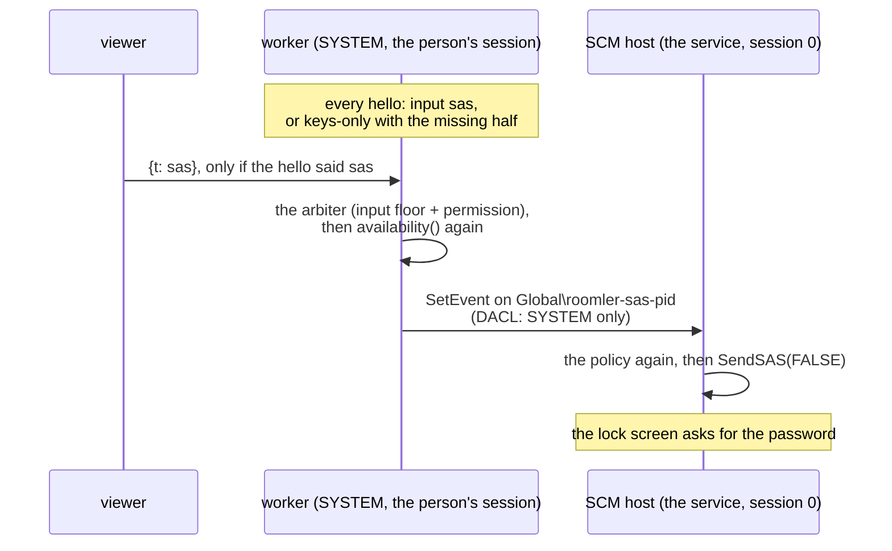

- **The decision is one pure function**
  ([`sas.rs:120`](../agents/roomlerd/src/input/sas.rs#L120)), compiled on every
  OS so the lanes that never run Windows tests check it. It is made at every
  announcement ([`signaling.rs:7123`](../agents/roomlerd/src/signaling.rs#L7123)),
  and the heartbeat re-announces the moment its answer changes, so a policy a
  GPO refresh changes reaches the server within a beat. Where it says no, the
  `keys-only` entry stays and its reason names the half that is missing.
- **The viewer sends `{t: "sas"}` only to an agent that advertises `sas`**
  ([`ctrlAltDel.ts:22`](../ui/src/composables/ctrlAltDel.ts#L22)): an older
  agent cannot parse the frame. The title then says the real one reaches the
  lock and sign-in screens.
- **The frame goes through the input arbiter like a key**, so it needs the
  input floor and the session's input permission, as typing does. The injector
  then checks again
  ([`enigo_backend.rs:329`](../agents/roomlerd/src/input/enigo_backend.rs#L329)):
  the policy can change between the hello and the click, and a viewer is not
  trusted to have read the hello.
- **The relay** ([`sas_relay.rs:43`](../agents/roomlerd/src/win_service/sas_relay.rs#L43))
  is one named, auto-reset event per host, `Global\roomler-sas-<host pid>`,
  whose protected DACL grants SYSTEM alone. A process that is not SYSTEM cannot
  even open it (a test pins this), so an attended worker cannot ask for a SAS
  and says `keys-only`. A SAS is what the physical chord raises: a SYSTEM
  process that asks for one gains nothing it lacked. Signals that arrive while
  one is being answered coalesce into one more, never a queue.
- **The host re-checks the policy before it sends**
  ([`sas.rs:170`](../agents/roomlerd/src/input/sas.rs#L170)), never trusting
  that the worker did.
- **`sas.dll` is loaded when the host sends, never imported**
  ([`sas.rs:255`](../agents/roomlerd/src/input/sas.rs#L255)). A binary that
  imports a DLL some Windows edition lacks does not start at all. It is loaded
  from System32 only (`LOAD_LIBRARY_SEARCH_SYSTEM32`), so a SYSTEM process can
  never load a copy planted beside the binary.
- ⚠️ **The policy is read, never written.** It is a security setting, and on
  a managed laptop it is the organisation's. Measured before the build
  (2026-10-18, read-only over `roomler exec`), the three corporate laptops in
  the fleet all set it to `1`.

### 5.1f The frame stays on the GPU (FR-118)

Every Windows arm reads each captured frame back into memory. The
SystemContext DXGI arm copies the duplication surface into a staging texture
and maps it, inside the capture stage: about 4 ms at 1920×1200. WGC does the
same in its `FrameArrived` handler, off the pump's clock: about 6 ms at
2560×1600. With `zero_copy` on, both arms keep the frame as a texture on their
own device. Unset reads a built-in default list of cells, which ships empty, so
by default they do not (FR-132 P2, below):

- **The DXGI arm** hands it to a QSV encoder whose GPU form the probe proved.
- **WGC** (FR-118 P3) hands it to a proven NVENC encoder. WGC first moves its
  device to the NVIDIA adapter, so on a hybrid laptop the OS copies each frame
  across from the panel's iGPU (0.3–0.6 ms at the median, measured).

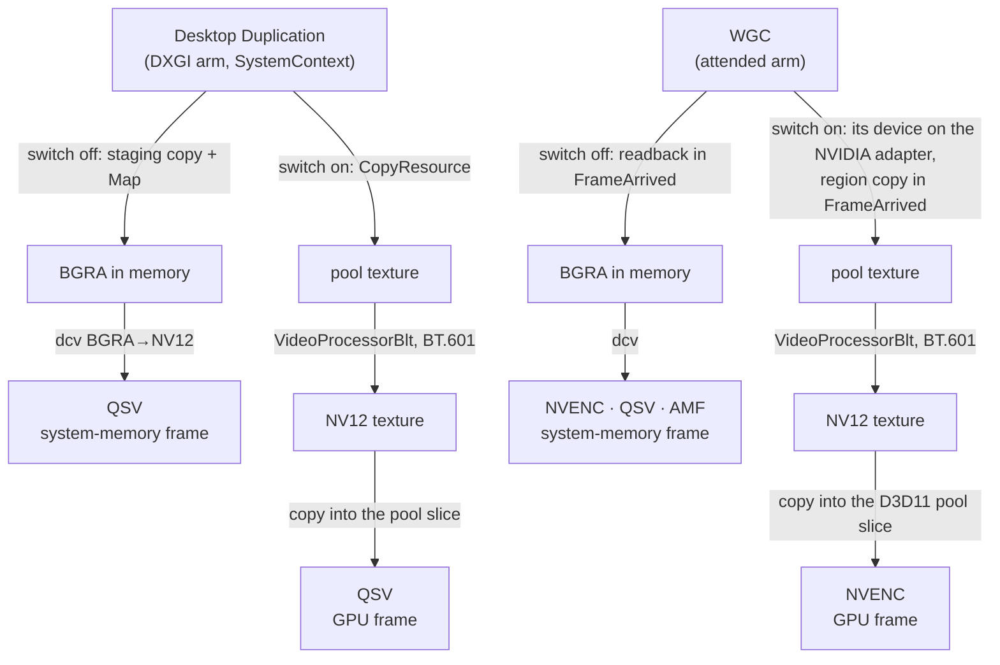

| Measured: `av1_qsv` 1920×1200 at 60 fps, a moving test pattern, 20-minute legs (FR-118 AC3) | Switch off | Switch on |
|---|---|---|
| capture | 4.45 ms | 0.43–0.44 ms |
| readback (inside capture on this arm) | 4.06 ms | 0 |
| encode | 10.24 ms | 11.87–11.91 ms |
| **capture + encode** | **14.70 ms** | **12.30–12.33 ms** |
| worker CPU per encoded frame | 15.9 ms (95 % of a core) | 10.6–10.9 ms (63–65 %) |

- **The encode stage grows**, because `send_frame` waits for the GPU's
  conversion and copy before QSV reads the surface. The whole frame is still
  2.4 ms shorter, and the CPU no longer copies 9 MB a frame.
- **The picture does not change.** Every patch of the test pattern decodes to
  the same RGB with the switch on and off, and the viewer sees no decode error
  and no extra keyframe requests on either path.
- **The device survives a desktop transition.** A lock, an unlock or a UAC
  prompt makes the DXGI arm rebuild its duplication. With the switch on, it
  keeps its D3D11 device when the device is alive and still on the primary
  output's adapter, so the encoder does not reopen and send a keyframe each
  time. A capture that does come back on a new device moves the encoder to it.

On a 2880×1800 panel the readback is what caps the frame rate. Measured on a
laptop whose Intel GPU drives the panel and runs QSV:

| Measured: `av1_qsv` 2880×1800, 60 fps asked, a moving test pattern (FR-118 AC4) | Switch off | Switch on |
|---|---|---|
| encoded fps: median (highest) | 37.6–38.6 (42.8) | 60.0 (60.3) |
| windows at ≥ 50 fps | 0 of 564 | 594 of 596 |
| capture | 8.14–8.16 ms | 0.26 ms |
| readback (inside capture on this arm) | 7.91–7.92 ms | 0 |
| encode | 17.23–17.74 ms | 16.34 ms |
| **capture + encode** | **25.12–25.88 ms** | **16.61 ms** |
| worker CPU per encoded frame | 15.93 ms (58 % of a core) | 3.88 ms (23 %) |

- **The frame rate reaches its target.** With the switch off, the 7.9 ms
  readback sits in series with a 17 ms encode stage, so the host stops near
  40 fps. With it on, a frame fits the 16.7 ms period at 60 fps.
- **QSV's encode is the next bound.** `send_frame` takes about 16 ms a frame
  on both paths, so removing copies cannot take this host far above 60 fps
  ([FR-118 §9.10](fr/FR-118-gpu-resident-frames.md#910-ac4-the-slow-laptop-at-60-fps-2026-10-30)).

WGC's GPU path, measured on a hybrid laptop whose panel is on the iGPU (WGC's
device on the RTX 5090, the OS copying each frame across):

| Measured: `av1_nvenc` 2560×1600 at 60 fps on the WGC arm, a moving test pattern, 20-minute legs (FR-118 AC7) | Switch off | Switch on |
|---|---|---|
| readback (in `FrameArrived`, off the pump's clock) | 6.23 ms | 0 |
| encode | 12.06 ms | 5.14–5.23 ms |
| of which `send_frame` | 11.05 ms | 5.05–5.13 ms |
| **readback + encode** | **18.26 ms** | **5.14–5.23 ms** |
| worker CPU per encoded frame | 9.64 ms (52 % of a core) | 3.09–3.18 ms (18 %) |

- **On WGC the encode stage shrinks too.** With CPU frames, NVENC's wrapper
  copies each 6 MB NV12 frame to the GPU inside `send_frame`. With GPU frames
  it takes the pool's texture, so the readback and most of `send_frame` go
  together: the work per frame falls by 71 %. The pump's capture stage is the
  wait for the next frame on this arm, so the comparison is readback + encode
  ([FR-118 §9.7](fr/FR-118-gpu-resident-frames.md#97-ac7-nvenc-on-the-wgc-arm-2026-10-29)).
- **A SystemContext hybrid host gains nothing.** Its DXGI arm captures on the
  panel's adapter, and Desktop Duplication cannot cross adapters, so NVENC on
  the other GPU refuses the frame (`adapter_mismatch`) and reads it back
  ([FR-118 §9.6](fr/FR-118-gpu-resident-frames.md#96-p3s-first-field-contact-2026-10-28)).

**macOS** (FR-118 P5) has no readback, but the same copies. The display
stream already delivers each frame as an IOSurface. With the switch off the
scrap arm copies it into memory, the encoder converts the BGRA to NV12 on the
CPU, and FFmpeg copies that into a buffer for VideoToolbox: 70–87 % of
VideoToolbox's encode stage over AC1's fleet week. With the switch on, the
surface itself reaches a proven VideoToolbox encoder as a CVPixelBuffer over
the same memory, and VideoToolbox converts the BGRA on the GPU.

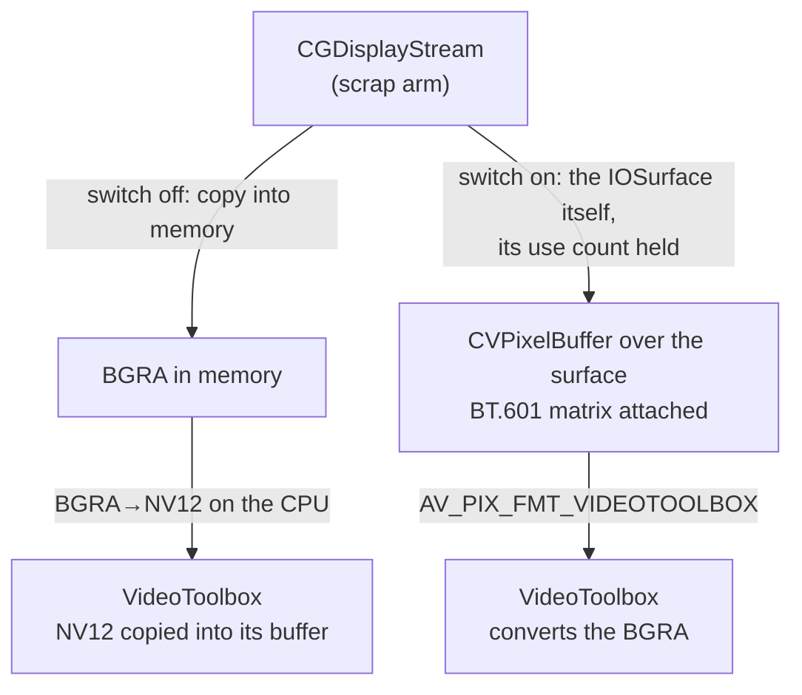

- **Each buffer is marked BT.601.** VideoToolbox converts an unmarked BGRA
  buffer with BT.709, which moves 75 % green from Y 112 to 133. Marked, the
  test bars decode within 2 code values of the CPU path in every plane.
- **The surface is held until VideoToolbox is done with it**, out of the
  stream's queue of 3, and that costs no frames: the frame rate is the same
  with the switch on and off.

| Measured: `hevc_videotoolbox` 3024×1964 on an M5 Pro, 120 fps asked, a moving test pattern, 20-minute legs (FR-118 AC7) | Switch off | Switch on |
|---|---|---|
| capture (the wait for the stream's next frame; switch off: and the copy into memory) | 7.18 ms | 11.21–11.22 ms |
| encode | 4.18 ms | 0.12 ms |
| of which the CPU conversion | 3.27 ms | 0.03–0.04 ms |
| **capture + encode** (the frame period at 88 fps) | **11.34 ms** | **11.32–11.34 ms** |
| worker CPU per encoded frame | 14.58 ms (126 % of a core) | 2.55–2.60 ms (22–23 %) |
| encoded fps (median window) | 87.8 | 87.8–88.0 |

- **On the scrap arm the capture stage is a wait too.** The pump times the
  whole `next_frame()`, which waits for the display stream's next frame, so
  capture + encode is the frame period on both paths and the time the GPU path
  saves goes into the wait. The work it removes shows in the encode stage
  (−97 %) and the worker's CPU (−82 %), which also counts the copy into memory
  ([FR-118 §9.9](fr/FR-118-gpu-resident-frames.md#99-ac7-videotoolbox-on-the-macbook-2026-10-29)).

**The reasons a session reports.** Each session says which form its encoder
opened, on the heartbeat (`input_path`, `input_reason`) and in
`rc:session.stats` (`video.input_path`, `video.input_reason`, §11.12). `gpu`
carries no reason. A CPU form names the first gate that refused it, in the order
the open reads them:

| `input_reason` | The gate |
|---|---|
| `switch_off` | `zero_copy` is set to `off` |
| `default_off` | `zero_copy` is unset and the cell is not on the built-in default list (FR-132 P2) |
| `cpu_frames` | the capture delivered frames in memory |
| `no_gpu_cell` | the encoder or its chroma has no GPU form |
| `denied` | `zero_copy_deny` names the cell |
| `unproven` | the probe's `gpu` child did not prove the form on this host |
| `adapter_mismatch` | the capture's device is on an adapter the encoder cannot take frames from |
| `open_failed` | the GPU form failed to open, and the CPU form took over |

`default_off` and `switch_off` are two reasons on purpose: "not on by default
yet" is never read as "someone turned it off". The list ships empty, so until a
cell has had its canary week (FR-132 P3–P5) an unset host behaves exactly as an
`off` host and reads `default_off`, where it read `switch_off` before the
release that carries P2. A fleet read across that release counts both. Every
reader of the reason takes it as a string (the heartbeat's field, the server's
`SessionVideo.input_reason`, whose only check is the name rule, and the
viewer's media plan), so a reason an older reader has never seen is shown as
it came.

- The cells, the reasons a session took CPU frames, the default list and the
  configuration:
  [`encoders.md`](encoders.md#gpu-resident-frames-the-input-path-fr-118). The
  field record: [FR-118 §9.2](fr/FR-118-gpu-resident-frames.md#92-the-first-field-run-2026-10-28),
  [§9.3](fr/FR-118-gpu-resident-frames.md#93-ac3s-pairs-2026-10-28),
  [§9.7](fr/FR-118-gpu-resident-frames.md#97-ac7-nvenc-on-the-wgc-arm-2026-10-29)
  and [§9.9](fr/FR-118-gpu-resident-frames.md#99-ac7-videotoolbox-on-the-macbook-2026-10-29).

### 5.1g The capture waits (#3272)

`ScreenCapture::next_frame` has a contract: **the backend owns its pace, and an
`Ok(None)` comes after a bounded wait for a frame**. A pump loops straight back
on one and sleeps on nothing. WGC, the portal, scrap and DRM always did this.
The SYSTEM-context capture did not: it polled and returned at once, and the two
DataChannel pumps slept on an empty themselves, while the RTP pump, which had no
sleep, asked about 90,000 times a second on a still screen.

Measured on 0.4.195 on one host, worker CPU over 30 s, as a share of one CPU:
2.3 % with no session, 17.1 % on a DataChannel session, **191.8 % on an RTP
session**. Its idle line ran at 362 lines a second, which crowded its heartbeats
out of the log uploader (16 on disk, 10 in `agent_logs`).

A pump asks for the contract when it opens the capture (`capture::open_async`'s
`paced`). Only the RTP pump does so far, and the request travels on each
`CaptureCmd`, so a pump that does not ask keeps the old path, its open included.

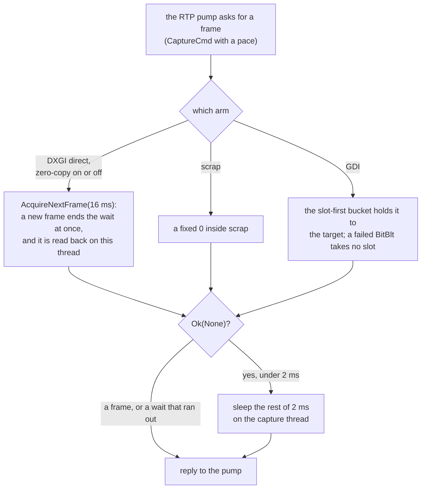

| Arm | A still screen costs | What it adds to a frame |
|---|---|---|
| DXGI direct (`dxgi_direct.rs` `frame`) | about 58 asks a second, and about 74 with a pointer moving, since a pointer-only update ends a wait and reads as an empty | an event wake in place of a poll. L4 against the kill switch is below |
| scrap | about 450 asks a second | at least one 2 ms floor, not read on L4. The same poll on the direct arm cost more than that, below |
| GDI | the target rate, full work on each | the bucket's wait, once it is out of credit |

**Why a paced capture's frames stay off the GPU.** A thread waiting in
`AcquireNextFrame` holds the D3D11 multithread lock for its wait. Measured on two
drivers with a test in `dxgi_direct.rs`
(`a_waiting_acquire_and_a_readback_share_one_device`): on one, taking the lock went
from 1 µs to 22 ms and a readback from 6 ms to 67 ms. So a capture that waits keeps
its device to itself, reads each frame back on its own thread, and hands no GPU
frame to anyone. `zero_copy` still decides what the DC pumps get, because their
encoders do take GPU frames.

The other way out was built and measured, and it lost: an `AcquireNextFrame(0)`
poll resting on the 2 ms floor, which read L4 +11.3 ms p50 on a still screen,
against the same switch spinning ([#3272's third
run](https://github.com/gjovanov/roomler-ai/issues/3272#issuecomment-6568846719),
on a guest with only the Basic Render Driver). The poll itself runs at 2.6 ms, so
the poll alone does not account for that, and the cause is not proven. FR-98 C7
inherits both facts, because a DC pump's encoder wants GPU frames and its pump
sleep is the same poll.

**What the wait costs, measured.** On that guest (2 vCPU, `openh264` over RTP, zero
copy off), against the kill switch beside it. L4 is `p50 / p95` in ms, 2 runs per
arm; a gap counts when it is beyond the larger of the two arms' run-to-run spread,
in brackets.

| Read | spin (kill switch) | waiting | gap, p50 / p95 |
|---|---|---|---|
| Worker CPU, one viewer, still screen, % of one CPU | 162 | **1.5** | |
| `calls` per 30 s, still screen | about 3 M | **about 1,790** | |
| L4, still | 40.9 / 57.5 | 40.8 / 57.9 | 0.0 (1.1) / +0.4 (0.5) |
| L4, a pointer at about 30 Hz | 39.9 / 57.9 | 39.8 / 59.2 | −0.1 (1.9) / +1.3 (3.7) |
| L4, a pointer at about 110 Hz | 41.4 / 57.7 | 42.1 / 57.5 | +0.7 (2.0) / −0.2 (0.6) |
| L4, 60 fps motion | 39.5 / 68.5 | 42.8 / 69.7 | **+3.4 (0.5)** / +1.2 (8.2) |

With the zero-copy switch on, the spin reads GPU frames and the waiting arm does
not, and motion reads p50 **+4.9** (1.4), p95 **+8.0** (2.0), while the still screen
reads +0.5 (0.2) / −1.2 (1.4). Motion is the wait's one standing L4 miss, the cause
is not proven, and it comes from a guest whose compositor renders in software. L4 has not been read on a real GPU.
`calls` and CPU have, on 0.4.197 ([#3272's result](https://github.com/gjovanov/roomler-ai/issues/3272#issuecomment-6577753677)): on a still screen, 1,686 to 1,744 `calls` per 30 s on an Intel GPU and 2,146 to 2,254 on a Radeon with a person's pointer moving, against 1,571,195 before. Worker CPU reads 19 to 22 % of one CPU on both, about what a DataChannel session costs (16.2 %), against 191.8 %. A third to a half of that is on threads that do not outlive the 30 s read, and its cause is not proven; FR-98 C7 inherits it.

⚠️ **How to move a pointer in an L4 cell.** A target-mode probe is itself a pointer
move onto the probe window's pad, so a load that moves the same pointer can measure
the two movers instead of the capture. The rows above move it the way a controller
does: an absolute move through the input queue, 1 px either side of where the probe
left it. `SetCursorPos` costs both arms 8-11 ms by itself, and pulling the pointer
off the pad also loses probes on the waiting arm, 15 and 31 of about 480 at 110 Hz
against 2 and 0 through the queue ([the correction on
#3272](https://github.com/gjovanov/roomler-ai/issues/3272#issuecomment-6571879880)).

RTP gives up nothing on H.264: its encoders read every frame back anyway
(`mf/sync_pipeline.rs`, `openh264_backend.rs`, `frame.cpu()`). An RTP session on
FFmpeg HEVC, which takes a browser without H.264, opens with no capture device
named, so `gpu_input::plan` refuses `cpu_frames` and it stays on the CPU form, as
on a host with zero-copy off.

⚠️ **The RTP heartbeat changes meaning at this release.** Don't compare these
across it:

- `avg_capture_ms` counts the asks that brought a frame. Each now includes its
  wait in the acquire, and on GDI the bucket's wait: a frame that arrives 10 ms
  into a wait reads 10 ms plus its readback, where it used to read the readback
  alone, because the polls before it were not counted. It is waiting, not work.
  The work is `avg_readback_ms`, which only the DataChannel heartbeat carries, so an RTP heartbeat cannot tell the wait from the work.
- `worker_avg_capture_ms` counts every ask, so on a still screen on the waiting
  arm it reads about 16 ms, and about 12.6 ms with a pointer moving. The floor and the bucket's wait stay outside its clock.
- `frames_empty` drops about 1,000-fold, and `calls=` with it. A rate read off
  them from before and after the release is measuring this change.

The rest of the change:

- **The auto-fps-cap moves the rate in place.** It used to reopen the capture
  while the old one still held the output, so `DuplicateOutput` answered
  `0x80070057`, and 15 of 16 sessions on one host in a day spent their first 5 s
  on GDI (`set_target_fps`, as the DC pumps do on a grant).
- **That error has a name now.** `BackendBail::SeatBusy`, at the `DuplicateOutput`
  call alone: the capture that is ending lets go within one in-flight capture, so
  a paced open waits up to 5 × 40 ms before going on to scrap and GDI. A second
  viewer, who really is locked out, pays that once, and then re-climbs quietly
  every 5 s. An unpaced open takes one look and goes straight on, as it always did:
  a DC pump's reopen holds the old capture through the open, so a wait there could
  not succeed, and FR-70 AC10's week reads those pumps.
- **An owed keyframe does not wait for the keepalive, and the transport coming up
  owes one.** A frame encoded before the transport is up is lost, and a browser asks
  for a keyframe only once a packet reaches it, which on a still screen is the next
  keepalive. So a session whose first frame beat its transport by 100 ms showed its
  first picture about 1.5 s after the click, and one whose transport won showed it
  in 0.25 s (read on #3272). The reopen used to hide that by accident: GDI has a
  frame on every ask. It also stands in for the frame the auto-downscale drops to
  build the encoder at the smaller size. An owed keyframe re-encodes the last frame
  at most 4 times a second, however often a browser on a lossy link asks.
- **The encoder open left the runtime worker** (`spawn_blocking`, as the FFmpeg DC
  pump's). The MF cascade waits on each candidate's own thread, about 0.6 s a go.
- **The idle line runs on time, once per 5 s**, on every OS. The FR-29 line on an
  idle Linux host used to run once per 150 empties.
- **`capture::pace::EmptyGuard`** watches the pump's empties: three instant ones in
  a row with no frame between them warn once and cost 2 ms each. One alone is
  normal, because a pull backend's next ask is already due after a slow encode.
- **The log uploader counts what a full channel drops** and says `dropped=N` in its
  next batch (`crates/agent-core/src/logs_upload.rs`), so a read off `agent_logs` can
  tell a quiet host from one that overflowed the channel. It is not every loss: a
  batch shed in an outage or refused 401/403 is not counted, and can take the line
  with it, so no `dropped` line does not prove that nothing was lost.

**What this does not do.** On DXGI a motion source above the target still delivers
at the display's rate: a 60 fps source read 55-56 frames a second at a target of 30,
waiting or spinning. A session that encodes faster than its target stamps each frame
at least 33 ms on (`frame_duration_floor`), so its RTP clock runs ahead of wall time.
Only the GDI arm holds to the target here.

The kill switch is `ROOMLERD_RTP_CAPTURE_WAIT=0`: environment only, read once per
pump. Off, the pump does not ask and the guard is not armed, so the capture spins
as it did and an open on a taken seat takes one look. The reopen, the time-gated line
and the blocking open do not come back with it. [FR-98 C7](fr/FR-98-input-to-photon-budget.md#4-design-cuts-each-one-attributed-by-l4)
moves the other pumps over and retires the opt-in, the switch and their sleeps.

### 5.1h A session says what it got (FR-135 R2)

Until this a viewer learned its encoder from `rc:video-info`, which only an opened
encoder sends. A pump that could not open one logged a line and returned, so the
page stayed black, read *connected*, and asked for a new session every 10 s. The
reason was in the host's log and nowhere else. Now a session states its plan on the
p2p control channel when it starts, and again on every change.

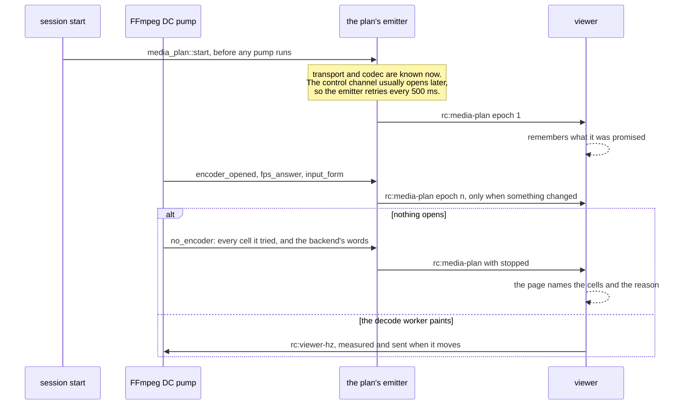

The agent's side is `agents/roomlerd/src/media_plan.rs`: pure transitions on a `Plan`,
a registry keyed by session id as `session_telemetry`'s is, and one emitter per
session that ends with the session. Only a real change raises `epoch`, so a heartbeat
that reports the same input form costs nothing.

| Field | Written by | Says |
|---|---|---|
| `epoch` | every real change | A viewer keeps the newest. A re-created session starts at 1 again |
| `transport`, `codec` | session start | What the session negotiated. A data channel names its own codec, because `chosen_codec` is the RTP track's pick |
| `chroma`, `cell` | `encoder_opened` | `cell` is `name:chroma`, the spelling `encoder_cells_deny` takes |
| `capture` | `encoder_opened` | The capture backend as it names itself, and the frames' form when the encoder opened |
| `input` | the pump's heartbeat | `gpu` or `cpu`, with the encoder's own reason |
| `fps` | the grant, when the answer moves, or without `fps-high` `encoder_opened` (the FFmpeg data-channel pump only) | `granted`, plus `asked` and `reason` when an ask was refused. Without `fps-high`, `granted` is the rate the encoder opened at, which an `rc.l4` record carries as `target_fps` (FR-135 N2). A reopen at a new rate moves it, with no arrow |
| `ladder` | every step down | `{from, to, why, at_ms}`. A cell that lost to the next, GPU form to CPU form, asked to granted. At most 24, and `stopped` still says how it ended |
| `stopped` | the pump, on its way out | `no_encoder` or `encoder_fault`, and the backend's own words, one line of at most 160 characters |
| `legacy` | session start | FR-135 §7.1 — the media paths this session runs on their OLD code because `rc_media_legacy` says so, listed or implied by a path they stand on. Absent when no key sent one back |
| `refused` | session start | FR-135 §7.1 — `rc_media_canary` entries this session did not honour, as `path:why` (`legacy`, `not_built`, `requires:<path>`). Absent when none |

⚠️ **Three of those arrows are written by one pump.** The FFmpeg data-channel pump is
the only one instrumented. An RTP or VP9 session carries the plan's start and nothing
after it, on purpose: FR-135's ratchet stops those pumps growing, and their fault
ladders arrive with their stages (R8, R11). So a viewer on one of them learns less,
never something wrong.

⚠️ **The arrows come from a recording, not from the pump's error.** The cascade keeps
one failure in the error it returns, which on a guest read `no vulkan device opened on
this host` with three other cells tried and unnamed. `media_plan::OpenTrail` listens
on the open's own blocking-pool thread, and `note_candidate_failed` costs one
thread-local read when nobody is listening, as during a probe. A name this build does
not carry never ran, so it leaves no arrow: the cascade asks FFmpeg (`find_by_name`)
rather than reading its own error's words, and a Windows page does not say it tried
`h264_videotoolbox`.

**What the page does with it** (`composables/mediaPlan.ts`, in full in
[`ui.md`](ui.md#a-session-says-what-it-got-fr-135-r2)). `stopped` becomes an overlay
that names the cells it tried. A plan and no picture for 6 s says what was promised.
And a plan that says `webrtc` while the page decodes a data channel stops that path, so
`<video>` shows: the agent fell to the RTP track, and nothing will ever arrive on the
channel the page opened.

⚠️ **It does not end the session.** The watchdog still asks for a new one every 10 s,
because a transient GPU fault heals that way today, and from the fourth attempt the
dead-air backoff stretches that to minutes. The page keeps the words across the
re-create and through the backoff, so they hold still while it tries. It has dropped
the backoff's "its network may be blocking the connection" for an attempt that heard a
plan, because the plan came over the control channel. Ending the session with a reason is
R8's (FR-135 §6.8).

⚠️ **A follower of a shared pipeline carries the plan's start only.** The owner's pump
writes under the owner's session, so a second viewer on one stream knows the transport
and the codec, and not the ladder or a stop.

The field proof is [`ui/e2e/vmtest-media-plan.spec.ts`](../ui/e2e/vmtest-media-plan.spec.ts).
It reads what a person would see on a named device, and whether the reason ever leaves
the page, on a mutation rather than a poll, because a redial is shorter than any
sampling. So one spec reads the black page on an old viewer and the reason on a new one.
Through a real agent and a webrtc-rs viewer, `session_media_plan_tests` reads the verb,
the plan on the control channel and `rc:viewer-hz` reaching the agent.

**`rc:viewer-hz`.** The decode worker measures its own `requestAnimationFrame` in a
short burst when the first frame paints and once a minute after
(`ui/src/workers/rc-viewer-hz.ts`), and the page sends a reading that moved by more
than 1 Hz. The agent stores it per viewer (`ViewerFeedback::store_viewer_hz`) and logs
`control: rc:viewer-hz`. It changes nothing unless `ROOMLERD_VIEWER_HZ_CAP=1`, which
is off by default. On, the grant reads the slowest screen that has said
(`Pipeline::merged_viewer_hz`) and refuses a rate above it with the reason
`viewer_refresh`, 2 Hz of slack allowed for a 59.94 panel. FR-135's S14 has not yet
answered whether a worker's rAF follows the panel under `desynchronized`, and a worker
that falls behind reads low, so the cap and the picker wait for that answer and for
FR-135 §7.1's gates.

Both directions are additive, and each is read by the other side's verb or by nothing:

| Agent | Viewer | What happens |
|---|---|---|
| With `media-plan` | Knows it | The whole of this section |
| With `media-plan` | Older | Its parser drops an unknown `t`. It never sends `rc:viewer-hz`, so `viewer_hz()` stays `None` |
| Older | Knows it | No plan arrives, so the page reads as it did. No `rc:viewer-hz` is sent, because the verb is absent |

Kill switch: a `media_plan` entry in `rc_media_legacy` (FR-135 §7.1, below) registers
no plan for the sessions that open after it, so every writer does nothing. It is
pushable with `MANAGE_AGENTS` and live, with no restart
([`remote-config.md`](remote-config.md) §6, "A fifth"). `ROOMLERD_MEDIA_PLAN=0` still
works, read as that entry, and it alone also stops the agent advertising `media-plan`:
a hello is not re-sent for a push, and a viewer reads no fault into a missing plan. The
cap is not in R0's keys yet; it stays on its own env switch until its flip. Neither
message touches the server wire or the composition baseline: both are peer-to-peer
control-channel JSON, and the baseline holds no verbs.

**The media paths (FR-135 §7.1).** Each FR-135 phase adds a media path's new code beside
the old, and two temporary keys choose between them per session:
`rc_media_legacy` sends a session back to old code, and `rc_media_canary`, local only,
turns new code on before its default does. Precedence is legacy, then canary, then the
built-in default. Entries match whole names. The one read is each session's open
(`RemoteConfigServices::media_paths`), and the session keeps what it read until it ends.

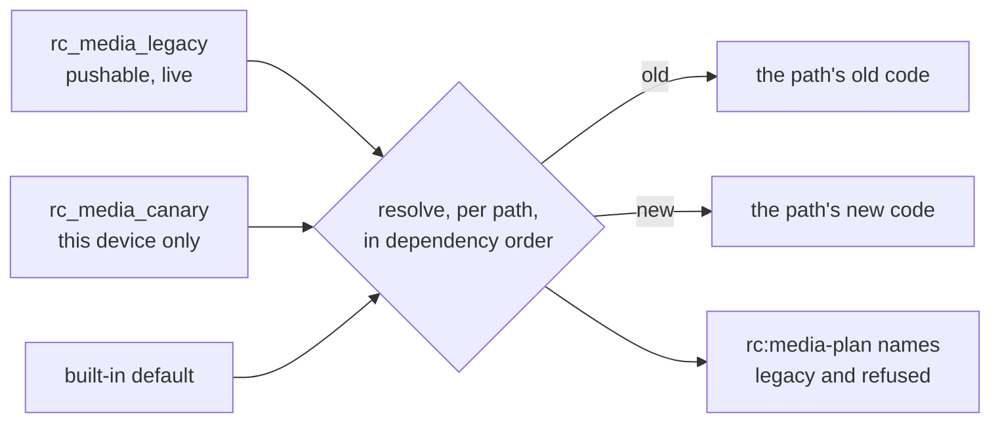

| Path | Phase | New code in this build | Default |
|---|---|---|---|
| `stats` | R0 | yes | new |
| `media_plan` | R2 | yes | new |
| `capture_wait`, `capture_stage`, `zero_copy_shared`, `dc_sink`, `sctp_rto`, `encode_stage`, `cell_table`, `rtp_sink`, `recording_door`, `high_refresh` | R4a to R12 | not yet | old |

Some paths stand on others (`capture_wait` under `capture_stage`, both and `dc_sink`
under `encode_stage` and `high_refresh`, `encode_stage` under `rtp_sink`), so an old
path forces what stands on it onto the old path, and a canary entry whose requirement
is old is refused. `media_paths::tests::every_combination_keeps_the_rules` walks about
57,000 combinations of the two keys against those rules.

### 5.2 Encoder selection

Picked at agent startup, redetected on GPU change:

```
priority order:
  1. HW: nvenc | qsv | amf | vaapi | videotoolbox | mediafoundation
  2. SW: openh264 (always available)
codec preference:  AV1  > H.265  > H.264
```

H.264 is the safe default — every browser decodes it. AV1 only if the controller's `RTCRtpReceiver.getCapabilities('video')` advertises it. We negotiate this in the SDP exchange.

### 5.3 Adaptive streaming

- Two-layer simulcast in SW (one full-res, one half-res) so the controller can switch instantly on bandwidth dips.
- `goog-remb` / TWCC feedback drives target bitrate; reasonable bounds: 600 kbps (idle) → 25 Mbps (4K motion).
- **Variable framerate, idle skip**: when nothing on screen changes (the capturer's per-frame `Damage`, `capture/mod.rs`: WGC's dirty regions, DXGI's no-new-frame, XDamage on X11; `scrap` on macOS reports none, so there every frame counts as changed), the encoder emits a 1 fps keepalive instead of a full 60 fps stream. This is the single biggest battery and bandwidth win.
- IDR on demand: the controller sends `{"t":"keyframe"}` over the control DC if it detects decode errors after a packet loss spike; agent issues an immediate keyframe.

### 5.4 Above 60 fps: the viewer asks, the host proves it (FR-119)

A viewer on a high-refresh screen can ask for 120 or 144 fps. The host grants a
rate only where the path is direct, its screen refreshes that fast, nothing
denies the rate, the host has shown it can sustain it, and the pipe covers the
higher ceiling. All of it is per session and per rate class, and an agent
without the switch behaves exactly as before. Spec and field log:
[FR-119](fr/FR-119-high-refresh-streaming.md).

**The switch and the wire.** `fps_high` in the config (or `ROOMLERD_FPS_HIGH`),
default off. With it on, the hello's `AgentCaps.video` carries `fps-high` and
`fps-retry` ([`caps.rs:3941`](../agents/roomlerd/src/encode/caps.rs#L3941)).
Without them the viewer never offers above 60 and never sends `rc:fps`.

| Message | Direction | Fields |
|---|---|---|
| `rc:fps` | viewer → agent, control channel | `fps`: 60, 120 or 144 ([`frame_rate.rs:36`](../agents/roomlerd/src/encode/frame_rate.rs#L36)); anything else is dropped. `retry: true`, a literal `true` only, asks to trial a refused rate again (`fps-retry`, [`frame_rate.rs:30`](../agents/roomlerd/src/encode/frame_rate.rs#L30)) |
| `rc:video-info` | agent → viewer | `fps`, what the stream runs at; `fps_asked` and `fps_reason` once it runs below the ask; `fps_trial` while a trial runs; `refresh_hz` when the host could read its screen's rate ([`peer.rs:5607`](../agents/roomlerd/src/peer.rs#L5607)) |
| `rc:viewer-hz` | viewer → agent, control channel | `hz`, the viewer's screen as its decode worker measured it, 1 to 1000. Stored and logged ([§5.1h](#51h-a-session-says-what-it-got-fr-135-r2)). The grant reads it only under `ROOMLERD_VIEWER_HZ_CAP=1` |

**The grant** ([`frame_rate.rs:320`](../agents/roomlerd/src/encode/frame_rate.rs#L320)).
It runs in the FFmpeg data-channel pump
([`peer.rs:8597`](../agents/roomlerd/src/peer.rs#L8597)) whenever the ask, the
base rate, the transport or the class moves, and once a second for the pipe's
belief. Each rate is checked in the order a viewer can see and act on
([`frame_rate.rs:260`](../agents/roomlerd/src/encode/frame_rate.rs#L260)):

| `fps_reason` | When | Steps down? |
|---|---|---|
| `constrained` | the session is relayed: above 60 there waits for FR-17 stage C, FR-63 and FR-70 M3 | no: a relay refuses every rate above its cap |
| `refresh` | the captured screen refreshes slower than the rate | yes |
| `viewer_refresh` | the viewer's measured screen refreshes slower than the rate, by more than 2 Hz. Only under `ROOMLERD_VIEWER_HZ_CAP=1`, off by default | yes |
| `denied` | `fps_deny` names this encoder at this rate | yes |
| `unproven` | this rate class's last trial failed, within the hour | yes |
| `pipe` | the session's pipe push-back is below the ceiling at this rate | yes |

A refused ask **steps down one rate at a time** (P2b-18): the highest offered
rate below the ask that nothing refuses runs instead, and the viewer is still
told why the ask was refused, as "120 fps (144 fps not granted: …)". The pump
checks each of those rates against its own deny entry and its own ceiling
([`peer.rs:8666`](../agents/roomlerd/src/peer.rs#L8666)).

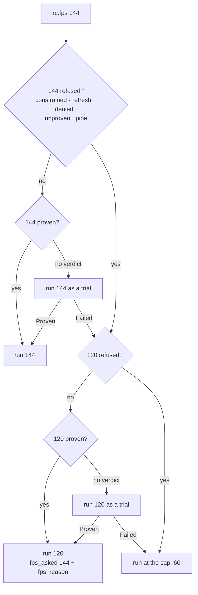

**The rate class and its trial.** A class is the capture backend, the screen's
refresh rate, the encoder, the geometry's long-edge bucket and the rate
([`frame_rate.rs:122`](../agents/roomlerd/src/encode/frame_rate.rs#L122)). A class
with no verdict runs as a trial. It is `Proven` once 10 s of moving content
reached 90 % of the rate with the p99 inter-frame time under two periods. It is
`Failed` only when the encoder itself was the limit: its p90 time per frame at
90 % of a period, while it spaced the frames
([`frame_rate.rs:469`](../agents/roomlerd/src/encode/frame_rate.rs#L469)).
Content slower than the rate concludes nothing, and a frame the pump drops for
the viewer or the link breaks the stretch, so a viewer that cannot decode the
rate yields no verdict at all. Verdicts persist in `fps-class-cache.json`, keyed
on the build, the hardware and the knobs: `Proven` holds a week and `Failed` an
hour ([`fps_class_cache.rs:34`](../agents/roomlerd/src/encode/fps_class_cache.rs#L34),
[`fps_class_cache.rs:40`](../agents/roomlerd/src/encode/fps_class_cache.rs#L40)).
A new agent release starts with an empty cache.

**Try again** ([`frame_rate.rs:590`](../agents/roomlerd/src/encode/frame_rate.rs#L590)).
The picker offers "Try N fps again" for an `unproven` refusal from an agent that
advertises `fps-retry` ([`ui.md`](ui.md)). The retry forgets the session's
failed verdicts from the ask down to the cap, so the step-down is walked again
from the top. A proven rate stays proven.

**What holds the rate up on Windows.** Above 60, the WGC capture session's
`MinUpdateInterval` is lowered from Windows' 16 ms default
([`gate.rs:115`](../agents/roomlerd/src/capture/gate.rs#L115)), without which
every Windows session ran at about 58 fps. An NVENC session holds the GPU clock
pin, graphics and memory, from the moment the grant wants the rate
([`gpu_clock.rs:506`](../agents/roomlerd/src/gpu_clock.rs#L506),
[`peer.rs:8704`](../agents/roomlerd/src/peer.rs#L8704)). Under an encoder-only
load the driver otherwise drops the memory clock, and NVENC's time per frame
doubles.

⚠️ **A trial proves the host, not the delivery.** Its 10 s show the host can
capture and encode the rate. Whether the viewer receives it is read at the
viewer, from the arrival of every frame (FR-119 §8.1).

⚠️ **The refusal line is a live session's answer.** With no session open, the
picker shows its default hint, never a stale refusal.

| Cell (FR-119 §8) | Result |
|---|---|
| The MacBook (VideoToolbox, ProMotion) → Edge, direct, 120 | proven at 119.7 fps; every 60 s window at the viewer 119.8–120.1 fps |
| neo16 (RTX 5090) → the MacBook, HEVC 4:4:4 2560×1600, 120 | proven at 112.4 fps with the clock pin |
| neo16, AV1 2560×1600, 144 | proven at 141.4 fps |
| neo16, HEVC 4:4:4 2560×1600, 144 | encoder-bound: 101–131 fps over six trials. Since P2b-18 the session steps down to 120, proven at 117.0 fps (2026-10-27), where before it fell to 60 |
| neo16, AV1 scaled to 1704×1066, 144 | 44–61 fps: the pump's CPU resample takes 14.7 ms a frame, so a scaled session cannot reach 144 there until FR-118's GPU scale |

## 6. Input injection

Three input planes, all over a single SCTP-unreliable data channel labeled `input`:

```rust
// shared schema, serialized as msgpack (smaller + faster than JSON)
#[derive(Serialize, Deserialize)]
#[serde(tag = "t")]
enum InputMsg {
    MouseMove   { x: f32, y: f32, mon: u8 },        // normalized 0..1 per monitor
    MouseButton { btn: Button, down: bool, x: f32, y: f32, mon: u8 },
    MouseRelease { btn: Button },                     // let go WHERE THE POINTER IS (#1945)
    MouseWheel  { dx: f32, dy: f32, mode: WheelMode },
    Key         { code: u32, down: bool, mods: u8 }, // USB HID usage code; mods: 0x01 Ctrl, 0x02 Shift, 0x04 Alt, 0x08 Meta
    KeyText     { text: String },                    // for IME / unicode
    Touch       { id: u32, phase: TouchPhase, x: f32, y: f32 },
    Heartbeat   { seq: u64, ts_ms: u64 },
}
```

Key design choices:

- **Normalized coordinates** (0..1 per monitor index), not pixels. The browser doesn't know the agent's resolution, and the agent's resolution can change mid-session (laptop docking, etc.). The agent maps to absolute pixels using its current monitor geometry. An app that captures the pointer needs movement instead of a position: that is relative mode, `mouse_rel` and `mouse_press` under Pointer Lock ([relative-mouse.md](relative-mouse.md), FR-109). A finger on a touch screen is the mouse too, and the stage keeps every touch so the browser cannot cancel a drag halfway through and leave the host's button down ([touch-controls.md](touch-controls.md), FR-111). Its on-screen controls (rows of keys, a d-pad, a mouse stick) send the frames a keyboard and a mouse would, so they work with every deployed agent. ⚠️ The agent turns a pixel wheel into 100 px steps and rounds every frame on its own (`enigo_backend.rs` `wheel_to_steps`). So the viewer gathers pixel-mode wheel events and sends whole steps, carrying the rest and dropping the carry after a 400 ms pause (`useRemoteControl.ts` `onWheel`, #2367). Before that, a precision trackpad's or a high-resolution wheel's frames under 50 px scrolled nothing.
- **HID usage codes**, not browser key codes or X11 keysyms. Browser keyboard events expose `KeyboardEvent.code` which maps cleanly to HID; the agent maps HID → OS-native scan codes. This is the only way to get layout-independent behavior (a German controller pressing the physical "Z" key sends "Y" on a US-layout host *correctly*, because the host's layout interprets the scan code).
- **Unreliable DC, ordered=false, maxRetransmits=0** — input is real-time; a dropped move event is replaced by the next one a few ms later. Latency >> reliability.
- **A chord only `mods` names is tapped whole, on its `down`** (#3046). `mods` says what the viewer believes is down with a key. A physical keyboard's modifiers arrive as frames of their own and stay held, so for those it adds nothing. The soft keyboard's sticky Ctrl, Alt and Win, a controller's one-key chord, and a Ctrl+V flushed after its Ctrl came up have only `mods`. For those the arbiter, ahead of every backend (`chord_tap`, `agents/roomlerd/src/input/arbiter.rs:75`), presses what `mods` names and the session does not hold, then the key, then lets go of the key and those modifiers, all on that one frame. Nothing stays down and nothing is tracked, so the viewer's own up frame has nothing to let go of.
  ⚠️ That is why the viewer sends no explicit modifier frames for these, and why the release doesn't wait for the up frame: on this channel a lost Ctrl-up would be a stuck Ctrl on the host, which is worse than the bare letter it replaces.
  ⚠️ A viewer turns Ctrl into Cmd for a Mac host in the key's code and not in `mods` (FR-13), so on a Mac a held Cmd answers the Ctrl bit. Without that rule every Ctrl+C from a viewer would press a second, literal Ctrl.

  | | A soft keyboard's chord | A physical Ctrl+C |
  |---|---|---|
  | New viewer, older agent | the bare key, as before, until the agent updates | unchanged |
  | Older viewer, new agent | works, as a literal Ctrl on a Mac host | unchanged |

  No capability word goes with it: the field has always been on the wire, and every sender already set it truthfully.
- **A click moves first; a release-all never moves** (#1945). Every backend
  positions the pointer before a `MouseButton` event, so a click lands on its
  target even if the moves before it were coalesced away. The arbiter's
  release of what a closing session still holds is a `MouseRelease` instead,
  because it has no position worth moving to. It used to be a `MouseButton` up
  at (0,0), so a viewer that vanished mid-drag threw the host's cursor into the
  top-left corner: GNOME's Activities hot corner, or a macOS hot corner that
  may lock the screen. Each backend's no-move arm is locked by a test that
  records what it emits (`a_release_never_moves_the_pointer` in
  `enigo_backend.rs`, `uinput_backend.rs` and `capture/portal/input.rs`).
  ⚠️ **The page lets go first, when it can.** On blur or a hidden tab
  (`releaseHeldInputs`), and for a drag that ends outside the picture, the
  viewer sends a positioned button-up at `lastPointerNorm`, because an older
  agent does not know `MouseRelease`. That position must follow every pointer
  move. Updated only on press, it held the press point: a tab closed mid-drag
  snapped the host cursor back to where the drag began (FR-93 lab, the
  `close-mid-drag` oracle). The agent's release-all is the path for a page that
  cannot run any code at all (a crash, `crash-mid-drag`).
- **Mouse coalescing on the controller**, not the agent. The browser fires `pointermove` at up to display refresh rate; we coalesce to one msg per RAF (~16 ms), preserving the *last* position but dropping intermediate samples. Click/key events are never coalesced.
- **The viewer's own inputs keep their keys** (#2869). The key listener sits
  on the `window` in the **capture** phase (rc.18: a focused page button must
  not see Enter while the operator drives the host), so it also sees a key
  typed into the files drawer's path field before the field does — and it
  forwarded it: Ctrl+A, a path and Enter typed into the drawer replaced the
  text of the note open on a Mac host. `isViewerOwnInput`
  (`useRemoteControl.ts`) makes `onKey` step aside, untouched — not
  forwarded, no `preventDefault`, no `stopPropagation` — for a key whose
  target is one of the viewer's own controls: an `input`, a `textarea`, a
  `select`, a contenteditable, or a `role` of textbox / searchbox / combobox /
  spinbutton / slider. What the host still held is let go first, so a chord
  begun over the stage and finished in a field leaves no modifier down.
  Buttons, list rows and the body are not the viewer's own: a key with one of
  those focused is the host's, as it always was. ⚠️ Two editable targets are
  the **host's**, and a blanket "skip editable targets" would break phones:
  anything inside the stage, and the soft keyboard's off-screen textarea
  (`MobileKeyboard.vue`, marked `data-rc-capture`) — its typed text arrives
  through its own `input` handler, but a Backspace on that always-empty
  textarea raises no `input` event, so the keydown this listener forwards is
  the only way it reaches the host. A dialog that takes over the typing
  entirely (the touch-layout editor) uses the other mechanism,
  `keyboardPaused` (FR-111 P4b-2).
- **One owner per key** (#2888). A key aimed at the soft keyboard's textarea
  has ONE owner. A HID frame — a named key, a chord, a modifier — is the window
  listener's: forwarded with the browser's default prevented and propagation
  stopped, so the textarea never also receives it and `MobileKeyboard.vue`
  never also presses it. A printable character is the textarea's: left
  untouched, typed through its `input` handler, where the toolbar's sticky
  Ctrl / Alt / Win become a chord. What the listener drops (an IME keydown, a
  `code` it cannot map — the OS soft keyboard's own keys) is the component's
  too. Before this, a tablet or a phone with a hardware keyboard beside the
  open soft keyboard typed every character, Enter, Tab, Escape and arrow
  twice. §6.3 has the matrix and the real-browser harness that measured it.
- **`enigo` is the default**, with OS-specific direct backends behind a feature flag for performance and edge cases (UIPI on Windows, IME composition on macOS, `uinput` on Wayland because XTest doesn't exist there).

### 6.1 The Wayland problem

Wayland has no equivalent of XTest. The supported path is `/dev/uinput`, which requires the agent to be in the `input` group (or have `CAP_SYS_ADMIN`). No package adds that group or a udev rule: uinput is an opt-in of a root (system) install, `uinput = true` (`agents/roomlerd/packaging/linux/README.Debian`). If permission isn't granted, the agent runs in **view-only** mode and the UI clearly says so.

As shipped: uinput is FR-36's arm (`ROOMLERD_UINPUT=1`, paired with DRM capture; host-global, it injects into whatever has focus). Where the compositor is **nested** — WSL2, a compositor inside another — uinput publishes events that nothing reads, so the only input path is the portal's RemoteDesktop interface riding the capture session (FR-45 P4, `ROOMLERD_PORTAL_INPUT=1`), and on GNOME the person at the screen must also flip the dialog's *Allow Remote Interaction* switch. A per-user Wayland session whose portal switched itself on (FR-93 P4b, KDE and other desktops without mutter) asks for remote control with no key set. Both are in [`linux-capture.md`](linux-capture.md#43-input-rides-the-same-session-p4).

**Saying so (FR-93 P1).** An injector that reaches nothing does not fail. XTest
into Xwayland *succeeds*, and moves only Xwayland's own pointer, which the
compositor ignores. Where Xwayland sends XTest through EI, it reaches no window
at all. GNOME 49 and later start Xwayland with `-enable-ei-portal`: measured on
GNOME 50, 0 events in a native window and 0 in an Xwayland one. KWin does it
with nothing on the command line. It hands Xwayland an EI socket in its
environment (`LIBEI_SOCKET=/proc/self/fd/N`) and gates XTest behind its own
prompt. Measured on Plasma 6.7: `xdotool` moved nothing and clicked nothing, even
in an X11 window, and the prompt helper failed to start. So each session works
out what its input will
reach (`input/reach.rs`), from the facts `input::open_default` decides from,
after capture has opened (a portal capture registers its input route as it
opens).

| The session finds | `reach` |
|---|---|
| a live portal RemoteDesktop route, or uinput that is on and opens | `full` |
| XTest on a real X server (Xorg, or the daemon's own Xvfb) | `full` |
| XTest on Xwayland | `xwayland_only` |
| XTest on an Xwayland that sends it through EI, read from that process: `-enable-ei-portal` on its command line (GNOME 49+), or a `LIBEI_SOCKET` in its environment (KWin) | `none` |
| … through KWin, and the person allowed roomlerd in **Legacy X11 App Support** (kwinrc `[Xwayland] XwaylandEisNoPromptApps`, or the global `XwaylandEisNoPrompt`) | `full` |
| no X display and no uinput · a build without an injector · a Mac without Accessibility | `none` |

⚠️ **A sandboxed per-user daemon cannot read Xwayland's environment.** Wherever
the user unit's sandbox applies (Fedora: always, #1997), the daemon runs in a
user namespace of its own. The kernel then refuses another namespace's
`/proc/<pid>/environ` (*Permission denied*), while `cmdline`, `comm` and `status`
read fine. There, two readable facts stand in:
- Xwayland's parent is `kwin_wayland`;
- that KWin is 6.1 or later, read from its library's file name
  (`libkwin.so.6.7.5`). 6.1 is the release that hands every Xwayland an EI
  socket (Plasma 6.1's changelog), so Plasma 5.27 stays `xwayland_only`.

From FR-93 P4b the per-user input path on Plasma is the automatic portal's
remote control: one dialog, its answer restored afterwards, and no settings to
change ([`linux-capture.md`](linux-capture.md#12-a-per-user-wayland-session-switches-itself-on-fr-93-p2-decision-d1)
§1.2). So a session whose reach still reads `none` there tells the person to
reconnect and allow remote control first. KWin's grant is the other path, and
the release binary already uses it. Measured on Plasma 6.7 with the viewer
oracle's `points` plan:

| kwinrc `[Xwayland]` | result |
|---|---|
| stock | 🔴 0 events: KWin's prompter could not start, so nothing got through |
| `XwaylandEisNoPromptApps=roomlerd` | ✅ every pointer target within 1 px, the click, the wheel, `hello 123`; 🔴 only Shift+A lost |

The name is the one Xwayland gives an X11 client's EI connection, the process
name. KWin applies the grant only once it has reloaded its options (System
Settings' Apply does that) **and** Xwayland has reconnected, which a new login
does. Until then the agent already says `full`, because it reads the file.

When `reach` is anything but `full`, the agent sends `rc:input-reach {reach,
reason}` once over the control DC, with the same retry-until-open as FR-80's
notice. A session that reaches everything sends nothing, and an older viewer
ignores the message. The viewer then shows a closable warning on any session
that has input: *"Your mouse and keyboard do not reach this device's desktop."*,
followed by the agent's reason, which names the key that would fix it.

On Linux the notice belongs to FR-93's P1, so P1's kill switch
(`wayland_aware = false`) sends none and asks no X server, as the agent did
before FR-93 (P1a, [`linux-capture.md`](linux-capture.md) §1.1). macOS and
Windows are always told: the switch is a Linux key.

### 6.1a Keep busy — a second input source (FR-92)

A controller with input can leave the host's pointer moving in a pattern so the
host stays active (`rc:keep-busy.*` on the control DC). It is **another input
source behind the same arbiter**, never a second injector: the arbiter refuses
its moves while any session holds a mouse button, and tells it about every
controller event it injects, so a remote person pauses it exactly as a local
one does. See [`keep-busy.md`](keep-busy.md).

### 6.1b An injector with no permission is opened again (#2066, #3164)

The arbiter opens the OS injector at the first event, then keeps it. If no backend can open yet, it gets a `NoopInjector`, which drops every event. Before these two fixes that Noop stayed for the life of the process, so input stayed dead for every later controller until a restart.

| Host | What it waits for | How often it looks, while events arrive |
|---|---|---|
| macOS | the Accessibility grant, read live with `AXIsProcessTrusted` | once a second |
| Elsewhere | nothing to ask: only opening one tells (a Linux daemon before its display or `/dev/uinput` exists) | after 1 s, doubling to once a minute |

A new session's first event looks at once, from the shortest wait again (`Regrant`, `agents/roomlerd/src/input/arbiter.rs:1419`; `os_grants_input`, `agents/roomlerd/src/input/mod.rs:639`).

⚠️ A root daemon with no `DISPLAY` can never open enigo, so since #3787 its open is not tried. With no `DISPLAY`, x11rb answers `DisplayNotSet` before any I/O, and enigo printed that and `no successful connection` at ERROR on every try. `agents/roomlerd/src/input/no_display.rs` says why instead, once a session:

| Who is at the screen (a look at the seat for the session's first line) | The line |
|---|---|
| known to show nobody at a graphical session: the login screen (`greeter`), no seat (`none`), a text console (`tty`) | INFO `input: no X display to open: … nobody is signed in …` |
| a person signed in on X11, Wayland or any other session type, or the seat not known | ERROR `input: no X display to open: … though a person is signed in …` |
| the same kind again within the session (warm, a first event, each regrant, each keep-busy op) | DEBUG |

Who is at the screen is read when the session's first line is said. The desktop brief alone was not enough: it reads logind once a minute (`REFRESH`, `agents/roomlerd/src/desktop_brief.rs:22`), so for up to a minute after a person signed out it still showed them. The first session at the login screen then said ERROR. The 0.4.219 release lab read ERROR 35 s after a sign-out and INFO 88 s after.

```mermaid
sequenceDiagram
    participant A as input-arbiter thread
    participant L as no-display-line thread
    participant S as seat-look thread
    participant B as desktop-brief thread
    A->>A: the open fails at once: no DISPLAY, the brief's kind and when it read logind
    A->>L: the session's first try: spawn, and return
    L->>S: ask the one look in flight, 1.5 s at most
    S->>S: loginctl: the class and type of the session a controller would see
    S-->>L: the kind now
    L->>B: refresh_soon(), when the look and the brief disagree
    L->>L: the line, at the level of what the look saw
```

- **The open never waits.** It still fails at once on the input arbiter's thread, which serves every injector, keep busy's 500 ms replies and the control-state broadcasts. The session's first try marks the session's memory and leaves the line to a short `no-display-line` thread (`Lines::say`, `agents/roomlerd/src/input/no_display.rs:341`; the thread, `:376`).
- **One look in flight.** That thread asks a `OneInFlight` (`ask_blocking`, `agents/roomlerd/src/one_in_flight.rs:194`) whose lookup runs on a `seat-look` thread. The lookup reads logind's sessions and takes the session a controller would see, with the class and type mapped as the brief maps them (`seen_now`, `agents/roomlerd/src/desktop_brief.rs:118`). A text console stays INFO. While logind hangs, however many sessions ask, the look holds one thread (#3796, #3830).
- **No answer in 1.5 s**, or none at all (logind slow, stopped, hung or missing): the brief's kind stands, which is the level this line had before, and the line says so: `…(#3787); the seat was not known within 1.5s, so the desktop brief chose this level, and it can be a minute old` (`first_line`, `no_display.rs:256`). A look with no answer is no reading of the seat, so it never wins over the brief.
- **Later tries in the session** are DEBUG, and so is a try while the first line still waits for its look. The kind changes only when a read of the seat newer than the line's shows another kind (`next_line`, `no_display.rs:280`). The brief keeps when its read of logind began (`current_read`, `desktop_brief.rs:43`). A brief read before the look, which still shows the person who signed out, changes nothing. A brief read after it, which shows a person who signed in since, is said at that kind's level. A reading with no read instant counts as older than any other.
- **The brief catches up.** When the look sees a kind that differs from the brief's, the `no-display-line` thread asks the brief to read again (`refresh_soon`, `desktop_brief.rs:53`). That call sets a flag and wakes the refresher, so it never blocks, and the arbiter's thread never makes it. The hello's `desktop` follows within a heartbeat.
- `roomlerd input-smoke`, a one-shot command, waits for that line before it goes on (`no_display::wait_for_the_line`). The daemon never does.

With `DISPLAY` set the open runs as before, and a failed one still prints enigo's ERROR lines and warns. The doubling still bounds the regrant tries: about nine in a session's first minute, then one a minute while events arrive.

Off macOS only a Noop reports no permission, because enigo, SystemContext and uinput all report it once they open. So this can never drop an injector that works.

### 6.1c The injector follows the virtual desktop (#3918)

On a Linux host whose desktop is the daemon's own virtual desktop, the
arbiter's one injector is the X11 one (enigo over XTest), an X client of that
desktop's X server. When the server exits, the supervisor starts it again on
the same display
([`linux-capture.md` §2.4](linux-capture.md#24-what-an-x-server-exit-does-to-everything-that-was-open-3671-3918)),
but the cached injector keeps the dead connection. Before #3918 every key,
click and pointer move failed from then on, with an `ERROR` from enigo for
each (one a key, two a click or a move), in every session, until the daemon
restarted.

**The injector records the X server it opened on.** At its open it reads the
desktop's generation (`x_follow::opened_under`,
`agents/roomlerd/src/input/x_follow.rs:85`, kept by the injector as
`x_generation`); an injector that is no X client of the desktop records none.
Before each of the arbiter's three lazy opens (the warm-up, an event's
injection and a keep-busy move), and as the last step before it,
`follow_the_desktop` (`agents/roomlerd/src/input/arbiter.rs:1506`) asks the
gate (`x_follow::gate_at`, `x_follow.rs:130`):

| The desktop | The cached injector | What happens |
|---|---|---|
| down | the desktop's X11 one, or none where the open would be the X11 one | the event is dropped and nothing is opened; said once a down period, at `INFO` |
| up, on the generation the injector opened on | the desktop's X11 one | it is used |
| up, on a newer generation | the desktop's X11 one | it is told its server is gone, dropped as a stale one is, and the lazy open after the gate connects to the new server (`let_go`, `x_follow.rs:162`); one `INFO` |
| any | not an X client of the desktop (uinput, or any injector off Linux) | not concerned: the desktop is not even read, so no lock is taken |

The gate is last because the regrant can drop an injector and open it again
inside one command: a gate ahead of that would let an open reach a display
with no server behind it, and warn at every regrant. The generation and the
down period come in one read under the lock that publishes the desktop up
(`virtual_desktop::x_server_now`), so an injector never records the new
generation for the old server. That lock is held across one process spawn at
most, never across a kill, a reap or the wait for a new server, so an event
waits at most one fork and exec, on the arbiter's own thread.

The arbiter's record of what each session holds is left alone: a release for
a press made on the old server goes to the new one, where an XTest release of
a key or button that is not down changes nothing, and nothing stays held.

**The session rule.** A session that has no picture of the virtual desktop has
no input of it either, for as long as its input would reach the desktop's X
server.

- **Who is marked.** At an X server exit the supervisor marks every session
  registered at that moment, on its own thread, before it reads the device's
  plan or the tell's switch and before the restart can publish the desktop up
  (`sessions_told_via`, `agents/roomlerd/src/virtual_desktop.rs:513`). FR-80's
  notice also marks the session it tells, when its reason is this daemon's
  virtual desktop being down (`input::told_no_picture`,
  `agents/roomlerd/src/input/mod.rs:93`): a session whose open was refused
  while the desktop was down, the followers of a shared pipeline when its owner
  tells them, and a later joiner told the same. A session opened while the
  desktop was down whose capture opens only once it is back was told nothing,
  is not marked, and sees and types into the new desktop. A mark goes when its
  session closes, and nowhere else.
- **Where a mark is read.** At the start of every command
  (`Sessions::forget_left_behind`, `x_follow.rs:309`): a marked session whose
  input would reach the desktop's X server is left behind, and any other marked
  session is taken back. Again at the injection point, on the OS injector's
  branch and only for an injector that is an X client of the desktop
  (`arbiter.rs:1588`), because the regrant can swap the injector and a route
  can come or go inside one command. And at a shared pipeline's join (§5.1a).
- **What a mark never touches.** Input that goes elsewhere: a portal or
  compositor route into a person's real desktop, and uinput. That is decided
  again before every command.
- **A session left behind** is a session without input (`leave_behind`,
  `arbiter.rs:394`): its events are dropped before any injector, and said once
  for the session at `INFO` until it closes. Its floor requests and grants,
  its mode, keep busy and layout switches are refused as for a session without
  an INPUT grant. What it holds is forgotten, releasing nothing: its presses
  went with their X server, so no release of them reaches the new one, through
  its close, the modifier fence or a floor takeover. The floor it holds, and a
  request it made, are given up, so the person who reconnects does not wait
  out an idle takeover from their own dead session, and the viewers are told;
  taken back, it does not get them back. A session reconnecting is a new
  session, with input.
- **The switches.** `ROOMLERD_VIRTUAL_DESKTOP_TELL_SESSIONS=0` silences the
  notice and not the marks: such a session keeps its last picture and has no
  input of the desktop until it reconnects. `ROOMLERD_INPUT_X11_FOLLOW=0` turns
  off the follow and every reader of a mark, the arbiter's and a shared
  pipeline's join, so input and joins are as before #3918; the marks are still
  written. Marks exist only on Linux builds with `enigo-input` (`full` and
  `full-hw` carry it).

**What a mark costs, by where the picture comes from and which injector
carries the input.** "Master" is the behaviour before #3918; "told" is #3671's
notice.

| Picture | Input | Left behind | Its input, against master | A new viewer of its pipeline, against master | Told |
|---|---|---|---|---|---|
| the virtual desktop, by plan | the X11 injector | yes, at every command | nothing (on master that input was dead for the daemon's life). In exclusive mode the floor it gives up goes to the next session that acts, whose command tells the viewers | nothing it can see: the dead server's pipelines are retired at the exit and once the desktop is back. A pipeline the marked session registers later is refused although live: one more capture and encoder | yes |
| the virtual desktop, by plan | uinput | no | nothing | as above | yes |
| the virtual desktop, after an explicit `drm_capture` or `portal_capture` arm fell through to it | the X11 injector (or uinput that failed and fell back to it) | yes | nothing; exclusive mode as above | nothing, and better than master: nothing is retired (the plan is another arm), but the owner published `x11` or nothing, so the pipeline is refused (on master new viewers followed the frozen picture) | no |
| the same fall-through | uinput | no | nothing | as the row above | no |
| an explicit `drm_capture` that opens | uinput | no | nothing | `drm` published: joins as on master. While a marked owner reopens its capture, refused: one more capture and encoder, and with no end after an FFmpeg error reopen | no |
| an explicit `drm_capture` that opens | the X11 injector | yes | nothing it can see; exclusive mode as above | as the row above | no |
| an explicit `portal_capture` or `mutter_capture` that opens, with `portal_input` | the portal or mutter route | only in a moment with no route (a capture's reopen, the route owner's close) | events: nothing, since the route is read before the mark. In exclusive mode the floor and a pending request given up in such a moment are not given back | `portal` or `mutter` published: joins as on master. While a marked owner reopens and still beats: refused, one more capture and encoder, one more consent dialog without a restore token, #3945's takeover while the owner's portal open is pending, and with no end after an FFmpeg error reopen. An owner silent past 10 s is evicted first, as on master | no |
| this session fell through, another session's route is live | the other session's route | no | nothing | the fall-through owner's pipeline is refused, as above; the route owners' as in the row above | no |
| an explicit portal or mutter capture that opens, without `portal_input` | the X11 injector | yes | nothing it can see; exclusive mode as above | as the portal row; in #3945's takeover the owner's viewers lose the real desktop's picture, while their input already went to the virtual desktop | no |
| a person's real desktop, no virtual desktop | any | never marked | nothing | nothing | — |
| the per-user delegate worker | its own arbiter | never marked | nothing | nothing | — |
| Windows, macOS, and Linux without `enigo-input` | — | no marks | nothing | nothing; on Linux without `enigo-input` a fall-through device's later viewers still join the frozen picture, as on master | — |

**Log lines for one X server exit**: at most one `INFO` a down period when
input arrives while the desktop is down, one `INFO` at the reopen when an X11
injector was open, one `INFO` per session left behind that sends input, and an
enigo `ERROR` only for an event in the moment between the server's death and
the supervisor marking the desktop down.

**Proven** by `input::x_follow::tests` (the gate, the marks, the switch:
`nothing_but_the_desktops_x11_injector_follows_it`,
`a_session_told_it_has_no_picture_stays_marked_until_its_close`,
`with_the_kill_switch_nothing_reads_a_mark`), `input::arbiter::tests`
(`input_while_the_desktop_is_down_reaches_nothing_and_is_said_once`,
`a_noop_the_regrant_drops_while_the_desktop_is_down_opens_nothing`,
`a_told_session_is_refused_as_one_without_input_and_gives_up_the_floor`,
`another_sessions_event_or_takeover_releases_nothing_of_a_told_session`,
`a_session_opened_while_down_and_never_told_types_once_the_desktop_is_back`),
`input::tests::x11_would_open_names_every_route_open_default_tries_ahead_of_enigo`
(the open's routes and the gate's reading of them stay one list), and, against
a real X server that is killed and started again,
`input::arbiter::x11_follow_tests` in CI's step "#3918 — remote input follows
the virtual desktop to a new X server, on a real X server".

**Not covered.** Two `rc:control.state` broadcasts for one viewer can arrive
in the other order, and the viewer then keeps the older state
([#3946](https://github.com/gjovanov/roomler-ai/issues/3946)). A portal
capture beside the virtual desktop, where a session can see one desktop and
type into the other ([#3945](https://github.com/gjovanov/roomler-ai/issues/3945)).

### 6.2 Remote cursor

The agent does **not** render the cursor into the captured frame (it tells the OS "I'm capturing, hide the cursor"). Instead, it sends cursor shape + position over the `control` DC. The controller renders the cursor as a CSS overlay on top of the video. This eliminates the "delayed mouse" feeling that plagues lower-end remote desktop tools — the local cursor moves at native refresh, the video catches up.

### 6.3 One owner per key — the soft keyboard beside a hardware keyboard (#2888)

The viewer has two places a key can enter the host from. The window-level
CAPTURE listener (`attachInput`, `useRemoteControl.ts:13126`) sees every key
first and forwards it — `key_text` for a printable character, a HID `key` frame
otherwise. The soft keyboard (`MobileKeyboard.vue`) is an off-screen textarea
whose focus brings up the OS keyboard; its typing arrives as `input` events
(`MobileKeyboard.vue:233`), a composition as `compositionend` (`:293`), and a
special key the OS keyboard sends as a `keydown` through `onKeyDown` (`:313`).
Both are needed: the keydown is the only way a Backspace on the always-empty
textarea or a hardware chord reaches the host (#2878), and the `input` event
is the only way the phone's letters do (their keydowns carry `keyCode` 229).

Until #2888 nothing made the listener the ONLY owner once it had taken a key.
With the soft keyboard open and a hardware keyboard attached — a tablet with a
keyboard, a phone with a Bluetooth one, a touch laptop — the listener forwarded
the key and, the pointer being off the stage (a finger leaves when it lifts),
neither prevented its default nor stopped its propagation. The event went on to
the textarea: `onKeyDown` pressed Enter / Tab / Escape / the arrows a second
time, and the browser inserted every printable character, whose `input` event
typed it a second time. With the pointer inside the stage, propagation was
stopped but the default was not: the printable characters and Enter still
doubled through `input`. Ctrl+V was the worst of them — the editable-target
carve-out sent it as a plain keystroke while the paste landed in the textarea,
so the host pasted its own clipboard and then typed the browser's.

Measured in a real Chromium by the harness below, on the code before and after
the fix (soft keyboard open, hardware keyboard; `L` the listener, `S` the
component, `P` the deferred paste's flush). The "before" column's
pointer-inside chord cells and its Ctrl+Alt+End cells are derived from the
old code rather than measured: `isCtrlCOverViewer` / `isCtrlVOverViewer`
returned false for a textarea target in every state, so no mirror and no
deferral ever applied there. Everything else in that column is the harness's
pre-fix run.

| key | pointer outside, before | pointer inside, before | after, every state |
|---|---|---|---|
| `a`, `Shift+A`, Space | `L text` + `S text` — **twice** | `L text` + `S text` — **twice** | `S text` — once (the textarea's) |
| Enter | `L ↓` `S ↓` `S ↑` `L ↑` — **twice** | `L ↓↑` + `S ↓↑` (via `input`) — **twice** | `L ↓↑` — once |
| Tab, Escape, arrows | `L ↓` `S ↓` `S ↑` `L ↑` — **twice** | `L ↓↑` — once | `L ↓↑` — once |
| Backspace, Delete, Home, F2 | `L ↓↑` — once | `L ↓↑` — once | `L ↓↑` — once |
| Ctrl+C | `L` chord — once, no mirror | `L` chord — once, no mirror (derived) | `L` chord + mirror — once |
| Ctrl+V | `L` HID Ctrl+V + `S text:"<browser clipboard>"` — **host pasted, then typed** | `L` HID Ctrl+V — once, the paste suppressed by `shouldPreventDefault`, no mirror (derived) | `P` paste → `P` Ctrl+V — once, clipboard mirrored |
| Ctrl+Alt+End | End forwarded, no SAS | SAS (derived) | SAS once, no End |
| sticky toolbar Ctrl, then `c` | `L text:"c"` + `S` Ctrl+C — **twice, and the host's text first** | same | `S` Ctrl+C — once, the modifier cleared |

The rule now, decided by `routeKeyEvent` (`useRemoteControl.ts:15326`, pure)
and carried out by `applyKeyRoute` (`:15416`): a key whose target is the soft
keyboard's textarea (`isSoftKeyboardTarget`, `:15157` — the same
`data-rc-capture` attribute `isViewerOwnInput` exempts) is **driving**, like a
key over the stage or under keyboard lock, and has one owner — which one
depends on the key.

| the listener… | the textarea's own path carries |
|---|---|
| **forwards a HID frame** (a named key, a chord, a modifier): default prevented, propagation stopped | nothing — no `input` event, and `onKeyDown` never runs |
| **leaves a printable character** (no chord) **or a dead key** untouched — `untouched / soft-keyboard` | the character, through `input` — with the toolbar's sticky Ctrl / Alt / Win applied (`consumeModBits`); a dead key composes with the next, and `compositionend` carries the composed character |
| **drops** (IME, `keyCode` 229, a `code` it cannot map): untouched | the typed text, the composition, the code-less Enter / Tab / Backspace / Delete (#2909) |
| **defers Ctrl+V**: default NOT prevented (the paste event must fire), propagation stopped | nothing — `routeDeferredPaste` consumes the paste event for `onPaste` (`useRemoteControl.ts:12840`) |

```mermaid
flowchart TD
    K["keydown, target = soft keyboard's textarea"] --> R["routeKeyEvent<br/>(window, capture phase)"]
    R -->|"paused · viewer-own"| U["untouched"]
    R -->|"IME · keyCode 229 · unmapped code"| D["untouched → the textarea's own path<br/>input · compositionend · onKeyDown"]
    R -->|"printable, no chord · dead key"| T["untouched → the browser inserts or composes it →<br/>input / compositionend → keyText, sticky modifiers applied"]
    R -->|"named key · chord · modifier"| F["forward HID frame<br/>preventDefault + stopPropagation"]
    R -->|"Ctrl+V"| V["defer: no preventDefault<br/>stopPropagation"]
    V --> P["paste event → routeDeferredPaste<br/>preventDefault · mirror · flush Ctrl+V"]
    F --> H["host: once"]
    P --> H
    D --> H
    T --> H
```

⚠️ **Not by exempting `[data-rc-capture]` from the listener.** That reads as
the tidy fix and breaks phones: a Backspace on the always-empty textarea raises
no `input` event, and a hardware chord never does — the keydown the listener
forwards is the only way either reaches the host. ⚠️ **The printable character
is the textarea's on purpose.** `MobileKeyboard.vue`'s `input` handler is the
only code that turns an armed toolbar modifier into a chord (`consumeModBits`)
— the one chord mechanism a phone has — and iOS's software keyboard fires real
keydowns (`key` "a", no `code`) for every letter, which `decideKeyAction`
classifies as text by `key`. A listener that forwarded printable keydowns
would own the phone's own typing and leave the armed modifier for the next
toolbar key (the first version of this fix did exactly that; review caught
it). ⚠️ **A dead key is the textarea's as well.** On a viewer whose browser
composes dead keys — macOS, Linux, iPadOS Safari, the tablet case — a
prevented dead keydown kills the composition: ´ then e would reach the host
as HID(dead) + "e" instead of "é". Windows viewers compose in the OS and were
never affected. The stage keeps forwarding a dead key as the HID usage of its
position: nothing composes there, and the host's own layout does.
⚠️ **The drop happens before any `preventDefault`.** A dropped keydown
must stay untouched, or the IME's composition and the OS keyboard's own Enter
lose their default and never arrive at all. ⚠️ **The deferral consumes its
paste.** `routeDeferredPaste` calls `preventDefault` whenever a deferral is
pending — in the one function `onPaste`, the harness and the spec all run, so
it is not a copy that can drift. With nothing editable focused the default did
nothing anyway; with the textarea focused it inserted the clipboard, and the
`input` handler typed it. `onKeyDown` (`MobileKeyboard.vue:325`) also ignores
a `defaultPrevented` keydown — the second lock, should the listener ever
forward without stopping.

⚠️ **A code-less Backspace or Delete is the component's** (#2909). The
listener maps by `code`, so a keydown with `key` "Backspace" and an empty
`code` — what an OS keyboard that sends keydowns without a physical position
emits, iOS's being the likely one — is dropped, and the always-empty textarea
deletes nothing, so no `input` event carries it either: it reached the host
through nobody. `onKeyDown` now sends both (`MobileKeyboard.vue:329`), with
its default prevented; a `keyCode` 229 one stays the IME's, editing its own
composition.

⚠️ **A paste has one owner too** (#2910). Two `paste` listeners sit on
`window`: the files drawer's `onWindowPasteForDrawer`
(`RemoteControl.vue:3478`), registered at mount (`:5756`), and the deferred
Ctrl+V's `onPaste` (`useRemoteControl.ts:12872`), registered later by
`attachInput` (`:13107`). Same node, same phase, so the drawer's runs
**first** — and `preventDefault` stops no other listener on the same node.
With the drawer open, a Ctrl+V over the stage with files on the clipboard
uploaded every file twice: into the drawer's directory, then again into the
default folder. Now each half steps aside for the other: `drawerPasteFiles`
(`useRemoteControl.ts:15535`) returns nothing for a paste already consumed,
and `routeDeferredPaste` (`:15479`) answers `taken` for one the drawer
consumed — the deferred chord is dropped, with no keystroke and no second
upload (`:12884`). Whichever listener runs first owns the paste, so a future
change to the registration order cannot bring the double back. With the
drawer open, a files paste that does reach `onPaste` — one aimed at the soft
keyboard's textarea, which the drawer leaves to it as a form field — uploads
into the drawer's directory as well (`RemoteControl.vue:5692`).

```mermaid
flowchart TD
    E["paste on window"] --> DR["1 · the drawer's listener (mounted first)<br/>drawerPasteFiles"]
    DR -->|"drawer open · files · not a form field · not consumed"| DU["upload into the drawer's directory<br/>preventDefault"]
    DR -->|"otherwise: untouched"| OP
    DU --> OP["2 · onPaste (attachInput)<br/>routeDeferredPaste"]
    OP -->|"no deferral pending"| IG["ignore"]
    OP -->|"pending, already consumed"| TK["taken: drop the chord<br/>no keystroke · no upload"]
    OP -->|"pending, files"| FU["upload, no keystroke"]
    OP -->|"pending, text"| CT["mirror · flush Ctrl+V"]
```

The soft keyboard's **own** paths are unchanged and locked beside the fix: text
through `input`, a composition through `compositionend`, a code-less Enter,
Backspace or Delete through `onKeyDown`, the toolbar's keys through `sendKey`.
The desktop policy
(rc.18) is unchanged too: with the pointer off the stage and nothing editable
focused, a key — a printable character included — is forwarded with the
browser's default kept (Tab and Backspace excepted) and its propagation kept.

**Proof** — the harness in `ui/e2e-harness/` ([testing.md](testing.md)): the
real `MobileKeyboard.vue` and the real `routeKeyEvent` / `applyKeyRoute` /
`routeDeferredPaste` on one page the Vite dev server serves, driven by
Playwright in a real Chromium — hardware keys in three viewer states,
`insertText` (the OS keyboard's path), an iOS-style letter (a code-less
keydown, then the insertion), the toolbar's sticky Ctrl followed by a hardware
`c`, a dead key followed by its composition, a CDP IME composition, a real
paste, the SAS chord, Ctrl→Cmd, the toolbar,
the closed states and the path field, a code-less Backspace and Delete
(#2909), and a files paste with the drawer open and shut, behind the drawer's
own listener registered first as the viewer registers it (#2910) — recording
each frame, and each upload, with WHO sent it. With either fix removed the
harness fails exactly there: the code-less keys reach nobody, and the drawer
case shows `[D]upload(files=2) [F]upload(files=2)`.
The vitest matrix (`useRemoteControl.spec.ts`, `MobileKeyboard.spec.ts`) locks
the verdicts, the one-owner invariant over every key and state, and the paste
seam. Still owed on real devices: a tablet with a hardware keyboard, a phone
with a Bluetooth keyboard (Android and iOS: Backspace and Enter from the OS
keyboard once), and a desktop with the soft keyboard toggled on.

### 6.4 Typed text and the target's key state (#3047)

A printable character reaches a Windows agent as `KeyText`, one frame per
character, and `win_text::type_text` presses the real key for it: one `SendInput`
holding `Shift↓ X↓ X↑ Shift↑` (`tap_vk`,
`agents/roomlerd/src/input/win_text.rs:194`). To correct letters for CapsLock it
has to know the target's CapsLock, which is per thread, so it attaches to the
foreground thread to read it (`capslock_on`, `:244`). Microsoft documents that
key state is reset after a call to `AttachThreadInput`.

Until #3047 that read ran once per frame. A reset falling between the target
reading `Shift↓` and reading the key Shift was for lost Shift, because by then the
async state already said Shift was up:

```mermaid
sequenceDiagram
    participant A as Agent's injector
    participant Q as Target's input queue
    participant T as Target thread
    A->>Q: frame n: Shift↓ X↓ X↑ Shift↑, one SendInput
    T->>Q: reads Shift↓
    A->>T: frame n+1: attach and detach, key state reset
    T->>Q: reads X↓. Shift is up now, so X comes out unshifted
```

How often that happens depends on what the target spends on a key. Read on a
de-AT guest under SystemContext, in a real session typing into a text box that
sleeps on every key-down, Shift's included. Each burst is 1,147 characters, 386 of
them shifted. Windows rounds a sleep up to its 15.6 ms tick, so the 3 ms and 10 ms
rows ran at about the same speed.

| Sleep per key-down | Injection on released | Shifted characters lost on released 0.4.197 | Last one lost | Lost on the candidate |
|---|---|---|---|---|
| none, three runs | 3.7 to 4.2 s | 34, 36, 25, anywhere in the line | 1109, 1141, 1060 | 0, 0, 0 |
| 3 ms | 4.5 s | 63 | 210 | 0 |
| 10 ms | 3.5 s | 54 | 157 | 0 |
| 30 ms | 2.7 s | 18 | 52 | 0 |

- A target that keeps up loses about one shifted character in twelve, anywhere.
- A target spending time on each key loses nearly every one until injection ends,
  and then none, because the resets stop and the backlog drains correctly: a clean
  split at chars per second × injection time. The split doesn't follow the length
  of the burst: at 10 ms, 400 characters split at 15 and 2,400 at 69.
- The injected keys were right in every case. A hook on the guest saw Shift held
  for every character the target lost, so the agent never believed Shift was
  already down. ⚠️ A keyboard hook cannot show this bug. Only what the target
  translated can.

Under SystemContext the same thing reaches the locked screen, where a lost Shift is
a failed login. A password of 99 shifted characters, typed with no delay on de-AT,
failed on released 4 times out of 4. Typed at 150 ms a character on the same build
it logged in on 3 of 5 tries, so the password itself reaches the box. The candidate
logged in fast 4 times out of 4.

`caps_for_frame` (`:292`) now reads once per run of typing. A read stands for as
long as frames keep coming within `CAPS_FRESH_FOR`, 2 s of each other, on one
foreground thread. A CapsLock key frame clears it (`caps_changed`, `:309`, called
from `agents/roomlerd/src/input/enigo_backend.rs:278`), so the letters after it
take the new state (read with CapsLock toggled twice inside a run of typing,
`abcDEFabcDEFabcDEF`). Injecting 1,147 characters went from about 3.7 s to about
0.9 s, because the attach was costing about 2.5 ms a character.

Two corners are accepted. A CapsLock toggled at the host's own keyboard while a
controller types isn't seen until a 2 s pause. And a read after such a pause, with
a slow target still draining a backlog, can lose the one character it lands on.

⚠️ Nothing on the per-frame path may call `AttachThreadInput`.

## 7. Signaling protocol (`rc:*` namespace)

Extension to the existing WebSocket. All messages are JSON envelopes; the existing `WS Handler` routes by prefix.

### 7.1 Agent → server

```jsonc
// on connect, after WSS auth via agent_token
{"t":"rc:agent.hello", "machine":"linuxbox-9950x3d", "os":"linux", "displays":[...], "caps":{...}}

// answer to a controller's offer
{"t":"rc:sdp.answer",  "session":"sess_abc", "sdp":"..."}
{"t":"rc:ice",         "session":"sess_abc", "candidate":"..."}

// session-control replies
{"t":"rc:consent",     "session":"sess_abc", "granted":true}

// passive
{"t":"rc:agent.heartbeat", "rss_mb":124, "fps":58, "encoder":"nvenc-h264"}
```

### 7.2 Server → agent

```jsonc
{"t":"rc:request",   "session":"sess_abc", "controller":{"user_id":"u_1","name":"Goran"}, "permissions":["input","clipboard","files"]}
{"t":"rc:offer",     "session":"sess_abc", "sdp":"...", "ice_servers":[{"urls":"turn:..."}]}
{"t":"rc:ice",       "session":"sess_abc", "candidate":"..."}
{"t":"rc:terminate", "session":"sess_abc", "reason":"user_disconnect"}
```

### 7.3 Controller browser ↔ server

Same `rc:*` shapes; the controller is just the other peer. The server is a relay only for SDP/ICE, never for media.

### 7.4 Why not piggyback on mediasoup signaling

mediasoup-client speaks its own RPC for `transport.connect/produce/consume`. That's the right protocol when mediasoup is in the path, but for direct P2P agent↔controller it's overkill. We'd be paying for a router roundtrip just to swap SDP. So: a thin custom signaling layer for the 1:1 case, mediasoup signaling for the N-watcher case.

## 8. Data model additions

```rust
// crates/data/src/models/agent.rs
pub struct Agent {
    pub id: ObjectId,
    pub org_id: ObjectId,
    pub owner_user_id: ObjectId,
    pub name: String,                  // user-friendly: "Goran's Laptop"
    pub machine_id: String,            // stable hardware fingerprint (HMAC of dmi+mac)
    pub os: OsKind,
    pub agent_version: String,
    pub agent_token_hash: String,      // argon2 of the long-lived token
    pub status: AgentStatus,           // Online | Offline | Unenrolled
    pub last_seen_at: DateTime,
    pub displays: Vec<DisplayInfo>,    // refreshed on every connect
    pub capabilities: AgentCaps,       // hw encoders, has_input_perm, etc.
    pub access_policy: AccessPolicy,   // who from this org can request control
    pub created_at: DateTime,
}

pub enum AgentStatus { Online, Offline, Unenrolled, Quarantined }

pub struct AccessPolicy {
    pub require_consent: bool,         // user must click "Allow" each time
    pub allowed_role_ids: Vec<ObjectId>,
    pub allowed_user_ids: Vec<ObjectId>,
    pub auto_terminate_on_idle_min: Option<u32>,
}

// crates/data/src/models/remote_session.rs
pub struct RemoteSession {
    pub id: ObjectId,
    pub agent_id: ObjectId,
    pub org_id: ObjectId,
    pub controller_user_id: ObjectId,
    pub watchers: Vec<ObjectId>,       // view-only participants
    pub permissions: Permissions,      // input, clipboard, files, audio
    pub started_at: DateTime,
    pub ended_at: Option<DateTime>,
    pub end_reason: Option<EndReason>,
    pub recording_url: Option<String>, // optional; recorded as standard mediasoup recording
    pub stats: SessionStats,           // bytes, peak fps, avg rtt
}

// crates/data/src/models/remote_audit.rs
pub struct RemoteAuditEvent {
    pub session_id: ObjectId,
    pub at: DateTime,
    pub kind: AuditKind,               // Started, ConsentGranted, ClipboardWrite, FileSent, ...
    pub detail: Bson,
}
```

*(The original sketch. The clipboard and file kinds were never written to `remote_audit`: they
are the device's claims and live in `transfer_activity`, §11.3a.)*

Indexes (typical):
- `agents`: `{org_id:1, status:1}`, `{owner_user_id:1}`, `{machine_id:1}` unique per org
- `remote_sessions`: `{agent_id:1, started_at:-1}`, `{controller_user_id:1, started_at:-1}`
- `remote_audit`: `{session_id:1, at:1}` + TTL on `at` for org retention policy

## 9. New backend crates / modules

```
crates/
├── remote_control/
│   ├── src/
│   │   ├── lib.rs
│   │   ├── hub.rs            # registry: agent_id → WS, session_id → state
│   │   ├── session.rs        # state machine: Pending → AwaitingConsent → Active → Closed
│   │   ├── signaling.rs      # rc:* message routing
│   │   ├── consent.rs        # consent prompt + timeout
│   │   ├── permissions.rs    # what a controller is allowed to do this session
│   │   ├── sfu_bridge.rs     # publishes agent stream into mediasoup for N-watcher case
│   │   ├── turn_creds.rs     # REST API short-lived TURN creds (HMAC over coturn shared secret)
│   │   ├── worker_pick.rs    # THE shared FNV-1a coturn worker pick (invariant I6)
│   │   └── audit.rs
│   └── Cargo.toml
├── routes/
│   └── src/
│       └── remote_control.rs # /api/agents, /api/agents/:id/sessions, /api/agents/enroll
└── server/
    └── src/
        └── ws/
            └── rc.rs         # rc:* dispatcher → remote_control::hub
```

> **Same-worker TURN affinity (invariant I6).** With ≥2 coturn workers
> configured (`ROOMLER__TURN__WORKER_URLS`), `turn_creds::issue_for_session`
> puts one session-picked worker's URLs first in the creds issued
> independently to controller and agent, so both ICE stacks converge on the
> same worker — cross-worker relay↔relay drops under the dual-public-IP
> worker's SNAT asymmetry. The pick is the ONE shared `worker_pick`
> implementation (FNV-1a over the session key), also used by the overlay
> broker and overlay client; rationale + golden-vector locks:
> [`docs/overlay-nat-traversal.md`](./overlay-nat-traversal.md), "Worker
> co-location".

### 9.1 REST surface

| Method | Path | Purpose |
|---|---|---|
| `POST` | `/api/agents/enroll-token` | Admin creates a one-shot enrollment token (returns QR + CLI command) |
| `POST` | `/api/agents/enroll` | Agent exchanges enrollment token for `agent_token` |
| `GET` | `/api/agents` | List agents in current org (filtered by RBAC) |
| `GET` | `/api/agents/:id` | Agent detail incl. live status, displays |
| `PATCH` | `/api/agents/:id` | Rename, update access policy |
| `DELETE` | `/api/agents/:id` | Revoke (server-side token blacklist) |
| `POST` | `/api/agents/:id/sessions` | Request a new session (returns `session_id`; SDP exchange happens over WS) |
| `GET` | `/api/sessions/:id` | Session detail + live stats |
| `POST` | `/api/sessions/:id/terminate` | Force-end (controller, agent owner, or org admin) |
| `GET` | `/api/sessions/:id/audit` | Audit trail |
| `GET` | `/api/turn/credentials` | Short-lived TURN creds for browser & agent |

### 9.2 Hub state machine

```
                      consent.timeout (5 min)
        ┌─────────────────────────────────────┐
        ▼                                     │
  ┌──────────┐  request   ┌────────────────┐  │  granted   ┌─────────┐
  │ Pending  │──────────► │AwaitingConsent │──┴──────────► │ Active  │
  └──────────┘            └────────────────┘  denied        └────┬────┘
                                              ─────────►        │ ws_drop / terminate
                                              Rejected           ▼
                                                            ┌─────────┐
                                                            │ Closed  │
                                                            └─────────┘
```

A session is the only thing that can hold a mediasoup transport open in this subsystem; closing it tears down the routers and frees worker slots.

## 10. Frontend additions

```
ui/src/
├── views/
│   ├── Agents.vue                 # list + status per agent
│   └── RemoteControl.vue          # the actual session view
├── stores/
│   └── remoteControl.ts           # Pinia store
├── composables/
│   └── useRemoteControl.ts        # PeerConnection lifecycle, DC handlers
└── components/
    └── remote/
        ├── ScreenCanvas.vue       # <video> + cursor overlay + input handlers
        ├── MonitorPicker.vue
        ├── ToolBar.vue            # Ctrl-Alt-Del send, file, clipboard, quality
        ├── FileTransferPanel.vue
        └── ParticipantsBar.vue    # for multi-watcher sessions
```

`RemoteControl.vue` does the gnarly browser-side work:

- Captures `pointermove` / `pointerdown` / `wheel` / `keydown` / `keyup` on a focused, cursor-hidden surface.
- For mouse: requests pointer lock when entering "fullscreen control" mode so movement is unbounded.
- For keyboard: uses `KeyboardEvent.code` (HID-aligned), traps the browser's reserved combos with `navigator.keyboard.lock(['Tab','Escape',...])`. This is a real API and is how Discord/Parsec keep Tab/Esc from leaving the page.
- Coalesces mouse events to RAF cadence, sends keys immediately.
- Renders cursor shape + position from the `control` DC as an SVG overlay.

```ts
// useRemoteControl.ts (sketch)
export function useRemoteControl(sessionId: string) {
    const pc = new RTCPeerConnection({ iceServers: await fetchTurnCreds() });
    const inputDc    = pc.createDataChannel('input',     { ordered: false, maxRetransmits: 0 });
    const controlDc  = pc.createDataChannel('control',   { ordered: true });
    const clipDc     = pc.createDataChannel('clipboard', { ordered: true });
    const fileDc     = pc.createDataChannel('files',     { ordered: true });

    pc.ontrack = e => videoEl.srcObject = e.streams[0];

    // Signaling via existing WS
    ws.on('rc:offer',   ({ sdp }) => pc.setRemoteDescription({type:'offer',sdp})
                                       .then(() => pc.createAnswer())
                                       .then(a => { pc.setLocalDescription(a); ws.send({t:'rc:sdp.answer', sdp:a.sdp})}));
    pc.onicecandidate = e => e.candidate && ws.send({t:'rc:ice', candidate:e.candidate.toJSON()});

    return { pc, inputDc, controlDc, clipDc, fileDc };
}
```

## 11. Auth, consent, security

### 11.1 Tokens

| Token | Audience | Lifetime | Storage |
|---|---|---|---|
| User JWT | `aud=user` | 30 min, refresh 30 d | httpOnly cookie (existing) |
| Enrollment token | `aud=enroll`, `org_id`, `single_use=true` | 10 min | shown once in UI, copied to agent CLI |
| Agent token | `aud=agent`, `sub` = agent id, `tenant_id`, `gen` | 1 year; **renewed by the device** 180 days early, never rotated (FR-103) | the daemon's `config.toml`; the server keeps no copy, only the row's `token_gen` and the `exp` it last saw ([`device-credentials.md`](device-credentials.md)) |
| Session token | `aud=session`, `session_id`, perms[] | session duration | in-memory both sides |
| TURN creds | HMAC-SHA1 over coturn shared secret | 10 min | not stored |

**Every credential above reaches the server over TLS** (FR-101 P1b). The device dials
the URL in its config, and a plaintext one that is not loopback is read as
`https://` / `wss://` wherever it enters:
- enrollment, which always did this;
- every load of the config: `server_url`, `ws_url`, and each `[[orgs]]` entry's;
- the tunnel CLI's enrollment and config.

The rule is one function, `crates/remote_control/src/server_url.rs`.
[security-baseline.md](security-baseline.md) §4 has the entry-point table and the lab
escape, `allow_plaintext_server`, which the device owns.

### 11.2 Consent

> A session that may cover the device's screen says so on this prompt: "They may also cover this
> screen while they work." That is privacy mode (FR-99), which needs the device owner's own
> `privacy_mode_allowed`: [privacy-mode.md](privacy-mode.md). What the device then did with the
> curtain is its claim, kept in `privacy_activity` beside the grant
> ([privacy-mode.md § What is recorded](privacy-mode.md#what-is-recorded)).

Five modes, set per device (`AccessPolicy.consent_mode`, admin-set, default
`prompt`). The server resolves one per session and sends it to the agent as a
directive on `ServerMsg::Request`:

| mode | who is asked | window | agent behaviour |
|---|---|---|---|
| `auto` | nobody | — | grants immediately |
| `prompt` | whoever is at the device | **5 min** | raises an on-host prompt |
| `email` | the device OWNER, by approve-link, and in-app | 5 min | waits; the SERVER resolves |
| `push` | the device owner, by web-push card, and in-app | 5 min | waits; the SERVER resolves |
| `prompt_then_email` | **both, in parallel** | host 30 s / owner 5 min | prompts AND the server emails |

**Every owner-side mode also reaches the owner in-app.** Before the email or push
leg, the server writes the owner a notification linking to the same
`/consent/<token>` approve page and fans it to their open tabs
([`consent_consumer.rs:192`](../crates/modules/fleet/src/consent_consumer.rs#L192)).
⚠️ A deployment without a push service has **no** web-push leg. `GET
/api/push/config` then answers an empty `vapid_public_key`, and `push` reaches the
owner in-app only: an owner who does not have the app open learns of the request
only from the bell. The server's warning says `owner cannot approve`
([`:254`](../crates/modules/fleet/src/consent_consumer.rs#L254)), and that is
wrong whenever the in-app leg reaches them. Measured on roomler.ai on 2026-10-23:
no push service, and the owner approved through the bell (the FR-27 log).
roomler.ai has had a push service since 2026-10-24, and a browser **opts in**
through the notification panel's *Turn on* (#2817); a page load never prompts.
A card's click opens its `/consent/<token>` page in a window of its own (#2827):
the first roomler window may be the very viewer waiting on that answer. The bell
follows the same rule (#2841). From a page that holds a live session, a remote
viewer or a call, a notification's link opens in a new tab
([`inAppLink.ts:26`](../ui/src/utils/inAppLink.ts#L26)). A bell click once moved a
live viewer to the consent page, and the device hung its session up.

**The controller is told who is asked (#2810).** `rc:session.created` carries
`consent_asks` from the mode the hub resolved:
- `host` for `prompt`;
- `owner` for `email` and `push`;
- `both` for `prompt_then_email`;
- absent for `auto`.

The mapping is `ConsentMode::asks`
([`models.rs:1485`](../crates/remote_control/src/models.rs#L1485)), sent at
[`hub.rs:2035`](../crates/modules/fleet/src/hub.rs#L2035). A duplicate request
coalesced onto a live session gets the same value (`:1645`).

The viewer words two things for the person actually asked:
- its wait (`awaitingConsentLabel`,
  [`useRemoteControl.ts:890`](../ui/src/composables/useRemoteControl.ts#L890));
- a `consent_timeout` or `user_denied` end (`friendlyEndReason`, `:917`).

Before this, an `email` session nobody answered ended with "Nobody answered the
prompt on that device… ask the person there". Nobody at the device had been
asked. ⚠️ Absent means host wording, not "nobody will be asked". A device whose
own `auto_grant_session = false` floor prompts under an `auto` directive asks
its host anyway, and the viewer must still word that wait as a prompt there.

Plain `prompt` waits **5 minutes** (FR-34, field CORPLAP-1): a device set to it may
be LOCKED when a session starts, and the operator has to walk to the machine,
unlock, and only then can they see and approve — 30 s was not enough to arrive.
`prompt_then_email` keeps a SHORT (30 s) host half precisely because its emailed
link is the fallback; plain `prompt` has none, so its one window must be
generous. The on-host panel shows the remaining time as `m:ss`.

**A locked host (FR-34).** When a device set to `prompt` is LOCKED, the on-host
panel is on the (currently invisible) secure `Winlogon` desktop, so nobody can
see it until someone unlocks the machine. That is the intended flow — unlocking
proves physical presence, then you approve — not a bug, and the 5-min window
gives the operator time to reach the machine. So the controller does not sit in
a silent wait: the agent probes lock state at prompt time (`lock_state`) and, if
locked, sends `rc:consent.pending{host_locked}` over the signalling WS; the hub
relays it to the controller, whose "awaiting consent" screen becomes *"that
device is locked — unlock it on the machine, then approve."* Advisory only; it
never gates the outcome. (Rendering the panel on the secure desktop was
considered and rejected — modern Win11 restricts windows there, it is
`WDA_EXCLUDEFROMCAPTURE` so unobservable, and unlock-then-approve is the sounder
flow anyway.)

A Mac says the same since FR-97 P2d-1: its prompt (the panel, or the
companion's) is drawn in the console user's session, out of sight while that
session's screen is locked or another user has the console, and the GUI
session's half reads both from the session dictionary
([`lock_state.rs:301-320`](../agents/roomlerd/src/lock_state.rs#L301-L320)).
A Linux host does not say it yet (§5.1d).

`prompt_then_email` is "and", not "then" — the mail goes out at once. What is
sequential is the two windows: the host modal closes after the attended window
while the emailed link keeps the full async one, so a host nobody answers hands
over to the owner rather than ending the session. An explicit host **Deny** does
end it — the person at the machine said no.

**The owner shortcut.** Controlling a device you OWN resolves to `auto` before
the policy is read (`resolve_session_authz`), because unattended access to your
own headless boxes is the common case. ⚠️ That made the picker look broken on
any fleet where one person owns every device: the setting had no observable
effect and nothing on screen said so. `AccessPolicy.prompt_owner` (FR-27,
default off) opts the owner back in, and the Devices grid now labels the state
either way. Field-verified on GNOME Wayland on 2026-10-23: unset, the owner's own
session auto-granted; set, the companion's panel asked, and Approve and Deny each
did what they say (the FR-27 log).

**The device has the last word.** The directive is a CEILING. A device with
`auto_grant_session = false` prompts even under an `auto` directive — the agent
resolves the two through `consent::strictest_of`. Same gate-4 principle as exec
and SSH: the device's own refusal survives a server that has been talked into
something. The floor defeats `auto` only; `email`/`push` do not auto-grant, so a
device that merely refuses to auto-grant has no standing to force a second
prompt onto the host.

How one session's consent is resolved, end to end — the server picks a
directive, the device takes the stricter of that and its own setting, and the
reason for a "no" survives to the controller:

```mermaid
flowchart LR
  subgraph server["server — hub"]
    A["resolve_session_authz<br/>owner → auto (unless prompt_owner)<br/>else the device policy"] --> D["rc:request<br/>consent_mode + windows"]
  end
  subgraph device["device — roomlerd"]
    L["auto_grant_session<br/>(config.toml — never remote)"] --> S
    D --> S{"strictest_of(directive, local)"}
    S -- "auto, local true" --> G["grant, ~1 ms"]
    S -- "auto, local false → Prompt over the server's window" --> P
    S -- "prompt" --> P["prompt surface chain<br/>native → companion → notification → CLI → none"]
    P -- "Approve" --> G
    P -- "Deny" --> N["granted=false"]
    P -- "window expires, a surface existed" --> T["granted=false, reason=timeout"]
    P -- "window expires, no surface" --> X["granted=false, reason=no_prompt_surface"]
  end
  G --> H1["session runs"]
  N --> H2["UserDenied"]
  T --> H3["ConsentTimeout"]
  X --> H4["NoPromptSurface"]
```

Field-verified 2026-09-25 on the WSL node (agent 0.4.102, API 0.4.101): with
`auto_grant_session = false`, the owner's own session — a server `auto` — ran as
a prompt for the full 300 s server window, found no surface and ended
`NoPromptSurface`, the controller told that nobody could be asked; with the
setting at its default the same request auto-granted in 1.5 ms. The run, both
halves, is in `docs/fr/FR-27-consent-surfaces-and-desktop-companion.md`'s log.

⚠️ **This surprises operators** (field, 2026-08-30): a device whose *server*
policy reads `consent_mode = auto` — including one you own — can still prompt on
every session, and nothing server-side fixes it. The reason is that
`auto_grant_session` lives in the device's own `config.toml`, and as a gate-4
floor it is **deliberately not remotely configurable** — a control plane that
could flip it would not be a floor. It **defaults to `true`** (auto-grant), so a
device that prompts has it explicitly set to `false`; that `false` overrides both
the `auto` directive *and* the owner shortcut. To change it, do so **on the
host** — `roomler config set auto_grant_session <true|false>` — then restart the
daemon (the config surface notes changes apply on the next start). Making a
device auto-grant is a device-owner decision the server cannot make for it.

**Prompt surfaces.** A chain, logged per prompt (`native`, `companion`, `notified` and `have_surface` on one line). The X11
panel connects to its display once, when the daemon starts, and keeps that connection for the process's life (#2029):

1. **native** — the daemon draws the panel itself. Windows
   (`viewer-indicator`, and `WDA_EXCLUDEFROMCAPTURE` so the requester cannot
   see the Approve button), X11 (`viewer-indicator-x11`, an override-redirect
   window, no capture exclusion — X has no equivalent), macOS
   (`viewer-indicator-macos`, AppKit). The macOS panel is a question's surface
   only while the window server serves its process (#4053). At each question
   `prompt` (`agents/roomlerd/src/indicator/mac.rs:259`) asks a gate
   (`indicator/panel_gate.rs:332`), with no lock held. Three things decide, in
   this order, and since #4119 the first two make no window:
   - in a root process only, **the seat**: whether it has emptied or changed
     hands since the gate's first look at it (a log-out, a login as someone
     else, a user switch). The person socket's poll of `/dev/console`'s owner
     tells the gate every 5 s (`person_socket.rs:895`, `indicator/mac.rs:1161`,
     `indicator/panel_gate.rs:277`). The change is held for the process's
     life and never read at a question, since after the login someone is at
     the seat again. A seat that goes from nobody to a person (a boot, then a
     login) ends nothing, and a look that could not tell changes nothing.
   - in a root process only, **the console session**: whether another one has
     started since the pump's start, by notify(3) on CoreGraphics'
     `GUIConsoleSessionChanged` and `GUISessionUserChanged`
     (`indicator/console_watch.rs:40`). Another session answers before the
     window is made. A root `notifyutil` in the lab (macOS 15, 2026-11-19) saw
     neither name at a lock, a display sleep or the screen saver, and one or
     both at a log-out, a login, a fast user switch and the switch back.
   - **the connection**: whether a 1×1 probe window, never shown, gets a
     window device (`window_number` above 0, `indicator/mac.rs:1180`). The main
     thread makes it, and the question waits 500 ms at most. Just before it
     makes the window, the main thread asks the gate again whether the panel
     has ended (`probe`, `indicator/mac.rs:1148`).

   The order is #4119's. The 0.4.228 lab found a third shape: a log-out that
   killed a two-row Mac's root half's window-server port ("received
   notification of WindowServer event port death"). At the first question
   after the login, AppKit ended the process with exit 0 while it made the
   probe window (`_CGSCreateWindow returned 268435459`), with no line of ours.
   launchd relaunches the daemon only after a non-zero exit, so the root half
   stayed down until the next boot. In the lab run that watched them, both
   console-session names posted at that log-out, so the session's read alone
   would have answered first. The seat is the second guard, for a Mac where
   the names do not post.

   Only a root process follows the seat and reads the console session
   (`reads_console_session`, `indicator/panel_gate.rs:131`): a one-row Mac's
   daemon and a two-row Mac's root half. Its window-server connection belongs
   to the console session it started in, so another one since leaves its
   panel reaching nobody. A per-user process, a two-row Mac's per-user half,
   belongs to a GUI session of its own, which a fast user switch away and
   back leaves alive: a read there would end its panel at the first switch,
   and its row's questions would go to the app until it restarted. It reads
   neither, so the window device alone decides for it, and its lines say
   `console_session=none`.

   A root daemon that launchd started before anyone signed in is refused when
   it starts, and a log-out detaches one that was served, or kills its port.
   Either way, and when a root process's seat or console session has changed,
   the panel answers `false` for the rest of the process's life. A read with
   no answer in time gives `false` for that question alone. `false` takes the
   road of a panel already showing another question: the question is
   marked `companion` and goes on down this chain to the person's app, over
   the relay on a one-row Mac and through the announcement on a two-row Mac.
   It is never a refusal. Since #4164 the panel says which it was
   (`NotShown`): this `false` is no panel here, and only a panel showing
   another question is busy, which a caller reads when nothing else shows the
   question (item 5, "A busy panel"). The panel comes back at the root daemon's next
   start with someone signed in. Nothing restarts it, and drawing it from the
   person's own session is FR-149 (#4054), below.

   **The session panel (FR-149 P1).** On a one-row Mac, `native` is first the
   screen worker's panel: the worker runs as the person in their own GUI
   session, where the window server serves it after a boot and after a
   log-out. At each question the root daemon asks it over the delegation
   channel (`PanelAsk`), 500 ms at most, when the worker said
   `consent-panel`, its person owns `/dev/console`, the person socket serves
   that person and the root daemon's own panel shows no other question
   (`indicator/session_panel.rs`, `chain`). Only the worker's `shown` within
   the wait makes the question `native`, logged `native=true panel=session`.
   `busy`, `not_up` or silence sends it to the app (`native=false
   session_panel=<busy|not_up|no_answer> why=<…>`), never to a second panel.
   The root daemon's own panel is used only when the session panel was not
   asked (`panel=root`, else `session_panel=not_asked why=<…>`): no worker or
   no word, the person not at the console, the person socket not served,
   `ROOMLERD_SESSION_PANEL=0`; and not while the session panel shows another
   of its questions. The panel's Approve takes the app's road through the
   person socket's gates, so a session process's word routes a question and
   never decides one. A channel that ends after `shown`, or a click on the
   panel that the root half did not take (the panel clears its question at
   the click, and the worker says so), sends the question to the app for the
   rest of its window, and starts the app as a question whose surface is the
   app does. A two-row Mac, Linux and Windows keep
   the chain above. `docs/desktop-companion.md` §10.8.3 has the parts, the
   logs and the cells.

   **The exit net (#4119).** A root process registers an `atexit` hook when
   the pump starts (`indicator/exit_net.rs:89`, armed at
   `indicator/mac.rs:669`). The main thread marks itself while it is inside
   one of the panel's AppKit calls: the probe window, the panel's window, and
   the event fetch and dispatch (`indicator/mac.rs:1181`, `:721`, `:688`). An
   exit that begins on that thread inside such a call, and that our code did
   not choose, writes one line to stderr and leaves with 32, which launchd
   relaunches (`the_net`, `indicator/exit_net.rs:138`). 32 is the net's own
   code, `APPKIT_ENDED_EXIT_CODE` (`watchdog.rs:259`), and no other exit in
   the tree uses it. It is not the requested restart's 9, which says no
   failure happened: the net marks no clean shutdown, so a run it ends inside
   the first 5 minutes counts as a crash at the next start, and the
   crash-loop rollback counts it as it counts any other. Every other exit
   keeps its code: the clean stop after a SIGTERM, which exits 0 on the
   `roomlerd-main` thread (#3195), a requested restart, an error, the quit
   backstop, the watchdog, and AppKit's exit 0 after the delegate answers a
   log-out's quit with `NSTerminateNow`, which the delegate marks as chosen
   (`indicator/mac.rs:557`, #3164) and whose run it marks clean, so the next
   start does not count it as a crash (`:558`, #4292). The hook cannot see an `_exit`, a signal
   or an exit on another thread. There the seat and the console session,
   read before any window, are what hold.

   Each change is logged once, with `window_number` and `console_session`:
   `macOS consent panel available` at the start, or in its place a WARN that
   the process could not put a window on the screen, then a WARN when the
   connection is lost or a root process's console session changes. When the
   console session answered first, no probe window was made, and that WARN
   says `window_number=none`. A seat change logs its own WARN when the poll
   sees it, with `seat_was` and `seat_now` (a uid, or `nobody`). The net's
   line on stderr names the call it caught and its code (`roomlerd: an exit
   began inside the probe window … leaving with 32 …`). §10.8.2 of
   `docs/desktop-companion.md` has the parts and the cells.
2. **companion** — `roomler-desktop`'s always-on-top consent window. The daemon
   starts it if it is not running (`companion::ensure_running`). On Linux,
   Windows and macOS that start runs off the async worker, one start in
   flight, 2.5 s at most, and a start that runs out of time names the step it
   was waiting on (#3855 on Linux, #3858 on Windows and macOS;
   `docs/desktop-companion.md` §10.2, §10.4). For a remote-control request the
   WS loop starts it and never waits for it, and since #4000 neither does the
   window: the consent task reads its verdict when the window ends (#3888 had
   the window start after it; see "The window runs from the request" below).
   A start that failed or ran out of
   time is asked again by a prompt 2 s on; a tray that is up and no companion
   at all stand 20 s (#3884; `docs/desktop-companion.md` §10.5). On a
   one-row Mac the root daemon asks, and the tray reaches the screen worker's
   socket. Since #3864 the worker lists and decides the root daemon's
   questions over the root's person socket, and the root counts the tray as a
   surface only while that road is open: a worker that said `relay-consent`,
   and a person socket that answers within 1 s. A closed road leaves this
   chain's floor, `no_prompt_surface` at the window's end
   (`docs/desktop-companion.md` §10.8). On a two-row Mac the root half asks
   its own row's exec and SSH questions (and, supervised, its remote-control
   ones), and the tray reaches the per-user half's socket. Since #3967 the
   per-user half lists and decides them the same way, and tells the root
   half so over the person socket (`consent_relaying`, held on that
   connection). The root counts the tray only while that announcement is
   live and the person socket answers within 1 s; otherwise the same floor
   (`docs/desktop-companion.md` §10.8.1). On either, the road is asked after
   the tray's start, within its own 1 s and outside the start's 3 s budget, so
   a slow start and a slow road that each answer in time still show the
   question. Until #4000 the window then started at most 4 s after the
   question went up (#3983, `docs/desktop-companion.md` §10.8). An SSH
   session's question still waits that long before its window starts.
3. **notification** (Linux, FR-93 P6f) — the desktop's own notification with
   **Approve** and **Deny**, where the companion cannot show the question: none
   is installed, or there is no marker for it to read. Posted from inside the
   person's session by the session helper (`roomlerd portal-helper --notify`,
   `indicator/notify.rs`), at critical urgency: GNOME and KDE keep it on screen
   until it is answered, and show it under Do Not Disturb. Closing it is a Deny.
   The daemon takes it down when the question ends any other way. For a
   remote-control request the surfaces' task starts it once the tray's verdict
   is in, beside the window; neither the WS loop nor, since #4000, the window
   waits for either (#3857; #3888 had the window wait). Its session walk
   (logind) waits 1.5 s at most, one walk in flight for every caller of the
   session helper, and a walk with no answer in time means no notification, with
   the reason in the log. A question that ends while its notification is on the
   way gets none, and nothing comes up late (#3857,
   `docs/desktop-companion.md` §10.3). A helper that has not posted within 5 s
   is let go with its stdin closed, which takes down a notification it did
   post, and is killed 1 s later if it is still there. What it posts expires at
   the question's end (#3886). A press the person made while the question was
   on the screen still answers it in that 1 s: after its close the helper
   reads the server's signals until the server says the notification closed,
   and passes the press on (#3942, `docs/desktop-companion.md` §10.3.1).
4. **CLI** — `roomlerd consent --list` / `--approve`, which works everywhere.
5. **none** — reported as `no_prompt_surface`, not as a deny. What each question's caller reads
   once its window is out (#3982):

   | Question | No surface showed it | A surface showed it, and nobody answered |
   |---|---|---|
   | remote control | `no_prompt_surface` | `timeout` |
   | SSH | "nobody could be asked at this device — it has no prompt surface (no one at its screen and the Roomler desktop app is not running); answer with `roomlerd consent` there, start the desktop app, or set this device's SSH policy to auto" | "nobody approved this session at the device within 30s" |
   | SSH, where the app was up and a Mac's road to it was closed (#4140) | "nobody could be asked at this device — the question could not reach the Roomler desktop app there (the app gets this device's questions through a part of Roomler in the person's session, and that part is not running or did not answer); answer with `roomlerd consent` there, or set this device's SSH policy to auto" | as SSH's above |
   | SSH, where a consent panel was showing another question (#4164), whatever the app's side found | "nobody could be asked at this device — its consent panel was showing another question, and nothing else there could show this one; answer with `roomlerd consent` there, ask again once the panel is free, or set this device's SSH policy to auto" | as SSH's above |
   | exec (`roomler exec`, the device's console) | the same sentence for each cause, naming the device's execution policy | "the operator at this device did not approve the command (Timeout)" |

   SSH's and exec's no-surface sentences are one text, which takes the policy's name and the cause
   (`nobody_could_be_asked`, [`consent.rs:1105`](../agents/roomlerd/src/consent.rs#L1105); the
   causes, `NoSurface`, [`:1079`](../agents/roomlerd/src/consent.rs#L1079)), and tests pin every
   sentence, SSH's and exec's. An exec command waits on the broker alone: its companion and
   notification go up on a task of their own (`exec_surfaces_up`,
   [`signaling.rs:7961`](../agents/roomlerd/src/signaling.rs#L7961), handed off at
   [`:5976`](../agents/roomlerd/src/signaling.rs#L5976)), and its answer reads what they came to when
   the window ends, never waiting for it (`shown_by_now`,
   [`:8007`](../agents/roomlerd/src/signaling.rs#L8007), read at
   [`:6013`](../agents/roomlerd/src/signaling.rs#L6013); `exec_refusal`,
   [`:8047`](../agents/roomlerd/src/signaling.rs#L8047)). A verdict not known by then keeps the
   right-hand words. Until #3982 every unanswered exec question read "did not approve the command
   (Timeout)", whether anything showed it or not.

   **Which sentence (#4140).** The companion's verdict keeps why it did not count the app
   (`TrayVerdict`, [`companion.rs:1191`](../agents/roomlerd/src/companion.rs#L1191)): the tray was
   not up, or it was up and a Mac's road from the question to it was closed. That is a one-row
   Mac's screen worker that does not relay (#3864), or a two-row Mac's per-user half that announced
   nothing or did not answer (#3967; `docs/desktop-companion.md` §10.8). An exec question reads it
   from `ensure_running_verdict` ([`:1181`](../agents/roomlerd/src/companion.rs#L1181)), an SSH
   question from `Companion::verdict` ([`:1462`](../agents/roomlerd/src/companion.rs#L1462)), in
   `ask_here` ([`ssh.rs:2694`](../agents/roomlerd/src/ssh.rs#L2694)). `TrayVerdict::why_not_shown`
   ([`companion.rs:1227`](../agents/roomlerd/src/companion.rs#L1227)) picks the closed road's
   sentence only where the tray was up with the question's marker to read, and FR-27's sentence
   otherwise. Until #4140 both causes were one `false` (`tray_up() && reaches_the_tray()`), so on a
   Mac whose road was closed the caller read that the desktop app was not running, while it ran,
   and was told to start it (the 0.4.228 release lab). Only `roomlerd consent` worked as written.
   A remote-control question is unchanged: it ends `no_prompt_surface` for either cause.

   **A busy panel (#4164).** A native panel shows one question at a time. Until #4164 a question
   asked while it showed another got the `false` of a panel that is not there, so a question that
   nothing else showed read FR-27's guess, "no one at its screen and the Roomler desktop app is not
   running", while that screen showed the first question. Each panel now says why it did not take a
   question (`NotShown`, [`indicator/mod.rs:470`](../agents/roomlerd/src/indicator/mod.rs#L470)):
   `Busy` while it shows another, `NoPanel` where it cannot reach the screen, whatever it holds (no
   panel in the build, no display, a pump that never came up or has ended, a Mac's gate). One rule
   takes a question on Windows, X11 and macOS alike (`panel_takes`,
   [`:510`](../agents/roomlerd/src/indicator/mod.rs#L510)): no panel first, read with no lock held,
   then busy. On a one-row Mac's root daemon three states are that one fact (`chain`,
   [`indicator/session_panel.rs:500`](../agents/roomlerd/src/indicator/session_panel.rs#L500)): the
   root daemon's own panel refusing the question as busy, the session panel's `busy` (FR-149's C8),
   and the session panel not asked because the root daemon's own panel held another
   (`not_asked why=root_panel_busy`). Every other `not_up`, `no_answer` or `not_asked` keeps the
   app's cause, and FR-149's routing is unchanged.

   | The panel's side | The app's side | The caller reads |
   |---|---|---|
   | busy | not up, nobody at the screen, or no marker to read | the busy panel's sentence |
   | busy | up with the marker, and a Mac's road to it closed | the busy panel's sentence: busy wins |
   | busy | up with the marker, the road open (it shows the question) | the person's timeout, as before |
   | no panel | any | as before: FR-27's sentence, or the closed road's |

   Busy wins over the app's cause (`Prompted::why_not_shown`,
   [`:470`](../agents/roomlerd/src/indicator/session_panel.rs#L470), read by exec at
   [`signaling.rs:7984`](../agents/roomlerd/src/signaling.rs#L7984) and by SSH at
   [`ssh.rs:2714`](../agents/roomlerd/src/ssh.rs#L2714)): the panel took no question because it
   showed another, and that is what kept this one from the person. Its sentence
   (`NoSurface::PanelBusy`, [`consent.rs:1093`](../agents/roomlerd/src/consent.rs#L1093)) says that
   the device's consent panel was showing another question. It never says that nobody is at the
   screen or that the app is not running, and it keeps `roomlerd consent` and the policy switch. The
   cause is read only for a question that stood its window with nothing showing it, and the
   per-question line says `panel_busy=true`. A remote-control question is unchanged: it ends
   `no_prompt_surface` for every cause.

**The window runs from the request (#4000).** A remote-control question's window now runs from the
request, as an exec question's does. Its surfaces go up beside it on a task of their own
(`rc_consent_task`, [`signaling.rs:7881`](../agents/roomlerd/src/signaling.rs#L7881), spawned at
[`:4542`](../agents/roomlerd/src/signaling.rs#L4542); `rc_surfaces_verdict`,
[`:7844`](../agents/roomlerd/src/signaling.rs#L7844)). When the question ends, the task reads what
they came to without waiting (`rc_shown_by_now`, [`:8019`](../agents/roomlerd/src/signaling.rs#L8019)).
Not known yet counts as shown (`timeout`), as for exec, and one INFO line says the surfaces were
still going up. Since #4016 only a question that asked a surface logs it: an auto-grant asks none
(`surfaces_asked`, read at the call, [`:4534`](../agents/roomlerd/src/signaling.rs#L4534)), and its
answer is ready before the surfaces' task has run. A verdict that comes after its question ended
logs `consent prompt surface, after its question had ended`, never the line of a live question
(`rc_surfaces_up`, [`:7733`](../agents/roomlerd/src/signaling.rs#L7733)). Until #4000 the task
waited for the surfaces before its first look at the prompt started the window (#3888). That wait,
worst case:

| Host | The wait (#3888 to #4000) |
|---|---|
| Windows | 3 s: the tray's start (`COMPANION_START_BUDGET`) |
| a Mac's root daemon | 4 s: the start, then the road to the tray (`RELAY_WITHIN`, §10.8 of `docs/desktop-companion.md`) |
| a Linux per-user daemon | 9.5 s: the start, then the notification's session walk (1.5 s) and the helper's first line (`SHOW_BUDGET`, 5 s) |
| a Linux root daemon | 11 s: the same, and the account lookup before the helper starts (1.5 s) |

The hub waits `CONSENT_VERDICT_GRACE` (5 s) past the window it announced, so on Linux its own timer
answered a bare `ConsentTimeout` first and the agent's reason was lost. Those seconds were shown to
nobody: every surface counts down to the request plus the window, because the question's
`expires_at` is fixed before the surfaces go up (the panel's and the notification's lifetime, the
marker's `expires_at_ms`). An answer given while the surfaces go up now decides at once. A
notification that comes up after its question ended rewrites no marker
(`ConsentBroker::write_prompt_while_asking`,
[`consent.rs:1135`](../agents/roomlerd/src/consent.rs#L1135)). An SSH session's question still waits
for its surfaces before its window starts, so the same hidden seconds exist there. Nothing races
it: there is no hub timer for SSH, and the Windows worker relay waits the window plus 20 s.

| Test | Shows |
|---|---|
| `an_rc_verdict_leaves_at_the_windows_end_whatever_the_surfaces_take` ([`signaling.rs:9086`](../agents/roomlerd/src/signaling.rs#L9086)) | with the surfaces held to each OS's worst case above, the `rc:consent` reaches the stood-in hub at the window's end, before `window + CONSENT_VERDICT_GRACE`, saying `no_prompt_surface` |
| `surfaces_still_going_up_at_the_windows_end_count_as_shown` ([`:9157`](../agents/roomlerd/src/signaling.rs#L9157)) | surfaces slower than the window do not hold the verdict; it says `timeout` |
| `an_answer_given_while_the_surfaces_go_up_decides_at_once` ([`:9199`](../agents/roomlerd/src/signaling.rs#L9199)) | an Approve or a Deny at 1 s, with the surfaces held 11 s, decides at once |
| `an_auto_grant_logs_no_surfaces_going_up_and_is_granted_as_before` ([`:9247`](../agents/roomlerd/src/signaling.rs#L9247)) | #4016: a question that asked no surface logs no "still going up" line, and is granted as before |
| `only_a_question_decided_while_its_surfaces_go_up_logs_that_they_were` ([`:9297`](../agents/roomlerd/src/signaling.rs#L9297)) | #4016: the line, once, for a question decided while its surfaces go up; none, and the verdict kept, when the verdict came first |
| `a_question_that_ended_before_its_surfaces_says_so_in_their_line` ([`:9371`](../agents/roomlerd/src/signaling.rs#L9371)) | #4016: a verdict that comes after its question was answered says the question had ended; one that comes while it stands logs the plain line |
| `a_marker_is_rewritten_only_while_its_question_stands` ([`consent.rs:1253`](../agents/roomlerd/src/consent.rs#L1253)) | the notification's marker rewrite writes nothing for a question that ended |

⚠️ **A click on a notification's body is not an answer** (FR-93 P6f). GNOME 50
removes a notification clicked on its body, and the removal arrives as a
dismissal. Read as one, a person who clicked to read the question had refused
it (measured in the lab). So the question carries the spec's `default` action:
the click then arrives first as `ActionInvoked(default)`, and the helper posts
the question again. Only a close with no `default` before it (the X, a swipe)
is a refusal, and both signals are read from one stream, in the server's order.

⚠️ A question a notification shows is marked `native` on the wire
(`PromptSurface::Notification`): every companion renders a marker whose surface
is not `native`, so a new word would have a companion that starts late ask the
question a second time. The helper's D-Bus work runs on a plain thread, because
zbus's blocking API panics on a runtime thread: the first candidate's helper
panicked there before it posted anything. Kill switch `ROOMLERD_NOTIFY_CONSENT=0`.

⚠️ **The X11 panel's unmap must be flushed** (FR-93 P6a). x11rb buffers
requests, and the panel's loop flushed only when it repainted, which it stops
doing once the prompt is gone. Until P6a an answered prompt therefore stayed on
screen, frozen on its countdown, with live-looking buttons: the decision was
recorded and the session ran beneath it. Measured on GNOME 50 and Plasma 6.7,
both through Xwayland; a real X server buffers the same way. The Xvfb lane now
proves that a dismissed prompt leaves the screen, as a second client sees it.

⚠️ **The Windows panel's countdown ticks on the badge's timer** (#2116). One pump
thread drives the badge, the curtain and the consent panel, on one 120 ms
`WM_TIMER`. That timer was killed whenever no session existed, and a prompt waits
*before* its session exists. So a lone prompt read "Expires in 4:59" for as long
as it was up, which a person at the machine reads as "this request does not
expire". Approve still worked. The timer now runs while a session is up **or** the
panel is (`pump_timer_wanted`, `agents/roomlerd/src/indicator/win.rs:702`, applied
at `:1368`), and stops when neither is. The X11 panel needs no such rule, because
its loop ticks on its own.

⚠️ **The X11 panel is drawn at the desktop's scale** (FR-93 P6i). On a scaled
Wayland desktop, Xwayland's root is in device pixels and an X11 client is
expected to scale itself. That is KDE's default and GNOME's at an integer
scale. Drawn at 1×, the panel came out at about 9-px text on a 4K desktop at
KDE's 2.7×, with its buttons a third of their size (measured on real hardware,
Plasma 6.6). It now reads `Xft.dpi` from the resources the desktop publishes
for X11 clients and shows the same drawing at `round(dpi / 96)`, between 1 and
4 (`scale`, `agents/roomlerd/src/indicator/x11.rs:82`). The drawing is painted
at 1× into a pixmap, scaled up nearest-neighbour, and written in requests the
server takes (`blit`, `:494`); a click maps back to the 1× layout. Measured:
KDE at `Xft.dpi` 259 draws at 3× and GNOME at 192 at 2×, the size of the
companion's own prompt, and **Approve** on the scaled panel granted the
session. At 1× nothing changes. `ROOMLERD_CONSENT_PANEL_SCALE` overrides the
scale; `1` is the kill switch. ⚠️ GNOME shows no X11 window during its
Activities overview, which it opens after every login, so a prompt raised
there is seen once the person leaves the overview.

⚠️ **The companion starts through the manager this daemon may use** (FR-93
P6b). A root daemon starts a system transient unit as the session's user
(`--uid=`). A per-user daemon starts it from its own user manager
(`systemd-run --user`). Before P6b a per-user daemon also asked the system
manager, which waited on polkit and failed after 25 s (*"Failed to start
transient service unit: Connection timed out"*), so a per-user host whose
native panel could not open had no prompt at all. "Already running" now means
the session user's own companion (`pgrep -u`), not anyone's.

⚠️ The `.pending` marker is written in ALL cases, because it is also what
`roomlerd consent --list` reads. `ConsentRequest.surface` is what stops the
companion from popping a second panel over a native one.

⚠️ **The consent folder is the daemon's own, or the file channel is off** (#3939).
The broker keeps a question's `.pending` marker and its answer as files in one
folder, `<data folder>/logs/consent`, in the data folder of the account the daemon
runs as ([`default_sentinel_dir`](../agents/roomlerd/src/consent.rs#L634)). The
daemon makes it when it starts ([`new`](../agents/roomlerd/src/consent.rs#L584)).
On Windows it sits in that account's profile, which only that account, SYSTEM and
Administrators can change. On Unix it is mode 0700, and a folder that another
account owns is refused (`:605`). An answer from the tray, from `roomlerd consent`
or from a native panel reaches the broker in process (`record_decision`, `:925`),
which writes it there. `roomlerd consent` writes the file itself only when it
cannot reach the device service, and then only a console-run agent in the same
profile sees it (`consent_cmd`, [`app.rs:2559`](../agents/roomlerd/src/app.rs#L2559)).

| The daemon's own folder | the file channel | questions and answers | the log, once at start |
|---|---|---|---|
| resolved and set up | on | files in that folder | `operator-consent broker ready … sentinel_dir=<the folder>` |
| cannot be resolved or set up | **off** | in memory, under the lock of the broker's books; no file is read or written | `consent: the file channel is off …` with the reason in `error=`, then `sentinel_dir=none (file channel off)` |

With the file channel off, no other folder stands in for the daemon's own. Until
issue #3939 a folder below the system's temporary folder did, or that folder
itself. The LocalAPI still lists every question and decides it
([`consent_pending`](../agents/roomlerd/src/localapi_state.rs#L1198) reads the
broker's books, `:1152`), so the tray, `roomlerd consent --list` and
`--approve` / `--deny` and a native panel all work, and a question nobody answers
ends at its window, as before. A question then takes one answer: the first
decides, and a second is refused. The broker keeps its configured mode either way,
and a Prompt broker is never downgraded (`for_daemon`,
[`consent.rs:651`](../agents/roomlerd/src/consent.rs#L651); the log lines,
`on_own_folder`, `:658`). Pinned by `consent::tests::own_folder` and
`localapi_state::tests::with_the_file_channel_off_the_localapi_lists_and_decides`,
in "Test agent under vp9-444" (Linux) and "Agent unit tests on Windows (the whole
--lib suite)".

⚠️ **Inside the companion, the prompt window asks; the main window's modal is
only its fallback** (#2815). Both used to render every marker whose surface was
not `native`. On the GNOME Wayland lab box on 2026-10-24, each exec and SSH
question therefore came up twice at once: in the prompt window, and as a modal
in the main window. Both closed on one answer, but two Approve buttons for one
decision is how someone approves the wrong thing. The modal now renders only
when the prompt window could not be created (`panels::consent_modal_needed`,
asked through `cmd_consent_modal_needed`). When it cannot get that answer, it
asks, so a question is never left with no one to show it.

⚠️ **A virtual-desktop host declines the native surface, even though its X
display connects.**
<!-- RETIRED-NAME-ANCHOR: the LEGACY env spelling FR-21 P3 kept working, and
     the one every affected host actually carries in its systemd drop-in. -->
`ROOMLER_AGENT_VIRTUAL_DESKTOP=1` means the daemon started
the Xvfb itself so a headless box can be remote-controlled — so the display's
only viewer is a remote controller, which is the worst possible place to ask
"may this remote controller in?". Field-measured on mars, jupiter and the WSL
node 2026-08-29: unattended, the panel is drawn where nobody can see it and the
session dies `timeout` when the truth is `no_prompt_surface`; attended, viewer
A can click **Approve** on viewer B's request. `indicator/x11.rs` reads the
daemon's own configuration, not the display, so a real X session on the same
machine is unaffected and the banner path is untouched. Consequence for such a
host: use `email`/`push`, or answer with `roomlerd consent`.

⚠️ **macOS native requires tokio off the main thread.** AppKit delivers events
on the main run loop and `#[tokio::main]` parks it, so under
`viewer-indicator-macos` the runtime moves to a worker and `main` hands the
main thread to `NSApp`. That is why the feature stayed out of the macOS release
build until FR-97 P2b ran the real-Mac procedure: a candidate on a Mac where the
daemon started and a prompt both appeared and answered. Approve connected the
viewer, and Deny declined it. The companion stays the fallback. On a supervised
Mac the root half is the one that asks (`Request` is never delegated), and it
draws the panel too: a LaunchDaemon's window reaches the console (measured on
the operator's MacBook, macOS 27; FR-97 §8, 2026-10-22). It does so only while
the window server serves the process: the 0.4.226 lab found a root daemon
started before login refused, and one that a log-out detached still on
connection 0 after the next login (#4053). The 0.4.228 lab found a log-out
that killed a two-row Mac's root half's port, after which the next window it
made ended the process with exit 0 (#4119). The panel then takes no question,
after a log-out it makes no window, and each question goes to the person's app
(item 1 of "Prompt surfaces" above).
⚠️ **The macOS panel appears in the captured stream.** `NSWindowSharingNone` is
ignored by `CGDisplayStream`, which is what our capture uses. ⚠️ Since FR-27 the marker is written by **all three**
consent-bearing subsystems — remote control, Fleet-RPC `exec` and Roomler SSH —
carrying a `kind` so the modal does not describe a root command as "wants to
control this device". Before that only remote control wrote one, so an `exec` or
SSH prompt reached no UI at all. The daemon also starts the companion when a
prompt begins (`companion::ensure_running`), since nothing used to.

**A refusal says which refusal it is.** `rc:consent` carries an optional
`reason`; an absent one is an ordinary deny, which is what a bare
`granted: false` has always meant. ⚠️ Until FR-27 the agent's own prompt
timeout produced exactly that bare `false`, and the hub terminated it as
`EndReason::UserDenied` — so "nobody was at the machine" reached the controller
as "a human refused you". The three now end as `UserDenied`,
`ConsentTimeout` and `NoPromptSurface`, and the viewer renders a sentence per
case rather than the enum name.

⚠️ **The hub waits longer than the window it announces**
(`consent::CONSENT_VERDICT_GRACE`, 5 s). The agent's prompt window and the
hub's own fallback are set from the same `consent_timeout_secs`, so on every
non-answer they expire together and the hub's used to fire ~130 ms first —
measured on mars twice — throwing away the agent's reason and reporting every
`no_prompt_surface` as "nobody answered". The hub's timer is a backstop for a
dead agent, not a peer of a live one; the number on the wire is unchanged, so
the on-host prompt still stands for exactly the announced window.

⚠️ **A session that ends while its prompt stands takes the prompt with it**
(#1632). The controller closing the tab, switching device, or the server timing the
session out all reach the agent as `ServerMsg::Terminate`; the agent then cancels the
running prompt (`ConsentBroker::cancel` → `Decision::Cancelled`), which sends **no**
`rc:consent` — the server has already forgotten the session, and a `granted:false`
would be a refusal nobody made — and takes down the native panel and the companion's
`.pending` marker. Before this, the person at the machine was asked to decide about a
session that no longer existed until the window ran out. The cancel runs ahead of the
FR-43 delegation gate, because the prompt is always the daemon's even when the session
media was handed to the GUI worker.

⚠️ **So does a control socket that closes** (#2416). A server roll or a network drop
ends the agent's connection without any `Terminate`, and every session asked about on
that socket goes with it. A viewer that redials asks again under a new session id. On
0.4.141 the old panel stayed up, answerable, beside the new question; its Approve did
nothing (`outbound consent send failed (channel closed)`), and the person at the
screen saw two prompts for what was, to them, one request. Each prompt's task now races
its answer against its connection's own outbound channel
(`await_prompt_or_socket_end`, `agents/roomlerd/src/signaling.rs`). That channel's
receiver lives in the connection's loop, so it closes when the connection ends and never
before. The prompt is then withdrawn exactly as a `Terminate` withdraws it. The same
holds for an **exec** prompt (`roomler exec` with consent on), where it matters more: an
Approve on a stale panel would otherwise run the command for a caller no longer waiting
for it, and twice if that caller retried.

⚠️ **A request that comes before the capability probe's first answer waits for it**
(#3439). On a host that is slow to probe, the device comes online while its probe children
run, and an `rc:request` then is held in its connection
([`held_requests.rs`](../agents/roomlerd/src/held_requests.rs)). The consent broker sees it
once the answer lands, as if it had arrived then, with its windows shortened by the wait, so
neither the agent nor a person at the prompt runs past the hub's timer. A request whose window
runs out first is never answered, and the hub's own consent timer ends it as a
`ConsentTimeout`. It is never served from the interim answer, which would open Media
Foundation in the daemon before a probe child had proved it
([encoders.md](encoders.md#the-device-is-online-while-its-first-probe-runs-3439)).

### 11.3 Recording & audit consent

If recording is enabled for the session, the controlled side gets a persistent banner (cannot be dismissed) and a red dot in the tray icon. Mirrors macOS's screen-recording indicator behavior; users have learned to look for it.

**FR-85 builds this** ([recording.md](recording.md) §10). A remote recording is made and stored **on the controlled device**, and the controller downloads it on demand over the session's P2P channel. The server stores only the facts. `Permissions::RECORD` survives the hub only when the controller may record (the device's owner, an `ADMINISTRATOR`, or the role bit `RECORD_REMOTE_SCREEN`) **and** the device's owner has switched remote recording on. Each refusal is named in `rc:session.created` and in the audit. The device then asks the host again (a session consented on the host gets a fresh "record this screen" prompt), and the indicator above is up **before the first frame**. On Windows it is the daemon's badge, pinned open and relabelled "Recording"; elsewhere it is the companion's banner, with a **Stop recording** button that keeps the session. With no surface to show it, the recording is refused. **The red dot** is the companion's tray icon: it turns red while any recording runs, this device's own or a controller's, from the same 750 ms poll the banner rides ([recording.md](recording.md) §7). The microphone is never a remote option.

### 11.3a What crossed the clipboard and file channels (FR-101 P3)

Clipboard and files travel peer to peer on their own data channels, so the server never sees a
transfer. What the org gets is the device's **account** of the traffic: how many transfers, how
many bytes, which way, and for a file a SHA-256 of its name. It never gets content, and never a
name. The hash still lets an auditor tell one file sent five times from five different files.

```mermaid
sequenceDiagram
    participant V as Viewer (browser)
    participant D as Device (roomlerd)
    participant H as Hub (remote module)
    participant DB as MongoDB
    V->>D: clipboard write / file upload (P2P data channel)
    D->>V: clipboard read or change / file download
    Note over D: session_telemetry: clipboard tallies (cumulative),<br/>one note per completed file (name hashed at once)
    D->>H: rc:session.stats { transfers } every 30 s,<br/>and once more as the session ends
    H->>H: the session is this device's?<br/>clipboard needs CLIPBOARD, files need FILES
    H->>DB: $max into remote_sessions.transfer_totals,<br/>returning the totals stored before
    H->>DB: transfer_activity rows: the clipboard difference per direction,<br/>one row per file
```

| Rule | Why |
|---|---|
| **A claim, kept apart from the decision**: rows go to `transfer_activity`, never `remote_audit` | `remote_audit` holds what the server decided, here the `CLIPBOARD` / `FILES` grant. A transfer is something a host that may be compromised reports, so it is a claim, as in `recording_activity` and `ssh_activity`. The four clipboard and file `AuditKind`s are left unwritten |
| **The session must be the reporting device's, and the grant must allow the traffic** | Otherwise a device could write about a session it does not hold, or claim traffic the session could not carry. The live session decides first; after it ends, its stored row decides |
| **The clipboard tallies are cumulative; the server keeps the difference** | A lost sample costs nothing, and a repeated one adds nothing. The totals sit in `transfer_totals`, outside `stats`, which `mark_ended` rewrites whole: a reset would count everything again |
| **A last sample as the session ends** (`rc:terminate`, or the host's Disconnect, sent before the terminate) | A session shorter than one 30 s sample would otherwise report nothing. It is skipped when the session's telemetry does not answer, because a sample of zeros could overwrite the live totals of a session the server has not ended yet. ⚠️ Pre-existing follow-up: on a supervised Mac (FR-43) the host's-Disconnect sample goes up the delegation channel for every session the worker's loop holds, its own included, so a worker's own session's last sample is dropped as another device's. FR-102 P9d moved the live samples onto the peer's own sender (§11.9); this one stays on the direct write ahead of its terminate |
| **A name hash must be 64 lowercase hex digits** | Free text there would let a host store the very name the hash keeps out. At most 256 files are kept per sample |
| **A renegotiated session keeps its readings** (a second offer for one session id builds a new peer) | The old peer's drop forgets its counters. The device carries the tallies and waiting notes over to the new peer, or its cumulative readings would restart below the server's stored totals and count nothing until they caught up |

⚠️ **An empty result is not proof that nothing crossed.** A compromised host can stay silent. A
session that dies with the control WS loses its last sample. A download stopped partway leaves no
row, because a file row is written when the transfer completes.

The trail is read at `GET /api/tenant/{tid}/transfer-activity/{agent_id}` under
`VIEW_REMOTE_AUDIT`. Like the recording trail, it still resolves for a removed device.

### 11.3b Clipboard, files and audio by policy (FR-101 P2)

An org and each device's owner can each switch the session's clipboard, file transfer and host
audio to `on` (the default), `ask` or `off`. The stricter of the two wins. Nothing changes for an
org or a device that sets nothing.

| | The org's switch (P2a) | The device's floor (P2b) |
|---|---|---|
| Stored in | `TenantSettings.rc_session` ([`tenant.rs:116`](../crates/db/src/models/tenant.rs#L116)) | `rc_clipboard`, `rc_files`, `rc_audio` in the device's `config.toml` |
| Set through | `GET`/`PUT /api/tenant/{tid}/rc-session-policy` ([`session_policy.rs:85`](../crates/modules/remote/src/session_policy.rs#L85), [`:104`](../crates/modules/remote/src/session_policy.rs#L104)); `PUT` needs `MANAGE_TENANT`, is partial, and reads values strictly. The org settings card "Remote session features" | the LocalAPI, from **the person at the console only** ([`localapi/src/lib.rs:3681`](../crates/localapi/src/lib.rs#L3681), the `CONSOLE_PERSON_KEYS` entries since #2871); live, no restart |
| Pushable by a server | — | **never**: absent from `DesiredConfig`, so a compromised server cannot switch back on what the owner switched off |
| Reaches the session | in `rc:request.session_policy`, only when it restricts anything | advertised in `AgentCaps.session_policy` ([`models.rs:629`](../crates/remote_control/src/models.rs#L629)) and re-announced on the heartbeat when it changes |

```mermaid
sequenceDiagram
    participant V as viewer (browser)
    participant S as hub (server)
    participant A as roomlerd
    participant DB as remote_audit
    V->>S: rc:session.request (clipboard, files, audio asked for)
    Note over S: org policy (tenant row) + the device's floor (its caps),<br/>the stricter wins (FeaturePolicy::stricter)
    S->>DB: session_requested, features_stripped {feature: reason}
    S->>V: rc:session.created, features_refused {feature: reason}
    Note over V: each refused control greyed, its reason as the title,<br/>one snackbar names what is off
    S->>A: rc:request without the stripped bits (+ session_policy)
    Note over A: mask(): the org policy and its own floor, whatever the hub sent,<br/>`ask` survives only a prompt the person here answers
    A->>A: the channels refuse what the grant lacks (files, clipboard, and no audio track)
```

**What `ask` means.** A feature set to `ask` survives only a session that the person at the
device approves on a prompt naming it ("Approving also allows clipboard, file transfer and
audio.", [`session_policy.rs:202`](../agents/roomlerd/src/session_policy.rs#L202)). Every other
session goes without it, with a reason:

| Reason | When |
|---|---|
| `org_policy_off` | the org set `off`. It binds every controller, break-glass included |
| `device_policy_off` | the device's owner set `off` (when both say `off`, the org's is named) |
| `needs_consent` | `ask`, and nobody at the device is asked (`auto`, `email`, `push`, `prompt_then_email`) |
| `device_cannot_ask` | `ask`, but the agent does not advertise `session-policy`: one from before P2b grants whatever reaches it, so `ask` would mean `on` |
| `policy_unavailable` | the org's row could not be read. The session goes ahead without the features asked for |

- ⚠️ **The device enforces the floor itself.** The hub's strip is so the viewer can say why before
  the person clicks. The agent masks the grant ([`mask`, `session_policy.rs:147`](../agents/roomlerd/src/session_policy.rs#L147),
  applied at [`signaling.rs:4175`](../agents/roomlerd/src/signaling.rs#L4175)) the moment the consent
  mode resolves, before anything reads it. A request carrying `FILES` with no policy at all, as from a
  bypassed hub, is masked to no `FILES` when the floor says `off`
  (`the_device_floor_holds_when_the_server_sends_no_policy`). Field-verified on 0.4.136, with the red
  on 0.4.132 (FR-101 AC4).
- The hub decides in [`feature_grant`, `hub.rs:621`](../crates/modules/fleet/src/hub.rs#L621). The
  viewer reads `features_refused` into words naming whose decision it was
  ([`useSessionFeatures.ts:53`](../ui/src/composables/useSessionFeatures.ts#L53)). A reason it does
  not know still greys the control, so a newer server's refusal is never ignored.
- Audio is the request's `audio_enabled` flag, which is what the agent adds its track on; the
  `AUDIO` bit is read by nothing and is cleared with it.
- A change applies to sessions that start after it. Each watcher is a session of its own through
  the same path.

### 11.4 The reality of misuse

A remote-control feature is the most-abused capability in any product. Mitigations:

- **No silent install**. The agent installer always shows a consent screen and creates a tray icon.
- **Quarantine flag**: org admins can mark an agent quarantined, which blocks new sessions but keeps the agent registered.
- **Geofencing & impossible-travel**: log controller IP geo per session, surface anomalies in admin UI.
- **Mandatory audit retention** is configurable per-org but cannot go below 30 d for sessions.
- **No keystroke logging** in audit — only event counts. The controlled user's passwords typed during a session must not be persisted.
- **Tray icon cannot be hidden** by config; if you want covert monitoring, this is the wrong product.
- **Break-glass never records** (FR-85). An `ADMINISTRATOR` who skips consent with an `override_reason` is never granted `RECORD`, whatever their mask says: nobody at the machine agreed to the session, so a recording of it would be covert.
- **Break-glass never covers the screen** (FR-99, decision 1). The same session is never granted `PRIVACY` either (`privacy_refused` `break_glass`): it is the one session nobody at the device was asked about, and a curtain would hide it from the only person in a position to object. The hub reads break-glass from the authz gate's `override_reason`, which the cross-pod relay carries, so an owner pod applies the rule too.
- **An outsider is never recorded and never covers the screen** (FR-52 §10 and decision 13). A controller from outside the organization is never granted `RECORD` (`controller_not_allowed`) or `PRIVACY` (`privacy_refused` `outside_the_org`). The person at the device let a stranger in on a password, and is the only one placed to see what that stranger does. The device strips both again when it admits the session, so a compromised server cannot hand them back.
- **No prompt-bombing** (FR-101 P4a). A caller may send one device at most 60 session requests a minute, checked after the authz gate, so a caller who may not ask is refused by identity first. Past the ceiling the answer is `rc:error` `rate_limited`, which the viewer does not retry. Each request can put a consent prompt in front of the person at the device, and the control WS is outside the per-IP HTTP governor.

### 11.4a The device and the browser prove who they are (FR-100 P1–P2b)

The SDP is the only thing that says whose DTLS key is whose (webrtc-rs checks each side's certificate against
the fingerprint in the SDP), and the hub rebuilds every offer and answer frame around it. So whoever holds the
hub, its Redis, or a signalling leg could swap a fingerprint for their own, and the other side would complete
DTLS with them. FR-100 ties the answer to a key only the device holds, and the offer to a key only this browser
holds:

```mermaid
sequenceDiagram
  autonumber
  participant B as Viewer (browser)
  participant H as Hub (relays, records the verdict)
  participant D as Device (roomlerd)
  Note over D: P1a: one P-256 key per enrollment,<br/>peer-auth/#lt;tenant#gt;.json, the public half<br/>rides the hello and the device row
  Note over B: P2b: one P-256 key per user,<br/>non-extractable, in IndexedDB
  B->>H: rc:sdp.offer + peer_auth {nonce, key, sig}
  H->>D: relayed verbatim
  Note over D: P1c: verify the offer (role "offer", empty answer fp),<br/>look the key up for this user, remember it if new
  Note over D: P1b: sign the answer (role "answer",<br/>both fingerprints, the same nonce)
  D->>H: rc:sdp.answer + peer_auth {key, sig} + peer_auth_verdict
  Note over H: records the verdict on session_started<br/>(the device's word), relays the rest
  H->>B: rc:sdp.answer + peer_auth {key, sig}
  Note over B: P2a: verify BEFORE setRemoteDescription,<br/>pin the key per (user, device) on first use
  B-->>D: DTLS only with the certificates both signatures named
```

- **When the page asks** ([`shouldAskPeerAuth`, `peerAuth.ts:152`](../ui/src/utils/peerAuth.ts#L152)): an
  in-org session, to a device that advertises `peer-auth` (equality, never a prefix) and whose row carries a
  well-formed key, from a page that knows who is signed in (the signature names them) and can verify at all.
  An outsider's session is bound by [FR-52](fr/FR-52-cross-org-remote-access.md)'s MAC over the same
  fingerprints instead, under the key its password login produced. A non-secure origin has no
  `crypto.subtle`, and a page that cannot verify does not ask
  ([`peerAuthCanVerify`, `peerAuth.ts:138`](../ui/src/utils/peerAuth.ts#L138)), or every answer would read
  as a bad signature.
- **What the device signs** ([`peer_auth_transcript`, `signaling.rs:240`](../crates/remote_control/src/signaling.rs#L240);
  [`sign_answer`, `peer_auth.rs:276`](../agents/roomlerd/src/peer_auth.rs#L276)): the transcript above,
  ECDSA P-256 over SHA-256 as WebCrypto verifies it. The daemon signs at both places an answer leaves it, so a
  GUI worker that built the answer never holds the key.
- **What the page does with the answer** ([`judgePeerAuth`, `peerAuth.ts:267`](../ui/src/utils/peerAuth.ts#L267),
  [`applyPeerAuthVerdict`, `peerAuth.ts:358`](../ui/src/utils/peerAuth.ts#L358)), always before the answer
  is applied:

  | Verdict | The page |
  |---|---|
  | `first-use`: verified, by a key this browser had not pinned for this device | pins it, connects, toolbar **Verified** |
  | `pinned`: verified, by the pinned key | connects, toolbar **Verified** |
  | `key-changed`: verified, by **another** key | stops: `rc:terminate`, nothing shown or sent; both fingerprints in the message; **Trust the new key and connect** pins that one key on the person's click |
  | `bad-signature`: does not verify over this session (or the answer names no single certificate) | stops, the same way; nothing to trust |
  | `unsigned`: asked, no signature | connects, toolbar **Unverified** (a pod from before the field existed drops it mid-roll) |
  | `not-asked` | connects, exactly as before |

- **The pins** ([`storagePins`, `peerAuth.ts:201`](../ui/src/utils/peerAuth.ts#L201)) are public keys in this
  origin's `localStorage` (`roomler.peerAuth.pins.v1`, keyed `user:device`). A browser that refuses storage
  keeps them for the page's life, so the next visit is first use again, never a false alarm. The server's copy
  of the key (the device row) is a hint for the person to compare, never what the page trusts.
- **The kill switch** is per browser: `localStorage['roomler.peerAuth.ask'] = 'off'` stops asking.

> ⚠️ **What P2a does not stop yet.** An unsigned answer proceeds. An attacker in the signalling path who strips
> the nonce or the signature gets an **Unverified** session rather than a refusal. Refusing an unsigned answer
> from a device this browser has pinned is P3's `enforce`. And whoever serves the viewer's JavaScript can make
> the page say anything (FR-100 §1); this binding protects against the signalling path, not against the origin.

> ⚠️ A device that is reinstalled with its config wiped makes a new key, and every browser that pinned the old
> one stops at **key changed** until the person trusts the new one. That is the point: from the browser's side,
> a reinstalled device and an impostor look the same until a person compares the fingerprints.

**What uninstall leaves.** The key lives in the config dir, so it leaves with it.

| Path | The key file |
|---|---|
| `install.sh --uninstall`, Linux and macOS | removed with the config trees: `/etc/roomler`, the caller's and root's. Another account's tree is listed, not removed, and its key with it |
| `install.sh --uninstall --keep-config` | kept |
| Windows: the MSI, or `install.ps1 -Uninstall` | kept, exactly as they keep `config.toml` with the agent's credential |

A re-enrollment that finds the key keeps every browser's pin valid. One that had to make a new key reads as **key
changed** in every browser that pinned the old one, even when the server revives the same device row: a wiped
machine is a new identity until a person says otherwise.

**The other direction: the device judges the browser (P1c).** The daemon judges the browser behind every in-org
offer as it notes it ([`judge_offer`, `peer_auth.rs:231`](../agents/roomlerd/src/peer_auth.rs#L231)),
and the hub records the verdict on the session's `session_started` audit row
([`forward_answer`, `hub.rs:2455`](../crates/modules/fleet/src/hub.rs#L2455)). Nothing is refused
before FR-100 P3; the record is what the fleet's audit week is counted over.

| Verdict | Means | The device |
|---|---|---|
| `absent` | the offer carried no browser signature (every viewer before FR-100 P2b) | records it |
| `unknown` | a signature that verifies, by a key the device had not seen for this user | **remembers the key** and records it |
| `verified` | a signature that verifies, by a key remembered for this user; or an outsider FR-52 admitted | records it |
| `mismatch` | a signature that does not verify over this session | records it; the session runs (audit) |

- **The keys it remembers** live in `<config dir>/peer-auth/<tenant>.controllers.json`, beside the device key and
  with its protections: public keys only, 16 per user (the oldest goes first), 256 users. They are why a later
  `enforce` can ask only about a browser the device has never met.
- **A config does not move by itself** (#3387). A SystemContext worker runs the machine's own enrollment and
  nothing else ([`pick_config_path`, `app.rs:1121`](../agents/roomlerd/src/app.rs#L1121)), so no daemon copies a
  person's config, or its `peer-auth/`, to the machine-global path any more: the copy after a healthy run and the
  key adoption #3096 added to it are gone. A key is read from its file or made there
  ([`load_or_make`, `peer_auth.rs:740`](../agents/roomlerd/src/peer_auth.rs#L740)). An administrator who moves an
  enrollment to the machine-global path by hand moves its `peer-auth/` folder with it
  ([the SystemContext checklist](operator-systemcontext-smoke.md), step 2c): an enrollment that arrives without its
  key mints a new one, and every browser that pinned the device reads it as `key-changed`, though the device's
  identity did not change.
- **A missing machine config comes back from its own copy, never from anyone else's** (#4176). Until the machine
  has an enrollment SYSTEM may run, the service host keeps its worker on the waiting arm: the signed-in person's
  own enrollment, as that person. A machine config that went missing beside its `config.toml.prev` ends that
  wait only when the copy passes every check the config itself would, as found and as it is, and holds an
  enrollment ([`read_machine_copy`, `machine_tree.rs:1135`](../crates/agent-core/src/machine_tree.rs#L1135)).
  While only the copy is there, the repair leaves the tree as it found it unless the copy, the machine folder and
  its keys were the machine's as found. The order is the SYSTEM worker's ladder: the machine config, then the
  SYSTEM profile's own config, then the copy. The host asks that function third
  ([`config_opens_in`, `supervisor.rs:990`](../agents/roomlerd/src/win_service/supervisor.rs#L990)), and the
  worker's start asks it at the machine path its ladder names when neither config opens: there, the host starts
  the SYSTEM worker exactly when its start restores the file. For any other copy the host stays on the waiting arm
  and logs why once.
- **On a machine-wide install the keys share the machine config's check** (#3609). `peer-auth\` and each
  `<tenant>.json` and `<tenant>.controllers.json` the daemon loads are repaired to SYSTEM and Administrators
  alone and checked with the config ([`repair`, `machine_tree.rs:630`](../crates/agent-core/src/machine_tree.rs#L630)),
  so a key file another account owns keeps the service from running that enrollment as SYSTEM until it is
  fixed. Any other file in the folder (a backup, a temporary file) is neither repaired nor checked. #3666:
  outside a save the repair seals the keys folder and a key file only when they, with the rest of the tree, were the
  machine's as found, inherited entries counted ([the as-found rule](installation.md#windows)); an entry another
  account could have written stays refused until an elevated Setup or `roomlerd enroll --machine-global` seals it.
- **The daemon writes them as that repair leaves them** (#3956). A new enrollment's device key, a browser key
  the device has not seen before, and a `peer-auth\` the daemon makes for them are made sealed (owner
  Administrators, protected, SYSTEM and Administrators alone) in the call that creates them, then renamed into
  place by handle ([`machine::write`, `peer_auth.rs:1193`](../agents/roomlerd/src/peer_auth.rs#L1193)). The
  next start's repair has nothing to change on them, so its `machine tree: repaired` line still means an entry
  drifted. A `peer-auth\` that is there is written into as it is, never re-sealed or moved (the repair's as-found
  rule decides on it), and one that is a link is never written through: that key is not kept, so not offered.
  `ROOMLERD_MACHINE_TREE_HELD=0` in the service's environment writes them by path as before, said once.
- **Any other config an elevated or SYSTEM daemon runs, it seals itself.** On Windows, a daemon that runs
  elevated or as SYSTEM with a config outside the machine folder keeps `peer-auth\` sealed to SYSTEM and
  Administrators: owner Administrators, protected, nothing inherited, and every file read and written by handle
  ([`seal`, `peer_auth.rs:1396`](../agents/roomlerd/src/peer_auth.rs#L1396)).

  | Who decides | Rule |
  |---|---|
  | [`keeping`, `peer_auth.rs:927`](../agents/roomlerd/src/peer_auth.rs#L927) | sealed only on Windows, elevated or SYSTEM, outside the machine folder, switch on. Unix keeps 0700/0600; the machine folder stays `machine_tree`'s |
  | the first seal, per run | reads the folder as found, then seals it: a folder and key file Administrators or SYSTEM own are sealed in place, the key kept byte for byte, so no browser warns |
  | | a folder or key file another account owns is never used: moved aside by handle (the folder as `peer-auth.moved-<unix>`, a file as `peer-auth.<name>.not-sealed-<UTC>` in the config folder), nothing deleted, and a new key made, which each browser that knew the old one warns about once. Where a policy gives an elevated process's files to its person (the "object creator" default owner), the first seal makes a new key |
  | | a browser-key file is kept only when its folder and the file were closed to every other account as found; otherwise it is moved aside, and each browser reads `unknown` once more |
  | every read after it | judged with [`verdict`, `machine_tree.rs:201`](../crates/agent-core/src/machine_tree.rs#L201) on the handle it reads through: a key file another account can change is not offered (the hello carries none, so the viewer shows **Unverified**), and a browser-key file another account can change is not read |
  | a config folder that cannot be held as itself | redirected to a share, or reached through a link: the key is kept as before, no browser key is read or kept, and that is said once |
  | a run neither elevated nor SYSTEM | a per-user install: nothing is sealed or changed. At a folder an elevated run sealed it offers no key, deletes nothing, and says once why and what to do: start it elevated again, or an administrator moves the folder away (a new key, one warning per browser) |
  | `ROOMLERD_PEER_AUTH_SEAL=0` | read from the service's `Environment` value only ([`seal_enabled_in`, `peer_auth.rs:956`](../agents/roomlerd/src/peer_auth.rs#L956)), never the process's environment or the config: the switch is the service's, set where only an administrator sets it. Off keeps the behaviour from before, said once |

  A later change that runs this worker with standard rights must first hand the sealed folder back to the person's
  account (the SYSTEM host can), or each such device makes a new key once.
- **The policy is the device owner's**: `roomler config set peer_auth off|audit` (default `audit`), live, and only
  from the person at the console. It is never pushable by the server, and `enforce` is refused by name until P3.
  `off` stops the judging, the remembering and the record; the device still signs its answers.
- **What the browser signs with (P2b)**: a key of its own, made on first use in IndexedDB per user, its private half
  non-extractable, so a script can sign with it while the page runs and never read it out
  ([`controllerKeyFor`, `peerAuth.ts:416`](../ui/src/utils/peerAuth.ts#L416)). The offer that asks (P2a) carries
  `key` and `sig` over the transcript with role `offer` and an empty answer fingerprint
  ([`offerAsk`, `peerAuth.ts:506`](../ui/src/utils/peerAuth.ts#L506)). A browser that cannot keep a key asks
  unsigned, and the device records `absent`: a key made per page would reach it as a new browser on every visit.

> ⚠️ **The verdict is the device's word, kept on the server's row.** `remote_audit` otherwise holds the server's
> own decisions, while a device's claims live apart (`transfer_activity`, `ssh_activity`, `privacy_activity`).
> `session_started.peer_auth` is the exception, on purpose: it describes the session's start, and the fleet's
> audit week counts it per session. The hub only checks that it is one of the four words; it cannot check the
> judgement behind it. A compromised device can misreport only its own trust decision, which it controls
> anyway. Read a `verified` as "the device says it knew this browser", never as "the server verified".

### 11.5 The host's Disconnect (FR-27 P10)

The person at the device can end a session from their own screen — the
Windows badge's **Disconnect** (§18.3) or the companion banner's
(`docs/desktop-companion.md` §12). Every one of those surfaces reaches the
same arm of the agent's signalling loop (`kill_rx`, `agents/roomlerd/src/signaling.rs`),
and that arm's job is to make the ending **final and attributed**: the viewer
is told who ended it and does not come back on its own. Since FR-101 P4b-2 the
same arm also ends a session that sat idle past its limit (`idle_rx`, §11.6),
the same way and under its own reason (`DeviceEnd`). The banner's Disconnect
reaches it over the LocalAPI (`RcDisconnect`), which takes it, as it takes a
consent answer, only from the person at the screen the daemon shows, SYSTEM
or an elevated administrator (`docs/desktop-companion.md` §12.4). The badge's
is the daemon's own and never crosses the pipe.

Each order on that channel names what asked (`rc_sessions::Via`,
[`rc_sessions.rs:347`](../agents/roomlerd/src/rc_sessions.rs#L347), #4001), and the arm logs
`the person at the device ended the session` with it as `via`
([`signaling.rs:2943`](../agents/roomlerd/src/signaling.rs#L2943) → `log_device_end`,
[`:7600`](../agents/roomlerd/src/signaling.rs#L7600) →
[`rc_sessions.rs:382`](../agents/roomlerd/src/rc_sessions.rs#L382)):

| `via` | what asked |
|---|---|
| `overlay_badge` | the Windows badge's Disconnect |
| `localapi` | a LocalAPI client: the companion banner's Disconnect, or `roomlerd rc --disconnect`. The request does not say which, so the line does not either |
| `being_viewed_notification` | the Disconnect on the Linux being-viewed notification (FR-93 P6g) |
| `desktop_share_stop` | the desktop's own Stop on the screen share (FR-93 P6c, below) |

The line's text is pinned by `the_host_ended_line_says_the_person_ended_it_and_names_what_asked`.
Until #4001 every one of these read `viewee requested disconnect via overlay badge`, and only
Windows has a badge. The field logs in `docs/fr/FR-27-consent-surfaces-and-desktop-companion.md`
quote that old line as it read then. A pump with no encoder (#3245) asks on the same channel, as
`no_video`, and the arm names that end `no_video`, not the person's (`DeviceEnd::NoVideo`,
`docs/encoders.md`).

Every road that ends a session at the device logs that line, or the idle limit's, once and before
it ends anything, through `log_device_end` (#4010): this arm, a session of a GUI worker's delegated
table (`end_delegated_by_device`, [`signaling.rs:7616`](../agents/roomlerd/src/signaling.rs#L7616),
§11.16.1), and an end while no connection is up (`end_in_gap`,
[`:7650`](../agents/roomlerd/src/signaling.rs#L7650), §11.16). Until #4010 the person's end of a
delegated or kept session logged none. `a_device_end_is_logged_once_through_one_function`,
`a_delegated_session_the_device_ends_logs_its_end_once` and `an_end_at_the_device_in_a_gap_logs_once`
pin it.

```mermaid
sequenceDiagram
    participant H as person at the device
    participant A as roomlerd
    participant S as hub (server)
    participant V as viewer (browser)
    H->>A: Disconnect (badge / banner over LocalAPI)
    A->>A: peer.stop_serving() — no input, clipboard, files or frames
    A->>S: rc:terminate reason=host_disconnect
    S->>V: rc:terminate reason=host_disconnect
    S->>A: rc:terminate (echo, idempotent)
    Note over S: audit: session_ended host_disconnect
    V->>V: phase=closed, endedBy=host, ladder cancelled
    Note over V: "The person at the device ended the session." + Reconnect
    Note over A: grace (1 s default)
    A->>A: peer.close()
```

The order is the whole mechanism. Before P10 the agent closed the peer first
and told the server afterwards, and the browser's control data-channel
`onclose` won every time: it read the drop as an ordinary one, hung the old
session up itself and scheduled the reconnect ladder — so the audit said
`controller_hangup` and the viewer was back within ~3 s of being sent away
(measured on 0.4.119, 2026-10-08). Now:

| step | where | what holds it |
|---|---|---|
| control ends **at the click**: the channel handlers let go, the media pumps stop, and the input arbiter forgets the session (its next event is denied, anything it holds is released); no channel closes, so the browser sees nothing yet | `AgentPeer::stop_serving`, called by the `kill_rx` arm before it speaks; `close` repeats it | — |
| the agent says it **first** | the `kill_rx` arm; on a supervised Mac through the delegation link, like the session's answer | `a_host_disconnect_terminates_as_host_disconnect` |
| the hub forwards it to the controller **before** echoing it to the agent, and audits `SessionEnded { HostDisconnect }` | `Hub::terminate` | — |
| only the **device** may claim it: a controller's `host_disconnect` is recorded as `controller_hangup` | the hub's `rc:terminate` arm | `host_disconnect_is_the_devices_claim_only` |
| the viewer closes as "ended by the host", cancels the ladder, drops its replay args, then tears the peer down with the phase already `closed`, so the control DC's `onclose` stays quiet | `useRemoteControl.ts`, the `rc:terminate` handler | `FR-27 P10` in `useRemoteControl.spec.ts` |
| the bare connection closes after a grace, off the loop | `ROOMLERD_HOST_DISCONNECT_GRACE_MS`, default 1000, `0` = the pre-P10 timing, capped at the 5 s close budget | `host_disconnect_grace_is_bounded_and_switchable` |

⚠️ The grace holds the **transport**, never the session's powers. A grace
that kept the peer serving would hand the controller up to a second more of
the machine its owner had just taken back, so the arm stops serving first and
only the connection waits for the viewer to hear why.

**A stop at the screen takes the same arm** (FR-93 P6c). On a Linux desktop
the person at the screen can stop a screen share with the desktop's own
control: **Stop** on GNOME's screen-sharing pill, **End** in the menu of KDE's
screen-sharing tray icon. Before P6c the daemon reopened the capture behind
them, half a second later on GNOME. Now the media pump that lost its capture to
such a stop asks the session registry for the session's Disconnect
(`RcSessionRegistry::disconnect`, the companion banner's own path), the
followers of a shared pipeline first, and never reopens. The wire says
`host_disconnect`, the viewer is told who ended it, and a recording stops. How
the daemon tells a stop from a lock or a compositor crash is in
[`linux-capture.md`](linux-capture.md) §5.7.

Ordinary drops are untouched: `agent_disconnect` and `error` still
re-create the session, as do a failed peer and a control channel that closes
mid-session (the S3 ladder in `useRemoteControl.ts`, `scheduleReconnect`). When a new build
of the page is out, a reload may take that redial's place and resume the session (§11.15).
Reconnecting after a host Disconnect is an explicit click and a **new**
request, through consent like any other. It is the notice's **only** action.
Break-glass ("Force control") is not offered there: the person's Disconnect is an
explicit stop, and an override as the suggested next step would undercut it
(operator decision, 2026-10-10). Break-glass itself is unchanged. It is still on a
fresh page, still needs a reason, and is still audited and notified to the owner.
The external viewer never offers it, however its session ended (#3258): the reason
rides `rc:session.request`, which an outsider's session never sends. One rule decides
both cases, `offersBreakGlass` (`ui/src/composables/breakGlass.ts:18`), and
`rcBreakGlassOffer.spec.ts` pins that the button renders under it.

**Measured** on the macOS banner, 2026-10-09, agent 0.4.121 with the P10 image
(the FR-27 field log):
- the reason reached the viewer **72–86 ms** after the click;
- the transport closed **1.0 s** after it, exactly the grace;
- the viewer held **65 s** with no request;
- an explicit Reconnect connected in **2.4–3.5 s**;
- a later cut of the viewer's signalling socket was back in **6.3 s** with no click.

The same day on the **Windows badge** (capture-excluded, so the click was aimed by its
fixed geometry):
- the agent told the server **1 ms** after the click;
- the transport closed **1.03 s** after it;
- the viewer held **67 s** with no frame sent;
- an explicit Reconnect connected in **1.4 s**;
- a killed signalling socket was back in **0.95 s** with no click.

⚠️ Playwright's `context.setOffline` is not a drop: 10 s of it closed neither the
open `/ws` nor the WebRTC path, and the session streamed on. To test the ladder,
cut the socket.

⚠️ The wire is `rc:terminate`, unchanged; `host_disconnect` is a new
`EndReason` value. A pre-P10 **server** cannot decode the frame and drops it
(debug log, socket up): the session then ends when the peer closes and the
viewer reconnects as before — degraded, never broken, and locked by
`pre_p10_end_reason_rejects_host_disconnect_so_old_servers_drop_the_frame`.
A pre-P10 **viewer** treats the unknown reason as terminal (the retry list is
an allowlist) and simply shows no notice. The full matrix is in the FR-27 spec.

### 11.6 Sessions that end: the maximum length and the idle limit (FR-101 P4b)

> What the device does to its own screen when the last session ends (`lock_on_end`: `never`, `auto`,
> `always`) is FR-99 P3's: the device owner's setting, which an admin can make stricter (never looser)
> from the device's row, on an install that can unlock remotely: [privacy-mode.md § Locking when the
> session ends](privacy-mode.md#locking-when-the-session-ends).

An org can bound how long a session lasts, and how long it may sit idle. Both
are off by default. Both end the session as `idle_timeout`, the `EndReason`
every reader already knows, and name the limit in an additive `limit` field
on `rc:terminate` and in the `session_ended` audit row. An older agent, viewer
or pod reads the reason it knows and ignores the field.

The two limits are kept by different parties, because they see different
things:

| | Maximum length (P4b-1) | Idle limit (P4b-2) |
|---|---|---|
| Set by | the org (`rc_limits.max_secs`), on the org settings page | the org (`rc_limits.idle_secs`), on the same page, shortened by the device's own `AccessPolicy.auto_terminate_idle_minutes` ("Idle limit" on its row in the device list; the shorter wins) |
| Route | `GET`/`PUT /api/tenant/{tid}/rc-session-limits`, a minute to a day, `null` clears | the same route and range; a body naming one limit leaves the other alone |
| Kept by | the **hub**, from the moment the session goes live | the **device**: only it sees both the controller's input (peer to peer) and the screen |
| Who it binds | every agent and viewer already deployed | agents that advertise `idle-timeout`; the viewer is told the limit (`rc:session.created.idle_secs`) only for those |
| `limit` | `max_duration` | `idle`, honoured from the agent only, and only with `idle_timeout` |

```mermaid
sequenceDiagram
    participant V as viewer (browser)
    participant S as hub (server)
    participant A as roomlerd
    V->>S: rc:session.request
    Note over S: authz gate: idle = shorter of the org's and the device's
    S->>A: rc:request idle_secs (every agent)
    S->>V: rc:session.created idle_secs (only if the agent advertises idle-timeout)
    Note over A: session live: the idle clock starts
    loop no input and no significant screen change
        A->>A: tick (an eighth of the limit, between 0.25 s and 5 s)
    end
    A->>V: rc:idle ends_in_ms (control channel, a fifth of the limit before the end)
    Note over V: countdown banner, any input sent from here withdraws it
    Note over A: limit reached: the device-end arm, as for the host's Disconnect
    A->>A: peer.stop_serving()
    A->>S: rc:terminate idle_timeout, limit=idle
    S->>V: rc:terminate idle_timeout, limit=idle
    Note over S: audit: session_ended limit=idle
    Note over V: "The session ended after a period with no activity."
    Note over A: grace, then peer.close()
```

What counts as activity:

| Kind | Counts | Does not count |
|---|---|---|
| **Controller** (`session_telemetry`) | any input it sent, even when the lock screen suppresses it, and in a view-only session; the clipboard either way; file transfer, including a download's progress | the viewer's own automatic traffic: stats, keyframe requests, pings |
| **Screen** (`session_idle::ScreenActivity`) | change spread over at least 6 cells of a 32 × 18 grid (about 1 %) within 30 s: a scroll, a video, a line of typing, a window moved | the same few cells repainting forever: a clock (even with seconds), a blinking caret, a tray icon |

The screen leg samples each captured frame on the grid's lattice at most
once a second per screen (about 9k pixel reads), and costs nothing while no
live session has an idle limit.

⚠️ **The screen is one per process, not one per session.** On a host with two
monitors, one session's activity keeps another's alive, and a host whose
screen never stops changing (a video wall) never idles out. Both err toward
keeping a session someone may be using; the maximum length is their bound.

⚠️ **A limit sent is not a limit kept.** An agent older than P4b-2 ignores
`idle_secs`. The `session_requested` audit row records `idle_secs` and
`idle_enforced`, so a limit the org set that a device could not keep shows
up there.

### 11.7 A session the device cannot answer: `no_common_codec` (#2251)

On the WebRTC track (the RTP transport, no DataChannel) the track **is** the
picture: it sends the encoder's codec, and the browser must have offered it. A
browser that decodes none of the codecs the RTP track sends offers VP8, VP9 and
AV1 while the track sends H.264 (`session_codec`'s fallback when nothing it can
open is listed), HEVC or AV1. That is mainly a Firefox without its OpenH264 plugin:
Playwright and CI builds, a plugin disabled by policy, an offline install.
`create_answer` then fails ("RTPSender created with no codecs").

Until #2251 that ended the session as a bare `error`, which the viewer retries:
the same offer met the same failure again, and nobody was told why. Now the
agent refuses before it builds a peer, and the session ends once, with a reason.

```mermaid
sequenceDiagram
    participant V as viewer (browser)
    participant S as hub (server)
    participant A as roomlerd
    V->>S: rc:session.request browser_caps=[vp8, vp9, av1]
    S->>A: rc:request
    Note over A: session_codec: nothing it can open is listed, so H.264
    A->>S: consent granted
    S->>V: rc:ready
    V->>S: rc:sdp.offer (m=video: VP8, VP9, AV1)
    S->>A: rc:sdp.offer
    Note over A: the RTP track sends H.264 and the offer has none: refuse before AgentPeer::new
    A->>S: rc:terminate error, limit=no_common_codec
    S->>V: rc:terminate error, limit=no_common_codec
    Note over S: audit: session_ended reason=error, limit=no_common_codec
    Note over V: says why, and does not retry
```

| | |
|---|---|
| Decided by | the **agent**, the one party holding both halves: the codec its RTP track sends and the offer (`rtp_track_unanswerable`, `agents/roomlerd/src/peer.rs:14663`). A DataChannel transport is never refused: its track is a placeholder and takes VP8 instead (#2231, `rtp_track_codec`, `:14641`). An offer with no `m=video` is answered without the track |
| Refused at | `rc:sdp.offer`, before the peer is built (`agents/roomlerd/src/signaling.rs:4688`). The warning names what the browser offered (`offered_video_codecs`, `peer.rs:14672`) |
| Wire | the existing `error` plus `limit: "no_common_codec"` (`LIMIT_NO_COMMON_CODEC`, `crates/remote_control/src/signaling.rs:110`). No new `EndReason`: an older server drops a frame that carries one it does not know (the FR-27 P10 lesson) |
| Hub | names it only from the agent and only with `error` (`device_end_limit`, `crates/modules/fleet/src/hub.rs:691`), on both ends' `rc:terminate` and in the `session_ended` audit row |
| Viewer | never retries it (`isRetryableTerminateReason`, `ui/src/composables/useRemoteControl.ts:351`) and says: *"This browser can't decode the video this device sends. Try Chrome, Edge or Safari, or turn on the OpenH264 plugin in Firefox's add-ons."* (`friendlyEndReason`, `:942`). An `rc:error` that arrives later for the same, already-ended session, from candidates still in flight, is ignored, so it cannot replace that sentence (`isFalloutOfEndedSession`, `:481`, #2326) |
| Tests | the predicate on recorded offers (`codec_cap_tests` in `peer.rs`); the field's own offer, which `create_answer` fails on, is the one it refuses (`agents/roomlerd/tests/dc_track_codec.rs`); who may name the code (`only_the_device_names_no_common_codec`, `hub.rs:4541`); the real agent through a real server, with an H.264 offer as the control (`crates/tests/src/rc_no_common_codec_tests.rs:147`) |

⚠️ **The consent prompt has already been answered** by the time the offer
arrives, so the person at the device approved a session that then cannot start.
The viewer could refuse before it asks, from its own `browser_caps` and the
device's cells, but only with a second copy of `session_codec` in the
browser. The agent's check stays the authority either way, because an older
viewer will still ask.

⚠️ **Both halves are needed.** A server without #2251 drops the code and sends
the bare `error`, which the viewer retries as before. An agent without it fails
`create_answer`, as before.

**Field-verified** on agent 0.4.139 with prod at `hosted-20261016-377f1d4`. A
Firefox 153 with no H.264 made one request and got one `error/no_common_codec`
2.4 s after Connect, and the sentence was still on screen 75 s later. Agent
0.4.138 had made 12 requests, each ending in a bare `error`. With prod at
`2f2cfa9`, before #2326, the sentence had been replaced by the generic one.

### 11.8 The post-session rating (FR-102 P9b)

After a session of 30 s or more — measured in the viewer from its own request to the attempt's
terminal phase, a reconnect inside the attempt being the same attempt — the ended state offers a
thumbs up or down with optional reason chips (*lag*, *picture*, *mouse or keyboard*, *couldn't
connect*, *something else*), at most once a UTC day per browser, dismissible, inline beside the
Connect button, never a dialog, never focused, never a text field. Every gate fails toward not
asking (`ui/src/composables/rcSessionRating.ts`), and the server (`remote`,
`POST /api/tenant/{tid}/session/{sid}/feedback`) accepts one rating per session per party to
it (the controller and each watcher once), not before 30 s after the request, codes only, and
answers the empty 404 while
`ROOMLER__GROWTH__FEEDBACK=false`. Nothing here touches the session's data path: the rating is a
question asked after it. The rules, the row and the field plan:
[growth-observability.md](growth-observability.md#the-post-session-rating-p9b).

### 11.9 The carrier a session rides (FR-102 P9c)

Once a session reaches `Connected`, the agent records **what it rode** — `direct` · `turn` ·
`turn_local` · `overlay_direct` · `overlay_turn` · `derp` · `org_relay` · `unknown`
(`agents/roomlerd/src/session_carrier.rs`) — and carries it, additively, on every
`rc:session.stats` (`#[serde(default)]`). **Record, never decide**: it reads the nominated ICE
pair webrtc-rs already has and, when that pair rides the overlay, the overlay runtime's own
carrier for the peer (the same LocalAPI lookup the adaptive-bitrate probe makes); no path choice
changes. ⚠️ A relay kind the build does not know, a daemon older than the overlay field, a
tunnel/blocked/offline peer, or nothing learned is **`unknown`, never `direct`** — CLAUDE.md's
`is_direct()` trap, closed. It is read once after a 2 s settle (Chrome renominates relay→direct a
moment after `Connected`), and the server stores it on `remote_sessions.carrier`, beside `stats`
so `mark_ended`'s whole-`stats` write cannot reset it, only when the value is a short code (the
device is the only writer). Absent is unknown, never direct. The P9a freeze splits the day's
Active sessions by carrier, and the Quality tab and weekly roll-up show it. Rules, storage and
the field plan: [growth-observability.md](growth-observability.md#remote-desktop-quality-from-what-is-recorded-p9a).
Whether the pair rides the overlay is its remote's range (`carrier_of`, `agents/roomlerd/src/session_carrier.rs:187`),
except under `rc_carrier_rank=route` (FR-148 P4 step 2). There it is the ICE agent's own read of the pair, the route
rank's predicate with the mesh's own blocks (`carrier_on`, `:201`, fed at `:367`): a remote in the `/10` outside
them is recorded as the TURN or direct path it is, and a pair whose local socket the mesh carries asks the overlay,
whatever its remote ([§4.4](#the-route-rank-fr-148-p4-step-2)). The vocabulary is the same under every value.
Under `route` a later change of pair is still not recorded, but it is named: one `session carrier moved` line, from
the last pair's carrier to the new pair's, in the same words (`follow_moves`, `:523`;
[§4.4](#the-move-off-the-mesh-fr-148-p4-step-2-phase-b)).
Since FR-148 P0 the agent's carrier line also names what carries its own TURN allocation,
`relay_transport` (`udp`, `tcp`, `tls`, `none` or `unknown`). It is a log field only, never sent
on `rc:session.stats`
([rate-control.md § The standing queue](rate-control.md#the-standing-queue-what-a-tcp-carrier-holds)).

**When it reaches the server (FR-102 P9d).** The observation lands ~2.5–6 s after `Connected`
(`NOMINATION_WAIT` 3 s + `SETTLE` 2 s + the LocalAPI budget). P9c sent the carrier only on the
heartbeat's free-running 30 s tick and in the end-of-session sample — and that last sample lands only
where the server still holds the session live: on the device-ended path (sent ahead of the device's
own `rc:terminate`), not on the controller-ended one, where `ended_at` is already set when the agent
hears the terminate and `merge_live_stats` matches nothing. So a session with no tick after the
observation — overwhelmingly a short one — recorded none, which the freeze reads as `unknown`. Since
P9d the observation signals the signalling loop the moment it lands (`agents/roomlerd/src/peer.rs:955`)
and the loop sends one `rc:session.stats` at once (`agents/roomlerd/src/signaling.rs:2828`), by the
same road the tick uses: the shared `send_one_session_stats` (`signaling.rs:6876`) queues the sample on
**the peer's own sender**, the FR-43 seam the peer was built with (`peer.rs:295`) — the loop's outbound
queue for its own session, flushed to the WS one hop later, or the delegation channel for a delegated
session, so a supervised Mac's sample reaches the server under the daemon's identity, the one the
session row carries, rather than up the GUI worker's own WS, where `merge_live_stats` would match
nothing and drop it. `try_send`, never an await: the loop that queues is the loop that drains, so a
full queue skips the round, hands the FR-101 file notes back, and the next tick retries. A session that
**outlives** the observation therefore records its carrier whatever its length. Only a session that
**ends before** the observation lands still records `unknown`: a pair was nominated, but the settle read
that names the carrier never ran. ⚠️ Not on that road: the device-ended last sample (§11.3a), which
must stay ahead of the terminate written directly after it. On a supervised Mac both still pick their
road per session (`delegation_for_session`, #3245): a delegated session's go up the delegation channel,
and a worker's **own** session's go on its own WS, where the hub reads them as that row's and not as
another device's.

### 11.10 The viewer's decode errors (FR-132 P1)

Before FR-132 a decode error in the viewer's worker reached nobody: the page tore the WebCodecs
path down and fell back to `<video>`, so a fleet week of a GPU-input cell could not be read for
decode errors unless someone was watching a viewer. Now the viewer sends **one control message per
decode error, before the fallback**, and the agent counts it into `rc:session.stats`. On the two
data-channel paths, after the first frame, there is no fallback any more unless recovery gives up:
see [§11.11](#1111-a-decode-error-recovers-in-place-fr-135-r1).

```mermaid
sequenceDiagram
    participant W as Decode worker
    participant V as Viewer page
    participant A as Agent (control DC)
    participant S as Server
    V->>A: rc:decodestat {fps, struggling, de: 1} (every window)
    Note over A: first de → the session is counted (Some(0))
    A->>S: rc:session.stats {decode_errors: 0} (at once)
    W->>V: decoder-error / decode-error / decoder-configure-error / pipe-error
    V->>A: rc:decode-error {stage, path, codec, error}
    V->>V: fall back to <video>
    Note over A: count += 1, logged with its stage (first 8)
    A->>S: rc:session.stats {decode_errors: 1} (at once)
    Note over S: stats.decode_errors written only when present
```

| Piece | What it does | Where |
|---|---|---|
| the message | `{t: 'rc:decode-error', stage, path, codec, error}`: `stage` is `configure` (the decoder's `configure()`), `decode` (its error callback, or `decode()` throwing) or `pipe` (the RTP transform's reader or pipe); `path` is `webcodecs`, `vp9-444` or `hevc`; the codec and the message are cut to 64 and 160 characters | `decodeErrorWireMessage`, `ui/src/composables/useRemoteControl.ts:2641`; sent by `reportDecodeError` (`:7870`) from all three worker handlers |
| the counted marker | every `rc:decodestat` carries `de: 1`, so the agent knows this viewer counts and a zero is a measured one | `useRemoteControl.ts:2615`; read by `viewer_counts_decode_errors`, `agents/roomlerd/src/peer.rs:10824` |
| the agent's arm | counts the error, logs the first eight with their stage, path, codec and message (bounded, control characters dropped; the spellings matched by equality), and asks for one sample at once; past eight a flood is counted, never logged or sent early | `"rc:decode-error"`, `peer.rs:11385`; `viewer_decode_error`, `peer.rs:10799` |
| the count | per session, saturating; `None` until the viewer counts, so absent means **not counted**; carried to a new peer when a re-offer replaces one, as the clipboard tallies are | `SessionCounters::note_decode_error` / `decode_errors` / `carry_decode_errors`, `agents/roomlerd/src/session_telemetry.rs:505` |
| the early samples | the first `de` and each of the first eight errors send one `rc:session.stats` at once, by the carrier's road (§11.9): a session someone leaves right after a black screen still records its count, and a short clean one its zero | the FR-102 P9d channel, `peer.rs` `attach_control_handler` |
| the wire | `decode_errors: Option<u32>` on `rc:session.stats`, absent unless counted; an older server ignores it | `crates/remote_control/src/signaling.rs:764` |
| the row | `remote_sessions.stats.decode_errors`, `$set` only from a sample that counted: a sample without it never writes a zero over a stored count | `merge_live_stats`, `crates/services/src/dao/remote_session.rs:187` |

⚠️ **Absent is not counted, never zero.** An older viewer sends no `de` and no `rc:decode-error`;
an older agent ignores both (its control arm drops an unknown `t`); a session that never decoded in
a worker has nothing to count. Each reads as an absent field, so a fleet read (FR-132 §3d) compares
only sessions that counted. **Record, never decide**: nothing on the agent changes because a viewer
reported an error; the fallback is the viewer's own, as before.

### 11.11 A decode error recovers in place (FR-135 R1)

A decoder can fail mid-session: the GPU process restarts, a driver faults, a frame is corrupt. WebCodecs
closes a `VideoDecoder` when it errors. Before R1 the page answered by stopping the worker, and on a
data-channel session nothing else carries pixels, so the picture froze until the media watchdog
re-created the session 10 s later. The worker now replaces its decoder and the session goes on. The bound
is 500 ms from the error to the next paint ([FR-135 §6.8](fr/FR-135-one-rc-media-pipeline.md#68-recovery)).

```mermaid
stateDiagram-v2
    [*] --> Decoding: first frame painted
    Decoding --> Recovering: decoder error, or decode() threw
    Recovering --> Decoding: first paint after a key frame
    Recovering --> Recovering: the new decoder fails too, budget left
    Decoding --> WatchdogPath: 4th failure inside 10 s
    Recovering --> WatchdogPath: 4th failure inside 10 s
    WatchdogPath --> [*]: path stopped, session re-created about 10 s later
```

| Piece | What it does | Where |
|---|---|---|
| the decision | Whether this failure recovers. Before the first frame it does not: the page bans the transport and renegotiates, because the browser's probe was wrong. Past 3 rebuilds in 10 s it does not: a stream this decoder cannot take fails again on every key frame | `createDecodeRecovery`, `ui/src/workers/rc-decode-recovery.ts:77` |
| the rebuild | A new decoder, configured as the old one was, and one `request-keyframe` at once. `reset()` is not an option, because the error already closed the codec and `reset()` then throws. The leading-delta gate drops deltas and keeps asking until the key frame lands | `rebuildDecoder`, `ui/src/workers/rc-dc-worker.ts:743` |
| both failure routes | The decoder's error callback and `decode()` throwing go through one function. Without recovery each still posts its old message | `onDecoderFailure`, `rc-dc-worker.ts:772` |
| the page | `decode-recovering` sends the same `rc:decode-error` as §11.10 and leaves the path up, so the agent's count still counts every error. `decode-recovered` logs the outage's length: `[rc] vp9-444 decode recovered in N ms, attempts K` (`hevc` on an HEVC session) | `useRemoteControl.ts:8951` |
| a chunk gap | The deltas behind a gap reference the frame it lost, so on the default ordered channel the gap also re-arms the gate, on the same decoder. Before R1 they were decoded, painting garbage until the IDR landed, or failing the decoder. ⚠️ Not on `video-deadline`, the unordered channel a framed session opens beside `video-bytes` (FR-148 P4b-2, which retired the per-browser opt-in `roomler-rc-unordered-video`): a lost packet there kills its chunk, which is routine, and at 1 % loss a key frame rarely survives whole, so a gate waiting for one would freeze a picture that today keeps moving. The rule follows the channel each message came from. The switch below turns it off too (`gapClosesGate`) | `rc-dc-worker.ts:643` |
| the watchdog | Once a data-channel path has decoded a frame, only its frames count as progress: RTP bytes on the silent m-section must not hold off a re-create while the canvas is frozen. Before that frame RTP still counts, because the viewer opens its channel speculatively and an agent that ignores it sends RTP | `mediaAdvanced`, `useRemoteControl.ts:724` |

**The switch.** `localStorage.setItem('roomler-rc-decode-recover', '0')` in a browser, then reconnect, is the
old path in all of the above (`storedDecodeRecover`, `useRemoteControl.ts:4458`). Rolling back the whole fleet is
promoting the previous image: this phase changes the viewer only, and an agent of any version answers the same
`rc:keyframe` it always did. The agent clamps those asks to two a second, so an ask just after another waits up
to 500 ms for the gate's next one.

**What it does not cover.** The RTP transform worker (`rc-webcodecs-worker.ts`) keeps its fallback, because
there `<video>` has real samples to show. A decoder that hangs without an error is still the watchdog's.

The field proof is [`ui/e2e/vmtest-decode-recover.spec.ts`](../ui/e2e/vmtest-decode-recover.spec.ts). It forces a
real `Decoding error.` from outside the product and times the next paint, once the draw has returned, so the same
spec reads RED on an old viewer and GREEN on a new one.

⚠️ **≤ 500 ms is the typical read, not a bound.** On production (2026-11-02, no GPU on the guest, VP9 4:4:4, screen
noise) Chromium's median is 188 ms and 18 of 22 rounds met it, and Firefox's 12 rounds read 62-116 ms. Decoding and
drawing the key frame is a steady 50-61 ms in Chromium, so nearly all the spread is the wait for it. An ask inside
500 ms of the last one is dropped ([`MIN_KF_GAP`](../agents/roomlerd/src/peer.rs#L11354), rc.217: bursts of IDRs fed
the backlog they were meant to clear), and the worker has to ask again, so a key frame that has just gone out adds
up to that gap. Three of the four rounds over the bar followed a key frame by 36-137 ms. A hard bound would need the
agent to let a recovery's ask past the gap.

### 11.12 What a session's video ran on (FR-132 P1d)

A canary week (FR-132 §3d) is read per encoder and capture backend, because a cell's GPU input
depends on both, and the pump's heartbeat carries no capture backend. So `rc:session.stats` names
what the video ran on, and the session's row keeps the newest reading. A week reads per session,
with no grep of `agent_logs`.

| Piece | What it does | Where |
|---|---|---|
| the reading | taken at the pump's 2 s heartbeat: the encoder's name, the capturer's `backend()` (`wgc`, `scrap`, `system-context`, `portal`, `mutter`, `drm`), and the input form's path and reason. Only the FFmpeg DC pump has an input form to name | `media_pump_ffmpeg_dc`, `agents/roomlerd/src/peer.rs:10146` |
| a failed read | a heartbeat whose `rate_stats` failed reads `InputForm`'s default, CPU with no reason. A real CPU form always names its reason, so this one is dropped and the reading before it stands | `SessionCounters::note_video`, `agents/roomlerd/src/session_telemetry.rs:249` |
| the early sample | a new reading sends one `rc:session.stats` at once, by the carrier's road (§11.9), so the row has it within a heartbeat and follows a form that moves in the session's first seconds | same |
| the wire | `video: Option<SessionVideo>` on `rc:session.stats`, absent until the pump's first heartbeat; an older server ignores it | `crates/remote_control/src/signaling.rs:771` |
| the check | the device is the only writer, so a reading with any field that is not a short lowercase name is dropped whole, and the row keeps its last | `SessionVideo::checked`, `crates/remote_control/src/models.rs:6158` |
| the row | `remote_sessions.video`, beside `stats`, so `mark_ended`'s whole-`stats` write cannot reset it | `merge_live_stats`, `crates/services/src/dao/remote_session.rs:182` |

⚠️ **The reading cannot wait for the session's last sample.** When the viewer hangs up, the server
has set `ended_at` before that sample arrives, and `merge_live_stats` writes only while `ended_at`
is null (`crates/services/src/dao/remote_session.rs:192`), so it never reaches the row. Taking one
for every session would also put `peer.telemetry()`'s 3 s budget
(`agents/roomlerd/src/signaling.rs:198`) on every teardown, and a wedged peer is the case that budget
exists for.

⚠️ **Absent is not reported, never CPU.** A session on an older agent, one that ended before its
first heartbeat, a follower on a shared pipeline (its owner's row has the reading) and a pump with
no input form each read as an absent field, so a fleet read compares only sessions that reported.
**Record, never decide**: nothing on the agent or the server changes because of a reading.

### 11.13 What a session did, and each window of it (FR-135 R0)

FR-135's first week replaces its plan's weights with measured ones, which needs each session to
say which cell it ran and how long it was in motion. Before this, those numbers came from scraping
`agent_logs`, which keeps seven days. So both data-channel pumps keep a **window**
(`MediaWindow`, `agents/roomlerd/src/media_window.rs:198`), and two things are built from it: new
heartbeat fields, and a **summary** that rides P1d's reading into `remote_sessions.video`. The
VP9 pump folds its window at `agents/roomlerd/src/peer.rs:4396`, the FFmpeg one at `:7480`, each
into the session's tally (`note_media_fold`, `agents/roomlerd/src/session_telemetry.rs:335`).

```mermaid
flowchart LR
  P["DC pump<br/>capture · encode · hand-off"] --> W["MediaWindow<br/>histograms + counts"]
  W -->|"each heartbeat (FFmpeg)"| H["heartbeat fields"]
  W -->|"every 2 s, own clock"| T["session_telemetry<br/>MediaTally"]
  T --> V["rc:session.stats video"] --> R["remote_sessions.video"]
  K["rc:keyframe handler"] -->|"asks, gapped, oldest wait"| T
```

**The summary**, every field absent until the pump has folded a window, and absent is **not
counted**, never zero:

| Field | Says |
|---|---|
| `chroma` | `yuv420` or `yuv444`; with `encoder`, the cell |
| `moving_s`, `sparse_s` | seconds of 2 s windows capturing 5 or more real frames a second, and the rest (FR-135 §2.1). A window longer than 10 s (a gate, a long capture wait) counts 10 s (`MOVING_FPS`, `FOLD_EVERY`, `MAX_FOLD`, `media_window.rs:56-66`) |
| `frames_encoded`, `frames_keepalive` | frames the encoder returned, and the pump's keepalives: its decisions to re-encode an unchanged screen, one of which a drain or a gate can still skip before the encoder, so the second is not strictly part of the first |
| `followers` | the most viewers that shared the session's pipeline |
| `first_frame_ms` | from the pump's start to its first frame in the channel's queue: the agent's half of the time to the first frame |

The VP9 pump now sends P1d's reading too (`vp9_libvpx`, CPU, `no_gpu_cell`,
`agents/roomlerd/src/peer.rs:4393-4404`), so a VP9 session names its cell as an FFmpeg one does.
The server checks every count against a bound (30 days, 240 fps, 64 followers, an hour) and drops
a reading with one out of range whole, as it drops a bad name (`SessionVideo::checked`,
`crates/remote_control/src/models.rs:6158`). The agent saturates every count at those bounds
(`SessionCounters::video`), so a session past one, an hour's wait for its first frame, keeps its
cell and loses only that count's precision. The struct defaults field by field, so a later agent
that drops a field costs that reading and never the rest of the sample.

⚠️ **A reading names a cell before the cell has encoded anything.** It is noted at the pump's
first fold, so a host whose capture never delivered reports, say, `vp9_libvpx` with `capture:
none` and no frames. A read that takes a reading as proof of a cell also requires
`frames_encoded > 0`.

⚠️ **A short session reports its first window only.** The summary rides the samples P1d sends:
one when the reading first appears, about 2 s in, then the 30 s tick. A session the viewer ends
before its first tick keeps that early count, because the server has set `ended_at` before the
last sample lands (above). By FR-135 §2.1's numbers those sessions hold about 6 % of the hours.

**The heartbeat fields**, on the FFmpeg data-channel pump's line
(`agents/roomlerd/src/peer.rs:10341-10354`), appended and never renamed. Each reads `None` with
`stats` on the session's old path. A `_ms` list is twelve log-2 ms buckets,
`[0,1)` up to `[1024,∞)`. The `_ms` lists, `frames_keepalive`, `keepalive_bytes` and
`idr_causes` are this window's; `kf_asks` and `kf_asks_gapped` are the session's so far, as the
line's older `frames_encoded` is.

| Field | Instrument | Says |
|---|---|---|
| `capture_backend`, `frames_keepalive`, `keepalive_bytes` | N3 | which capture arm, and what a still screen costs |
| `window_ms` | ledger L03 | the window's real length; "≈2s" is only its floor |
| `cap_to_handoff_ms`, `_p50_ms`, `_p95_ms` | N7 | from when the pump took a real frame to its hand-off to the channel, in the process's one clock. On a push arm (WGC, the portal) it starts when the pump takes the frame, not at capture |
| `handoff_gap_ms` | N10, the agent's half | the cadence the channel is fed at |
| `kf_ask_to_queued_ms`, `kf_asks`, `kf_asks_gapped` | N12 | how long the oldest unanswered `rc:keyframe` waited for a key frame, and the session's asks so far with how many the 500 ms gap dropped. FR-135 R1's slow recoveries pointed at that gap with no counter. Under `ROOMLERD_VIDEO_DEADLINE=on` the send tasks' own asks are counted with the viewer's (§11.20), and an ask the key frame rule owes counts as one not let through, its wait running until the key frame (FR-148 P4b-4) |
| `idr_causes` | IDR by cause | forces per window: `[asked, shared, lock, backstop, resync, settle]` (`IdrCause`, `media_window.rs:158`). `asked` is the session's key-frame flag, which the viewer, the settle request and the channel-not-open request all set; `shared` is the pipeline's. ⚠️ The causes overlap: one force with both flags set counts `asked` and `shared`, a settle counts `settle` when requested and `asked` when forced, and each pass while the channel is not open forces and counts `asked`. Their sum is not the number of key frames, and `idr_count` minus it means nothing |
| `dc_lock_ms` | §2.5 | the video channel's mutex wait, which `send_wait` does not contain |
| `maxrate_bps` | R12's red | the bitrate ceiling the encoder runs now, from the handle's own copy, which a failed `rate_stats` read cannot zero |

The switch is `rc_media_legacy=stats` (§5.1, "The media paths"): with it, the pumps keep no window
and send no summary, and the heartbeat's new fields all read `None` under their names. The FFmpeg
reading still carries `chroma`, so a chroma change can still send an immediate sample. The fix that rides with it: a heartbeat
whose `rate_stats` read failed no longer reaches `rc:media-plan`, where it wrote a false "gpu →
cpu" step and its way back (`agents/roomlerd/src/peer.rs:10121`).

#### 11.13.1 The viewer's half (R0c)

What a frame cost after it left the agent stopped at the viewer's HUD: `rc-hop-stats.ts` kept means
for the diagnostics overlay, and no session's record held a decode time, a paint time or a freeze.
The data-channel decode worker (two workers until R3, §11.14) now keeps a window of its own beside
those means (`ui/src/workers/rc-media-window.ts`), in the agent's twelve buckets, and folds it into the
`stats` message it posts each second. The page carries it on the `rc:decodestat` it already sends, and the
agent keeps it in `session_telemetry` for its heartbeat and the session's reading.

```mermaid
flowchart LR
  W["decode worker<br/>rc-media-window"] -->|"stats.media, 1 s"| P["page<br/>decodeStatWireMessage"]
  P -->|"rc:decodestat, new keys"| C["control handler<br/>ViewerReport::parse"]
  C -->|"stats new only"| T["session_telemetry<br/>viewer tally"]
  T -->|"each heartbeat"| H["viewer_* fields"]
  T --> V["rc:session.stats video<br/>frames_painted · freezes"] --> R["remote_sessions.video"]
```

**On `rc:decodestat`**, each key is sent only when the worker counted it, so absent is **not
counted**, never zero. A `_ms` key is this second's twelve log-2 ms buckets; the counts are
cumulative for the worker's session.

| Key | Instrument | Says |
|---|---|---|
| `dec_ms`, `paint_ms`, `fwd_ms` | N9 | `decode()` to the decoder's output, the paint itself, and the page-to-worker hop, read on one clock since #3566 (§11.14.3), which a channel moved into the worker does not have (§11.14.1) |
| `backlog_ms` | N9 | the decode backlog, one sample per frame the gate let through |
| `chunk_gaps` | N9 | the framing layer's gaps (FR-17), cumulative |
| `decoder_hw` | N9 | whether the browser says a hardware decoder takes this configuration: `isConfigSupported` with `prefer-hardware`, asked once per `configure()`, and `false` under `prefer-software` without asking. Absent until it answers, or when it cannot say. It can be wrong wherever `isConfigSupported` is |
| `arr_gap_ms` | N10, the viewer's half | the interval between whole frames reaching the worker |
| `freezes` | N11 | a gap between two painted frames more than 200 ms longer than the host's own longest pause in framing between them (#3875). The pauses come from the frames' wire timestamps, and every header the worker saw counts as framed, so a wait at the key-frame gate is a freeze, while the gap where motion stops, a caret's blink or a host framing 4 times a second is not. A capture or encode stall, or a frame the agent shed or never made, reads as the host's pause, and the agent counts those. A keepalive, or a settle or refine key frame that re-encodes the still picture, counts like any frame, so a stall over a still screen counts though nobody saw it, and a hidden tab counts like a visible one. The clock restarts at a capture hold the agent announces (`rc:media-waiting`) and when the wire timestamp runs backwards. Before #3875 it counted every paint gap over 200 ms outside a hold; the `build` on `rc.connect` (#3582) tells the two apart. Rule, cases and reasons: FR-135 §3.5 |
| `gate_ms` | N12, the viewer's half | from the key-frame gate closing after the first paint (a backlog drop, a chunk gap, or a decoder R1 rebuilt) to the paint of the key frame through it. The frames the decoder still held paint first and do not end the wait, and the first closing stands while one waits. R1's recovery is this case, timed from the failure |
| `painted` | N16 | frames drawn to the canvas |

| Piece | What it does | Where |
|---|---|---|
| the worker's window | hooks at the hops `rc-hop-stats` already timed; no new message and no new cadence | `createViewerMediaRecorder`, `ui/src/workers/rc-media-window.ts:156`; folded at `ui/src/workers/rc-dc-worker.ts:483` |
| the freeze rule (N11) | a paint gap less the host's longest framing pause between the two frames, over 200 ms; each header is read as it is parsed, before the gate, the backlog shed and the decoder | `createFreezeCounter`, `ui/src/workers/rc-freeze.ts:95`; fed at `ui/src/workers/rc-dc-worker.ts:1032` |
| the wire | drops a key it cannot read and keeps the rest; every key it sent before is unchanged | `decodeStatWireMessage`, `ui/src/composables/useRemoteControl.ts:2567` |
| the parse | the viewer is the untrusted side: a histogram must be exactly twelve counts that fit a `u32`, and a count must sit inside the row's bounds, so no viewer can make the agent send a reading the server drops whole | `ViewerReport::parse`, `agents/roomlerd/src/media_window.rs:389` |
| the gate | kept only with `stats` on the session's new path | `note_viewer_decodestat`, `agents/roomlerd/src/peer.rs:10834` |
| the tally | windows summed between two heartbeats, and the counts as last reported | `SessionCounters::note_viewer_report` / `take_viewer_window`, `agents/roomlerd/src/session_telemetry.rs:293` |
| the reading | `frames_painted` beside `frames_encoded`, and `freezes`, bounded by `checked` (30 days at 240 fps; five freezes a second) | `SessionVideo`, `crates/remote_control/src/models.rs:6130` |

⚠️ **`frames_painted` and `freezes` are the viewer's word.** They are bounded on intake, never
checked against what the agent sent. A read that takes painted frames as a cell's proof checks
`frames_painted ≤ frames_encoded` and never rests on one session.

**The heartbeat fields**, on the FFmpeg data-channel pump's line after R0b's, each `None` from a
viewer that does not count and with `stats` old: `viewer_windows` (how many of the viewer's
one-second windows the histograms sum, `Some(0)` when none came since the last line),
`viewer_dec_ms`, `viewer_paint_ms`, `viewer_fwd_ms`, `viewer_backlog_ms`, `viewer_arr_gap_ms`,
`viewer_gate_ms`, and the cumulative `viewer_chunk_gaps`, `viewer_freezes`, `viewer_painted` and
`viewer_decoder_hw` (`agents/roomlerd/src/peer.rs:10359`). The VP9 pump's heartbeat counts packets
(ledger L02) and carries none of them; its session's reading still gets the two counts.

**The `rc.l4` record (N2)** names what it measured, so it reads without a join: `target_fps`
(`rc:video-info`'s `fps`, else the media plan's `fps.granted`), `width` and `height` (the decoded frame),
`codec` and `chroma` (`rc:video-info`'s), `carrier` (`direct` or `relay`: `rc:video-info`'s
`transport`, coarser than the row's carrier), and while a decode worker paints, `render` (`2d`,
`fsr`, `rcas`) and `decoder_hw`. Each is absent when the page did not know it, and a value that is
not a short lowercase name or a size is left out (`buildL4Upload`, `ui/src/composables/rcBench.ts:476`;
`benchJoin`, `useRemoteControl.ts:7562`). The record stays at `v: 1`, because the fields only add.
Only an FFmpeg data-channel session has a `target_fps` to give. Its plan's `fps.granted` is the
rate the encoder opened at without `fps-high`, and the grant's answer with it (the
[table in §5.1h](#51h-a-session-says-what-it-got-fr-135-r2)). A follower of that stream reads it
only with `fps-high` on, from the `rc:video-info` it mirrors, because its own plan carries the
start only. The libvpx VP9 pump and the RTP pump write no `fps` to the plan or to
`rc:video-info`, so their records have none until R8 and R11. A VP9 session on a host whose
`vp9_qsv` opens runs on the FFmpeg pump, and has one.

⚠️ **Skew, both ways.** A new viewer on an older agent: the older arm reads only its own keys, so
the new ones cost a few hundred bytes a second and nothing else. An older viewer on a new agent: no
key, nothing kept, every field absent. A new agent under `rc_media_legacy=stats`: nothing kept, the
reading is what it was before R0, and the heartbeat's new fields read `None` under their names. An older server drops the two new
fields from the reading and stores the rest. **Record, never decide**: the struggling bit, the
backlog drop and `queueMs` are as they were, and FR-63's shadow reads what it read.

⚠️ **What it does not cover.** The `<video>` path sends no `rc:decodestat`, and an RTP session has
no reading for its counts to ride (its pump names no form), so N11's `freezeCount` from `getStats`
is not built: it waits for the RTP pump to name its cell (R11). A follower's viewer reports into its
own session, which has no reading either. A session re-offered under a new peer (only an older or
hostile server sends a second offer) starts its viewer counts again, as R0b's summary does, and a
short session's reading carries its first window only, as above.

### 11.14 One data-channel worker (FR-135 R3)

Every codec a session carries on the `video-bytes` channel is decoded by one worker,
`ui/src/workers/rc-dc-worker.ts`: VP9 4:4:4 and 4:2:0, AV1, H.264, and HEVC Main and Rext. Until R3
there were two, the VP9 worker (Phase Y.2), which took AV1 in rc.190 and H.264 in P2, and its copy for
HEVC (rc.78). They shared 573 code lines and had started to drift
([FR-135 §6.12](fr/FR-135-one-rc-media-pipeline.md#612-the-viewer)). The page has one path to match:
one worker handle, one message handler, one canvas and one set of numbers. Each fan-out (the clock
offset, the bench probe, the capture hold, the sharpening mode) used to post to both workers. R3's
second half moves the channel itself into the worker where the browser allows it (§11.14.1), and reads the
transit queue at arrival beside the old reading (§11.14.2).

```mermaid
flowchart LR
  C["connect()<br/>preferredTransport"] -->|"vp9-444 · av1 · h264"| S["startDcPath<br/>label vp9-444"]
  C -->|"hevc"| H["startDcPath<br/>label hevc"]
  S & H --> W["rc-dc-worker<br/>codec from init-canvas"]
  W --> K["one canvas<br/>dc-canvas"]
  W -->|"stats · first-frame · errors"| P["onDcWorkerMessage"]
  P --> D["rc:decodestat · rc:decode-error<br/>path vp9-444 or hevc"]
```

| Piece | What it does | Where |
|---|---|---|
| the worker | one wire format and one decoder life: the key-frame gate, the backlog drop, R1's recovery, FR-130's colour space, the bench probe, the render modes, R0c's window and the capture hold. One paint and one 1 s `stats` message, with the keys both workers sent | `ui/src/workers/rc-dc-worker.ts` |
| the codec | named by the page in `init-canvas` for every session; with none named it is VP9 profile 1, the VP9 worker's old default. HEVC Main is `HEVC_MAIN_CODEC_STRING`, the string the HEVC probe asks about too, so the two cannot drift | `startDcPath`, `ui/src/composables/useRemoteControl.ts:8686`; `:3196`; `DEFAULT_CODEC`, `rc-dc-worker.ts:193` |
| the crop | `classifyCrop` classifies every codec's frames and the first frame says how, but only HEVC acts on the class: an alignment crop paints and reports the visible picture, and a spurious one is re-wrapped to the coded picture (rc.100, rc.102). Any other codec paints its decoder's visible picture at its natural size, as the VP9 worker did (below) | `classifyCrop`, `rc-dc-worker.ts:1326`, applied at `:828` |
| the name | `vp9-444` on VP9, AV1 and H.264 sessions, `hevc` on HEVC ones. It is the `path` of `rc:decode-error` and of the bench record, which the agent and the L4 reads keep, so it stays as it was. Only `msg.codec` says which codec ran | `DcPathLabel`, `useRemoteControl.ts:5077` |
| the ban | a decoder that fails before its first frame bans the transport the path was started for, and its cell, as both workers did | `onDcWorkerMessage`, `useRemoteControl.ts:8839`, `:8929` |
| a stale message | a message from a worker that is no longer the page's belongs to a stopped path and is dropped, so a stopped path cannot stop a newer one, now that one handle serves every codec | `useRemoteControl.ts:8840` |
| the view | one `<canvas class="remote-video dc-canvas">`, mounted while `dcActive` | `ui/src/views/remote/RemoteControl.vue:1379` |
| the watchdog | one counter, `dcFrames`, where VP9 and HEVC each had one | `mediaAdvanced`, `useRemoteControl.ts:724` |

**What a session sees change.** Nothing on the wire. `rc:decodestat`, `rc:decode-error`, `rc:keyframe` and
the `stats` message's keys are as they were, and `rcDcWorker.spec.ts` locks the keys for all six codec
strings. Four things changed inside the page:

- Every codec's frames go through `classifyCrop` now, and the first-frame line says how (`crop`), but only
  HEVC acts on the class, as it did. The plan asked for the rule on every codec (ledger S19), and applied as
  written it breaks VP9. Chromium's software VP9 decoder reports a coded width 64 to 74 px wider than the
  picture: libvpx's buffer, 1984×1080 coded for a 1920×1080 picture, 1440×768 for 1366×768, 2624×1600 for
  2560×1600 (measured on 2026-11-07 in Chromium 151, Playwright's, which decodes in software; AV1 read
  `exact`, H.264 `alignment`). The rule reads that as the NVDEC bug. Re-wrapped, a VP9 session would paint the
  padding and hand the cursor map a 1984-wide picture. So a VP9 session's first frame says
  `crop spurious, rewrapped false` and paints its decoder's visible picture at its natural size, as the VP9
  worker did. On any codec but HEVC the class is a reading for the log, not a fault. S19 stays open until a
  rule tells the bug from the padding. What a hardware decoder reports for the codecs other than HEVC has
  not been read.
- An HEVC session's worker now clears the age split at `close`, as the VP9 worker did (ledger X16).
  Under `roomler-rc-per-frame-msg` it also posts `frame-decoded` for a frame that changed size.
- The backlog-drop line prints the backlog in ms, which is what the rule reads (ledger G05).
- `dcStats`, the numbers the stats pill and the picture-size fallbacks read, start from zero with each path
  (`stopDcPath`, `useRemoteControl.ts:9034`). One set serves every codec now, so a path must not show the last
  path's numbers, of another codec, until its own first `stats`. The two sets before R3 kept a stopped path's
  numbers, each for its own codec.

The e2e harness (`ui/public/rc-vp9-444-harness.js`) and the field specs' worker shims follow the new
file name. The field specs match the two old names too, so they still read a viewer from before R3.

#### 11.14.1 The channel in the worker (`roomler-rc-dc-worker`)

On the relay every message on `video-bytes` crosses the main thread. `dc.onmessage` runs there, then one
`postMessage` per 16 KiB chunk carries it to the worker, about 690 a second at 90 Mbit/s, and each chunk waits
behind whatever else the page is doing ([FR-135 §2.7](fr/FR-135-one-rc-media-pipeline.md#27-the-viewer-r-m)).
Where the browser can transfer an `RTCDataChannel` (Chrome 130, Firefox 144 and Safari 15 by browser-compat-data,
FR-135 §2.7), the page can move the channel itself into the worker instead, and the main thread leaves the
per-chunk path. The relay stays: it is the default, and it is the fallback wherever the move is refused.

```mermaid
flowchart LR
  A["agent<br/>video-bytes"] --> B["the browser's SCTP"]
  B -->|"relay: the default, and the fallback"| M["page<br/>dc.onmessage"]
  M -->|"chunk + sentAt, one per message"| W["rc-dc-worker<br/>onChunk"]
  B -->|"roomler-rc-dc-worker=1 and the transfer taken"| W
  W -->|"video-channel-attached · -open · -closed · -gap"| P["page<br/>the relay's own log lines"]
```

| Piece | What it does | Where |
|---|---|---|
| the switch | `localStorage.setItem('roomler-rc-dc-worker', '1')` turns it on and `'0'` off, then reconnect. Anything else is the default, read once per connect. The default is **off** until S11 (§ below), and it is one constant | `storedDcWorker`, `ui/src/composables/useRemoteControl.ts:4483`; `DC_WORKER_DEFAULT`, `:4481` |
| the move | `startDcPath` posts the channel in the transfer list in the task that created it, the only task in which a channel can move: the spec ends its transferability at the end of that task, and at its first `send()`, which the viewer never calls on this channel. A browser that cannot transfer one throws `DataCloneError` from `postMessage` before anything is detached, so the channel is still the page's, whole, and the relay carries it. The console says which arm the session got, and why | `moveVideoChannelToWorker`, `ui/src/workers/rc-video-channel.ts:126`; `useRemoteControl.ts:8769` |
| the worker's side | sets the channel's binary type, which does not travel with it, and feeds every message to the same `onChunk` the relay's `chunk` message feeds, with no `sentAt` | `attachVideoChannel`, `ui/src/workers/rc-dc-worker.ts:680`, and `readVideoChannel`, `:698`; `onChunk`, `:613` |
| the word back | the page keeps no copy of a channel it moved, so a move `postMessage` took can still fail in the worker. The worker says `video-channel-attached` as it takes the channel, and `message-error` when a message could not be received in its realm. The page waits 2 s from the worker's first answer to `init-canvas` (`decoder-configured` or `decoder-configure-error`), which the worker sends just before it reads the channel, so a slow module load is not inside the wait. No word by then, or a `message-error`, and the page stops the path, relays the channel on every later session of this viewer, and reconnects at once rather than at the watchdog. The flag lives in the composable (`dcWorkerMoveFailed`, `useRemoteControl.ts:6192`), so leaving the remote page and coming back clears it | `createChannelMoveWatch`, `ui/src/workers/rc-video-channel.ts:54`; `DC_WORKER_ATTACH_GRACE_MS`, `useRemoteControl.ts:4498`; `onVideoChannelMoveFailed`, `:9063`, read at connect, `:11780`; the worker, `rc-dc-worker.ts:589`, `:598` |
| open and close | the worker posts `video-channel-open` and `video-channel-closed`, once each. The page marks `dc_open` and logs `[rc] <path> DC opened` and `DC closed`, as the relay's own handlers do | `onDcWorkerMessage`, `useRemoteControl.ts:8875` |
| the delivery gap | the 1.5 s network-silence warning (the 2026-07-24 freeze triangulation) moves with the channel. One clock, `createDeliveryGapClock`, runs on whichever side reads the channel, and the page prints the same line | `rc-video-channel.ts:25`; `useRemoteControl.ts:8525`, `:8530` |
| the page's object | a moved channel leaves a closed husk behind. It stays out of `channels`, so `teardown()` has nothing to close there | `useRemoteControl.ts:8769` |

**Every edge, on both arms.** The switch changes who reads the channel. Past that, the edges that differ are the
moved channel's own: a path that stops while its session goes on, and a move the worker does not confirm, or
confirms and then never delivers on. Their rows say how.

| Edge | Relay | Channel in the worker |
|---|---|---|
| the far end closes the channel | the page's `onclose` logs it, and nothing else happens | the worker's `onclose` posts `video-channel-closed`, the page logs it, and nothing else happens |
| the path stops: a decode error past R1's budget, or a media plan that shows `<video>` | the worker is terminated. The channel stays open, and its messages reach the page and go nowhere, until the session's `pc.close()` | the worker is terminated with the channel in it, and nothing reads the channel. The page does not close it, as it does not close a relayed one (`detachVideoChannel`, `rc-dc-worker.ts:724`), but the browser may: by libwebrtc's source, a channel with no reader is closed once 16 MiB wait for one (`kMaxQueuedReceivedDataBytes`). The agent sends on an open channel only, so from then on its pump drops each frame and asks for a key frame (`agents/roomlerd/src/peer.rs:5224`, `:9883`) until the watchdog re-creates the session. A follower sharing that pipeline (FR-44) freezes with it, since the pump drops the frame before its fan-out (`peer.rs:5278`, `:9926`); on the relay the channel stays open and a follower is not touched. Only a decode error after the first frame waits for the watchdog: one before it reconnects at once, and a media plan that shows `<video>` sends nothing on the channel. Not read in a browser, and the default stays off until it is closed (ledger `r3:VIEW-1`) |
| the worker does not confirm a move | (nothing moved) | the page stops the path, relays every later session of this viewer, and reconnects at once (the word back, above) |
| the worker confirms a move, and the channel then never opens or delivers | (nothing moved) | `video-channel-attached` ends the page's wait, so only the watchdog notices the black page, and its next session moves the channel again: every session of that viewer stays black, and the relay is never tried. Not seen in Chromium; Firefox's and Safari's transfers are unread. The default stays off until a move that delivers no frame counts as failed (ledger `r3:VIEW-1`) |
| the session ends, or the page navigates | `teardown()` closes `channels`, then `pc.close()`. A navigation closes the peer and ends the worker | `pc.close()` closes the channel wherever it lives. A navigation does the same |
| the capture hold, the bench, the clock offset and the worker's clock calibration (§11.14.3), sharpening | posted to the worker | the same: none of them rides the video channel |
| a decode error, R1's recovery, the ban, the watchdog | in the worker and in `onDcWorkerMessage` | the same |
| a stopped path's worker | its messages are dropped (§11.14) | the same |

**What S11 reads, and how a record tells the arms apart.** With the channel in the worker there is no page hop,
so `fwd_ms` counts nothing while `arr_gap_ms` counts every whole frame (§11.13.1). That is how a session's record
says which arm it ran. The readings that mean the same on both arms are `arr_gap_ms`, `queue_arr_ms` (§11.14.2),
the age at arrival `arr_ms` (it needs the clock probe), L4, and the page's long tasks (the HUD's `long`).
⚠️ On the relay `fwd_ms` is the worker's clock at a chunk's arrival less the page's `sentAt`, and those are two
clocks: a worker made after its page reads a constant apart from it. Before #3566 a hop shorter than that skew read
negative, and a histogram drops a negative sample. On the harness's idle loopback, whose page builds its own relay
and measures no skew, one run of the relay counted 1 or 2 hops in a window of 17 frames, and another counted 17 to
20. The viewer now reads `sentAt` through the skew it measured when it started the worker, and counts a hop inside
that skew's error as 0 (§11.14.3, #3596). Where it measured none (its switch off, or no round trip fast enough to
trust), a count of `fwd_ms` samples is still not a count of messages. S11 reads its p95.

**The proof here, and what it is not.** `ui/e2e-harness/dcworker.spec.ts` runs both arms and a refused transfer in
a real Chromium, over two peer connections looped in one page, with frames from `VideoEncoder` framed as the agent
frames them ([testing.md](testing.md#the-data-channel-worker-harness-fr-135-r3)). Chromium took the transfer and
left the husk closed, the worker said it had the channel before the channel opened, every frame decoded off the
moved channel, the far end's close reached the worker, and the refused transfer fell back to the relay with the
channel whole. Each arm also checks the size the worker paints is
the picture's: run on the worker with `classifyCrop` acting on every codec, it read 384×180 for a 320×180 VP9
picture, Chromium's software VP9 padding of §11.14, and it reads 320×180 now. Firefox, Safari and a real session
are unread.
Whether the move is faster is S11's question: a real session at 60 Mbit/s or more, `fwd_ms` p95 on the relay
against the arm with the channel in the worker, by more than run-to-run spread (FR-135 §8.2, §7.5). Until it
answers, the default stays off, and the flip is `DC_WORKER_DEFAULT`.

#### 11.14.2 The arrival reading, `queue_arr_ms`

`queue_ms` (FR-59 P3) is how much the transit queue grew in the stats window: Σ(Δarrival − Δwire) over pairs of
consecutive frames, where Δwire is the interval between the two frames' header timestamps (the agent's clock at
framing, `agent_epoch_us()`) and Δarrival the interval between the same two frames on the worker's clock. A
constant offset between the clocks cancels, so it needs no clock probe. The worker reads it when a frame is
painted, after the decode queue and the decoder, so a decoder falling 10 ms further behind with each frame adds
10 ms a frame, exactly as a link that grew would ([FR-135 §4.2](fr/FR-135-one-rc-media-pipeline.md#42-the-rows-that-matter)).
The live law and FR-63's shadow read `queue_ms` on every data-channel session, and the viewer rolls with no agent
release, so it stays as it is.

`queue_arr_ms` is the same sum read where each frame arrives:

| | `queue_ms` | `queue_arr_ms` |
|---|---|---|
| read when | the frame is painted | the frame's last chunk is in hand, before the key-frame gate, the backlog drop and the decoder |
| over | frames that painted | every whole frame, decoded or not: a frame the gate or the backlog dropped counts |
| holds | the transit, the page's hop on the relay, the decode queue, the decode, the paint | the transit, and the page's hop on the relay |
| pairs | `QueueDrift`'s rules: a pair whose wire interval is not positive or is over 5 s, or whose arrival interval is negative or over 5 s, is dropped, and each pair's drift is clamped to ±1 s. A pair can start in the window before | the same |
| on the wire | signed whole ms, clamped to an i16, only beside `rx_bps` | signed whole ms, clamped to an i16, on its own |
| absent | in a window where no pair of painted frames closed: no signal, never zero | in a window where no pair of whole frames closed: the session's first frame, a pause over 5 s, or no whole frame at all |
| read by | the live law, FR-63's shadow | nothing yet. FR-63's B2 chooses between them |

| Piece | Where |
|---|---|
| fed at arrival | `rc-dc-worker.ts:1064`, beside N10's `onArrival` |
| the old reading, fed at paint | `rc-dc-worker.ts:917` (`queueDrift`, `:371`) |
| into the 1 s `stats` message as `queueArrMs` | `rc-dc-worker.ts:472` (`arrivalQueueDrift`, `:376`) |
| onto `rc:decodestat` | `decodeStatWireMessage`, `useRemoteControl.ts:2565` |

**Skew.** An agent of any version ignores the key, because its handler reads `rc:decodestat`'s keys by name, and
an older viewer sends none. Every key the message carried before is unchanged (`useRemoteControl.spec.ts` locks
it), so FR-63's shadow and the live law read what they read. R3's GREEN reads `queue_ms` and the granted rate
with the switch on and off. The relay's page hop is inside both readings, so they move only by how much that
hop's own variation changes.

#### 11.14.3 One clock for the page and its worker (#3566)

Three of the viewer's numbers subtract a time the page took from a time a decode worker took, and both sides
read `performance.timeOrigin + performance.now()`. That is not one clock. Each browsing context fixes its
`timeOrigin` from the wall clock when it starts, and `now()` then runs on the monotonic clock, so on a host whose
wall clock is slewed against the monotonic clock a worker made after its page reads a constant apart from it: the
slew between the two starts. It stays fixed for the worker's life, because both `now()`s run on one monotonic
clock.

Measured on 2026-11-08 in Chrome on the Windows dev box: a worker made 162 s after its page read 7.25 ms behind it
(−7.0 to −7.4 ms over 15 round trips at 0.1 to 0.2 ms), about 45 ppm. At that rate a page open for an hour puts the
skew near 160 ms. In a session whose worker started about 47 s after its page, `fwd_ms` timed 1 hop in a second
that carried about 40 frames, several hundred chunks: every other sample was negative and dropped. Eight sessions
whose worker started within 0.5 s of the page measured −0.2 to +0.15 ms, and timed every chunk, 9,105 to 34,506 a
minute.

| Reading | The page stamps | The worker stamps | Read through |
|---|---|---|---|
| `fwd_ms` (N9, §11.13.1) | each relayed chunk's `sentAt` (`ui/src/composables/useRemoteControl.ts:8793`) | the chunk's arrival (`ui/src/workers/rc-dc-worker.ts:618`) | `fwdHopMs`, `ui/src/workers/rc-clock-cal.ts:151`, then the band below (`fwdSampleMs`, `:174`) |
| the age and the age at arrival (FR-1 P7, FR-70 M0), which FR-15's loop, the age split and FR-71's verdicts read | the agent's clock against its own, from `rc:clock` (`handleClockEcho`, `useRemoteControl.ts:7280`) | the paint and the arrival (`rc-dc-worker.ts:901`) | `workerAgentOffsetUs`, `rc-clock-cal.ts:184` |
| L4 (FR-16) | a bench probe's send (`createBenchProber`, `ui/src/composables/rcBench.ts:188`) | the paint that carried it (`rc-dc-worker.ts:890`, `ui/src/workers/rc-webcodecs-worker.ts:199`) | `toPageEpochMs`, `rc-clock-cal.ts:191`: the worker hands its stamp back on the page's clock |

Every other reading is one context's own: `queue_ms` and `queue_arr_ms` are differences of intervals on the worker's
clock and on the agent's, where a constant offset cancels (§11.14.2), and so are the freezes since #3875 (a gap between
paints on the worker's clock against the host's pause between framings on the agent's), while `dec_ms`, `paint_ms`,
`arr_gap_ms`, `gate_ms` and the arrival-to-paint time are the worker's alone. The `<video>` path's bench sampler stamps on the
page's own clock.

So the page measures the skew once per decode worker, as it starts the worker, the way NTP does:

```mermaid
sequenceDiagram
    participant P as page (startDcPath, installWebCodecsTransform)
    participant W as decode worker
    loop 10 round trips, one at a time, 20 ms apart
        P->>W: clock-cal-ping {seq}, the page stamps t0
        W-->>P: clock-cal-pong {seq, tw}, tw on the worker's clock as the ping arrived
        Note over P: t1 as the answer arrives. skew = tw − (t0 + t1) / 2, within half the round trip
    end
    P->>W: clock-cal {skewMs, rttMs} from the fastest round trip, when it took 1 ms or less
    Note over W: sentAt, the rc:clock offset and a bench paint stamp read through skewMs. A fwd hop below zero by no more than rttMs / 2 + 0.2 ms counts as 0
```

| Piece | What it does | Where |
|---|---|---|
| the page's half | pings one round trip at a time, 20 ms apart, ten to a round; keeps every sample, and posts the skew of the lowest RTT once a round has one of 1 ms or less. A ping with no answer in 1 s ends its round. A round with no trusted answer runs again 2 s later, three rounds in all, and then the page gives up. Nothing waits for it | `createClockCalibration`, `ui/src/workers/rc-clock-cal.ts:225`; `calSample` `:120`, `pickCalSample` `:130` |
| the start | the data-channel worker's as `startDcPath` makes it, the RTP transform's as `installWebCodecsTransform` installs it. The data-channel worker starts before the session request goes out, so its pings normally finish before media flows | `startWorkerClockCal`, `useRemoteControl.ts:7304`, called at `:8831` and `:8438` |
| the answer | the worker's first branch: stamped as the ping arrives, before anything else runs | `rc-dc-worker.ts:525`; `rc-webcodecs-worker.ts:141` |
| the stamp of the answer | the page hands a pong to the calibration before any other handler. A pong from a worker that is no longer the page's never reaches a newer worker's calibration, and an answer to a ping the page gave up on is dropped by its number | `useRemoteControl.ts:8844`, `:8357` |
| the skew | one number per worker, `pageSkewMs`, 0 until it arrives. Every reading through 0 is the arithmetic of before, bit for bit | `rc-dc-worker.ts:385`, set at `:564`; `rc-webcodecs-worker.ts:94`, `:150` |
| the band (#3596) | the data-channel worker's second number, `pageSkewBandMs`: how far below zero a `fwd` reading can fall on a real hop, from the round trip the page posts beside the skew. 0 until the skew arrives with its round trip, and again when the session closes. The RTP transform has no relayed hop, and reads only the skew | `rc-dc-worker.ts:390`, set at `:568`, applied at `:618`, cleared at `:1248`; `calBandMs`, `rc-clock-cal.ts:165`; posted at `:256` |
| the stop | a path that stops stops its calibration: no more pings, and no verdict | `stopDcPath`, `useRemoteControl.ts:9051`; `stopWebCodecsPath`, `:8505` |
| the console | one line per worker: `[rc] vp9-444 decode worker clock: 7.25 ms behind the page's (the fastest of 10 round trips, 0.12 ms) - the worker reads the page's timestamps through it (#3566)`, or that it measured nothing, with the fastest round trip it saw. The line is the field read of the skew | `useRemoteControl.ts:7304` |

**The error, and the band (#3596).** A round trip's skew is wrong by at most half its RTT, whichever leg was slow, so
the kept one is wrong by at most 0.5 ms, and by about 0.1 ms on an idle page. Chrome coarsens `now()` to 100 µs
outside a cross-origin isolated page (`CLOCK_GRAIN_MS`, `ui/src/workers/rc-clock-cal.ts:157`), which adds about that
much. The error stays the same for the worker's life, because the skew is measured once and both `now()`s run on one
monotonic clock, and a relay hop is about its size, 0.1 to 1 ms. A real hop can therefore read a little below zero,
and `HopStats.add` (`ui/src/workers/rc-hop-stats.ts:54`) and `LogHist.add` (`ui/src/workers/rc-media-window.ts:57`)
drop every negative sample as a clock fault. So the page posts the kept round trip beside the skew, and the worker
keeps a band of half that round trip plus two grains (`calBandMs`, `rc-clock-cal.ts:165`): half the round trip and a
grain for the skew's own error, and a grain for the hop's two stamps. A `fwd` reading below zero but inside the band
counts as 0, in `fwd_ms`'s `[0,1)` bucket, and one further below is still dropped (`fwdSampleMs`, `:174`). On a clock
that truncates each stamp to its grain, the band holds every real hop. Chrome rounds a stamp up or down at a point it
draws at random within the grain, so on rare draws a real hop reads past the band and is dropped, as before. The band
is 0 until the skew arrives, for a worker that measured none, and under the switch below, so there each reading is
the one of before #3596, bit for bit. A browser that coarsens its clock to a millisecond or more measures the skew
only to its grain, as it times every hop only to its grain.

**The switch.** `localStorage.setItem('roomler-rc-clock-cal', '0')`, then reconnect, and the page measures no
worker's clock: each worker reads the page's timestamps on its own clock, as before #3566, and the console says so
once per connect. Anything else, no value, or storage that cannot be read leaves it on (`storedClockCal`,
`rc-clock-cal.ts:59`, read at `useRemoteControl.ts:11786`). It is on by default, because it is a fix, and the switch
is there because FR-15's live law reads the age it corrects. It is ledger row `r0:CLOCK-1`, which retires after a
week of field reads with it on.

**What the agent sees change.** No message and no key: `rc:decodestat` carries what it carried. On a session whose
worker started after its page, the age and the age at arrival move by the skew, to the page's clock, and `fwd_ms`
counts the hops it used to drop: through the skew since #3566, and inside the skew's error, as 0, since #3596.
FR-15's loop fires on the age less a floor it learns from the session's own window
minimums, where a constant cancels, but also on an age far above half the RTT, and it refuses a floor sample below
half the RTT (`AgeLoop::observe`, `agents/roomlerd/src/encode/viewer_rate.rs:769`). Those two read the age itself,
a negative age never reaches the loop at all, and the split and the verdicts read absolute numbers too.

**The proof here, and what it is not.** `ui/src/__tests__/workers/rcClockCal.spec.ts` pins the arithmetic with the
dev box's numbers (a 2 ms hop that read −5.25 ms reads 2 ms, an age 7.25 ms short reads true), each reading through
a skew of 0 as bit for bit the old one, the page's half (one ping at a time, the spacing, a busy round run again,
the give-up, a late or garbled answer, the stop, the round trip posted beside the skew), the switch, the RTP
transform's bench stamp, and the band: a reading at minus the band counts as 0 and one just past it is dropped, a
0.1 ms hop through a skew 0.15 ms off reads −0.05 ms and counts as 0, and with no band every reading is kept or
dropped exactly as `HopStats` and `LogHist` kept or dropped it. `rcDcWorker.spec.ts` drives the data-channel worker
on all six codecs: the answer, `fwd`, the age, the age at arrival and the bench stamp, before and after the skew
arrives. Its band cases: a hop that reads −0.05 ms through a skew measured on a 0.1 ms round trip counts as 0 in
`fwd` and in `fwd_ms`'s `[0,1)` bucket while one at −5 ms stays dropped, the same hop is dropped when the skew comes
without its round trip, and a closed session forgets the band. The e2e harness (`ui/e2e-harness/dcworker.ts`)
builds its own relay and measures no skew, so its `fwd` hop still reads raw and it asserts the relay by its own
count. RED, in #3566's measurement on 2026-11-08: the session above, whose `fwd_ms` timed 1 hop in a second.
GREEN, on production's `hosted-20261108-4297002` the same day: three connects from one page to a Linux lab
desktop. Workers made 225 s and 532 s after the page named their skew on the console, 4.20 and 9.75 ms behind,
within 0.1 ms of an independent probe, and `fwd_ms` timed 790 of 831 relayed chunks and 500 of 621. With the
switch at `0`, a worker 7.5 ms behind timed 1 of 591. The chunks it missed were hops shorter than the error above,
which read below zero: on an idle page a relay hop takes about 0.1 ms, and every 1 s window timed 10 to 15 of its
15. Those are the hops #3596's band counts as 0. The ages were not read separately; they go through the same skew.

### 11.15 A new build takes over a redial (#3582)

A promote rolls the pods and the viewer reconnects in place (§11.5's S3 ladder), so a tab that stayed on this
page ran the viewer it loaded through any number of promotes: one controller's ran a pre-November build through
three. The page now compares the build it runs with the build the server serves and reloads at a moment that
loses nothing ([ui.md, "A tab that outlives a promote"](ui.md#a-tab-that-outlives-a-promote-3582)). For a
session, that moment is a cut it already had: the reload takes the place of the redial, and the next page load
resumes the session.

```mermaid
sequenceDiagram
    participant P as the page (old build)
    participant W as staleBuildWatch
    participant L as the next load (new build)
    participant D as the device
    Note over P: the session is cut, and scheduleReconnect arms the ladder
    P->>W: the phase moves to reconnecting (notifyRcReloadSurface)
    W->>W: a new build confirmed, the socket connected 30 s, nothing in flight, nothing held
    W->>P: holdRedial(): the pending retry stops, its args come back
    W->>W: claim the reload (one in 10 min), write the resume and the person
    W->>L: location.reload()
    Note over L: the resume is taken out of storage before any page renders
    L->>L: the viewer has its device and person: claimRcResume (once, under 60 s, same person and device, first page)
    L->>D: resumeAfterReload: the redial's own ladder, past attempt 0, so agent_offline is retried
```

| Rule | Where |
|---|---|
| Only `redialing` is taken over: the ladder's timer waiting, the args known, not external. A request or a consent prompt in flight reads `live`, and a live session gets the banner, never a reload in the middle of it | `rcReloadState`, `ui/src/composables/useRemoteControl.ts:444` |
| The redial is stopped, not failed: no request leaves a page that is unloading. If the page is still there 20 s later, `releaseRedial` re-arms the ladder with its backoff, and the recorded resume is deleted, or an F5 inside the minute would open a second session beside the redial and, on a device that asks, a second prompt | `reloadSurface`, `useRemoteControl.ts:9929`; `startReload`, `ui/src/utils/staleBuildWatch.ts:284` |
| An external session (FR-52) is never taken over: its login opened one session, and another costs the device's password | `rcReloadState`; the banner says Reload ends it |
| Work only this page holds keeps the redial: a transfer the redial would resume (rc.19), a recording's download | `reloadSurface.state`, `useRemoteControl.ts:9929` |
| The next load resumes once, for the same signed-in person, through the redial's own ladder: the connect args set, the attempt count at least 1, the phase `reconnecting`, then the attempt. A first connect would start the ladder at 0, where `rc:error` gives up on `agent_offline`: a tab reloaded while its device restarted for an update would stop there. Its record is `after_drop`. A load with no resume recorded never connects by itself | `resumeAfterNewBuild`, `ui/src/views/remote/RemoteControl.vue:5519`; `resumeAfterReload`, `useRemoteControl.ts:9972`; `resumeArgsFor`, `ui/src/utils/staleBuildPolicy.ts:318` |
| A session that ended within 5 minutes, or whose rating prompt is up, holds the page: its notice and its error are what the person is reading | `RC_ENDED_HOLD_MS`, `useRemoteControl.ts:469` |

The device decides consent for the resumed session the way it would have for the redial, per device and user,
never per reconnect. The reload replaces the redial, so the host is asked nothing it would not have been asked
anyway. A cut by the roll itself is not taken over: the page's own socket is not settled then, and its redial
has the session back long before the second read 30 s later confirms the new build. That session gets the
banner, and the reload waits for its next cut, its end, or a click on Reload.

### 11.16 A session outlives its control socket: the device's half (FR-138 P2a)

A server roll used to end every live session. The device closed every peer the moment its control socket
dropped, although the pixels never crossed the server ([FR-138](fr/FR-138-the-session-outlives-its-control-socket.md)
§2). The org loop now owns the sessions and lends them to each connection (`SessionTable`,
`agents/roomlerd/src/session_table.rs:639`). When a connection loses only its path, a live session is **kept**:
its peer, pumps, input, banner, idle clock and recording run on, and the next connection's hello claims it back in
`kept_sessions`. The server answers `rc:session.resumed`, and the session goes on under its own id, or
`rc:terminate`, and it closes.

| Switch | Default | Where it is read |
|---|---|---|
| `rc_sessions_survive_reattach` in the config, or `ROOMLERD_RC_SESSIONS_SURVIVE_REATTACH`. Device-side: `DesiredConfig` has no such field, so no push sets it | on, since P4-1: only `0`, `false`, `no` or `off` turns it off, and an empty or unknown value is on. Off on one device: `roomler config set rc_sessions_survive_reattach off`, then a restart | once per connection (`survive_enabled`, `agents/roomlerd/src/session_table.rs:100`). On, the hello says `rc-resume` (`apply_resume_word`, `:129`), and so does every heartbeat that re-announces the caps. A loop that holds the delegation host, a supervised Mac's daemon, reads it as every loop does since P2b: its delegated sessions are kept by the GUI worker on its orders, and one it cannot keep it does not claim (`connection_keeps`, `:115`; §11.16.1) |

On, the device still keeps nothing until the server it speaks to announces a window, `rc:agent.resume_window {secs}`
(`set_window`, `agents/roomlerd/src/session_table.rs:1385`). The device caps it at 120 s (`WINDOW_CAP`, `:70`), a
window of 0 withdraws it, and each connection starts with none. Off, or with no window ever announced, every exit
closes every peer as `close_all_peers` did, in the same order, under the same `ws_disconnect` label and with the same
`torn down peers` line (`close_all`, `:1715`).

**The switch alone changes nothing** (P4-0). Everything it gates waits for a window this connection's server
announced and has not withdrawn, read at the moment of each decision (`window_open`,
`agents/roomlerd/src/session_table.rs:1369`): the server's end said peer to peer (C1, below), and on a supervised
Mac a delegated session offered `keepable`, its record, and the daemon serving a session it holds (§11.16.1, A1 to
A3). A device the resume scope does not cover is announced no window, so with its switch on it behaves exactly as
with it off, and the scope alone stages the fleet, the switch's default being on since P4-1. The tests compare the
two on what can be seen of a session (its peer's closes, what it said on its control channel, the end hook, the
lines, what is kept, what the server hears after the next hello, what the GUI worker is told), for a window never
announced, one announced as 0, and one withdrawn: at each of the seventeen arms
(`p4_0_with_no_window_every_arm_ends_as_with_the_switch_off`, `:4564`), at the server's end of a session
(`p4_0_with_no_window_the_servers_end_closes_at_once_as_off`, `:4636`), and on the delegation host
(`p4_0_with_no_window_the_delegation_host_is_the_switch_off`, `:4792`).

```mermaid
stateDiagram-v2
    [*] --> Attached: the answer is sent
    Attached --> Kept: one of the twelve transient exits
    Kept --> Attached: the server says resumed
    Attached --> Closed: a terminate, a re-offer, an end at the device, a terminal exit
    Attached --> Closed: a transient exit that finds its peer dead
    Kept --> Closed: the deadline, a terminate, a terminal exit, a refused token
    Kept --> Closed: Disconnect or the idle limit at the device
    Kept --> Closed: the peer fails, or leaves Connected after a net change
    Kept --> Closed: the server says resumed, but its peer died meanwhile
    Closed --> [*]
```

Which way the connection ends decides (`ConnExit::kind`, `agents/roomlerd/src/session_table.rs:216`):

| The connection ends because | Its sessions | `ConnExit` |
|---|---|---|
| a stop, an update, a restart | close | `Shutdown` |
| the computer is going to sleep, or a hold for it starts during a gap | close | `Sleep` |
| a resume from suspend, at least 120 s napped: read by the wall-clock check, or measured at the RX deadline where the monotonic clock counts the sleep, as Windows' does (P2a-2, M2) | close | `ResumeFromSuspend` |
| no inbound frame within the RX deadline, after a pause under 120 s or none. `ConnExit::after_rx_deadline` (`agents/roomlerd/src/session_table.rs:289`) picks this row or the one above from the pause the late keepalive measured (§ "The lines a resume writes") | kept | `RxDeadline` |
| the net-change probe, two strikes | kept, and closed once it leaves `Connected` | `NetChangeProbe` |
| the net-change re-probe ping failed | kept, and closed once it leaves `Connected` | `NetChangeReprobe` |
| the keepalive ping unanswered, two strikes | kept | `KeepaliveUnanswered` |
| the keepalive ping could not be sent | kept | `KeepaliveSendFailed` |
| the net-change probe ping could not be sent | kept, and closed once it leaves `Connected` | `NetChangePingFailed` |
| the heartbeat could not be sent | kept | `HeartbeatSendFailed` |
| a peer's message could not be flushed | kept | `OutboundFlushFailed` |
| the pong reply failed | kept | `PongReplyFailed` |
| the server closed the socket | kept | `ServerClosed` |
| a read error. A roll takes this arm | kept | `ReadError` |
| the pong RTT degraded, two strikes | kept | `PongRttDegraded` |
| `rc:goodbye`: deleted, refused, displaced | close | `Goodbye` |
| FR-40's key rotation | close | `KeyRotated` |
| the token is refused at the next dial (`AuthRejected`) | close, kept ones included | `agents/roomlerd/src/signaling.rs:1314` |

A session is never kept when it was built with no link: an external one (FR-52, D3), one built while the switch was
off, or a delegated session a GUI worker serves on its own table (an older worker's, §11.16.1). Those close at every
exit, as before. Nor is one whose peer is dead, `Failed` or `Closed`, at the exit: it cannot come back (P2a-2, M1).
A supervised Mac's daemon builds no peer for a delegated session, so it keeps none: it keeps a record of the session,
and the worker keeps the peer (§11.16.1).

| Rule | Where |
|---|---|
| ⚠️ Nothing leaves the table except through `close_within_budget`. `AgentPeer`'s `Drop` does not close its `RTCPeerConnection`, so a kept peer that is dropped is the ephemeral-port leak. A table dropped while it holds peers still closes them, with a WARN | `Drop for SessionTable`, `agents/roomlerd/src/session_table.rs:2046` |
| The deadline is set once, at the detach, to the window. A reconnect does not move it, and a claim answered after it is a claim refused: the device closes the session and answers `rc:terminate agent_disconnect` | `end_connection`, `agents/roomlerd/src/session_table.rs:1622`; `resume`, `:1566` |
| The deadlines are served wherever the loop waits: the backoff, the dial, the hello's send and the overlay's start (up to 15 s, and unbounded, between a connection's start and its loop: P2a-2, L8), and the connection's own loop until the claim is answered | `serving_kept`, `agents/roomlerd/src/signaling.rs:7424`; the hello, `:1976`; the overlay, `:2080` |
| Every sender a session holds is one link: the peer's ICE-candidate handler, the state handler that sends `Terminate` on `Failed`, the watchdog, the `record` context and the `privacy` reporter. The table points it at each new connection. While the session is kept the link never waits and drops what it is given, except what the server must hear anyway: the session's own `Terminate`, which closes the peer and queues the end, and its recording's and curtain's activity, which waits for a connection as an end does, for the audit (P2a-2, L9) | `SessionLink`, `agents/roomlerd/src/session_table.rs:414`; `forward`, `:478`; `heard_while_kept`, `:466` |
| ⚠️ The consent prompt keeps the connection's own sender: `await_prompt_or_socket_end` reads its close to withdraw a prompt (#2416) | `agents/roomlerd/src/signaling.rs:413` |
| The person at the device ends a kept session at once: it stops serving, says `rc:ended {reason}` on its control channel, closes after the grace, and its `rc:terminate` goes out on the current connection, or on the next one, after its hello. A pump with no encoder asks through the same channel, and a kept one's end is `no_video` too, never the person's `host_disconnect` (P2a-2, L10). The end is logged once, before it, as on every road (#4010) | `end_kept_by_device`, `agents/roomlerd/src/session_table.rs:1794`; `end_in_gap`, `agents/roomlerd/src/signaling.rs:7650`; `log_device_end`, `:7600`; `no_video`, `agents/roomlerd/src/session_table.rs:1443` |
| The server's end of a session the table holds, attached or kept (a kick, the maximum length, a refused claim): control stops at once, `rc:ended {reason, limit}` goes on its control channel, and the peer closes after the grace, on a task of its own. Its viewer may not have rejoined since a resume, and to a viewer a bare close reads as a drop, which it redials: on an owner's or an auto-consent device that undid the kick. The viewer reads `rc:ended` as it reads `rc:terminate`, and the first of the two wins (§11.17). Off, or with no window open on this connection, the switch on included, the end closes the peer at once and says nothing, as before (P2a-2, C1; P4-0). A session kept under an earlier connection's window is no exception: with no window its claim is refused `agent_disconnect` at the hello, which its viewer redials after anyway. A GUI worker's delegated table always says it, since it holds only what the daemon offered `keepable` under its window | `close_terminated`, `agents/roomlerd/src/session_table.rs:1469`; its call in the `Terminate` arm, `agents/roomlerd/src/signaling.rs:5049`; `p4_0_a_kept_sessions_end_on_a_connection_with_no_window_closes_at_once`, `agents/roomlerd/src/session_table.rs:4673` |
| A dead peer, `Failed` or `Closed`, is never kept and never resumed. Its state handler says `Terminate` once, on `Failed`, and the watchdog stops watching there, so one that died while its socket was dying told only that socket. A transient exit closes it and says its end, `error`, on the next connection; a claim answered after it died is refused the same way (P2a-2, M1) | `end_connection`, `agents/roomlerd/src/session_table.rs:1622`; `resume`, `:1566`; `AgentPeer::is_dead`, `agents/roomlerd/src/peer.rs:14201` |
| A connection that ends before its server announced a window (the window comes after the hello) closes what it built, as before. What the last connection kept keeps its own deadline, and the next hello claims it (P2a-2, M3) | `end_connection`, `agents/roomlerd/src/session_table.rs:1622` |
| What the server must hear is never lost to a full queue: an end at the device, a kept session's own end and reports, the answer to a claim the device can no longer honour, a request refused as busy. It waits, in order, for room on this connection's queue, and the loop's table arm sends it the moment there is room; with no connection, the next one's hello is followed by it. Nothing waits on it (P2a-2, L7) | `queue_end`, `agents/roomlerd/src/session_table.rs:1832`; `next_event`, `:1876` |
| Kept sessions count against `rc_max_sessions`: a request that would put one beside a kept peer past it is refused as busy (`rc:terminate agent_hangup`), and the table never keeps more than the capacity | `full_beside_kept`, `agents/roomlerd/src/session_table.rs:1539` |
| Each detach, resume and close logs one line that names its session id: a two-org daemon uploads every org's lines under one enrollment, so a line without its session cannot be paired (P0) | `rc session detached`, `rc session resumed`, `rc session closed` |

Each path into Closed has a unit test on a peer that counts its closes, in `session_table::tests`, and so does each
P2a-2 fix, written first. The field test is FR-138's P3.

What P2a-2 leaves to others: a computer that goes to sleep while no connection is up closes the kept sessions only at
its next dial, when FR-55's hold is read (`agents/roomlerd/src/signaling.rs:1232`), or at their deadline. FR-140
(#3619) makes the gap hear the sleep, and swaps the signal that measures a pause at the RX deadline, under the same
120 s line.

#### 11.16.1 A supervised Mac's delegated sessions (FR-138 P2b)

On a supervised Mac the root daemon holds the control socket and the enrollment, and the GUI worker holds the peer
(FR-43). With the switch on and a window announced on the daemon's connection (P4-0), a delegated session the
daemon will claim is split between them, and each half keeps what it owns:

| | Owned by | Where |
|---|---|---|
| The peer, its sockets and its close | the GUI worker, on a second session table beside its own, driven by the daemon's orders | `SessionTable::for_worker`, `agents/roomlerd/src/session_table.rs:699`; `DelegatedSide`, `agents/roomlerd/src/signaling.rs:7456` |
| The claim, the window, the verb, what the server must hear | the daemon, in a record with no peer | `Record`, `agents/roomlerd/src/session_table.rs:602` |
| The deadline | both, from one number: the daemon sets it at the detach and sends it as `keep_ms`, and the worker closes its peer on its own copy, capped at 120 s. The daemon's is never later, so "the daemon refused" always means "the worker closes". The worker's own close says `agent_disconnect` up the channel, so a record whose `Resumed` was lost to a full queue does not stay live with no peer behind it | `detach_records`, `agents/roomlerd/src/session_table.rs:1208`; `detach_named`, `:829`; `close_due`, `:1981` |

A roll, end to end. A two-row Mac differs only in the worker's own socket, which a roll also drops and which no
longer matters: the orders, the server's end of a session among them (`Ended`), and the deadlines are served while
it redials.

```mermaid
sequenceDiagram
    participant O as Old pod
    participant D as roomlerd (root)
    participant W as GUI worker
    participant V as Viewer
    participant N as Replacement pod
    Note over W,V: pixels and input peer to peer, the worker holds the peer
    O--xD: the control socket is reset (read_error)
    D->>D: end_connection keeps the record, deadline = now + window
    D->>W: Detached {sessions, exit, netchange, keep_ms}
    W->>W: its delegated table keeps the peer, deadline = receipt + keep_ms
    Note over W: its link drops ICE and stats, and its end and reports go up the channel
    D->>N: redial, the hello's kept_sessions names the session
    N->>D: rc:agent.resume_window, then rc:session.resumed
    D->>D: the record is attached, its link points at the new connection
    D->>W: Resumed {session_id}
    W->>W: its link points at the channel again
    V->>N: rc:session.rejoin
    alt the claim is refused (a kick in the gap)
        N->>D: rc:terminate admin_terminated
        D->>W: Ended {session_id, reason, limit}, an order, then the Terminate crosses as before
        Note over W: the first of the two it reads ends the session, the other finds nothing
        W->>V: rc:ended admin_terminated, on the control channel
        W->>W: closes after the grace
    else no pod answers in time
        D->>W: Close, at the daemon's deadline
        W->>W: its own deadline closes it anyway
    end
```

| Rule | Where |
|---|---|
| A1 — while the daemon's table keeps, a message about a session the daemon's own table holds is served by the daemon and never crosses to a worker that attached since. It keeps while a window is open on this connection, or while a session is still kept from an earlier one, whose peer is the daemon's to close. Otherwise, the switch on alone included, the gate is today's (P4-0) | `served_by_daemon`, `agents/roomlerd/src/delegate.rs:424`; `keeping`, `agents/roomlerd/src/session_table.rs:1379`; the gate, `agents/roomlerd/src/signaling.rs:3841` |
| A2 — `SessionParams.keepable` says the daemon will claim the session: the switch on and a window open on this connection (P4-0: the switch alone is not enough), an attached worker that said `keep-delegated` (matched by equality), never an external session. Of a worker's feature words the daemon keeps only those it knows, each once, as it keeps only the capability words it knows (`worker_words`) | `session_keepable`, `agents/roomlerd/src/delegate.rs:432`; `worker_feature_words`, `:293`; `worker_words`, `:630`; `worker_keeps`, `:2366`; the params, `agents/roomlerd/src/signaling.rs:4272` |
| A3 — a keepable session's crossed offer gets a record while the window is still open (P4-0), under the attach generation the gate read before the offer crossed, so a channel that ends in between leaves a record of a gone worker. A window withdrawn between the params and the offer leaves the worker a session the daemon orders nothing about, which still closes on its own end (B6), its `Terminate` or the channel's end. The worker's replies about it go into the record's link: to the connection while attached, and while kept what the server must hear goes to the table and the rest is dropped. Nothing waits | `cross_offer`, `agents/roomlerd/src/session_table.rs:732`; the read, `agents/roomlerd/src/signaling.rs:3834`; `relay_upstream`, `agents/roomlerd/src/delegate.rs:2482` |
| A4 — a transient exit with a window keeps the record and sends one `Detached` per exit; a terminal exit, no window (M3: one the scope's reconcile withdrew since the record was made), a record past the capacity, the switch off at the next connection or the daemon's deadline closes it and sends `Close` | `detach_records`, `agents/roomlerd/src/session_table.rs:1208`; `close_record`, `:1165` |
| A5, A6 — the hello claims the kept records. `rc:session.resumed` before the daemon's deadline, with the same worker attached, re-attaches one and sends `Resumed`; otherwise the record goes, the worker is told to close, and the server hears `agent_disconnect` | `kept_ids`, `agents/roomlerd/src/session_table.rs:1525`; `resume_record`, `:1278` |
| A7 — the server's end (a kick, the maximum length, a refused claim, the viewer's hang-up) drops the record and is ordered to its worker as `Ended {session_id, reason, limit}`, on the lane the worker serves wherever its loop waits, its own socket's dial, hello and backoffs included; the `Terminate` still crosses as before, on the inbound lane, which waits for that socket. The worker ends the session as the `Terminate` would: the recording's end and the banner, the final stats up the channel through the queue that never waits, `rc:ended` on its control channel, the close after the grace (C1). The first of the two it reads ends it, and the other finds nothing. Only the worker whose record it is gets the order, so an older worker never does. A bare `Close` it is not: one could overtake the end and close the peer before the end is said | `drop_record`, `agents/roomlerd/src/session_table.rs:785`; its call, `agents/roomlerd/src/signaling.rs:3828`; the worker's end, `end_ordered`, `agents/roomlerd/src/session_table.rs:1008` |
| A9, D6 — the host bumps an attach generation each time a channel ends, however it ends, an I/O error included (a worker gone mid-write is EPIPE), before the next worker can attach: a record of an older one is never claimed, counted or resumed. Each bound record hears its session end as `error`, which the server hears on this connection, or after the next hello, and the worker's `keep-delegated` goes with the channel. The queue, the caps and keep busy's questions are cleared by `run` however the channel ends, outside the switch, a line over the read limit included | `records_channel_ended`, `agents/roomlerd/src/delegate.rs:2320`; `channel_ended`, `:2278`; `prune_records`, `agents/roomlerd/src/session_table.rs:1189` |
| A10 — kept records count against `rc_max_sessions` | `len`, `agents/roomlerd/src/session_table.rs:1506` |
| A11 — a loop that holds the host says `rc-resume` with the switch on, as every loop does. The verb asks for a window, and nothing else changes before one (P4-0) | `connection_keeps`, `agents/roomlerd/src/session_table.rs:115` |
| P4-0 — one device, one switch: the root's `rc_sessions_survive_reattach`, set in its environment or its config, binds the GUI worker, whose own table and hello would otherwise follow the person's config | `WORKER_ENV_FORWARD`, `agents/roomlerd/src/macos_supervisor.rs:353`; `the_roots_resume_switch_binds_the_worker`, `:2305` |
| B2 — the worker serves a message about a session whose params said `keepable`, or that its delegated table holds, on that table; anything else as before | `agents/roomlerd/src/signaling.rs:3222` |
| B3, B6 — such a session's peer is built on a link to the delegation channel, and its own end closes it at once, attached or kept, with its real end: after a roll no server echoes it | `agents/roomlerd/src/signaling.rs:4728`; `forward`, `agents/roomlerd/src/session_table.rs:478`; `serve`, `:1910` |
| B4 — the orders (`Detached`, `Resumed`, `Close`, `Ended`, and the channel's own `Paused` and `Attached`) travel a lane of their own, served by the delegated table wherever the worker's loop waits, its own connection down included | `worker_lane`, `agents/roomlerd/src/delegate.rs:382`; `obey`, `agents/roomlerd/src/session_table.rs:1058`; `next_side`, `agents/roomlerd/src/signaling.rs:7528`; `serving_delegated`, `:7563` |
| B5 — `Detached` keeps only the sessions it names (one worker serves every org's on a one-row Mac). A dead one closes and says `error` up the channel (M1), and one it cannot keep says its end too, so the daemon does not claim it | `detach_named`, `agents/roomlerd/src/session_table.rs:829`; `close_session`, `:918` |
| B7 — the person's Disconnect and the idle limit end such a session through that table, whose queue never waits. A kept one says `rc:ended`; an attached one stops at once and says nothing on its control channel, since the server tells its viewer. Both roads that end one, the device-end arm and the gap's, go through one function that logs the end first, once, as a direct session's is (#4010) | `end_by_device`, `agents/roomlerd/src/session_table.rs:1110`; the device-end arm, `agents/roomlerd/src/signaling.rs:2896`; `end_delegated_by_device`, `:7616` |
| B8 — the worker's own connection ends none of them, but for the machine's own exits: a stop, a sleep, a resume from suspend | `close_side`, `agents/roomlerd/src/signaling.rs:7580` |
| B9, D5 — the channel's end with both processes alive (`Paused`, said once per greeted attach however it ends, with its cause) closes every one of them, attached and kept, through the budget and with its real end: the daemon ended each as `error` at that end (D6), and the peer of an ended session must close. Their links stop waiting first. Each then says it is gone up the channel, `agent_disconnect`, through the queue that never waits: a `Paused` served late, after the next attach built a session, closes that one too, and the daemon drops the record it made for it; for a session of the attach that ended it repeats the daemon's `error`, harmlessly. A line names each session and the cause, and one counts them, so a read can count the blips that ended sessions. Surviving a blip, re-bound at the next attach, would be a design change | `close_at_channel_end`, `agents/roomlerd/src/session_table.rs:962`; `pause`, `:939`; `OrdersLane`, `agents/roomlerd/src/delegate_worker.rs:289` |

Both ends must speak P2b for a delegated session to be kept. The worker says a word in its caps, and the daemon says
it per session, so either side of a version skew falls back to today's path:

| Daemon | Worker | What happens |
|---|---|---|
| older than P2b | any | no `keepable`, no order: as before |
| P2b | older than P2b | no `keep-delegated`, so no `keepable`: the worker serves the session on its own table, as before. The daemon says `rc-resume`, so at a loss the server detaches the session and ends it at the hello, which does not claim it |
| P2b | P2b | kept, claimed, resumed |
| P2b, its switch off | any | no `keepable`: as before |
| P2b, its switch on and no window announced: outside the resume scope, or taken out of it (P4-0) | any | no `keepable`, no record, no order: as before (`p4_0_with_no_window_the_delegation_host_is_the_switch_off`, `agents/roomlerd/src/session_table.rs:4792`) |

| On the delegation channel | Direction | An older peer |
|---|---|---|
| `WorkerCaps.features: ["keep-delegated"]` (`agents/roomlerd/src/delegate.rs:133`) | worker to daemon | ignores the field |
| `SessionParams.keepable` (`agents/roomlerd/src/delegate.rs:781`) | daemon to worker | ignores it; absent reads `false` |
| `Detached`, `Resumed`, `Close`, `Ended` (`agents/roomlerd/src/delegate.rs:189`) | daemon to worker | skips them as unknown frames, and is never sent one |

The server does not change: the claim names session ids, the delegated session's row is the daemon's device's, and
the verb and the window are the existing ones. Each delegated session logs `rc session detached (delegated)`,
`rc session resumed (delegated)` and `rc session closed (delegated)` in the daemon, and its own `detached` and
`closed` lines in the worker, which a one-row Mac's daemon uploads marked `process: gui-worker`. A channel end that
ends them names its cause on both sides: the daemon's line for each session it ends as `error`, and the worker's
line for the sessions it closes.

### 11.17 A session outlives its control socket: the viewer's half (FR-138 P1c)

The page always kept its peer through its own socket's loss: only the chip changed. What ended a session at a
roll was the device closing its peer, and the redial that followed. With §11.16 the device keeps its peer, so the
page holds the session too, and claims it back once a socket is up ([FR-138](fr/FR-138-the-session-outlives-its-control-socket.md)
§4.5). The server says which sessions may be held: `resume_secs` on `rc:session.created`, sent only for a device
it announced a window to. Until FR-138's P3 turns the window on, no session carries it, and the page is today's,
byte for byte on the wire.

```mermaid
stateDiagram-v2
    [*] --> Live: created with resume_secs, the peer connected
    Live --> Held: this page's socket drops, or rc:session.detached
    Held --> Live: rc:session.resumed
    Held --> Redial: a retryable end, a transport signal, an rc:error, the deadline
    Held --> Closed: a final end, by rc:terminate or by the device's rc:ended
    Live --> Redial: a retryable end or a transport signal, as today
    Live --> Closed: a final end, as today
    Redial --> [*]: today's ladder, each request naming the held session in replaces
    Closed --> [*]
```

```mermaid
sequenceDiagram
    participant V as The page
    participant O as Old pod
    participant N as Replacement pod
    participant A as roomlerd
    Note over V,A: a live session, created with resume_secs 60
    O--xV: the page's socket is reset
    V->>V: hold. The phase stays connected, the chip reads server link down, the peer and the decode worker run on
    Note over V,A: pixels and input keep flowing peer to peer
    V->>N: its socket is back, so rc:session.rejoin
    N->>V: rc:session.detached with resume_by, the device has not claimed it yet
    V->>V: the deadline from resume_by, read once against this browser's clock, at most resume_secs
    V->>N: a second later, rc:session.rejoin
    A->>N: hello with kept_sessions, and the claim commits
    V->>N: a second later, rc:session.rejoin
    N->>V: rc:session.resumed
    V->>V: the hold ends, the chip clears, and rc.resume goes to /api/log/browser
```

The machine is `createSessionHold` (`ui/src/composables/rcSessionHold.ts:167`), with its clocks, timers and
socket handed in, so every row below is a unit test. The composable wires it (`ui/src/composables/useRemoteControl.ts:5605`).

| Event | What the page does | Where |
|---|---|---|
| `rc:session.created` carries `resume_secs` | The session may be held, for that many seconds at most, capped at the agent's own 120 s. An external session (FR-52, D3) never is | `holdWindowFor`, `ui/src/composables/rcSessionHold.ts:62`; `useRemoteControl.ts:9239` |
| This page's socket drops while the session is live, or the session goes live while it is down | The hold starts. Its deadline is the drop plus `resume_secs` plus 5 s, because a dying pod may never send `rc:session.detached` | the status watch, `useRemoteControl.ts:10036`; `:10511` |
| `rc:session.detached {resume_by}` | The hold starts if it has not, and the chip reads `connected · server link down` with this page's socket up. The deadline becomes `resume_by` plus 5 s, and a rejoin goes out a second later. The page also notes that the server called the session detached, until an `rc:session.resumed` or the hold's next arm or disarm, and the hold's own end leaves the note: until then no automatic redial of the session hangs up first (D5 = A, below) | `useRemoteControl.ts:9539`; `classifyDegraded`, `:981`; `deviceDetached`, `ui/src/composables/rcSessionHold.ts:309` |
| The socket is back | `rc:session.rejoin {session_id}` at once, on the socket that just opened | `socketUp`, `ui/src/composables/rcSessionHold.ts:267` |
| `rc:session.detached` again, the answer to a rejoin | Asks again a second later, until the deadline. Never without an answer, so a server that drops rejoins gets one rejoin a socket | `detached`, `ui/src/composables/rcSessionHold.ts:276` |
| `rc:session.resumed` | The hold ends `resumed` and the chip clears. No `rc.connect` record, because no attempt starts | `useRemoteControl.ts:9545` |
| `rc:terminate` | The hold ends `ended` with its reason, and the rest is today's: a retryable reason starts the ladder, a final one closes and says why. An admin's end now has a sentence (§2.5 of the spec) | `useRemoteControl.ts:9556`; `friendlyEndReason`, `:947` |
| `rc:ended {reason, limit}` on the control channel | Read as an `rc:terminate` for the session: a retryable reason starts the ladder, a final one closes with no ladder and drops the replay arguments, so a reload resumes nothing either. The first of `rc:terminate` and `rc:ended` for a session wins, and the second does nothing. One from a peer the page has since replaced ends nothing | `onDeviceEnded`, `useRemoteControl.ts:5718`; `claimEnd`, `:5703` |
| An `rc:error` | The server refused the rejoin: the hold ends `ended` with the code, and the page redials. A held session sends nothing but its rejoins, ICE included, so the error is never about a stray candidate | `useRemoteControl.ts:9646`; `:10490` |
| A transport signal: the peer `failed`, `disconnected` past 4 s, the control channel closing, the media watchdog | Today's meaning: the peer failed, so the page redials. For a session the server called detached it sends no `rc:terminate controller_hangup` first (D5 = A): its device is away, so the session ended on the device's side, and the request's `replaces` ends the row as that (§11.18). A `derp` session lands here at a roll when its DERP path is not back before ICE gives up on the pair (§4.5 of the spec) | `scheduleReconnect`, `useRemoteControl.ts:9818`; the skipped hangup, `:9806` |
| The deadline passes with no answer | The hold ends `expired`, the peer is closed and today's ladder starts, with no hangup first for a session the server called detached, as above | `onExpired`, `useRemoteControl.ts:5616` |

⚠️ **`resume_by` is on the server's clock, never this browser's** (#3511). It is read once, at receipt, against
this browser's wall clock, and what is left is bounded to `[0, resume_secs]` (`holdRemainingMs`,
`ui/src/composables/rcSessionHold.ts:78`). A browser an hour behind the server holds `resume_secs` plus 5 s, not an
hour. One an hour ahead reads the deadline as past and gives up after the grace, which costs a redial and no more.
The first `resume_by` a hold hears replaces the socket-loss fallback, and a repeated one never moves the deadline
later, since a recount against a skewed clock would every second.

**A redial names what it replaces.** A server may keep a resumable session past its viewer's socket, so a redial's
best-effort hangup no longer frees its slot on its own: it goes nowhere while the page's socket is down. Before a
redial of a session the server called detached it is not sent at all (D5 = A, the operator, 2026-11-11). Its device
is away, so a hangup could free nothing on it, and it wrote `controller_hangup` for a session nobody hung up
(FR-138's AC4, cell (d), #3604): the request's `replaces` ends that row `agent_disconnect`, inferred, and gives
the org's slot back before the request's gate (§11.18).

| Rule | Where |
|---|---|
| A redial of a session the server called resumable, for any reason, keeps its id and sends it as `replaces` on every `rc:session.request` until an `rc:session.created` answers one. The hangup stays, except before a redial of a session the server called detached; a person's Disconnect always sends it | `scheduleReconnect`, `useRemoteControl.ts:9818`; the skipped hangup, `:9806`; the request, `:11883`; answered, `:9240`; `disconnect`, `:11984` |
| A user's own Connect, a hangup, a failure or a final end replaces nothing, so every other request is the one a page before FR-138 sent | `useRemoteControl.ts:10172`, `:9711`, `:11997` |
| A reload that takes a redial over (§11.15) carries the id to the next load, by shape only, and that load's first request names it. A reload of a live resumable session names that session | `withReloadReplaces`, `useRemoteControl.ts:9920`; `RcResumeArgs.replaces`, `ui/src/utils/staleBuildPolicy.ts:206`; `resumeAfterReload`, `useRemoteControl.ts:9977` |

**`rc.resume`, a record of its own.** One record per hold, on the road `rc.connect` takes (`POST /api/log/browser`,
§12.1.5), best effort and capped at 12 a minute (`buildResumeRecordUpload`, `ui/src/composables/rcResumeRecord.ts:104`).
It is AC2's instrument.

| Field | What it holds |
|---|---|
| `v` | 1 |
| `outcome` | `resumed`, `ended` or `expired` |
| `reason` | An `ended` hold's reason: the server's or the device's token, `transport`, `controller_hangup`, `error`, or an `rc:error` code |
| `gap_ms` | From the last frame painted before the cut to the first painted after it, on the paint path's own clock. Only that first frame counts, so a stall that starts after it never shows (below) |
| `gap_open` | No frame was painted after the cut by the time of the record, so `gap_ms` is a lower bound |
| `ws_down_ms` | How long the page's own socket was down inside the hold |
| `held_ms` | From the cut to the outcome |
| `hidden`, `agent_id`, `agent_org_id`, `build` | As `rc.connect` carries them |

`gap_ms` is the paint path's to measure, so the page asks it. At the cut it posts `paint-gap-mark` to the
data-channel worker (`ui/src/workers/rc-dc-worker.ts:572`) or the RTP-transform worker
(`ui/src/workers/rc-webcodecs-worker.ts:152`), which answers at once how long ago it painted and, at its next
painted frame, the gap (`createPaintGapMark`, `ui/src/workers/rc-paint-gap.ts:48`). On the `<video>` path the view's
frame callback reports each frame (`ui/src/views/remote/RemoteControl.vue:5607`). A worker says nothing unless the
page marks a cut. ⚠️ On a still screen the RTP track carries no frames, so `gap_ms` reads the stillness there
(`gap_open`). The data-channel pumps re-send the last frame every 60 ms, so a session on the data channel always
paints. FR-138's §6 read runs a moving picture.

⚠️ **`gap_ms` reads the cut, not what comes after it.** The page keeps the first frame painted after the cut and
ignores the rest ("Only the first one counts", `createHoldPaintGap`, `ui/src/composables/rcSessionHold.ts:333`).
`direct` and `turn` media never crosses the server, so the cut stops nothing there and `gap_ms` is a fair reading:
the 2026-11-12 macOS `turn` cell's pump sent 20 frames every 2 s straight through its detach. A `derp` pair rides
`/derp`, which goes down with the pod. The frames already in flight land first and the stall comes after them, so
`gap_ms` under-reads a `derp` session's stall: the 2026-11-12 `derp` cell read 128 ms while the device's data
channel buffered about 3 s of video, and only the device's log showed it.

What stays as it was:

- **#3582's reload.** A held session's phase stays `connected`, so it reads `live`: a new build gets the banner,
  never a reload in the middle of a hold (`rcReloadState`, `useRemoteControl.ts:444`).
- **External sessions** (FR-52) never hold, whatever their create carries.
- **The redial ladder, the stage mount and `rc.connect`.** A redial is today's, with one more field on its request.
  A held session writes no `rc.connect` record, and a redial writes today's.
- **Off is today.** With no `resume_secs` the hold is never armed: no rejoin, no deadline, `rc:session.detached`
  ignored, so every automatic redial hangs up first, no `replaces` and no `rc.resume`. A test compares the redial's
  request with the first one, field for field.

The tests: `rcSessionHold.spec.ts` (the machine), `useRemoteControl.hold.spec.ts` (the composable end to end, with
a fake peer), `rcResumeRecord.spec.ts`, `rcPaintGap.spec.ts`, `rcPaintGapWorkers.spec.ts` and
`staleBuildPolicy.spec.ts`. The field test is FR-138's P3.

### 11.18 A session outlives its control socket: the server's half (FR-138 P1b)

The server keeps nothing in memory across a gap. It keeps the session's **row**, and whichever pod the device and the
viewer reach next decides from that row whether the session goes on
([FR-138](fr/FR-138-the-session-outlives-its-control-socket.md) §4.4). Everything below is off while the window is 0, the
default.

| Switch | Default | Where it is read |
|---|---|---|
| `rc.session_resume_secs` (`ROOMLER__RC__SESSION_RESUME_SECS`), the window. The server caps it at 120 s, as the device caps what it is told, so a `resume_by` never outlives the device's own deadline | 0, off | `capped_window`, `crates/modules/fleet/src/resume_scope.rs:380` |
| The resume scope, `GET`/`PUT /api/admin/rc-resume-scope` (platform admins only): `all`, an org, or a device | empty | `resume_hello`, `crates/modules/fleet/src/resume_scope.rs:346` |

A device that advertises `rc-resume` and is in the scope is told `rc:agent.resume_window {secs}` right after its hello,
and the viewer of every session created on it is told `resume_secs` on `rc:session.created` (`create_session_full`,
`crates/modules/fleet/src/hub.rs:1986`). An external session (FR-52) is never told it: D3.

```mermaid
sequenceDiagram
    participant V as Viewer
    participant O as Old pod
    participant DB as MongoDB
    participant N as New pod
    participant A as roomlerd
    Note over V,A: live, and the viewer was told resume_secs
    O-->>DB: SessionDetached at attach_seq s: detached_at, resume_by
    O-->>V: rc:session.detached {resume_by}
    Note over V,A: pixels and input keep flowing peer to peer
    V->>N: rc:session.rejoin
    N->>DB: the row names this person, and the gate runs again
    N->>V: rc:session.detached {resume_by}: ask again
    A->>N: hello with kept_sessions
    N->>DB: the claim commits at s, bumps to s+1, clears the detach
    N->>A: rc:agent.resume_window, then rc:session.resumed
    V->>N: rc:session.rejoin
    N->>V: rc:session.resumed: the new socket is bound
```

**The device's side** (P1b-1). When an announced device's socket goes, each live session its viewer may hold (told
`resume_secs`, not external) leaves the hub without ending: its row gets `detached_at` and `resume_by`, written at the
fencing number `attach_seq` the hub held, and its viewer is told `rc:session.detached` (`detach_agent_sessions`,
`crates/modules/fleet/src/hub/resume.rs:264`). Its FR-115 lease is kept until `resume_by` plus 10 s (**The FR-115
slot through a gap**, below). A session still waiting for consent or its offer, an external one, and
one that began before its device was announced a window end as before. The last is review 2's N3: a device that
enters the scope mid-session is told the window, but that session's viewer was never told `resume_secs`, ignores the
`detached` and never rejoins, so a session kept for it waited a whole window for nobody and then ended anyway. The next
hello claims the kept sessions in `kept_sessions`, and the pod it reaches answers each before the socket's read loop
starts (`claim`, `crates/modules/remote/src/resume.rs:137`):

| Check, in order | Fails as | Row written |
|---|---|---|
| the row is in the device's org and names the device | `agent_disconnect` | nothing |
| the row is live | the row's own end reason, so an end written during the gap is enforced here | nothing |
| `resume_by` has not passed | `agent_disconnect` | an inferred end, `end_source: registration` |
| the row is not marked `external` (D3; review 1, L6: **The `external` marker**, below) | `agent_disconnect` | a fenced end |
| the gate a request runs, run again (`resume_gate`, `crates/modules/remote/src/controller.rs:1095`) | `admin_terminated`; a read that failed decides nothing: `agent_disconnect` | a fenced end. When no read answered, the session is still over, since the device is told to close it: an inferred end, `end_source: registration`, written only by the device's newest connection (review 2, N4) |
| the org's maximum length, from `started_at` | `idle_timeout`, `limit: max_duration` | a fenced end |
| the commit at the number read (`commit_resume`, `crates/services/src/dao/remote_session.rs:283`) | decided from the row read again (`commit`, `crates/modules/remote/src/resume.rs:491`), in the table below | |
| the FR-115 slot, under the session's own id, taken once the commit has won and before the hub rebuilds anything, so its lease enters the hub with the session (`reclaim_slot`, `crates/modules/remote/src/resume.rs:621`; PR D's review, MEDIUM 2) | `agent_disconnect`, before any copy is rebuilt (`Hub::refuse_resumed`, `crates/modules/fleet/src/hub/resume.rs:515`). A copy the pod still held for the device's earlier connection, below the number committed, moves up to it and ends there; one at that number or later is another claim's and is left alone (LOW 3). When the claim's connection is already gone, nobody hears the refusal: the detach is written back instead, as below | a fenced end, at the number committed; or the detach written back |

A commit that matched nothing was always refused with no write, and its FR-115 lease given back by the session's id
(P1b-1's review, M4 and L1). It is now decided from the row read again. The claim holds no lease of its own through
the commit: it takes the slot only once its commit has won, so the lease in the last column is the session's own,
the one its detach kept (`refuse_claim`'s race, below):

| The row read again | Answer | Row written | The session's lease |
|---|---|---|---|
| cannot be read | `agent_disconnect` | nothing | left alone |
| ended | the row's own reason | nothing | given back by the session's id: nobody holds the session (`slots::release_ended`, `crates/modules/remote/src/slots.rs:259`) |
| live, but this is not the device's newest connection | `agent_disconnect` | nothing | left alone: the newest connection may hold it |
| live, names the device, inside any `resume_by`, and not yet tried again | committed once more, at the row's number: the device's newest connection wins | as committed | taken after the commit, as above |
| anything else | `agent_disconnect` | an inferred end, `end_source: registration`, fenced at the number last tried, so it lands nowhere if another claim resumed the session since | given back by the session's id when that end lands |

The second try is the race M4 found: an older connection's claim of the same device read the row first, committed
first and then found its connection gone, so the row waits at its number for whichever connection claims it next.
Refused, the live connection closed a session nobody had ended. **Only the device's newest connection** tries a lost
commit again or ends a row it refuses: its claim is still pending in this pod's hub (`Hub::claim_pending`,
`crates/modules/fleet/src/hub/resume.rs:427`) and the device's Redis presence names no other pod (`newest_connection`,
`crates/modules/remote/src/resume.rs:595`). The socket sets the presence before the hello's claims run, and a
connection's teardown removes it only while it still owns it, so a later connection to another pod always wins this
check. A presence that cannot be read counts as another pod's, and the claim is then refused writing nothing, as
before the review: an older connection's claim must never take the fencing number from the live one, or end the
session it is resuming.

A session the claim rebuilds has no controller until its viewer rejoins, and waits for it for the window. So does one
the claim re-attaches on the pod that still held it for the device's earlier connection, when its viewer had gone:
the wait armed when the viewer left is void once the number moves, so the claim arms it again (`resume_claimed`,
`crates/modules/fleet/src/hub/resume.rs:578`; review 2, N8). The claim reads the copy that pod held only after it has
taken the claim. The org's slot, which the claim took once its commit had won, comes in with the session
(`ResumedSession::slot`; PR D's review, MEDIUM 2): a rebuilt session's lease enters the hub's `slotted` before the
session enters its map, and a re-attached copy holds it from there only while the copy is still in the map
(`hold_slot`, `crates/modules/fleet/src/hub/resume.rs:443`; P1b-1's review, L13). So whatever takes the session out
of the hub next, a detach of the device's dropped connection during the claim's second read included, finds its
lease there and keeps or gives it back with it. A lease `hold_slot` finds no copy for is taken back out and NOT given
back: the end or detach that removed the copy left the session's lease as it should be (an end gave it back, a detach
kept it), and a release here could give away the slot of a session a concurrent detach had just kept. A lease that
then outlives a real end is still dropped by the stale check, whose row reads ended, as soon as a full set needs the
room. A refused claim takes the claim first too, and then removes from the hub exactly the copy it read, so a copy an
end removed meanwhile is that end's: neither counted on the new connection nor ended twice (`refuse_claim`,
`crates/modules/fleet/src/hub/resume.rs:712`; L13's twin).

**A claim whose connection is gone once its commit has won** (displaced by the device's newer connection, or closed)
writes the detach back: the commit cleared the row's deadline, and no pod holds the session, so the row would stay
live with no deadline until the sweep's second kind found it. The claim records a `SessionDetached` fenced at the
number committed, with a fresh window from that moment, and keeps the lease to match (`write_back`,
`crates/modules/remote/src/resume.rs:442`; `Hub::record_detach`, `crates/modules/fleet/src/hub/resume.rs:478`; review
1, L2). So does a claim refused after its commit whose connection is already gone: nobody hears the refusal, so the
server decides again at the device's next claim. The device never heard the resume, so it still holds the session as
kept, to the deadline it set at its first drop (`end_connection`, `agents/roomlerd/src/session_table.rs:1622`): that
deadline bounds when it claims again, and a fresh window on the row, which may run later, only tells the viewer
`detached` and keeps the slot that much longer. Whichever connection of the device claims the session next resumes it
at that number, and the sweep ends it if none does.

After the hello's claims, the **registration read** ends every live row of the device created before this
registration that the hello did not claim, dated by the row's own last clock (`detached_at`, else `stats_at`, else `started_at`) and marked `end_source: registration`
(`registration_read`, `crates/modules/remote/src/resume.rs:653`). The read is indexed on `{agent_id, phase,
created_at}` in the remote module's `index_plan` and bounded to 5 s (`READ_BUDGET`), so a roll's registrations never
walk a device's whole history (P1b-1's review, L3).

**The viewer's side** (P1b-2). The hub that holds a session keeps it through its viewer's socket loss when the viewer
may hold it (told `resume_secs`, live, not external) and the device's connection there still holds a window: no
controller, the device told nothing, the row untouched, until the viewer rejoins or the window ends, when it ends
`controller_hangup` as the socket's loss ended it before (`viewer_gone`, `crates/modules/fleet/src/hub/hold.rs:102`;
the wait, `arm_viewer_wait`, `:158`). That end is marked `limit: hold_expired` on the device's `rc:terminate` and in
the audit's `session_ended` (`LIMIT_HOLD_EXPIRED`, `:55`; review 2, N17), so a resume its viewer never rejoined reads
apart from a person's hangup, and AC7's read counts it (`scripts/fr138-roll-read.sh`). It is a mark and not an
`end_source`: the session's time is real, so the digest keeps its hours. The device only logs a limit. The cross-pod
relay's `rc.conn_closed` takes the same path, through `unregister_controller`.

`rc:session.rejoin` is answered on the pod the viewer's new socket reached (`rejoin`,
`crates/modules/remote/src/rejoin.rs:216`). Each rejoin gets exactly one answer, and it names its session:
`rc:session.resumed`, `rc:session.detached {resume_by}` or `rc:terminate`, never an `rc:error`. The page asks again
only after a `detached` (§11.17), so a rejoin left unanswered would hold it until its own deadline. Rejoins come
once a second, on either pod, before the device's claim and after it.

| Where the session is | Answer |
|---|---|
| held by that pod's hub, for this person | the gate again; then the new socket is bound and told `rc:session.resumed` (`Hub::rejoin`, `crates/modules/fleet/src/hub/hold.rs:211`), or the session ends `admin_terminated`. One that ended meanwhile is answered from its row |
| the row names someone else, or nothing | `rc:terminate agent_disconnect`, as for no session at all |
| the row is ended | `rc:terminate` with the row's own reason, except `controller_hangup`, answered `agent_disconnect` (`rejoin_end_reason`, `crates/modules/remote/src/rejoin.rs:198`; review 2, N9). The page that rejoins never hung up, so that end is its hold running out just before it came back, or its person's other request reaping it, and the page stops on `controller_hangup` but redials on `agent_disconnect`, as every page redialed after a drop before FR-138 |
| the row is live and the gate refuses | written to the row as `admin_terminated`, published as an admin's end is; `rc:terminate admin_terminated` |
| detached at the device's socket loss, inside `resume_by` | `rc:session.detached` with the row's `resume_by`: ask again |
| live in the hub of the pod that holds the device's socket | relayed there over `rc.cmd`, bound to a proxy for this socket, answered through it |
| live in no hub yet: the claim is not answered, or a pod died without a word | `rc:session.detached` with the device's last word plus the window, or `rc:terminate agent_disconnect` once that has passed |
| the gate cannot be run (a read failed) | nothing bound, nothing written: `rc:session.detached` with when the session ends if nobody claims it, so the viewer asks again. On the pod that holds it that is the hold's own deadline (`held_until`), the same at every ask |
| the row cannot be read | `rc:session.detached` with the window from now; the first answer that reads the row brings the page's deadline in, since the page only ever brings it closer after the first |

A late unregistration of the socket the rejoin replaced finds another sender and changes nothing.

**The gate's rate on a rejoin** (review 2, N14). The gate costs about five reads, and a page asks once a second
while its session waits for the device's claim. Where the rejoin binds nothing and relays nothing (a row detached
at the device's socket loss, or a live row in no hub yet), the gate runs at most once per 5 s per session and viewer
on each pod (`GateRuns`, `crates/modules/remote/src/rejoin.rs:72`), and between runs the deadline is answered.
Before a bind (the hub that holds the session) or a relay it always runs. A refusal on any run answers as the table
says, so a viewer removed from the org during the gap is still refused before the device's claim, within about 5 s:
that early refusal is deliberate, since through the gap the device keeps the peer. A row waiting for its claim has no
hold on any pod, so the time of each run lives in a per-pod map (`RemoteState::rejoin_gates`), keyed by session and
viewer. A pair leaves it when its session binds or is relayed, or when the gate refuses its viewer (`GateRuns::forget`,
`:106`), and the rest leave once older than 5 s, at a prune that runs at most once a second whatever the number of
asks (`GateRuns::prune`, `:130`; PR D's review, LOW 8). A roll's thousand held viewers therefore never walk the whole
map on every ask.

**A held session never costs its own viewer the slot.** Before every capacity gate a request meets, the org's FR-115
slot first (claimed before the hub's own dispatch), the pod that holds the device ends the session the redial names in
`replaces`, and every session held for the same person on that device, and gives each one's slot back before it
claims one (`before_request`, `crates/modules/remote/src/row_end.rs:203`; `Hub::end_replaced`,
`crates/modules/fleet/src/hub/hold.rs:284`; `Hub::reap_held_for`, `:323`). The hub's own orphan reap spares a held
session against another person's request and never takes a session with no controller for an orphan
(`crates/modules/fleet/src/hub.rs:1642`). When no pod holds the session the redial names, because its device's
socket went (the row is detached), it ends at its row instead, as `agent_disconnect`, inferred, and its slot is given
back there, still before the gate (D5 = A; the end table below). A redial sends `replaces` again on every attempt until it is
answered, so it may name a session that has already ended: that ends nothing and refuses nothing, and the request
goes on.

**The FR-115 slot through a gap** (review 1: M5, L5, L2, and `refuse_claim`'s race; PR D's review: MEDIUM 1 and 2,
LOW 4 to 7). A detached session is held by no pod, so nobody renews its lease, and that lease is its slot: a request
that took it during the gap would leave the resumed session over its org's cap.

| When | The session's lease | Where |
|---|---|---|
| the detach | kept once, in Redis, until `resume_by` plus 10 s (`SLOT_KEEP_PAST_RESUME_MS`). It is written at the detach, so it outlives the detaching pod, whose death is the roll this FR exists for. It only lengthens, and only a lease that is still live: one released meanwhile stays released (L5), and one that has lapsed stays lapsed even before a claim purges it, since its holder record may have gone with it (LOW 7) | `keep_slot`, `crates/modules/fleet/src/hub/resume.rs:454`; `SessionSlots::keep`, `crates/core/src/cluster/session_slots.rs:346` |
| a renewal round in flight at the detach | renewal only lengthens (`ZADD … XX GT`, `PEXPIRE … GT`), so the round never cuts the kept lease back. The lease answers as missing, and the hub no longer holds the session, so the round does not put it back | `renew`, `crates/core/src/cluster/session_slots.rs:263` |
| another session of the org is claimed or restored during the gap | each key's expiry only lengthens there too (LOW 5): the claim reads a key's `PTTL` and writes 90 s only over a shorter one, and a restore writes the score `GT`, then each expiry `NX` (a key with none) and `GT` (a shorter one). So neither takes the kept lease away with its set before its deadline | `CLAIM`, `crates/core/src/cluster/session_slots.rs:110`; `restore`, `:309`; `lengthen`, `:162` |
| a request finds the org full, on the pod that claimed the lease | above window 0 the holder's row is read first, once per such holder and only when the set is full. The lease is kept only while the session can still be resumed: live with a `resume_by` no more than 10 s past, since a claim that began before the deadline may commit just after it (LOW 4), or live with no `resume_by` on a device in the resume scope, whose detach may not have reached the row yet (MEDIUM 1). Anything else is dropped as stale, as before: ended, not live, past the grace, not in the org, or live with no deadline on a device outside the scope. A row or a scope that cannot be read keeps it (M5) | `stale_holders`, `crates/modules/remote/src/slots.rs:85`; `over`, `:118` |
| the device's claim | taken again under the session's own id once the commit has won, and before the hub rebuilds anything: its own lease, which the detach kept, or a new one when the org has room. The lease enters the hub with the session (MEDIUM 2). When another session took the slot, the claim is refused before any copy is rebuilt: `agent_disconnect`, fenced at the number committed | `reclaim_slot`, `crates/modules/remote/src/resume.rs:621` |
| the row read again after the rebuild is ended | given back with the rebuilt copy, and by the session's id too, for a lease the hub never held: a claim that fell back on a Redis error while the kept lease lived on (LOW 6) | `slots::release_ended`, `crates/modules/remote/src/slots.rs:259` |
| the claim's connection is gone after its commit, or nobody hears its refusal for a full org | kept again, until the fresh `resume_by` plus 10 s, as the detach is written back (L2). After a refusal for a full org the session has no lease left, so nothing is kept | `write_back`, `crates/modules/remote/src/resume.rs:442`; `slots::keep`, `crates/modules/remote/src/slots.rs:274` |
| a claim refused before its commit (D3, the gate, the maximum length, `resume_by` passed) | left to lapse at `resume_by` plus 10 s. Its own pod drops it sooner, at the next request that finds the org full, once the row reads ended. At D1's 60 s window that is no later than before, when a lease nobody renewed lapsed 60 to 90 s after the socket loss | — |
| nobody claims the session | lapses 10 s after `resume_by`, unless the sweep's end gives it back first | `run_sweep`, `crates/modules/remote/src/sweep.rs:94` |

Before, the claim took the slot among its checks, ahead of the commit. A claim that then lost its commit to another
connection of the device had already renewed the winner's lease and written its own pod into the lease's holder
record, where that pod's stale check could later drop the lease of a session another pod held. The trade-offs this
design accepts:

- **A live row with no deadline keeps its lease to its expiry only on a device in the scope.** Above window 0, a
  lease this pod claimed whose row reads live with no `resume_by`, on a device in the resume scope (a detach whose
  write has not reached the row yet, an end not yet projected, a few hundred ms at most, or a session a dead
  predecessor of this pod held), is not dropped as stale: it lapses at its expiry, 90 s at most. That bounded delay is
  the price of never giving away a detached session's slot by mistake. A device outside the scope is never detached,
  so such a lease of one is dropped at once, as before FR-138: a pod that died without writing its ends frees its
  orgs' slots at the next request that finds one full (MEDIUM 1; the rule before it kept every such lease once the
  window was on, which reached every org, since the window is a global setting). At window 0 nothing is read, as
  before.
- **A row or a scope that cannot be read keeps the lease.** That refuses a new session for a moment rather than ever
  giving away a detached one's slot, and the lease's own expiry bounds it.
- **A Redis that loses the sets during a gap loses the kept lease.** No hub holds the session, so no renewal round
  puts it back. The claim then takes a new slot when the org has room, and is refused `agent_disconnect`, fenced at
  the number committed, when it has none.
- **Every expiry only grows.** The renewal (`GT`), the claim (a `PTTL` read first), a restore (`NX`, then `GT`) and
  the keep never shorten a key's expiry, and only the claim of the session's own id may lower its score: to a full
  lease from now, which the hub that holds the session from then on renews. So no writer cuts a kept lease or its set
  short, at any window up to the 120 s cap. That removes the precondition this section once set on a window above
  80 s, when the claim and the restore still wrote a set's expiry with no flag (LOW 5).
- **Redis 7.0 or later.** `ZADD … GT` needs Redis 6.2, and `PEXPIRE … GT` and `PEXPIRE … NX` need 7.0. On an older
  Redis every renewal round and every restore fails, and every lease lapses within 90 s while its session goes on.
  Every profile this repository ships runs `redis:7.4.12`, CI runs `redis:7`, and the hosted deployment runs Redis 7.
  A deployment that turned `rc.session_slots` on with an older Redis upgrades it first.

**The `external` marker** (review 1, L6). An external session (FR-52) requested while its device's connection holds a
window is marked `external: true` on its row: the hub writes the marker into the `session_requested` audit event
(`crates/modules/fleet/src/hub.rs:2072`), which projects it onto the row (`crates/remote_control/src/audit.rs:188`),
and a claim of a marked row is refused `agent_disconnect` and ended at the number read, whatever the gate says
(`crates/modules/remote/src/resume.rs:241`; D3). It is written only under a window, so with none the event and the
row are what they always were. One gap remains: an external session requested before its device was announced a
window carries no marker. That is harmless, since a device never keeps an external session (D3), so it never claims
one.

**The spec's words.** The FR-138 spec's claim table (§4.4) listed the slot among the checks before the commit. It now
says the slot is taken once the commit has been won and before the session is rebuilt, and that the detach keeps it
until `resume_by` plus 10 s, for the race above and PR D's review (MEDIUM 2). Its detach paragraph says the same of
the lease, where it said that a lease nobody renews frees itself within 90 s. Only its words changed: its anchors
stay at its doc-level pin.

**An end while no pod holds the session** waits in the row, and the device's claim and the viewer's rejoin read it
there (`crates/modules/remote/src/row_end.rs`). Each is written straight to the row, conditional on the row being live,
then published, so a claim that rebuilt the session meanwhile either finds the end when it reads the row again or
receives the event:

| End | The row must name | Then |
|---|---|---|
| an admin's, `POST …/session/{id}/terminate` (`admin_end`, `:141`); the answer says `row_ended`. A write that failed answers 503 and asks to try again, since the device's claim may still resume the session (`Written::Failed`, `:57`; review 2, N10) | the route's org | the `terminate` control event, as before, published before the 503, so a pod that holds the session still ends it |
| the controller's own `rc:terminate` (`controller_end`, `:166`) | the person | `controller_terminate`, which the holding pod applies only to that org and that person (`crates/modules/fleet/src/ctrl.rs:126`) |
| a redial's `replaces` of a session not detached (`before_request`, `crates/modules/remote/src/row_end.rs:203`) | the person and the device | `controller_terminate` |
| a redial's `replaces` of a session its device's socket left detached (D5 = A; `replaced_detached`, `crates/modules/remote/src/row_end.rs:257`). The page knew, sent no hangup first, and gave the session up only once its peer went or its own deadline passed, so the session ended on the device's side | the person and the device, live and detached | `controller_terminate` with `agent_disconnect`, as insurance: the row is ended `agent_disconnect` at its own last clock (`detached_at`), marked `end_source: redial`, only as it was read (`end_replaced_detached`, `crates/services/src/dao/remote_session.rs:624`), and its FR-115 slot is given back before the request's gate. A write that matches nothing (a claim resumed the session, or the sweep ended it) takes the row above's path. ⚠️ The detach reaches the row through the audit sink, which batches for up to 200 ms, so a redial inside that gap reads the row attached and ends it `controller_hangup` |
| the device's own, after its hello, for a session its registration ended unseen (`device_end`, `crates/modules/remote/src/resume.rs:714`) | the device | none: the device's reason (`host_disconnect`, `idle_timeout`/`idle`, `error`) replaces the inferred `agent_disconnect`, `end_source` is cleared, and `ended_at` stays the row's own last clock, since the frame carries no time (`replace_inferred_end`, `crates/services/src/dao/remote_session.rs:480`) |
| the device's own, for a session whose end was inferred BEFORE this connection: by the sweep, by an earlier connection's registration (review 2, N5; `earlier_inferred_end`, `crates/modules/remote/src/resume.rs:775`), or by its viewer's redial while it was detached (D5 = A) | the device, and an end inferred as `registration`, `sweep` or `redial` (`inferred_by_device_loss`, `crates/services/src/dao/remote_session.rs:770`) | none: as above (`replace_earlier_inferred_end`, `crates/services/src/dao/remote_session.rs:425`). Never the one-time close's rows (`backfill`): that end is an operator's, taken only once the row's own clock has stood still for an hour at least and its device has had a session since, long after any device stopped keeping the session (a window is 120 s at most), and no inference from the device's connection going |

Each writes the audit's `session_ended` as its trail, which projects nothing onto the row
(`AuditSink::record_trail`, `crates/remote_control/src/audit.rs:100`).

**The sweep** ends the rows nobody will ever claim, one pod at a time, on the presence sweep's cadence
(`rc.presence_sweep_secs`) with a Redis claim of its own (`run_sweep`, `crates/modules/remote/src/sweep.rs:94`):

| Rows | When | `ended_at` |
|---|---|---|
| detached and live past `resume_by` | at every window, 0 included: only a detach writes `resume_by`, so a window turned back to 0 still ends what was detached before, and one at 0 from the start finds nothing | `detached_at` |
| live with no `resume_by`, quiet for longer than the window, on a device in the scope that the presence sweep found offline for longer than the window, or that was removed: the pod that held it died without a word, and the device has not come back | only with the window on | `stats_at`, else `started_at` |

Each is `agent_disconnect` with `end_source: sweep`, written only on the row as the sweep read it: still live, at the
`attach_seq`, the `resume_by` and the `stats_at` read (`end_swept`, `crates/services/src/dao/remote_session.rs:612`). A
claim that resumed the session meanwhile bumps the one and clears the other, and a session whose own clock moved is
alive, so neither is undone. Its FR-115 slot is given back. A row outside the scope with no `resume_by` stays as it is
until the scope reaches its device.

The second kind is read a page at a time. The scope is read once a cycle and asked of the query
(`scope_filter`, `crates/modules/remote/src/sweep.rs:168`), so the rows of a device outside it never come back. The
next cycle reads on after the page's last row (`sweep::Cursor`, a `(created_at, _id)` cursor per pod), so the rows
the sweep keeps, of a device online or a session this pod holds, never starve a newer one. A removed device reads as
gone for good, never as "unreadable, try later" (`abandoned`, `crates/modules/remote/src/sweep.rs:205`).

**A scope change is re-announced** at once: every connected device that advertises `rc-resume` is told its window
again, on this pod and, over the rc ctrl lane (`resume_scope`), on every other, the window when the scope covers it
and 0 when it no longer does, which withdraws it (`reannounce`, `crates/modules/fleet/src/resume_scope.rs:255`). Only
a connection whose window changes is told.

| Piece | What it does | Where |
|---|---|---|
| the event | A nudge, carrying no list and no window. A pod that hears it reads the store itself, so an event that arrives late or twice applies the newest list | `nudge`, `crates/modules/fleet/src/resume_scope.rs:199`; `apply_rc_ctrl_on`, `crates/modules/fleet/src/ctrl.rs:290` |
| a reading | The store as it reads now, under this pod's OWN window, never the window of the pod that saved the scope: a device is told what its pod announces at a registration. Readings on one pod take turns, so the last applies the newest list. A store that cannot be read changes nothing until the next reading | `reconcile`, `crates/modules/fleet/src/resume_scope.rs:178` |
| the cadence | While the window is on, every pod reads the store again every `rc.presence_sweep_secs`, so a change whose event was lost still reaches the device | `spawn_reconciler`, `crates/modules/fleet/src/resume_scope.rs:220` |
| window 0 | Nothing is read, published or announced: the reader is never spawned, and a nudge does nothing. A pod at 0 never announces a window, whatever another pod holds while a roll changes the setting | the same |

**The rows a pod that died before FR-138 left open** close once, by hand: `POST /api/admin/rc-sessions/close-dead`,
for platform operators only, who are checked before the body is read (`close_dead`,
`crates/modules/remote/src/dead_rows.rs:174`). It is a dry run unless the body says `"dry_run": false`. A live
session is held in the hub of the pod that holds its device's control socket and nowhere else, so a row is **dead**
when all of these hold:

| Check | Evidence in the answer |
|---|---|
| live, created more than `min_age_hours` ago (24 by default, 1 at least), and its own clock has not moved since: no `stats_at`, or one that old | `stats_at`, `stats_age_hours` |
| no hub on the answering pod holds it | `held_here` |
| its device has had a session since, in its org | `later_row` |
| its device is offline everywhere; or its socket is on the answering pod, whose hub does not hold the session; or it is on another pod, which answers over the bus that its hub does not hold it (`rc.session_held`) | `device` (`here`, `elsewhere`, `offline`, `unknown`), `owner_pod`, `held_by_owner` (`device_presence`, `crates/modules/remote/src/dead_rows.rs:347`; `held_by`, `:392`) |

The answer lists the dead rows in `rows`, with the `ended_at` a real run writes and the hours each has been open, and
every other row it read in `kept`, with its evidence and `why` (`held_here`, `no_later_row`, `held_by_owner`,
`owner_no_answer`, `device_unknown`): anything the pod cannot read keeps the row. A real run is refused with 409 while
`stats.enabled` is off (`stats_enabled` in the answer), because no row's own clock moves then and a live session looks
as quiet as a dead one. It ends each dead row `agent_disconnect` at the row's own last clock (`detached_at`, else
`stats_at`, else `started_at`), marked `end_source: backfill`, only on the row as it read it and only on a row
created before the cut-off. It reads at most `limit` rows (50 by default, 500 at most); when `more` is true the answer
carries `next`, and a call with `"after": next` reads on, so the rows it keeps never hide a newer dead one. A second
run finds nothing left.

```sh
# The dry run: what a real run would close, nothing written.
curl -sS -X POST "$SERVER/api/admin/rc-sessions/close-dead" \
  -H "Authorization: Bearer $OPERATOR_TOKEN" -H 'Content-Type: application/json' -d '{}'
# The real run, once the list reads right.
curl -sS -X POST "$SERVER/api/admin/rc-sessions/close-dead" \
  -H "Authorization: Bearer $OPERATOR_TOKEN" -H 'Content-Type: application/json' -d '{"dry_run": false}'
# The next page, when the answer said "more": true.
curl -sS -X POST "$SERVER/api/admin/rc-sessions/close-dead" \
  -H "Authorization: Bearer $OPERATOR_TOKEN" -H 'Content-Type: application/json' -d '{"after": "<next>"}'
```

The growth digest counts a row with an `end_source` in its hour-weighted sums up to that inferred `ended_at`
(`read_remote_usage`, `crates/api/src/growth/digest.rs:1703`). The row was seen alive at that clock, so the end is a
proven lower bound, and `growth_org_daily` counts the row the same way (`compute_range`,
`crates/api/src/growth/org_daily.rs:217`), so the live digest and the nightly freeze agree. The digest leaves such a
row out of its quality section's ends by `ended_at` (`end_was_seen`, `crates/api/src/growth/digest.rs:1699`): the end
is no failure a pod saw, and it would land, back-dated, in a day already reported. In the quality rule such a session
still went live and still counts as requested, but it adds no duration and its end counts as `inferred`, never as an
`agent_disconnect` failure (`session_quality`, `crates/api/src/growth/quality.rs:201`).

**An end someone asks for never overwrites an inferred one** (review 2, N11). The audit's projection writes such an
end (an admin's, the controller's, the device's, a consent verdict) only to a row with no `end_source`
(`end_session`, `crates/remote_control/src/audit.rs:312`). An inferred end (the registration read's, the sweep's, a
detached session's redial's or the one-time close's) was written because the session was over, by the best evidence there was, and a later asked end can only come from a copy some pod still held of a session
already ended (a half-open socket kept it), whose reason and `now` would rewrite the row's end and leave the mark on
it. An asked end still replaces an earlier SEEN end, as every end did before FR-138, and at window 0 that is
load-bearing: FR-27 audits a device with no prompt surface as `consent_timeout` and then ends it `no_prompt_surface`
on the same row (`crates/modules/fleet/src/hub.rs:2258`), and the growth digest's `by_end_reason` reads the second
(`crates/api/src/growth/digest.rs:2358`). A filter of `ended_at: null` (first end wins) would turn every such row into
`consent_timeout`.

| Off is today | What happens |
|---|---|
| window 0 | no window is announced and no `resume_secs` is told; a socket loss of either end ends its sessions as before; every claim is refused at once and nothing is read; a rejoin is dropped unanswered, as an older server drops it; no end is written to a row no hub holds; the sweep ends only a row a detach marked, and a scope change is told to nobody. Review 2's one change at window 0 is N11's: an asked end leaves an inferred end alone, and at window 0 a row carries one only if a window detached it earlier or the one-time close ended it. The later edges change nothing at window 0: the stale-lease check reads no row and no scope, no row is marked `external`, no lease is kept past its expiry, and an admin's end answers as before. What makes every expiry only grow runs at every window but decides nothing at 0: only the pod that holds a session writes its lease, every writer writes 90 s from its own now, and its scores and expiries only grow, so the renewal's and the restore's `GT` and `NX` never refuse a write and the claim's `PTTL` reads never skip one (should a pod's wall clock step back by more than a renewal period, the round reads the lease as missing, and the hub, which still holds the session, restores it, keeping the later score). Each command carries one more word, and the claim script one more read; no outcome differs |
| a device without `rc-resume`, or outside the scope | as window 0, for that device |
| an older viewer | ignores `resume_secs` and never rejoins: its own socket's loss keeps the session for the window, which then ends it marked `hold_expired` (AC5 allows as today, or at the window), and its next request reaps it as the same person's |
| a page from before D5 = A | hangs up before it redials a session the server called detached, so the row reads `controller_hangup`, as before: the hangup ends it first (`controller_end`), and the redial's `replaces` then finds the row ended |

The integration tests are `crates/tests/src/rc_resume_claim_tests.rs` (the device's side),
`crates/tests/src/rc_resume_rejoin_tests.rs` (the viewer's side, and the ends written to the row),
`crates/tests/src/rc_resume_sweep_tests.rs` (the sweep, the re-announce and the dead-row close),
`crates/tests/src/rc_resume_ends_tests.rs` (how a resumable session ends at the edges the reviews found: N3, N4, M4,
L1, N5, N17, N9, N11) and `crates/tests/src/rc_resume_pd_tests.rs` (the edges the reviews deferred: M5 and its
window-0 guard, `refuse_claim`'s race, L2, L5, L6 with D3 at the claim, N10 and N14; then PR D's review: MEDIUM 1,
LOW 4, 5, 7 and 8, the renewal's `GT`, whose removal fails a test, a session whose slot another took during the gap,
and a viewer removed from the org during the gap, refused within 5 s), and `crates/tests/src/rc_resume_replaces_tests.rs`
(D5 = A: a redial's `replaces` of a detached session, the device's own end after its hello replacing that inference,
and an attached session held on another pod, still `controller_hangup`). MEDIUM 2's ordering, LOW 3's fence and L13's
twin are unit tests in the hub (`crates/modules/fleet/src/hub/resume.rs`); L13's twin also passes without the fix,
so it is a guard rather than a proof.

### 11.19 A session outlives its control socket: the roll, old meets new, and the floor (FR-138)

§11.16 to §11.18 describe the device's half, the viewer's and the server's. This section puts them together: what a
server roll does to a live session now, what becomes of an end someone issues during the gap, what each half does
when another is older or switched off, and how far back the server may be rolled
([FR-138](fr/FR-138-the-session-outlives-its-control-socket.md) §4.7, §4.8, §5). The switches, and what an operator
reads before and after a roll, are in [deployment.md](deployment.md#a-roll-and-a-live-remote-session-fr-138).

**A session is kept only when all three halves agree.** The device keeps a peer only with its switch on and a window
from its server (§11.16). The server announces a window only to a device that says `rc-resume` and that the resume
scope covers (§11.18). The page holds only a session whose `rc:session.created` carried `resume_secs` (§11.17). With
any of the three off, a roll ends the session as it did before FR-138. With its switch on and no window, the device
does nothing new at all, the server's end of a session and a supervised Mac's delegated sessions included (P4-0,
§11.16), so the resume scope alone decides which devices change.

**A roll, end to end.** Production has run the window at 60 s since 2026-11-10, and its scope, widened class by
class (FR-138's P4), has read `all` since 2026-11-13.

```mermaid
sequenceDiagram
    participant K as Kubernetes
    participant O as Old pod
    participant DB as MongoDB
    participant A as roomlerd
    participant V as Viewer
    participant N as Replacement pod
    K->>O: SIGTERM
    O-->>DB: SessionDetached at attach_seq s, best effort: detached_at, resume_by
    O--xA: the control socket is reset, read_error
    O--xV: the viewer's socket is reset
    Note over A,V: pixels and input keep flowing peer to peer, direct or over TURN
    A->>A: rc session detached, the peer kept until the detach plus the window
    V->>V: hold. Still connected, the chip reads server link down
    A->>N: redial, then the hello with kept_sessions
    N->>DB: the claim. The same device, live, inside resume_by, the gate run again
    N->>DB: commit at attach_seq s, bump it to s+1, clear the detach
    N->>A: rc:agent.resume_window, then rc:session.resumed
    A->>A: rc session resumed, kept_ms 3.1 to 3.7 s in the field
    V->>N: rc:session.rejoin
    N->>V: rc:session.resumed
    V->>V: the hold ends, and rc.resume carries gap_ms
```

What a roll does to each kind of session, as the field read it (the spec's §10):

| The session | All three halves on | Any half off, as before FR-138 |
|---|---|---|
| on `direct` or `turn` | Keeps its row: no end, no new row, no redial, no consent prompt. The device logs `rc session detached`, then `rc session resumed` with `kept_ms` 3114 to 3723. Eight sessions over seven rolls read `rc.resume`'s `gap_ms` from 13 to 262 ms, on Linux, Windows and macOS, against AC2's bound of 500 ms | Ends `agent_disconnect` when its device's pod goes. The page redials (`rc.connect` with `after_drop=true`), the new row comes 4.0 to 8.4 s after the old end, and the picture is gone for 4.7 to 9.0 s. A device that asks raises a new prompt |
| on `derp` | Kept when its DERP path is back before ICE gives up on the pair, and redials otherwise. Its pair rides `/derp`, which is pod-local, so the roll takes the path down until the mesh rebuilds its DERP carrier (the spec's §4.5). On 2026-11-12 a Windows session's carrier was back about 4 s after the cut: the device's peer never left `Connected`, the device logged `rc session resumed` with `kept_ms` 3120, the page did not redial, the row stayed (`attach_seq` 1), and there was no `agent_busy`. Its `gap_ms`, 128 ms, under-reads the stall (§11.17). A redial names the old session in `replaces`, which frees its slot at once; when the roll also cut the device's socket, the old row ends `agent_disconnect`, marked `end_source: redial` (D5 = A) | ends as on `direct` |
| delegated, on a supervised Mac | Kept by the GUI worker on the daemon's orders (§11.16.1), from agent 0.4.215 | ends as on `direct` |
| not yet live: a consent prompt or an offer in flight | Ends as before (#2416) | the same |
| external (FR-52) | Ends as before (D3): its viewer's login was proven on one pod, and proving it again on another is a design of its own | the same |
| begun before its device entered the scope | Ends as before: its viewer was never told `resume_secs`, so nobody would rejoin it (review 2, N3) | the same |

**An end during the gap.** No pod holds the session then, so the end waits in the row, and the device's claim and
the viewer's rejoin read it there (§11.18's table of ends). The person at the device needs no server at all.

```mermaid
sequenceDiagram
    participant AD as Admin
    participant P as A pod
    participant DB as MongoDB
    participant A as roomlerd
    participant V as Viewer
    participant H as Person at the device
    Note over A,V: the device's control socket is down, and the session is detached
    AD->>P: the session's terminate route
    P->>DB: no hub holds it, so SessionEnded admin_terminated is written to the row
    P->>AD: row_ended true
    V->>P: rc:session.rejoin, once a second while it holds
    P->>V: rc:terminate admin_terminated, read from the row
    V->>V: close, say why, no redial
    alt the device reaches a pod before its deadline
        A->>P: hello with kept_sessions
        P->>A: rc:terminate admin_terminated, read from the row
        A->>A: stop serving at once, say rc:ended on the control channel, close after the grace
    else no pod answers in time
        A->>A: the deadline closes the peer
    end
    Note over H,A: on another session, also kept, the person presses Disconnect
    H->>A: Disconnect, during the gap
    A->>V: rc:ended host_disconnect, on the session's control channel
    A->>A: stop serving at once, close after the grace
    A->>P: rc:terminate host_disconnect, after the next hello
    P->>DB: host_disconnect replaces the inferred agent_disconnect
```

The field read of AC4's cell (a) followed the first half: the route answered `row_ended: true`, the page said at once
that an administrator had ended the session, and the claim 31 s later was refused `admin_terminated` 51 ms after the
hello (the spec's §10).

**Old meets new** (AC5). Each half ships on its own track: the server and the page with the hosted image, the device
with an agent release. Every pairing behaves as before FR-138, or ends the session at the window.

| Older or off | What a socket loss or a roll does | Proven by |
|---|---|---|
| The device says no `rc-resume`: a release before P2a, a release before P4-1 whose switch was never set (off was its default), or its switch turned off | The server announces no window and ends the session at the loss as `agent_disconnect`, as before. With its switch off the device also ignores a window it is told, and every exit closes every peer as `close_all_peers` did | `a_device_without_the_verb_ends_its_session_at_the_socket_loss_as_today` (`crates/tests/src/rc_resume_claim_tests.rs:601`); `with_the_switch_off_every_arm_closes_every_peer` (`agents/roomlerd/src/session_table.rs:2471`); `the_switch_off_at_the_next_connection_closes_what_was_kept` (`:2931`); `the_resume_word_follows_the_switch_by_equality` (`:2998`) |
| The server's window is 0, its default, or the server predates FR-138 | No window and no `resume_secs`: the device keeps nothing, the page never holds, and a socket loss of either end ends the session as before. At window 0 a claim is refused, a rejoin is dropped, and nothing reads or writes a row no hub holds | `with_the_window_at_zero_a_socket_loss_ends_as_today_and_a_dead_pods_row_stays` (`crates/tests/src/rc_resume_claim_tests.rs:855`); `with_the_window_at_zero_the_viewers_side_is_as_today` (`crates/tests/src/rc_resume_rejoin_tests.rs:827`); `at_window_zero_the_new_wire_changes_nothing` (`crates/tests/src/rc_resume_tests.rs:382`); `with_no_window_every_arm_closes_every_peer` (`agents/roomlerd/src/session_table.rs:2487`); "without resume_secs, the page is today's" (`ui/src/__tests__/composables/useRemoteControl.hold.spec.ts:725`) |
| The device is outside the scope, or taken out of it | As window 0, for that device. Taking it out tells its live connection 0, so its next loss ends its sessions, and a session it had already kept is refused at its claim, or closes at its own deadline. With its switch on it then behaves as with its switch off (P4-0): every exit closes as before, the server's end closes the peer at once, and a supervised Mac makes no record of a delegated session. A scope the server cannot read at the hello announces no window either | `a_device_outside_the_scope_ends_its_session_as_today_and_its_claim_is_refused` (`crates/tests/src/rc_resume_claim_tests.rs:639`); `a_window_withdrawn_keeps_nothing_at_the_next_exit` (`agents/roomlerd/src/session_table.rs:2503`); `a_scope_change_reaches_a_device_on_the_other_pod` (`crates/tests/src/rc_resume_sweep_tests.rs:303`); `p4_0_with_no_window_every_arm_ends_as_with_the_switch_off` (`agents/roomlerd/src/session_table.rs:4564`); `p4_0_with_no_window_the_servers_end_closes_at_once_as_off` (`:4636`); `p4_0_with_no_window_the_delegation_host_is_the_switch_off` (`:4792`); `a_scope_that_cannot_be_read_at_the_hello_announces_no_window` (`crates/tests/src/rc_resume_claim_tests.rs:1348`) |
| The page predates P1c | It ignores `resume_secs` and `rc:session.detached` and never rejoins. The device's claim resumes the session, which waits the window for a viewer and then ends `controller_hangup`, marked `limit: hold_expired`. The page's own socket loss holds the session the same way, and its next request, which names nothing in `replaces`, reaps the held one as the same person's | `a_resume_its_viewer_never_rejoins_ends_marked_hold_expired` (`crates/tests/src/rc_resume_ends_tests.rs:610`); `a_held_session_never_costs_its_own_viewer_the_slot` (`crates/tests/src/rc_resume_rejoin_tests.rs:393`), its second half |
| The page predates D5 = A | It hangs up before it redials a session the server called detached, so the row reads `controller_hangup` (§11.18) | `a_controllers_end_during_the_gap_is_enforced_at_the_claim` (`crates/tests/src/rc_resume_rejoin_tests.rs:558`) |
| A supervised Mac's GUI worker or daemon predates P2b | The delegated session takes the path it took before (§11.16.1's version table). A P2b daemon with an older worker claims nothing for it, and the server ends it at the hello | `p2b_only_a_worker_that_says_keep_delegated_gets_keepable_sessions` (`agents/roomlerd/src/delegate.rs:3518`); `p2b_the_orders_and_both_fields_keep_a_stable_wire_and_older_frames_parse` (`:5287`) |
| The server is rolled back during a gap, to an image at or above the floor below | The session's audit listing still reads, a kind the image does not know as `unknown`. Whether a kept session resumes is that image's claim to decide; an image that never answers the claim leaves the device to close the peer at its own deadline, so the session ends at the window | `an_audit_listing_holding_the_new_kinds_and_an_unknown_one_still_reads` (`crates/tests/src/rc_resume_tests.rs:257`); `an_audit_page_holding_an_unknown_kind_still_reads` (`crates/remote_control/src/models.rs:11489`); `a_reconnect_does_not_move_the_deadline` (`agents/roomlerd/src/session_table.rs:2572`) |

The integration tests run on every master push that touches the server or the agent (`integration-tests.yml`), the
agent's unit tests on Linux and on Windows in `ci.yml`, and the page's in the frontend checks.

**Everything else still ends** (AC6). A process that ends, the machine's sleep, and an end the server or a refused
token decides close every peer at once, a kept one included, each through its arm's one call into the table. A
session not yet live, and an external one, end as before FR-138.

| What ends it | What the device does | Proven by |
|---|---|---|
| a stop or a restart | the `Shutdown` arm closes every peer | `arm_shutdown_closes_every_peer` (`agents/roomlerd/src/session_table.rs:2381`); `a_terminal_exit_closes_kept_sessions_too` (`:2912`) |
| an update | once the installer is running, the updater sends `true` on the daemon's shutdown watch, which the `Shutdown` arm reads | `an_update_reaches_the_shutdown_that_closes_every_peer` (`agents/roomlerd/src/updater.rs:8690`) |
| sleep, a resume from suspend | the `Sleep` and `ResumeFromSuspend` arms close every peer. A pause of at least 120 s, measured at the RX deadline, is read as a resume (M2) | `arm_sleep_closes_every_peer` (`agents/roomlerd/src/session_table.rs:2382`); `arm_resume_from_suspend_closes_every_peer` (`:2383`); `the_rx_deadline_reads_a_long_pause_as_a_resume_from_suspend` (`:3159`) |
| `rc:goodbye`, a key rotation | the `Goodbye` and `KeyRotated` arms close every peer | `arm_goodbye_closes_every_peer` (`agents/roomlerd/src/session_table.rs:2396`); `arm_key_rotated_closes_every_peer` (`:2397`) |
| a token refused at the next dial | every peer closes, kept ones included | `a_refused_token_closes_every_peer_kept_ones_included` (`agents/roomlerd/src/session_table.rs:2900`); `a_device_removed_during_the_gap_is_refused_at_its_redial_and_its_session_ends` (`crates/tests/src/rc_resume_claim_tests.rs:1155`) |
| each row above | each arm is the loop's one call into the table, and nothing else closes the connection's peers | `every_arm_of_the_connection_ends_through_the_table` (`agents/roomlerd/src/session_table.rs:2438`) |
| a session not yet live: a consent prompt or an offer in flight | ends at the socket loss, as before (#2416): the server ends it, and the device withdraws its prompt | `an_announced_drop_detaches_the_live_session_and_ends_the_rest` (`crates/modules/fleet/src/hub/resume.rs:974`); `a_prompt_whose_socket_closes_is_withdrawn` (`agents/roomlerd/src/signaling.rs:9002`) |
| an external session (FR-52, D3) | built with no link, so it closes at every exit. The server ends it at the drop and refuses a claim of it | `an_external_session_is_built_without_a_link` (`agents/roomlerd/src/session_table.rs:3351`); `a_delegated_or_external_session_closes_at_a_transient_exit` (`:2513`); `an_announced_drop_detaches_the_live_session_and_ends_the_rest` (`crates/modules/fleet/src/hub/resume.rs:974`); `a_claim_of_an_external_session_is_refused` (`crates/tests/src/rc_resume_pd_tests.rs:379`) |

⚠️ **The rollback floor.** Production has written `session_detached` and `session_resumed` since P3 turned the window
on, on 2026-11-10, so no server rollback goes to an image built before `79cf1019b` (P1a, #3607). `AuditKind` gained its
tolerant `Unknown` there (`crates/remote_control/src/models.rs:6962-6963`), and the session's audit listing reads a
page as one `Vec` (`AuditListResponse`, `crates/modules/remote/src/routes.rs:163-164`; `session_audit`, `:339`): on an older
image one unknown kind fails the whole page, FR-137 S-B5's class. The row sets no floor. `RemoteSession` denies no
unknown field (`crates/remote_control/src/models.rs:6186-6187`), so an older image ignores `attach_seq`, `detached_at`,
`resume_by`, `stats_at` and `end_source`, and FR-138 added no `EndReason` and no phase. An `end_source` value from a
later image, such as D5's `redial`, reads as `Unknown` from P1a on (`EndSource`, `:6272`, its `#[serde(other)]` at
`:6289`).

What a rollback above the floor still costs:

| Rolled back to an image built before | What changes |
|---|---|
| `07e2d20b1` (P1b-1, #3612) | No claim is answered and no window announced: a session kept at the roll goes on peer to peer until the device's deadline closes it, then its page redials. It ends at the window |
| `6d13320d7` (P1b-2's second part, #3633) | No sweep: a row a detach marked stays live until an image with the sweep runs again, which ends it `agent_disconnect` at its `detached_at`, at any window, 0 included (§11.18) |
| `14a516541` (D5 = A, #3693) | A redial of a detached session writes `controller_hangup` again, and the device's own end no longer replaces an end inferred as `redial` |

### 11.20 Two video channels, and the agent's pick (FR-148 P4b-3)

Since FR-148 P4b-2 a framed data-channel session has two video channels: `video-bytes`, reliable and
ordered, and `video-deadline` beside it, unordered with `maxRetransmits: 0`, which the viewer opens in
the same offer whenever chunk framing is negotiated (`videoDeadlineDcOptions`,
`ui/src/composables/useRemoteControl.ts:5121`). Both feed the one assembler of the viewer's worker
(§11.14), keyed by `frame_seq` (`onChunk`, `ui/src/workers/rc-dc-worker.ts:613`). On a leg that is TCP somewhere, TURN over TCP or TLS or a mesh path the overlay
relays, a lost segment holds every message behind it on the ordered channel until the leg sends it
again, and that wait has no bound ([the standing queue](rate-control.md#the-standing-queue-what-a-tcp-carrier-holds)).
On `video-deadline` the vendored SCTP abandons a lost chunk instead (P4b-1), and its frame is gone.
P4b-3 is the agent's half: which channel a frame goes on, and whether it goes at all. P4b-3b (D58)
lets the pick read the viewer's end too: the viewer reports what carries its own relay, so a viewer
that reaches TURN only over TCP or TLS moves the session as an agent whose own relay is TCP does.
It ships off, behind `ROOMLERD_VIDEO_DEADLINE` (below), and the agent's half lives in one module that
builds without media features, `agents/roomlerd/src/media_deadline.rs`, which the two send tasks and
the control channel only call.

| Piece | Rule | Where |
|---|---|---|
| the arm | `video-deadline` has an arm of its own in the data-channel match, by equality like every arm there (`video-bytes`' is `:1369`). It stashes the channel in the session's `media_deadline::Session`, which `AgentPeer::new` registers (`:1195`) and both pumps find by session, and logs `video-deadline DC stashed (FR-148 P4b-3)` with the channel's `ordered`, `max_retransmits` and `stream_id` | `agents/roomlerd/src/peer.rs:1412`; `Session`, `agents/roomlerd/src/media_deadline.rs:756` |
| the class | the carrier of the selected pair at the agent's end, one of seven (below) | `class_of`, `media_deadline.rs:333`; `class_now`, `:376` |
| TCP somewhere | the agent's own class is TCP (`turn_tcp`, `turn_tls`, `mesh_relay`), or the pair does not ride the mesh and the viewer's newest report of its own relay is `tcp` or `tls` (P4b-3b, below). On the mesh the report is ignored and the agent's own read decides. `tcp_end` names the end that holds the TCP leg: `agent`, `viewer`, `both` or `none` | `TcpEnd::of`, `media_deadline.rs:268` |
| the pick | `video-deadline` when the carrier is TCP somewhere and the session has one open; `video-bytes` otherwise. A viewer that sends no report keeps P4b-3's pick, so `unknown` stays on `video-bytes` | `pick`, `media_deadline.rs:365`; `CarrierClass::is_tcp`, `:173`; `TcpEnd::is_tcp`, `:294` |
| when the class is read | at the pump's start, once `detect_constrained_transport` returned, and again at each 5 s transport re-check (`TRANSPORT_RECHECK_INTERVAL`, `peer.rs:2121`), under every override. Never from `detect_constrained_transport`'s 3 s default: with no pair selected the class is `unknown`, so the session starts on `video-bytes` and the next re-check picks again. The viewer's newest report is read with the class, so a report moves the pick at the next read, not when it arrives. A change of the class, the report or `tcp_end` writes `video channel: carrier class (FR-148 P4b-3)` with `from`, `to`, `viewer_relay` and `tcp_end` | `Pump::start`, `media_deadline.rs:994`; `Pump::read`, `:1032`; `Pump::note`, `:1045`; the VP9-444 pump, `peer.rs:4091` and `:4422`; the FFmpeg pump, `:6661` and `:7756` |
| the lane | each send task routes every frame through its lane once, before the frame's first write: the channel and the `frame_seq`, or nothing. The lane holds `video-bytes`' stash through the frame's chunked send, as the send task's `if let` did, so the FFmpeg pump's `dc_lock` (FR-65) still waits out a frame's send | `Lane::route`, `media_deadline.rs:1261`; the VP9-444 send task, `peer.rs:4339`; the FFmpeg one, `:7374` |

**The classes.** The pair, what carries the agent's own relay and whether the pair rides the mesh are
the carrier line's own reads (§11.9): `session_carrier::nominated_pair`
(`agents/roomlerd/src/session_carrier.rs:394`), `relay_transport_of` (`:297`), and the ICE agent's
route read where it has one, else a remote in the mesh's ranges (`addr_is_overlay_range`,
`agents/roomlerd/src/peer.rs:2286`). The overlay's tier for the remote's peer comes from one LocalAPI
`peers` call within 400 ms (`overlay_path`, `session_carrier.rs:401`), asked only for a pair on the
mesh.

| Class | The selected pair | Pick, the viewer reporting nothing or `udp` | Pick, the viewer reporting `tcp` or `tls` (P4b-3b) |
|---|---|---|---|
| `unknown` | none selected yet; the far end's relay (the agent's own candidate is no relay, so what carries the far leg is not known here); a relay whose gather left no transport stamp; a mesh pair the overlay said nothing about | `video-bytes` | `video-deadline`, `tcp_end=viewer`, off the mesh: the far end's relay is the leg the report names. With no pair selected, or on the mesh, `video-bytes` |
| `direct` | host, server-reflexive or peer-reflexive candidates, off the mesh | `video-bytes` | `video-deadline`, `viewer`: the viewer's relay reads `prflx` here when its checks arrive before its candidate |
| `turn_udp` | the agent's own TURN allocation, over UDP (`relay_transport=udp` on the carrier line) | `video-bytes` | `video-deadline`, `viewer` |
| `turn_tcp` | the agent's own TURN allocation, over TCP | `video-deadline` | `video-deadline`, `both` |
| `turn_tls` | the agent's own TURN allocation, over TLS | `video-deadline` | `video-deadline`, `both` |
| `mesh_direct` | a pair on the mesh whose overlay tier is `Direct` | `video-bytes` | `video-bytes`: the report is ignored on the mesh |
| `mesh_relay` | a pair on the mesh whose overlay tier is anything but `Direct`: `overlay_remote_is_relay_tier`'s rule (`peer.rs:2236`) | `video-deadline` | `video-deadline`, `agent`: the report is ignored |

**The viewer's report (P4b-3b, D58).** The agent can name only its own end's carrier, so a pair on
the viewer's relay alone reads `unknown`, and a pair on both relays reads the agent's own leg. Until
P4b-3b, a viewer that reaches TURN only over TCP or TLS, such as a browser behind a proxy that passes
only 443, stayed on `video-bytes`. The viewer now says what carries its own relay, on each
`rc:decodestat`:

| Key | Value | Absent |
|---|---|---|
| `relay` | exactly one of `udp`, `tcp` or `tls`: the `relayProtocol` of the selected pair's local candidate, when that candidate's `candidateType` is `relay` | with no pair selected, a local candidate that is not a relay, a relay with no `relayProtocol`, or any other value. Absent is no report, never `udp` |

| Piece | Rule | Where |
|---|---|---|
| the read | a pure function over the report of the viewer's 500 ms stats poll, with no `getStats()` of its own. The pair is the one the `transport` report's `selectedCandidatePairId` names, else the `candidate-pair` whose `selected` is `true` (Firefox's shape), else none | `selectedRelayProtocol`, `ui/src/composables/useRemoteControl.ts:14672`; read by the poll, `:9114` |
| onto `rc:decodestat` | the poll's newest value, on each message, whatever the agent's mode. The poll's stop clears it | `decodeStatWireMessage`, `useRemoteControl.ts:2610`; `sendDecodeStat`, `:7917`; `stopStatsPoll`, `:9175` |
| the parse | exact equality with `udp`, `tcp` or `tls`; anything else, a non-string included, is no report | `ViewerRelay::of_decodestat`, `agents/roomlerd/src/media_deadline.rs:207` |
| where it is kept | in the session's `Session`: the newest report, with its arrival time. Each `rc:decodestat` overwrites it, so one without the key clears an earlier report, and it has no age bound. Under `off` nothing is kept: the slot keeps reports once a pump starts under `shadow` or `on` | `ViewerRelayReport`, `media_deadline.rs:812`; noted by the control channel's `rc:decodestat` arm, `agents/roomlerd/src/peer.rs:11274` |
| where it is read | with the class, at the pump's start and at each re-check, so a pump's pick and its lines read one report | `Pump::note`, `media_deadline.rs:1045` |

**What a session sees change.** Under `off`, nothing: the agent keeps no report, and every line and
write is P4b-3's, byte for byte. Under `on`, a session whose viewer reports `tcp` or `tls` on a pair
off the mesh moves to `video-deadline` at the first class read after the report: the pump's start, or
the next 5 s re-check. The viewer's first `rc:decodestat` follows the first video that reaches it, so a
pump's start usually reads no report: such a session starts on P4b-3's pick and moves at a re-check,
through the drain and a key frame like any switch. That key frame passes at the 500 ms gap, as every
switch's own does (P4b-4b), and from the pick on, the session's recovery key frames, D's and the
viewer's, are the key frame rule's (P4b-4). A report that turns `udp` or goes absent moves it back the
same way. Under `shadow` the lines say all of this, and the writes are `off`'s.

**The switch.** A session changes channel only at a key frame, and each send task keeps one
`frame_seq` space across both channels:

```mermaid
stateDiagram-v2
  [*] --> Steady: the first pick, at the first frame, with no wait
  Steady --> Draining: the pick names the other channel
  Draining --> Draining: the old channel still holds bytes, the frame is dropped
  Draining --> Keying: the old channel reads 0, a key frame is asked
  Keying --> Keying: a delta is dropped
  Keying --> Steady: a key frame goes whole on the new channel
```

| Rule | What the lane does |
|---|---|
| the drain rule | once the pick says switch, nothing more is written on the old channel. Every frame that arrives, a key frame too, is dropped whole while the old channel's buffered amount is above 0, that is until each of its chunks was acknowledged, or abandoned and forwarded (P4b-1). Then a key frame is asked through the session's gate, asked again at each frame until an ask passes the gate's 500 ms gap, toward either channel (a switch's own key frame is not recovery, so the key frame rule never spaces it: P4b-4b), and the frames before the key frame are dropped. The wait has no time bound: the switch line says how long it held the video |
| one `frame_seq` space | a frame written, a frame a switch dropped and a frame D dropped each take the next number, so the viewer reads every drop as a gap and the numbers it receives never repeat (`Lane::write`, `media_deadline.rs:1306`; `drop_switching`, `:1555`; `drop_late`, `:1565`) |
| the first pick | at the pump's first frame: no old channel, so no drain and no wait |
| a channel that closes | the drain of a closed channel is over at once. A switch whose `video-deadline` closed while it waited ends on `video-bytes` at the key frame, and a session on `video-deadline` whose channel closed is picked back onto `video-bytes` |
| an unframed session | never leaves `video-bytes`: an unframed stream on an unordered channel cannot be put back together |

**The mark.** Under `on`, before the first write on `video-deadline`, the lane marks its SCTP stream
deadline-limited (`RTCSctpTransport::mark_deadline_stream`,
`crates/vendored/webrtc/src/sctp_transport/mod.rs:493`, FR-148 P4b-1): once per stream, when the pick
says switch, before the drain. A refused mark (no association, its slot held, no such stream) switches
nothing: the session stays on `video-bytes`, one WARN line says so, and the mark is tried again at the
next key frame (`Lane::mark`, `media_deadline.rs:1529`). `off` and `shadow` never mark.

**D.** Under `on`, on `video-deadline` only, a frame older than 300 ms at its first write, counted
from its hand-off to the send task, is dropped whole, and a key frame is asked through the session's
gate ([rate-control.md](rate-control.md#the-deadline-channel-fr-148-p4b-3--a-frame-that-cannot-arrive-in-time-is-not-sent)).

**The key frame gate is the session's** (`KeyframeGate`, `media_deadline.rs:593`). The viewer's
`rc:keyframe` used to keep its 500 ms gap in the control channel's handler. The gap moved into the gate
(`MIN_KF_GAP`, `:393`), which `AgentPeer::new` hands that handler, whose `rc:keyframe` arm asks
through it (`peer.rs:11381`), as the send tasks do. So at most one forced key frame passes per 500 ms,
whoever asks. The gate counts every ask in the session's telemetry, the viewer's and the send tasks'
alike (`kf_asks`, `kf_asks_gapped` and `kf_ask_to_queued_ms`, FR-135 R0's N12, §11.13), so under `on`
those fields also count the asks of a switch and of D.

**From P4b-4 the gate spaces recovery key frames by their cost** under `on`, while the lane is on
`video-deadline` or switching to it: D's ask or the viewer's passes once
`max(500 ms, 8 × kf_bytes / (0.25 × rate))` has passed since the later of the last key frame written and
the gate's last grant, with `kf_bytes` the size in bytes of the last key frame the send task wrote and
`rate`, in bit/s, the in-flight budget's measured rate, or else the encoder's target. A refused recovery
ask is owed, never forgotten: the first frame the lane is handed after the gap opens grants it, and a key
frame written first answers it
([rate-control.md](rate-control.md#the-key-frame-rule-fr-148-p4b-4--recovery-costs-at-most-a-quarter-of-the-path)).
So a run of D's drops forces one key frame per gap. A switch's own asks are not recovery (P4b-4b): they
get the 500 ms gap toward either channel, and a refused one is forgotten, so a switch waiting for its key
frame asks at each frame until an ask passes; the key frame it writes restarts the rule's clock and
answers an owed ask like any other. Everywhere else the 500 ms gap holds, grant for grant. N12 also
tells the asker apart: the viewer's asks and the lane's, and refusals by the 500 ms gap and by the rule,
on the `path delivery` line under `shadow` and `on` (`kf_asks_viewer` … `kf_owed_granted`), with the
rule's gap at the line (`kf_gap_ms`). Under `shadow` they count the viewer's asks alone, since the
shadow lane asks nothing.

**The switch's values.** `ROOMLERD_VIDEO_DEADLINE`, or the local config key `video_deadline`, read once
per pump ([rate-control.md](rate-control.md#the-deadline-channel-fr-148-p4b-3--a-frame-that-cannot-arrive-in-time-is-not-sent)):

| Value | What a session does |
|---|---|
| `off`: the default, unset, or any other value | today's writes, numbers and holds: every frame on `video-bytes`, no class read, no viewer report kept, no line, no count |
| `shadow` | the pick and D run on the channel `on` would be on, and the lines say what `on` would do, with `(shadow)` after `channel`. Every write is `off`'s, byte for byte: no mark, no drop, no ask. The key frame gate grants what `off`'s does, and counts what P4b-4's rule would refuse, owe and grant. Its switch has no drain, since nothing was written on the channel it leaves: it completes at the next key frame, and its line's `dropped` is 0 |
| `on` | the pick, the switch with its drain, the mark and D act |

**Mixed versions.**

| Peer | What happens |
|---|---|
| a viewer older than P4b-2 | it opens no `video-deadline`. The pick finds none, the session stays on `video-bytes`, and where the carrier wanted one a line says so once per send task |
| a `video-bytes` that arrives unordered | an older viewer's retired opt-in (`roomler-rc-unordered-video`, retired by P4b-2). The agent sends on it as today under every value: it acts only on the channel labelled `video-deadline` |
| an agent older than P4b-3 | it attaches `video-deadline` log-only (the catch-all arm, `peer.rs:1423`), and the viewer's second channel stays one idle stream |
| a viewer older than P4b-3b | it sends no `relay`, so the agent picks exactly as P4b-3 did. Its lines are P4b-3's but for `tcp_end`, which reads `agent` or `none` as the class is TCP or not (`an_older_viewer_gets_p4b_3_s_picks_and_lines`, `media_deadline.rs:2482`) |
| an agent older than P4b-3b | it reads `rc:decodestat`'s keys by name, so it ignores `relay`, and every key the message carried before is unchanged (`useRemoteControl.spec.ts` locks it). The session picks by the agent's own end |

**The lines,** each with `session`:

| Line | When |
|---|---|
| `video-deadline DC stashed (FR-148 P4b-3)`, with `ordered`, `max_retransmits`, `stream_id` | the viewer's `video-deadline` opened |
| `video channel: carrier class (FR-148 P4b-3)`, with `from`, `to`, `viewer_relay`, `tcp_end` | a pump's read at its start or a re-check changed the class, the viewer's report or `tcp_end` (`shadow`, `on`). `from` and `to` are the agent's own class, `viewer_relay` the report the read used (`none`, `udp`, `tcp` or `tls`), and `tcp_end` the end that holds the TCP leg. A report repeated unchanged writes nothing |
| `video channel: none -> <channel> (carrier=<class>, frame_seq=<n>, held_ms=0, dropped=0, tcp_end=<end>)` | a send task's first pick |
| `video channel: <from> -> <to> (carrier=<class>, frame_seq=<n>, held_ms=<n>, dropped=<n>, tcp_end=<end>)`, with `drained_ms` | a switch completed: `frame_seq` is the key frame's, `held_ms` the time from the pick to it, `dropped` the frames dropped meanwhile, `drained_ms` the time until the old channel read 0. `carrier` is the agent's own class, so a switch the viewer's report made reads `tcp_end=viewer` beside it |
| `video channel (shadow): …` | the same lines under `shadow`, for what `on` would do |
| `video channel: the carrier is TCP somewhere and no video-deadline is open; video-bytes (FR-148 P4b-3)`, with `carrier`, `framed`, `tcp_end` | once per send task, when the pick would take `video-deadline` and the session has none |
| WARN `video channel: video-deadline's stream was not marked; staying on video-bytes, and trying again at the next key frame (FR-148 P4b-3)`, with `stream` | once per send task, at the first refused mark |

A switch on the agent's own relay, and one on the viewer's, with made-up values:

```text
video channel: carrier class (FR-148 P4b-3) session=… from="unknown" to="turn_tcp" viewer_relay="none" tcp_end="agent"
video channel: video-bytes -> video-deadline (carrier=turn_tcp, frame_seq=164, held_ms=212, dropped=7, tcp_end=agent) session=… drained_ms=145

video channel: carrier class (FR-148 P4b-3) session=… from="unknown" to="unknown" viewer_relay="tls" tcp_end="viewer"
video channel: video-bytes -> video-deadline (carrier=unknown, frame_seq=301, held_ms=180, dropped=6, tcp_end=viewer) session=… drained_ms=120
```

The counts ride the `path delivery` line ([rate-control.md](rate-control.md#the-deadline-channel-fr-148-p4b-3--a-frame-that-cannot-arrive-in-time-is-not-sent)).

**What it leaves.** The rest of each pump is as it was, and some of it reads `video-bytes` alone:

- Both pumps' open-checks read `video-bytes` (`peer.rs:5224`, `:9883`), and the VP9-444 pump's
  watermark reads its buffered amount (`dc_buffered_high`, `peer.rs:5240`). On `video-deadline` the
  watermark does not see what that channel holds. What bounds it there is the send channel's depth,
  fixed at the pump's start by the opening's constrained flag (`peer.rs:4290`, `:7102`), D, and the
  in-flight budget where it acts (`ROOMLERD_INFLIGHT_BUDGET=on`), whose `out` is the association's.
  A `video-deadline` that closes is noticed by the lane, at the next frame's pick.
- A shared pipeline's followers keep their own `frame_seq` and `video-bytes`
  (`agents/roomlerd/src/media_share.rs:1113`): only the owner's send task has a lane.
- The RTP pump has no data channel, and no lane.

**The cells** (`agents/roomlerd/src/media_deadline.rs`, natively on Windows):

| Cell | What it shows |
|---|---|
| `the_pick_takes_video_deadline_on_a_tcp_carrier_alone` | the pick table, every class with `video-deadline` open and not, and per switch value the channel a session's first key frame goes on |
| `the_class_is_read_from_the_selected_pair` | the class from a pair: the agent's relay by its transport, a mesh pair by its tier, `unknown` for the far end's relay, a relay with no stamp and a mesh pair the overlay said nothing about, never `direct` by default |
| `with_no_pair_selected_the_class_is_unknown`, `a_session_with_no_pair_starts_on_video_bytes_and_switches_at_the_re_check` | a real peer connection with no pair reads `unknown`, never the 3 s default; the session starts on `video-bytes` and switches once a re-check reads a TCP carrier |
| `a_switch_drains_the_old_channel_then_waits_for_a_key_frame` | the drain rule: frames, a key frame too, dropped while the old channel holds bytes, then the ask, the drops until a key frame, the key frame on the new channel, and the line; a refused ask asked again; a channel that never drains holds the video, every frame dropped and counted |
| `one_frame_seq_space_across_a_switch_and_back` | the numbers written rise without a repeat across a switch and back, and the gaps are the frames dropped, each counted |
| `d_drops_a_late_frame_whole_on_video_deadline_alone` | D: a frame over 300 ms dropped whole on `video-deadline` with its number consumed, counted and a key frame asked; none on `video-bytes`; `shadow` counts and drops nothing |
| `the_mark_comes_once_under_on_before_the_first_write_on_video_deadline` | one mark per stream, before the first write there, however often the session switches; a refusal keeps `video-bytes` and is tried again at the next key frame |
| `shadow_writes_exactly_off_s_bytes` | over five seeds of 3,000 random frames, carrier changes, a `video-deadline` that comes and goes and a `video-bytes` sometimes missing: `shadow`'s and `off`'s messages, framed as the send task frames them, equal today's send task's in channel, bytes and order |
| `an_older_viewer_gets_today_s_writes_under_on` | no `video-deadline`, or no framing: under `on` on a TCP carrier, today's writes and one line |
| `the_gate_passes_one_ask_per_gap` | one ask per 500 ms passes and sets the flag the pumps poll; every ask counted |
| `the_lane_holds_video_bytes_stash_through_the_send` | a real peer connection: the stash stays locked from the frame's routing to its send's end, under every value |
| `the_video_deadline_channel_has_an_arm_of_its_own`, `both_send_tasks_take_every_frame_s_road_from_their_lane`, `the_control_channel_asks_through_the_session_s_gate` | pins over `peer.rs` as compiled: the arm by equality, between `video-bytes`' and the catch-all; each send task's chunk loop on the lane's channel and number, with no number of its own; the class read at both pumps' start and re-check; the control channel's asks through the session's gate |

`media_delivery::tests::the_video_channel_s_counts_close_the_line` and
`config_enum_pins::video_deadline_declares_every_mode_the_pump_reads` pin the line and the config key.

**The kill switch** is the value `off`, which is also the default: no class is read, no channel
marked, and every frame goes on `video-bytes` under the send task's next number, as before.

## 12. Performance targets & budget

### 12.0 Input to photon, measured (FR-98)

[FR-98](fr/FR-98-input-to-photon-budget.md) measures the budget with FR-16's L4 instead of assuming it. L4
stamps a pointer move in the viewer and stops the clock when the first decoded frame that carries that move
is painted. On a release build the move lands on `roomlerd probe-target`, a window in the host's corner, so
injection, the host's compositor and the capture are all inside the round trip ([testing.md](testing.md#l4-on-a-release-build-roomlerd-probe-target)).
The stage split below comes from the host's own pump heartbeat for the same sessions.

Baseline cells, measured on agent and server 0.4.187 (2026-10-30), with no cut switched; the viewer is
Chrome 156 on neo16, on Wi-Fi. Cell 3 is the direct QSV cell, the shape of the "under 50 ms" claim:

```mermaid
flowchart LR
    S["pointer move sent<br/>(viewer)"] -->|"~19 ms, 48 %<br/>input leg, injection, the window's paint,<br/>compositor vsync, capture gate and copy"| C["frame at the encoder"]
    C -->|"10.8 ms, 27 %<br/>encode, av1_qsv"| E["encoded, queued to send"]
    E -->|"9 ms, 22 %<br/>send queue and transit<br/>(DataChannel, Wi-Fi LAN)"| A["arrived in the<br/>decode worker"]
    A -->|"1 ms, 3 %<br/>decode and paint"| P["painted: L4 stops<br/>p50 40.1 ms"]
```

| Stage | Cell 3: direct LAN, `av1_qsv`, 60 fps | Cell 4: forced relay, `hevc_qsv`, 30 fps | Read from |
|---|---|---|---|
| **L4 p50**, outside the viewer's Wi-Fi bursts | **40.1 ms** | **130.2 ms** | `rc.l4` batches, with a 10 Hz ping from the viewer to its gateway beside them |
| input leg, injection, the window's paint, compositor, capture gate and copy | ~19 ms (48 %) | ~77 ms (59 %) | the residual |
| encode | 10.8 ms (27 %) | 7.9 ms (6 %) | pump heartbeat, `avg_encode_ms` |
| send queue and transit | 9 ms (22 %) | 44 ms (34 %) | pump heartbeat, `age_split` |
| decode and paint | 1 ms (3 %) | 1 ms (1 %) | pump heartbeat, `age_split` |
| L4 p95 / p99, every probe | 90.1 / 149.9 ms | 206.0 / 304.5 ms | `rc.l4` |

How to read it:

- **The residual is a share, not a stage time.** It is L4's p50 less the host's per-window medians.
- **L4 stops at the viewer's paint stamp.** The display's own latency comes after it: a vsync or two, and
  the panel. None of these numbers include it, and AC4 cross-checks it once against a 240 fps camera.
- **Cell 3's p95 is the viewer's Wi-Fi.** In the run with a gateway ping beside it, every probe over 80 ms fell
  inside a latency burst of the viewer's own link. The bursts arrive every ~33 s and last a few seconds, the
  pattern a Wi-Fi adapter's background scans produce. Outside them, cell 3's p95 is 49 ms.
- **On the relay, the network is most of it.** The input leg rides the same relay as the video, so its
  ~40 ms half of the 80 ms RTT sits inside the residual.
- Cell 1 (NVENC, the headline cell) and cell 2 (a VideoToolbox host) are not measured yet. Until they are,
  the design targets below stay as the table to beat.

Each cut is its own switch, A/B'd on these cells and reverted if it moves nothing
([FR-98 §4](fr/FR-98-input-to-photon-budget.md#4-design-cuts-each-one-attributed-by-l4)):

| Cut | Switch | Default | State |
|---|---|---|---|
| C1 slot-first capture gate | `ROOMLERD_CAPTURE_GATE=slot_first`, environment only, read by the WGC backend | `legacy` at 60 fps and below; above 60, slot-first whatever the switch says (FR-119 P2b) | built; L0 moves 19.9 ms in CI. The L4 field A/B is owed on a WGC host at 60 fps; the system-context DXGI arm never reads the switch |
| C2 GPU clock pin, NVENC | `ROOMLERD_GPU_CLOCK_PIN`: `1` pins every session, `0` never | unset pins only above 60 fps (FR-119 P2b-16) | the 60 fps A/B is owed |
| C3 pointer-move coalescing gap | `localStorage['roomler-rc-input-gap']`, 0–16 ms | 8 ms | knob built; L4's target mode cannot read it |
| C4 cursor poller period | `ROOMLERD_CURSOR_POLL_MS`, 2–50 ms | 8 ms | knob built; L4's target mode cannot read it |
| C5 NVENC preset and tune | `ROOMLERD_FFMPEG_PRESET`, `ROOMLERD_FFMPEG_TUNE` | `p4`, `ll` | the A/B is owed |
| C6 `playout-delay` 0/0 on the RTP track | `ROOMLERD_RTP_PLAYOUT_DELAY_ZERO=0` turns it off | on since 0.4.139 | done: Chrome's jitter buffer 193 → 0.1 ms |

**The design targets**, written before anything measured them. The measured cells above replace them
column by column:

| Stage | Target (LAN) | Target (WAN, RTT 30 ms) |
|---|---|---|
| Capture (frame ready → encoder in) | 2 ms | 2 ms |
| Encode (HW H.264, 1080p) | 4 ms | 4 ms |
| Network out → in (incl. TURN if any) | 5 ms | 50 ms |
| Decode (browser) | 5 ms | 5 ms |
| Composite + display | 16 ms (1 vsync at 60 Hz) | 16 ms |
| Input event → server-side queue | 0 (P2P) | 30 ms |
| Input injection → next frame captured | up to 16 ms | up to 16 ms |
| **End-to-end glass-to-glass** | **~50 ms** | **~120-180 ms** |

Two practical observations:

1. The single biggest WAN latency contributor is TURN relaying through a far-away region. Co-locate TURN with users; roomler already runs `coturn.roomler.live` — for a global rollout, deploy regional TURN endpoints and let the agent pick the lowest-RTT one at registration. **SHIPPED (multi-region relay PoPs, 2026-08)**: `ROOMLER__RELAY__REGIONS` declares regional coturn+DERP PoPs (`scripts/relay-pop/` provisions one per cheap VPS); agents advertising `supports_relay_regions` receive the region list (`rc:relay.regions`), time a STUN binding per PoP, and report (`rc:relay.probe_report`); the server derives a hysteresis-guarded `relay_home` per agent and issues every RC-session / overlay-pair / tunnel TURN grant from the nearest region (sticky per pair, same-worker pin preserved within a region). Regional DERP rides EdDSA admission tickets (`crates/derp-relay`, public-key-only PoPs) and is applied to force-DERP-pinned pairs; the ladder DERP tier stays central pending netmap self-home. Master gate `ROOMLER__RELAY__REGIONS_ENABLED` (default off = legacy single-region, byte-identical).
2. The single biggest CPU/battery contributor is encoding *unchanged frames*. Dirty-rect skipping is non-negotiable.

### 12.1 Time-to-first-frame — the connect timeline (FR-22)

The budget above is glass-to-glass once a session is up. The first thing every
session is judged on is the wait *before* that: operator, 2026-08-28 — *"in some
occasions it can take up to over 10 or even 15 secs to see the remote screen."*
FR-22 (#819) measured that wait, bounded it, put it in front of the operator,
and — since part 4 — persists it.

What the 10–15 s turned out to be, from ten consecutive agent-side sessions
(request → first ICE candidate 127–253 ms, → `video-bytes` DC open 0.95–2.25 s,
→ first pump heartbeat 2.5–4.7 s, no outliers): **not a slow connect.** One
silently lost attempt, unnoticed for the full `RC_SIGNALING_TIMEOUT_MS` = 15 s,
then a 250 ms ladder step and a normal ~3 s connect — ≈18 s. The 15 s was the
*cost* of a stall, never its *cause*, and the cause is still the open question
(the 2026-09-25 field read localized it, § below).

#### 12.1.1 The eleven marks, and who can see each

The viewer records one mark per wait, per attempt
(`ui/src/composables/rcConnectTiming.ts:31`; #821 added eight, #824 the three
pre-flight ones after a field repro showed the clock started too late). Each
name says what is being **waited on**, because the diagnostic question is
always *who didn't answer*.

```mermaid
flowchart LR
    subgraph pre["pre-flight — browser only"]
        ws[ws_ready] --> turn[turn_ready] --> probes[probes_ready]
    end
    probes --> req[request_sent]
    req -->|"requesting · 4 s bound"| sc[session_created]
    sc -->|"awaiting_consent · server-owned, never armed"| rdy[ready]
    rdy --> off[offer_sent]
    off -->|"negotiating · 15 s bound"| ans[answer]
    subgraph carrier["carrier — browser only, dominates a relayed connect"]
        pc[pc_connected] --> dc[dc_open] --> ff["first_frame = TTFF"]
    end
    ans --> pc
    classDef srv fill:#dbeafe,stroke:#2563eb,color:#1e3a8a;
    class sc,rdy,ans srv;
```

| mark | waits on | set at | server record | persisted (part 4) |
|---|---|---|---|---|
| `ws_ready` | the signalling socket — re-keyed and redialled when the device's org differs from the page's, up to `RC_PREFLIGHT_WS_WAIT_MS` (`useRemoteControl.ts:320`) | `connect()` pre-flight | — | ✅ |
| `turn_ready` | `GET /turn/credentials` | pre-flight | — | ✅ |
| `probes_ready` | the loopback-relay probe + the browser's decode-capability probes (cached since #861: 28 ms cold, 7 ms warm) | pre-flight | — | ✅ |
| `request_sent` | nothing — the instant `rc:session.request` left | `connect()` | — | ✅ |
| `session_created` | **one server hop**: the request reached a live hub | `rc:session.created` | `remote_audit` `consent_prompted` | ✅ |
| `ready` | a human, on a Prompt-mode device | `rc:ready` | `remote_audit` `consent_granted` | ✅ |
| `offer_sent` | the browser building its offer | after `setLocalDescription` | — | ✅ |
| `answer` | the agent receiving the offer and answering | `rc:sdp.answer` | `remote_audit` `session_started` (`crates/modules/fleet/src/hub.rs:2512`, `crates/remote_control/src/audit.rs:204`) | ✅ |
| `pc_connected` | ICE + DTLS | `RTCPeerConnection` `connected` | — | ✅ |
| `dc_open` | SCTP — the `video-bytes` DataChannel | DC `open` | — | ✅ |
| `first_frame` | the decode worker's first output frame | worker `first-frame` | — | ✅ |

Only the three blue marks have ever had a server record (`remote_audit`, 90 d),
so the server can see the consent band and the offer→answer band and **nothing
else**: not the pre-flight, not the requesting hop, and not the carrier phases
that dominate a relayed connect (a DERP-relayed LAN pair measured on 2026-08-29:
`answer` +214 ms, then `pc_connected` +1.2 s, `dc_open` +0.3–0.8 s,
`first_frame` +0.4 s of a 2.7 s TTFF).

⚠️ **Marks are per ATTEMPT, never per connect.** A recorder shared across the
ladder would let the fast retry overwrite the lost attempt's marks and report an
18 s connect as a 3 s one — hiding the exact defect being hunted. Each retry
calls `beginAttempt()` (`useRemoteControl.ts:10193`) and gets a fresh recorder.

⚠️ **An unreached mark is the finding.** The console line prints it as
`<name>:—` and the record omits the key; the first missing mark
(`firstMissingMark`, `rcConnectTiming.ts:87`) names the step that never
completed, and the three candidate causes — a half-open agent control WS, a
cross-pod split, a lost SDP frame on a reconnected WS — fail in **different
phases**. A single total could not tell them apart.

#### 12.1.2 The phase-aware bound (part 1)

One timeout used to guard two different questions. `signalingTimeoutFor(phase)`
(`useRemoteControl.ts:304`) is total over `RcPhase`, so a new phase must declare
its own bound instead of inheriting the ICE-sized one:

| phase | waits on | bound | why |
|---|---|---|---|
| `requesting` | one server hop, measured sub-second | **4 s** (`RC_REQUEST_TIMEOUT_MS`, `:282`) | guarding a sub-second hop with a 15 s timer is what made a lost request cost 18 s |
| `awaiting_consent` | a human | **never armed** | the SERVER owns `consent_timeout`; a client number here would abandon a session someone is about to approve |
| `negotiating` | ICE, which legitimately varies by network | 15 s (`RC_SIGNALING_TIMEOUT_MS`, `:281`, unchanged) | a corp-VPN host reaching a DERP relay is nothing like a LAN pair |
| everything else | nothing | never armed | terminal, or already connected |

A stall in `requesting` now recovers in 4 s + 250 ms (`RC_RECONNECT_LADDER_MS[0]`,
`:78`) + a normal ~3 s connect — under the 8 s acceptance budget, locked by a
unit test. ⚠️ **A stall in `negotiating` still costs 15 s by design**: that bound
is guarding ICE. ⚠️ **Mitigation, not diagnosis** — the bound shortens the cost
of the stall and explains nothing about it.

#### 12.1.3 An undeliverable request fails in well under a second (part 2 — already there)

The spec proposed making the server answer instead of the client guessing, on
the assumption the fast-fail was missing. Measured against the tree, it was not
— recorded rather than rebuilt:

```mermaid
sequenceDiagram
    participant V as Viewer
    participant P as API pod (rc hub)
    participant R as Redis presence
    participant O as Owner pod
    V->>P: rc:session.request
    P->>P: Hub::create_session (hub.rs:1494)
    alt the agent is registered on this pod
        P-->>V: rc:session.created
    else AgentOffline here
        P->>R: agent_presence_foreign(agent) — 250 ms budget (controller.rs:139)
        alt a foreign pod holds a fresh presence record
            P->>O: relay the frame to the owner pod (PR-2)
            O-->>V: rc:session.created, via the relay
        else nobody holds it
            P-->>V: rc:error agent_offline (error_code, controller.rs:538)
            Note over V: a first connect fails fast with the reason,<br/>a mid-ladder attempt rides on (isRetryableRcErrorCode).<br/>No client timer was involved either way
        end
    end
```

The viewer surfaces the code (`rcErrorMessage`) — a first connect fails fast
with an attributable reason, and an attempt already inside the ladder advances
on it instead (`isRetryableRcErrorCode`, `useRemoteControl.ts:429`) — so the
undeliverable case never waits for any timer. ⚠️ **What the server genuinely
cannot see** is the case
actually observed in the field: a session that *reached* the agent, gathered
candidates at +160 ms, and then went silent. A live agent that stops answering is
not detectable by another server-side check — only the browser's marks can name
the phase it died in, which is what parts 3 and 4 are for.

#### 12.1.4 The verdict the operator sees (part 3b)

The console line is invisible during exactly the sessions this exists to
explain — nobody has devtools open when a connect takes 15 s — so
`describeConnectTiming()` (`rcConnectTiming.ts:284`) turns one attempt's marks
into a sentence in the app snackbar, naming which wait dominated in plain words,
with the short mark name in the tail so a reported snackbar is traceable without
devtools (`(stalled at answer)`).

| rule | why |
|---|---|
| **Consent is never named as "what was slow"** (`HUMAN_PACED`, `:240`) | `ready` is human-paced by design; blaming the operator's own approval is true, useless, and points them at themselves. Locked by a test, because the failure mode is a *confidently wrong* message, not a missing one |
| A normal connect says nothing (`CONNECT_SLOW_MS` = 7 s, `:247`), **judged on the machine's share** (`:350`) | above the measured healthy band, below the reported 10–15 s; a threshold inside the band trains people to dismiss the message. ⚠️ #2787: the total used to include the consent wait, so every attended connect read "slower than usual" and named a machine step — measured 35.6 s, 33.6 s of it the owner approving, blamed on a 1.5 s network path. The human-paced waits now come off the total before the threshold (`:312`), and the sentence states them (`Connected in 35.6 s, 33.6 s of it waiting for approval.`) once they reach a second (`APPROVAL_MENTION_MS`, `:252`) |
| A retry is always notable, even when the total looks fine | the operator waited through a lost attempt either way — and that is the FR-22 signature |
| `afterDrop` changes the wording | `attempt > 1` has two causes that look identical in the counter: a request never answered, and a session that WORKED and then dropped. Field-found: the first wording named the wrong one |
| Stall warnings throttle (20 s, `:258`); resolutions never | a flapping path would bury its own message, but showing "it is failing" and suppressing "it finally connected" leaves a warning with no ending |
| Operator cancellation is silent | telling someone their own button press interrupted a connect is noise |

⚠️ **#822's snackbar never fired in the field**, twice over: the clock started at
the request while the operator waits from the click (fixed by the three
pre-flight marks), and the snackbar teleported to `<body>` while the viewer was
fullscreen, so it rendered outside the fullscreen element (fixed by `attach`).
Every test had agreed with the bug, because every fixture was hand-written from
the same wrong model of where the wait lives.

#### 12.1.5 Persisted marks (part 4) — where a stall's phase outlives the tab

Parts 1–3b left every mark in the browser. The 2026-09-25 field read found what
that costs: every server-visible stall in 90 d of `remote_audit` had aged past
the pod-log (~1 day) and `agent_logs` (7 d) windows, a stall in `requesting`
leaves **no server row at all** (the request never reached a hub), and
`agent_logs` held **zero** browser-source rows — `POST /api/log/browser`
(`crates/modules/fleet/src/agent_log.rs:207`, mounted at
`crates/modules/fleet/src/lib.rs:544`) had existed since rc.58 without a caller.

Part 4 is that caller (`ui/src/composables/rcConnectTimingUpload.ts`). When an
attempt ends — first paint, a phase bound firing, the operator cancelling, or
the ladder advancing past it — `logConnectTiming` (`useRemoteControl.ts:5451`)
posts **one record**: the console line, persisted.

```jsonc
// POST /api/log/browser  →  agent_logs, one batch, one line
{
  "tenant_id": "<page org hex>",            // the row's scope; membership is checked
  "source": "browser",
  "session_id": "<session hex>",            // ABSENT on a `requesting` stall — that absence is the phase
  "lines": [{
    "ts": {"$date": {"$numberLong": "1758826800000"}},   // canonical extended JSON, the shape bson::DateTime accepts
    "level": "INFO",                        // WARN for anything that did not paint
    "target": "rc.connect",
    "msg": "attempt 1 ttff 2736ms — ws_ready:+12 turn_ready:+64 … first_frame:+372",
    "fields": {
      "v": 2,                               // 2 since #3582 added `build`
      "outcome": "first_frame",             // first_frame | abandoned | closed | retried
      "attempt": 1, "after_drop": false,
      "hidden": false,                      // true when the tab was hidden at any point during the attempt
      "stalled_at": null,                   // the first mark never reached, e.g. "answer"
      "ttff_ms": 2736,
      "agent_id": "<device hex>",
      "agent_org_id": "<device org hex>",   // only when it differs from tenant_id (FR-52 cross-org)
      "error_code": "agent_offline",        // only when an rc:error ended the attempt
      "build": "6a18333d5c746b7e",          // #3582: the build the page runs; absent where it has none. Compare /version.json
      "marks": { "ws_ready": 12, "turn_ready": 76, /* … */ "first_frame": 2736 }   // absolute ms; unreached = absent
    }
  }]
}
```

| outcome | means | snackbar |
|---|---|---|
| `first_frame` | the attempt painted; `ttff_ms` is set | per the rules above |
| `abandoned` | a phase bound fired (`armSignalingTimeout`, `useRemoteControl.ts:5749`) | stall warning |
| `closed` | the operator hung up, the view unmounted, or a terminal `rc:error` failed it (`error_code` says which) | none |
| `retried` | the ladder advanced past a live attempt for another reason — a transient `rc:error` it rides, an ICE failure, dead air before the first frame (`scheduleReconnect`, `useRemoteControl.ts:9758`) | none |

⚠️ **`retried` closed a hole the console never had a line for.** Before part 4
such an attempt's recorder was replaced by the next `beginAttempt()` with no
trace, so "one record per attempt" was false for exactly the attempts the
server refused — and a refusal and a silence stop at the same missing mark.
`error_code` is what tells them apart.

⚠️ **`hidden` is a validity flag, not a curiosity.** Standing rule (2026-09-07):
viewer-paint timing from a hidden tab is invalid — `requestAnimationFrame` does
not run there, `first_frame` measures when the decoder produced a frame nobody
could see, and the media watchdog tears such a session down about every 30 s.
The 2026-09-25 self-measurement was blocked by exactly such a tab (the
automation browser, 0 rAF frames per second, window 0×0). **Filter
`hidden: false` before any paint-inclusive distribution.**

⚠️ **Best effort, by construction.** The POST is fire-and-forget with
`keepalive` (so the `closed` record of a tab the operator shut still leaves),
bypasses `api/client.ts` on purpose (its 401 handler would refresh-then-logout,
its 429/5xx handlers raise a snackbar), never retries, and caps itself at
`RC_CONNECT_UPLOAD_MAX_PER_MIN` = 12 per page under the API's 60 req/min per-IP
governor — a flapping ladder drops records rather than throttling the API the
session shares. A diagnostic must never become the incident.

⚠️ **Timing metadata only, by shape.** Ids must be ObjectId hex or they are
dropped; `error_code` must match the server's snake_case vocabulary or it is
recorded as `other`; `msg` is mark names and millisecond deltas. No URL, token,
message text or hostname can enter the record — locked by
`rcConnectTimingUpload.spec.ts`, and the exact JSON is locked to parse on the
route by `browser_connect_timing_record_parses` (`agent_log.rs:494`), because a
422 is swallowed like every other failure and would look like nobody connecting.

**Mining it** (`roomler2`, through `scripts/prod-mongo-read.sh`, whose client runs outside
`mongodb-0` and never prints a credential: [production-mongo-reads.md](production-mongo-reads.md)). Retention is the collection's **7 d
TTL** (`crates/modules/fleet/src/lib.rs:877`, `crates/db/src/models/agent_log.rs:115`) — the same window
as the agent's own logs, and the pod log is shorter still — so a stall must be
mined within the week; `remote_audit` keeps its three marks for 90 d.

```js
// Which step do stalls die in, and did the server refuse or stay silent? Foreground tabs only.
db.agent_logs.aggregate([
  { $match: { source: 'browser', 'lines.target': 'rc.connect' } },
  { $unwind: '$lines' },
  { $match: { 'lines.fields.outcome': { $ne: 'first_frame' }, 'lines.fields.hidden': false } },
  { $group: { _id: { outcome: '$lines.fields.outcome', at: '$lines.fields.stalled_at',
                     code: '$lines.fields.error_code' }, n: { $sum: 1 } } },
  { $sort: { n: -1 } } ])

// Paint-inclusive TTFF per device: first attempts, foreground, no drop (MongoDB ≥ 7 for $percentile).
db.agent_logs.aggregate([
  { $match: { source: 'browser', 'lines.target': 'rc.connect' } },
  { $unwind: '$lines' },
  { $match: { 'lines.fields.outcome': 'first_frame', 'lines.fields.hidden': false,
              'lines.fields.attempt': 1, 'lines.fields.after_drop': false } },
  { $group: { _id: '$lines.fields.agent_id', n: { $sum: 1 },
              p: { $percentile: { input: '$lines.fields.ttff_ms', p: [0.5, 0.9], method: 'approximate' } } } } ])

// One stall, both ends: the browser's record and the agent's own upload share the session hex.
db.agent_logs.find({ session_id: '<hex>' }).sort({ created_at: 1 })

// #3582 — which builds the connecting viewers run, over one day (compare `curl https://roomler.ai/version.json`).
// A record with no `build` is a page loaded before the field existed: stale by construction.
db.agent_logs.aggregate([
  { $match: { source: 'browser', 'lines.target': 'rc.connect', created_at: { $gte: ISODate('<day>'), $lt: ISODate('<next day>') } } },
  { $unwind: '$lines' },
  { $group: { _id: { $ifNull: ['$lines.fields.build', 'none'] }, n: { $sum: 1 }, users: { $addToSet: '$user_id' }, last: { $max: '$created_at' } } },
  { $project: { n: 1, users: { $size: '$users' }, last: 1 } },
  { $sort: { last: -1 } } ])
```

`session_id` is a **string** on both agent and browser batches; join it to
`remote_sessions._id` / `remote_audit.session_id` with `ObjectId(...)`. A
browser row with **no** `session_id` and `stalled_at: "session_created"` is the
one class the server can never count: a request that reached no hub.

#### 12.1.6 What the field read found (2026-09-25, prod `0.4.101`)

From `remote_audit` (90 d), consent excluded (`consent_granted` → `session_started`):

- **The healthy signalling band shows no slowdown attributable to #821** — p50
  116 → 143 ms, p90 216 → 293 across the boundary (n 6503 / 1809), a real shift
  that moves with which hosts connect in a window (last 7 d: p50 118, n 49) and
  that #821 has no mechanism to cause: it arms a client-side timer that never
  fires on a healthy connect.
- **The server-visible stall is in `negotiating`** — 34 of 8312 started sessions
  ≥ 3 s (0.41 %), ~17 ≥ 8 s, consent tiny on every one, clustered on the hosts
  whose control WS runs through a TLS-inspecting corporate middlebox or a WSL NAT
  (CORPLAP-1/2/3, NEO16, NEO16-WSL) while direct/LAN hosts stay p99 < 630 ms.
  Because it sits **before** `pc_connected` it is not the media carrier and not
  consent; it fits a **half-open agent control WS delaying offer delivery**
  (the "GREEN but `agent_offline`" class; agents ≥ rc.293 self-heal in ≤ ~2 min).

Both were localizations, not a traced mechanism — the explanatory logs had aged
out while the audit row survived, and the marks that name the phase were not
yet persisted. Part 4 changed that within two weeks of landing.

#### 12.1.7 The stall, traced end to end (2026-10-06, prod `0.4.116`)

The first fleet-wide census of the persisted records (7 d window, 1 654 browser
batches, 254 foreground `first_frame`s) found the FR-22 symptom in the data: **7
foreground connects of 14–19.5 s, every one `attempt=2, after_drop=true`, every
one spending +11.4…+16.3 s in `session_created → ready`.** Two were traced
through all three records — browser marks, `remote_audit`, the agent's own log:

```mermaid
sequenceDiagram
    participant B as Viewer
    participant H as API pod (hub)
    participant A as Agent (a corporate laptop)
    Note over A: MAJOR network change — "probing the control WS now"<br/>the WS is now half-open, the probe does not conclude
    Note over B,A: ~5 s later the live session's ICE pair moves — media stops
    B->>H: rc:terminate controller_hangup (the ladder, after the 4 s pc grace)
    B->>H: rc:session.request — attempt 2, after_drop
    H-->>B: rc:session.created (+24 ms) → mark session_created
    H--xA: rc:request written into the dead socket — never arrives
    Note over A: 19–22 s after its own probe: ws read → WSAECONNRESET<br/>(+5 s if the old peer's close overruns its budget)
    A->>H: redial · rc:agent.hello 1.6 s later
    H->>A: the pending rc:request — 54–70 ms after hello
    A->>H: rc:consent granted (AutoGrant, 0 ms)
    H-->>B: rc:ready → mark ready (+15 570 ms / +11 399 ms)
    Note over B,A: offer→answer ~200 ms · ICE 1.7–2.7 s · first_frame at 14–19.5 s
```

The browser's `session_created → ready` and the hub's `consent_prompted →
consent_granted` are the same interval **to the millisecond** (15 570 vs 15 571,
11 399 vs 11 400), so the wait sits between the hub pushing `rc:request` and the
agent answering — and the agent's log says why: its **control WebSocket was
half-open** from a host network-path change (default route moved) until the far
end's TCP reset arrived, **18.9–22.3 s after the agent had itself logged `MAJOR
network change — probing the control WS now`**. Once re-registered, the hub
delivered the pending request in 54–70 ms and AutoGrant consent took 0 ms.

| it is | it is not |
|---|---|
| the agent's half-open **control WS** after a path change, surviving until the remote reset | the session **slot** (no `agent_busy`; the consent broker ran the instant the request arrived) |
| visible only on **attempt 2**, because the event that killed the first session's media is the one that killed the socket | **consent** (0 ms once delivered) or the **carrier** (ICE came after, 1.7–2.7 s) |
| ~15 s because both ends are timers: 19–22 s of dead socket minus the 4 s pc grace, detection and the 250 ms ladder step | a server defect — the hub re-delivered the pending request within 70 ms of `hello` |

⚠️ **Why a server-only read mis-named the band.** The 09-25 read put the stall
in `negotiating` because `consent_prompted` is stamped when the hub *sends* the
request, not when the agent *receives* it. Only the browser marks can split
"sent" from "arrived", which is the reason part 4 exists.

The proposed fix (FR-22 Part 5, not built) is agent-side: after a MAJOR network
change, probe the control WS with a short deadline and redial on silence,
instead of waiting for the far end to reset it; and redial before a slow peer
close. Its kill switch, risks and fail-first are in
`docs/fr/FR-22-time-to-first-frame.md`.

### 12.2 Memory after a session ends (#2024)

A session is expensive while it runs: the libvpx VP9 4:4:4 encoder alone holds a
49 MB token buffer and a pool of 5 MB frames at 1280×800, and the capture, the
peer and the DataChannels add their own. All of it is **freed** when the session
ends. What used to stay behind is what **glibc** keeps of it.

```mermaid
sequenceDiagram
    autonumber
    participant S as signalling loop
    participant P as AgentPeer
    participant M as media pump task
    participant E as rc-enc thread
    participant T as mem-trim thread
    S->>P: rc:terminate → close()
    P->>M: stop_serving(): abort
    M-->>M: future dropped (the send task exits: "channel closed")
    M->>E: EncoderHandle dropped → channel closed, join
    E-->>E: Vp9Encoder dropped → vpx_codec_destroy
    S->>P: drop
    P->>T: mem_trim::after_session_ended()
    Note over T: 5 s with no further session end
    T->>T: malloc_trim(0) → "mem-trim: handed … back to the OS"
```

Each thread allocates from a glibc arena of its own (up to eight per core), and
every session encodes on **new** threads (`rc-enc-*`, libvpx's workers, the
capture worker). Freed memory stays mapped in the arena it came from, so each
session can strand its buffers in a different one. Measured on a 4-core KDE
system guest, idle 60 s after each of three 2-minute DRM sessions, with gdb's
`malloc_stats()`:

| idle after | RSS | anon RSS | glibc holds | **in use** | arenas |
|---|---|---|---|---|---|
| fresh daemon | 51 MB | 12 MB | 10 MB | **7.3 MB** | 12 |
| session 1 | 100 MB | 53 MB | 59 MB | **8.9 MB** | 32 |
| session 2 | 204 MB | 157 MB | 177 MB | **9.1 MB** | 32 |
| session 3 | 303 MB | 256 MB | 290 MB | **9.2 MB** | 32 |
| one `malloc_trim(0)` | **89 MB** | **42 MB** | 290 MB | 9.2 MB | 32 |

So `AgentPeer`'s drop (`agents/roomlerd/src/peer.rs:2009`) asks for a trim, and
`agents/roomlerd/src/mem_trim.rs:33` runs `malloc_trim(0)` once, on a short-lived
`mem-trim` thread, **5 s after the last session ended**. The delay lets the
encoder thread finish freeing (`encode/thread.rs:308` joins it), and sessions
ending together cost one trim. A trim takes each arena's lock in turn and nobody
waits for it. "glibc holds" does not fall after a trim, because the pages are
released with `MADV_DONTNEED` while the arena keeps the address space. RSS is the
number that falls.

| | |
|---|---|
| Where | Linux/glibc only (`malloc_trim` is a glibc extension). Windows and macOS were not measured |
| Kill switch | `ROOMLERD_MEM_TRIM=0` |
| Field signal | `mem-trim: handed the memory finished sessions freed back to the OS (#2024)` with `rss_before_mb`, `rss_after_mb`, `elapsed_ms` |

⚠️ **RSS is not the heap.** Read what is *in use* before calling anything a leak:
`sudo gdb -p "$(systemctl show -p MainPID --value roomlerd)" -batch -ex 'call (void) malloc_stats()'`
prints every arena's system and in-use bytes on the daemon's stderr, which is
`journalctl -u roomlerd`. A climbing RSS over a flat in-use is retention, and a
trim answers it. A climbing in-use is a leak, and a trim hides nothing of it.

⚠️ **A wrong turn worth keeping.** heaptrack's "leaked at exit" listing read as
one encoder kept per session, and the issue was filed that way. The sizes say
otherwise: the 49.41 MB at `vpx_codec_enc_init_ver` is **exactly one** token
buffer (50 × 80 macroblocks × (16·16·3 + 4) tokens × 16 B), and the 3.07 MB of
plane buffers is one encoder's Y, U and V. Neither is one per session. A local
probe then dropped encoders through every runtime call the pump makes
(`set_bitrate`, `set_max_quantizer`, runtime `cpu-used`, keyframes) and got back
every byte (0 KB per encoder in `mallinfo2`). The debug journal showed each pump
dropped 8 ms after its terminate.

## 13. Testing strategy

Reuse the existing 114 Rust integration test conventions plus Playwright E2E specs. New harness pieces:

- **`agent-headless`** test binary: a stripped-down agent that captures from a virtual framebuffer (Xvfb on Linux CI) and accepts injected input via stdin. Lets us assert end-to-end round trips in CI without a GPU.
- **Latency probe**: a Playwright test that draws a known pattern, sends a click, and asserts the agent received the click within budget.
- **Loss simulation**: `tc netem` in the test container to add 100 ms RTT, 2% loss, and verify the input/control DC behave correctly.
- **Multi-watcher SFU bridge**: spin up 3 mediasoup consumers against one agent producer, verify CPU stays bounded.

## 14. Rollout plan (historical — the original phasing, long since shipped)

| Phase | Scope | Calendar guess (solo) |
|---|---|---|
| **0. Spike** | webrtc-rs PoC on Linux: capture+encode → browser, view-only, no input | 1 week |
| **1. MVP** | Linux-X11 agent + browser controller, attended PIN pairing, mouse + keyboard, single monitor, no SFU bridge | 3 weeks |
| **2. Productize** | Windows + macOS agent, unattended enrollment, multi-monitor, clipboard, consent UI, audit | 5 weeks |
| **3. Scale** | SFU bridge for N-watchers, file transfer, recording, hardware encoders on all platforms, regional TURN | 4 weeks |
| **4. Polish** | Wayland, AV1, mobile-controller UX, RBAC integration with existing roles bitfield, installer signing | 3 weeks |

That's ~16 weeks for a properly hardened v1, which is in the right ballpark for what RustDesk took to mature.

## 15. Decisions worth flagging

- **`webrtc-rs` over wrapping libwebrtc** — pure Rust toolchain matches the rest of roomler, avoids a C++ build dependency, and the API surface we need (PC + DC + RTP send) is well-supported. The trade-off is fewer mature codec integrations; we route around that by encoding ourselves and feeding raw H.264 NALUs into a `TrackLocalStaticSample`.
- **Tauri for the tray, not Electron** — keeps the agent under 20 MB and the dependency tree close to the rest of your stack.
- **`enigo` as default, OS-specific only when needed** — same calculus RustDesk made; enigo handles 90% well, the remaining 10% (Wayland, IME, UIPI) needs direct backends.
- **One unified room kind, not a separate "remote" service** — keeps notifications, RBAC, presence, chat, and recording free. The cost is one new `RoomKind::RemoteControl` variant and the discipline to keep `remote_control` crate's surface narrow.
- **No SOCKS-style port forwarding in v1** — RustDesk has it; it's a security minefield and 90% of users don't need it. Add later if there's demand. *(Later arrived: forwards + SOCKS5 shipped as the policy-gated tunnel subsystem — [tunnels.md](tunnels.md).)*

## 16. Open questions (historical — all since resolved)

*Answers, with hindsight: (1) headless agents shipped — the Windows service +
SystemContext and Linux virtual desktops; (2) still a UX call, plumbing exists;
(3) recordings stayed on MinIO; (4) mobile controller ships with an on-screen
keyboard component.*

1. Do you want to allow **headless agents** (no logged-in user, e.g., a server in a rack)? That requires a system service, which is a much bigger blast radius. Recommend deferring past v1.
2. Should an in-progress remote control session be **shareable into a roomler call** as a screen share automatically? The plumbing supports it; it's a UX call.
3. **Recording storage**: piggyback on the existing MinIO setup, or push to S3-compatible per-org bucket? Existing MinIO is fine for v1.
4. **Mobile controller** keyboard UX is genuinely hard (no physical keys, lots of host-OS shortcuts to send). v1 should be view + tap-to-click only on mobile, full input on desktop browsers.

<!-- RETIRED-NAME-ANCHOR-BEGIN: §17-19 are historical appendices. They record what the
     product was called and what operators actually typed at the time (0.1.32 - rc.26),
     so rewriting `roomler-agent` to `roomlerd` here would falsify the record rather
     than update it. The CURRENT encoder reference is docs/encoders.md. docs/fr/FR-21 -->

## 17. Hardware encoder backends

> **Current reference: [encoders.md](encoders.md)** — the codec × platform matrix,
> selection cascade, rate control, and capture backends as they ship today. This
> section remains as the engineering record (probe designs, per-vendor failure
> modes) behind that summary.

### Current state (0.1.25)

On Windows, the default `Auto` cascade picks **openh264** — the
software H.264 encoder we've trusted since day one. The Windows
Media Foundation backend (`mf-h264`) is compiled in and functional
but **opt-in only** via `encoder_preference=hardware`, because on
mixed-GPU hosts (e.g. NVIDIA GeForce + Intel iGPU) it hits two
blockers that phase 3 will resolve:

1. **NVIDIA H.264 Encoder MFT** `ActivateObject` returns
   `0x8000FFFF` when the D3D11 device is bound to the default DXGI
   adapter (usually the Intel iGPU on hybrid laptops / desktops
   with both). NVENC MFT requires its D3D device to be created on
   NVIDIA's adapter specifically.
2. **Intel Quick Sync Video H.264 Encoder MFT** activates OK but
   is async-only. It ignores `MF_TRANSFORM_ASYNC_UNLOCK` and
   rejects `SET_D3D_MANAGER` with `MF_E_ATTRIBUTENOTFOUND`. Sync
   `ProcessOutput` returns `0x8000FFFF` on the first drain.

Phase 3 (DXGI adapter enumeration + `IMFMediaEventGenerator`
event loop + per-MFT probe-and-rollback) is a separate focused
work package. Until it lands, Auto → openh264 is the right call.

### Backend cascade

`encode::open_default(width, height, preference)` picks as follows:

| `preference` | Order tried |
|---|---|
| `Auto` (default) | **openh264** → Noop   (MF is opt-in until phase 3) |
| `Hardware` | Windows MF (experimental) → openh264 → Noop |
| `Software` | openh264 → Noop |

Selection is logged at INFO:

    INFO encoder selected: openh264 (software) width=1920 height=1080

and on every `media pump heartbeat`:

    INFO media pump heartbeat backend="openh264" frames_encoded=30 ...

### Per-session downscale behaviour

The capture layer runs a 2× box downsample on sources above
~3.5 Mpx when the active encoder is software (openh264 or MF SW).
Hardware encoders (when phase 3 lands) will skip the downsample so
they see native resolution. Logged at pump start:

    INFO media pump starting encoder_preference=Auto downscale=Auto

### Configuration

Three places, in decreasing priority:

1. **CLI flag**: `roomler-agent run --encoder hardware` (also
   accepts `auto`, `software`, `hw`, `sw`, `mf`, `openh264`).
2. **Env var**: `ROOMLER_AGENT_ENCODER=hardware`. Mostly for
   systemd-user / Task Scheduler entries where editing the TOML is
   less convenient.
3. **Config file** (`config.toml`): `encoder_preference = "hardware"`.

Invalid values fall through to `Auto` with a warning — a typo can
never prevent the agent from starting.

### Known hardware issues (to fix in phase 3)

Verification priority: NVIDIA → Intel iGPU → AMD.

| Vendor | Driver | Symptom | Workaround |
|---|---|---|---|
| NVIDIA (GTX 1650 + Intel UHD 630 mixed) | 560.x series | `NVIDIA H.264 Encoder MFT` `ActivateObject` returns `0x8000FFFF` (E_UNEXPECTED) because D3D11 device was created on the default adapter (Intel). Fix requires DXGI adapter enumeration + VendorId=0x10DE match. | Use `encoder_preference=software` (default) |
| Intel UHD 630 iGPU (Quick Sync) | same | `Intel® Quick Sync Video H.264 Encoder MFT` is async-only; ignores `ASYNC_UNLOCK`; first sync `ProcessOutput` returns `0x8000FFFF`. Fix requires `IMFMediaEventGenerator` event loop. | Use `encoder_preference=software` (default) |
| AMD | *(not yet tested)* | expected to behave like Intel QSV (async) | |

### Encoder smoke test

Release builds run `roomler-agent encoder-smoke --encoder hardware`
as part of the Windows CI job. It opens the preferred encoder at
640×480, feeds 10 synthetic frames, and fails the build if no
keyframe comes out or the cascade bottoms at `NoopEncoder`.

To reproduce locally:

    cargo build -p roomlerd --release --features full-hw
    target\release\roomler-agent.exe encoder-smoke --encoder hardware

With the `full-hw` build, the MF backend code is present but only
engaged when `--encoder hardware` is passed explicitly.

### Scaffolding already in place

The following phase-1-and-2 plumbing stays in the codebase ready
to be re-engaged once phase 3 adds the missing pieces:

- `create_d3d11_device_and_manager()` — builds a multithread-
  protected D3D11 device + `IMFDXGIDeviceManager`. Works but binds
  to default adapter.
- `activate_h264_encoder()` — `MFTEnumEx` with
  `MFT_ENUM_FLAG_HARDWARE | SORTANDFILTER | SYNCMFT`. Returns
  first-activating vendor MFT, falls back to MS SW.
- Async-mode probe via `GetAttributes().GetUINT32(MF_TRANSFORM_ASYNC)`
  + `MF_TRANSFORM_ASYNC_UNLOCK` attempt. Works for MFTs that honour
  unlock; doesn't for those that don't.
- `MFT_MESSAGE_SET_D3D_MANAGER` handoff, tolerant of rejection.
- `MF_E_TRANSFORM_STREAM_CHANGE` handling in the drain loop.
- Debug tracing at every `ProcessInput`/`ProcessOutput`.

### Phase 3 scope

Three pieces, each tractable on its own:

1. **DXGI adapter enumeration** — ✅ landed in 0.1.26 commit 2
   (`encode/mf/adapter.rs`). `CreateDXGIFactory1` →
   `EnumAdapters1` → vendor priority rank → `D3D11CreateDevice` on
   that specific adapter. The cascade then feeds the adapter-bound
   device to each enumerated H.264 MFT.

2. **Async event loop** — ⏳ commit 1A.2 (tracked; not yet needed
   on the RTX 5090 Laptop + AMD box since both vendors' MFTs
   honour `MF_TRANSFORM_ASYNC_UNLOCK`). Design: `QueryInterface`
   for `IMFMediaEventGenerator`, dedicated worker thread running
   `GetEvent` (blocking) → `METransformNeedInput` pulls the next
   input from an mpsc queue and calls `ProcessInput` →
   `METransformHaveOutput` calls `ProcessOutput` and pushes to
   another mpsc. `VideoEncoder::encode()` becomes a non-blocking
   pusher that drains available outputs. Intel QSV is the main
   target; cascade routes candidates that ignore `ASYNC_UNLOCK`
   to `MfInitError::AsyncRequired` today and logs them.

3. **Per-MFT probe-and-rollback** — ✅ landed in 0.1.26 commit
   1A.1 (`encode/mf/activate.rs` + `encode/mf/probe.rs`). Full
   pipeline init + one 480×270 NV12 black-frame probe per
   candidate; non-zero output within the existing 64-iteration
   drain cap is required. Additional hardening beyond the
   original scope: blanket `MF_TRANSFORM_ASYNC_UNLOCK` regardless
   of the reported flag (the MS SW MFT silently delegates to
   async HW and reports `is_async=false`), and tolerance for
   `SET_D3D_MANAGER E_NOTIMPL` (treats the candidate as a sync
   CPU MFT with no D3D binding — matches the "H264 Encoder MFT"
   entry that `MFTEnumEx` returns for the MS SW MFT).

Status: **Phase 3 commits 1 + 2 + 3 landed**. Auto cascade on
Windows now prefers MF-HW (commit 1A.3, 0.1.26) with
`ROOMLER_AGENT_HW_AUTO=0` escape hatch. Async pipeline (commit
1A.2) remains tracked for Intel QSV boxes.

Live verification (2026-04-20, Win11 + RTX 5090 Laptop + AMD
Radeon 610M): cascade enumerates 2 adapters + 5 H.264 MFTs, winner
is AMD Radeon 610M + H264 Encoder MFT, `encoder-smoke --encoder
hardware` produces 1 keyframe + 9 P-frames, total 4212 bytes over
10 frames. `encoder-smoke --encoder auto` picks `mf-h264` unless
`ROOMLER_AGENT_HW_AUTO=0` is set, in which case it picks
`openh264`.

### Future phases beyond Windows

> 🗄️ **Two of these shipped, by another route.** VideoToolbox (H.264, HEVC)
> and VAAPI are FFmpeg encoders in the hardware cascade, not a direct
> `VTCompressionSession` or `libva` backend ([encoders.md](encoders.md)). The
> audio-input entitlement arrived later, with FR-97 P2f, for a recording's
> microphone (`packaging/macos/entitlements.plist`, beside the bundle's usage
> string). The third item still stands.

Deferred per platform (as written):

- **macOS**: VideoToolbox `VTCompressionSession`. Sync-ish API,
  per-user `com.apple.security.device.audio-input` entitlement
  should already be covered by the existing signed .pkg build.
- **Linux**: VAAPI via `libva`. Intel + AMD on kernel drivers;
  separate NVENC path for NVIDIA.
- **GPU-side capture → encoder pipeline** (all platforms).
  `CLSID_VideoProcessorMFT` upstream of the encoder MFT on
  Windows so BGRA→NV12 never touches the CPU. A DXGI Desktop
  Duplication capture backend keeps frames as D3D11 textures
  end-to-end — removes the 900 MB/s of memory bandwidth we push
  at native 4K today.

## 18. Appendix — viewer controls + codec negotiation + DC handlers (0.1.32 → 0.1.35, historical)

Post-Phase-3 the subsystem grew three feature families. Commit-by-commit
detail is in `git log`. Summary:

### 18.1 Codec negotiation (0.1.28 → 0.1.30)

Agent advertises H.264 + HEVC + AV1 capabilities via `AgentCaps.codecs`
in `rc:agent.hello`. Browser advertises its decode caps in
`ClientMsg::SessionRequest.browser_caps`. Agent picks the best
intersection with priority `av1 > h265 > vp9 > h264 > vp8` and binds
the matching MF encoder + `video/H264|H265|AV1` track +
`set_codec_preferences` SDP pin. HEVC/AV1 activation failures are
fail-closed (black video + WARN, not silent bitstream substitution).
Caps probe-at-startup (0.1.30) filters codecs that enumerate-but-fail-
to-activate, so the browser never sees a bait-and-switch.

### 18.2 Data-channel handlers (0.1.31 → 0.1.33)

- **Cursor DC** (0.1.31): agent pumps `cursor:pos` + `cursor:shape` at
  ~30 Hz; browser paints the real OS cursor bitmap on an overlay
  canvas. Synthetic initials-badge is the fallback when no shape has
  been cached yet.
  **Native OS cursor (current):** `cursor:shape` gained an optional
  `css` keyword — the agent matches the live `HCURSOR` against the
  stock `IDC_*` set and, for standard cursors (I-beam→`text`,
  arrow→`default`, hand→`pointer`, resize variants…), tells the browser
  to render the viewer's real OS cursor via CSS `cursor:` on the video
  surface (zero-latency, pixel-perfect) instead of the streamed bitmap;
  app-custom cursors still use the bitmap (whose monochrome I-beam path
  now renders black + white-outline rather than the old solid-white
  blob). The WGC backend's in-video cursor bake-in
  (`SetIsCursorCaptureEnabled`) is disabled by default
  (`ROOMLER_AGENT_WGC_CURSOR=1` re-enables) so the low-latency overlay /
  CSS cursor is the single source with no double cursor. Additive +
  back-compat: old browsers ignore `css` and draw the bitmap.
  **A shape always fits one message (#4207):** a webrtc-rs reader takes
  at most 65 535 bytes a message and the agent's SCTP stack refuses one
  over 65 536, so a `cursor:shape` whose message would pass 64 000 bytes
  (a bitmap of about 110×110 px or more: an enlarged accessibility
  pointer, a large application cursor, a high DPI) goes out with its
  bitmap scaled down, aspect kept, until the message fits
  (`shape_message`, `agents/roomlerd/src/capture/cursor.rs:813`). `w`,
  `h`, `hx`, `hy` and `bgra` describe the scaled bitmap, the hotspot
  scaled with it and kept inside it, and `css` is kept, so the wire and
  the viewer are unchanged: the viewer draws such a pointer smaller than
  the host does, and a stock one as its own native cursor. The scale
  averages premultiplied colour, so a transparent ground leaves no dark
  fringe at the pointer's edge. A shape send that fails is logged at WARN
  with its error, one line per send (a shape is sent when the pointer
  changes to it), and the pump goes on. Before the fix such a shape never
  arrived, silently: the viewer kept the previous pointer, even for a
  stock cursor, whose `css` only counts once its shape is cached.
- **Clipboard DC** (0.1.32): thread-pinned `arboard::Clipboard` worker;
  JSON protocol `clipboard:read` / `clipboard:write` /
  `clipboard:content` / `clipboard:error` with `req_id` round-trip
  for interleaved reads. Fixed in 0.1.34: `Clipboard` handle had a
  `Drop` impl that sent `Shutdown` on every clone drop, killing the
  worker on the first closure-captured clone release; dropped the
  `Drop` impl and rely on Sender refcount to end the `rx.recv()`
  loop naturally.
- **Clipboard protocol v2** (0.3.0-rc.227): auto-sync without the
  toolbar buttons. Additive messages on the same DC, gated by
  `AgentCaps.clipboard = ["ack","events","images"]`:
  `clipboard:write` gained an optional `id` → the agent acks with
  `clipboard:write-ack {id,bytes}` after the OS write (the browser
  gates its deferred Ctrl+V on this — fixes the stale-paste race
  where the keystroke on the unordered input DC beat the write);
  `clipboard:subscribe {events}` installs a host-side change watcher
  (Windows: `GetClipboardSequenceNumber` at 200 ms, one syscall when
  idle; elsewhere 1 Hz text-hash poll) that pushes `clipboard:event`
  / `clipboard:event-chunk` / image streams; PNG images flow both
  directions as `clipboard:img-begin` + binary frames (16 KiB up /
  64 KiB down) + `clipboard:img-end`, capped at 8 MiB and 4096×4096
  (header-checked pre-alloc). Wire text is canonical LF; the agent
  converts to the host convention (CRLF on Windows — LF-only text
  in `CF_UNICODETEXT` mis-renders in classic Win32 apps). Echo
  suppression: agent-side self-marks (post-write seq + FNV-1a-64
  content hashes) × browser-side echo gate, both hashing identical
  canonical bytes. The session's CLIPBOARD permission bit is now
  actually enforced (deny → `clipboard:error` stub handler). The
  browser's local→remote triggers are focus/visibility/2 s-focused
  poll/paste-intent; Settings → Session has the persisted
  "Clipboard auto-sync" toggle (default ON).
- **Clipboard v2.1 — html lane** (0.3.0-rc.229, caps += `"html"`):
  formatted text survives the round-trip. `clipboard:html-begin
  {id, html_bytes, text_bytes}` + binary frames (html UTF-8 then the
  plain-text alt) + `clipboard:html-end`, both directions, 4 MiB
  combined cap; the agent writes CF_HTML + CF_UNICODETEXT in ONE
  transaction via `arboard::set_html` (paste targets pick the richest
  they understand), the browser writes a two-format `ClipboardItem`.
  Watcher priority: html > text > image (html carries its own text
  alt). Echo marks hash the READ-BACK (the OS re-wraps CF_HTML);
  the browser echo gate became a 4-entry ring because one html state
  surfaces as two hashes (combined + text-alt via readText polling).
  Covers formatting, tables and WEB-HOSTED images; images EMBEDDED in
  local documents (Word ⌘A copies) are only reachable via native RTF
  — that's the local-agent rich-clipboard bridge (v2.2 below).
- **Clipboard v2.2 — native (RTF) lane + loopback bridge** (caps +=
  `"native"`, Windows agents). Full Word↔Word fidelity, EMBEDDED
  images included. The browser Clipboard API can't see RTF, so the
  VIEWER machine's own enrolled agent serves it over a loopback HTTP
  bridge — `GET/POST /rc-clipboard` on the EXISTING corp-relay-assist
  probe (`127.0.0.1:47989`, `rc_local_turn.rs`): GET → `NativePayload`
  JSON (base64 RTF + html + text, 204 when no RTF), POST → native
  write. The browser probes it once per connect; when present AND the
  remote agent advertises `native`, `syncLocalClipboardToRemote` reads
  local RTF and ships it as a `clipboard:native-begin` / binary frames
  (rtf ++ html ++ text) / `native-end` stream, 16 MiB cap; the remote
  agent writes it via clipboard-win raw `register_format("Rich Text
  Format")` + `set_without_clear` (html+text via arboard first, RTF
  appended without clearing). Remote→local applies through the bridge
  POST. Echo suppression: ONE process-shared clipboard worker
  (`Clipboard::shared()`) so a bridge write is never re-pushed by a
  co-hosted session watcher; RTF-byte hashes marked on both apply and
  push. Trust model = the TURN probe's: loopback-only bind + strict
  browser-origin CORS/PNA allowlist + no capability a local process
  doesn't already have (any local app can write the OS clipboard).
  Escape `ROOMLER_AGENT_CLIPBOARD_BRIDGE=0`. Without a local bridge
  (no viewer-side agent) the flow degrades to the v2.1 html lane.
- **The watcher on X11 (FR-97 P3e-3a)**: an X11 session gets Windows'
  sequence number in another form. XFixes reports every change of the
  CLIPBOARD selection's owner, which is what a copy is
  (`agents/roomlerd/src/clipboard.rs:1319` `x11_gate`), so a tick whose
  counter did not move reads nothing (`clipboard.rs:1846`). That makes
  copied images affordable, and they are watched now, where before an
  image waited for the clipboard button; text no longer costs a read and
  a hash every second, and the worker ticks at Windows' 200 ms behind the
  gate (1 s without one). One counter per tick for every watcher
  (`clipboard.rs:671` `gate_tick`); with no watcher the gate is closed,
  because an X server buffers what a client does not read. Our own writes
  change the owner too, and the content hashes swallow them as before.
  `AgentCaps.unavailable["clipboard-image-events"]` goes away where the
  gate opens (`agents/roomlerd/src/encode/caps.rs:2808`). ⚠️ Not under
  Wayland: the clipboard is the compositor's there, and Xwayland's copy
  of it is unmeasured. A broken gate connection drops back to text
  polling with images unwatched. Kill switch
  `ROOMLERD_CLIPBOARD_X11_WATCH=0`.
- **The worker follows the virtual desktop (#3671)**: on a host whose desktop
  is the daemon's own, an X server exit used to leave the one worker on the
  dead server for the daemon's life: copy and paste failed, and the X11 gate
  stayed shut. Once the desktop is up on a newer X server than its handle's,
  the worker takes arboard's process-wide connection down through a second
  handle, opens a fresh one on the new server on a helper thread and proves it
  with a read, under a 6 s bound, and the gate opens again (`x11_follow`,
  `agents/roomlerd/src/clipboard.rs:1035`; `Follow::check`, `:1138`). A
  follow that failed, and a first start (`Clipboard::shared`, `:459`) or a
  gate check (`available`, `:1410`) that failed while the desktop was down,
  are tried again at most every 10 s once its server answers (`Retry`,
  `:700`). A session the desktop's restart left behind keeps the daemon's
  clipboard: until it reconnects it receives the new desktop's copies, and its
  pastes set the new desktop's clipboard, under the same grant as before. The
  hello still announces copied images as its first probe found them
  ([#3927](https://github.com/gjovanov/roomler-ai/issues/3927)). The follow
  rests on how arboard 3.6.1's `Drop` counts its handles before it closes the
  connection, so the workspace pins `arboard` to `=3.6.1` (`Cargo.toml:326`).
  An upgrade has to read that `Drop` again; the CI control
  `x11_real_without_the_second_handle_the_clipboard_stays_on_the_dead_server`
  turns red when its rule changes. Kill switch
  `ROOMLERD_CLIPBOARD_X11_REBUILD=0` (the first connection is kept); the retry
  of a failed first start has none. Bounds and log lines:
  [`linux-capture.md` §2.4](linux-capture.md#24-what-an-x-server-exit-does-to-everything-that-was-open-3671-3918).
- **The watcher on a Mac (FR-97 P2e-1)**: the same gate, from
  `NSPasteboard`'s change count, which the pasteboard server moves on every
  write by any app (`agents/roomlerd/src/clipboard.rs:1452` `mac_gate`). The
  tick and the early return are X11's (`clipboard.rs:671`, `:1846`), so
  copied images are watched on a Mac too, and text is read when it changed.
  Measured first, on macOS 27 (FR-97 §8): without the gate a session read the
  general pasteboard's text and html every second. Apple's pasteboard privacy
  may ask the person before an app reads what another app copied, and a read
  the gate skips cannot ask. The count is read inside an autorelease pool of
  its own (`clipboard.rs:1493`), because the clipboard worker is not the main
  thread. `unavailable["clipboard-image-events"]` goes away wherever the
  switch is on (`agents/roomlerd/src/encode/caps.rs:2815`), without asking this
  process's own pasteboard (`clipboard.rs:1503`): on a supervised Mac the root
  daemon says the hello, while a delegated session's clipboard runs in the GUI
  worker. A root daemon outside the console session cannot reach the
  pasteboard server at all (its lookup fails, measured), so its count never
  moves and it reads nothing. RTF as `public.rtf` (P2e-2) is not built. Kill
  switch `ROOMLERD_CLIPBOARD_MAC_WATCH=0`.
- **File DC** (0.1.33): browser drag/pick → `files:begin` →
  16 KiB ArrayBuffer chunks (64 KiB until rc.23, which sat at webrtc-rs's
  SCTP message limit) with `bufferedAmount` back-pressure at 4 MiB →
  `files:end` → agent writes into the controlled host's Downloads
  folder. Filename sanitization + collision-safe rename + 2 GiB
  per-transfer cap. An upload's `id` names its staging folder, so it is one
  plain name: letters, digits, `.`, `_` and `-`, not starting with `.`, at
  most 128 bytes (`transfer_id`, `agents/roomlerd/src/files.rs:1711`).
  `files:begin`, `files:resume`, `files:cancel` and `files:end` check it
  first, on every OS, and answer any other id with a `files:error`; the
  viewer's ids (`up-<base36>-<base36>`) are such names (#3688).
  Since FR-84 D4 the folder is **`files_dir`** (live; `~`
  per the active user; a SYSTEM/root writer is confined to the active user's
  profile), shown and changed from the companion's Overview —
  [desktop-companion.md](desktop-companion.md) §9 has the rules. Since FR-97
  P3d a Linux system install writes the file **as** the person at seat0, into
  their Downloads, so it is born theirs (§9.1 there). Since #3048 a Windows
  background-service install does the same, as the person signed in to the
  session the service serves; with nobody signed in the upload is refused
  with a reason the viewer shows (§9.2 there). Since #3669 that install
  reads as the same person: a download, a folder download and the drawer's
  listing open what they touch as them, and with nobody signed in they are
  refused with a reason the viewer shows (§9.3 there). Since #3688 a Linux
  system install reads as the person at seat0 too, each step with no
  capability and every handle, a file's or a folder's, held to what was
  asked, off the kernel's own file systems; a folder download ends with an
  error once they leave seat0. With nobody there reads are refused with a
  reason the viewer shows, and an upload lands in the default folder, never
  in one the controller chose, as a file only root may read (§9.4 there).
  Since #3757 a Mac's system install transfers files only in its GUI worker,
  as the person signed in at the screen: the root daemon declines the files
  channel of a session no worker serves (nobody signed in at the screen, a
  two-row Mac's `-daemon` row, a secondary org's session off one row), each
  request answered with a reason the viewer shows, `files:dir-error` in the
  drawer and `files:error` on a transfer, and the session goes on (§9.6 there).
  Gated by `AgentCaps.files` — `upload · download ·
  download-folder · resume` always, `browse` only while
  `enable_remote_browse` is on, and `dir-pages` with it (#4121: a large
  folder's listing comes in pages, below). ⚠️ The list is assigned by the daemon in
  `encode::caps::detect()` (`with_config_lists` → `files_caps`), never by the
  caps-probe child:
  the child loads no config, so a `browse` computed there rode the flag's
  default and a device with browse disabled advertised it on every
  cache-miss boot (#1672 — the same hole [`remote-apps.md`](remote-apps.md)
  §4.3 closed for `apps`).
  **Browse** (`files:dir` → `files:dir-list`): the **roots view** is the
  EMPTY path (or the legacy `~`) — the logical drives on Windows, a single
  `/` on Unix; the reply's `path` reads `Drives` / `/` with `parent: null`.
  Every other path, `/` included, is a directory to list. ⚠️ The drawer's
  `isRootsView` is set from the REQUEST (`isRootsRequest` in
  `useRemoteControl.ts`), never from `parent === null`, which a verbatim
  drive root `\\?\C:\` and `/` itself also report; in the roots view a
  double-click drives into the entry's name verbatim (`C:\`, `/`), anywhere
  else it appends the name to the current path (`nextDirPath`). Until #2870
  both sides read `/` as a roots request — the agent's `list_dir` answered
  it with the roots again and the viewer labelled it a roots view — so on a
  Mac or Linux host the roots view's one entry led nowhere; with an agent
  from before that fix the hosted viewer still shows `/` as a one-entry
  list, and a typed path works. Since #3682 a Windows background-service
  install builds the roots view as the person signed in, so their drive
  list is their own, a letter they mapped included. And on every install
  a listing is answered from a task of its own, off the files channel's
  read loop: nothing else on the channel waits behind a share, and a later
  listing's answer can come before an earlier one's, which the viewer
  matches by `req_id`. One 3 s bound covers a listing's step, from when it
  takes the channel's lane, and a listing is answered within 4.5 s of
  reaching its task, inside the viewer's 5 s, during an upload's end
  too: the read loop hands that end's placement, which can copy a large
  file for minutes, to a lane of its own, so a listing or a download's
  `files:cancel` sent behind it is acted on at once (#4082). A
  channel runs one folder listing step at a time, and the Drives view has
  a lane of its own ([desktop-companion.md](desktop-companion.md) §9.3).
  **A listing too large for one message comes in pages** (#4121). A
  webrtc-rs receiver reads each message into a 65 535-byte buffer, and the
  SCTP stack refuses to send one over 65 536 bytes, so a folder whose
  listing ran past that never listed (about 360 names of 120 characters
  are enough): the drawer showed its 5 s timeout. The agent measures the
  listing as one frame and answers by what the request asked
  (`answer_measured`,
  [`files/dir_pages.rs:44`](../agents/roomlerd/src/files/dir_pages.rs#L44)):

  | The listing as one frame | A viewer that asks for pages (`paged: true`) | An older viewer |
  |---|---|---|
  | at most 65 535 bytes (`FILES_FRAME_MAX`) | one `files:dir-list`, today's bytes, no page fields | the same |
  | larger | `files:dir-list` pages of at most 40 KiB each (`DIR_PAGE_BUDGET`), measured as serialized: every entry in order, each page numbered `page` (from 0) of `pages`, with the listing's `total`, and the last one `capped` when the folder held more | one `files:dir-error` naming the folder, its count and the listing's size ("too large for this viewer to receive at once") |

  | A large folder | An older viewer | A viewer with #4121 |
  |---|---|---|
  | **An agent before #4121** | never arrives: the 5 s timeout | the timeout names the folder and says the host's agent needs an update (its hello has no `dir-pages`) |
  | **An agent with #4121** | the refusal, at once | the pages, joined |

  The limit is one byte under the stack's own: a frame of 65 536 bytes is
  sent, and closes a native receiver's stream for good. A page is filled
  entry by entry against each entry as serialized, then measured whole
  (`paginate`, `dir_pages.rs:110`), so a name that escapes long (a control
  character is six bytes as `\u0001`) cannot carry a page past the budget.
  A folder whose path alone leaves a page no room is refused, named by its
  last part, shortened to fit if need be (`refusal`, `dir_pages.rs:148`).
  The listing's task sends the frames in order (`send_listing_frames`,
  [`peer.rs:13571`](../agents/roomlerd/src/peer.rs#L13571)), each waiting
  while the channel holds more than the download pumps' 4 MiB high-water
  mark, and stops at the channel's end, the session's, or the first send
  that fails. A send that fails is a WARN, `files: answer not sent`, with
  the frame's kind, size, id and error, never an entry's name
  (`send_files_frame`, `peer.rs:14024`); `files: dir listed` gains
  `capped`, `bytes` and `pages`. The viewer
  ([`remoteDirListing.ts`](../ui/src/composables/remoteDirListing.ts),
  moved out of `useRemoteControl.ts` by #4121) asks with `paged: true`,
  joins one `req_id`'s pages in order and checks the join against `total`
  (`takePage`, `remoteDirListing.ts:171`): a page out of order, or a join
  short of `total`, rejects naming the folder. Its 5 s wait starts again at
  each page (`armWait`, `remoteDirListing.ts:121`), so a large folder is
  not cut off 5 s after the request. A wait that runs out names the folder
  and, when the agent's hello has no `dir-pages`, says that an update lists
  a large folder (`timeoutWords`, `remoteDirListing.ts:132`), never that the
  host "may not support remote browse": the drawer asks only an agent that advertises `browse`.
  A folder over 10 000 entries (`DIR_ENTRIES_MAX`) is listed to that limit
  and says so, `capped` on its last page or its one frame, and the drawer
  shows a line under the list. The drawer applies only its latest
  navigation's answer (`createLatest`, `remoteDirListing.ts:250`, from `navigateTo` in
  [`RemoteControl.vue:3339`](../ui/src/views/remote/RemoteControl.vue#L3339)):
  pages widen the window in which an earlier folder's answer lands after a
  later one's.
  **One upload on the wire at a time** (#2929). The agent keeps ONE active
  transfer per files channel: a `files:begin` while another is open
  replaces it, and every chunk lands in the open one. Two uploads started
  together therefore both failed. The field saw it 9 ms apart, and a drop
  while a long upload runs does the same. Every upload source ends in
  `uploadOne`, so it takes a place in the session's queue there
  ([`useRemoteControl.ts:13537`](../ui/src/composables/useRemoteControl.ts#L13537),
  `createUploadQueue` at `useRemoteControl.ts:15567`). The transfer shows
  as `queued` at once, and its `files:begin` waits until every earlier
  upload has settled (`useRemoteControl.ts:13785`). ⚠️ The next place
  waits for this one's turn AND its settle.
  So an upload cancelled while queued cannot let the one behind it start
  while an earlier one is still on the wire.
  **A refused begin is the upload's only answer** (#3785). The viewer sends
  an upload's `files:begin` and goes straight on to its chunks and its
  `files:end` (`runOnce`, `useRemoteControl.ts:13676-13699`), without
  waiting for `files:accepted`. So a small file is wholly on the wire
  before a refusal comes back: nobody signed in to a Windows service's
  session (#3048), a seat0 lookup out of its time on a Linux system install
  (#3711), the 2 GiB cap. The device used to answer the refused begin with
  its reason, and then the chunk and the end with one more `files:error`
  each, "no active transfer" and "no active transfer to end". The viewer
  settles a transfer on its first error and ignores the rest
  (`useRemoteControl.ts:10699-10700`), so the row kept the right reason, and
  the extra errors were noise. Each files channel now keeps a record of
  what it refused (`RefusedBegins`, `agents/roomlerd/src/files.rs:2387`).
  The chunks behind a refused begin, up to the next begin or resume, land
  nowhere and get no answer (`chunk`, `files.rs:2863`). The first is logged
  at DEBUG and the rest are counted. Before, such a chunk was appended to an
  upload left open before the refused one, which a viewer's Cancel leaves
  open on the device. The end of an upload whose begin the channel refused
  gets no answer either (`refused_at_begin`, `files.rs:3264`, asked in the
  End arm at `agents/roomlerd/src/peer.rs:13329`). The channel remembers its
  last 64 refused ids, the oldest forgotten first, and only ids that are one
  plain name. A begin with a refused id is a retry and runs as a fresh
  begin, and once accepted its id is off the list. A resume, whatever its
  answer, ends the dropping, and an accepted one takes its id off the list. A
  chunk or an end for an upload never begun is answered as before, and so is
  everything on the declined (#3757) and FILES-denied channels. Tests:
  `peer::refused_upload_tests` (`agents/roomlerd/src/peer.rs:17686`), over
  a real channel through the production router, and
  `files::refused_begin_tests` (`files.rs:14080`).
  **A refused folder is said, not hidden** (#2930). The agent falls back to
  Downloads for a `dest_path` it will not write: a SYSTEM/root writer
  outside the active user's profile (FR-84 D4), a path that is not a
  directory, or the agent's own state. It says why only in its own log. The
  viewer learns of the fallback from the completed `path`
  (`uploadLandedIn`, `useRemoteControl.ts:15712`, which compares whole segments:
  `/tmp/x` does not hold `/tmp/xy`). A file that landed outside the folder
  the person chose is a warning that names where it went
  (`uploadOutcomeMessage`, `useRemoteControl.ts:15740`), not "Uploaded".
  **A success says where, too** (#3048): "Uploaded report.pdf to
  `C:\Users\ana\Downloads`", and "Uploaded 3 files to `\\server\share\…\Downloads`"
  for several in one folder (`useRemoteControl.ts:15783-15792`). On a
  machine-wide Windows install that folder is the signed-in person's own
  Downloads, which Folder Redirection may have moved to a share, and the
  viewer is where the controller learns that path. The folder is `path`
  without the uploaded name's tree (`uploadLandingFolder`,
  `useRemoteControl.ts:15723`), read without a verbatim prefix:
  `\\?\UNC\server\share` reads `\\server\share`. Files that landed in more
  than one folder say "to 2 folders (first: …)".
  **A dropped folder names itself once** (#3725). A drop on the stage and a
  drop on the files drawer both walk the folder with `walkFolderEntry`
  (`useRemoteControl.ts:14203`), and each entry carries its own path: the
  folder's name once, then the path below it, so `l2fold/l2-one.bin` and
  `l2fold/sub/l2-two.bin`. Until #3725 the walk added the folder's name a
  second time and every file landed in `<folder>/<folder>/…`, because the
  agent places exactly the `rel_path` it is given. An empty subfolder sends
  nothing (no message makes a folder), and dotfiles and dot-folders are
  skipped. A folder reaches the device only by a drop: the viewer has no
  folder picker, and a paste carries flat files.
  **A Transfers row moves in one place** (#3726). Every change to a row is a
  move that `moveTransfer` (`useRemoteControl.ts:15643`) applies, through
  `patchTransfer` (`useRemoteControl.ts:7204`):

  | Move | Made by | What it does |
  |---|---|---|
  | `start` | `files:begin` sent, `files:accepted`, `files:offer` | queued or reconnecting → running |
  | `bytes` | an upload: the device's `files:progress`; a download: what the browser received | raises a running row's count, never lowers it |
  | `reconnect` | the channel closed, the device can resume | → reconnecting, "attempt N" |
  | `resume` | the resume path, on `files:resumed` | → running at the device's accepted offset |
  | `complete`, `fail` | `files:complete` or `files:eof`; `files:error` or a local failure | → complete, → error |
  | `cancel` | the person's Cancel | → cancelled |

  ⚠️ Complete and cancelled are final, and a failed row takes `resume` only.
  The device still writes and acknowledges what was in flight when the
  person pressed Cancel, and that late `files:progress` set the row running
  again, Cancel button and all, 0.4 s after it read Cancelled.
  ⚠️ **One byte count per direction.** An upload's bar is what the device
  has written (`files:progress`, every 256 KiB, the count a resume asks to
  start from, `useRemoteControl.ts:10713`), never the pump's offset, which
  runs up to 4 MiB ahead in the channel's buffer (`useRemoteControl.ts:13412`).
  With both writing, the bar read 13 → 1 → 22 → 4 → 25 % in a row's first
  seconds. A download's bar is what the browser received, never the device's
  send count. The one step back is a resume: after the row has read
  Reconnecting, it reads the device's accepted offset
  (`useRemoteControl.ts:13697`), which is below what it showed when the
  device kept less than it had acknowledged.
  A Cancel the person chose says so: the row reads Cancelled, and the
  snackbar "Upload cancelled: big.bin" or "Download cancelled: …"
  (`isTransferCancelled`, `useRemoteControl.ts:15685`), never "Upload
  failed: cancelled by operator"; a failure keeps its wording. A download's
  Cancel (`useRemoteControl.ts:14082`) settles its row in the viewer: the
  device stops its pump on `files:cancel` and, since #1730, answers nothing,
  so the row used to stay running with its save target open. The viewer now
  aborts the save target and drops the chunks that arrive late. An upload's
  Cancel (`useRemoteControl.ts:14112`) does not tell the device: the pump
  stops, and the partial stays in the device's `.roomler-partial` staging
  folder until a start of the agent sweeps partials older than 24 h
  (`sweep_orphans`). Tests: `useRemoteControl.transfers.spec.ts` drives the
  real composable over a fake peer whose `files` channel buffers as a
  browser's does (before #3726 it read the field's 13 → 1 → 22 → 4 → 25 %),
  and `uploadOutcome.spec.ts` holds the wording.
- **Remote Apps on the control DC** (FR-56, [`remote-apps.md`](remote-apps.md)):
  `rc:apps.list` / `rc:apps.focus` / `rc:apps.launch` and their `*.reply`,
  id-correlated like `rc:logs-fetch`, handled off-thread in
  `apps::handle_control_message`. Gated by `AgentCaps.apps` — `list · focus ·
  launch` when the agent could manage a desktop at hello time, `status` when
  it has a backend and will say honestly why not. The reply carries the
  honesty: `coverage` (`sources`, `unlisted`, `missing_tools`) on a host where
  the feature works, `unavailable: {code, reason}` where it does not.

### 18.3 Hotkey + viewer indicator (0.1.33)

- **Hotkey interception** in `useRemoteControl.ts::attachInput`:
  Ctrl/Cmd + A/C/V/X/Z/Y/F/S/P/R are locally `preventDefault`-ed
  while the pointer is over the viewer, still forwarded to the
  remote; outside the video the controller keeps normal browser UX.
  `Tab` + bare `Backspace` are globally intercepted.
  Ctrl+Alt+Del is exposed as a dedicated toolbar button — the
  OS reserves the real chord, the browser can't catch it.
- **Keyboard Lock (0.3.0-rc.227)** — the §10 design intent is now
  implemented: entering fullscreen calls `navigator.keyboard.lock()`
  (no args = all capturable keys) and `shouldPreventDefault` flips to
  suppress-everything, so Alt+Tab / Win / Ctrl+W / Ctrl+T / F-keys
  act on the REMOTE. Hold-Esc exits fullscreen (browser gesture,
  not cancellable); short Esc taps forward. Chromium-only,
  feature-detected; other browsers keep the pointer-inside policy.
  A toast + subtle pill INSIDE `.video-frame` (Vuetify overlays
  teleport to `<body>` and vanish in fullscreen) advertise the mode.
  **Ctrl+Alt+End** (RDP convention; plus the literal chord on
  Linux/macOS viewers) triggers `sendCtrlAltDel()` — AltGr carve-out,
  repeat-guarded, gated on pointer-over-viewer OR locked fullscreen.
- **Viewer-indicator overlay** (`viewer-indicator` feature, Windows
  only): originally one click-through window with a 6 px red border +
  "Being viewed by: …" caption. **Current design** = two topmost,
  capture-excluded windows. A **thin 2 px red border**, always on while
  a session is active (the passive "someone is watching" cue). A
  separate **interactive badge** — hidden until the viewee parks the
  pointer at the top edge for ~1.2 s (RDP / RustDesk-style reveal),
  **draggable** so it can be moved off content that needs reading,
  auto-hiding ~2.5 s after the pointer leaves — shows the controller's
  **initials avatar + display name** and a **Disconnect** button.
  Clicking Disconnect sends the session's `ObjectId` through an
  in-process channel to the signaling `select!`, which stops serving the
  session at once (`AgentPeer::stop_serving`: no more input, clipboard,
  files or frames), emits `ClientMsg::Terminate {reason: HostDisconnect}`
  and closes the bare peer after a grace (FR-27 P10, §11.5 — before P10 it closed first and
  said `AgentHangup` after, and the viewer reconnected); the server
  tears the session down, notifies the browser, and echoes `Terminate`
  back (the agent handler is idempotent). The overlay label is the
  controller's real `display_name`, resolved server-side at WS connect
  (fallback: login username). `SetWindowDisplayAffinity(WDA_EXCLUDEFROMCAPTURE)`
  keeps BOTH windows out of every screen-capture path (our WGC backend,
  DXGI Desktop Duplication, BitBlt, third-party tools), so neither the
  border nor the Disconnect button leaks into the RTP stream — and the
  viewer's injected input can't intentionally target what it can't see.
  Primary-monitor + DPI-naive today.

### 18.3.1 Keyboard-layout auto-switch + rc:layout (0.3.0-rc.227)

The "typing is dead until I press ALT+SHIFT on the remote" fix
(viewer German, remote Cyrillic-BG). `win_text::type_text` resolves
each char against the remote's ACTIVE layout; unreachable chars used
to drop straight to VK_PACKET (which conhost ignores). Now
`input::layout` (Windows + enigo-input):

- **Per-char auto-switch**: unreachable on the active layout → find an
  installed non-IME layout that CAN produce it (last-good-first) →
  post `WM_INPUTLANGCHANGEREQUEST` to the foreground window (the OS's
  own ALT+SHIFT) → verify-poll ≤100 ms → inject real VK+scancode under
  the new layout. Verify timeout → VK_PACKET + 3 s cooldown; ≤8
  switches/call. Kill switch `ROOMLER_AGENT_AUTO_LAYOUT=0`. Switch
  logs carry a script class only — never the char (passwords).
- **`rc:layout`** (control DC, agent→browser): active + installed
  layouts as opaque 8-hex HKL strings + BCP-47 tags, published on
  change (sampled on key events + every 32nd mouse event, on the
  injector thread — the desktop-bound one under SYSTEM-context).
  Drives the viewer's layout chip. The emitter task exits on DC
  send-failure (the layout watch is process-global and never closes).
- **`rc:layout.set {hkl}`** (control DC, browser→agent): the Settings
  picker. Validated against the CURRENT installed list (never
  activates arbitrary wire input); runs on a fresh desktop-rebound
  thread; the re-sampled `rc:layout` push is the implicit ack.
- **Caps**: `AgentCaps.layout = ["report","set"]` gates the UI.
- **FR-97 P3e, on both platforms:** `rc:layout.set` goes through the input
  arbiter, which refuses a session that may not type, and in exclusive mode
  anyone but the floor holder, as keep busy's switch does
  (`agents/roomlerd/src/input/arbiter.rs:994`). Before, a view-only session
  could switch the host's layout. And the current snapshot goes out once when
  the control DC opens (`agents/roomlerd/src/peer.rs:1288`): the emitter
  starts before the channel does, so the snapshot it starts with found no
  channel, and went out again only on the next change.

### 18.3.2 The keyboard layout on X11 (FR-97 P3e)

The same chip and picker on an X11 desktop, through the same two messages. On
Linux `input::layout` *is* `input::layout_x11`
(`agents/roomlerd/src/input/mod.rs:158`), so the peer's emitter
(`agents/roomlerd/src/peer.rs:1599`) and its `rc:layout.set` arm
(`agents/roomlerd/src/peer.rs:11449`) serve both platforms.

```mermaid
sequenceDiagram
    autonumber
    participant V as Viewer
    participant P as Agent: control DC
    participant A as Input arbiter
    participant R as Layout reader thread
    participant X as X server (XKB)
    P->>R: subscribe(), as the session starts
    loop every 500 ms, only while a session watches
        R->>X: GetState (the locked group), _XKB_RULES_NAMES, the group names
        R-->>P: a snapshot, when it changed
    end
    P-->>V: rc:layout {active_hkl, active, installed}
    V->>P: rc:layout.set {hkl}
    P->>A: layout_set(session, token)
    Note over A: may this session type?<br/>exclusive mode: the floor holder only
    A->>X: LatchLockState(group) on a fresh connection, read back
    R-->>V: the next snapshot is the answer: a refused switch snaps the picker back
```

| | Windows (rc.227) | X11 (FR-97 P3e) |
|---|---|---|
| A layout is | an installed HKL | one of the keymap's XKB groups, at most four |
| The list | `GetKeyboardLayoutList` | the root window's `_XKB_RULES_NAMES`, and the keymap's names for its groups |
| The one in use | the foreground thread's HKL | XKB's locked group |
| The token (`hkl`) | the HKL, 8 hex | the layout's FNV-1a hash (8 hex) and its group (1 hex), so a click that arrives after the desktop changed its layouts is refused (`agents/roomlerd/src/input/layout_x11.rs:498`) |
| The tag (`active`) | BCP-47, from the LANGID | BCP-47 for a plain layout the table knows (`de` → `de-DE`, `layout_x11.rs:528`); otherwise the keymap's own name, `German (no dead keys)` (`layout_x11.rs:509`) |
| Read | on input events, on the injector thread | polled every 500 ms on a thread of its own, and only while a session watches (`layout_x11.rs:164`) |
| Switch | `WM_INPUTLANGCHANGEREQUEST` to the foreground window | `XkbLatchLockState`, then read back for up to 300 ms (`layout_x11.rs:360`) |
| Switch while typing | yes, per character | no: typing on X11 (`enigo.text`, over XTest) maps each character to a spare keycode, and reaches it on any layout |
| Offered | in every session | in an X11 session: `DISPLAY` set and no `WAYLAND_DISPLAY` (`layout_x11.rs:62`); `set` too, except under GNOME (`layout_x11.rs:79`, below) |
| Kill switch | `ROOMLERD_AUTO_LAYOUT=0` (the auto-switch only) | `ROOMLERD_X11_LAYOUT=0`: no `layout` in the hello, so no chip |

⚠️ **GNOME reports, and does not switch.** GNOME Shell keeps its own input
source on Xorg as well: an XKB group locked from outside it is back on GNOME's
own within 20 ms (measured on GNOME 46 through libX11's own `XkbLockGroup`,
the agent out of the loop; FR-97 §8), and GNOME has no public interface for
switching sources. Under `XDG_CURRENT_DESKTOP` naming GNOME (Ubuntu's,
Flashback, Budgie) the hello says `report` without `set`, so the viewer shows
the chip and no picker, and `rc:layout.set` is refused there too. The chip
does follow GNOME's own switch: Super+Space sent from the viewer moved it to
`de-DE` and back, with GNOME's indicator.

**Elsewhere the picker switches.** XFCE 4.18 on Xorg keeps a group locked from
outside it (measured the same way: held for 2 s, both ways), so its hello says
`set`. The picker is in the viewer's Settings, on the Session tab ("Remote
keyboard layout"). Clicking a layout there switched the host's XKB group, which
held (FR-97 §8).

⚠️ **GNOME configures one group more than it shows.** Its input sources `us,
de` reach XKB as `us,de,us`: the locale's layout appended for GNOME's own
shortcuts. Each layout is offered once, at its first group, and the locale
group in use reads as the layout it repeats.

⚠️ **Not under Wayland, nor on a system install.** Under Wayland the layout is
the compositor's, and no protocol the desktops share reads or sets it.
Xwayland's XKB group is a copy of what the compositor sends, and locking it
does not reach the compositor. A system install reaches the screen through DRM
and has no X connection (FR-113). Both leave `layout` out of the hello
(`agents/roomlerd/src/encode/caps.rs:3023`), with no reason in `unavailable`:
there is no control to grey, so the chip does not appear, as before P3e.

### 18.3.3 The keyboard layout on a Mac (FR-97 P2d-2a)

The same chip and picker again. On macOS `input::layout` *is*
`input::layout_mac` (`agents/roomlerd/src/input/mod.rs:165`), behind the same
peer emitter and `rc:layout.set` arm, now built for all three platforms.

The constraint that shapes it is the thread. Text Input Sources (Carbon's
HIToolbox) is called on the main thread only; recent macOS asserts it. A daemon
built with `viewer-indicator-macos` gives its main thread to AppKit for its
whole life (`main.rs`'s swap, FR-27), so every read and switch is queued for it:
`indicator::mac::on_main` (`agents/roomlerd/src/indicator/mac.rs:215`) parks a
closure that the pump runs on its next pass (`mac.rs:706`), at most 120 ms
later, and sends the answer back.

```mermaid
sequenceDiagram
    autonumber
    participant V as Viewer
    participant P as Agent: control DC
    participant A as Input arbiter
    participant R as Layout reader thread
    participant M as Main thread (AppKit pump)
    participant T as Text Input Sources
    P->>R: subscribe(), as the session starts
    loop every 500 ms, only while a session watches
        R->>M: on_main(read)
        M->>T: TISCreateInputSourceList (enabled, selectable), TISCopyCurrentKeyboardInputSource
        M-->>R: the sources and the one in use
        R-->>P: a snapshot, when it changed
    end
    P-->>V: rc:layout {active_hkl, active, installed}
    V->>P: rc:layout.set {hkl}
    P->>A: layout_set(session, token)
    Note over A: may this session type?<br/>exclusive mode: the floor holder only
    A->>M: on_main(select)
    M->>T: TISSelectInputSource, then read the one in use back
    R-->>V: the next snapshot is the answer: a refused switch snaps the picker back
```

| | macOS (FR-97 P2d-2a) |
|---|---|
| A layout is | an enabled keyboard input source the person can select, as the input menu lists it: a layout (`com.apple.keylayout.German`) or an input method's mode |
| The list, the one in use | `TISCreateInputSourceList` filtered to selectable keyboard sources; `TISCopyCurrentKeyboardInputSource` (`agents/roomlerd/src/input/layout_mac.rs:426`) |
| The token (`hkl`) | the source ID's FNV-1a hash, 8 hex (`layout_mac.rs:233`): a click on a source disabled since is refused |
| The tag (`active`) | BCP-47 for a layout the table knows (`German` → `de-DE`, `layout_mac.rs:253`); otherwise the system's localized name, never a guess (`ABC` stays `ABC`) |
| Read | polled every 500 ms on a thread of its own, only while a session watches (`layout_mac.rs:137`), each read a hop to the main thread |
| Switch | `TISSelectInputSource` on the main thread, then the one in use read back (`layout_mac.rs:332`) |
| Offered | wherever the switch is on and the build runs AppKit's main loop (`layout_mac.rs:54`); never asked of the process's own session, because on a supervised Mac the root daemon says the hello and the session runs in the GUI worker |
| Kill switch | `ROOMLERD_MAC_LAYOUT=0`: no `layout` in the hello, so no chip |

⚠️ **`on_main` refuses to run from the main thread**, where it would wait for
itself, and answers `None` without a pumping main loop (a CLI call, a test). So
`cargo test` cannot call Text Input Sources at all: its threads are not the
main thread. The pure parts (the tag table, the token, the snapshot) are unit
tests; the calls themselves are proven on a Mac (FR-97 §8).

### 18.4 Input fix — Windows VK path (0.1.34)

`hid_to_key` previously mapped letters/digits to `Key::Unicode(c)`.
enigo routes `Key::Unicode` through `KEYEVENTF_SCANCODE` on Windows,
a layout-sensitive path that drops modifier composition on
non-US / International layouts — producing `©` for Ctrl+C and
`^H` for Backspace in pwsh / Windows Terminal. Letters now route
through `Key::Other(VK_A..VK_Z)` and digits through
`Key::Other(VK_0..VK_9)` on Windows only; non-Windows continues to
use `Key::Unicode` because XTest / CGEventPost combine modifiers
with Unicode fine.

### 18.5 RustDesk-parity Tier A (0.1.33)

Shipped to close the `<video>`-based viewer's smoothness gap vs
RustDesk's native client on the HW path. Details in
`~/.claude/plans/floating-splashing-nebula.md`.

- **60 fps + native resolution** on the MF-HW path (`TARGET_FPS_HW=60`,
  `DownscalePolicy::Never` when `mf-encoder` is compiled in).
- **Bitrate ceilings lifted**: 0.10 → 0.15 bpp/s baseline, MAX 15 →
  25 Mbps, High-quality clamp 20 → 30 Mbps.
- **Codec override dropdown** in the UI; persists per browser;
  `filterCapsByPreference` narrows `browser_caps` before the
  `rc:session.request` so the agent can't pick the excluded codec.
- **Browser buffering to zero**: `jitterBufferTarget = 0`,
  `playoutDelayHint = 0`, `contentHint = 'motion'`,
  `requestVideoFrameCallback` keeps the tab hot + `play()` kicker
  rescues idle-optimizer pauses. Chrome still enforces a soft
  ~80 ms JB floor regardless — Tier B7 (WebCodecs canvas render)
  is the deferred structural escape.

### 18.6 Viewer scale + remote resolution (0.1.35)

- **Scale** (`RcScaleMode`): `adaptive` (default, `object-fit:
  contain` fit-to-stage), `original` (1:1 intrinsic pixels with
  scrollbars), `custom` (5-1000% CSS scale). Persisted per browser.
  Input coordinate mapper switches between `letterboxedNormalise`
  (adaptive) and the new `directVideoNormalise` (original/custom)
  so clicks land accurately in every mode. Cursor overlays
  (synthetic badge + real-OS-cursor canvas) are scale-aware via
  `cursorMapping()`.
- **Fullscreen** toggle: `requestFullscreen` on the stage element,
  `fullscreenchange` listener flips the icon, ESC exits natively.
  Shown only where `document.fullscreenEnabled` (Android's Chrome, a
  desktop) — never on iPhone Safari, which fullscreens only video.
- **Immersive landscape on phones** (FR-125): on a phone held sideways in
  a session, the app bar, the toolbar and the tools strip step aside and
  the stage takes the whole page — the one way to give an iPhone's
  remote desktop more than 182–232 px. The bars come back as an overlay
  behind a pull-tab, so the stage never resizes and `fit` mode re-sends
  no `rc:resolution` for it. Where the browser can fullscreen the stage,
  the mode offers it once with a chip, which also hides the browser's own
  bar. Detail: [ui.md](ui.md) § Phones and tablets.
- **Remote Resolution** (`rc:resolution` control-DC message): tells
  the agent to capture/encode at a specific size. Modes:
  `original` (native monitor), `fit` (match local stage ×
  `devicePixelRatio`, re-emitted on resize via `ResizeObserver`
  debounced 250 ms), `custom` (preset chips + free-form W×H).
  Persisted per-agent (keyed on `agentId`) so "Fit to local
  1920×1080" on my laptop doesn't bleed to my 4K desktop.

**No SDP renegotiation needed for resolution changes** —
H.264 / H.265 / AV1 all carry resolution in the SPS/VPS NALU;
browsers handle mid-stream size changes on the existing RTP track.
The agent's existing `encoder_dims != Some((w, h))` rebuild branch
already handles dim changes (docking, DPI toggle); `rc:resolution`
just writes a new target into the shared `TargetResolution` atomic
and `apply_target_resolution` downscales the captured frame via
`downscale_bgra_box` (CPU box filter, ~30 ms on 4K→1080p) before
encode. GPU `VideoProcessorMFT` path stays in the deferred 1C.3
bucket.

### 18.6.1 The viewer's pixel chain (FR-74 P4)

The codec is not the last thing that touches a remote pixel. After decoding, the
browser paints the frame into a CSS box and the compositor scales that box by
`devicePixelRatio`; in `adaptive` mode the FSR pass (`rc-fsr-render.ts`) renders
straight at the resulting screen size. Every step but the middle one is a resample,
and no encoder setting can undo a resample that happens after the encoder — which is
why "the text is blurry" was hunted as an encoder regression for a week when, on the
reporting laptop, a native 1920×1200 frame was being spread over 2018×1261 screen
pixels (a 1345×841 CSS stage at 150 % scaling).

```mermaid
flowchart LR
    F["decoded frame<br/>1920×1200"] --> B["CSS box<br/>adaptive: contain-fit to the stage<br/>original: frame size<br/>custom: frame × zoom"]
    B --> D["× devicePixelRatio<br/>(display scaling, browser zoom)"]
    D --> S["screen pixels<br/>2018×1261 → shown at 1.05×"]
    S -. "FSR (EASU+RCAS) sharpens<br/>an UPscale only" .-> S
```

The viewer now reports that factor as a pill beside the resolution — `1:1 pixels`
(within 0.1 %) or `shown at 1.05×` — computed by `displayScale()` in
`ui/src/composables/useRemoteControl.ts` (pure, unit-tested) exactly the way the FSR
sizing policy (`computeRenderTarget`) computes its fit factor, so the two never
disagree. Its tooltip, and the hint under Display → *Fit in my window*, say what the
number means and how to reach 1:1:

| you see | it means | 1:1 needs |
|---|---|---|
| `shown at 1.05×` | each remote pixel spread over 1.05 screen pixels (an upscale; FSR sharpens it) | **Custom zoom 100/dpr %** (66.7 % at 150 % scaling — the zoom keeps one decimal for this), or **Match remote display** so the host renders at the window's W×H |
| `shown at 1.50×` in `Original` | `Original` is 1:1 in **CSS** pixels; at 150 % display scaling that is 1.5× on screen — worse than `Adaptive` there, not better | as above |
| `shown at 0.53×` | the frame is larger than the window; fine detail is lost in the downscale | Custom zoom 100/dpr % (the frame will scroll), Resolution → Fit, or Match remote display |
| `1:1 pixels` | pixel-exact — the only state in which a settled frame can be compared to the host pixel for pixel (FR-74 AC1's method) | — |

⚠️ "1:1 Match host display" is a *request*: the host switches to the largest mode
that fits the window, which on a panel smaller than the window cannot match it. The
pill is the verification that button never had — read it after toggling. Since FR-108
the device also decides whether to switch at all (never a screen someone is using) and
answers every request, shown under the button: [`display-match.md`](display-match.md).

### 18.6.2 The decoder is told the colour space (FR-130 P2)

Before the pixel chain above, the decoder turns each frame's YUV into RGB, and for that it needs the matrix the
agent converted with. Every agent path converts with **BT.601 at limited range**, but before
[FR-130](fr/FR-130-colours-decode-true.md) P1 no encoder writes that into the bitstream. Chrome then decodes an HD
picture as BT.709: greys stay exact, and every saturated colour shifts (magenta 191/0/191 arrives as 205/30/197,
#3049). So each decode worker tells its decoder. It passes `VideoDecoderConfig.colorSpace` set to FR-130's set S:
the SMPTE 170M (BT.601) matrix, limited range, and the BT.709 primaries and sRGB transfer of the desktop it came
from (`ui/src/workers/rc-decoder-config.ts:38`). The override wins over whatever the stream says.

| | |
|---|---|
| **Paths** | both decode workers: `rc-dc-worker` (every codec over the data channel; until FR-135 R3 this was `rc-vp9-444-worker` for VP9, AV1 and H.264 and `rc-hevc-worker`, §11.14) and `rc-webcodecs-worker` (the RTP transform; its flag rides the transform's options, because the transform can start before the canvas arrives). The `<video>` element has no such control and decodes true once the agent describes its stream (FR-130 P1) |
| **Sessions** | every one, from every agent (`ui/src/composables/useRemoteControl.ts:11769`). Every agent so far converts with BT.601 limited, the oldest included. For VP9 this is the only fix: Chrome's WebCodecs ignores VP9's own colour space ([FR-130 §2.5](fr/FR-130-colours-decode-true.md#25-p0-what-chrome-does-with-each-description-2026-10-30)) |
| **Kill switch** | `localStorage.setItem('roomler-rc-colorspace', 'off')`, then reconnect (`ui/src/composables/useRemoteControl.ts:4440`). The decoders are no longer told, and the console says so at connect |
| **A browser that refuses it** | keeps its picture (`ui/src/workers/rc-decoder-config.ts:93`). A `configure()` that throws on the colour space goes again without it. A decoder that fails before its first frame with it set is rebuilt once without it, and it waits for a key frame, which it asks the agent for. One console line names the case: `decoder colour space dropped (FR-130 P2)` |
| **Reading it** | each worker's `decoder configured` line in the console names the colour space `configure()` was told, and its `first frame` line the one the decoder says it produced. With the override, that is `matrix=smpte170m primaries=bt709 transfer=iec61966-2-1 range=limited` |
| **In the field** | on a capture with no colour management ([FR-130 §8](fr/FR-130-colours-decode-true.md#8-field-verification-log)). A VP9 4:4:4 session from a 0.4.187 agent, which writes no description, reads within 1 code value of the source with the override, on the blit and FSR paths, and shows #3049's shift with the kill switch on. From 0.4.188, which describes its stream, the same session reads the same with the override and still shifts without it: Chrome ignores VP9's own colour space. H.264 into `<video>`, which the override cannot reach, decodes true from 0.4.188 and shifts from 0.4.187 or with `color_description = off`. From the hardware encoders on 0.4.188 (NVENC, QSV, VideoToolbox), HEVC and AV1 read within 1 of the pixels as captured with the override, on blit and FSR, and without it on blit; H.264 was read without it (`h264_nvenc` 4:4:4 within 2, from quantization). The decoder reports the same set S either way, so the two levers agree and nothing is corrected twice |

### 18.7 Diagnostics (0.1.34)

Added in response to the field-reported 7-8 fps case on a hybrid
RTX 5090 + Intel UHD 630 box:

- Media-pump heartbeat log now reports `avg_capture_ms` /
  `avg_encode_ms` per 30-frame window (reset per window so
  transient stalls don't smear over a long session).
- WGC `SharedSlot` tracks `arrived_total` + `dropped_stale` and
  logs `wgc: capture cadence arrived=N drops=M drop_ratio_pct=P`
  every ~120 arrivals. Low `arrived_total` means WGC itself is
  starving (iGPU scheduling); high `drop_ratio_pct` means
  consumer (encode) can't keep up.

Root cause of that specific 7-fps case: NVENC Blackwell
`ActivateObject` returns `0x8000FFFF` for H.264/HEVC/AV1 on RTX
5090 → cascade lands on Intel UHD 630 HEVC MFT → can't sustain
4K@30. Workaround: operator picks `Remote Resolution = Fit` (or
`Custom: 1920×1080`), agent CPU-downscales, UHD 630 HEVC holds 30-60
fps comfortably at that size. Proper fix deferred to Tier 1C.3
(GPU-side scale via `VideoProcessorMFT`).

## 19. Appendix — resilience cycle (0.1.50 → 0.1.54, historical; SystemContext follow-ons shipped through rc.26)

Multi-release hardening of the agent's lifecycle: persistent
diagnostics, OS-supervisor parity across Win/Linux/macOS, integrity-
verified updates, automatic rollback, and turn-key install. Five
patch releases shipped 2026-04-29 in a single push. Total of ~3700
LOC added, ~150 unit tests; 0 deferred to next cycle from the
P0 cut.

### 19.1 Failure-resilience P0 (0.1.50)

The five P0 phases that made the agent stop dying silently.

**Persistent file logging + panic hook** (`agents/roomlerd/src/
logging.rs`): daily-rolling appender via `tracing-appender` at the
platform data-local dir (`%LOCALAPPDATA%\roomler\roomler-agent\
data\logs\` on Win; `~/.local/share/roomler-agent/logs/` on Linux;
`~/Library/Application Support/live.roomler.roomler-agent/logs/`
on macOS). 14-day retention via prune-on-startup. `WorkerGuard`
held in a `OnceLock<WorkerGuard>` so the writer thread survives
process lifetime. Process-wide `std::panic::set_hook` writes a
sync `panic-<pid>-<unix>.log` with `Backtrace::force_capture()`
output BEFORE delegating to the previous hook — the sync write
is the belt-and-braces against the non-blocking appender's worker
not draining the queue before the OS reaps a panicking process.

**Windows Scheduled Task XML rewrite** (`agents/roomlerd/src/
service.rs::render_task_xml`): replaced `schtasks /Create /SC
ONLOGON ...` with `schtasks /Create /XML <utf-16-le-bom-tempfile>`.
Schema 1.2 (broadest universally-supported version, Win 7+).
Settings that were previously missing or wrong:
- `<RestartOnFailure><Interval>PT1M</Interval><Count>10</Count></RestartOnFailure>`
  (#3292, 2026-11-02, measured: this restarts no exit, despite its name)
- `<MultipleInstancesPolicy>IgnoreNew</MultipleInstancesPolicy>`
- `<StopIfGoingOnBatteries>false</StopIfGoingOnBatteries>` (default
  is `true` — silently kills agent on laptop unplug)
- `<DisallowStartIfOnBatteries>false</DisallowStartIfOnBatteries>`
- `<StartWhenAvailable>true</StartWhenAvailable>`
- Belt-and-braces `<EventTrigger>` on EventID 12 (Microsoft-Windows-
  Kernel-General "operating system started") for kiosk auto-logon
  hosts where the LogonTrigger may fire before user session is
  fully ready

Brings Windows to parity with systemd `Restart=on-failure` (already
in `packaging/linux/roomler-agent.service`) and macOS launchd
`KeepAlive` (already in `packaging/macos/com.roomler.agent.plist`).

**Single-instance lock** (`agents/roomlerd/src/instance_lock.rs`):
prevents an interactive `roomler-agent run` from racing the
Scheduled-Task / systemd-launched copy in the same user session.
Win: `CreateMutexW` named `Local\RoomlerAgent-<sha-prefix12-of-
config-path>` (`Local\` namespace = per-session scope; SHA disambig
covers two enrolments on the same machine for the same user). Unix:
`flock(LOCK_EX | LOCK_NB)` on `$XDG_RUNTIME_DIR/roomler-agent-<id>.
lock` (or `~/.cache/...` fallback) with PID written for diagnostics.
Both kernel-released on process death, no stale-lock cleanup needed
after `kill -9`. Only `run` gates on the lock — `enroll`,
`service install/uninstall`, `caps`, `displays`, `encoder-smoke`,
`self-update` stay runnable alongside a live agent.

**Internal liveness watchdog** (`agents/roomlerd/src/watchdog.
rs`): process-singleton via `OnceLock<Arc<Watchdog>>`; pumps tick
via global `watchdog::tick("name")` free helpers (no parameter
threading). Per-pump thresholds — signaling: 90s (keepalive cadence
25s × 3 grace), gated on while its connection is up; encoder + capture
are registered at 30s but nothing gates them on, so the scan skips them. Async `run()`
loop wakes every 5s, scans, force-exits via `std::process::exit(2)`
(sentinel code distinct from 0 + 1) on stall — relies on the OS
supervisor to relaunch a healthy copy. Suspend handling: if a loop
iteration takes more than `SCAN_INTERVAL + 60s`, treat as wall-clock
jump (laptop close-lid → resume) and reset all pump heartbeats
instead of declaring a stall. **Watchdog-of-watchdog** runs on a
dedicated `std::thread`, outside the runtime it watches,
wakes every 30s, force-exits if the async watchdog hasn't bumped
its `AtomicU64` heartbeat in 60s — catches a fully-deadlocked
tokio runtime. (A close-lid gap reaches `Instant` on Windows only;
since #3530 the thread measures its own sleep too. See **Across a
freeze or a suspend** below.)

**Where a stall froze** (#2551). A tick says a pump is alive, not
where it is. The signaling loop awaits inside its `select!` arms,
so a stall is one arm whose await never returned, and the INFO log
is silent while it waits.
- Every arm therefore enters a named stage first
  (`watchdog::enter`, `agents/roomlerd/src/watchdog.rs:510`):
  `shutdown`, `keepalive`, `netchange`, `heartbeat`, `outbound`,
  `carrier_ready`, `consent`, `device_end`, `tunnel_reap`,
  `quic_setup`, `delegated`, and `ws.text` / `ws.ping` / `ws.pong` /
  `ws.close` / `ws.error` / `ws.other`
  (`agents/roomlerd/src/signaling.rs:2293` onwards).
- The connection's setup awaits too, with the pump already counting.
  It reads `setup`, and `setup.overlay` while the overlay runtime
  starts or re-attaches (`agents/roomlerd/src/signaling.rs:1886`).
  Only the loop waiting for its next event reads `select`.
- A `ws.text` arm is refined to the message it is handling, read
  from the JSON's `t` (`ws.text:rc:ssh.response`; `server_msg_tag`,
  `agents/roomlerd/src/signaling.rs:6559`). The dispatch awaits per
  message, so that is where a stall inside it shows.
- The `StageGuard` (`watchdog.rs:524`) puts the pump back to
  `select` when the arm's scope ends, however it ends. An arm that
  leaves early cannot leave its name behind for a later stall to be
  blamed on.
- The stall report then reads `signaling=93s@ws.text:rc:ssh.response`
  (`stall_summary`, `watchdog.rs:540`). The `name=Ns` prefix is
  unchanged, so a parser of the old line still finds the pump.
- ⚠️ Read it from the crash record, not only the log. The summary
  also goes into the crash sidecar that the next worker uploads
  (`agent_crashes.summary` on the server). The forced exit loses its
  own log line about 1 stall in 6, measured on a Windows dev box on
  2026-10-19.
- The sidecar is fsync'd before its rename
  (`crates/agent-core/src/crash_recorder.rs:334`, #2955). Without that,
  a power loss could persist a NUL-filled file that no parser reads; one
  was seen, skipped at every start for two weeks. A sidecar that does
  not parse is now moved once into `crashes/malformed/`
  (`crash_recorder.rs:726`), so it is kept but not re-warned.

**What the first named stall found** (#2551). The first stall to name
its stage came on 2026-10-22, under 0.4.151, and read
`signaling=93s@heartbeat`. Every await in that arm was already bounded.
The arm also read the host counters for its telemetry block, inline,
while holding the overlay view's watch guard. That read is the process
table and, on Windows, `GetIfTable2` (the whole IP Helper interface
table), on a host whose adapters and routes churn.
- The read now runs on one sampler thread per process, every 30 s,
  into a cache (`host_sampler_loop`,
  `agents/roomlerd/src/telemetry.rs:135`).
  - The heartbeat only copies the cache (`SysSampler::sample`,
    `agents/roomlerd/src/telemetry.rs:256`). A blocked read now costs
    stale counters, never the loop.
  - The thread is detached, so a read blocked in the OS cannot hold up
    the runtime's shutdown either.
- Two log lines show whether this was the cause. Either one beside a
  stall confirms it; a stall without them rules it out.
  - A read slower than 5 s logs `host sampler: reading the host
    counters was slow (#2551)` with its duration.
  - A heartbeat that finds a read running for 60 s says so, once per
    episode.
- Until the first read completes, a heartbeat carries no `sys` block
  rather than zeros. The rollups take each cumulative counter as
  `max - min` per bucket, so a zero would read as a since-boot spike.
- The arm is staged step by step: `heartbeat.flows`, `heartbeat.sys`,
  `heartbeat.caps`, `heartbeat.send`, `heartbeat.stats`
  (`agents/roomlerd/src/signaling.rs:2640` onwards).
- The encoder capability probe never runs in the heartbeat.
  `caps::detect()` is memoized per process, so only its first call
  probes.
  - ⚠️ That first call used to be the hello's, inside `connect_once`
    with the pump already counting. On a probe-cache miss (no cache
    yet, a week's age, a driver change), the probe's two children can
    take up to 60 s each, which is past the watchdog. The kill left the
    cache unwritten, so the restarted worker probed again: a crash loop
    with the device offline.
  - It is now warmed at the top of `run`, while the pump is gated off, and
    since #3439 the connect waits for its first answer `FIRST_ANSWER_WAIT`
    at most (`agents/roomlerd/src/signaling.rs:1035`).

**What a stall leaves behind** (#3018). Until #3018 the
watchdog-of-watchdog wrote one stderr line and exited. On 2026-10-26
a Mac's whole runtime froze for a minute inside an overlay carrier
flap, and that line was all there was. No crash record reached the
server, and nothing said where any worker was stuck. Both exits now
leave the same evidence before they go:

```mermaid
sequenceDiagram
    autonumber
    participant W as watchdog-of-watchdog (std thread)
    participant E as evidence thread
    participant S as sample (macOS) / procfs (Linux)
    W->>W: the async watchdog's heartbeat stood still past 60 s
    W->>W: stderr line, then the exit-node routes dropped
    W->>E: collect, within STALL_EVIDENCE_BUDGET (10 s)
    E->>S: every thread's stack (6 s deadline)
    S-->>E: the whole report, kept in the log dir
    E->>E: crash sidecar (WatchdogStall): summary, log tail, condensed stacks
    E-->>W: done, or the budget ran out
    W->>W: exit(2), either way
```

| what | where |
|---|---|
| The runtime-stall exit. The exit-node routes are dropped first, because the evidence may take its whole budget | `force_exit_on_runtime_stall`, `agents/roomlerd/src/watchdog.rs:736` |
| The pump-stall exit records the same evidence, and now also drops its routes first | `force_exit_on_stall`, `watchdog.rs:826` |
| The evidence runs on a thread of its own, for at most 10 s. Whatever the stuck threads hold (the pump lock, the log writer, a filesystem) can delay the exit by that much, never stop it | `leave_stall_evidence` `:774`, `within` `:811` |
| Each pump's age and stage, read with `try_lock`: the thread that holds the pump lock may be one of the stuck ones | `pump_ages_now` `:441` |
| Every thread's stack, read from outside the stuck code: `/usr/bin/sample` on macOS, `/proc/self/task` on Linux, nothing on Windows yet | `thread_dump::capture`, `agents/roomlerd/src/thread_dump.rs:63` |
| Condensed per thread to the leaf end of its heaviest path, 16 frames, with identical stacks folded and a 24 KiB cap | `condense_sample` `:191`, `condense_procfs` `:412` |
| Written after the log tail, because the 64 KiB envelope trims from the oldest log line, so the stacks survive whole | `record_with_appendix`, `crates/agent-core/src/crash_recorder.rs:150` |
| The whole report stays beside the log as `stall-<unix>-<pid>.threads.txt`, the newest 3 | `FULL_REPORTS_KEPT`, `thread_dump.rs:46` |

- The summary reads `runtime stalled: the async watchdog has not
  ticked in 63s (watchdog-of-watchdog); pumps: signaling=88s@select`,
  and the sidecar's log tail ends with a block headed
  `--- thread stacks (#3018): N threads, M stacks (sample, 1 s) ---`.
- As root, `sample` reads the hardened-runtime daemon: measured on a
  MacBook on 0.4.181, 43 threads with symbolized Rust frames in 1.6 s.
  On macOS the stacks are read **only as root**
  (`may_read_own_stacks`, `watchdog.rs:793`). The FR-43 GUI worker runs
  as the signed-in person, where a request to read the hardened binary
  would be refused, and a refused debugger-style request has no business
  on someone's desktop. Its record names the stall without the stacks.
- On Linux, procfs gives each thread's name, state and kernel wait
  channel. Its kernel stack needs root. That says "waiting on a futex"
  or "in a socket send", not which Rust frame.
- ⚠️ The report is written into the agent's own log dir, never `/tmp`.
  `sample -file` writes as root, and a predictable name in a
  world-writable directory lets any local account plant a symlink
  there and have root overwrite the file it points to.

**Across a freeze or a suspend** (#3530). Both watchdogs judge time
with `Instant`. After a pause they wake to a gap that a naive scan
reads as a stall, and what makes the gap depends on the OS:

| | Windows | Linux | macOS |
|---|---|---|---|
| `Instant` (std 1.95, `Instant::now` in [`sys/time/windows.rs`](https://github.com/rust-lang/rust/blob/1.95.0/library/std/src/sys/time/windows.rs) and [`sys/time/unix.rs`](https://github.com/rust-lang/rust/blob/1.95.0/library/std/src/sys/time/unix.rs)) | `QueryPerformanceCounter` | `CLOCK_MONOTONIC` | `CLOCK_UPTIME_RAW` |
| across a host sleep | **counts it**: "including the time when the machine was in a sleep state such as standby, hibernate, or connected standby" ([Acquiring high-resolution time stamps](https://learn.microsoft.com/en-us/windows/win32/sysinfo/acquiring-high-resolution-time-stamps)) | stops: "does not count time that the system is suspended" ([`clock_gettime(2)`](https://man7.org/linux/man-pages/man2/clock_gettime.2.html)) | stops: "does not increment while the system is asleep" (the man page std's source quotes) |
| a timeout across a host sleep | stops since Windows 8: "does not include time spent in low-power states" ([`WaitForSingleObject`](https://learn.microsoft.com/en-us/windows/win32/api/synchapi/nf-synchapi-waitforsingleobject)) | stops: "Linux measures the time using the CLOCK_MONOTONIC clock" ([`nanosleep(2)`](https://man7.org/linux/man-pages/man2/nanosleep.2.html)) | stops: the kernel's timeouts run on `mach_absolute_time`, which `CLOCK_UPTIME_RAW` is (std's source) |
| across a freeze (SIGSTOP, a cgroup freeze such as `systemctl freeze` or `docker pause`, a debugger, a VM pause) | counts it | counts it | counts it |

So a freeze looks the same on every OS, and a host sleep looks like a
freeze on Windows only. The wall-vs-monotonic checks (the control WS's
`RESUME_SKEW_MIN`, `agents/roomlerd/src/signaling.rs:604`, the `/derp`
WS's, the overlay's `resumed_from_suspend`,
`crates/tunnel-core/src/overlay/runtime.rs:572`) catch a Linux or macOS
sleep. They never catch a freeze or a Windows sleep, because there both
clocks moved. What each watchdog does with the gap:

| | the async watchdog | the watchdog-of-watchdog |
|---|---|---|
| its sleep | 5 s on a tokio timer (`SCAN_INTERVAL`, `agents/roomlerd/src/watchdog.rs:92`) | 30 s of `std::thread::sleep` (`THREAD_WATCHDOG_CHECK_EVERY`, `:263`) |
| a sleep that came back late | more than 60 s past it (`SUSPEND_TOLERANCE`, `:98`): pump heartbeats reset, no scan (`:610`), line `watchdog detected wall-clock jump (suspend/resume) … lag_secs=N` | more than 10 s late (`THREAD_WATCHDOG_LATE_AFTER`, `:286`): a new baseline instead of a verdict (`:673`), line `watchdog-of-watchdog: its sleep came back Ns late, so this whole process did not run … heartbeat_moved=…` |
| a runtime that is really stuck | exits at its pump's threshold | exits 60–90 s in, and after a late sleep one check later at most |

Until #3530 the watchdog-of-watchdog had no guard, and one freeze in
the wrong place forced an exit:

```mermaid
sequenceDiagram
    participant T as watchdog-of-watchdog (30 s)
    participant A as async watchdog (5 s)
    participant F as the freeze
    T->>T: check: heartbeat n, the baseline
    F->>F: freeze begins, before A's next tick
    Note over T,A: frozen 70 s, and Instant runs on
    F->>F: thaw: both sleeps long expired
    T->>T: wakes first: heartbeat still n, stuck_for 70 s
    Note over T: before the fix: past 60 s, so exit(2)<br/>with it: its sleep came back 40 s late, a new baseline
    A->>A: wakes microseconds later: tick, lag_secs=70, pumps reset
```

- **Why 10 s, and not the issue's 60 s.** The baseline is the check the
  sleep began at. A freeze of F s that begins φ s into a sleep brings
  it back φ + F − 30 s late, with `stuck_for` = φ + F, so every freeze
  that would read as a stall (`stuck_for` > 60 s) comes back more than
  30 s late. Any bound under `STUCK_AFTER − CHECK_EVERY` catches all of
  them. `SUSPEND_TOLERANCE` as the bound catches none of the 70 s
  freezes that begin in the first 5 s of a sleep: they come back 40–45 s
  late. 10 s leaves 20 s of margin and is still far above any
  scheduler's lateness. The test
  `the_late_bound_catches_every_freeze_that_would_read_as_a_stall`
  (`watchdog.rs:1867`) walks every φ and F.
- **What it costs.** The new baseline throws away at most one interval
  of evidence, so a stuck runtime is caught one check later at most
  (`a_late_sleep_then_a_real_stall_exits_within_one_extra_check`,
  `:1835`). A host so starved that a sleeping thread wakes 10 s late at
  every check would put the exit off indefinitely, and it would not
  run a restarted daemon either.
- **The line goes out on a thread of its own** (`say_the_process_did_not_run`,
  `:704`). `tracing`'s stdout layer waits for whatever reads stdout
  (journald, a console nobody reads, #3438), and the
  watchdog-of-watchdog must never wait. One line is in flight at a
  time (`PAUSE_LINE_IN_FLIGHT`, `:694`), so a sink that never answers
  holds one thread. `heartbeat_moved=false` marks the pause that was an
  exit before #3530.
- **Why a lab loop rarely trips the old code.** The exit needs a freeze
  that begins after a check of the thread's and before the async
  watchdog's next tick. On a daemon that has run for hours without a
  pause, that window is 0–5 s wide, about one freeze in twelve. But a
  thaw re-phases both loops: their sleeps expired together, the thread
  wakes first, and the async watchdog then falls about 0.6 ms further
  behind per tick (tokio rounds a sleep up to the next millisecond).
  After a resume the window is a few milliseconds wide, so random
  freezes almost never hit it. The field read of 2026-11-07, on a root
  system daemon on an Ubuntu 24.04 lab guest, froze the release,
  0.4.203, for 70 s a round. Frozen 1–8 ms after the thread's fourth
  check since the previous thaw, it exited in 9 rounds of 10, with
  `stuck_for` 70.0001–70.0081 s; the tenth, at 1 ms, sat on the
  window's edge. Frozen at a random phase, it exited in none of 10.
  The build with the fix ran 40 rounds of the same 70 s freeze on one
  process, 20 by `SIGSTOP`, 10 by `systemctl freeze` and 10 by
  `cgroup.freeze`, 37 of them aligned. It exited in none, and the
  thread logged its new baseline in all 40, 30 of them with
  `heartbeat_moved=false`. Two more froze it for 152 s, the issue's
  own case, and it exited in neither. The release that carries the
  fix, 0.4.204, ran 11 rounds of 70 s, 10 of them aligned: no exit, the
  new baseline in all 11 (8 with `heartbeat_moved=false`), and the
  service manager's restart count unchanged.

**The lines a resume writes** (#3530). After the same freeze the agent
blamed the network for a silence it had made itself: `half-open socket
(middlebox still ACKs our pings)`, `signaling connect failed` with no
connect tried, `half-open /derp WS`, a relay `not delivering the
peer's frames`, and a direct carrier's `peer roamed / NAT rebind /
path died`. A loop that convicts a carrier of silence now first
asks its own late tick (`tunnel_core::frozen::did_not_run_for`,
`crates/tunnel-core/src/frozen.rs:44`). When the tick that found the
silence came late by about as long, the line says the agent did not
run. For every carrier this is wording only: every verdict and every
reconnect stays what it was. One reader goes further (FR-138 P2a-2,
M2): the control WS's RX deadline reads a pause of at least 120 s,
`RESUME_SKEW_MIN`, as the resume from suspend that a Windows sleep
never shows the wall-clock check, and ends the connection as
`ResumeFromSuspend`, which closes the remote sessions FR-138 would
otherwise keep (§11.16). The reconnect is the same either way.

| line | the lateness it reads | slack | after a freeze it reads |
|---|---|---|---|
| control WS RX deadline (`signaling.rs:2393`) | the keepalive's own due instant, which `tick()` returns (`:2336`) | 2 × 25 s | `… but this agent did not run for ~N s of it (frozen or suspended): the silence is its own, not the network's; reconnecting` |
| control WS, a failed heartbeat send (`signaling.rs:2720`) or read (`:3418`) | the larger of two: the keepalive's overdue time, which is the time since its last tick (`skew_mono`) less its 25 s period, and the remembered pause, the lateness of a tick that already ran at the thaw, kept for about 25 s, until a tick comes on time (`RememberedPause`, `:160`, set at `:2337`). Both are read before the send, or on a read error before the closes (`session_ended`, `:122`) | 2 × 25 s, and never under 30 s (`WS_PAUSE_MIN`, `:100`) | the reconnect's `why=heartbeat send: …: this agent did not run for ~N s before it (frozen or suspended)`, or `why=ws read: …` |
| the reconnect after any of them (`signaling.rs:1548`) | the session's reason, `AgentDidNotRun` (`:84`), which a suspend's A5 cycle carries too | | `signaling: the session ended while this agent did not run; reconnecting`, not `signaling connect failed` |
| `/derp` RX deadline (`agents/roomlerd/src/derp.rs:488`) | the keepalive's due instant (`:475`) | 2 × 25 s | `… but this agent did not run for ~N s of it (frozen or suspended): the silence is its own, not the relay's; reconnecting` |
| direct carrier rx-stale, at 60 s (`crates/tunnel-core/src/overlay/runtime/establish.rs:679`) | the sweep tick's lateness, stored next to `mono_elapsed` (`runtime.rs:3166`, `tick_late_ms`) and read once a sweep (`establish.rs:608`) | 25 s + 2 ticks (`CARRIER_QUIET_WHILE_RUNNING`, `:28`) | `established direct carrier went silent while this agent did not run for ~N s (frozen or suspended): the silence is its own, not the path's …` |
| relay carrier rx-stale, at 90 s (`crates/tunnel-core/src/overlay/runtime/establish.rs:779`) | the same | the same | `relay carrier went silent while this agent did not run for ~N s (frozen or suspended): the silence is its own, not the relay's …` |

- ⚠️ The slack is what "about as long" means: how quiet the carrier gets
  while the loop runs. A carrier that had gone quiet before the agent
  stopped keeps today's sentence, and so does a stale lateness, which
  the overlay's net-change sweep reads from the last tick.
- `~N` is the tick's lateness, the least the agent was stopped for. The
  pause itself was longer by up to one keepalive period.
- On Windows a host sleep reaches these lines as a freeze does, so
  after a sleep the line names the pause instead of a middlebox.
- **Why a send or a read names a pause from 30 s up only.** After a
  long freeze the far end has reset the socket, and whichever arm
  `select!` runs first at the thaw can meet the reset before the RX
  deadline does. A loop that ran can still come late into those exits:
  the heartbeat arm awaits its own reads first, and one send can be
  held for `WS_SEND_TIMEOUT` (15 s, `signaling.rs:188`) while a corp
  VPN captures the route. That wait is the network's, so a pause under
  `WS_PAUSE_MIN` keeps today's line. 30 s is the shortest pause the RX
  deadline's line can name (80 s less its 50 s slack), so all three
  exits name a pause on the same terms. The error keeps its own type
  under the new context, so the reconnect still reads it (FR-28's 502
  check downcasts it).
- **The remembered pause.** The keepalive arm is ready at every thaw,
  and the frames the far end sent before its close sit ahead of the
  error. Each read of one refreshes `last_rx`, so the RX deadline does
  not trip, and gives the keepalive arm another turn. When that arm
  runs it restarts `skew_mono`, so a send or read that fails after it
  would find no lateness left. So a tick at least `WS_PAUSE_MIN` late
  is kept, per session, until a tick comes on time again, about 25 s
  later (`MissedTickBehavior::Delay`). A tick under the floor clears
  it, so a loop held by one wedged send keeps none. The exits read
  the larger of it and the keepalive's overdue time, and the floor
  still applies to the result. The tests are
  `a_session_reset_during_a_freeze_names_the_pause` (`:8942`),
  `a_reset_after_the_thaw_tick_names_the_remembered_pause` (`:9030`),
  `a_reset_with_no_remembered_pause_keeps_its_error` (`:9066`),
  `an_on_time_tick_forgets_the_pause` (`:9079`),
  `a_session_starts_with_no_remembered_pause` (`:9100`),
  `a_session_reset_while_running_keeps_its_error` (`:9111`) and
  `the_pause_floor_matches_the_rx_deadline_line` (`:9138`).
- **In the field** (the same lab guest). In the 40 rounds of 70 s,
  `/derp` tripped 3 times and read "did not run" each time, while the
  control WS's 80 s and the relay's 90 s deadlines never tripped. In
  the two 152 s rounds `/derp` read "did not run" twice and the relay
  rx-stale line three times. The control WS's session was reset by the
  far end during both freezes, so it ended on the heartbeat's send
  (`Broken pipe`) and on the read (`Connection reset without closing
  handshake`), and logged `signaling connect failed` with no connect
  tried. The build with the send and read exits but no remembered
  pause was frozen 8 more times for 152 s. The far end closed each of
  those sessions mid-freeze. The server's log shows it reaping 7 of
  them at its own 90 s receive deadline. In the eighth, whose socket
  was watched, the guest's kernel held 2857 bytes of the server's
  frames ahead of its FIN (`CLOSE-WAIT`). The
  keepalive ran first in 7 of the 8 rounds and ended them at the RX
  deadline, and the reconnect read `the session ended while this agent
  did not run … why=ws rx deadline: no inbound frames for 159 s: this
  agent did not run for ~134 s of it (frozen or suspended)` (~137 to
  ~149 s in the others). The #3536 build went read- or heartbeat-first
  in 2 of 2. In the eighth round the read failed 2.6 ms after the
  thaw, with no RX-deadline line before it, and still logged
  `signaling connect failed; … error=ws read`. That round is the
  remembered pause's case, and the tests above pin it.
- ⚠️ A relay carrier on `/derp` can still be convicted after a freeze,
  by a failed active revalidation (`forced rekey unanswered — one-way
  over /derp`), 45–49 s after 11 of the 40 thaws. That verdict comes
  from a sweep that ran on time, so no lateness explains it (#3539).
- ⚠️ Not covered: the keepalive's own ping, a pong reply and an
  outbound frame are sends too, and one that meets the same reset after
  a thaw still logs `signaling connect failed`. None did in the field.

**What the second named stall found** (#2551). A second Windows device
stalled on 2026-10-27, under 0.4.177, and read
`signaling=95s@heartbeat.sys`. That stage copies the host sampler's
cache and borrows the overlay view's `watch`, nothing else. Its log tail
had no `host sampler:` line and no QUIC collapse, so the host read is
ruled out by the rule above. The lock behind that borrow is what held it.
- The view's lock is a `parking_lot` `RwLock`, because tokio's `full`
  feature includes `parking_lot`. It is task-fair: once a writer waits,
  a new `read()` parks, even on a thread that already holds a read guard.
- `DaemonState::status()`
  (`agents/roomlerd/src/localapi_state.rs:843`) built `NodeStatus` as
  one struct literal, and ten of its fields each called
  `self.overlay.borrow()`. A temporary lives until the literal is
  finished, so every field's guard was still held when the next field
  borrowed: ten nested read locks on one lock.
- The view's one writer is the overlay runtime's `publish_view`
  (`send_replace`, `crates/tunnel-core/src/overlay/runtime.rs:1985`), on
  every 5 s sweep and on carrier events. A publish that landed between
  two of `status()`'s borrows left nothing able to move:

```mermaid
sequenceDiagram
    participant S as LocalAPI status()
    participant L as overlay view RwLock
    participant R as overlay runtime (publish_view)
    participant H as signaling heartbeat
    S->>L: read(): guard 1, held to the end of the literal
    R->>L: write(): waits for guard 1
    S->>L: read(): parks behind the waiting writer
    H->>L: read() at heartbeat.sys: parks behind the writer
    Note over S,H: nobody releases, so the watchdog kills the worker 90 s later
```

- The companion's device view asks for `status()` every 2 s while its
  window is open (`pollDeviceView`), and `roomler status` asks for it too.
  The window was microseconds wide, so the deadlock was rare, not
  impossible.
- `status()` now takes the view once, clones the ten fields out, and
  drops the guard before the literal. The test
  `status_survives_a_view_publish_mid_read` drives it against a writer
  in a tight loop.
- ⚠️ **Never borrow one `watch` twice in one statement.** A struct
  literal, an argument list, a tuple and a tail expression all keep each
  temporary's guard to their end. Bind one borrow, copy what you need,
  and drop it. The same goes for any `RwLock` read guard: `std`
  documents that a recursive read may deadlock, and `parking_lot`'s fair
  policy makes it certain once a writer waits in between.

**Token revocation grace** (`agents/roomlerd/src/signaling.rs`):
replaced the `AuthRejected → hard exit` branch with a backoff ladder
(`auth_backoff_for`): 30s → 60s → 5min → 1h capped. Server-side
JWT cache flushes during a deploy used to permanently break every
agent in the field; now they back off and rejoin within seconds.
After 3 consecutive 401s, raises `<config-dir>/needs-attention.txt`
sentinel via `notify::raise_attention` describing the situation +
recommending `roomlerd re-enroll --token <jwt>` (new CLI
that preserves `machine_id` + `machine_name` from the existing
config). Sentinel auto-cleared on auth recovery.

**One verdict for every loop that uses the token** (#2512): the
control socket is not the only thing a device dials with its token.
Its DERP dialer and its log uploader used to reach their own
verdicts. A device whose row was gone kept re-dialling `/derp` every
10 s and posting its logs every 5 s, while its control socket waited
out the ladder above. In the field that was 72 dials and 88 posts in
13 minutes, against 4 control-socket attempts. The control socket
now records the server's answer on the enrollment's `TokenSlot`
(`crates/agent-core/src/token_slot.rs`):

- a 401 on its upgrade marks the token refused;
- an accepted upgrade, or a new token (an FR-103 renewal, a token
  re-enrolled on disk), lifts it.

While the token reads refused, the DERP dialer does not dial
(`derp.rs`, `central_url_per_attempt`) and the uploader posts
nothing (`logs_upload.rs`). Both resume within one backoff step once
it lifts.

⚠️ The verdict is the control socket's alone. `/derp` answers 401 for
any lookup error, a Mongo blip included, so a dialer that believed
its own 401 would drop every device's DERP floor on one database
wobble. The uploader's own 401 now waits out its 60 s backoff, as
its doc always said. Before, it set that backoff and went straight
back to its 5 s tick.

**A batch never rides a connection the server is closing** (#4067).
The uploader keeps one HTTP client for the life of the process, and
its pool kept an idle connection for reqwest's default 90 s. The
server closes an idle HTTP/1.1 connection after 30 s (#4018 measured
it for the self-view client,
[desktop-companion.md](desktop-companion.md#the-companions-side)),
and a batch goes out on the first 5 s tick that finds lines queued.
So a batch six ticks after the last one rode a connection idle for
about 30 s, just as the server closed it, and one written in the last
few tens of milliseconds before the server's FIN got no answer.
Nothing was lost: the batch was kept and sent again after the
backoff, one backoff late.

| What | Where (`crates/agent-core/src/logs_upload.rs`) | Why |
|---|---|---|
| The pool drops a connection idle for 10 s | `POOL_IDLE_TIMEOUT` (`:123`), set by `client_builder` (`:421`); a const assertion (`:124`) holds it at 20 s or less | a third of the server's close, and the self-view client's value: a batch after a quiet spell dials a new connection, while a busy log's batches, one per tick, still share one |
| A failed POST is not asked again at once | `post_batch` (`:429`), called once per flush (`:373`) | the batch is already kept and sent again after the backoff. A front that closes idle connections sooner than 10 s still costs a batch one backoff, as before |

A failed send writes `logs upload error` at DEBUG (target
`roomlerd::logs_upload`, the cause in `e`). The line reaches the
on-disk log only, and only when `RUST_LOG` enables DEBUG for that
target: the upload layer skips its own target. Tested by
`a_connection_idle_past_the_pool_timeout_never_carries_a_batch`: the
uploader's own client and `post_batch` against a raw keep-alive
server that answers as ours does (201, and a body the uploader never
reads). Two batches 50 ms apart share one connection, and one sent
after a 2 s idle timeout dials a new one. CI runs it on Linux
(`rust-unit`) and on Windows (`windows-overlay-clippy`).

### 19.2 Update-path hardening (0.1.51)

**Configurable update cadence**: `update_check_interval_h: Option<u32>`
config field + `ROOMLER_AGENT_UPDATE_INTERVAL_H` env var override.
Pure resolver `resolve_check_interval_with(env_value, cfg_value)`
extracted so tests don't race on process env. Defaults to the
existing 24 h built-in.

**Post-install watcher** (`agents/roomlerd/src/post_install.rs`):
new hidden CLI subcommand `roomler-agent post-install-watch
--installer-pid <pid> --installer-path <path> --expected-version
<tag>`. Spawned by `updater::spawn_installer_with_watch` as a
sibling of msiexec / dpkg / installer(8) just before the parent
agent exits to make room for the installer. Watcher polls the
installer PID (Win `OpenProcess` + `WaitForSingleObject`; Unix
`kill(pid, 0)` loop), captures the exit code, sleeps 2s for FS
settle, runs the new binary's `--version`, writes a typed JSON
outcome to `<log_dir>/last-install.json` with status
`InProgress` / `SucceededVerified` / `SucceededUnverified` /
`InstallerFailed` / `Timeout` / `WatcherStopped`. The daemon reads the file back at
startup (one `last install:` line) and on every `roomler status`
(`last_install`) — since FR-67 P3; for the two Linux defects that
kept the verdict off the disk until then, the eight words the daemon
reports and which process reads it where, see
[`update-outcome.md`](update-outcome.md).

**What the record says** (#3302):

| `status` | Meaning | `installer_exit_code` |
|---|---|---|
| `InProgress` | The watcher wrote its opening line and no verdict yet | none |
| `SucceededVerified` | The new binary answers the expected version: by the watcher's probe, or, when the watcher left no verdict, by the next daemon being that version | 0 or 3010, or none when nobody read it |
| `SucceededUnverified` | The installer went through and the probe did not confirm the version. The note says what it saw | 0 or 3010 |
| `InstallerFailed` | The installer exited with anything else, or it was gone before its exit could be read and the expected version is not on disk | the code, or none |
| `Timeout` | The installer did not exit within the budget, on Windows after a kill and a retry | none |
| `WatcherStopped` | Nothing wrote a verdict in the watcher's whole life, 25 min, and this daemon is not the expected version | none |

⚠️ **A process gone before the wait has no exit code.** A refused MSI is
over in under a second and the watcher starts after it, so `OpenProcess`
finds no such pid. That used to read as exit 0: released 0.4.197 wrote
`installer_exit_code: 0` and `SucceededUnverified` for an MSI whose own
log says `status 1603`. `WaitOutcome::AlreadyGone` leaves the code unset
and the version on disk decides. Unix keeps its stand-in 0: `wait_pid_unix`
is never the installer's parent, so it reads no exit at all, and the probe
is its source of truth.

⚠️ **3010 is a success with a reboot asked for** (#3340). `msiexec` answers it
when it replaced a file in use, and 1641 is the same family, so
`installer_went_through` sends both on to the probe and the note says a reboot
was asked for. A self-update measured at 3010 was online on the new version
15 s later, with a record that called it failed.

⚠️ **The next daemon settles what the watcher never wrote.** A watcher can
be stopped before its verdict, and a release cannot reach the watcher of
the release before it, so the watcher alone could never fix the first
jump. At the clean-run threshold the daemon reads the record, and
`post_install::settle_unreported` turns an `InProgress` into
`SucceededVerified` when this daemon is the expected version, or, once the
watcher's whole life has passed, into `WatcherStopped`. Younger than that
it looks once more when the time is up. A note the watcher wrote, a wedge's
or a console stop's, stays first, and the settle's words follow it (#4302).

⚠️ **The record is read in two places.** A SystemContext worker logs to
`service-logs`, and the watcher it spawns has no service role, so the
watcher writes `last-install.json` into SYSTEM's profile. Reading only its
own log dir, the settle found nothing there: on a per-machine guest, a real
self-update from 0.4.220 to 0.4.221 still read `InProgress` after the
clean-run threshold. `post_install::outcome_paths` lists the daemon's own
log dir and the profile's. The most recently written record is the one read
and settled, in the file it came from. The watcher runs the outgoing
release's code, so the reader is the side a release can fix.

**What stops a watcher** (#3302). Measured beside a real per-user update,
released 0.4.196 to 0.4.197, with four stand-ins running the same
`post-install-watch`:

| Who | Its console | Its VC runtime | How it ended |
|---|---|---|---|
| the real watcher | the daemon's | the install folder's | `0xC000013A` |
| stand-in A | its own | the install folder's | `0xC000013A` |
| stand-in B | the daemon's | the install folder's | `0xC000013A` |
| stand-in C | its own | its own copy | still alive |
| stand-in D | the daemon's | its own copy | `0xC000013A` |

All four ended within 6 ms, 3.5 s after the MSI began, at Restart Manager's
event 10002. `0xC000013A` is `STATUS_CONTROL_C_EXIT`, a console control event.
So Restart Manager picks its targets by the files they hold and reaches them
through their console, and either half is enough on its own: holding the
runtime makes you a target, and sharing a console with a target gets you the
same event.

⚠️ **A staged copy alone does not keep a watcher off that list.** A copy that
still holds files the update replaces is stand-in A or B, and one that shares a
console with such a process is stand-in D. With the launcher's daemon
(`roomlerdw.exe`) the record reached `SucceededVerified`, with no event 10002.
Since #4302 a watcher the updater stages in its own staging folder is stand-in C:
everything the copy loads sits beside it, and `CREATE_NO_WINDOW` alone gives it a
console of its own (`watcher_creation_flags`, `agents/roomlerd/src/updater.rs:3078`).
Read on per-Machine hops ([the cells](https://github.com/gjovanov/roomler-ai/issues/4302#issuecomment-7099732479)):
from the released 0.4.233 the installer's second Restart Manager session named the
staged watcher (event 10002, application type console) and ended it before its verdict;
from a candidate the watcher had a console host of its own, no event named it, and it
wrote its verdict and ran its service check ([update-outcome.md](update-outcome.md) §3).

**Each attempt keeps its own MSI log (#2107).** The verbose `/l*v` log
exists to name the action a wedged run stopped in, and the watcher's
wedge recovery retries the same staged installer. `/l*v` truncates, so
the retry used to erase the one record of where the first attempt
wedged.

| Log | Written by | Lives |
|---|---|---|
| `<msi>.log` | the first attempt (`next_msi_log`, `agents/roomlerd/src/updater.rs:2075`) | next to the MSI, until the startup sweep removes the staging dir, 1 h or more later |
| `<msi>.2.log`, `<msi>.3.log` | each later attempt on the same path | the same |
| `<log_dir>/msi-wedged.log` | the watcher, copied before its retry (`keep_wedged_log`, `agents/roomlerd/src/post_install.rs:984`) | until the next wedge moves it to `msi-wedged.prev.log` |

The record's `note` in `last-install.json` names the kept copy.

**It must inherit no socket (#2836, Windows).** std's `Command` spawns
with `bInheritHandles = TRUE`, so the watcher gets a copy of every
inheritable handle the outgoing worker holds. It also outlives that
worker by design: it holds RUNNING for 15 s, below. Before mio 1.2.1
every tokio socket was inheritable, so the watcher kept the old daemon's
ports bound into the new daemon's start.

Measured on a Windows laptop across a self-update: a netstack org's SOCKS
front stayed taken 0.8 s past the new daemon's one bind attempt, and the
org had no front until the next restart. Two things now prevent it:
- mio 1.2.1 creates sockets with `WSA_FLAG_NO_HANDLE_INHERIT`. That is
  locked by `overlay::socket_inherit_tests`
  (`agents/roomlerd/src/overlay.rs:1330-1385`), which a child process
  spawned in the test cannot get past.
- The front waits out a busy port (`overlay.rs:868-927`).

**Never leave the service stopped (#2711, Windows perMachine).** The
watcher is the only actor that outlives the install, so its last act
settles the `Roomler` SCM service (`post_install.rs`,
`settle_service`) instead of probing it once. It reads the state with
QUERY_STATUS, waits out a STOP_PENDING / START_PENDING it did not
cause, starts the service whenever it reads STOPPED (at most 3 starts),
and believes RUNNING only once it has held for 15 s, all inside a 2 min
budget. On a per-Machine hop the installer's Restart Manager session
could end the watcher before it got here, until #4302
([update-outcome.md](update-outcome.md) §3).

```mermaid
sequenceDiagram
  participant U as updater (outgoing worker)
  participant M as msiexec and Restart Manager
  participant S as Roomler service
  participant W as post-install watcher
  U->>M: spawn the MSI /qn, then exit
  M->>S: RM stop, from InstallValidate
  M->>S: install, the new host starts
  M-->>S: a late RM stop, never restored, on some installs
  M-->>W: msiexec exits
  W->>S: read StopPending, wait
  W->>S: read Stopped, StartService
  W->>S: Running held 15 s, done
```

> ⚠️ **`sc start` → 1056 is not "running".** `ERROR_SERVICE_ALREADY_RUNNING`
> means the SCM still holds an instance, and it says the same for a
> **STOP_PENDING** one. Field, 2026-10-22, CORPLAP-1: Restart Manager
> stopped the new 0.4.151 host 3.9 s after it started (RestartManager
> event 10002, no 10003 restore). The newborn worker was in its
> first-boot capability probe and never heard its stop event, so the
> stop took 8.4 s. The watcher's one-shot `sc start` landed one second
> before it completed, got 1056 and recorded `already running`. The
> host stayed down 30 min, until a person started it. On 10-19 the same
> late stop had landed 1 s after the start, the worker exited in 1.4 s,
> and RM's own restore brought the host back. Each update's outcome came
> down to timing.

> ⚠️ **Every update on such a host shows RestartManager 10006** ("could
> not be shut down") for `Roomler`: the service's stop takes longer than
> RM waits. The watcher's settle does not depend on why. It ends any
> stop it finds in flight by starting the service once the stop
> completes.

**AgentConfig crash-tracking fields** (all `#[serde(default)]` for
back-compat — pre-0.1.51 configs continue to load, locked by
`old_config_without_new_fields_loads_with_defaults`): `last_known_
good_version: Option<String>`; `crash_count: u32`; `last_crash_unix:
u64`; `rollback_attempted: bool`; `last_run_unhealthy: bool`;
`last_run_boot: Option<String>` (#3289).

**Crash-loop detection** (rewritten for #3289). A crash is the daemon
dying on its own while the OS was up and nobody had asked it to go.
`last_run_unhealthy` alone says only that nothing marked the last run
clean, and Windows can end a worker before its service host hears of a
restart. On released 0.4.197 two `shutdown /r` within five minutes of a
self-update reached `crash_count=3`, and a healthy device tried to roll
itself back. `config::previous_run`
([`crates/agent-core/src/config.rs:2682`](../crates/agent-core/src/config.rs#L2682))
is the one table that decides, on every start:

| How the last run ended | Who can say | `PreviousRun` | Counts |
|---|---|---|---|
| It marked itself clean (`mark_clean_shutdown`) or reached `CLEAN_RUN_THRESHOLD_SECS=300` (`record_clean_run_at`) | `last_run_unhealthy` is false | `Clean` | no |
| It ended by its own choice: the server removed or refused the device (exit 7), it lost a duplicate-instance duel (exit 7), or macOS asked it to quit and AppKit exited 0 | the run itself, which marks itself clean before the exit ([`run_end`](../agents/roomlerd/src/run_end.rs), #4292) | `Clean` | no |
| Its service host watched it end, and that was not the worker failing: exit 0, a requested restart, the agent deleted, a session teardown (`0x40010004`), or the host ended it itself | the SCM host, by `run --prior-end <word>` ([`worker_end_is_no_crash`](../agents/roomlerd/src/win_service/supervisor.rs#L1098)) | `EndedByItsHost` | no |
| The OS restarted during it: a restart, a power cut, a kernel fault | `last_run_boot` differs from [`boot_id::current`](../crates/agent-core/src/boot_id.rs#L17) | `EndedWithTheOs` | no |
| Anything else: a kill, an access violation, a panic, a stall | nobody | `Crashed` | **yes** |
| Either boot unknown, and no word from a host | nobody | `Crashed` | **yes** |

```mermaid
flowchart TD
    A["start: last_run_unhealthy?"] -->|no| C["Clean: nothing counted"]
    A -->|yes| B{"--prior-end from the service host?"}
    B -->|yes| D["EndedByItsHost: not counted"]
    B -->|no| E{"last_run_boot differs from the boot id now, both known?"}
    E -->|yes| F["EndedWithTheOs: not counted"]
    E -->|no| G["Crashed: record_crash_at"]
    G --> H{"should_rollback: 3 in 10 min, not yet promoted, not yet handled"}
    H -->|no| I["carry on"]
    H -->|yes| J{"ROLLBACK_CAN_DOWNGRADE"}
    J -->|Linux, macOS| K["pin_version, installer, exit"]
    J -->|Windows| L["raise rollback_failed, stay up"]
```

⚠️ **When in doubt it counts.** A real crash loop must still reach the
ladder, so an unknown boot reads as the same boot, and a code nobody
named counts. A stall counts too (`STALL_EXIT_CODE`): it is the build's
own failure, although `should_record_supervisor_crash` leaves it out of
the crash *reports* because the watchdog wrote its own.

**A worker with no enrollment counts nowhere** (#4028). The SCM host's
worker for an account with no config, and no last good copy of one that
holds an enrollment (#4157), exits `NO_ENROLLMENT_EXIT_CODE`
(78, [`daemon_error.rs:153`](../agents/roomlerd/src/daemon_error.rs#L153)).
`should_record_supervisor_crash` leaves it out of the reports, and the host
backs it off exactly as an exit 1. Since #4324 it does not count toward the
host's crash-loop alarm and never raises it: the host names the way forward in
one line instead
([`ExitTally`](../agents/roomlerd/src/win_service/supervisor.rs#L1269)). It
ends before this bookkeeping, with no config to keep a count in, so it needs
no `--prior-end` word. Since #4071 the
GUI worker FR-43's macOS supervisor starts (`run --supervised` on a two-row
Mac) exits 78 as well, and that supervisor's `crash_summary` leaves it out of
its reports. Since FR-150 P2 so does the per-user task's daemon, whose
launcher leaves on it. Only those three workers exit 78: every other `run`
with no config still exits 1. The macOS supervisor's worker exits 78 even
beside an enrolled copy, because it never restores at its start (#4157): on a
converted one-row Mac the person's `config.toml.prev` can still hold the
enrollment that moved to root (#4184). The other two restore a missing config
from such a copy, and exit 78 only without one. The service's SYSTEM worker
restores its machine config only from a copy that passes every check the
config itself would, and the service starts that worker for such a copy
(#4176); for any other, it keeps the person's worker running.

**A restored config counts nowhere either** (#4157). When `config::load`
restores a config from its last good copy (`config.toml.prev`), the live
file missing or unreadable, it clears the copy's run marks first:
`last_run_unhealthy` and `last_run_boot` (`clear_run_marks`,
[`crates/agent-core/src/config.rs:5158`](../crates/agent-core/src/config.rs#L5158)).
A save kept that copy while its run went on, so its mark says nothing of
how the run ended. Before #4157 the copy kept the mark, and the start after
a restore read the run before it as `Crashed` on the same boot, one step
toward `should_rollback`. Since #4157 a start restores a missing config
itself, so that start reads `Clean`. The crash count stays the copy's, and
a crash of the run started on the restored config counts as any crash does.

**A deliberate end counts nowhere** (#4292). Three ends are the daemon's own
choice, and none of them takes the graceful path that marks a run clean:

| The end | Exit | Where | In `run_end` |
|---|---|---|---|
| The server removed or refused the device (`rc:goodbye` with `AgentDeleted` or `PolicyRejected`) | 7 | [`signaling.rs:1425`](../agents/roomlerd/src/signaling.rs#L1425) | `exit_removed` |
| A third displacement by another process using this `agent_id`, with `ws_replaced_exit = true` | 7 | [`signaling.rs:1495`](../agents/roomlerd/src/signaling.rs#L1495) | `exit_duel_lost` |
| macOS asked the app to quit and the delegate let AppKit exit: a log-out's quit from `loginwindow`, or a quit with no supervisor | 0 | [`indicator/mac.rs:558`](../agents/roomlerd/src/indicator/mac.rs#L558) | `mark_quit_by_macos` |

Only the primary org's loop reaches them: a secondary org's goodbye or duel
ends that org's loop alone. Before #4292 each of them left its run marked
unhealthy. A device removed in its run's first five minutes and enrolled
again, which keeps the file's bookkeeping, started its next run at
`crash_count` 1 (FR-150's C14 cell, 0.4.231).

Each one now marks its run clean before it ends, through
[`agents/roomlerd/src/run_end.rs`](../agents/roomlerd/src/run_end.rs):

- `run_cmd` opens the run's book once the start's mark is saved
  ([`app.rs:4416`](../agents/roomlerd/src/app.rs#L4416)), and never on the
  read-only view an unenrolled GUI worker runs on (FR-43 P3a). It shares the
  P6 write lock with the book
  ([`app.rs:4876`](../agents/roomlerd/src/app.rs#L4876)).
- The mark takes that lock, reads the file again, calls
  `mark_clean_shutdown` and saves, on a thread of its own. The end waits for
  it at most `MARK_BUDGET` (2 s) and then exits anyway. A mark that comes too
  late leaves the run counted, as before #4292, and never holds the exit.
- ⚠️ It reads with `config::read_if_present`, never `config::load`. `load`
  restores a missing or unreadable file from `config.toml.prev` and writes it
  back, and a removal that lands after an uninstall must not bring the
  enrollment back. With nothing to read, nothing is written.
- Then `logging::finish` writes the log's last lines, and the process exits
  with the same code as before.

⚠️ **Every other end still counts** when it ends a run inside its first five
minutes: the watchdog's stall (2), the exit net's 32, a stop that wedged
past its backstop, an error out of the primary loop, a panic, a kill from
outside. Those are failures, and the crash-loop handling exists for them. A
new `process::exit` after the start's mark is one or the other: a deliberate
end goes through `run_end`, and a failure does not.

⚠️ **The boot is an id, never a time.** A boot time worked out from the
wall clock moves when the clock is stepped, and two starts of one boot
then read as two boots. Linux reads `/proc/sys/kernel/random/boot_id`,
macOS `kern.bootsessionuuid`, Windows `BootId` in `KUSER_SHARED_DATA`,
which has no API (`boot_id.rs`). Measured on a Win11 guest: the registry's
copy and KUSER both read 7 before three restarts and 10 after.

⚠️ **The bookkeeping runs after preflight**
([`agents/roomlerd/src/app.rs:4388`](../agents/roomlerd/src/app.rs#L4388),
a 15 s budget). A daemon that dies before it is not counted, and marks
nothing. This is the one crash loop the ladder cannot see.

After 5 min of healthy signaling, a background tokio task promotes the
running version to `last_known_good_version` and resets the counter via
`record_clean_run_at`. Ctrl-C handler also clears the unhealthy flag
(`mark_clean_shutdown`), and so does a deliberate end (`run_end`, #4292).

### 19.3 SHA256 verification + automatic rollback (0.1.52)

**SHA256 asset verification** (`updater::verify_sha256`): GitHub
Releases API exposes a `digest` field per asset of the form
`"sha256:<hex>"` (added late 2024). Forwarded by the proxy via
`AgentReleaseAsset.digest`. Agent computes SHA256 of downloaded
bytes via `sha2`, compares case-insensitive against the digest;
mismatched downloads NEVER touch disk. Refuses unsupported
algorithms loud (`sha512:...` etc) so a future GitHub format
change fails-loud rather than silently disabling verification.
Falls through to the existing `MIN_INSTALLER_BYTES` size floor
when digest is absent (pre-2024 releases or proxy that doesn't
yet forward the field).

**`updater::pin_version(tag)`**
([`agents/roomlerd/src/updater.rs:1830`](../agents/roomlerd/src/updater.rs#L1830)) fetches one
release by its tag, for the rollback and for an operator's pinned update (`rc:agent.update`). It
looks the release up in the update feed on roomler.ai first (`/api/agent/latest-release`, or
`ROOMLERD_UPDATE_URL`), the list the update check reads. Only when the feed cannot name the tag
does it ask GitHub's by-tag endpoint, `https://api.github.com/repos/.../releases/tags/<tag>`, and
it logs that fallback (#3818, `release_sources`, `:1676`). A tag can be missing from the feed
because the feed lists only GitHub's newest page of releases (48 agent releases on 2026-11-13), or
the feed can be down. A pinned lookup runs on one device, once per crash loop or once per pin, so
there reaching the release counts for more than a single origin. Before #3818 it asked GitHub
directly. The daemon's own release for the tray refresh never falls back like this
([desktop-companion.md §13](desktop-companion.md#13-one-version-the-companion-follows-the-daemon-fr-117)).
It returns the same `CheckOutcome::UpdateReady` shape as the regular update path, so the rest of
the install flow composes.

**What a crash loop does**: when `should_rollback` fires (3 crashes
within 10 min, `last_known_good_version` set and different from the
running version, `rollback_attempted` false), mark `rollback_attempted`
FIRST and save, so a crash during what follows cannot loop into it
again. That flag reads "handled" on Windows, where nothing is attempted.
It is cleared by `record_clean_run_at`, so one sentinel per clean-run
cycle. The rest depends on whether the installer here can go back at
all (`updater::ROLLBACK_CAN_DOWNGRADE`,
[`agents/roomlerd/src/updater.rs:1810`](../agents/roomlerd/src/updater.rs#L1810), #3289):

| Platform | What it does | Read |
|---|---|---|
| Windows, both MSI flavours | Raises `rollback_failed`, downloads nothing, does not exit. It stays on this version and takes the next release as usual | Released 0.4.197, both flavours: the old attempt cost a download and a daemon exit, the MSI refused in about a second (events 10005, 11708, 1033 `status 1603`), and the exe still read 0.4.197. On a per-user device the exit took it offline, because nothing restarts that daemon (#3295). A real downgrade is #3318 |
| Linux, macOS | `pin_version(format!("agent-v{target}"))`, then on `UpdateReady` the installer with the post-install watcher, and exit so it can overwrite the binary. Skipped, Unreachable, UpToDate or a spawn error raise `rollback_failed` | Released 0.4.197, root `.deb`: `apt-get` refused the downgrade (100), `dpkg --install` took it, 8 s from the decision to the older daemon, row online. macOS unread |

The sentinel goes where its reader looks:
`notify::raise_rollback_attention` writes through
`attention_path_for_worker`, so a worker in SystemContext reaches the
machine-global path, where the companion (running as the person) reads
it. Its one reader is the companion's Overview
([`agents/roomler-desktop/src/commands.rs:133`](../agents/roomler-desktop/src/commands.rs#L133)).

⚠️ **The way back by hand undoes itself unless updates are off first.**
Uninstalling keeps the config and the enrollment, and installing the
older MSI over nothing works: measured on 0.4.197 → 0.4.196, exit 0, row
back. With `auto_update` still on, that daemon said `new release
available` one second after it started and was on 0.4.197 again 23 s
later. So the Windows message says to set `auto_update = false` first
(`crash_loop_no_rollback_msg`).

⚠️ **A rollback does not hold** (#3346). Nothing remembers the version it
left, so the next check takes it again: measured on Linux, a restart ten
minutes after the rollback was back on the release that had crash-looped.

⚠️ **The sentinel outlives the crash loop.** FR-53's `rollback_is_stale`
clears it only on a healthy connect from a *different* build, so a device
that recovers without an update keeps saying it until its next update.

⚠️ **Nothing on the server reads it.** A crash-looping device's row says
`online`, with its version, and nothing else. The reports do arrive
(`agent_crashes`, `supervisor_detected`, "worker exit code 1"), behind
the row's Crash reports action.

### 19.4 Schema 1.3+ regression fix (0.1.53)

0.1.50's `service install` shipped `<DisallowStartOnRemoteAppSession>`
and `<UseUnifiedSchedulingEngine>` inside a `<Task version="1.2">`
document — both are Schema 1.3+ Settings.* children. schtasks /XML
on Win10/11 correctly rejected the document with
`(39,7):DisallowStartOnRemoteAppSession: ERROR: The task XML
contains an unexpected node`. Field impact: anyone who tried
`roomlerd service install` after 0.1.50–0.1.52 saw the error
and kept their pre-0.1.50 ONLOGON task. Their *binary* had all the
in-process resilience features but their *Scheduled Task* still had
the bad battery defaults.

Fix: removed both elements (neither was load-bearing — the
resilience-critical settings are all Schema 1.2 native). Locked by
`xml_template_excludes_schema_1_3_only_elements` regression test
so a future "let me bump these back in" diff fails CI.

### 19.5 MSI auto-registers Scheduled Task (0.1.54)

WiX custom actions in `agents/roomlerd/wix/main.wxs`:

- `RegisterAutostart`: `FileKey='roomler_agent_exe'
  ExeCommand='service install' Execute='deferred' Impersonate='yes'
  Return='ignore'`. Sequenced `After='InstallFiles'` with condition
  `NOT (REMOVE="ALL")` so it runs on fresh install + repair +
  MajorUpgrade but skips during full uninstall.
- `UnregisterAutostart`: same shape with `service uninstall`.
  Sequenced `Before='RemoveFiles'` (the action shells out to the
  EXE so it must still be on disk) with condition `REMOVE="ALL"`
  so it only fires during full uninstall, not modify/repair.

perUser MSI runs in the user's token (no UAC, no SYSTEM
impersonation complications). `Return="ignore"` so an existing-
task ACL conflict (the rare Win11 quirk that bit the field on
2026-04-29 — see §19.7) doesn't sink the install.

Closes the UX gap that bit operators upgrading from 0.1.49 → 0.1.5x:
the new task XML shipped inside `service::install()` but the MSI
never ran it. From 0.1.54 onwards every install + upgrade refreshes
the task definition automatically.

### 19.6 CI hardening (during 0.1.54 cycle)

`continue-on-error: true` on the three `Cache cargo` steps in
`.github/workflows/release-agent.yml`. agent-v0.1.53 attempt 1
failed despite every build / smoke / artifact-upload step
succeeding — the post-job tar/zstd cache write returned non-zero,
which marked the whole job as failure and caused
`Publish GitHub Release` to skip. Attempt 2 (manual rerun) was
green. Cache is an optimisation, not a correctness gate.

### 19.7 Field gotcha: Win11 ACL-locked Scheduled Tasks

Discovered while validating 0.1.52 → 0.1.53: existing tasks
created via `schtasks /Create /SC ONLOGON` (the pre-0.1.50 path)
can develop a tightened ACL that denies even the owner Modify and
Delete rights without elevation. Symptom on devbox:
`Unregister-ScheduledTask` returns `HRESULT 0x80070005`
(E_ACCESSDENIED), and `schtasks /Create /XML /F` fails with
`Access is denied` even though the existing task's `Author` field
matches the current user. UAC token-filtering on Win11 is the
likely root cause (admin users run with a filtered non-admin token
by default; modifying certain scheduled-task properties requires
the unfiltered token).

**Recovery** (one-time, per machine that hits this):
```powershell
# Elevated PowerShell:
schtasks /Delete /TN RoomlerAgent /F

# Normal PowerShell (post-0.1.54):
& "$env:LOCALAPPDATA\Programs\roomler-agent\roomler-agent.exe" service install
```

After this, the freshly-created task has a normal ACL and future
upgrades can self-manage. From 0.1.54 onwards new installs never
hit this — only pre-existing locked tasks.

> **Later finding (FR-150, #3507, 2026-11-20):** the cause was not a
> Windows 11 quirk, and new installs did hit it. A task registered
> from an elevated token is owned by Administrators and only readable
> by its account, so every registration at medium, each self-update's
> among them, is refused. Since FR-150 each task definition names a
> descriptor of its account's own, an elevated `service install`
> repairs a task left like that, and a refused registration leaves a
> start task that brings the daemon back
> ([`installation.md`](./installation.md#what-the-per-user-scheduled-task-runs-3292)).

### 19.8 Phase 7 / 8 / Effort 2 cycle — shipped 0.1.55 → 0.1.58

The "next session" plan from §19.8's prior revision shipped on
2026-04-30 across four patch releases. Three closed cleanly; M3 + M5
of Effort 2 are queued for follow-up.

#### 19.8.1 agent-v0.1.55 — enrollment http→https normalization

Field bug: `roomler-agent enroll --server http://roomler.ai ...` failed
with `enrollment rejected (status 405 Method Not Allowed)`. Cause: the
production ingress 301-redirects plaintext to TLS; reqwest follows the
redirect but converts POST→GET (RFC 7231 historical behaviour for
301/302), and a GET on `/api/agent/enroll` is unmatched.

`enrollment::normalize_server_url` upgrades `http://` → `https://`
upfront with a warn log and stores the normalized form in the agent
config so `derive_ws_url()` also yields wss:// for the long-lived
signaling connection. Bonus security win: enrollment tokens never
leave the wire in cleartext.

#### 19.8.2 agent-v0.1.56 — Phase 7 heartbeat telemetry

Closes the "agent shows online forever after silent disconnect" gap.
Agents emit `ClientMsg::AgentHeartbeat { rss_mb, cpu_pct,
active_sessions }` every 30 s on the existing `/ws` connection; the
wire format already existed but neither side was using it.

Server (`crates/api/src/ws/remote_control.rs`) checks for the
heartbeat variant in the read loop and calls the new
`agents.touch_heartbeat(agent_id)` DAO method, which writes
`last_seen_at = now()`. Best-effort: a Mongo lag warns rather than
dropping the WS. With this in place, "agent online" can be defined as
`last_seen_at > now − 90 s` (3× cadence tolerance for one missed
tick).

Agent (`agents/roomlerd/src/signaling.rs`) adds a 30 s
`tokio::time::interval` arm to the connect_once `select!`. v1 sends
`rss_mb=0`, `cpu_pct=0.0` (process-self metrics deferred to a follow-
up that adds the `sysinfo` crate); `active_sessions = peers.len()`
straight off the per-connection peer map.

Backend deployed via buildhost rebuild → ArgoCD GitOps in the same cycle.

#### 19.8.3 agent-v0.1.57 — Phase 8 pre-flight checks

New `preflight` module runs three parallel probes right after config
load, before the signaling loop kicks in:

  - DNS via `tokio::net::lookup_host`. Hint: "check /etc/hosts, the
    system DNS resolver, or whether VPN is required".
  - TCP via `tokio::net::TcpStream::connect`. Hint: "check firewall
    outbound rules, corporate proxy / captive portal".
  - Clock skew via HEAD `<server>/health` + RFC2822 Date: parse.
    Warns past ±60 s. Hint: "JWT validation will fail past ±60 s;
    sync time (w32time / chronyd / ntpd)".

Non-blocking — each finding is a `warn!` with `hint=` field. Total
budget ~5 s wall (parallel join); 5 s per probe individually. Bad
URL surfaces a `BadServerUrl` finding rather than silently no-oping.

#### 19.8.4 agent-v0.1.58 — Effort 2 M1+M2 (Windows Service mode)

Optional opt-in alternative to the Scheduled Task auto-start, for
fleet / unattended deployments. Two milestones landed; M3 + M4 + M5
are deferred (see §19.8.5).

**M1 — service host skeleton** (`agents/roomlerd/src/win_service/
mod.rs`):

  - `install(exe_path)` registers `RoomlerAgentService` with the SCM
    (LocalSystem, AutoStart, OWN_PROCESS), launches via the agent's
    own hidden `service-run` subcommand on start.
  - `uninstall()` stops (best-effort 5 s) + deletes; tolerates
    ERROR_SERVICE_DOES_NOT_EXIST (1060) for idempotent rollback.
  - `status()` returns `InstalledStatus` enum.
  - `run_in_dispatcher()` is the SCM entry point. Hands the OS thread
    to `windows_service::service_dispatcher::start`.
  - SCM control handler accepts STOP + PRESHUTDOWN + SESSION_CHANGE, and
    answers STOP / PRESHUTDOWN with `STOP_PENDING` (§19.8.7, #2010).

CLI: `service install --as-service` / `service uninstall --as-service`
/ `service status --as-service`. Hidden top-level `service-run`
invoked by the SCM's StartService.

Crate: `windows-service = "0.7"` for the SCM lifecycle.

**M2 — session-aware worker supervisor** (`win_service/supervisor.rs`):

  - `active_console_session_id()` wraps `WTSGetActiveConsoleSessionId`;
    None for the 0xFFFFFFFF "no active session" sentinel.
  - `query_user_token(session_id)` wraps `WTSQueryUserToken`; tolerates
    ERROR_NO_TOKEN and returns None for the M3 SYSTEM-context case.
  - `unsafe spawn_in_session(token, exe, args)` calls
    `CreateEnvironmentBlock` + `CreateProcessAsUserW` with
    CREATE_UNICODE_ENVIRONMENT + CREATE_NEW_CONSOLE; attaches to
    `winsta0\default` desktop. Returns `OwnedProcess`.
  - `OwnedHandle` / `OwnedProcess` / `EnvBlock` RAII wrappers — no
    handle leaks even on `?` early returns.
  - `decide_spawn(active, current_worker_session) →
    {SpawnIn|KeepCurrent|Idle}` — pure state machine, exhaustively
    unit-tested without FFI.
  - `next_backoff(consecutive_failures)` — 2 s × 2^(n−1) capped at
    60 s, saturating against runaway counters.
  - `run(exe, args, rx)` is the supervisor main loop on a dedicated
    OS thread. SCM session-change notifications swap the worker to
    the new active console user; worker crash respawns under backoff.

Crate: `windows-sys = "0.59"` for the raw Win32 FFI (
Win32_System_RemoteDesktop, _Threading, _Environment,
_StationsAndDesktops). Going through windows-sys (not the higher-
level `windows` crate) keeps service-mode independent of the
feature-gated MF / WGC compilation paths.

**M4 (MSI integration) deferred-by-design**: the agent MSI is
`InstallScope='perUser'` (no UAC), but `CreateService` requires admin
elevation. Auto-registering `RoomlerAgentService` from a perUser MSI
is impossible. Operators install the MSI normally, then run
`roomlerd service install --as-service` from an elevated
PowerShell. Future per-machine MSI flavour can revisit.

### 19.8.5 Where the cycle ended

Everything queued at the end of this cycle subsequently shipped: M3 pre-logon
SystemContext capture (rc.1–rc.7, hardened through rc.26 behind
`ROOMLER_AGENT_ENABLE_SYSTEM_SWAP`), M5 field verification, and the perMachine
MSI flavour (`wix-perMachine/`). The operator-facing verification procedure lives
in [operator-systemcontext-smoke.md](operator-systemcontext-smoke.md).

#### 19.8.6 Graceful worker stop (#1683)

The supervisor stops its worker with `TerminateProcess`
(`win_service/supervisor.rs`, `OwnedProcess::terminate`). A hard kill delivers no
console control event, so the worker's `terminate_signal()` — `pending()` on
Windows — never fired, and its `os_initiated_stop` arm never ran. Two things
were lost on every SCM stop: an **ephemeral** device never self-unenrolled (only
the server-side reaper collected it, after the TTL — the FR-51 promise held on
Linux only), and a deliberate stop was miscounted toward `crash_count` on the
next start (the #1040 wall, on Windows).

The fix is a per-worker **named stop event**
(`win_service/stop_event.rs`):

- The host **creates the event before it spawns each worker** and passes the
  name as a hidden `--stop-event <name>` argv (the same channel as
  `--supervisor scm`). The worker's Windows `terminate_signal()` waits on it and,
  when it fires, takes the exact `os_initiated_stop` arm a Unix SIGTERM takes.
- The worker **polls the event on the async runtime** — `WaitForSingleObject(h,
  0)` every `STOP_EVENT_POLL` (250 ms) — rather than parking a blocking task on
  it. Its `select!` has other arms (an update's internal shutdown, FR-84 D3's
  requested restart), and `main()` drops the runtime at the end of its
  `block_on`, which waits for every `spawn_blocking` task to *return*: a blocking
  wait that lost the select would have kept process exit waiting for a signal
  that never comes, so the worker never left on an auto-update and a requested
  restart never landed. The handle lives inside the future and closes when it is
  dropped; 250 ms of latency is nothing against the 8 s budget.
- On SCM Stop / Preshutdown the supervisor **signals the event, waits a bounded
  `WORKER_GRACEFUL_STOP_BUDGET` (8 s), then falls back to `TerminateProcess`**.
  The service accepts `SERVICE_CONTROL_PRESHUTDOWN` (180 s budget), so 8 s is
  comfortably inside the window while never letting a wedged worker hold up an OS
  shutdown; the reaper stays the backstop.
- **An update's own service stop never unenrolls.** The MSI stops the service
  while it replaces the binary; by then the worker that spawned `msiexec` has
  exited 0 and the host has respawned a fresh one (`decide_exit_reaction(0)` →
  `Respawn`), which receives that stop as an `os_initiated_stop`. The
  self-unenroll is therefore gated by the pure
  `updater::should_self_unenroll(ephemeral, os_initiated_stop, update_in_flight)`
  — true only for `(true, true, false)` — where `update_in_flight()` reads the
  `update-attempt` marker `spawn_installer_with_watch` touches (rollbacks
  included) against `UPDATE_STOP_WINDOW` (10 min; the MSI's stop can lag the
  spawn by minutes under EDR). A suppressed unenroll is logged by name. The gate
  is platform-neutral; Linux never needed it only because `dpkg -i` does not
  restart `roomlerd`.
- **A per-user install has no host to signal it.** Since FR-97 P4d, the
  Scheduled Task's daemon holds its own event, which `roomlerd service stop`
  signals, and hears sign-out and shutdown through a hidden window. Both reach
  this same arm (`docs/ephemeral-nodes.md`, "A per-user Windows install").
- **Security** — the event's DACL (`STOP_EVENT_SDDL`, a protected `D:P`) grants
  **only SYSTEM** `EVENT_ALL_ACCESS` (the sole principal that may `SetEvent`) and
  interactive users `SYNCHRONIZE` only (wait, never signal). A worker may run as
  SYSTEM (SystemContext) or as the signed-in user (attended); neither an
  unprivileged local user nor a second interactive user can stop — or unenroll —
  a SYSTEM worker through this event. The name is unique per spawn (host PID + a
  monotonic counter), so a restart never reopens a stale, possibly-signaled
  handle.
- **Degrades safely**: if the event can't be created the worker still spawns and
  the host hard-terminates as before; if the worker can't open/wait it, it falls
  through to `pending()` and the host's bounded wait times out into
  `TerminateProcess`. Only the whole-service shutdown signals the event — a
  session-change swap or crash-respawn still hard-kills, because the device is
  not leaving.

#### 19.8.7 The host says it is stopping (#2010)

§19.8.6 made an SCM stop last as long as the worker's graceful exit, which is
1.5–2.3 s in the field. Throughout that time the host kept reporting `RUNNING`.
PowerShell does not tolerate that. `Stop-Service` and `Restart-Service` wait for
`Stopped` in 2-second slices, and after each slice they accept only the pending
state. A service still `RUNNING` is a `StopServiceFailed`, and `Restart-Service`
then **never calls start**:

```mermaid
sequenceDiagram
    participant PS as Restart-Service
    participant SCM
    participant H as SCM host (service-run)
    participant W as worker
    PS->>SCM: ControlService(STOP)
    SCM->>H: Stop
    H->>SCM: STOP_PENDING (wait hint 20 s)
    H->>W: signal the stop event
    Note over PS: 2 s slice ends: STOP_PENDING,<br/>so keep waiting
    W-->>H: exits (graceful, bounded at 8 s)
    H->>SCM: STOPPED
    PS->>SCM: StartService
```

| The host reports while stopping | `Restart-Service` when the stop takes > 2 s |
|---|---|
| `RUNNING` (0.4.105 → #2010) | `StopServiceFailed`. The service stays **stopped**, and the device stays offline: the service has no SCM recovery actions |
| `STOP_PENDING` | warns "Waiting for service … to stop", waits, then starts it |

- `on_control` (`agents/roomlerd/src/win_service/mod.rs`) reports
  `stop_pending_status()` **before** it posts `Shutdown` to the supervisor. In
  the other order, a fast supervisor could report `STOPPED` first and then have
  it overwritten with a pending state for a process that is already gone. A
  recorder test pins the order.
- The wait hint is `supervisor::SHUTDOWN_BOUND` plus 10 s. The bound is one poll
  interval, plus the graceful budget, plus the terminate wait, so raising any of
  those raises the hint with it.
- ⚠️ Field case, CORPLAP-3 on 0.4.126: a stop took 2.31 s, and the SYSTEM task
  running `Restart-Service Roomler -Force` exited 1 that same second. The device
  was offline for 10 min 24 s. The same restart earlier that day took 1.74 s and
  came back 162 ms later. Because the failure depends on which side of 2 s a stop
  lands, it is intermittent.
- `roomler restart` never had this problem. Under the SCM the worker exits 0 and
  the supervisor respawns it in-process, so the service itself never leaves
  `RUNNING`. Prefer it remotely too: `roomler exec <host> -- roomler restart
  --no-wait`.
- ✅ Field-verified on 0.4.130 (CORPLAP-3). Ten milliseconds after Stop the state
  was `STOP_PENDING` with a 20 s wait hint. The stop took 2.29 s, and
  `Restart-Service` waited ("Waiting for service … to stop"), exited 0, and the
  service was back 2.47 s after the stop began.

#### 19.8.8 A host that dies comes back (#2087)

Until #2087 the `Roomler` service had **no SCM recovery actions**. A service host
that died left the device dark until the next reboot. Worse, a supervisor that
failed or panicked still ended with `STOPPED` and exit code 0, which looks like a
clean stop. A startup error before the supervisor existed did not report
`STOPPED` at all, so the SCM kept showing `RUNNING` for a host that did nothing.

```mermaid
flowchart LR
    End["host's run ends"] --> Asked{"Stop / Preshutdown<br/>was requested?"}
    Asked -- yes --> Zero["STOPPED, exit 0<br/>nothing restarts it"]
    Asked -- no --> Second{"a confirmed second<br/>flavour holds the lock?<br/>(#2465)"}
    Second -- yes --> Zero
    Second -- no --> NonZero["STOPPED, ServiceSpecific 1–5"]
    NonZero --> SCM["SCM failure actions:<br/>restart 5 s → 30 s → 60 s"]
    Crash["host process dies"] --> SCM
```

- `install()` writes the recovery actions when it registers the service:
  **restart after 5 s, 30 s, then 60 s** for every later failure, with the count
  reset after a day without failures. It also turns failure actions on for
  **non-crash failures**. Restart is the only action: never a reboot, never a
  command. The MSI's `RegisterService` runs the newly installed binary's `service
  install --as-service`, and a major upgrade recreates the service, so every
  device gets the actions with its next update.
- `exit_code_for` decides the code reported with `STOPPED`:

  | How the run ended | Exit code | The SCM then |
  |---|---|---|
  | A requested stop (Stop or Preshutdown from an operator, an MSI or the OS), whatever happened during it | `0` | leaves the service stopped |
  | The supervisor returned with no stop requested | `ServiceSpecific(1)` | restarts it |
  | The supervisor returned an error | `ServiceSpecific(2)` | restarts it |
  | The supervisor panicked | `ServiceSpecific(3)` | restarts it |
  | No supervisor at all (the worker path or the startup sequence failed) | `ServiceSpecific(4)` | restarts it |
  | The worker found the single-instance lock held, and the orphan check read every roomlerd process without finding an earlier host's worker: a second installed flavour (#2465, §19.8.9) | `0` | leaves the service stopped |
  | The same refusal, but some roomlerd process could not be read, so an orphan cannot be ruled out (#2465) | `ServiceSpecific(5)` | restarts it |

  ⚠️ A requested stop must stay `0`. With non-crash failure actions on, any other
  code would have the SCM undo an operator's, an MSI's or the OS's stop.
- netd's shutdown reap waits a bounded `NETD_REAP_WAIT` after `kill()` instead of
  an unbounded `wait()`. `SHUTDOWN_BOUND`, and with it §19.8.7's wait hint,
  includes that wait.

#### 19.8.9 A worker its host left behind (#2465)

#2087's recovery brings a dead host back. Its field check found what it brings
it back to: a host that dies (a crash, a `TerminateProcess`) does **not** take its
worker with it.

- The worker is in no job object, and it waits only on its stop event (#1683),
  which only a live host signals.
- So it keeps running, connected and holding the config's single-instance lock,
  and nothing supervises it.

Every host the SCM started next spawned a worker that lost that lock (`single-instance
lock held by another process; exiting`, exit 8). The supervisor's `Stop` arm read
that as a second installed flavour and stopped, and #2087 had made that stop a
failure, so the service flapped:

| After killing only the host | 0.4.132 (no recovery actions) | 0.4.143 (#2087, before #2465) |
|---|---|---|
| the SCM | 7034, no action. The service stays stopped, and `Start-Service` stops again at once | 7031: a new host at 5.4 s that stops 0.6 s later (7024), again at 30 s, then every 60 s |
| the device | online, through the orphan | online, through the orphan |
| a deliberate `Stop-Service` | cannot stop the orphan: the host that would signal its stop event is gone | the same |

```mermaid
sequenceDiagram
    participant SCM
    participant H as new host (service-run)
    participant O as orphaned worker
    participant W as new worker
    Note over O: its host crashed,<br/>it still holds the lock
    SCM->>H: restart after 5 s
    H->>H: orphan check: run --supervisor scm,<br/>this binary, not supervised here
    H->>O: TerminateProcess, not its stop event
    O-->>H: exited, the lock is released
    H->>W: spawn
    W->>W: takes the single-instance lock
    Note over W: the device reconnects
```

- **The rule** (`is_orphaned_worker`, `agents/roomlerd/src/win_service/orphan.rs:153`):
  a running `roomlerd.exe run --supervisor scm` that this host does not
  supervise. The SCM runs one host process per service, a host supervises one
  worker, and the check runs only while this host supervises none. So such a
  worker belongs to a host that is gone, or is one this host lost track of.
  - A Scheduled-Task worker (`run --supervisor task`), a hand-started `run`, the
    CLI, netd and the updater's helpers never match (`is_scm_worker_cmdline`,
    `orphan.rs:137`).
  - ⚠️ It is matched by the image **name** from the process list, never by the
    full path. An update replaces an exe that is in use by renaming it away, so
    an orphan that outlived an update no longer runs from the install path. A
    full-path rule would spare exactly that orphan, and the service would then
    stop cleanly beside it.
  - A unit test builds a command line from `worker_args`, so changing the worker's
    argv without the rule fails a test instead of silently disabling the reaper.
- ⚠️ **It is keyed on who spawned the worker, never on when.** Creation times are
  wall clock. On the vmtest guest whose clock had been corrected backwards by
  nine hours, the 0.4.132 orphan read as nine hours *younger* than the host that
  replaced it, so an "older than this host" rule would have left it running.
- **When it runs.** Once before the first spawn (`supervisor.rs:1597`). Again in
  the `Stop` arm (`supervisor.rs:1753`) before it gives up: if that pass ended an
  orphan, the supervisor respawns instead of stopping.
- **How the orphan ends.** `TerminateProcess` through the handle it was read
  with, waited on for up to 5 s (`terminate_and_wait`, `orphan.rs:353`).
  - Never its stop event: that is the OS-stop path, and an ephemeral device
    self-unenrolls on it.
  - One handle per process for the read and the kill, so a recycled pid is never
    hit.
  - The command line comes from `NtQueryInformationProcess(ProcessCommandLineInformation)`,
    which needs only `PROCESS_QUERY_LIMITED_INFORMATION` (`cmdline_of`,
    `orphan.rs:313`).
- **The redundant stop is clean again.** Suppose the `Stop` arm's pass finds no
  orphan and could read every roomlerd process. Then the lock is held by a second
  installed flavour: the supervisor returns `Redundant`, and the host ends with
  exit **0**, so the recovery actions leave the service stopped, as that arm
  always intended. #2087 had made this end `ServiceSpecific(1)`, a restart every
  minute.
  - If any roomlerd could not be read, the supervisor returns
    `RedundantUnconfirmed` and the host ends `ServiceSpecific(5)`. The SCM's retry
    then still recovers a lock held by a worker the check could not see.
- ⚠️ **The order of the two fixes matters.** A clean redundant stop *without* the
  reaper brings back the dark device: the orphan holds the lock, the service
  stops for good, and when the orphan later exits nothing starts the device
  again.
- ⚠️ The System log's 7024 renders a service-specific code through the Win32
  message table. So `ServiceSpecific(1)` reads "Incorrect function." and `5`
  reads "Access is denied." Neither is a real error: the host's own
  `service stopping outcome=… exit_code=…` line says why it stopped.
- **Out of scope:** the optional `netd` child (`overlay_netd`, off by default) can
  outlive a crashed host too. A hard kill could leave netd's network state behind,
  so it is not reaped here.

<!-- RETIRED-NAME-ANCHOR-END: end of the historical appendices (§17-19). -->
