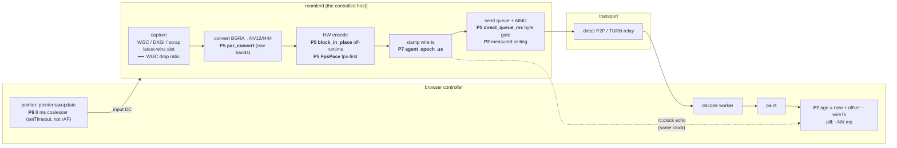

# Remote-desktop drag smoothness & latency (FR-1)

How a remote-desktop session is made to *feel* as fast as RustDesk on the same
pair — the encode-cadence, pointer-cadence and end-to-end-age work that sits on
top of the rate controller. This is the design-and-evidence record for
[FR-1](fr/FR-1-remote-desktop-drag-smoothness.md) (#767); the bit-spending rate
loops it rides on are in [rate-control.md](rate-control.md), the capture/encode
surface in [encoders.md](encoders.md), and the viewer in [ui.md](ui.md).

> **Why a separate page.** The rate controller (P1–P4) answers *how many bits*;
> this page answers the three things left over once the bits are right — the
> **cadence** the frames arrive on (P5), the **pointer** stream that drives them
> (P6), and the **number** that tells you whether any of it worked (P7). Those
> three were shipped but never had a home outside the FR spec.

## 1. The problem, and where it was NOT

Reference test (2026-08-26, a browser on NEO16 viewing a 2880×1800 Iris-Xe host,
same LAN, direct): RustDesk H.265 at ~7 Mbps / 29 fps felt instant; roomler at a
higher bitrate and fps felt *sluggish, bulky, with occasional freezes*. The
agent's own 2 s heartbeats exonerated both the network (the DataChannel drained
~9.8 Mbps) and the viewer (40 fps decoded, zero struggle reports). The drag feel
was manufactured **inside the agent** — by rate control opening above the pipe,
by blocking encoder re-opens, and by a motion-defer that parked every rate drop
as a standing send queue. P1–P4 fixed the bit-spending (see
[rate-control.md](rate-control.md), rows rc.442–446 and the measured-rate loop).
P5–P7 fixed what remained.



## 2. The seven phases

| Phase | What it does | Kill switch | Lives in |
|---|---|---|---|
| P1 | Byte-budget gate on the **direct** send queue (150 ms of the path ceiling); send depth 12→6 | `direct_queue_ms` | `rate_profile.rs:504` ([rate-control.md](rate-control.md)) |
| P2 | Measured-rate ceiling `min(nominal, 0.85×goodput)` from blocked-send samples | `measured_ceiling` | [rate-control.md](rate-control.md) |
| P3 | Background encoder rebuild — the replacement opens on a blocking thread while the current one keeps producing; swap between frames | `bg_rebuild` | [rate-control.md](rate-control.md) |
| P4 | Direct HRD window 2×→1× (AV1 floored at 2×); area-scaled AIMD floor | `direct_hrd_pct`, `area_min_bitrate` | `rate_profile.rs:590` |
| **P5** | **Encode cost & cadence** — parallel convert, off-runtime encode, **fps-first** shedding on a paced even grid | `par_convert`, `fps_pace` | §3 below |
| **P6** | **Pointer cadence off rAF** — immediate-send + 8 ms min-gap timer, `pointerrawupdate` sampling | localStorage `roomler-rc-input-gap-ms` | §4 below |
| **P7** | **End-to-end age** — one process clock stamped on the wire, echoed over control, measured at paint | — (absent on old agents) | §5 below |

> P1–P4 are **direct-only** since 0.4.3 — they were field-proven *relay-hostile*
> (per-frame samples read near-zero through a lumpy TURN-TCP pipe; a swap's
> adoption IDR is a multi-second lump at ~2 Mbps). Relay keeps the field-proven
> nominal-clamp + defer-at-quiet posture. The relayed drag quality arc is
> [FR-10](fr/FR-10-relay-drag-quality.md); the relay-robust estimator is a
> deliberately-separate follow-up.

## 3. P5 — encode cost & cadence

Three independent levers, each hatched (`agents/roomlerd/src/encode/`):

1. **Parallel convert** (`par_convert`, default on). Frames ≥ 2 MPix run the
   BGRA→NV12/I444 conversion in row bands across scoped threads — byte-identical
   output (even-row cuts, chroma pairs never straddle a band boundary). Band
   count is `min(4, cores)`; under 2 MPix the single call wins
   (`encoder.rs:2039` `convert_bands`, `:2058` `band_cuts`; `mod.rs:552`
   `par_convert_enabled`).
2. **Off-runtime encode** (`block_in_place`). The 20–30 ms HW encode no longer
   stalls the async runtime the DataChannel send task shares (`peer.rs:6469`,
   `:9218`).
3. **fps-first shedding** (`fps_pace`, default on). When the encoder can't hold
   the target frame rate, frames are consumed on an **even grid** at the
   sustainable rate — instead of WGC dropping ~33 % of frames at *random* phases,
   which is what the alternating 16/33 ms motion deltas (the residual "steps"
   judder) actually were.

The pace is pure and hysteretic (`encode_pressure.rs:162` `FpsPace`, `:185`
`observe`):

```
sustainable = 1000 / ewma_encode_ms            // clamped to [0, 240]
quantized   = (sustainable / 5) * 5            // 5 fps steps
paced       = Some(quantized)  if quantized + 5 ≤ target_fps   // engage ≥5 under target
            = None             otherwise                       // run at target
```

floored at `FPS_PACE_MIN = 15` (`encode_pressure.rs:139` — below that the cure is
a resolution tier, not more pacing). While paced, the exposed `encode_factor` is
masked at 1.0 (`governor.rs:1523`): the pixels-bound HW encode time never
responded to the bitrate factor, so resolution stays the second lever. The pump
reads `governor.paced_fps()` each loop (`governor.rs:1535`; consumed at
`peer.rs:9576`, logged at `:9653`).

> ⚠️ **The pace keys on encode time, not full-pipeline time.** `FpsPace` derives
> the sustainable rate from `ewma_encode_ms` alone. At small geometries encode
> *is* the bottleneck and the pace tracks delivery closely. At 2880×1800 the
> per-frame capture + convert + submit cost sits *beyond* the encode EWMA, so the
> pace target can read higher than the full pipeline can actually deliver — see
> the field finding in §6. Closing that gap is pipeline-cost work
> ([FR-70](fr/FR-70-media-pipeline-leaves-the-runtime.md),
> [FR-118](fr/FR-118-gpu-resident-frames.md)), not a pacing change.

## 4. P6 — pointer cadence off rAF

The old mouse-move coalescer sent one move per `requestAnimationFrame`. rAF is
driven by the compositor, so a tab busy decoding/compositing heavy video slows
the pointer stream **exactly when a drag needs it most**, and even idle it adds up
to a frame (~16 ms) before the first send.

P6 drives sends from a timer instead (`useRemoteControl.ts:6499`
`INPUT_MOVE_GAP_MS`, `:6512` `schedulePendingMove`): send immediately when the
min-gap has elapsed, else arm one `setTimeout` for the remainder; latest position
wins. 8 ms ≈ a 125 Hz ceiling at ~60 B/message — noise even on a constrained
relay. Where the browser supports it (Chromium), `pointerrawupdate` feeds the
coalescer at device rate between rAF-aligned moves, so the freshest position is
always queued (`useRemoteControl.ts:11981`). The gap is localStorage-tunable
(`roomler-rc-input-gap-ms`); the same timer drives the relative-pointer path
(`:6608`).

The point of the design is that `setTimeout` cadence is **independent of rAF**:
under a compositor load that drops rAF to 20 fps, pointer sends still leave at
~125 Hz.

## 5. P7 — end-to-end age ("Delay")

The HUD's `~NN ms` age pill is the roomler analogue of RustDesk's "Delay". It is
built **without a wire-format change**: the 13-byte video header already carried a
µs timestamp.

- **One process clock.** Both DataChannel pumps stamp the header from a single
  process-wide epoch (`peer.rs:3522` `agent_epoch_us`). Stamped at framing, so the
  send-queue wait is *inside* the measured age.
- **An echo on the same clock.** A new `rc:clock` control verb echoes `t0`
  verbatim plus the agent's epoch µs (`peer.rs:3529` `clock_echo_json`, handled at
  `:10562`). The browser probes it every stats tick and keeps the **lowest-RTT**
  sample of the last 8 (`useRemoteControl.ts:6447` `CLOCK_RING`, `:6451`
  `sendClockProbe`): both clocks are fixed-origin, so the offset is a constant and
  min-RTT bounds the asymmetry error to RTT/2 of the best probe.
- **Measured at paint.** The decode worker computes
  `age = epochNow + offset − wireTs` (`rc-hop-stats.ts:213` `frameAgeMs`). The
  pill is the window average, `~${Math.round(age.avgMs)} ms`
  (`RemoteControl.vue:3180` `statsAgeLabel`, rendered at `:236`).

It covers **encode-output → send queue → network → decode → paint**. The
agent-side capture + encode (~10–15 ms) sits *before* the stamp and is excluded,
so the pill reads ~15 ms low against a photographed glass-to-glass. Old agents
never echo → the ring stays empty → the pill simply does not appear.

> The same paint age is reported back to the agent as `viewer_age_ms` (over
> `rc:decodestat`), where [FR-15](fr/FR-15-relay-age-feedback.md) folds a
> sustained excess into the constrained rate loop. The HUD and the agent loop read
> one measurement. An implausible reading (clock not yet locked) is clamped to a
> `u16` sentinel and flagged `viewer_age_implausible`, never fed to the loop.

## 6. Field verification

Measured 2026-10-26 from production `agent_logs` (read-only, 7-day window). The
fleet was on 0.4.167–0.4.172.

### Encode cadence (AC6) — **partial**

Per-window delivered fps is the diff of the monotonic `frames_encoded` between
consecutive ~2 s heartbeats (there is no frames-base field); session *mean* is
meaningless because idle desktop windows (~16 fps) dominate, so the distribution
and the motion windows are what matter.

| Host / geometry (Iris-Xe class) | windows | fps med / p90 / max | motion(≥25) med | ≥45 fps | avg_encode_ms | paced |
|---|---|---|---|---|---|---|
| **2880×1800** av1_qsv (Rozalina-New, 0.4.167) | 918 | 29.5 / 36.5 / **38.5** | 34.5 | **0 %** | 19.7 / 20.5 | 100 % @ 50 |
| **1920×1200** hevc_qsv (CORPLAP-1, 0.4.171) | 1334 | 40.5 / 51.5 / 60.5 | **45.0** | 31 % | **10.5 / 11.7** | ~0 % |

- At the **named 2880×1800 geometry** the headline **"≥45 fps … avg_encode_ms ≤
  ~17" is NOT met**: delivered fps tops out at ~38 (no window reached 45) and
  encode sits at ~20 ms. The fps-first pace *is* engaged (even cadence), but at a
  rate below the target — the pace keys on the ~20 ms encode EWMA and the full
  5.2 MPix pipeline delivers only ~38 (the §3 caveat, in the field).
- At **1920×1200** on the same GPU class the targets *are* met: motion-window
  median 45 fps, encode ~10.5 ms.
- **No online host is Iris-Xe *at* 2880×1800** — the only 2880×1800 QSV host
  (Rozalina-New) is offline and runs AV1, not the HEVC the original reference
  used, so the literal cell could not be driven live; this is the best available
  evidence.
- **WGC drop ratio** (`wgc_backend.rs:717` `wgc: capture cadence`,
  `drop_ratio_pct`): on the one WGC-capture host in the window (NEO16, 0.4.172,
  635 samples) the ratio was **median 2 %** (p90 27, max 65) — the ~33 % random
  drop pathology is gone. That host is NVENC/WGC, not a 2880×1800 Iris-Xe one (no
  online Iris-Xe host captures via WGC).

### End-to-end age (AC8) — **partial**

| Transport | age_ms med / p90 / p99 | floor med | windows | sessions / hosts |
|---|---|---|---|---|
| direct | **15** / 1108 / 1194 | 9 | 182 503 | 226 / 10 |
| relay | **36** / 63 / 248 | 34 | 27 206 | 73 / 8 |

The P7 age is a **real `Some(N)` on 209 709 of 259 704 heartbeat windows, across
294 sessions and 10 hosts** — the HUD computes and shows an end-to-end number
across the live fleet. Direct median 15 ms and relay median 36 ms are sane,
path-reflective latencies with RustDesk-"Delay" semantics; the direct p99 ~1.1 s
tail is the [FR-14](fr/FR-14-direct-link-jitter-episodes.md) jitter episodes made
visible, which is the point of the pill. The **"HUD shows end-to-end age" half is
met**; a literal side-by-side comparison against RustDesk's own Delay readout on
the reference pair is an operator A/B (FR-1 AC9).

### Pointer cadence (AC7) — mechanism confirmed, field read owed

The decoupling is in the source (§4): sends run off a `setTimeout` floor, never
rAF, with `pointerrawupdate` sampling. The field read — input-DC send cadence held
flat while the viewer's rAF is tanked by compositor load — needs a **foreground**
browser with forced control to measure, which a relay-only, background-throttled
automation tab cannot do (a background tab throttles `setTimeout` too). It is owed
on the operator's own browser or a dedicated idle host.

## 7. Config & kill-switch reference

| Knob | Env | Default | Effect |
|---|---|---|---|
| `par_convert` | `ROOMLERD_PAR_CONVERT` | on | banded BGRA→NV12 convert ≥ 2 MPix |
| `fps_pace` | `ROOMLERD_FPS_PACE` | on | fps-first even-cadence shedding |
| `direct_queue_ms` | `ROOMLERD_DIRECT_QUEUE_MS` | 150 | direct send-queue lag bound (0 = off) |
| `direct_hrd_pct` | `ROOMLERD_DIRECT_HRD_PCT` | 100 | direct HRD/VBV window (AV1 floored 200) |
| `roomler-rc-input-gap-ms` | — (localStorage) | 8 | pointer min-gap, ms |

The age pill needs agent ≥ 0.4.9 and a WebCodecs decode path (HEVC-over-DC or
VP9-4:4:4); it is absent on the classic `<video>` path and on older agents.

---

*Cross-refs: [FR-1 spec](fr/FR-1-remote-desktop-drag-smoothness.md) ·
[rate-control.md](rate-control.md) · [remote-control.md](remote-control.md) §12
(latency budget) · [encoders.md](encoders.md) · children
[FR-10](fr/FR-10-relay-drag-quality.md) (relay), FR-14 (jitter), FR-15 (age
feedback).*
