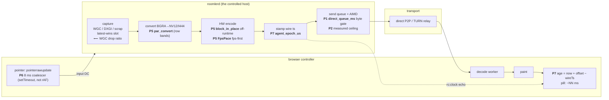

# Remote-desktop drag smoothness & latency (FR-1)

How a remote-desktop session is made to *feel* as fast as RustDesk on the same
pair — the encode-cadence, pointer-cadence and end-to-end-age work that sits on
top of the rate controller. This is the design-and-evidence record for
[FR-1](fr/FR-1-remote-desktop-drag-smoothness.md) (#767); the bit-spending rate
loops it rides on are in [rate-control.md](rate-control.md), the capture/encode
surface in [encoders.md](encoders.md), and the viewer in [ui.md](ui.md).

> **Why a separate page.** The rate controller (P1–P4) answers *how many bits*;
> this page answers the three things left over once the bits are right — the
> **cadence** the frames arrive on (P5), the **pointer** stream that drives them
> (P6), and the **number** that tells you whether any of it worked (P7). Those
> three were shipped but never had a home outside the FR spec.

## 1. The problem, and where it was NOT

Reference test (2026-08-26, a browser on NEO16 viewing a 2880×1800 Iris-Xe host,
same LAN, direct): RustDesk H.265 at ~7 Mbps / 29 fps felt instant; roomler at a
higher bitrate and fps felt *sluggish, bulky, with occasional freezes*. The
agent's own 2 s heartbeats exonerated both the network (the DataChannel drained
~9.8 Mbps) and the viewer (40 fps decoded, zero struggle reports). The drag feel
was manufactured **inside the agent** — by rate control opening above the pipe,
by blocking encoder re-opens, and by a motion-defer that parked every rate drop
as a standing send queue. P1–P4 fixed the bit-spending (see
[rate-control.md](rate-control.md), rows rc.442–446 and the measured-rate loop).
P5–P7 fixed what remained.



## 2. The seven phases

| Phase | What it does | Kill switch | Lives in |
|---|---|---|---|
| P1 | Byte-budget gate on the **direct** send queue (150 ms of the path ceiling); send depth 12→6 | `direct_queue_ms` | `rate_profile.rs:547` ([rate-control.md](rate-control.md)) |
| P2 | Measured-rate ceiling `min(nominal, 0.85×goodput)` from blocked-send samples | `measured_ceiling` | [rate-control.md](rate-control.md) |
| P3 | Background encoder rebuild — the replacement opens on a blocking thread while the current one keeps producing; swap between frames | `bg_rebuild` | [rate-control.md](rate-control.md) |
| P4 | Direct HRD window 2×→1× (AV1 floored at 2×); area-scaled AIMD floor | `direct_hrd_pct`, `area_min_bitrate` | `rate_profile.rs:657` |
| **P5** | **Encode cost & cadence** — parallel convert, off-runtime encode, **fps-first** shedding on a paced even grid | `par_convert`, `fps_pace` | §3 below |
| **P6** | **Pointer cadence off rAF** — immediate-send + 8 ms min-gap timer, `pointerrawupdate` sampling | localStorage `roomler-rc-input-gap` | §4 below |
| **P7** | **End-to-end age** — one process clock stamped on the wire, echoed over control, measured at paint | — (absent on old agents) | §5 below |

> P1–P4 are **direct-only** since 0.4.3 — they were field-proven *relay-hostile*
> (per-frame samples read near-zero through a lumpy TURN-TCP pipe; a swap's
> adoption IDR is a multi-second lump at ~2 Mbps). Relay keeps the field-proven
> nominal-clamp + defer-at-quiet posture. The relayed drag quality arc is
> [FR-10](fr/FR-10-relay-drag-quality.md); the relay-robust estimator is a
> deliberately-separate follow-up.

## 3. P5 — encode cost & cadence

Three independent levers, each hatched (`agents/roomlerd/src/encode/`):

1. **Parallel convert** (`par_convert`, default on). Frames ≥ 2 MPix run the
   BGRA→NV12/I444 conversion in row bands, since FR-119 P2b-11 on a pool that
   stays up (`encoder.rs:3388` `convert_pool`) — byte-identical output (even-row
   cuts, chroma pairs never straddle a band boundary). Band count is
   `min(4, cores)`; under 2 MPix the single call wins (`encoder.rs:2310`
   `convert_bands`, `:2325` `band_cuts`; `mod.rs:639` `par_convert_enabled`).
2. **Off-runtime encode.** The 20–30 ms HW encode no longer stalls the async
   runtime the DataChannel send task shares. P5 did it with `block_in_place`;
   since FR-70 M1 (default on since 0.4.70) the encoder lives on its own thread per
   session and the pump awaits the packets (`thread.rs:387` `encode`, called at
   `peer.rs:9781`). `block_in_place` remains the inline path, `media_thread = false`.
3. **fps-first shedding** (`fps_pace`, default on). When the encoder can't hold
   the target frame rate, frames are consumed on an **even grid** at the
   sustainable rate — instead of WGC dropping ~33 % of frames at *random* phases,
   which is what the alternating 16/33 ms motion deltas (the residual "steps"
   judder) actually were.

The pace is pure and hysteretic (`encode_pressure.rs:162` `FpsPace`, `:185`
`observe`):

```
sustainable = 1000 / ewma_encode_ms            // clamped to [0, 240]
quantized   = (sustainable / 5) * 5            // 5 fps steps
paced       = Some(quantized)  if quantized + 5 ≤ target_fps   // engage ≥5 under target
            = None             otherwise                       // run at target
```

floored at `FPS_PACE_MIN = 15` (`encode_pressure.rs:139` — below that the cure is
a resolution tier, not more pacing). While paced, the exposed `encode_factor` is
masked at 1.0 (`governor.rs:1602`): the pixels-bound HW encode time never
responded to the bitrate factor, so resolution stays the second lever. The pump
reads `governor.paced_fps()` each loop (`governor.rs:1614`; consumed at
`peer.rs:8296`, logged at `:10188`). FR-112 gave a software encoder a pace of its
own, `SoftwarePace`, which holds its steps up by a margin and never goes below 30.

> ⚠️ **The pace keys on encode time, not full-pipeline time.** `FpsPace` derives
> the sustainable rate from `ewma_encode_ms` alone. At small geometries encode
> *is* the bottleneck and the pace tracks delivery closely. At 2880×1800 the
> per-frame capture + convert + submit cost sits *beyond* the encode EWMA, so the
> pace target can read higher than the full pipeline can actually deliver — see
> the field finding in §6. That gap closed as pipeline-cost work, not as a pacing
> change: the 7.9 ms the pump waited for a readback is gone when the frame stays on
> the GPU ([FR-118](fr/FR-118-gpu-resident-frames.md), switch `zero_copy`, off by
> default until [FR-132](fr/FR-132-zero-copy-by-default.md)).

## 4. P6 — pointer cadence off rAF

The old mouse-move coalescer sent one move per `requestAnimationFrame`. rAF is
driven by the compositor, so a tab busy decoding/compositing heavy video slows
the pointer stream **exactly when a drag needs it most**, and even idle it adds up
to a frame (~16 ms) before the first send.

P6 drives sends from a timer instead (`useRemoteControl.ts:7145`
`INPUT_MOVE_GAP_MS`, `:7158` `schedulePendingMove`): send immediately when the
min-gap has elapsed, else arm one `setTimeout` for the remainder; latest position
wins. 8 ms ≈ a 125 Hz ceiling at ~60 B/message — noise even on a constrained
relay. Where the browser supports it (Chromium), `pointerrawupdate` feeds the
coalescer at device rate between rAF-aligned moves, so the freshest position is
always queued (`useRemoteControl.ts:12761`). The gap is a per-browser knob,
0 to 16 ms (`roomler-rc-input-gap`, `:2766` `storedInputGapMs`, from FR-98 C3); the
same timer drives the relative-pointer path (`:7257`).

The point of the design is that `setTimeout` cadence is **independent of rAF**:
under a compositor load that drops rAF to 20 fps, pointer sends still leave at
~125 Hz.

## 5. P7 — end-to-end age ("Delay")

The HUD's `~NN ms` age pill is the roomler analogue of RustDesk's "Delay". It is
built **without a wire-format change**: the 13-byte video header already carried a
µs timestamp.

- **One process clock.** Both DataChannel pumps stamp the header from a single
  process-wide epoch (`peer.rs:3709` `agent_epoch_us`). Stamped at framing, so the
  send-queue wait is *inside* the measured age.
- **An echo on the same clock.** A new `rc:clock` control verb echoes `t0`
  verbatim plus the agent's epoch µs (`peer.rs:3716` `clock_echo_json`, handled at
  `:11065`). The browser probes it every stats tick and keeps the **lowest-RTT**
  sample of the last 8 (`useRemoteControl.ts:7066` `CLOCK_RING`, `:7070`
  `sendClockProbe`): both clocks are fixed-origin, so the offset is a constant and
  min-RTT bounds the asymmetry error to RTT/2 of the best probe.
- **Measured at paint.** The decode worker computes
  `age = epochNow + offset − wireTs` (`rc-hop-stats.ts:220` `frameAgeMs`). The
  pill is the window average, `~${Math.round(age.avgMs)} ms`
  (`RemoteControl.vue:4845` `statsAgeLabel`, rendered at `:289`).
- **On one clock.** The probe runs on the page, so the offset maps the agent's
  clock onto the page's, and a decode worker's `epochNow` is not the page's:
  each context fixes its epoch from the wall clock when it starts, and a worker
  made after its page reads a constant apart from it (7.25 ms, 162 s after the
  page, on the Windows dev box). So the page measures that skew when it starts
  the worker, and the worker reads the offset through it
  (`workerAgentOffsetUs`, `ui/src/workers/rc-clock-cal.ts:184`; #3566,
  [remote-control.md §11.14.3](remote-control.md#11143-one-clock-for-the-page-and-its-worker-3566)).
  Before that, a session whose worker started late read every age off by the
  skew.

It covers **encode-output → send queue → network → decode → paint**. The
agent-side capture + encode (~10–15 ms) sits *before* the stamp and is excluded,
so the pill reads ~15 ms low against a photographed glass-to-glass. Old agents
never echo → the ring stays empty → the pill simply does not appear.

> The same paint age is reported back to the agent as `viewer_age_ms` (over
> `rc:decodestat`), where [FR-15](fr/FR-15-relay-age-feedback.md) folds a
> sustained excess into the constrained rate loop. The HUD and the agent loop read
> one measurement. An implausible reading (clock not yet locked) is clamped to a
> `u16` sentinel and flagged `viewer_age_implausible`, never fed to the loop.

## 6. Field verification

Measured 2026-10-26 from production `agent_logs` (read-only, 7-day window), with the
fleet on 0.4.167–0.4.172, and read again 2026-11-02 with the fleet on 0.4.177–0.4.197.
Each dated read keeps the anchors of its day.

### Encode cadence (AC6) — **partial**

Per-window delivered fps is the diff of the monotonic `frames_encoded` between
consecutive ~2 s heartbeats (there is no frames-base field); session *mean* is
meaningless because idle desktop windows (~16 fps) dominate, so the distribution
and the motion windows are what matter.

| Host / geometry (Iris-Xe class) | windows | fps med / p90 / max | motion(≥25) med | ≥45 fps | avg_encode_ms | paced |
|---|---|---|---|---|---|---|
| **2880×1800** av1_qsv (WINHOST-J, 0.4.167) | 918 | 29.5 / 36.5 / **38.5** | 34.5 | **0 %** | 19.7 / 20.5 | 100 % @ 50 |
| **1920×1200** hevc_qsv (CORPLAP-1, 0.4.171) | 1334 | 40.5 / 51.5 / 60.5 | **45.0** | 31 % | **10.5 / 11.7** | ~0 % |

- At the **named 2880×1800 geometry** the headline **"≥45 fps … avg_encode_ms ≤
  ~17" is NOT met**: delivered fps tops out at ~38 (no window reached 45) and
  encode sits at ~20 ms. The fps-first pace *is* engaged (even cadence), but at a
  rate below the target — the pace keys on the ~20 ms encode EWMA and the full
  5.2 MPix pipeline delivers only ~38 (the §3 caveat, in the field).
- At **1920×1200** on the same GPU class the targets *are* met: motion-window
  median 45 fps, encode ~10.5 ms.
- **No online host is Iris-Xe *at* 2880×1800** — the only 2880×1800 QSV host
  (WINHOST-J) is offline and runs AV1, not the HEVC the original reference
  used, so the literal cell could not be driven live; this is the best available
  evidence.
- **WGC drop ratio** (`wgc_backend.rs:718` `wgc: capture cadence`,
  `drop_ratio_pct`): on the one WGC-capture host in the window (NEO16, 0.4.172,
  635 samples) the ratio was **median 2 %** (p90 27, max 65) — the ~33 % random
  drop pathology is gone. That host is NVENC/WGC, not a 2880×1800 Iris-Xe one (no
  online Iris-Xe host captures via WGC).

**2026-11-02: the headline depends on where the frame lives.** Every
`FFmpeg DC pump heartbeat` at 2880×1800 from 2026-10-27 to 2026-11-02: 2 831 windows,
17 sessions, one host (the same laptop, `av1_qsv`, direct). No other host in the week
encodes at that geometry.

| Input path | windows | sessions | fps med / p90 / max | motion(≥25) med | ≥45 fps | avg_encode_ms med / p90 | paced |
|---|---|---|---|---|---|---|---|
| `cpu`, switch off: today's default | 1701 | 12 | 31.4 / 38.4 / 42.8 | 37.1 | **0 %** | 17.7 / 21.3 | 55 on 69 % of windows |
| `gpu`, `zero_copy` on | 986 | 1 | **60.0 / 60.0 / 60.3** | **60.0** | **89 %** | **16.3** / 18.9 | none on 80 % |
| unlabelled, 0.4.177, before `input_path` | 144 | 1 | 17.9 / 27.8 / 34.9 | 27.9 | 0 % | 17.7 / 17.9 | 55 on 98 % |

- The `gpu` row is [FR-118 §9.10](fr/FR-118-gpu-resident-frames.md#910-ac4-the-slow-laptop-at-60-fps-2026-10-30):
  a test pattern, full screen, in a window the laptop's owner agreed to. In its
  controlled 20-minute leg 594 of 596 windows reached 50 fps, and capture + encode fell
  from about 25.5 ms to 16.6 ms, because the 7.9 ms the pump waited for a readback is gone.
- The `cpu` row is what the §3 caveat predicts. The pace reads a 17.7 ms encode and
  allows 55 fps, while a frame costs about 25 ms in all, so delivery stays near 38.
- **So P5's numbers are reachable on this hardware, and the default does not reach them
  yet.** `zero_copy` is off by default until [FR-132](fr/FR-132-zero-copy-by-default.md).
- **WGC drop ratio** (`wgc_backend.rs:790`): median 2 %, p90 2, max 42, over 2 571
  samples on the one WGC-capture host in the week, again NVENC and not Iris-Xe.

### End-to-end age (AC8) — **met** (held for #3566, then met on 2026-11-08)

| Transport | age_ms med / p90 / p99 | floor med | windows | sessions / hosts |
|---|---|---|---|---|
| direct | **15** / 1108 / 1194 | 9 | 182 503 | 226 / 10 |
| relay | **36** / 63 / 248 | 34 | 27 206 | 73 / 8 |

The P7 age is a **real `Some(N)` on 209 709 of 259 704 heartbeat windows, across
294 sessions and 10 hosts** — the HUD computes and shows an end-to-end number
across the live fleet. Direct median 15 ms and relay median 36 ms are sane,
path-reflective latencies with RustDesk-"Delay" semantics; the direct p99 ~1.1 s
tail is the [FR-14](fr/FR-14-direct-link-jitter-episodes.md) jitter episodes made
visible, which is the point of the pill. The **"HUD shows end-to-end age" half is
met**; a literal side-by-side comparison against RustDesk's own Delay readout on
the reference pair is an operator A/B (FR-1 AC9).

**2026-11-02, the whole week:** an age on 123 375 of 128 325 heartbeat windows from the
two DataChannel pumps, with 6 sentinels and no `viewer_age_implausible`.

| Transport | age_ms med / p90 / p99 | floor med | windows | sessions / hosts |
|---|---|---|---|---|
| direct | **15** / 30 / 62 | 10 | 95 845 | 411 / 64 |
| relay | **42** / 80 / 179 | 33 | 27 530 | 150 / 12 |

The direct tail the 10-26 read showed (p90 1108, p99 1194) is not in this week's
numbers. This read does not say why.

**2026-11-02, the pill beside the wire.** A headed Chromium 151 on the production
viewer, with the page visible and focused, held two sessions to a throwaway Linux
device on 0.4.197. A script read the `~N ms` pill about once a second, 164 samples
from 36 to 2 865 ms. The agent's `agent_logs` for those two sessions hold 66
heartbeats with a `viewer_age_ms`.

| Session | Heartbeats with an age | Equal to a pill value within 5 s | Of those at 300 ms or more | Equal to a value from the *other* session (chance control) |
|---|---|---|---|---|
| 1 | 52 | 50 | 18 of 18 | 0 |
| 2 | 14 | 13 | 10 of 11 | 1 |

So the wire carries the number the person reads. Each window's `age` goes to the
pill and to `sendDecodeStat` from one worker `stats` message
(`useRemoteControl.ts:7617`, `:8263`, `RemoteControl.vue:4880`). A once-a-second
read can skip a window, which fits the three misses, though this read can't prove it.

That is all this read shows. The session was VP9 software on a loaded host, under
software compositing, with `carrier=direct`, so its ages say nothing about how low
the number gets on real hardware. The comparison with RustDesk's own Delay readout
is the operator's A/B (AC9).

**2026-11-08, held for #3566.** That issue found the decode worker applying a clock
offset the page measured on the page's own clock. Two browsing contexts started at
different times disagree by the wall-clock slew between their starts, so every age
read off by that much, low on some hosts and high on others: 7 ms after 162 s on one
host, near 160 ms after an hour (§5, "On one clock"). The fix, #3568, merged the same
day: the worker now reads the offset through a skew the page measures when it starts
the worker (`workerAgentOffsetUs`, `rc-dc-worker.ts:845`). Production runs the old
arithmetic until a promote. The read above started each session right after loading
its page, so it stands, and the pill and the wire still take one worker `stats`
message (`useRemoteControl.ts:7788`, `:8436`, `RemoteControl.vue:4846`). The fleet
tables above carry the error, and a window whose ages all read negative sent none,
since `HopStats` drops a negative sample (`rc-hop-stats.ts:54`). AC8 ticks once #3568
is on production and its owed GREEN read is in.

**2026-11-08 16:16Z, met.** #3568 went live at 15:56Z in `hosted-20261108-4297002`, and
its GREEN read on production is on #3566 (comment 6723890517). One page made three
connects. With the fix on, the page measured each new worker's skew, 4.20 ms at 225.5 s
and 9.75 ms at 531.6 s after the page loaded, within 0.1 ms of an independent probe, and
sent it before the first chunk. `fwd` then timed 95 % and 81 % of the relayed chunks;
with the switch off, the same page timed 1 chunk in 591. The age reads through the same
skew (`workerAgentOffsetUs`, pinned by `rcClockCal.spec.ts`), though that read didn't
measure the age by itself. With the 2026-11-02 read of the pill beside the wire above,
AC8 is met. A tab loaded before 15:56Z keeps the old arithmetic until it reloads.

### Pointer cadence (AC7) — mechanism confirmed, field read owed

The decoupling is in the source (§4): sends run off a `setTimeout` floor, never
rAF, with `pointerrawupdate` sampling. The field read — input-DC send cadence held
flat while the viewer's rAF is tanked by compositor load — needs a **foreground**
browser with forced control to measure, which a relay-only, background-throttled
automation tab cannot do (a background tab throttles `setTimeout` too). It is owed
on the operator's own browser or a dedicated idle host.

**2026-11-03, a real pointer: two tries, no result yet.** A headed Chromium on the
production viewer, page visible and focused, under software compositing, with an X
pointer moved by `xdotool` at 234 moves/s. Earlier runs through the DevTools protocol
read nothing useful, because its acks arrive at renderer pace, so the driver itself
followed rAF. The second try on 0.4.197:

| Arm | rAF/s | Sends/s | Sends/s while input flowed | Raw events/s | Send gap p50 / p95 ms | Host load |
|---|---|---|---|---|---|---|
| A1, no load | 48.5 | 99.2 | 126.4 | 186.5 | 7.8 / 9.1 | 2.4-3.6 |
| B1, compositor load | 31.7 | 94.4 | 127.3 | 176.4 | 7.8 / 9.4 | 5.2-6.7 |
| A2, no load | 44.0 | 93.0 | 128.6 | 174.6 | 7.7 / 9.0 | 7.2-7.6 |
| B2, compositor load | 29.6 | 100.4 | 127.0 | 186.9 | 7.8 / 9.2 | 7.4-8.9 |
| B_heavy, compositor nearly dead | 5.1 | 90.1 | 125.2 | 166.9 | 7.7 / 8.7 | 9.0-9.6 |

"While input flowed" leaves out gaps over 30 ms. Main-thread stalls, 230-380 ms each,
took about a quarter of every arm, loaded or not, and their cause isn't known.

While input flowed, sends sat at the 8 ms coalescer's ceiling of 125/s, from rAF 48
down to rAF 5. That is what P6 claims, but **it isn't a result**, because a read counts
only with its controls:

- The second try stopped on a host-pressure limit before its controls ran. That host
  is shared, and the pressure fell as soon as the rig stopped.
- The first try ran every arm, on a larger window with more paint. Its busy-frame
  control behaved: 14 sends/s, gap p50 86 ms. Its 16 ms control missed the 55-62 sends/s
  it had to reach, at 34.7/s, though its gap p50 read 16.0 ms, so the counter does
  follow the coalescer.

AC7 stays owed. It needs an idle host, where this rig is a 5-minute run.

## 7. Config & kill-switch reference

| Knob | Env | Default | Effect |
|---|---|---|---|
| `par_convert` | `ROOMLERD_PAR_CONVERT` | on | banded BGRA→NV12 convert ≥ 2 MPix |
| `fps_pace` | `ROOMLERD_FPS_PACE` | on | fps-first even-cadence shedding |
| `direct_queue_ms` | `ROOMLERD_DIRECT_QUEUE_MS` | 150 | direct send-queue lag bound (0 = off) |
| `direct_hrd_pct` | `ROOMLERD_DIRECT_HRD_PCT` | 100 | direct HRD/VBV window (AV1 floored 200) |
| `roomler-rc-input-gap` | — (localStorage) | 8 | pointer min-gap, ms (0–16) |
| `zero_copy` | `ROOMLERD_ZERO_COPY` | off | the frame stays on the GPU ([FR-118](fr/FR-118-gpu-resident-frames.md)); what lifts 2880×1800 past 45 fps |

The age pill needs agent ≥ 0.4.9 and a WebCodecs decode path (HEVC-over-DC or
VP9-4:4:4); it is absent on the classic `<video>` path and on older agents.

---

*Cross-refs: [FR-1 spec](fr/FR-1-remote-desktop-drag-smoothness.md) ·
[rate-control.md](rate-control.md) · [remote-control.md](remote-control.md) §12
(latency budget) · [encoders.md](encoders.md) · children
[FR-10](fr/FR-10-relay-drag-quality.md) (relay), FR-14 (jitter), FR-15 (age
feedback).*
