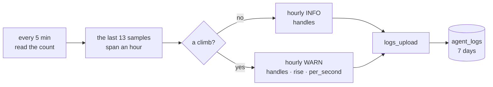

# The resource watch — how a daemon reports its own handle count

[FR-134](fr/FR-134-the-daemon-notices-its-own-leak.md) exists because a leak of
59 handles a second ran for six months and nothing said so
([#3252](https://github.com/gjovanov/roomler-ai/pull/3252)): a self-update
restarted each worker before the leak could hurt, and it was found by accident,
while tracing a kernel leak on the host. The daemon now samples its own open
handles, writes the count to the fleet's logs once an hour, and warns while the
count climbs.

This page covers what it reports, the rule that calls something a climb, how to
read it across the fleet, what it deliberately does not do, and FR-134's other
half: a Windows peer probe that starts no process.

| | |
|---|---|
| The watch | `agents/roomlerd/src/resource_watch.rs`, started in `run_cmd` (`agents/roomlerd/src/app.rs:4393`) |
| Kill switch | `ROOMLERD_RESOURCE_WATCH=0` |
| The bar | 2,000 handles on Windows, 200 descriptors on Linux and macOS (`resource_watch.rs:38`, `:40`) |
| A lower bar, for a field test | `ROOMLERD_RESOURCE_WATCH_MIN_RISE=<n>` |
| The Windows prober | `agents/roomlerd/src/icmp_win.rs`, called by `OsPinger` (`agents/roomlerd/src/localapi_state.rs:61`) |
| Its kill switch | `ROOMLERD_PING_SUBPROCESS=1` goes back to `ping.exe` |
| The fleet read | `scripts/resource-watch-read.js` (§3) |

All three variables are read at start, and none has a config key, so none can be
pushed through remote configuration.

## 1. What it reports

Every 5 minutes it reads the count. Once an hour it logs that count. While the
count climbs, the hourly line is a warning instead. Both go through the ordinary
log path, so a fleet read needs no new wire: the uploader's `tracing` layer takes
every event (`crates/agent-core/src/logs_upload.rs:128`) and `agent_logs` keeps
them for 7 days.



| OS | The count | The line |
|---|---|---|
| Windows | `GetProcessHandleCount` | `INFO resource watch handles=…` |
| Linux, macOS | entries in `/dev/fd`, which counts the listing's own descriptor | the same |

A climb reads `WARN resource watch: open handles have climbed for an hour, a leak
in this daemon? handles=… rise=… per_second=…`.

The first line comes 5 minutes after the process starts, and the next ones hourly.
Startup's own handles are not sampled, because the first tick is skipped.

⚠️ **On a Windows service host this watches the worker, not the supervisor.**
`run_cmd` is the console-session worker (`roomlerd run --supervisor scm …`). The
session 0 `roomlerd service-run` process has no watch. The leak this exists for was
in the worker, and a leak in the supervisor would not show here.

⚠️ `per_second` is whole numbers. A climb of 2,000 in an hour reads
`per_second=0`, so judge a warning by `rise`.

⚠️ `roomler logs --grep` cannot find these lines. It filters only the tail the
daemon returns, at most 64 KiB, and an hourly line is rarely in it: on a host in a
session the log grows by megabytes in that hour. On the device, grep the log file
itself (`grep -a`); across the fleet, §3.

## 2. What counts as a climb

The watch compares the two ends of the hour rather than asking for a rise at every
step. A real leak pauses: keep-busy, the caller behind #3252, stops while the
person is at the machine, and other handles come and go around it.

> **A climb is the quietest of the newest 3 samples sitting at least the bar above
> the busiest of the oldest 3** (`GrowthWatch::observe`, `resource_watch.rs:84`).

| The series | The verdict | Why |
|---|---|---|
| a steady leak | climbing | both ends move |
| a leak that pauses | climbing | the ends still sit apart |
| a flat daemon of any size | steady | the bar is a rise, not a level |
| a spike that fell back | steady | it leaves the newest samples low |
| a one-off step that stays | climbing, then steady | it can warn once, and clears when the step leaves the oldest samples |
| fewer than 13 samples | steady | under an hour there is nothing to compare |

The bars are far apart because the limits are: Windows gives a process 16.7 M
handles and a busy worker opens hundreds in a session, while a Unix process can
have as few as 1,024 descriptors.

## 3. Reading it across the fleet

```bash
roomler ssh mars -- 'kubectl -n roomler-ai exec -i mongodb-0 -- mongosh --nodb --quiet' \
  < scripts/resource-watch-read.js | grep -o 'OUT .*'
kubectl -n roomler-ai get pod mongodb-0     # RESTARTS must not have moved
```

It prints one line per reading: time, agent id, version, level, `handles`, and on a
warning `rise` and `per_second`.

⚠️ **This is the one read of `agent_logs` to use, and the reason is an outage.**
`mongosh` inside the database container counts against that container's memory
limit, and an unbounded read there OOM-killed production Mongo on 2026-10-26. The
script is bounded three ways: the text index on `lines.msg` picks the batches,
`$limit` caps them, and only the matching lines leave the server.

The per-agent route (`GET /api/tenant/{tid}/agent/{aid}/logs?limit=N`) is safe but
cannot answer this: it returns the newest 500 batches at most, and a chatty device
sends one every 5 seconds, so that is about 40 minutes, less than the gap between
two lines.

An exec sweep cannot answer it either: it only reaches devices with exec enabled,
which is a biased sample. `agent_logs` holds every device that can post a log.

## 4. What it does not do

**It only reports.** It never restarts or exits the daemon. A daemon that leaks may
still be the only way into the machine, and exiting one that nothing supervises
takes the device offline for good. The same rule binds remote configuration
([remote-config.md](remote-config.md)). What to do about a warning is a person's
decision.

It watches handles and nothing else: threads, memory and the kernel objects a
driver leaks are out of its reach. The kernel leaks that started this work were
AMD's `amdkmdag.sys`, in another address space entirely.

## 5. A Windows peer probe starts no process

The RTT column of `roomler peers` comes from a prober that pings each live peer
every 15 s (`RTT_PROBE_INTERVAL`, `localapi_state.rs:28`). Shelling `ping` meant a
process per probe, each with a `conhost.exe`: on a host with 17 peers, 194
`PING.EXE` starts in 291 s, one to two process exits a second at idle. That is more
than wasted CPU where a display driver leaks by the process exit, as the measured
host's did.

On Windows the prober now calls what `ping.exe` calls, `IcmpSendEcho` and
`Icmp6SendEcho2`, on a blocking thread. The route is the same, the number is the
OS's own, and nothing starts. Linux and macOS still shell `ping`: nothing measured a
cost there, and a raw socket would need privileges a per-user install lacks.

⚠️ Each value in the table is **one packet**. On a stable path it matches a hand
`ping` closely; on a jittery one it can land anywhere in the distribution, so compare
several reads, not one.

## 6. Field numbers

Measured 2026-11-01 on 0.4.194.

| | |
|---|---|
| First line after start | 300 s |
| Between hourly lines, 15 devices across the three OSes | 60.0 minutes |
| A real climb on a Linux lab device, bar lowered to 30 | `WARN handles=115 rise=72 per_second=0` on the 13th sample, the fleet's only warning |
| Windows, idle worker | 482 to 526 handles |
| A Windows worker that had just served RC sessions | 800 to 935 handles, flat |
| Linux | 36 to 39 descriptors |
| macOS | 20 to 33 descriptors |
| The fleet read against 406,843 batches | one line per device, no restart |
| `PING.EXE` started by the daemon, Windows, 17 peers | 0 in 610 s, with a positive control; 0.4.193 started 249 in 300 s |
| The RTT column against a hand `ping`, median of 16 pairs | within 1 ms on a server and three LAN peers |
| The same on a Wi-Fi peer, 40 pairs | minimum 4 and 4 ms, quartiles 5 to 54 and 6 to 63 ms: the same distribution, no offset |
