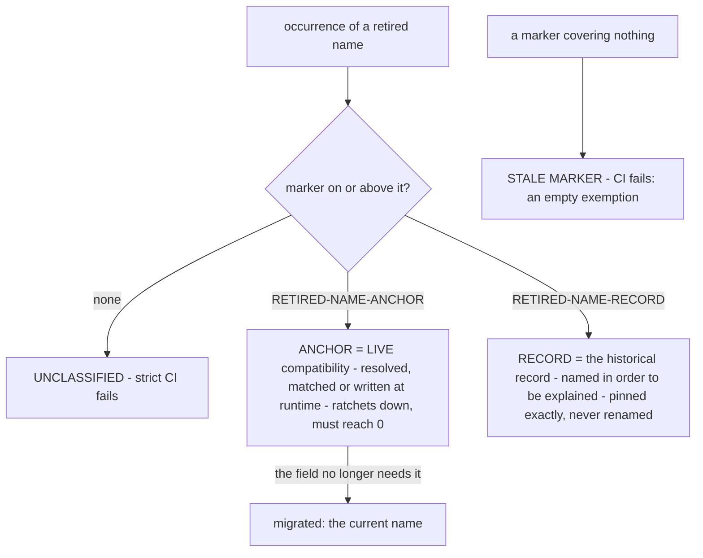
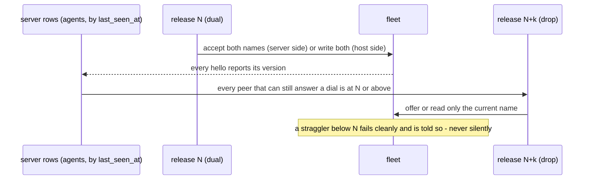

# Retired names — the audit that keeps them from coming back

The product renamed its binaries in August 2026 (FR-21, #809): the daemon, the
tray companion and the tunnel CLI each took the name they carry today —
`roomlerd`, `roomler-desktop`, `roomler` — and the two legacy wizards were folded
into the one `roomler-setup`. A rename of a daemon that runs as SYSTEM/root on
every enrolled machine cannot be a search-and-replace: the old names were
**load-bearing compatibility surfaces** — config trees, service names, an env
prefix, published asset names, a macOS bundle that keys TCC grants — and a
deleted compatibility arm fails no build and no test. It strands part of the
field at the next update.

So the rename is a *program*, not a commit, and this page is about the machinery
that keeps it honest: one script, two marker classes, a guard pinned in both
directions, and a CI job that blocks. FR-21 made every occurrence either migrated
or deliberately frozen; FR-46 (#1051) retires the frozen ones one class at a
time, each when the field allows it. The specs under `docs/fr/` hold the full
decision record; this page is the operating manual.

<!-- RETIRED-NAME-RECORD-BEGIN
The table below is the record of the rename itself. It names both sides because
that is its job: rewriting the left column would delete the one public place the
old names are explained. Its rows are pinned by `records` in
`scripts/name-audit-baseline.txt`, so adding or removing one is a reviewed act. -->
| Retired name | Current name | Where it was load-bearing |
|---|---|---|
| `roomler-agent` (the daemon) | `roomlerd` | appdirs trees, unit names, log prefixes, the Windows service `RoomlerAgentService`, the macOS bundle, published asset names, the tunnel's QUIC ALPN |
| `roomler-agent-tray` (the tray app) | `roomler-desktop` | the companion binary and its per-user unit |
| `roomler-tunnel` (the tunnel CLI) | `roomler` | the CLI's config segment, its PATH symlink, every tunnel release asset and the tarball's inner directory |
| `ROOMLER_AGENT_*` (the env prefix) | `ROOMLERD_*` | operator-authored systemd drop-ins and machine-wide registry entries that no package upgrade rewrites |
| `roomler-installer`, `roomler-tunnel-installer` (the wizards) | `roomler-setup` | two installers, one per role, retired for the unified wizard |
<!-- RETIRED-NAME-RECORD-END -->

## The classifier

`scripts/name-audit.sh` (`:142` lists the spellings it hunts, including the
CamelCase and spaced forms a person sees in a service list or a Privacy pane)
walks every tracked file that carries a retired name **or** a marker, and puts
each occurrence in exactly one state:

| Class | Marker forms | What it is | Guard (`scripts/name-audit.sh`) |
|---|---|---|---|
| **ANCHOR** | `RETIRED-NAME-ANCHOR` followed by `:` or `(N):`, or a `-BEGIN` … `-END` pair | code that resolves, matches or writes the retired name at runtime — a read-fallback over a pre-rename tree, a sweep that deletes the old unit, a wire value a deployed peer still sends | `anchors` must equal the baseline in both directions (`:562`, `:580`): a deleted anchor and a stale floor both fail |
| **RECORD** | `RETIRED-NAME-RECORD` followed by `:` or `(N):`, or a `-BEGIN` … `-END` pair | prose and fixtures that name the retired thing *in order to explain it* — a field log quoting real output, a migration note, the table above | `records` must equal the baseline in both directions (`:594`) |
| unclassified | none | nobody has decided | `--check --strict` requires 0 (`:608`); the `name-audit` job in `.github/workflows/ci.yml:2172` runs it on every PR (`:2214`) |

🔑 **The falsifiable rule**: *if deleting the live code would also delete this
occurrence, it is an ANCHOR; if the occurrence would survive, it is a RECORD.*
Reclassifying is exactly as easy as fixing and looks identical in a diff, which
is why `records` is pinned exactly: a live site relabelled as RECORD trips both
guards (anchors dropped **and** records rose) and costs two reviewed baseline
bumps that each have to say what they record.

⚠️ The colon is part of the marker (`:245`). A comment that merely *talks about*
`RETIRED-NAME-ANCHOR` exempts nothing — found when a regression test's own
comment would otherwise have exempted the regression.

### Changing the counts

Both counts move only with `scripts/name-audit.sh --update-baseline`, committed
in the same PR, whose body says which anchor retired (and which field state no
longer exists) or which record was added (and what it records). The CI job
prints the summary beside its verdict (`ci.yml:2217`), so a reviewer can diff
the number against the claim. A marker that covers nothing fails `--check`
(`:555`): an empty exemption is the one that silently widens.

## Why the live count is not zero yet

`anchors` stood at 747 when FR-46 opened and 654 on 2026-10-26, before this
page's PR took three more. The spec keeps **0** as the criterion rather than
redefining it down to whatever is currently true; what remains is mostly waiting
on a *condition*, each one named:

| Class | Site | Goes when |
|---|---|---|
| appdirs read-fallback | `crates/agent-core/src/appdirs.rs:85`, `:175` | **kept on purpose** — `migrate_legacy_trees` skips whenever the desktop companion is running, and the daemon respawns that companion, so on a GUI host the fallback is the *primary* path, not a safety net |
| already-published release assets | `agents/roomlerd/src/updater.rs:988`, `agents/roomler-cli/src/update.rs:391` | no picker matches them. The daemon lane has published `roomlerd-*` since 0.4.38 (field-proven across the rename on 0.4.40). The **tunnel lane still publishes the retired prefix** (`.github/workflows/release-tunnel.yml:165`), and the CLI's updater refuses a tarball whose inner directory is not that spelling — so that rename is its own two-release migration: a CLI that accepts both first, the rename once no tunnel-only host runs an older one |
| sweeps that delete the old thing | `agents/roomlerd/src/win_service/mod.rs:101`, `agents/roomlerd/packaging/macos/postinstall`, `scripts/install.sh --uninstall` | no host can still have the thing swept — a sweep must *name* what it removes |
| MSI installer identity | the WiX ARP entry, FileKey and ProductName | a major-upgrade decision, not a rename |
| wire values | `crates/tunnel-core/src/transport/quic.rs:61` | **step 2 of 3 shipped with this page**: the server has answered both ALPNs since 0.4.45; the client now offers only the current one; the legacy arm goes once no client can still offer it |
| env fallbacks | `crates/tunnel-core/src/env.rs:215`, `:225` | the retired prefix is **searched, never read** — a host that still sets one is told at startup and on `roomler status` — and the arm goes once no host can have one |
| a Windows rendezvous path | `agents/roomlerd/src/system_context/peer_presence.rs:82` | written today by the SystemContext worker and read by the supervisor, which can be different versions mid-update: a dual-read window first, then the rename |

⚠️ **An anchor's stated reason is a claim, not a fact.** Six have been found
false on inspection so far, each then free to remove. The latest (2026-10-26)
was the served install script telling every macOS user since 0.4.41 to enable a
Privacy-pane entry that the bundle rename had already replaced — a user-facing
instruction naming something that no longer existed. Read the reason before
paying its price; if it holds, the anchor holds.

## How a class retires — measure, dual, re-measure, drop

🔑 Measure on the **server's own rows**, never on a `roomler exec` sweep: exec
reaches only hosts with `exec_enabled`, which correlates with being maintained,
which correlates with being up to date — a sample that selects for the answer you
hoped for. ⚠️ A raw version histogram lies too: `agent_version` is the *last
reported* value, so a row dead for months keeps its number forever and looks
exactly like an active straggler. Bucket by `last_seen_at` first. ⚠️ And read
with a bounded, server-side aggregation: the 2026-10-26 histogram was first
written as a `find().toArray()` run inside the database's own container, and the
audit collection (which also carries a version field) took that container past
its memory limit — an 80-second read outage, self-healed.

## Traps the audit has met

| Trap | What happened | Guard |
|---|---|---|
| a file drops out of the scan when its *last* retired name is migrated | seven orphaned markers across six files in one phase, structurally unreportable | the scan is the union of token-bearing and marker-bearing files (`:185`) |
| an anchor inside a `\`-continued string literal | the marker text was *emitted* into a generated systemd unit and a LaunchAgent plist — invalid XML, launchctl refused it | `--check` fails when the line before a marker ends in a backslash |
| an anchor block pushed a shebang off line 1 | the macOS `.pkg` failed at "Validating packages" | `--check` fails any file whose `#!` is not on line 1 |
| an anchor interleaved with a `///` doc comment | both sentences split, and nothing else noticed | `--check` flags anchor prose resuming after doc lines before code |
| success looked like a crash | a `grep` matching nothing under `pipefail` killed the report at `unclassified = 0` — latent for the whole program, armed by its own success | the scoped `{ grep … \|\| true; }` (`:367`) |
| a sweep rewrote an anchor's own explanation | the sentence saying a name must not be rewritten had it rewritten; the count went *down*, which reads as progress | no guard can verify a prose claim — read the anchor |
| a span marker inside a BEGIN/END region | never staleness-checked; four kept claiming the bundle was TCC-frozen a phase after it moved | none, by decision: inside a region an inner marker is decorative |

Related: `docs/installation.md` (what each install path writes), `docs/tunnels.md`
(the transport the ALPN guards), `docs/fr/FR-46-eradicate-the-retired-agent-name.md`
(the phase table and the field log).
