# Roomler SSH

SSH into any enrolled node by its overlay address, without installing `sshd`,
without distributing `authorized_keys`, and without opening a port on the host.
The roomler answer to [Tailscale SSH](https://tailscale.com/kb/1193/tailscale-ssh)
— with one capability theirs does not have: **it works on Windows.**

Status: **the whole programme, P1 through P8, is shipped and field-proven** —
transport, server, the full four-gate authorization path, the privilege model
and interactive shells on **both** Windows and Unix, operator consent, the
audit log, host-key verification, the `roomler ssh` / `roomler proxy` clients,
SFTP/scp, port forwarding, the device-reported session-activity log, and the
admin UI for all of it.

**Field-proven on `corplap-3`** (a corp-managed laptop with no `sshd`, all
three firewall profiles enabled, and WSL holding loopback `:22`): a session
opened through the full gate chain returns `corp3net\corpuser` — the signed-in
domain user — with **no listener bound on the SSH port** and no firewall rule
added. Replaying the same grant is refused.

The feature is off at every level that is not the build
until an operator turns it on: all four release lanes build the `ssh-server`
cargo feature (`.github/workflows/release-agent.yml`), but `ssh_enabled`
defaults false, `ssh_authorized_keys` defaults empty, and every device's
`SshPolicy` defaults to `Off`.

---

## 1. Why the packets are intercepted instead of a socket being bound

The obvious implementation is a listener on `<overlay ip>:22`. Measured against
the fleet on 2026-08-19, by actually binding those addresses:

| Host | `overlay:22` | Why |
|---|---|---|
| buildhost / fleet-host-2 / fleet-host-1 | **EADDRINUSE**, on *both* orgs' addresses | `sshd` holds `0.0.0.0:22`, which covers every local address |
| devbox | **EADDRINUSE** | `sshd` is bound to `100.65.4.2:22` — the overlay address itself |
| corplap-3 | free, but useless | no `sshd` at all (`OpenSSH.Server` capability is `NotPresent`, corp-managed), WSL's `wslrelay` holds loopback `:22`, and all three firewall profiles are enabled so a new listener needs a rule an ordinary user cannot add |
| winhost-a / winhost-b | free | `sshd` installed but `Stopped/Manual` |

On four of seven hosts a bound socket is impossible. So roomler takes the
packets one layer lower, the way Tailscale does:

```
                                 ┌── dst == self_ip && tcp && dport == ssh_port
  mesh ─▶ WgDevice ─decrypt─▶ SplitTun ──┤       → Netstack (smoltcp) → SSH server
                                 └── everything else → SystemTun → OS stack
```

`bridge::run_bridge` was already device-agnostic over the `TunIo` trait, and the
netstack was already a full userspace TCP/IP stack implementing it, so
[`split_tun.rs`](../crates/tunnel-core/src/overlay/split_tun.rs) is a thin shim
between them. Consequences:

- **No port conflict.** `sshd` keeps `0.0.0.0:22`. Both serve, on different
  paths, on the same host.
- **No firewall rule.** Nothing binds. corplap's three enabled profiles are
  irrelevant.
- **Nothing for EDR to kill.** No new service and no new listening socket — the
  failure mode that parked `regal` outbound-only when Kaspersky terminated
  `sshd.exe` as a service.
- **Off-mesh unreachable by construction.** The only way in is a packet that
  already cleared WireGuard. That is a property of the topology, not a policy
  someone can misconfigure.
- **Identical on a locked-down laptop.** In netstack mode the inner device is
  itself a netstack; the split works the same, so a corp host with no winnable
  routing table behaves like a server.

The classifier is deliberately tiny and total over hostile input (an
authenticated peer is not a trusted one): IPv4 + TCP + exact destination +
first fragment only, every field bounds-checked, malformed input answered with
"not ours" rather than a panic.

### The in-process TCP stack on a lossy or policed path (#2876, #2882)

Interception has a cost: every byte a session sends leaves through smoltcp, not
the OS TCP stack. Three properties of that stack had to be fixed before roomler
SSH held up on a path that loses packets. The worst case is a path that polices
rather than queues, like the relay allowance (FR-115), which drops a network's
frames once they pass its bucket.

**It needs a congestion controller.** smoltcp ships without one by default. It
then sends the receiver's whole window at line rate and repairs every loss by
retransmission timer, whose floor is 1 s. Measured on 0.4.169, a pair held on
the DERP floor with its org over the Free allowance (a 1 Mbit/s bucket):

| transfer | throttled | unthrottled, same pair |
|---|---|---|
| `scp` over roomler SSH (sender = smoltcp) | 1 MiB in 173 s = **48.5 kbit/s** | 8 MiB in 1.01 s = 66 Mbit/s |
| HTTP (sender = kernel TCP) | 8 MiB in 77.8 s = **0.86 Mbit/s** | 8 MiB in 0.44 s = 154 Mbit/s |

Typing stayed fine throughout: keystroke echo p50 3–4 ms and p95 about 45 ms,
while a bulk transfer held the bucket full. The netstack now runs **Reno** on
every socket (`crates/tunnel-core/src/overlay/netstack.rs:613-632`,
`crates/tunnel-core/Cargo.toml:159-166`).

⚠️ Not smoltcp 0.13's Cubic. It evaluates RFC 8312's curve in bytes rather
than segments, so after each update the window sits at its 2 KiB floor for
about 11 s, and a socket's first send stalled under it.

**Its retransmission timer must back off only on a timeout.** smoltcp 0.13 had
three faults here, which compounded:
- every *fast* retransmit doubled the RTO, though RFC 6298 backs off only when
  the timer expires;
- each one resent the whole window;
- the backoff collapsed only on an RTT sample from data never sent before, and
  every retransmit aborted the sample in flight.

A policed path loses part of nearly every window, so that sample almost never
came. The timer climbed to its 60 s ceiling, and the transfer stood still for
most of a minute at a time.

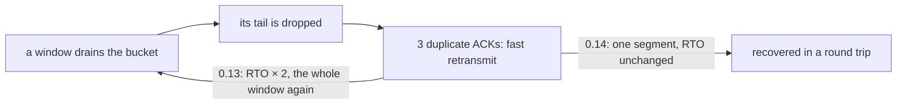

The netstack is on smoltcp 0.14 (`crates/tunnel-core/Cargo.toml:150`). It
resends one segment, enters Reno fast recovery, and backs off only when the
timer expires. Measured on the same pair as above, held on the DERP floor with
its org over the Free allowance, each run a 1 MiB `scp` over roomler SSH:

| smoltcp | runs | result | RTO, as traced |
|---|---|---|---|
| 0.13.1 (0.4.170, and master on it) | 7 | 33–101 kbit/s; three did not finish in 150 s | doubled on every retransmit, to 60 s, and held |
| 0.14.0 | 4 | **535–805 kbit/s**, each done in 10–16 s | at most 2 s |
| 0.14.0, the published agent 0.4.171 | 3 | **538–804 kbit/s**, each done in 10–16 s | — |
| kernel TCP (HTTP), same pair | 1 | 0.86 Mbit/s | — |

⚠️ A zero-RTT test link hid this one. The old stack passed the policed test at
0.97 Mbit/s, while over a 30 ms round trip a policed copy fell to 34 kbit/s,
the field's number. The harness link carries a delay now
(`netstack.rs:1438-1472`).

⚠️ A lower RTO floor is not the fix. On that link a 200 ms floor alone
collapsed the same way (28 kbit/s, RTO at 60 s): the doubling, not the floor,
causes the stall. What is left of the gap to kernel TCP is about nine timeouts
per MiB at the 1 s floor. A later smoltcp with a configurable floor could
remove them, with no fork.

**A dropped stream must still deliver its tail.** A stream used to be aborted
the moment the app dropped it, even after a shutdown. Whatever was queued or
unacknowledged was discarded, and the far side read a clean EOF, so a
truncated stream looked complete. Now:

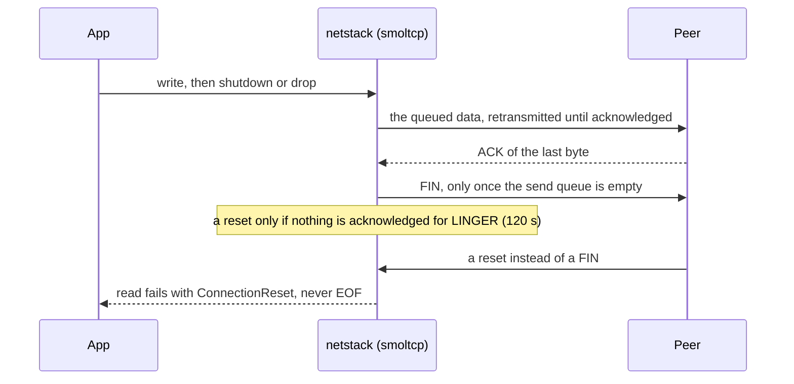

- **Drop closes like `close()`.** The queue drains, then a FIN
  (`netstack.rs:889-907`). It is reset only if the close stalls, with nothing
  acknowledged for `LINGER` (`netstack.rs:93-100`). A slow close always finishes.
- **The FIN waits for the last ACK** (`netstack.rs:995-1009`). smoltcp's
  `close()` with data still unacknowledged wedged the socket under loss: it
  stopped retransmitting, with an open window, and the tail never came.
- **A reset is an error.** A connection that ends without a FIN reads as
  `ConnectionReset` (`netstack.rs:944-952`, `454-460`).

Locked by three tests that each failed on the old stack. Two stacks are
cross-linked through a bucket like the relay's, with a one-way delay
(`netstack.rs:1417-1472`):

| test | what it holds |
|---|---|
| `a_policed_path_keeps_most_of_its_rate` | 512 KiB at Free's rate, over a 30 ms round trip, arrives at about the bucket's rate (4.6–4.7 s, ideal 4.2 s). Before Reno: 479,832 B, then EOF. On smoltcp 0.13: not finished in 30 s |
| `a_dropped_stream_still_delivers_its_tail` | a drop without `shutdown` still delivers every byte. Before: the tail never came |
| `a_reset_reads_as_an_error_not_eof` | a reset is `ConnectionReset`. Before: 703,720 B, then a clean EOF |

## 2. Configuration

| Key | Default | Meaning |
|---|---|---|
| `ssh_enabled` | `false` | Serve SSH on this node's overlay address |
| `ssh_port` | `2222` | The intercepted TCP port |
| `ssh_authorized_keys` | *(empty)* | OpenSSH public keys allowed to authenticate |
| `ssh_account_mode` | *(unset)* | What those keys run as: `daemon` \| `console_user` \| `named:<account>`. **Unset = they authenticate but run nothing** |
| `ssh_max_privilege` | *(unset)* | Ceiling on what a **server-granted** session may run as: `console_user` refuses a grant asking for the daemon identity. Unset/`daemon` = no device-side limit |
| `ssh_host_key` | *(minted on first use)* | This node's host identity — **not** exposed on the config surface |

```bash
roomler config set ssh_enabled true
roomler config set ssh_authorized_keys "ssh-ed25519 AAAAC3Nz... goran@devbox"
# restart to apply, then from any peer in the org:
ssh -p 2222 roomler@100.65.4.30 -- whoami
```

**Why 2222 and not 22.** Turning interception on for a port an OS daemon already
serves changes *who answers* for mesh traffic to that address — on devbox and the
Linux boxes that would silently shadow the `sshd` the fleet SSHes into daily.
2222 lets both coexist during migration; the daemon logs a warning when it
detects an OS listener on the address and port it is taking over. Move a device
to 22 deliberately, per device.

**Host key.** Ed25519, minted on the first SSH-enabled start and stored in
`config.toml`, which already holds `agent_token` — so it inherits the atomic
write with `sync_all`, the `.prev` rotation, `0600` on Unix and the hardened ACL
on a machine-global Windows install, and adds no new secret-at-rest surface. If
it cannot be persisted, SSH stays **off** for that run rather than serving an
identity that changes every restart: a host key that rotates on every boot
trains operators to accept unknown fingerprints, which is exactly the habit that
makes host verification worthless. The fingerprint is logged at start-up so it
can be pinned out of band.

## 3. What a session can do today

- `ssh <node> <command>` — routed through the daemon's existing
  [`exec`](fleet-rpc.md) engine's **streaming variant** (FR-89): stdout and
  stderr reach the client **as the command produces them**, with **no output
  ceiling and no wall-clock timeout** — the command lives exactly as long as
  the channel does. It keeps everything of the engine that is not about
  buffering: the `RunAs` identity model, operator consent, the per-device
  concurrency cap, secret redaction (now over the stream), process-tree kill,
  and the client's stdin. The mechanics, the lifetime table and the kill
  switch are in [One-shot commands stream](#one-shot-commands-stream-fr-89)
  below.
  **The output is byte-exact**: `ssh <node> cat f > f` lands the file as it
  is on the device, and redaction masks only text inside it. ⚠️ Until
  2026-10-06 the output was decoded to text first, so every byte that is not
  UTF-8 arrived as U+FFFD: a 4.4 MB MP4 came back as 1.9 MB of noise. ⚠️ And
  until FR-89 it was **capped at 1 MiB** (the engine's Fleet-RPC ceiling): the
  command was cut off mid-write, died of SIGPIPE, and `ssh` exited 1 — on the
  `console_user` corporate laptops, where `scp`/`sftp` refused until FR-97 P4b,
  nothing could move a file over 1 MiB.
  **The client's stdin reaches the command** ([#1747](https://github.com/gjovanov/roomler-ai/issues/1747)):
  `ssh <node> 'cat > f' < file`, `tar c . | ssh <node> 'tar x'` and
  `ssh <node> 'sh -s' < script` work, and the client's EOF ends the input.
  ⚠️ Until #1747 the command read NUL and the bytes were dropped without a
  word, so the first of those wrote an empty file and exited 0.
  A command that **prompts** now shows its prompt (the output streams); pass
  `-n` (stdin from `/dev/null`) to a command that must not read stdin.
  ⚠️ `ssh -vv` prints `read failed … Broken pipe` at the end of piped stdin.
  That is this OpenSSH client's normal EOF, not a fault: it shows up just the
  same against a stock `sshd`, and it sent #1747's diagnosis the wrong way once.
- **`ssh <node>` — a real interactive shell on a real terminal**, on both
  platforms (P4a Unix, P4b Windows ConPTY). See below.
- **`sftp` and `scp`** (P7a) — see below.
- **`ssh -L`, `-J` and `-W`** (P7b) — `direct-tcpip` channels, **default-deny**.
  See below.
- Still **refused with a stated reason on stderr**: any other subsystem. A bare
  channel failure reads as "administratively prohibited", which is
  indistinguishable from a policy denial; a tool silently hanging is a much
  worse diagnostic than "not implemented yet".
- **`ssh -R` is not implemented** and is refused by russh's own default,
  promptly and cleanly. That is a decision, not a gap — see P7b below.

### One-shot commands stream (FR-89)

Spec: [`docs/fr/FR-89-ssh-exec-streaming.md`](fr/FR-89-ssh-exec-streaming.md) ·
[#1826](https://github.com/gjovanov/roomler-ai/issues/1826).

Before FR-89, `ssh <node> 'cmd'` was handed to the Fleet-RPC engine's one
bounded run (`ExecEngine::run_fed`): the whole output was collected against a
1 MiB ceiling and sent when the process ended, under a 300 s wall clock.
Correct for `roomler exec`, whose answer is one persisted audit row; wrong for
a byte stream. The engine now has a second entry point beside it,
`ExecEngine::run_streamed` (`agents/roomlerd/src/exec.rs`), and the SSH server
uses that one (`ssh.rs` `stream_to_channel`):

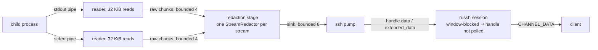

**Backpressure reaches the child.** `russh::server::Handle::data` is an
`await` on a bounded channel that the session loop stops polling while any
channel has window-blocked data. So: the client's window fills → the pump
blocks → the sink (8) fills → the stage blocks → the raw queue (4) fills → the
readers stop reading → the OS pipe fills → **the child blocks on `write`**. The
daemon holds at most ~13 chunks plus two small carries (≈ 0.5 MiB) per command,
however slow the client — `ssh <node> 'cat big' | (sleep 30; wc -c)` parks the
command for 30 s and then delivers everything. ⚠️ That is also why a client
that stops reading does **not** end the command: it costs nothing, and it is
exactly what OpenSSH does.

**What ends a command.** There is no wall clock, on purpose — a fixed limit is
what kills a long `tar` or a `journalctl -f`, and the pty path has run without
one since P4. The channel owns the lifetime:

| Event | What ends the command |
|---|---|
| the client closes the channel (Ctrl-C, `ssh` exiting) | `Handler::channel_close` fires the channel's abort token → `ExecEngine::cancel` → process-**tree** kill (`taskkill /T` / the process group) |
| the client disconnects, or the carrier dies | the handler drops; `Drop` cancels every exec it still tracks |
| the grant's `session_secs` deadline | `arm_session_deadline` disconnects → the same `Drop` |
| the session itself vanishes under the pump | `handle.data` fails → the pump cancels the abort |
| a key-list (break-glass) session | unbounded, as its pty is; the 600 s inactivity timeout still reaps a dead carrier |

⚠️ russh accepts and **discards** data for a channel the client has closed —
the pump cannot tell — which is why `channel_close` is wired rather than
relying on a failed write. The abort token is minted **before** the consent
wait, so a channel closed while the operator is being asked leaves nothing to
run; the engine re-checks it before spawning.

**Redaction cannot split a secret.** Every masked shape — the registered agent
tokens, `Bearer <token>`, JWT-shaped runs — is whitespace-free, so
`StreamRedactor` settles bytes only at a **word boundary** (right after the
last ASCII whitespace); the word in progress waits in a carry and a token is
always masked whole. The literal pass runs over everything visible before the
cut, a settled prefix ending in `bearer ` is pulled back to the boundary before
it, and binary passes through byte-exact. Two bounds, both documented in the
spec: a whitespace-free run over 64 KiB is force-settled holding back
max(8 KiB, longest literal − 1) bytes, and a carry that waits 150 ms with no
new bytes is flushed (holding back a literal prefix and a `bearer ` context) so
a prompt with no trailing newline still appears. Unit tests drive every secret
kind through **every split offset** of a two-chunk split.

**Windows `console_user` streams too.** `CreateProcessAsUserW` with three
anonymous pipes (`supervisor::spawn_in_session_captured`) is what P5b always
used; its drain read each pipe to EOF into a `Vec`. `read_pipe_streamed` hands
each `ReadFile` to the raw queue with `blocking_send` from the drain thread —
and that *is* the backpressure on this platform: a full queue parks the thread,
the 4 KiB pipe fills, the child blocks on `WriteFile`.

**The kill switch** — `ssh_exec_streaming = false` (device-owned, default
**on**, read at daemon start, never server-settable) restores the pre-FR-89
path exactly: `run_fed` with the 1 MiB ceiling and the 300 s wall clock, the
output after the run, and a stderr notice when the ceiling cut it. **Fleet
RPC is unaffected either way**: `rc:rpc.exec` never calls the streaming
variant.

**Exit status**: a real `0..=255` code is the SSH status; a signal-encoded or
absent one (killed, cancelled, refused) is **1**. It is sent only after the
pump delivered the last chunk, then `eof`, then `close` — the order `scp` and
scripts rely on.

### Interactive sessions (P4a Unix, P4b Windows)

`ssh <node>` allocates a terminal, runs a login shell on it, streams both ways,
and reflows when the client window changes — on **both platforms**, through one
surface: `agents/roomlerd/src/pty/{mod,unix,windows}.rs`. `ssh.rs` has a
single code path, which is deliberate: an interactive session is where a
per-platform divergence would be least visible and most annoying, and two
handlers would have grown two subtly different privilege and teardown stories.

**A pty session deliberately does not go through the exec engine.** Before
FR-89 the engine buffered a command's whole output to enforce a ceiling and
returned it at the end — the exact opposite of what an interactive session
needs, where the output *is* the interaction. One-shot commands stream through
the engine now too (above), but a terminal still needs a pty rather than pipes:
a pty merges the two streams, cooks line endings and gives the shell a tty. So
a terminal session has **no output ceiling and no wall-clock timeout**, as a
streamed command has. It keeps the parts that still apply: the same `RunAs`
identity model (via the same `exec::apply_run_as`, so every refusal is
identical and there is not a second privilege story for shells), the same
operator-consent gate, and process-group teardown.

Mechanics worth knowing:

- **`openpty`, not `posix_openpt`.** The latter needs `ptsname_r`, which does
  not exist on macOS. `openpty` is one call, declared for both platforms, and on
  glibc ≥ 2.34 needs no `-lutil`. Fewer moving parts across a boundary CI never
  compiles — macOS builds only at release-tag time.
- **The parent must close the slave** after spawning, or reads on the master
  never see EOF and a session whose shell exited would hang forever.
- **Linux reports `EIO`, not EOF**, on a master whose slave has been closed.
  Treated as end-of-session; treating it as an error would surface every normal
  shell exit as a transport failure.
- **The child `setsid`s and claims the tty**, so Ctrl-C signals the session's
  process group and not the daemon's.
- **Teardown signals the group with SIGHUP**, not just the shell — killing only
  the shell orphans whatever it was running, which keeps the pty alive.
- The terminal is allocated when the **shell starts**, not when `pty_request`
  arrives: that is when the identity is known and consent has settled, so a
  session about to be refused never gets a pty or a process.

#### Windows: ConPTY (P4b)

There is no pty pair to open. The console host owns the terminal:
`CreatePseudoConsole` returns an `HPCON`, and a process is attached to it by
passing that handle through a **process-thread attribute list**. Teardown is a
**job object** (`KILL_ON_JOB_CLOSE`) rather than a process group — Windows has
no `killpg`, and the job is what gives the same "nothing outlives the session"
guarantee. The output stream ends at `ClosePseudoConsole`, which blocks until
the host has flushed; a waiter closes it the moment the child exits, because
otherwise a reader waits forever for an EOF that the console host will never
send while the pseudoconsole lives.

Three things cost real debugging time and are commented where they live:

- ⚠️ **`STARTF_USESTDHANDLES` is required.** The pseudoconsole attribute gives
  the child a CONSOLE; it does **not** redirect its std handles. Without this
  the child inherits the *parent's* handle values, so the console attaches, the
  window title is set, `> CON` renders and the exit status is right — while
  everything the program writes to stdout goes somewhere the session never
  sees. Diagnose it in one line, inside the session:
  `echo a & echo b > CON` — if only the `CON` half comes back, it is this.
- ⚠️ **Inheritance must be BOUNDED.** `STARTF_USESTDHANDLES` needs
  `bInheritHandles=TRUE`, which alone hands the child *every* inheritable
  handle in the process — in a daemon, that is other sessions' pipes, and
  whoever inherits a write end keeps its owner's reader from ever seeing EOF.
  A second `PROC_THREAD_ATTRIBUTE_HANDLE_LIST` attribute names exactly the two
  handles. Take both or neither.
- ⚠️ **The HPCON is passed BY VALUE**, not as a pointer. Get it wrong and
  `CreateProcess` *succeeds*, then the child dies instantly with `0xC0000142`
  (`STATUS_DLL_INIT_FAILED`) because its console never initialised — visible
  only as an empty session, so check the child's exit code before the pipes.

**`console_user` works here too** where the process serving SSH is SYSTEM, which
is the point on a corp-managed laptop: the same attribute list goes onto
`CreateProcessAsUserW` with the `WTSQueryUserToken` token and the user's own
environment block, so the shell is the signed-in user's, not SYSTEM's.
`WTSQueryUserToken` needs SYSTEM, and the process serving SSH is the
console-session **worker** (FR-94 §2). That is SYSTEM in SystemContext mode. On
an **attended** install, perMachine or not, the worker runs as the signed-in user,
so `console_user` is refused there with that reason rather than quietly handed a
different shell. The worker's `daemon` mode already opens shells as that user.
FR-105 serves sessions from the device's SYSTEM service once an administrator
turns that on, and there `console_user` works on attended installs too
(§ Through the device's SYSTEM service). `named:<account>` stays refused
on Windows for the same reason `exec` refuses it — becoming an arbitrary local
user needs that user's credentials.

### Which account a session runs as (P5a)

The device's `SshPolicy.account_mode` decides, and the agent maps it through
`RunAs`:

| Mode | Unix | Windows, the agent's own process (the worker) | Windows, through the SYSTEM service (FR-105) |
|---|---|---|---|
| `daemon` (default) | root | **the worker's identity**: SYSTEM in session 1 in SystemContext mode, the **signed-in user** on an attended install (FR-94 §2) | **SYSTEM, session 0**, on every install type |
| `named` | **drops to that account** | refused — becoming an arbitrary user needs that user's credentials | refused, the same |
| `console_user` | **drops to the person at the screen** (FR-97 P5a): logind's seat0 on Linux, `/dev/console`'s owner on macOS; refused while nobody is signed in there, and by an agent before P5a | **runs as the signed-in user** (`WTSQueryUserToken` + `CreateProcessAsUserW`) where the worker is SYSTEM (SystemContext mode); refused on an attended install, where the worker cannot ask for that token, and refused if nobody is signed in | **the signed-in user**, on every install type; refused, naming why, while nobody is signed in |

Which Windows column applies is the server's decision per grant, recorded in
`ssh_audit` as `ran_as` (`worker`, `system`, `console_user`): see
§ Through the device's SYSTEM service.

#### `console_user` on Linux and macOS (FR-97 P5a)

The mode means what it means on Windows: the person signed in at the device's own
screen, and nobody else. The agent finds them at each session, then takes the drop
a `named` account takes (`unix_priv::drop_to_console`,
[`exec.rs:1404`](../agents/roomlerd/src/exec.rs#L1404)). Exec, the pty and `sftp`
all go through `apply_run_as`
([`exec.rs:807`](../agents/roomlerd/src/exec.rs#L807)), so one rule covers all
three.

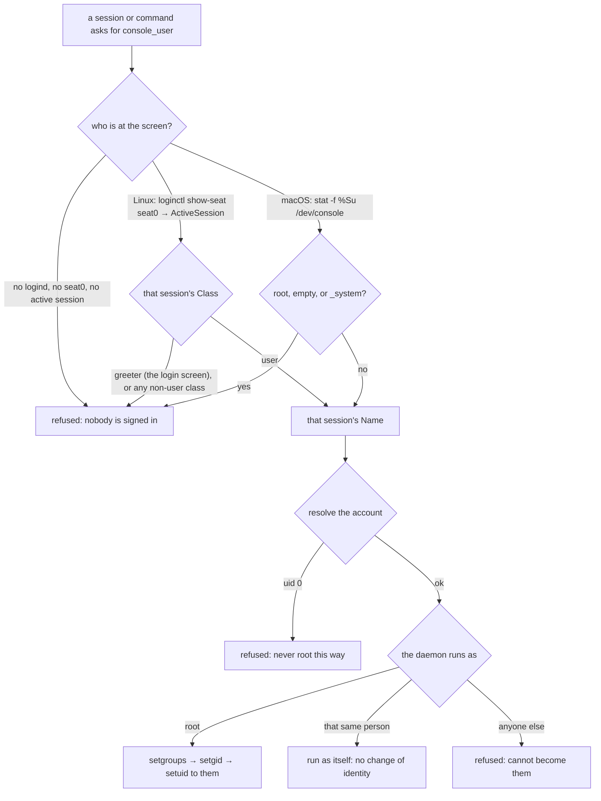

| | Linux | macOS |
|---|---|---|
| Who is at the screen | the user of logind's `ActiveSession` on `seat0`, if its `Class` is `user` ([`companion.rs:1067`](../agents/roomlerd/src/companion.rs#L1067)) | the owner of `/dev/console`, which loginwindow hands to whoever logs in at the GUI, read as the pkg's postinstall reads it ([`companion.rs:616`](../agents/roomlerd/src/companion.rs#L616)) |
| Nobody, when | no logind, no `seat0`, an empty seat, a greeter (GDM's `gdm` at the login screen) | the login window (`root`), or a system account (`_mbsetupuser` during Setup Assistant) |
| A text console counts | yes: a login on the machine's own VT is a person at its screen | not applicable |

- ⚠️ **seat0, never "the first graphical session".** `graphical_session` takes the
  first active graphical session anywhere, and logind calls every seatless session
  active, so an xrdp user would read as the person at the screen. `seat0` is the
  machine's own screen by definition, and its active session is the one showing,
  as Windows' console session is.
- ⚠️ **A drop, never a gain.** A root daemon drops to the person; uid 0 is refused
  as it is for `named`. A per-user daemon whose own account is at the screen runs
  the command as itself, which changes no identity, and must not try to drop:
  `setgroups` needs root even to keep the groups it already holds. A per-user
  daemon whose owner is not at the screen is refused.
- ⚠️ **The person's account, not their desktop session.** The command gets their
  uid, groups, `HOME`, `USER` and `LOGNAME`, as a `named` account does, but not
  their graphical session's environment (`DISPLAY`, the session bus), and on macOS
  it runs outside their GUI login's launchd domain. Windows' `console_user` runs
  inside the person's session.
- ⚠️ **The server stores `console_user` off Windows only for an agent that
  advertises `console-user`** (`console_user_unsupported`,
  [`agent_ssh.rs:1240`](../crates/modules/network/src/routes/agent_ssh.rs#L1240)).
  An agent rolled back since refuses the session itself, as every agent before
  P5a did, so this half fails closed either way.

Field-proven 2026-10-18 on candidates (FR-97 §8). On a Linux root daemon
(Ubuntu, GDM), a command, a pty and `sftp` ran as the person signed in on seat0,
and were refused once GDM's greeter held the seat. A per-user daemon whose own
account was at the screen ran them as itself. On a Mac's root daemon they ran as
the GUI user and were refused at the login window. On the release, every one of
them had been refused as "a Windows concept".

#### Where a session starts (FR-97 P5b)

A person's session starts in their home, where sshd and Windows' OpenSSH start
it: the shell, a command and `sftp`. Before P5b they started in the daemon's own
directory, `/`, so `scp f node:` aimed a relative path at a directory the person
could not write to.

| Session as | Linux and macOS | Windows |
|---|---|---|
| `daemon` | the daemon's directory, as before | the worker's directory, as before |
| `named` | the account's home | refused, as before |
| `console_user` | the person's home | the person's profile (P4b did it for `sftp`) |

- ⚠️ **The `chdir` runs in the child after the drop**, as the person
  (`unix_priv::start_in_home`). A root-squashed NFS home refuses root, so a
  parent-side `current_dir` would have failed the whole session. A home the
  person cannot enter leaves the child where it was, which is sshd's fallback too,
  and the daemon logs a missing home.
- Fleet RPC is unchanged: a command starts in its `cwd`, or where it always has.
- Kill switch: `ROOMLERD_SSH_START_IN_HOME=0` puts the old start back. On a
  SystemContext Windows device, set it in the service's environment
  (`roomlerd set-service-env-var`), as for `ROOMLERD_SFTP_AS_USER`.

Field-proven 2026-10-18 on candidates (FR-97 §8). On a Linux root daemon, `named`
and `console_user` sessions started in `/home/wlab`, where the release had started
them in `/`, and a relative `sftp put` landed there instead of failing. `nobody`,
whose home does not exist, ran from `/`. On a Windows SystemContext guest, a
`console_user` command and shell started in `C:\Users\vmtest`, not System32. The
kill switch put both back.

**Both paths obey this, and it took a fix to make that true.** A grant carries
the policy's `account_mode`. A key-list session has no policy behind it, so it
uses the device-owned `ssh_account_mode` — and while that was unset it fell
back to the daemon's own identity, meaning listing a key quietly handed out
SYSTEM/root and a policy of `console_user` was simply untrue for that path.
Unset now means the session authenticates and runs nothing, with the reason on
stderr. (Authenticate-then-refuse rather than refuse-the-auth, because it can
explain itself; a bare auth failure cannot.)

The rule the whole type exists to enforce: **never silently run as something
more privileged than was asked for.** A policy that says `console_user` on a
host that cannot obtain that token FAILS the command; it does not fall back to
SYSTEM. Falling back is how an operator ends up believing sessions are
unprivileged while they are root — the worst outcome, because it is invisible
until it isn't. An account mode this agent doesn't recognise (a newer server)
is likewise an error, never a downgrade.

The Unix drop is `setgroups` → `setgid` → `setuid`, **in that order** — after
`setuid` the process can no longer change either, so a reversed order silently
leaves the child in root's supplementary groups, which is the classic
privilege-retention bug and looks like a successful drop from outside. The
result is then verified (`getuid`/`geteuid`) rather than assumed. Account and
group lookup happen in the *parent*: everything between `fork` and `exec` must
be async-signal-safe and must not allocate, since a malloc lock held by another
thread at fork time is never released in the child.

Naming an account that resolves to uid 0 is refused. Not because running as
root is impossible — `daemon` already is root there — but because it has to be
the policy's explicit choice rather than a side effect of naming an account
that happens to be uid 0.

⚠️ `daemon` is still the default, so a device whose policy has not been set
runs sessions as the **daemon's own identity**: root under systemd, and on
Windows the console-session worker's (SYSTEM in SystemContext mode, the
signed-in user on an attended install). That is the same identity Fleet RPC had
before FR-94. Listing a key in `ssh_authorized_keys` grants that identity to its
holder unless the policy says otherwise. Key-list sessions never reach the
device's SYSTEM service: its port refuses them (FR-105).

### The device's own ceiling — `ssh_max_privilege` (M5)

Everything above is decided by the **server**: the org switch, the permission
bit, the `SshPolicy`, the account mode, the consent mode. That is the right
shape for administering a fleet, and it has one consequence worth stating
plainly — a control plane that mints `account_mode = daemon` with
`consent_mode = auto` gets an **unattended root shell on every device that
answers**, with nothing on the device consulted. `ssh_account_mode` does not
help here; it governs only the key-list path.

`ssh_max_privilege` is the device's own answer, and the only gate in the list
that still holds when the server is the compromised thing:

```bash
roomler config set ssh_max_privilege console_user
```

Set to `console_user`, a grant asking for the daemon identity is **refused, not
downgraded** — a caller who asked for root and silently got a user shell has
been told something untrue about their own session, and would read every later
permission error as the command's problem rather than the device's answer. The
refusal names the setting, on stderr, at run time.

**Unset is permissive** and changes nothing, deliberately: a device-side
ceiling that arrived switched on would revoke a working configuration in the
middle of a fleet roll, and the device you lose root SSH to is liable to be the
one you needed it for. Every SSH-enabled device that has not chosen says so in
its start-up log. `named:<account>` is not accepted as a value — a ceiling has
to be an ordering, and "is `named:svc-backup` above or below `console_user`?"
has no answer.

### Through the device's SYSTEM service (FR-105)

On an attended Windows install the agent's own process, the worker, *is* the
signed-in user. SSH there could never be SYSTEM, and `console_user` was refused.
FR-105 serves such sessions from the device's **SYSTEM service** (the one FR-94
gave Fleet RPC) once an administrator turns that on. The rule is FR-94's:
**nothing the signed-in user can write decides what SYSTEM runs.** The worker
still carries the bytes, but only ciphertext: the SSH transport ends in the
service.

**Turning it on**, elevated, on the device (from 0.4.136):

```
roomlerd anchor create --server https://roomler.ai --token <enrollment-token> --device <device id> --ssh system
roomlerd anchor ssh off|console_user|system   # an anchor that exists
roomlerd anchor status                        # "ssh: ON, …" and the service's host-key fingerprint
```

The ceiling belongs to the anchor (`%ProgramData%\roomler\roomler\exec-service\anchor.json`,
SYSTEM and Administrators only) and defaults to **off**, so every FR-94 anchor
reads as off and no device gains SYSTEM SSH by updating. `system` permits
`daemon` and `console_user` grants; `console_user` permits only that one. A
grant outside the ceiling takes the worker path, exactly as before: that is a
routing decision, not a refusal.

**How a grant gets there.** The server sends a grant to the service only when
both halves agree (`routes_ssh_via_service`,
`crates/modules/network/src/routes/agent_ssh.rs`):
- its own record: a Windows device, anchored, whose service published an
  endpoint (`PUT /api/agent/service/ssh-host-key`, with the service's own
  credential) under **this** anchor, with a ceiling that permits the mode;
- the device's live word `ssh-system`, which the worker advertises while the
  service answers its health ring with a ceiling above off and the person's
  `ssh_enabled` is on. It is matched by equality: `ssh` is its prefix.

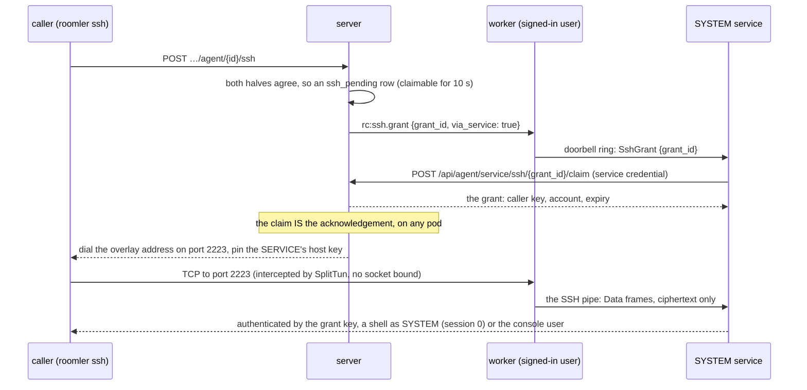

- **The pipe** is `\\.\pipe\roomler-ssh-service`: the doorbell's DACL, created
  first-instance only, at most 8 sessions, and the worker refuses one SYSTEM
  does not own. Frames are a kind byte, a big-endian `u32` length and a payload:
  `Hello`, `Data` (≤ 64 KiB), `Eof`, and `Ask`/`Answer` (≤ 4 KiB of JSON) for
  consent. Anything oversized, unknown or malformed ends the connection.
- **The grant is pulled, never relayed.** The worker pushes nothing to the
  service but a grant id; the service claims the grant from the server with
  its own credential (single use, this device only, inside the caller's wait),
  and holds it in its own table. A refused claim answers 404 and writes an
  `ssh_audit` row `claim_refused` with no person behind it.
- **Consent stays the person's.** The service asks over the pipe, and the worker
  answers with the same prompt chain its own sessions use. On the field run an
  unanswered prompt read the same on both paths.
- **Either half can refuse.** The worker refuses a via-service grant when its
  person's `ssh_enabled` is off, when `ssh_max_privilege = console_user` meets a
  `daemon` grant (M5 above), or when `ROOMLERD_SSH_VIA_SERVICE=0` is set.

What the signed-in user controls, and why none of it widens port 2223:

| The user can change | On the SYSTEM service's port |
|---|---|
| `ssh_authorized_keys` and `ssh_account_mode` in their config | the service's server has **no key list**. A key the user lists opens port 2222 as that user, and port 2223 answers `Permission denied` |
| the doorbell (a forged `SshGrant` ring) | the service claims with its own credential; the server refuses an id that is not pending for this device and audits it |
| the worker's host key (re-minted and republished) | a via-service grant returns the key the **service** published with its own credential; the worker's key pins only the worker path |
| `forward_acl` | `direct-tcpip` is refused on the service's port in v1 |
| the `ssh-system` word (a worker that lies) | the server also needs the endpoint the service published under the current anchor, and the caller pins a key only the real service holds |

**Revocation.** `roomlerd anchor ssh off` (the device withdraws `ssh-system`
within about 30 s), un-anchoring (`DELETE …/agent/{id}/exec-anchor`, immediate:
the server's half alone suffices), a re-anchor or a removal (the published
endpoint names the old anchor). Each sends grants back to the worker, and the
audit says `worker`.

**Kill switches:** the server's `rc.ssh_via_service = false`; the device's
`ROOMLERD_SSH_VIA_SERVICE=0` (the worker drops the word and stops intercepting
2223); the anchor's `ssh = off`, the default.

**`roomler proxy` needs nothing new.** It carries bytes for stock `ssh` to the
port in your ssh config, for key-list sessions, and only the worker's port
(2222) honours a key list. `roomler ssh` dials whatever port the grant names.

**The audit and the UI.** `ssh_audit.ran_as` records the server's decision. The
admin UI's *As* chip reads it together with the grant's `account_mode`, so an
attended device's `daemon` session through the worker is never shown as SYSTEM.
The SSH policy dialog says which identity each choice means on that device,
from whether it advertises `ssh-system`.

⚠️ **Not in v1:** the service owning the overlay socket and the WireGuard key
(D3). On an attended install with nobody signed in there is no worker, so the
device is offline. A SystemContext install keeps its worker at the logon screen;
there `daemon` still works through the service, and `console_user` is refused,
naming why.

Field-verified on the 0.4.136 candidate, attended and SystemContext, including
the claim landing on the other prod pod:
`docs/fr/FR-105-roomler-ssh-as-system.md` §8.

## 4. Authorization, and the gap P3 closes

| Gate | Owner | State |
|---|---|---|
| 0 — carrier identity | topology | **live.** The connection cleared WireGuard against a netmap key, so the peer is a specific enrolled node in a specific org — a cryptographic fact, not a claim |
| 1 — org kill-switch (`remote_ssh_enabled`) | server | **live.** Default off, and a *separate* switch from `remote_exec_enabled`: allowing bounded diagnostic commands is not the same decision as allowing interactive sessions |
| 2 — caller permission (`SSH_DEVICE`, `1 << 29`) | server | **live.** A *separate* bit from `EXEC_DEVICE` and, like it, deliberately **not** in `DEFAULT_ADMIN` |
| 3 — `SshPolicy` | server | **live.** `SshMode::Off` default, `can_originate` on the *originating* device, user/role allowlists, `account_mode`, consent |
| 4 — `ssh_enabled` + `ssh_authorized_keys` | the device | **live.** The refusal that survives a compromised control plane |

All four are default-deny, and each is owned by a different party, so no single
compromise is sufficient.

### The API

| Route | Permission | What |
|---|---|---|
| `POST …/agent/{id}/ssh` | `SSH_DEVICE` (gate 2) | Ask for a session. 200 with where to dial — once the device has confirmed the grant (FR-83, ≤ 10 s) — or with which gate refused |
| `PUT …/agent/{id}/ssh-policy` | `MANAGE_AGENTS` | Gate 3. Deciding a device *may* be SSHed into is a management act, distinct from being allowed to do it |
| `GET`/`PUT …/ssh-settings` | `MANAGE_AGENTS` / `MANAGE_TENANT` | Gate 1. Writing needs the higher bar — one switch governs the org |

The device-originated leg (`rc:ssh.request`, for `roomler ssh` from a laptop's
LocalAPI) goes through the **same** `dispatch`, so there is exactly one place
the gates are evaluated regardless of how a request arrived.

The server's last word is the grant's **confirmation**, not the session: the
session runs over a path the server is not on. Every failure up to that point —
the server's gates, and since FR-83 the device's own answer to the grant — is
enumerated and answered before the caller dials, each naming which gate said
no; "denied" without a reason turns a five-second config fix into a support
ticket.

### How a grant works (P3a — shipped)

The caller mints an **ephemeral keypair per session** and sends only the public
half in `rc:ssh.request`. If the server authorizes, it pushes
`rc:ssh.grant` — that key, the principal's name, the account mode, an expiry —
to the **target**, waits for the target to confirm it holds it
(`rc:ssh.grant_ack`), and only then answers the caller with where to dial.

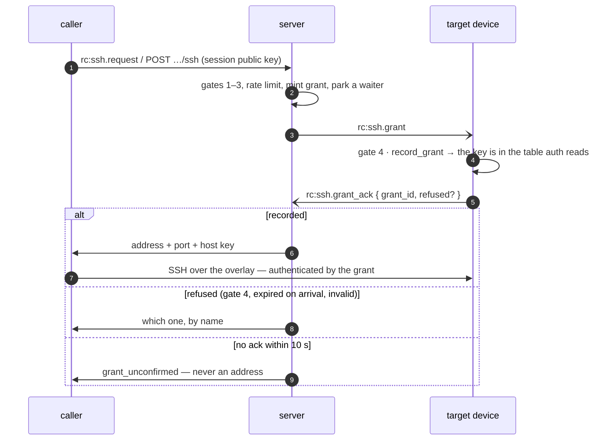

### The grant is confirmed before the caller dials (FR-83 — shipped)

Until FR-83 the server answered the caller as soon as the grant was **queued**
for the target, and queued is not recorded. On 2026-09-23 the FR-81 stress lane
caught a corp laptop — on DERP, behind a TLS-inspecting middlebox — recording a
grant **4.4 s after** it had refused the session that grant was for: the caller
(a VM on a fleet host, fast to the server) dialled first, the device correctly
found no grant for the key, and the user saw `Permission denied (publickey)`
about keys and policies that were all correct (#1597). It is path-dependent —
the same device passed 3/3 from a caller whose route to the server was no
faster than its own — which is the hardest shape to diagnose from a report.

Now an agent advertising **`ssh-grant-ack`** answers every grant, and does so
only after `record_grant` has put the key in the table its auth path reads — so
"acknowledged" means "a connection with this key succeeds from now". The server
holds the caller for that answer, bounded at
`ssh_limits::GRANT_ACK_TIMEOUT_SECS` (10 s: twice the worst lag measured,
inside the originating device's own 30 s wait, leaving most of the 60 s grant
life to dial in), and logs `confirmed_after_ms` on every confirmed grant.

| the device's answer | what the caller hears (`SshDenyReason`) |
|---|---|
| recorded | where to dial |
| `ssh_disabled` — gate 4 | `agent_disabled` |
| `expired` — arrived past its deadline (clock skew) | `grant_expired_on_arrival` |
| `invalid`, or a reason newer than the server | `grant_refused` |
| nothing within 10 s | `grant_unconfirmed` — **never an address**: the one thing known is that the device has not confirmed |

⚠️ `ssh-grant-ack` is **equality-matched** — `ssh` is its prefix exactly as it is
of `ssh-consent`, and every agent before FR-83 advertises `ssh` and never acks,
so a prefix match would make every grant to those devices wait out the bound
and then be refused. Such an agent is answered exactly as before, without
waiting.

⚠️ The capability is read from the **live connection** (the Hub entry), never
the stored agent row — after a rollback the row still promises an ack the
running agent never sends.

⚠️ An ack confirms only if it arrives on the socket of the agent the grant was
pushed to; one from any other socket confirms nothing and leaves the slot for
the real answer. Grant ids are ObjectIds — structured, not secret.

⚠️ `refused` is decoded **leniently**: an unknown spelling from a newer agent
lands on a refusal, never on "recorded" (which would send a caller to dial a
device that has just said no) and never on a parse error (which would drop the
frame and turn a clear refusal into `grant_unconfirmed` after the full wait).

The agent does not verify a signature on the grant, and does not need to: the
frame arrived over the control WebSocket it is already authenticated on, the
same trust path `rc:request` uses to open a remote-control session. No shared
secret with the server, no key distribution, nothing long-lived anywhere.

What the agent *does* enforce locally, because "the server said so" is not a
reason to accept an unbounded table or an eternal key:

- **Single use.** A redeemed grant is removed, so a captured public key cannot
  be replayed into a second session even inside its lifetime.
- **A local deadline**, derived from *arrival* (`Instant`), not from the
  server's wall clock. The server's timestamp can only ever shorten the window
  — a skewed clock or a compromised control plane cannot mint an immortal
  grant. Ceiling: 60 s.
- **A capped table** (16 pending), so the control plane cannot grow agent
  memory. Overflow drops the oldest, which is the one closest to expiry anyway.
- **A session lifetime** (`session_secs`, requested by the caller, clamped both
  sides; 0 = the 12 h ceiling). Enforced at the deadline by disconnect: the
  terminal's process group dies with the pty, and an exec still in flight is
  bounded by the engine's own wall clock. Only key-list sessions are unbounded
  — deliberately, because the break-glass session must not die under whoever
  is fixing the control plane.
- **Gate 4 again.** A device with `ssh_enabled` off refuses to record grants at
  all rather than accumulating credentials it would never honour — and since
  FR-83 says so in its acknowledgement, so the caller is told it was gate 4.
  Before, the server sent the caller to dial a port that nothing intercepts
  when SSH is off, and the answer was a bare `Connection refused`.

Grants are tried before `ssh_authorized_keys` and take precedence; sessions
authenticated by a grant carry the roomler principal into the log and the audit
record, which a key-list session cannot.

### Operator consent (P5d — shipped)

A device's `SshPolicy.consent_mode` decides whether a human **at the device**
has to approve before anything runs. `auto` is the only value that skips the
prompt; `prompt`, `email`, `push`, and a server that said nothing at all all put
a person in the loop. Absent means ask — the fail-safe direction for a gate
whose entire purpose is human review, and the same rule Fleet RPC applies to
`rc:rpc.exec`.

**The prompt happens at redemption, not when the grant arrives.** By grant time
the server has already answered the caller with where to dial; refusing there
would surface as a connection that rejects them for no stated reason. At exec
time the session is live, so the refusal has somewhere to explain itself — and
the caller is told *before* the wait begins:

```
roomler-ssh: waiting up to 30s for approval at the device…
```

Without that line a policy of `prompt` is indistinguishable from a 30-second
hang. Denial and timeout both refuse with their own reason and exit 1.

**The prompt names the caller as the grant words it** (#2815): `«name» (via
«device»)`, the way the screen-control and exec prompts word theirs. Until
#2815 it showed the session's technical identity,
`ssh:«name» (via «device»)@«overlay ip»:«port»`, which means nothing to the
person deciding. That identity still attributes every log line and activity
report (`ResolvedSessionPolicy::caller`). The prompt reads `prompt_name`, and
so does the SYSTEM service's relay to the worker.

⚠️ **The broker is threaded, not discovered.** The consent broker rides
`ssh::SessionServices` from the daemon through `overlay::maybe_start` into the
server's `Ctx`, and the field is non-optional — a server that can be
constructed at all provably has someone to ask. (It used to be a process
global, `consent::set_shared`, whose absence the server had to treat as a
denial; "no broker ⇒ deny" is now unrepresentable rather than documented.)

⚠️ **A denied session burns its grant.** Authentication consumes the grant
*before* the prompt runs, so a deny — or a timeout — means requesting a new
grant, not re-dialling with the same key. Correct by construction (single-use
is single-use, and a refused session must not leave a redeemable credential
behind), but surprising if you expect a simple retry.

⚠️ **Key-list sessions are deliberately exempt.** They carry no server policy,
and they exist as the break-glass route for when the control plane is the broken
thing. Gating them on a prompt would remove the emergency path exactly when it
is needed. The device owner already consented by listing the key and setting
`ssh_account_mode`.

### Host-key verification, not TOFU (P6a — shipped)

A client dialling a node needs to know it reached that node. Until rc.444 the
host key existed only on the device, so the only available answer was
trust-on-first-use — which for a mesh where addresses are reassigned and
devices are re-enrolled is not much of an answer.

The agent now reports the **public** half of `ssh_host_key` on every hello;
the server keeps it on the agent row and hands it back with the grant. That
placement is deliberate: the grant response is already the one thing that says
*where to dial*, so whoever has the address has the key, with no second lookup
and no window holding one without the other. It is **not** in `AgentCaps` —
caps say what a device can do, and two devices that can do the same things
must still not be interchangeable to a client checking who it reached.

⚠️ **An absent key means "this device cannot prove itself", never "any key is
fine."** The API emits `None` rather than `""` precisely so a client cannot
compare against nothing and always match, and an empty value is omitted from
the wire so *absent* and *empty* cannot come to mean two things. A client that
gets no key should say so rather than quietly falling back to TOFU.

⚠️ **The field tracks whether a host KEY is stored — not whether SSH is on**,
and the converse does not hold. A device that ever had SSH enabled keeps
`ssh_host_key` in its config afterwards, so it keeps publishing. Field-checked
2026-08-21: fleet-host-1 reads `ssh_enabled = false` and still publishes the key
minted for the P4a test. That is harmless — a caller who dials a device that
is not serving gets a connection refusal, not a verification failure — but do
not read a non-empty value as "SSH is accepting sessions here". Whether a
session can be opened is the four-gate chain's answer, never this field's.

It is re-derived on every hello, so rotating the key on the device and
restarting moves the fleet view with it; and it is rewritten even when empty,
so a device that switches SSH off stops advertising a key it no longer holds.

### `roomler ssh <device>` (P6b — shipped)

```
roomler ssh winhost-a
roomler ssh winhost-a -- uptime
roomler ssh "Office PC"            # a dashboard display name works too
```

`<device>` is a device name or a hex agent id — the server resolves it, as for
`exec` — or a dashboard display name, which the CLI translates to the hex id
before the grant request by the rule in `docs/device-naming.md` (never over a
device name, and refused when two devices share it).

**It execs the system `ssh` rather than embedding a client.** What roomler adds
is discovery, authorization and host-key distribution — which device, may you,
where does it live, what key will answer. Once those are known, the rest (raw
mode, resize, escape sequences, agent forwarding, `scp`) is a problem OpenSSH
already solves better than a second implementation would, and embedding a
client would have meant owning a terminal stack forever. Roomler is not in the
data path, which is the same property the server has by design — and it makes
P6c a small step rather than a rewrite.

The flow: `sshcmd::run` mints an ed25519 key **in the CLI process** (so the
private half never crosses the LocalAPI socket) → LocalAPI `SshSession` → the
daemon relays `ClientMsg::SshRequest` over its authenticated WS → `dispatch`,
the same gate path the HTTP route uses → `ServerMsg::SshResponse` →
`ssh_origin::deliver` wakes the parked caller → the CLI writes the key and a
`known_hosts` into a `0700` temp directory and execs `ssh` with
`StrictHostKeyChecking=yes`.

⚠️ **`IdentitiesOnly=yes` + `IdentityAgent=none` are load-bearing, not
hygiene.** Without them `ssh` also offers every key in the agent and
`~/.ssh` — so a device with a matching `authorized_keys` entry could
authenticate a session *the grant never covered*, silently turning the
break-glass path into the normal one.

⚠️ **No host key ⇒ refuse.** If the server has no key for the device, the
command errors out instead of connecting. Falling back to trust-on-first-use
would defeat the whole point of P6a.

⚠️ `ssh-key` is pinned with `=` to the version russh resolves. Two generations
in one tree means two incompatible `PublicKey` types across the server and
client halves of the same feature.

### File transfer — `sftp` and `scp` (P7a — shipped)

The `sftp` subsystem spawns OpenSSH's **`sftp-server` as the session's
account** and splices the channel to its stdio. Modern `scp` speaks SFTP, so
one path serves both.

⚠️ **This is a privilege decision, not convenience.** Serving SFTP in-process
(e.g. with `russh-sftp`, which resolves cleanly and adds no crypto) would run
every read and write as the DAEMON — root under systemd, and on Windows the
console-session worker (SYSTEM in SystemContext mode). A session resolved to
`console_user` would silently touch files as the daemon's identity, and
file transfer is the worst subsystem to get that wrong in. `exec` and the pty
both drop privilege by handing work to a child; anything else here would be a
second, weaker privilege story for the one subsystem that exists to touch
files. Same `apply_run_as`, same consent gate, same identity — and roomler
never parses an SFTP packet.

Which spawn serves the subsystem follows from the session's resolved identity:

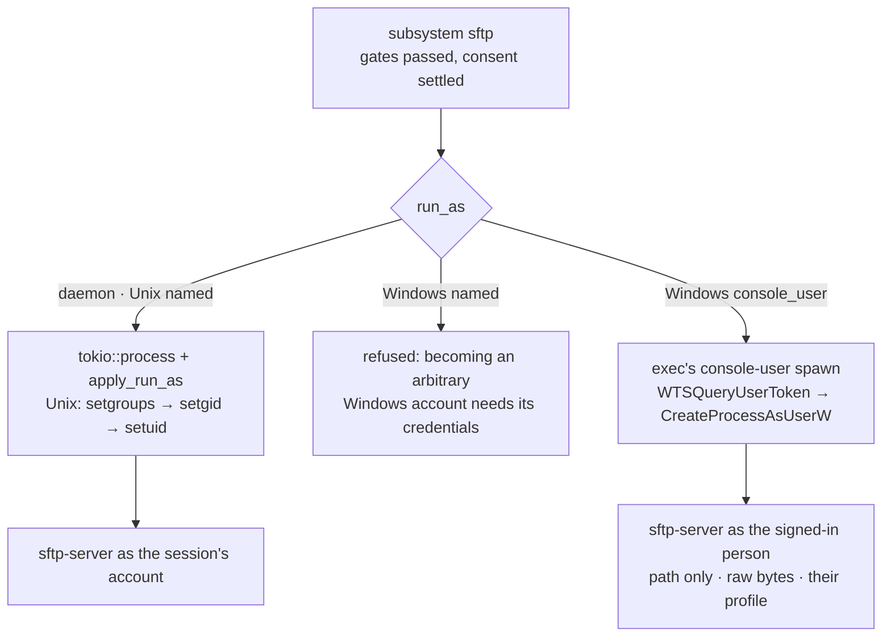

⚠️ **Windows `console_user` takes `exec`'s console-user spawn** (FR-97 P4b,
`exec::run_console_user_program`, `agents/roomlerd/src/exec.rs:937`).
`tokio::process` cannot take a token, so the subsystem goes through
`supervisor::spawn_in_session_captured`, the piped `CreateProcessAsUserW` spawn
P5b built and FR-89 made streaming. Three details differ from a shell command
on that spawn, and each one matters:

| What | Why |
|---|---|
| The command line is the **quoted path alone**: no shell, no argument | nothing a client sends can become an argument |
| The output is **raw, never redacted** | redaction rewrites text that looks like a secret, and inside a binary SFTP stream that is corruption |
| It starts in the person's **profile** (`GetUserProfileDirectoryW`, on the token the child runs under) | OpenSSH starts it there, and a client resolves every relative path against where it started. A service starts in System32, so `scp f <node>:` would aim at a folder the person cannot write |

The client gets the exit status, then EOF, then close, in that order (`scp`
reads the status as its verdict on the whole transfer; see below). Like every
console-user spawn it needs a caller that may read the console user's token
(SYSTEM: the SystemContext worker or the service), and elsewhere it refuses
with the reason, as `exec` does. A `named` account still refuses on Windows,
because becoming an arbitrary user there needs that user's credentials.
Running the transfer as SYSTEM is never the fallback. The device still needs
OpenSSH's `sftp-server.exe`, which Windows installs with the optional OpenSSH
Server feature: two of the three corporate laptops measured on 2026-10-18 have
it, and the third has only the client. Without it the subsystem refuses as
below.

Kill switch: `ROOMLERD_SFTP_AS_USER=0` puts the pre-P4b refusal back. On a
Windows service install, set it with
`roomlerd set-service-env-var --name ROOMLERD_SFTP_AS_USER --value 0`, then
restart the service. The SystemContext worker inherits the service's
environment, so a machine-wide variable reaches it only after a reboot.
⚠️ Never replace the service's registry `Environment` value by hand. On a
SystemContext install it already holds `ROOMLERD_ENABLE_SYSTEM_SWAP=1`.
Overwriting it turned a test device into a user-context one, whose worker,
enrolled machine-wide, exited at once with `no config found`.
`set-service-env-var` edits one entry and keeps the rest.

Until P4b this subsystem refused every Windows non-daemon account (FR-89, open
decision 3), so the `console_user` corporate laptops had no `scp`. There,
`ssh <node> 'cat f' > f` and `ssh <node> 'cat > f' < f` stream a file whole as
the signed-in user, and still work.

⚠️ **No `sftp-server` binary ⇒ refuse**, naming what to install. The probe
covers Debian/RHEL/Arch/macOS/Windows layouts; `ROOMLER_SFTP_SERVER` overrides
for an unusual host. `sftp-server`'s stderr goes to the daemon log, never the
channel — SFTP is binary and injected text corrupts a transfer.

Field-proven 2026-08-22, buildhost → fleet-host-1: an `sftp put` landed
`-rw-r--r-- root root` (matching `ssh_account_mode = daemon`), and `scp`
round-tripped a file byte-identical in both directions.

Field-proven for Windows `console_user` 2026-10-18 (FR-97 P4b) on a throwaway
Win11 SystemContext guest, from stock OpenSSH 10 over the mesh with a key in
the device's `ssh_authorized_keys`. On 0.4.142 the key authenticated, a command
ran as the person, and `sftp` and `scp` were refused (exit 255). On P4b:

- `pwd` said `/C:/Users/vmtest`, and a relative `put` landed there;
- an 8 MiB file came back byte-identical over `sftp` and over `scp` (both exit 0);
- both files on the device were owned by the signed-in account, not SYSTEM;
- a client killed mid-upload left no `sftp-server` running (`cancelled by the caller`);
- the kill switch brought the refusal back.

⚠️ Dial roomler's port, `ssh_port` (2222 by default; 2223 is the SYSTEM
service's, FR-105). On a device that runs its own `sshd`, port 22 over the mesh
reaches that server, which offers passwords too. A "Permission denied
(publickey,password,keyboard-interactive)" is that `sshd` answering, not
roomler. The first P4b run dialled 22 and met exactly that.

### Port forwarding — `-L`, `-J`, `-W` (P7b — shipped)

`ssh -L 5432:db.intranet:5432 <node>`, `ssh -J <node> <target>` and
`ssh -W host:port <node>` all arrive as one channel type, `direct-tcpip`: the
client asks the device to connect somewhere and splice the socket to the
channel. One handler serves all three.

**The gate is the device's `forward_acl`, and it is DEFAULT-DENY here** — the
same struct the tunnel subsystem reads, deliberately read with the opposite
sense for an empty allowlist:

| | tunnel forward | SSH `direct-tcpip` |
|---|---|---|
| who authorized the destination | the **server**, before the agent ever sees it | **nobody** — roomler hands over a socket and never sees the bytes |
| `forward_acl.allowlist = []` means | "no extra local restriction" | **"nowhere"** |

That asymmetry is the whole point. A tunnel flow has already passed the
server-side ACL, so an empty local list sensibly means "trust that decision".
An SSH forward has no prior decision to trust; if empty meant "anywhere", every
SSH session would silently be an open pivot into whatever the device can reach —
which on a corp laptop is the corporate network. So the operator opts in per
destination:

```bash
roomler config set forward_acl '{"enabled":true,"allowlist":[
  {"host_pattern":{"kind":"exact","value":"db.intranet"},"port_range":{"low":5432,"high":5432},"proto":"tcp"}]}'
```

⚠️ `HostPattern` is **adjacently tagged** — `{"kind":"exact","value":…}`, not
`{"Exact":…}` — and `proto` is lower-case. Getting this wrong is a parse
error at `config set`, not a silent no-op, but the message won't tell you the
shape.

Field-proven 2026-08-22, devbox → fleet-host-2 (both rc.451), all four paths:

| attempt | result |
|---|---|
| `-L …:127.0.0.1:22`, allowlist EMPTY | refused — `administratively prohibited` |
| same, after allowlisting `127.0.0.1:22` | **`SSH-2.0-OpenSSH_9.6p1`** through the tunnel |
| `-L …:127.0.0.1:80` (not listed) | refused — `administratively prohibited` |
| `-L …:127.0.0.1:23` (listed, nothing listening) | refused — **`connect failed`** |

The last two are the pair that matters: same host, and the caller can tell a
policy decision from a dead destination. Device-side each logged its reason
with the caller attributed, e.g. `ssh: forward refused … why=127.0.0.1:80 is
not in this device's forward_acl.allowlist`. All gates reverted afterwards.

⚠️ **`-J` needs the *jump host* to allowlist the final target**, not the other
way round — the jump host is the one making the connection. Expect a confused
first attempt otherwise.

`ssh -D` (dynamic SOCKS) works too — it is `direct-tcpip` with a destination
the client picks per connection, so every one of them is checked against the
allowlist individually. It is also the reason forwards are **capped at 64
concurrent, process-wide**: a browser opens one channel per connection, and
hundreds of live sockets is a resource story the operator never agreed to when
they allowlisted one destination. The cap **refuses rather than queues**
(`ResourceShortage`), matching the exec engine — a forward that opens two
minutes late is worse than one that fails now and says so.

Refusals name a cause the client can act on: a policy denial rejects with
`AdministrativelyProhibited` ("administratively prohibited"), an unreachable
destination with `ConnectFailed` ("connect failed"). Which one it was matters —
"your operator hasn't allowed this" and "the database is down" are different
problems. The *reason string* stays in the daemon log rather than going on the
wire, because it names internal topology; the operator who can act on it is the
one reading that log.

⚠️ **No consent prompt on a forward, deliberately.** The channel is not open
yet — we are deciding whether to open it — so there is no stderr to announce a
wait on, and a silent 30 s block ending in an unexplained failure is exactly
what P5d rejected for grants. The operator's consent for a forward *is* the
allowlist entry: given in advance, naming the destination, default-deny until
they write it. That is a more considered act than a prompt, not a weaker one.

**`-R` is not implemented, and that is a decision.** Reverse forwarding asks
the *device* to bind a listening socket — the one thing this whole design
exists to avoid (§1), and the thing a corp firewall or EDR agent objects to
most. It is also largely redundant: the client is itself a mesh node, so
reaching a service on it from the device is what the tunnel subsystem already
does, server-authorized. russh's default refuses it cleanly, so `ssh -R` fails
immediately with "remote port forwarding failed" rather than hanging.

### Session activity (P8a — shipped)

`ssh_audit` records the server's **decision**. P8 adds what the device says it
**did**: `ssh_activity`, fed by `rc:ssh.activity` over the agent's existing
control WS, read at `GET …/ssh-activity` behind the same `VIEW_SSH_AUDIT` bit.

Six kinds: `session_open`, `session_close`, `exec` (with the command and its
exit code), `shell`, `sftp`, `forward` (with `host:port` and whether the
device's `forward_acl` allowed it).

**What it deliberately does NOT record is session content** — no pty byte
stream, no command output. That is not a scoping shortcut. Recording a
terminal means shipping whatever the operator typed off the host, passwords
into `sudo` and `mysql -p` included, and §1's whole claim is that the session
rides a path nobody else observes. "What was run" is answerable without
breaking that; "what was on the screen" is not.

Two properties worth understanding before relying on this log:

|  | `ssh_audit` | `ssh_activity` |
|---|---|---|
| written by | the **server**, from its own decision | the **device**, reporting on itself |
| authority | authoritative | a claim by a host that may be compromised |
| answers | who was allowed in | what they did once inside |

⚠️ **They are separate collections on purpose.** Folded together, a reader
could not tell which rows the server stands behind. Join them on `grant_id`
(`?grant_id=` on the activity route returns one session's actions in order).

⚠️ **An empty result is not evidence of inactivity.** `ssh_activity_log` is a
device config key and defaults to **off**, so a device that never opted in
reports nothing and looks exactly like an idle one. That the device gets the
last word is the same rule as `ssh_enabled` and `exec_enabled` — a server can
never force a host to describe itself honestly, so the switch says out loud
what was already true. The grant record in `ssh_audit` is what survives a
device that lies or goes quiet.

Commands are redacted with the same registered-secret redactor `exec` uses
(agent token, `Bearer …`, JWT-shaped strings) and capped at 512 chars with a
visible `…`, **on the device, before the report leaves the host**. The server
re-clamps the length, because a bound that only exists on the reporting side
is not a bound.

Reports are fire-and-forget: a full outbound queue drops the line rather than
stalling the session that produced it, and `session_close` is emitted from the
handler's `Drop` so it fires however the session ended — clean exit, dropped
client, `session_secs` deadline, consent refusal.

**The UI (P8b)** is `SshActivitySection`, directly under `SshAuditSection` in
org Settings so the two are read together. It leads with the two things a
reader would otherwise get wrong — that an empty list is not evidence of
inactivity, and that these are the device's own account of itself — because
both are properties of the design rather than caveats that go away later. A
refused row is rendered in error red, since a forward the device turned down
is the row an operator is usually hunting for.

### `roomler proxy` for stock tools (P6c — shipped)

```
# ~/.ssh/config
Host *.roomler
  ProxyCommand roomler proxy %h %p
  Port 2222

scp report.pdf corplap-3.roomler:/tmp/
```

Resolves a device **name** to its overlay address and pipes stdio. A literal
IP short-circuits the lookup, so `%h` works either way. `Port 2222` is roomler
SSH's default intercept port; without it `%p` is 22, which reaches only a
device's own `sshd`.

| `%h` as it arrives | looked up as | why it is accepted |
|---|---|---|
| `corplap-3` | `corplap-3` | the bare label — tried first, exactly as before |
| `corplap-3.roomler` | `corplap-3` | what the `Host *.roomler` pattern above always produces |
| `corplap-3.<magic domain>` | `corplap-3` | the MagicDNS name, when the daemon reports a magic domain |
| anything else | verbatim — and fails | see below |

⚠️ Until #1573 the lookup was verbatim, so the recipe this section had always
shown failed for **every** host (`no device named "zeus.roomler"`). The fix
strips only suffixes the mesh owns: stripping "everything after the first dot"
would let a `ProxyCommand` scoped wider than `*.roomler` turn `github.com`
into a lookup for a device named `github` (`localclient::mesh_label`).

⚠️ **OpenSSH applies `HostName` before it substitutes `%h`.** A host that
also has a `Host zeus / HostName <public ip>` block hands the ProxyCommand its
*public* address, and the failure is a bare `actively refused` / `timed out`
that names no device and reads exactly like a broken overlay. `scp -v` shows
it (`Executing proxy command: exec roomler proxy <public ip> 2222`), and the
proxy now says so itself when a connect to a non-overlay literal fails.

⚠️ **Transport and resolution only, and the two commands are not
interchangeable.** `ProxyCommand` hands the client a byte pipe; it cannot
supply an identity or a host key, because by the time it runs `ssh` has
already chosen which key to offer and which `known_hosts` to check. A grant is
a single-use key with a ~60 s life, so it could not live in a static
`~/.ssh/config` either.

| | what it gives you |
|---|---|
| `roomler ssh` | the grant, the policy-resolved account, host key verified **for** you |
| `roomler proxy` | reach it **by name** with keys **you** manage — its own `sshd`, or your key in `ssh_authorized_keys` |

Don't "unify" them: doing so would quietly drop verification from one path.

⚠️ An unresolvable name is an **error, never a fallthrough**. Letting the OS
resolver see a mesh name invites it to find something else — a LAN host, a
search-domain match, a wildcard DNS answer.

For rsync with the grant path, `rsync -e 'roomler ssh' src box:/dst` already
works: the trailing args reach `ssh` verbatim.

### The audit trail (P3c-1 — shipped)

Every request through `dispatch` — granted **or refused** — lands in
`ssh_audit` (90-day TTL, indexed by tenant, by device, and by user).
`GET /api/tenant/{tid}/ssh-audit` reads it, gated on `VIEW_SSH_AUDIT`
(`1 << 30`), which is in `DEFAULT_ADMIN` while `SSH_DEVICE` deliberately is
not: reviewing who held a session is a different job from being able to open
one, and an org should be able to staff them separately.

The refused rows are the load-bearing ones — without them, someone probing
which devices will let them in leaves no trace at all. So the auditing is not
bolted onto each refusal site: `decide` returns
`Result<Granted, SshDenyReason>` and `dispatch` records **both arms** in one
place, which makes "a new refusal that forgets to audit itself" unrepresentable
rather than merely discouraged.

⚠️ **A row records the DECISION, not the session.** The server hands back an
address and a grant and then steps out of the way; the session rides the
overlay directly and the server never sees it. So there is deliberately no
duration, exit status or output here, and a row means "a grant was issued",
never "a session happened" — the design that keeps the server out of the data
path is the same design that stops it from auditing the data path. What
happened *on* the device is the device's own log. `account_mode` is the field
worth reading: it is the difference between a shell as the console user and a
shell as the daemon's own identity (root; on Windows SYSTEM where the worker is
SYSTEM, the signed-in user on an attended install).

⚠️ `VIEW_SSH_AUDIT` is a new bit, so **existing** admin roles do not carry it
until their mask is rewritten — the same friction `SSH_DEVICE` has. Owner is
unaffected (it passes via the `ADMINISTRATOR` bypass).

### An agent session's request (FR-90 P3-8-1b)

A Hive agent session runs one command on another device of its organization
(`ssh_run`, the FR-90 spec's §3e "P3-8, `ssh_run`, as designed"). It asks
from its own device, on the device-originated leg, which today runs under
the origin device's **owner**. A session that used it as it is would borrow
its owner's SSH rights. So the session's request carries a decision of its
own: the vault's **ticket** (`ssh_ticket`, [`vault.md`](vault.md) §22), and
the network module holds the request to it. It is a ticket, not a grant,
because `rc:ssh.grant` is already the target's grant, and the request
carries both.

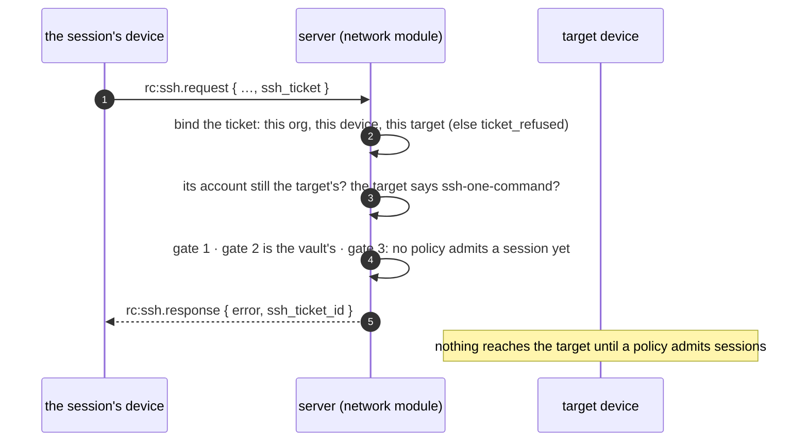

| Check, in order | Refused as | The answer echoes the ticket |
|---|---|---|
| the ticket binds: this server's, unexpired, for THIS organization, from THIS connection's device, toward the request's target as resolved (by id) | `ticket_refused` | no: nothing it claims was verified |
| the public key | `bad_public_key` | yes |
| the account the ticket was decided for is still the one the target's policy maps | `ticket_refused` | yes |
| the target advertises `ssh-one-command` (it can hold a grant to one command) | `target_too_old` | yes |
| gate 1, the org's switch | `org_disabled` | yes |
| gate 2 | (the vault decided `ssh:run` in its place: the owner's `SSH_DEVICE` is not read) | — |
| gate 3: the device's `mode`, then which policies admit a session | `device_disabled`, then `session_not_allowed` until decision 22 | yes |

What a session's request is held to once a policy admits it (decision 22,
P3-8-1b-2), already in place:

- **The rate limit counts the session**, not its owner: one session cannot
  spend its owner's budget, nor the owner the session's.
- **`session_secs` ends with the ticket at the latest**: the target closes the
  session there, whatever the session asked for. What is left of a ticket is
  never 0, which `clamp_session_secs` would read as the ceiling.
- **The grant says `one_command`**, and so does FR-105's pending row and the
  SYSTEM service's claim: the target serves the key one `exec` (P3-8-2a).

⚠️ **Never served as the owner's request.** A ticket that does not hold
refuses the request. It does not fall back to the owner's path, which the
device-originated leg would otherwise take: a session's daemon that sent a
forged or stale ticket gets a refusal, not its owner's rights.

⚠️ **The audit names the session.** `ssh_audit` rows of a session's request
are `source: session`. Once the ticket holds, they carry `session_id` and
`ssh_ticket_id` (`ticket:<id>` in `vault_audit`), and `user_id` is the
person the session acts for, who need not own the device it runs on. The
`caller` names the session too. A refused ticket's row is `session` with no
session id, since nothing it claimed was verified.

⚠️ **The echo is the client's guard.** A server before P3-8-1b ignores
`ssh_ticket`, an unknown field, and would answer the request as the owner's.
So `rc:ssh.response` echoes `ssh_ticket_id` whenever the ticket held, and
the session's daemon never dials on an answer that does not echo the ticket
it presented (P3-8-2b).

| Piece | Where |
|---|---|
| the wire | `ssh_ticket` on `rc:ssh.request` ([`signaling.rs:867`](../crates/remote_control/src/signaling.rs#L867)), `one_command` on `rc:ssh.grant` ([`:3920`](../crates/remote_control/src/signaling.rs#L3920)), `ssh_ticket_id` on `rc:ssh.response` ([`:3961`](../crates/remote_control/src/signaling.rs#L3961)); `RpcCap::SshOneCommand` ([`models.rs:1136`](../crates/remote_control/src/models.rs#L1136)) and the three refusals ([`models.rs:5116`](../crates/remote_control/src/models.rs#L5116)) |
| the binding | `bind_ssh_ticket` ([`agent_ssh.rs:220`](../crates/modules/network/src/routes/agent_ssh.rs#L220)), called where the request arrives ([`agent_arms.rs:194`](../crates/modules/network/src/agent_arms.rs#L194)); the outcome is a `CallerSession` ([`agent_ssh.rs:186`](../crates/modules/network/src/routes/agent_ssh.rs#L186)), and a refused one is answered at [`:411`](../crates/modules/network/src/routes/agent_ssh.rs#L411) |
| the checks | the account and one-command checks ([`agent_ssh.rs:501`](../crates/modules/network/src/routes/agent_ssh.rs#L501)); gate 3's refusal of a session ([`:324`](../crates/modules/network/src/routes/agent_ssh.rs#L324)); what is left of a ticket ([`:963`](../crates/modules/network/src/routes/agent_ssh.rs#L963)) |
| the audit | the `session` source and the session's ids ([`agent_ssh.rs:867`](../crates/modules/network/src/routes/agent_ssh.rs#L867)) |
| what comes next | P3-8-1b-2: gate 3 for a session, as decision 22 says. The target holding `one_command` (P3-8-2a), the device's client (P3-8-2b-1) and the tool `ssh_run` (P3-8-2b-2) are the next three sections |

### A session's grant on the target: one command (FR-90 P3-8-2a)

The grant a session's request earns says `one_command`, and the **target**
holds the session it opens to exactly that: one `exec`, on one channel. It is
the target's rule, not the client's. The session's daemon holds the key, and
a key may ask for anything a key may ask for, so only the device being reached
can keep the session to what its ticket was decided for.

| The session asks for | What it gets |
|---|---|
| a session channel | the first one. A second is refused (`administratively prohibited`): it could carry a second command |
| `exec` | the first one runs. Any later one is refused with the reason on stderr. The attempt is spent when it is asked, so a refused or failed `exec` is not followed by another |
| a terminal (`pty-req`) | refused before it is recorded. The command runs without one |
| a shell | refused, with the reason on stderr |
| a subsystem, `sftp` included | refused, with the reason on stderr |
| a forward (`direct-tcpip`) | refused, even to a destination this device's `forward_acl` admits, and reported as a denied forward |
| `-R`, agent or X11 forwarding | what every session gets: nothing (none is implemented) |

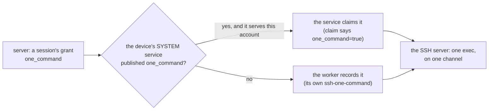

**Who says the device can hold it.** The worker's hello advertises
`ssh-one-command`, and P3-8-1b sends a session's grant to no connection that
does not. That word speaks for the worker's own server. On an anchored Windows
device, a grant may instead go to the SYSTEM service (FR-105), whose build can
be older than the worker's. So the service says it for itself:
- its endpoint publish carries `one_command: true`, and a session's grant is
  routed to the service only when the published record says so. Otherwise the
  worker serves it, as it serves any grant outside the service's reach;
- its claim carries `one_command=true`, and a session's grant is handed to no
  claim that does not say so: the same 404 as every other refusal, audited
  `claim_refused`. Routing already keeps such a grant from a service that
  never said the word, so this is the backstop for one whose build changed
  since it published.

⚠️ **The attempt counts, not the success.** A session that sent an `exec`
the device refused, or whose command failed to start, has used its one
command. Retrying would let a session probe the device's rules one refusal at
a time.

⚠️ **The key-list path is never one-command.** A key in the device's own
`ssh_authorized_keys` is the owner's break-glass access, and no agent
session's grant backs it.

| Piece | Where |
|---|---|
| the grant's field | `Grant::one_command` ([`ssh.rs:2852`](../agents/roomlerd/src/ssh.rs#L2852)), recorded by `record_grant` ([`:2928`](../agents/roomlerd/src/ssh.rs#L2928)), resolved into the session's policy ([`:833`](../agents/roomlerd/src/ssh.rs#L833)) |
| the rules | one channel ([`ssh.rs:1693`](../agents/roomlerd/src/ssh.rs#L1693)), no forward ([`:1759`](../agents/roomlerd/src/ssh.rs#L1759)), one `exec` ([`:1854`](../agents/roomlerd/src/ssh.rs#L1854)), no shell ([`:1964`](../agents/roomlerd/src/ssh.rs#L1964)), no terminal ([`:2003`](../agents/roomlerd/src/ssh.rs#L2003)), no subsystem ([`:2106`](../agents/roomlerd/src/ssh.rs#L2106)) |
| the device's word | `ssh-one-command` in the hello ([`caps.rs:2645`](../agents/roomlerd/src/encode/caps.rs#L2645)) |
| the SYSTEM service | the claim's word ([`ssh_service.rs:637`](../agents/roomlerd/src/ssh_service.rs#L637)), the published word ([`:646`](../agents/roomlerd/src/ssh_service.rs#L646)), and the claimed grant's field ([`:612`](../agents/roomlerd/src/ssh_service.rs#L612)) |
| the server | routing a session's grant to the service ([`agent_ssh.rs:784`](../crates/modules/network/src/routes/agent_ssh.rs#L784)), the claim's backstop ([`:1392`](../crates/modules/network/src/routes/agent_ssh.rs#L1392)) in the pending rows' claim ([`ssh_pending.rs:63`](../crates/services/src/dao/ssh_pending.rs#L63)), the published record ([`models.rs:2896`](../crates/remote_control/src/models.rs#L2896)) |

### The session's own device: the client (FR-90 P3-8-2b)

The SSH client is the session's own daemon, never the session. The session
never holds a key, and no key reaches its transcript: this daemon mints one for
each call, presents its public half once, and drops it when the call ends.

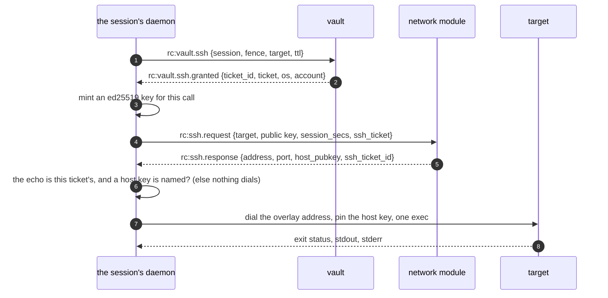

| Step | What the client does |
|---|---|
| the ticket | asks the vault (`rc:vault.ssh`), the primary's connection only, as a lease is. An answer that is not whole is refused; `Debug` never shows the ticket |
| the key | ed25519, minted for the call; its private half lives in this process's memory alone |
| the request | `rc:ssh.request` with the ticket and the key's public half. `session_secs` is the command's time plus the target's 30 s prompt; the network module clamps it to what is left of the ticket |
| the answer | refused unless it echoes the ticket it presented and names a host key that parses. A refusal is the server's words |
| the dial | the target's overlay address: through the userspace stack on a netstack node, through the OS's routes on a node with a TUN |
| the session | the target's host key pinned to the answer's; one `exec`; the exit status and both streams, each to 64 KiB (`truncated` when cut), all within the call's time |

⚠️ **The echo is the client's guard.** A server before P3-8-1b ignores
`ssh_ticket`, an unknown field, and would answer the request as the device
owner's. Such an answer echoes nothing, and the client dials nothing on it.

⚠️ **Another host key is refused before the key is offered.** The client
checks the target's key during the handshake, before it authenticates, so a
device that answers in the target's place learns no key and spends no grant.

⚠️ **One command is the target's rule, not this client's.** The client asks
for one `exec` because that is all it needs; the target refuses anything more
(P3-8-2a), whatever a daemon holding the key might ask.

| Piece | Where |
|---|---|
| the ask | `Client::ssh` ([`vault.rs:927`](../agents/roomlerd/src/vault.rs#L927)), answered at [`:1079`](../agents/roomlerd/src/vault.rs#L1079) from the primary's connection ([`signaling.rs:6551`](../agents/roomlerd/src/signaling.rs#L6551)) |
| the client | the key ([`ssh_client.rs:138`](../agents/roomlerd/src/ssh_client.rs#L138)), the request ([`:187`](../agents/roomlerd/src/ssh_client.rs#L187)), the answer's checks ([`:156`](../agents/roomlerd/src/ssh_client.rs#L156)), the one `exec` ([`:286`](../agents/roomlerd/src/ssh_client.rs#L286)), one call whole ([`:371`](../agents/roomlerd/src/ssh_client.rs#L371)) |
| the dial | the netstack's ([`overlay.rs:972`](../agents/roomlerd/src/overlay.rs#L972)), the OS's ([`ssh_client.rs:240`](../agents/roomlerd/src/ssh_client.rs#L240)) |
| the echo, carried | `rc:ssh.response` into the client's answer ([`signaling.rs:6187`](../agents/roomlerd/src/signaling.rs#L6187), [`ssh_origin.rs:37`](../agents/roomlerd/src/ssh_origin.rs#L37)) |

### The tool: `ssh_run` (FR-90 P3-8-2b-2)

A session asks for its one command with `ssh_run`, on its toolbelt. The tool is
offered only where three things hold: the device's owner turned on `hive_ssh`,
the vault is offered here (`vault_enabled`), and the build carries the `vault`
and `ssh-server` features. Anywhere else `ssh_run` is an unknown tool.

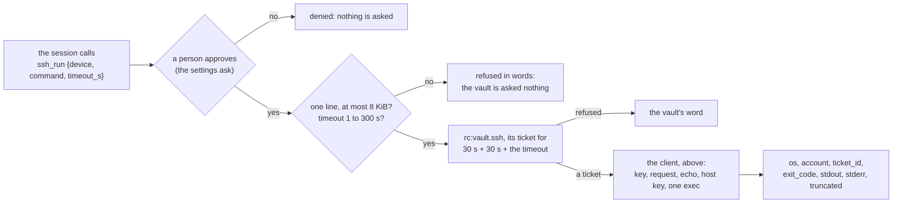

| Piece | What it does |
|---|---|
| the offer | `hive_ssh`: device-owned, default off, and never pushable (`DesiredConfig` cannot carry it). Only beside `vault_enabled` |
| the call | `device`, a device's id; `command`, one line of at most 8 KiB for that device's shell (PowerShell on Windows, bash elsewhere); `timeout_s`, 1 to 300 seconds, 60 if not given. A call that breaks one of these is refused before the vault is asked |
| the approval | the session's settings ASK for `mcp__roomler__ssh_run` on every call, as they do for the vault's uses, so a repository's own allow rule cannot skip the person |
| the ticket | asked for the session at its fence, toward `device`, to last the server's answer (30 s), the target's prompt (30 s) and the command. The network module ends the SSH session with what is left of the ticket, so a shorter one would cut the command off |
| the run | this daemon's own client (above), on the primary connection the vault answered on |
| the answer | the target's `os`, the `account` it ran as, the ticket's id (the join key to `ssh_audit`), the exit code, and both streams with `truncated`. Never the ticket itself |

⚠️ **The approval names the device and the command, not the account.** The
person answers before the vault is asked: an approval may wait 25 minutes, and
a ticket ends within 900 s. The account the target maps comes back in the
answer. What an account may run is the organization's guardrail to decide
beforehand: a Cedar `forbid` when `context.account == "daemon"` keeps a
session off SYSTEM and root ([`vault.md`](vault.md) §7). Whether the vault
seeds that guardrail is part of decision 22.

⚠️ **Until decision 22, every call is refused at gate 3.** No `SshPolicy`
admits a session yet, so the network module answers `session_not_allowed`
(P3-8-1b-1), whatever ticket the vault gave. The tool, the ticket and the
target's one command are all in place for that decision; until it lands,
nothing reaches a target.

⚠️ **The daemon never logs the command.** Its log line names the session, the
target, the ticket and the account, for the reason a terminal's content is
never recorded: what a session typed is its own.

| Piece | Where |
|---|---|
| the owner's key | `hive_ssh` ([`config.rs:605`](../crates/agent-core/src/config.rs#L605)), never pushable ([`models.rs:9771`](../crates/remote_control/src/models.rs#L9771)), read into `HiveConfig.ssh` ([`gates.rs:58`](../agents/roomlerd/src/hive/gates.rs#L58)) |
| the offer | `Supervisor::ssh_runner` ([`supervisor.rs:1599`](../agents/roomlerd/src/hive/supervisor.rs#L1599)), made at start ([`:879`](../agents/roomlerd/src/hive/supervisor.rs#L879)); `Run.ssh` ([`toolbelt.rs:510`](../agents/roomlerd/src/hive/toolbelt.rs#L510)); the settings' ask ([`supervisor.rs:5076`](../agents/roomlerd/src/hive/supervisor.rs#L5076), `SSH_TOOLS` at [`toolbelt.rs:631`](../agents/roomlerd/src/hive/toolbelt.rs#L631)) |
| the tool | its definition ([`toolbelt.rs:1378`](../agents/roomlerd/src/hive/toolbelt.rs#L1378)); the call ([`ssh_tools.rs:153`](../agents/roomlerd/src/hive/ssh_tools.rs#L153)), its checks ([`:113`](../agents/roomlerd/src/hive/ssh_tools.rs#L113)), the ticket's life ([`:146`](../agents/roomlerd/src/hive/ssh_tools.rs#L146)), the daemon's runner ([`:63`](../agents/roomlerd/src/hive/ssh_tools.rs#L63)) |
| the ask | `VaultTools::ssh` ([`toolbelt.rs:481`](../agents/roomlerd/src/hive/toolbelt.rs#L481)), on the primary's queue ([`vault.rs:668`](../agents/roomlerd/src/vault.rs#L668)) |

## 5. Roadmap

| Slice | Scope | State |
|---|---|---|
| P1 | Transport seam (`SplitTun`, netstack termination) | **shipped** |
| P2 | russh server, publickey auth, `exec` via the exec engine | **shipped** |
| P3a | Wire protocol (`rc:ssh.request` / `.grant` / `.response`), `SshPolicy` + `SshMode` + `SshAccountMode` models, `SSH_DEVICE` bit, agent-side grant table + redemption, `ssh` capability | **shipped** |
| P3b | The server half: `agent_ssh.rs` (gates 1-3 + grant minting), hub push, the `ssh_policy` + org-settings API, and the `rc:ssh.request` device leg | **shipped** |
| P3c-1 | `ssh_audit` — every request persisted, granted or refused; `GET …/ssh-audit` behind the new `VIEW_SSH_AUDIT` bit | **shipped** |
| P3c-2 | Admin UI: the org switch, a per-device `SshPolicy` dialog, and the grant log | **shipped** |
| P5a | `RunAs` + the never-silently-escalate rule; Unix named-account privilege drop (setgroups→setgid→setuid, verified); every unsupported mode refused | **shipped** |
| P5b | Windows console-user sessions (`WTSQueryUserToken` + `CreateProcessAsUserW` with captured output) | **shipped** rc.418, field-proven |
| P5c | `ssh_account_mode` — key-list sessions obey an explicit identity instead of silently taking the daemon's | **shipped** rc.419, field-proven |
| P5d | `SshPolicy.consent_mode` honoured — a policy of `prompt` now prompts, and refuses when nobody can be asked | **shipped** |
| P4a | PTY / interactive shell on **Unix** (`openpty`, login shell, resize, group teardown) | **shipped** |
| P4b | The same on **Windows** — ConPTY + `PROC_THREAD_ATTRIBUTE_PSEUDOCONSOLE` on `CreateProcessAsUserW`. The platform that needs this most | **shipped** rc.429, field-proven on corplap |
| P6a | Devices publish their SSH host key; the server stores it and returns it with the grant, so a caller has something to verify against | **shipped** rc.444 |
| P6b | `roomler ssh <name>` — ephemeral keypair → grant → verify against the published key → hand off to the system `ssh` | **shipped** rc.446, field-proven buildhost→corplap |
| P6c | `roomler proxy` — stdio `ProxyCommand`, so stock `ssh`/`scp`/`rsync`/`git` reach devices BY NAME | **shipped** |
| P7a | SFTP subsystem — `sftp` and `scp` | **shipped** rc.450, field-proven buildhost→fleet-host-1 |
| FR-97 P4b | SFTP and `scp` as the Windows `console_user`, through `exec`'s console-user spawn: raw bytes, the person's profile | **merged** [#2438](https://github.com/gjovanov/roomler-ai/pull/2438), field-verified on a candidate |
| FR-97 P5a | `console_user` on Linux and macOS: the person at the screen (logind's seat0, `/dev/console`'s owner), by the `named` drop; refused while nobody is there | **in review** [#2082](https://github.com/gjovanov/roomler-ai/issues/2082) |
| P7b | `-L` / `-J` / `-W` via `direct-tcpip`, default-deny on `forward_acl`. **`-R` deliberately not implemented** — it would make the device bind a listening socket | **shipped** |
| P8a | Session **activity** log — commands + exit codes, shell/SFTP/forward events, device-reported into `ssh_activity`. Deliberately NOT session content | **shipped** |
| P8b | Admin UI for the activity feed — `SshActivitySection`, under the audit log in org Settings | **shipped** |
| FR-83 | `rc:ssh.grant_ack` + `ssh-grant-ack`: the caller is answered only once the target confirms the grant (≤ 10 s), and the device's refusals — gate 4, expired on arrival — reach the caller by name | **shipped** 0.4.101, field-verified — 40/40 grant-issued sessions recorded before they opened across the FR-81 matrix |
| M5 | `ssh_max_privilege` — the device refuses a server grant that asks for the daemon identity. The one gate that survives a compromised control plane | **shipped**, default unset (permissive) |
| FR-89 | One-shot commands **stream** — no 1 MiB ceiling, no 300 s wall clock, the channel owns the command's life (close/disconnect ⇒ tree kill), redaction across chunk boundaries, Windows `console_user` included; `ssh_exec_streaming` kill switch. Fleet RPC untouched | **in review** [#1826](https://github.com/gjovanov/roomler-ai/issues/1826); field verification owed |

## 6. Build

`ssh-server` is a cargo feature (it implies `overlay-netstack`). It is not a
`default` feature, but all four release lanes build it — the Windows
`full-hw` set and the three `full` sets (Linux x86_64 and arm64, macOS) in
`.github/workflows/release-agent.yml` — so every released daemon carries the
server, off until the configuration below turns it on.

Measured by building `roomlerd` both ways on x86_64-pc-windows-msvc with
`codegen-units=1`: **29.939 MiB → 31.795 MiB, +1.856 MiB (+6.2%)**. At the
MSI's measured 2.67× compression that is roughly **+0.7 MiB** on the installer.
(An isolated harness had predicted +2.57 MiB; the real binary absorbs more,
because it already links a much larger std/tokio/webrtc surface for the linker
to share against.)

Little of that sharing is crypto, though: russh 0.62 sits on the next
RustCrypto generation (`aes-gcm` 0.11 vs our 0.10, `curve25519-dalek` 5 vs 4,
`p256` 0.14 vs 0.13, `sha2` 0.11 vs 0.10), so the binary genuinely carries a
second, parallel primitive stack and the dependency graph grows by ~99 crates —
worth weighing against the P3e trend that cut the tray from 470 to 321.

Two build constraints that must not be lost:

1. **`default-features = false, features = ["ring"]`.** russh's defaults are
   `["flate2", "aws-lc-rs", "rsa"]`, and aws-lc-rs is a C/NASM build that would
   break the deliberate ring-only / no-openssl invariant `tunnel-core` maintains
   for QUIC.
2. **`rsa` stays off.** It costs ~0.32 MiB and drags a `0.10.0-rc` pre-release
   into the graph. Roomler SSH authenticates ed25519.

russh has a real CVE history — CVE-2023-28113 (insufficient DH validation) and
RUSTSEC-2026-0154 / CVE-2026-46673 (unbounded allocation, CVSS 7.5, fixed in
0.60.3) — and releases fast. Pin it, watch it, and get `cargo audit` into CI
before this ships enabled.
