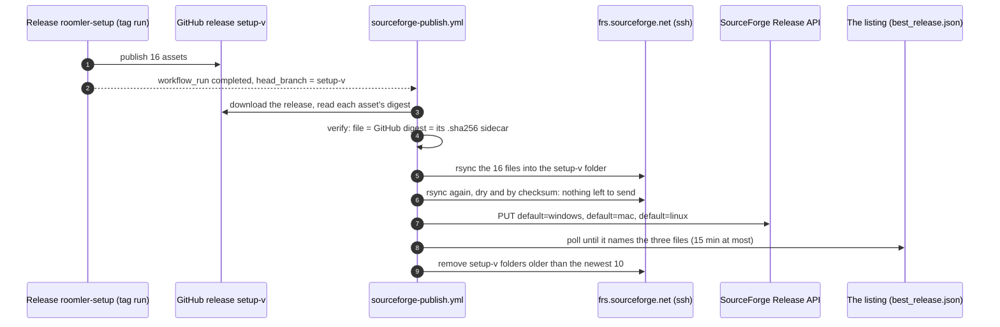

# The SourceForge listing

[sourceforge.net/projects/roomler-ai](https://sourceforge.net/projects/roomler-ai/) is a second
front door: a directory page whose **Download** button hands a visitor the Setup wizard for their
platform. This page covers what the listing holds, how a release reaches it with nobody touching
it, the two credentials that takes, and what to do when it fails
([FR-143](fr/FR-143-sourceforge-publish.md)).

The listing is not a mirror. `roomler.ai` and the GitHub releases stay the source of every
package; SourceForge carries the wizard, and the wizard installs the newest packages itself.

---

## 1. How a release reaches it



The agent release tags `setup-v<V>` and dispatches the wizard lane
([build-caches.md](build-caches.md#2-one-release-five-runs)). When that run finishes,
`.github/workflows/sourceforge-publish.yml` starts by itself. A run stops at the first step that
fails.

| # | Step | What makes it safe |
|---|---|---|
| 1 | Resolve the tag | Only `setup-v<major>.<minor>.<patch>` with a published, final GitHub release goes on. Anything else is skipped with a notice |
| 2 | Download and verify | Every file must hash to GitHub's asset digest, and every installer to the value in its own `.sha256` sidecar. The directory and the asset list must name the same files |
| 3 | Upload | rsync over ssh to a host whose three keys are pinned in `scripts/sourceforge-known-hosts`. Then the same transfer again, dry and by checksum, must find nothing left to send |
| 4 | Set the defaults | Only for the **newest** setup release. One `PUT` per platform to SourceForge's Release API; the API's answer has to list the platform |
| 5 | Wait for the listing | `best_release.json` must name the three new files within 15 minutes |
| 6 | Retention | Only after step 5. Removes `setup-v*` folders older than the newest 10 |

> ⚠️ **An event made with `GITHUB_TOKEN` starts no workflow.** The wizard lane publishes with that
> token, so `on: release` would never fire. That is why the trigger is `workflow_run`.

> ⚠️ **`workflow_run.head_branch` is text the triggering run chose.** It reaches the shell only
> through an environment variable, is never printed, and is used only after `valid-tag` has matched
> it.

The triggering run's conclusion is not read. A wizard run that published and then failed its cache
refresh still has a release the listing should carry; a run that never published has none, and
step 1 sees that.

## 2. What SourceForge holds

One folder per wizard release, `setup-v<V>/`, with that release's 16 assets: the wizard for
Windows (`.exe`, and the same EXE in a `.zip`), macOS universal, Linux x86_64 and Linux aarch64,
each with its `.sha256` and `.asc`, and the release public key. About 55 MiB a version, the newest
10 versions.

| Deliberately absent | Why |
|---|---|
| `agent-v*` packages (MSI, `.deb`, `.pkg`, the companions) | 177 MiB a release. The wizard and the terminal installers fetch them from `roomler.ai` |
| `seed-cache`, `vendored-*` | Build inputs. See §6 for the day they were here |
| Anything older than the newest 10 wizards | SourceForge's project limit is 5 GB |

SourceForge's own words on size: "5GB or less is ideal. 20-30GB may be permissible", and its admin
page states a "5GB total file size limit" for this project. Ten versions is about 0.6 GB.

## 3. The Download button

"Default Download For" is a property of one **file**, per platform. The button a visitor sees is
the file flagged for their platform. A new folder arrives with no flags, so a release that only
uploads leaves the button on an older version.

| Platform | The file that takes the flag |
|---|---|
| Windows | `roomler-setup-<V>-x86_64-pc-windows-msvc.exe` |
| macOS | `roomler-setup-<V>-universal-apple-darwin.tar.gz` |
| Linux | `roomler-setup-<V>-x86_64-unknown-linux-gnu.tar.gz` |

The match is on those exact names. The Windows `.zip` and the aarch64 tarball never take a flag.

**Ground truth:** `https://sourceforge.net/projects/roomler-ai/best_release.json`. Its
`platform_releases.{windows,mac,linux}` are the three buttons, and `release` is what a visitor on
an unknown platform gets.

- It lags a change by one to five minutes, and the platforms do not move together. In the minutes
  between, `release` can name a file from the newest folder that has no flag at all.
- Setting a platform on one file takes it off the file that had it.
- A file SourceForge has just received shows "Pending" in the signed-in Files view until its
  mirrors hold it.

## 4. Credentials

Two repository secrets, both the operator's to create. Without them a run reports that and skips;
it does not fail.

| Secret | Where it comes from | What it can do |
|---|---|---|
| `SOURCEFORGE_SSH_KEY` | The private half of a key pair made for this purpose. The public half goes on the SourceForge account: Account Settings → SSH Settings | Upload and remove files in the projects that account administers. No shell: `frs.sourceforge.net` serves sftp, scp and rsync only |
| `SOURCEFORGE_API_KEY` | Account Settings → "Releases API Key" → Generate | Change file properties, the defaults among them, in those projects |

```bash
# One key pair for this, with no passphrase (a workflow cannot type one).
ssh-keygen -t ed25519 -N '' -C 'roomler-ai sourceforge publish' -f sf_publish
# Paste sf_publish.pub into SourceForge: Account Settings → SSH Settings.
gh secret set SOURCEFORGE_SSH_KEY -R gjovanov/roomler-ai < sf_publish
# Generate the Releases API key on the same page, then (it prompts, nothing lands in history):
gh secret set SOURCEFORGE_API_KEY -R gjovanov/roomler-ai
rm sf_publish sf_publish.pub
```

Two repository variables are optional: `SOURCEFORGE_USER` (the account's login, default
`roomler-ai`) and the kill switch `SOURCEFORGE_PUBLISH=off`.

> ⚠️ **The API key never rides in a URL or an argument list.** The workflow builds the request body
> with a shell builtin and pipes it into curl's stdin.

**The pinned host keys.** `scripts/sourceforge-known-hosts` holds the three keys SourceForge
publishes for `frs.sourceforge.net`, with their fingerprints in its header. If SourceForge rotates
one, the upload fails closed with a host-key error. Re-scan (`ssh-keyscan frs.sourceforge.net`),
compare with SourceForge's
[fingerprint page](https://sourceforge.net/p/forge/documentation/SSH%20Key%20Fingerprints/), then
update the file. The pull request's self-test job checks that the file's keys and the fingerprints
in its header agree.

## 5. Operating it

```bash
# Rehearse: download, verify, list SourceForge, plan retention. Changes nothing.
gh workflow run sourceforge-publish.yml -f tag=setup-v0.4.211 -f dry_run=true

# Publish (or re-publish) a release by hand. The newest one also takes the defaults.
gh workflow run sourceforge-publish.yml -f tag=setup-v0.4.211

# What the listing serves right now.
curl -s https://sourceforge.net/projects/roomler-ai/best_release.json \
  | jq '{generic: .release.filename} + (.platform_releases | map_values(.filename))'
```

| Situation | What happens | What to do |
|---|---|---|
| A publish fails | One issue opens, "SourceForge publish failed". A repeat comments on it | Fix the cause, re-run the command in the issue. The next green publish closes it |
| A dispatch names an older tag | Its files are uploaded. The defaults and every other folder are left alone | Nothing: that is a backfill |
| The secrets are missing | A warning on the run, and it skips | §4 |
| `best_release.json` cannot be read from the runner | A warning, not a failure: the API's own answer is the record that the defaults moved | Read the JSON by hand once |
| The listing must stop following releases | | Set the variable `SOURCEFORGE_PUBLISH=off` |

> ⚠️ **`curl .../files/latest/download` answers 403.** That endpoint sits behind bot protection.
> Read `best_release.json` instead, and never work around the 403.

**By hand, when the workflow cannot run.** Sign in to SourceForge, open the release's folder under
Files, click the ⓘ on a file, tick the platform under "Default Download For", Save. One file per
platform. Compare the SHA-256 the panel shows with the release's `.sha256` first. A folder is
removed with its trash icon.

## 6. Why not SourceForge's GitHub import

Until 2026-11-11 the listing was fed by SourceForge's "GitHub Releases Integration", a webhook on
this repository's `release` events with no filter. Three things followed.

| What happened | Measured on 2026-11-11 |
|---|---|
| The CI cache is a GitHub release too ([build-caches.md](build-caches.md)), and every cache write is a `release edited` event | 1,571 webhook deliveries in 70 hours, nine in ten about `seed-cache`; 646 import runs in sixteen days; the cache's 31 GiB mirrored into the public Files; "GitHub Downloads Import Failed" mails whenever an import met an asset CI was replacing |
| It copied every asset of every release | About 310 MiB a version. 85.5 GB in 265 folders against a 5 GB limit |
| It never set a Download default | The button stood on `setup-v0.4.197` for nine days and thirteen releases while `roomler.ai` served the current wizard |

The integration cannot leave a release out, so the cache could not be excluded on SourceForge's
side. Moving the cache out of GitHub Releases would have ended the mails and neither of the other
two. So the webhook went, and the publish became ours.

> ⚠️ **Never set the GitHub Releases Integration up again**, and never re-run SourceForge's
> one-time "GitHub Downloads" import: the repository has more than 800 releases and about 60 GiB of
> assets, and the import takes all of them.

> ⚠️ **Switching the webhook off stops new imports, not one in flight.** On the day it was removed,
> an import SourceForge had started 12 minutes earlier went on copying the cache into a folder that
> had just been deleted, and re-created it with 24 GiB. Before removing an imported folder, read the
> last "import files" row in the project's Audit Trail and watch the folder's file count stand still.

## Code map

| File | What to look for |
|---|---|
| `.github/workflows/sourceforge-publish.yml` | the `gate` step (which runs go on, and `is_newest`), `Upload`, the `defaults` step, the `served` step, the retention step, the `alert` and `recovered` jobs |
| `scripts/sourceforge-publish.sh` | `valid_tag`, `sorted_tags`, `newest`, `default_for`, `defaults_plan`, `verify`, `prune_plan`, `selftest` |
| `scripts/sourceforge-known-hosts` | the three pinned keys, with their fingerprints in the header |
