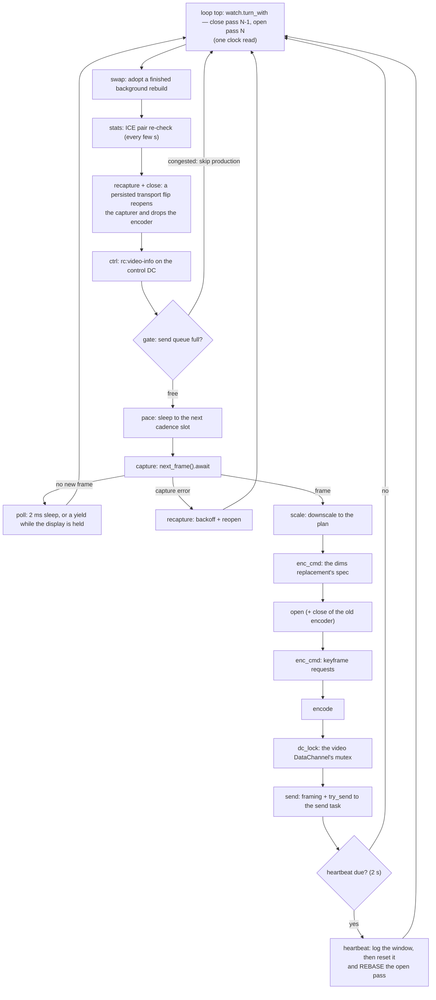
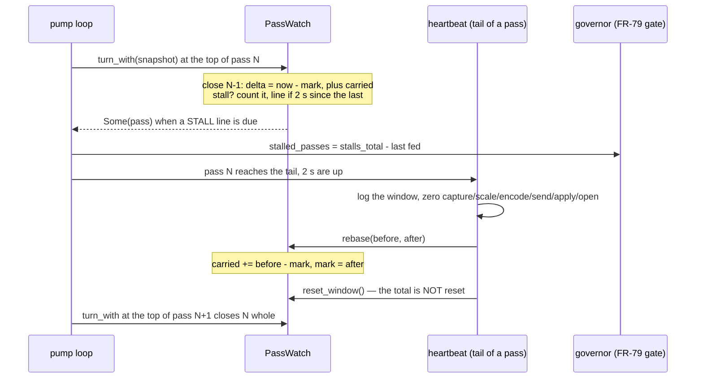

# The pump stall watch — how a remote-desktop session says where its time went

The instrument at the heart of [FR-65](fr/FR-65-blocking-work-on-async-runtimes.md):
every pass of the FFmpeg DataChannel pump (`media_pump_ffmpeg_dc`,
`agents/roomlerd/src/peer.rs:6167`) is timed, broken into named phases, and
judged. A pass whose **work** reaches the bar (100 ms) is a **stall**: it is
logged once with its breakdown, counted on the heartbeat, and handed to the rate
governor, whose FR-79 validity gate refuses to learn from a window in which the
agent's own loop was busy ([rate-control.md](rate-control.md#the-validity-gate-fr-79--a-window-is-evidence-about-the-pipe-or-it-is-not)).

It exists because a 2 s blocking encoder open hid for months: the pump already
timed capture, scale, encode and send, and the stall was in none of them. This
page is the instrument's manual — what each phase is, the two rules the verdict
runs on, the bookkeeping that feeds it, what the kill switch does and does not
turn off, how to read a STALL line, how to take a census of them across the
fleet, and what the watch itself costs (measured, FR-65 AC1).

| | |
|---|---|
| Verdict + bookkeeping | `encode::stall` (`agents/roomlerd/src/encode/stall.rs`) — a pure module on the **default** feature set, so `cargo test -p roomlerd --lib` covers it although the pump is behind `ffmpeg-encoder` |
| The pump's sites | `peer.rs:6656` (the watch), `:6668` (the one phase list), `:7137` (the pass boundary), `:9909` (the heartbeat's rebase) |
| Kill switch | `pump_stall_watch` / `ROOMLERD_PUMP_STALL_WATCH=0` (`encode/mod.rs:528`), restart required |
| The bar | `pump_stall_warn_ms` / `ROOMLERD_PUMP_STALL_WARN_MS`, default 100 (`encode/mod.rs:616`) |
| Its own cost | `roomlerd stall-watch-cost` (`stall.rs:592`, §8) |
| The census | `scripts/fr65-stall-census.sh` (§7) |

## 1. A pass, and where its time goes

A pass is one turn of the pump's loop: from the top of the loop to the top of
the next. It is closed and the next opened at the TOP, never at the tail — the
loop has more than a dozen `continue` paths, and closing at the top counts every
one of them without an RAII guard fighting the borrow checker.



Seventeen phases. Six are always timed, because the heartbeat publishes them;
eleven exist only for the watch and cost nothing when it is off.

| Phase | What it times | Work? | Timed when the watch is off? | Since |
|---|---|---|---|---|
| `capture` | `capturer.next_frame().await` (`peer.rs:7913`) — mostly **waiting for the screen to change** | no | yes (heartbeat average) | rc.88 |
| `scale` | the downscale to the plan's box (`:8509`) | yes | yes | P7 |
| `encode` | the encode round trip (`:9306`) | yes | yes | rc.88 |
| `send` | framing and the hand-off to the send task (`:9535`) | yes | yes | rc.88 |
| `apply` | a rate/dims change to an encoder that already exists (`timed_apply!`) | yes | yes | FR-65 P0 |
| `open` | opening an encoder, first or rebuilt (`:8676`) | yes | yes | #1279 |
| `pace` | the cadence sleep when the encoder cannot hold the rate (`:7899`) | **no** | no | #1327 |
| `stats` | the ICE pair and LAN-reason stats reads | yes | no | #1327 |
| `ctrl` | the control DC's lock and `rc:video-info` send | yes | no | #1327 |
| `swap` | adopting a finished background rebuild (`:7298`) | yes | no | #1327 |
| `gate` | the backpressure gate, including its skip-and-sleep (`:7782`) | yes | no | #1327 |
| `dc_lock` | waiting for the video DataChannel's mutex after an encode (`:9490`) | yes | no | 2026-10-30 |
| `enc_cmd` | encoder commands other than encode/apply/open: keyframe requests, the dims spec (`:8415`, `:8816`, `:8831`, `:8842`) | yes | no | 2026-10-30 |
| `close` | dropping an encoder — which **joins its thread** (`:7180`, `:7458`, `:8758`, `:8872`) | yes | no | 2026-10-30 |
| `recapture` | rebuilding the capturer: a flip's reopen, the error arm's backoff + reopen (`:7455`, `:8146`) | yes | no | 2026-10-30 |
| `poll` | an empty poll's 2 ms sleep, or the yield while the display is held (`:7993`, `:8120`) | yes | no | 2026-10-30 |
| `heartbeat` | the heartbeat block itself (`:9620`) | yes | no | 2026-10-30 |

⚠️ **`apply` is timed inside `swap`, `gate` and `send` on three paths** (a
background adoption, a backpressure decrease, an overflow decrease), so on those
passes the apply is counted twice and `other` can read 0 while time is still
missing elsewhere. It is rare (a rate move) and was so before FR-65's later
phases; it is recorded here rather than fixed by stealth.

## 2. The verdict — two rules, each paid for in the field

`PassTiming` (`stall.rs:120`) is one pass's breakdown. Two numbers are derived
from it, and both are judgements a reader would "simplify" into something wrong:

| Rule | Code | Why |
|---|---|---|
| **A stall is judged on `work = iter − capture − pace`**, never on `iter` | `work_us` (`stall.rs:327`), `is_stall` (`:374`) | A quiet screen sleeps inside capture. At the 100 ms bar that made idling the MAJORITY of warnings (2026-09-03: seven in 45 s, each `iter 111 / capture 101.9`). A watch that cries about idling is ignored. `pace` is the same idle one door along: at a paced 2 fps it is ~500 ms of one pass. |
| **`other = iter − Σphases` is computed** | `other_us` (`stall.rs:366`) | An overrun whose named phases read ~0 is itself the finding: the encoder open hid there for months, spotted by eye on the fourth occurrence. |

⚠️ The cost of the first rule: a **wedged capture cannot trip the watch**.
`capture_ms` still shows it on the line and `avg_capture_ms` on the heartbeat;
nothing alerts on it. If capture needs an alarm it needs its own threshold.

🔑 **Naming a phase never changes a verdict.** Every phase but `capture` and
`pace` counts as work — exactly as `other` did — so naming one only moves time
out of `other` (`naming_a_phase_moves_time_out_of_other_and_changes_no_verdict`).
That is what made it safe to name six more on 2026-10-30 without a release of
evidence first.

`dominant_phase` (`stall.rs:386`) names the phase that dominated the pass, and
**refuses** to name one when `other` is larger — so a line never blames a phase
for time it did not take (AC2's attribution tests).

## 3. The bookkeeping — `PassWatch`

`PassWatch` (`stall.rs:405`) owns the pass marks, the STALL line's rate limit
(one per 2 s), the window's worst pass and stall count (the heartbeat's
`iter_ms_max` and `pump_stalls`), and a **monotonic** stall total.



### 3.1 The window reset inside a pass (fixed 2026-10-30)

The heartbeat zeroes six accumulators at the **tail** of a pass, after the mark
that pass took at its top. Before the rebase, the close computed `0 − mark` for
each of them, which saturates to 0: the pass that held the heartbeat lost every
microsecond of capture, scale, encode, send, apply and open. Its capture wait
counted as work, its encoder open as nothing, and the pass went to `other`.

🔑 A pass longer than the heartbeat interval **always** holds a heartbeat — the
long pass is what makes it due — so the rule was blind to exactly the stalls
worth finding. `PassWatch::rebase` (`stall.rs:522`) carries what the open pass
had accrued and moves its mark past the reset (`peer.rs:9909`). The census that
found it is §6.

### 3.2 The governor reads a total that never resets (fixed 2026-10-30)

FR-79's gate asks whether the agent's own loop was free in a window
(`governor.rs:1162`, `agent_stalled: stalled_passes > 0`). The pump fed it
`pump_stalls − win_stalls_last`, and the heartbeat zeroed `pump_stalls` but not
the mark: after a window that held a stall, the next verdict read `1 − N`,
which saturates to 0. The first verdict after a reset is the heartbeat pass's
own — the long one. It now reads `PassWatch::stalls_total` (`stall.rs:556`,
`peer.rs:8914`), which only grows.

**What the two fixes change for the controller**, since a stall verdict gates
every rate estimator: a heartbeat pass whose overrun was only a capture wait is
no longer a stall (its window becomes evidence again), and a heartbeat pass
that did stall is no longer hidden from the gate (its window is refused, as it
always should have been). Every other verdict is unchanged.

## 4. What the kill switch turns off

`pump_stall_watch = false` (`ROOMLERD_PUMP_STALL_WATCH=0`, restart required):
no pass marks, no verdict, no window counters, and none of the eleven
watch-only timers — `PassWatch::start` returns `None` without reading a clock.
The six always-on phases keep running for the heartbeat.

⚠️ **It is not a pure instrument switch.** Since FR-79 the verdict is a
controller input: with the watch off `stalled_passes` is 0 on every window, so
the governor's `agent_stalled` gate goes blind and accepts windows it would have
refused. An A/B of whole sessions through this switch measures a different
controller as well as the instrument — which is why AC1's A/B is the harness in
§8 and not a pair of sessions.

## 5. Reading a STALL line

```text
WARN FFmpeg DC pump STALL — one pass exceeded the budget session_id=… codec_label="HEVC"
  constrained=false iter_ms=815.7 capture_ms=10.0 … open_ms=789.0 … dc_lock_ms=0.0
  enc_cmd_ms=0.0 close_ms=0.0 recapture_ms=0.0 poll_ms=0.0 heartbeat_ms=0.0
  other_ms=0.57 work_ms=805.7 dominant=Some(("open", 789024)) target_bps=…
```

- **Read `dominant` first, then `other_ms`.** A named dominant phase is the
  answer; `dominant=None` means the time is in no named phase, and `other_ms`
  says how much.
- **`work_ms` is what was judged**, `iter_ms` is the wall clock. A large gap
  between them is capture or pace — idle by design.
- **One line per 2 s at most**: the heartbeat's `pump_stalls` counts every
  stall, logged or not, and `iter_ms_max` is the worst pass of the window.
- A pass is logged at the top of the NEXT pass, so a line timestamp is the end
  of the stalled pass, and the heartbeat that closes a window reports the pass
  that held the previous heartbeat.

| Shape | Reading |
|---|---|
| `dominant=open`, first pass of a session | the encoder open — P1's make-before-break is the fix, the session has no encoder meanwhile |
| `dominant=encode` | a slow encode on the encoder's own thread (FR-70 M1) |
| `dominant=dc_lock` | the pump waited for the send task's previous frame — see §6.3 |
| `dominant=poll` | the pump asked for 2 ms and got the rest back late: the runtime did not schedule it (FR-65 P2's question) |
| `dominant=close` | a dropped encoder's thread join, on the runtime worker |
| `dominant=None`, `other_ms ≈ iter_ms` | still untimed — the census's job is to find these |
| all six reset phases 0.0, `other ≈ iter`, right after a heartbeat | **pre-2026-10-30 builds only**: the window-reset artifact of §3.1 |

## 6. The 2026-10-30 census — what the logs of three hosts said

Fourteen days of daemon logs (2026-10-17..30) on the three corporate laptops,
read with the census of §7 before any of this shipped. 344 STALL lines:

| Class | CORPLAP-1 | CORPLAP-2 | CORPLAP-3 | Reading |
|---|---|---|---|---|
| `open` | 21 (mean 0.93 s, max 1.4 s) | 122 (0.24 s, 3.0 s) | 37 (0.60 s, 1.5 s) | the encoder open, every session |
| `reset` | 7 (2.6 s, 3.6 s) | 51 (2.2 s, 4.1 s) | 26 (1.5 s, 4.1 s) | **the §3.1 artifact** — real stalls, attributed to nobody |
| `untimed` | 4 (14.7 s, **30.0 s**) | 27 (0.34 s, 1.0 s) | 15 (0.31 s, 1.8 s) | time in no phase named at the time — §6.2, §6.3 |
| `encode` | 10 (0.15 s, 0.23 s) | 0 | 19 (0.19 s, 0.55 s) | slow encodes |
| other phases | 1 swap | 1 capture | 1 ctrl, 1 stats, 1 swap | |

### 6.1 The longest stalls were the ones blamed on nobody

The `reset` lines were emitted within 5 ms of their session's heartbeat with
every reset phase at 0.0 — the §3.1 signature. On CORPLAP-1 six of the seven
came right after a heartbeat whose own fields still held the truth:
`open_ms` 1951–3529 on a session's first pass, i.e. `hevc_qsv` opens of 2–3.5 s
(against 748–789 ms measured on 0.4.60), blamed on nobody.

### 6.2 Thirty seconds in no phase

CORPLAP-1, 2026-10-24: two consecutive passes of **29 995 ms** and
**28 281 ms**, each with `capture_ms` < 0.4, no encode, and everything else in
`other`. Nothing from the pump was logged inside either window. Each ended
10–20 ms after a `keep-busy` state change (`paused reason=button_held`, then
`running`), and the second was followed by the keyframe fallback
(`pending_ms=30244`) and the peer failing. A pass with a near-zero capture and
no encode is an empty poll, so the 30 s was spent in that arm or at the loop
top — exactly the regions `poll` and `close` now name. The mechanism is not
established; the next occurrence will say which.

⚠️ **A dead end, recorded so nobody re-walks it:** keep-busy is not blocking a
runtime worker. Its Windows host does `std::thread::sleep` while it settles and
waits (`keep_busy/host_win.rs:96`, `:134`), but the engine runs on its own OS
thread (`keep_busy/mod.rs:214`), so those sleeps hold no tokio worker. The
correlation stands, unexplained.

### 6.3 The send task holds the DataChannel mutex for a whole frame

Forty of the 46 `untimed` lines (CORPLAP-1 2 of 4, CORPLAP-2 23 of 27,
CORPLAP-3 all 15) have a normal capture and a normal encode and the rest in
`other` — a pass that encoded a frame, then waited. The send task
takes the video DC's mutex in an `if let` scrutinee (`peer.rs:7032`), and Rust
2024 keeps a scrutinee's temporaries alive through the whole body, so the guard
is held across every chunk of a frame's flow-controlled send. The pump's own
`video_bytes_dc.lock().await` after each encode then waits out the previous
frame's send. Checked on the pinned toolchain (1.95, edition 2024): inside such
a body `try_lock` fails; after a plain `let` statement it succeeds.

That would re-couple the pump to the link that rc.106 moved the send off. It is
**named, not fixed**: `dc_lock` (and `heartbeat`, which takes the same mutex)
ship first, and the fix waits for their number, per this FR's first rule.

## 7. Running the census

```bash
scripts/fr65-stall-census.sh --days 14 CORPLAP-1 CORPLAP-2 CORPLAP-3
scripts/fr65-stall-census.sh --days 3 --rows CORPLAP-1   # every line, classified
```

It runs `scripts/fr65-stall-census.ps1` **on** each Windows host through
`roomler exec`, as a PowerShell `-EncodedCommand`. Read-only: it scans the
daemon's dated logs and prints one summary row per class (§5's table).

- `-EncodedCommand`, not a quoted command: `roomler exec` re-splits argv, so a
  comma list or a quoted pattern arrives mangled.
- The script pins the invariant culture: the fleet's Windows hosts are not all
  en-US, and a German culture would format 3586.0 as `3.586,0`.
- `--rows` also prints, for a `reset` line, the heartbeat just before it —
  where the lost attribution can still be read.
- ⚠️ **Today's file is open for writing, and a census must not skip it.** The
  first version read the logs with `[IO.File]::ReadLines`, which the daemon's
  open handle refuses (a sharing violation). PowerShell reports that as a
  non-terminating error, `roomler exec` delivers stderr as CLIXML, the wrapper
  drops CLIXML, and the census silently covered every day but today — five of
  its 344 lines (2026-10-30) went uncounted on its first reading. The script now
  opens each file the way a tail does (`FileShare 'ReadWrite, Delete'`), and its
  summary line says how far it read (`read through …`) and `unreadable=N`, with
  an `UNREADABLE` line per file it could not open. Read both before the counts.
- `--probes` runs `scripts/fr65-probe-census.ps1` instead: the caps-probe runs
  per daemon start and how many were at steady state (FR-65 AC6).
- ⚠️ An exec sweep is a biased sample (hosts with exec on, reachable). Report
  per host; never a fleet-wide proportion.
- It is FR-65 AC7's "same instrument": the before of a change to the watch is
  this script on the build without it, the after is this script on the build
  with it, same hosts, windows of the same length.

## 8. What the watch costs (FR-65 AC1)

> *"An instrument that costs what it measures is worthless."* AC1 asks for the
> overhead **measured** at under 1 % of the frame budget by an A/B with the
> watch disabled, on real hardware — explicitly not the arithmetic ("an
> `Instant::now()` is ~20–40 ns, and there are N of them") the switch's own
> description used to quote.

`roomlerd stall-watch-cost` (`stall.rs:592`, dispatched in `app.rs:1269` before
any runtime, config, log, lock or updater) runs the pump's per-pass watch work
through the **real** `PassWatch`, once enabled and once disabled, rounds
alternating which arm goes first. Everything else in a pass is the same in
both arms, so the difference is the watch.

| Cell | Per pass |
|---|---|
| `steady` | the pass boundary + `swap` + `gate` + `dc_lock`: what every pass enters while frames flow (7 clock reads ON) |
| `worst` | the boundary + every watch-only phase on every pass (23 clock reads ON) |
| `warm` | nothing between the watch's operations — the precise figure |
| `cold` | a 1 MiB walk between every one of them — the pump runs capture and an encode there, and a tokio worker may move it to another core |
| `control` | `steady-warm` with a calibrated spin **injected** into the ON arm at three times the bar; at least half must be measured back, or the verdict is INVALID |

**The bar is 1 % of a frame at the pump's highest rate**: `frame_rate::CHOICES`
tops out at 144 fps, so 1 % of 6.94 ms = **69.4 µs a pass** — not the 167 µs a
60 fps budget would give.

**Measured on NEO16, 2026-10-30 04:54Z** — the dev box (Windows 11), a release
build of this branch, the desktop in normal use (the interleaving absorbs that
load). Four runs of 31 rounds:

| Cell | Watch cost per pass, median (range of the four runs) | Worst p90 in any run | Worst p90, % of a 144 fps frame |
|---|---|---|---|
| `steady-warm` | 225 ns (207–242) | 260 ns | 0.0037 % |
| `steady-cold` | 300 ns (275–329) | 423 ns | 0.0061 % |
| `worst-warm` | 693 ns (662–713) | 743 ns | 0.0107 % |
| `worst-cold` | 854 ns (830–992) | **1 090 ns** | **0.0157 %** |
| `control` | 208.3 µs injected, 208.9–209.2 µs measured back (1.00×) | — | resolved in every run |

One `Instant::now()` costs 28–30 ns here, so the steady cell's seven clock
reads are most of its 225 ns. A first session at 02:29Z, with the box's clock
read at 24–27 ns, put the worst p90 at 869 ns: the host's state moves these
numbers more than the watch does.

**Per second — what "1 % of the frame budget" means once a frame takes several
passes.** The pump re-polls an idle screen every ~2 ms (rc.99), so it makes
more passes than frames. The field's rate, bounded from the heartbeat's frame
counters (`Δframes_empty + Δframes_encoded + Δframes_skipped_backpressure +
Δdc_unopen_drops` per window, which over-counts a keepalive pass) over 14 days
and 36 357 windows: at most **322 passes/s** (NEO16, 144 fps); 299, 314 and 296
on the three CORPLAP hosts (p99 273–282), up to 10.5 passes per frame interval
at 30 fps. At the worst cell's p90 that is 322 × 1 090 ns = **0.35 ms of watch per
second, 0.035 % of the frame budget — 28× under the 1 % bar**, with every factor
measured on the host it describes. From this build on the heartbeat carries the
rate itself (`passes`), so the next read needs no bound.

**The positive control is the "fail first".** The current release cannot run
this harness at all, so the failing run is the control: with 208 µs injected
into the ON arm the same instrument reads 208.9–209.2 µs, three times the bar — a
watch costing that much would FAIL (`the_verdict_needs_the_control_to_resolve`
pins the verdict side).

⚠️ **A dead end, recorded:** the first version differenced whole cold passes,
as the warm cells do. A cold pass is ~80–280 µs of walking whose time varies by
microseconds, so the watch came out at −6.4…+5.7 µs medians and p90s up to
37 µs — a bound set by noise, which multiplied by 322 passes/s is 1.2 % of each
second and proves nothing. The cold cells now bracket only the watch's own
operations after each eviction walk (`pass_timed`, `stall.rs:822`). And the
first control was a CALIBRATED LOOP COUNT: it came back at 0.83–1.16× over
eight runs, because a core that changes its clock between calibration and run
shrinks a step count — on a shared CI runner that is a flake waiting to happen.
The control is now a busy-wait for a fixed wall-clock time, and reads 1.00×.

```bash
roomlerd stall-watch-cost            # ~15 s, text; exit 0 PASS, 3 FAIL, 4 INVALID
roomlerd stall-watch-cost --json     # for a script
roomlerd stall-watch-cost --quick    # ~1 s smoke
# on a fleet host, once a release carries it:
roomler exec CORPLAP-1 -- "C:/Program Files/Roomler/roomlerd.exe" stall-watch-cost
```

## 9. Known limits

- **Only the FFmpeg DC pump has the watch.** The VP9-444 pumps and the RTP
  track path do not; a host whose sessions ran them logs no STALL lines, which
  is silence, not health.
- **`apply` nests inside `swap`, `gate` and `send`** on three rare paths (§1).
- **A wedged capture cannot trip it** (§2).
- **The census reads Windows hosts only.** The Linux and macOS daemons log the
  same lines (to journald or the daemon's file); the census has not been
  written for them.
