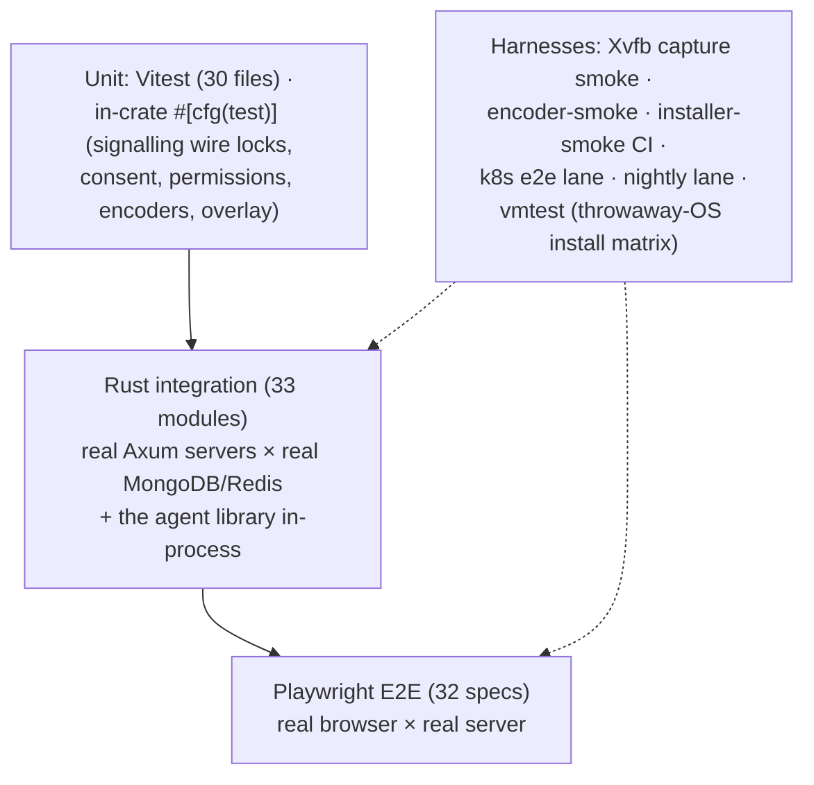
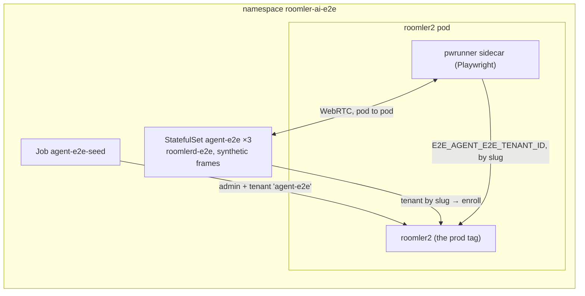
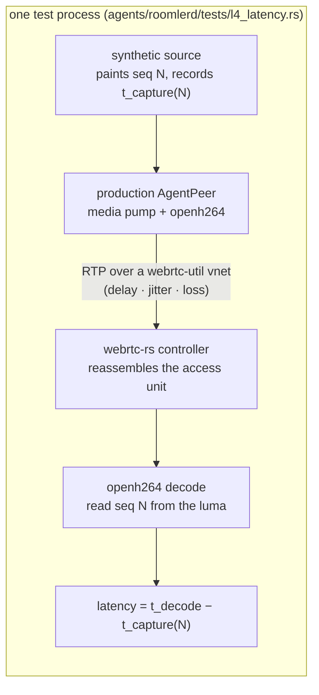
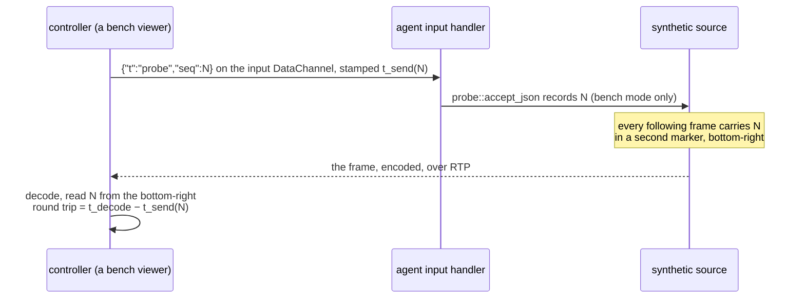
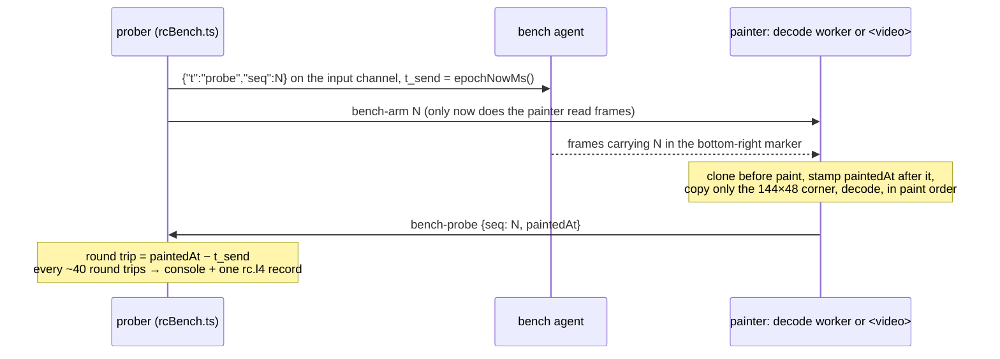
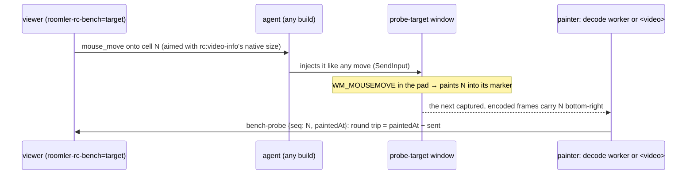
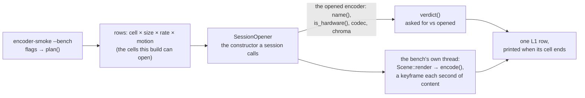
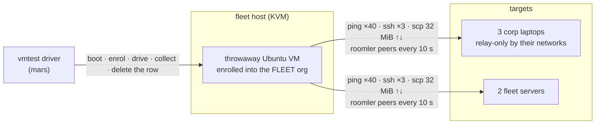
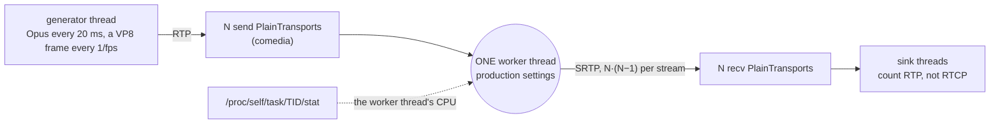

# Testing

Four layers, plus purpose-built harnesses for the parts a normal test runner can't
reach (screen capture, hardware encoders, installers, the k8s topology).
*As of 0.3.0-rc.381: 33 integration modules · 30 Vitest spec files · 32 Playwright
specs — the totals drift, the commands don't.*



## Commands (most specific first)

| Layer | Command | Needs |
|---|---|---|
| Backend integration | `cargo test -p roomler-ai-tests` | MongoDB `localhost:27019`, Redis `6379` |
| Remote-control crate | `cargo test -p roomler-ai-remote-control --lib` | nothing (wire-format locks, Hub, consent) |
| Agent library | `cargo test -p roomlerd --lib` | nothing (default features) |
| Agent w/ media+input | `cargo test -p roomlerd --lib --features full` | libxcb*-dev on Linux |
| Agent overlay tests | add `--features overlay-l3` | ⚠️ feature-gated — the default `--lib` run silently skips them |
| Frontend types+build | `cd ui && bun run build` | includes `vue-tsc --noEmit` |
| Frontend types, the hosted image's way | `cd ui && bun --bun x vue-tsc --noEmit` | ⚠️ the image has no `node`, so vue-tsc runs on bun and types `.vue` through `env.d.ts`'s shim: a spec's `setProps({ realProp })` passes on Node and fails there (cast it as `VideoTileFr124.spec.ts` does). CI runs both (`ci.yml:2543`) |
| Frontend unit | `cd ui && bun run test:unit` (`:coverage`) | jsdom |
| E2E | `cd ui && bun run e2e` | dev stack on :5000/:5001 (`E2E_BASE_URL`, `E2E_API_URL`, `E2E_MAILPIT_URL` to point elsewhere) |
| Phone-width smoke | `cd ui && bun run test:phone` | nothing — the built SPA with every `/api` call mocked (`ui/e2e-phone/`) |
| Soft-keyboard harness | `cd ui && bun run test:harness` | nothing — one harness page on the Vite dev server, in a real Chromium (`ui/e2e-harness/`, #2888) |
| Capture smoke | `./scripts/dev-xvfb.sh` | Xvfb — paints an xterm, runs the scrap-capture path headless |
| Encoder smoke | `roomlerd encoder-smoke --encoder hardware [--codec hevc]` | the host's GPU — 10 synthetic frames, prints the cascade's decisions |

## Rust integration tests (`crates/tests/`)

Each test spawns a **real Axum server** on a random port against a **unique
UUID-named database** (dropped on teardown). The agent-facing modules drive the
actual `roomlerd` library in-process for full `rc:*` round-trips against a
TestApp — enrollment, sessions, tunnels, overlay joins, exec.

Coverage areas: auth · tenant (+archive) · member · role · room/channel · message ·
reaction · recording · file · invite · notification · oauth · billing ·
multi-tenancy · pagination · rate-limit · CORS · export (xlsx/pdf) · conference
(+messages, +the FR-127 view: a view client's video consumers against its `media:view`
reports, the viewer's pause against the owner's, the kill switch, a report through the
other pod) · cluster · stats · relay-region · remote-control · agent
(+e2e, +crash, +exec, +presence) · overlay · tunnel · hive.

> [!NOTE]
> **`tests/hive_canary.rs` is a second test binary, on purpose.** FR-90's
> canary test (AC2) drives a real in-process device with the Hive supervisor
> on, and that supervisor is process-global. In the lib's binary every other
> in-process agent would re-point it at its own socket. `cargo test -p
> roomler-ai-tests` runs both binaries, and the lane's count sums them. The
> test is Linux-only and turns on `roomlerd`'s `hive-test-launcher` feature
> through a Linux-only dev-dependency. That feature launches sessions as the
> test's own account and refuses to run as root. Its log checks run under a
> thread-default subscriber around a current-thread runtime, so they see
> every task of the server and the device without `RUST_LOG`.
>
> **Since P2d-6 it starts a second device, a member, as a child process: the
> same binary**, running its `member_device_process` test with
> `HIVE_CANARY_MEMBER` set, a no-op in an ordinary run (so it counts one
> passed test). A `[[bin]]` could not do it: binaries get no
> dev-dependencies, and the test launcher is one on purpose. Under that
> feature a device takes its checkpoints in process, because the binary is a
> test's and knows no `hive-checkpoint`.
>
> **`tests/hive_drivers.rs` is a third, for the same reason** (FR-90 P1c-2b,
> AC6): a reader's message in the session's room and a prompt over their own
> viewer peer must reach no harness, while the owner's and a named driver's
> do, each labelled `[Name] …`. Its harness writes every line it reads on
> stdin to a file — what a model would be sent — and the test reads that
> file. The scaffolding both binaries share (the server, the in-process
> device, a browser's socket and viewer peer, the harness's side of a
> toolbelt) is `tests/hive_support/mod.rs`, a module each includes, not a
> test target of its own.
>
> **`tests/hive_memory.rs` and `tests/hive_memory_off.rs` are a fourth and a
> fifth** (FR-90 P1e-4, AC8): the same device, with its owner's
> `hive_core_memory` on and then off. The gate is read once, when the
> supervisor starts, and a process has one supervisor. The harness
> (`MEMORY_HARNESS`) copies out what it finds where Claude Code reads core
> memory — `$CLAUDE_CONFIG_DIR/CLAUDE.md` and the auto-memory `MEMORY.md` —
> when it starts and at every turn.
>
> | gate | what the test asserts |
> |---|---|
> | on | An org fact kept before a session starts is in its `CLAUDE.md`, and a device fact is in its `MEMORY.md`. A fact kept while it runs is not, even at its next turn. The next session has both, at a later revision. A write past the org's budget is `409 over_budget` with the numbers, and nothing is evicted |
> | off | The transcript shows the frame arrived (its revision, and that the gate is off). Nothing reached the session's config directory, nor even the daemon's own disk |

## Frontend tests

- **Vitest** (`ui/src/__tests__/`): stores (auth, messages, rooms, ws — including
  the `rc:*` channel — notifications, conference, tenants, files, agents…),
  composables (`useRemoteControl` HID + button-mapping locks, validation,
  markdown, snackbar), API client, plugins.
- **Playwright** (`ui/e2e/`): auth, chat (multi-client, pagination, reactions,
  threads, mentions), rooms + files panel, conference (list/chat/multi),
  websocket + connection status, billing, invite, oauth, email flows,
  notifications, observability, profile, responsive, 404 — plus the
  remote-control lane: `remote-session-smoke`, `remote-file-upload-smoke`,
  `rc-vp9-444` (needs an agent built with the feature),
  `remote-recording-refused` and `remote-recording-smoke` (FR-85; the second
  needs an agent that advertises `record`), and a field-host upload spec. Chromium runs with fake media devices for WebRTC.
- **The phone-width smoke** (`ui/e2e-phone/`, FR-116 D6): the BUILT SPA served
  by `vite preview`, every `/api` call answered from `e2e-phone/fixtures.ts`, each
  signed-in route at 360 and 390 px (`playwright.phone.config.ts`). It needs no
  backend, and CI runs it on any PR that touches `ui/` (`ui-phone-smoke.yml`).
  It asserts three things per page:
  - the page does not scroll sideways: neither the document nor `.v-main`,
    which is the app's real scroller (FR-116 P2 clips it);
  - no button, link, field, chip or heading sits past the screen's edge,
    unless it is inside something within the page that is built to scroll
    sideways or sit off-screen (a table's own box, a tab slider, a closed
    drawer). `.v-main` is never that exemption, or a page that lost its clip
    would exempt itself;
  - the page's primary action is wholly on screen.

  Unmocked calls and page errors become annotations, not failures, because
  the smoke judges layout. Its first run found the Overlay ACL's **New rule**
  past the edge on master (FR-116 P3a fixes it) and the viewer's break-glass
  button 2 px past a 360 px screen. With `.v-main`'s clip removed, it fails
  the dashboard and Observability with the 4 px that production showed
  before FR-116.

  ```mermaid
  flowchart LR
      B["vite build"] --> P["vite preview :4173"]
      F["fixtures.ts<br/>every /api call"] --> PW["Playwright<br/>360 · 390 px"]
      P --> PW
      PW --> C0{"page scrolls<br/>sideways?"}
      PW --> C1{"visible content<br/>past the edge?"}
      PW --> C2{"primary action<br/>on screen?"}
  ```
- **The soft-keyboard harness** (`ui/e2e-harness/`, #2888): the viewer's key
  path in a REAL Chromium. The composable cannot be instantiated outside the
  app, and jsdom has no default actions — a keydown there never inserts a
  character, so the `input` event the soft keyboard types through never fires
  and a key's second owner is invisible. `softkbd.html` mounts the real
  `MobileKeyboard.vue` and a window-level capture listener running the real
  `routeKeyEvent` / `applyKeyRoute` (`ui/src/composables/useRemoteControl.ts:14601`,
  `:14334`), both recording what the host would get and WHO sent it.
  `softkbd.spec.ts` presses hardware keys (`page.keyboard.press`), types as the
  OS keyboard does (`insertText`: an `input` event and no keydown), composes
  through the IME (CDP `Input.imeSetComposition`), pastes, and asserts one
  owner per key in every viewer state: the soft keyboard open with the pointer
  outside the stage, inside it, or under keyboard lock; closed with the stage
  or the body focused; one of the viewer's own inputs focused. WHICH owner is
  part of the contract: a HID frame (a named key, a chord, a modifier) is the
  listener's; a printable character aimed at the textarea is the textarea's,
  through its `input` handler — where the toolbar's sticky Ctrl / Alt / Win
  become a chord, which a case locks (sticky Ctrl, then a hardware `c`: one
  Ctrl+C, the modifier cleared), as does the iOS-style letter (a real keydown
  with no physical code, then the insertion). The paste half runs the same
  `routeDeferredPaste` production runs, so its one `preventDefault` is not a
  copy: remove it and the Ctrl+V case fails. Behind it sits the files
  drawer's own `paste` listener, running the real `drawerPasteFiles` and
  registered FIRST, as `RemoteControl.vue` registers it (#2910): a files paste
  with the drawer open or shut must start exactly one upload, by the owner the
  case names — remove `routeDeferredPaste`'s `taken` and the drawer case
  shows two. The Vite DEV server serves the
  page (`playwright.harness.config.ts`); `vite build` never includes it. CI
  runs it as a step of the phone-smoke job on any PR that touches `ui/`
  (`ui-phone-smoke.yml`) — one runner slot for both, since slots are the
  scarce resource there.

  Its first run, on the code before the fix, measured the bug: with the soft
  keyboard open and the pointer off the stage, `a`, `Shift+A`, Space, Enter,
  Tab, Escape and the arrows reached the host twice, and Ctrl+V pasted on the
  host AND typed the browser's clipboard; Backspace, Delete, Home, F2 and
  Ctrl+C arrived once. ⚠️ The recorder keeps who sent each frame on purpose:
  a count that happens to add up to one is not the same as one owner.

  ```mermaid
  flowchart LR
      D["vite dev :4174<br/>e2e-harness/softkbd.html"] --> PW["Playwright<br/>Chromium · hasTouch"]
      PW --> K["press · insertText · IME · paste"]
      K --> L["window capture listener<br/>routeKeyEvent → applyKeyRoute"]
      K --> M["MobileKeyboard.vue<br/>input · compositionend · keydown"]
      L --> R["recorder: the frame + who sent it"]
      M --> R
      R --> A{"one owner<br/>per key?"}
  ```

## In-crate Rust unit tests

The load-bearing ones: `remote_control` locks the **wire format** (every `rc:*`
tag pinned, ObjectId-as-hex, pipe-separated `Permissions`) so a rename is a
deliberate break; agent-side crates cover encoder cascades, config migration,
ACLs, and overlay internals under their feature flags. `roomlerd`'s Hive
supervisor tests (`--features hive -- hive::`) run twice: on Linux in the agent job, and on macOS
in the macOS job (FR-90 P1h-1), which before it never compiled the supervisor for a Mac. The
**whole** `roomlerd --lib` suite also runs natively on Windows, in `ci.yml`'s
`windows-agent-sessions` job (#2886) — every `#[cfg(windows)]` test, with the features the
table below names; before it, the Windows jobs ran filtered subsets and a Windows-only failure
in an unfiltered module was invisible until someone ran the suite on a Windows box.

> [!WARNING]
> **A log assertion in a binary of parallel tests needs two dispatchers** (FR-90 P2i-1). With
> only one registered, `tracing` caches a callsite's interest from the default of whichever
> thread reaches it first. A parallel test's thread, with no subscriber, caches `never`, and a
> capture set on the test's own thread then never sees that line. Keep a second dispatcher
> registered for the capture's life (a `NoSubscriber` will do), so every callsite asks per
> event; and assert a line the capture must see before one it must not, since a capture that
> sees nothing passes every absence check. The pattern: `Logs::capture` in
> [`tests.rs:746`](../agents/roomlerd/src/hive/view/tests.rs#L746).

Flakes fixed on 2026-10-30, and what each one teaches:

> [!WARNING]
> **Two in-process webrtc-rs peers swap SDPs after gathering completes, never by trickle.**
> `add_ice_candidate` refuses a candidate that arrives before the far side's remote
> description (`ErrNoRemoteDescription`), and a test that ignores the refusal and loses every
> candidate both ways never connects. `privacy_dc` (10-30) and `control_dc_record` (10-28) hit
> their 30 s `on_data_channel` timeout that way in CI. The pattern: `exchange` in
> [`privacy_dc.rs:416`](../agents/roomlerd/tests/privacy_dc.rs#L416), as `dc_throughput.rs`'s
> `connect` always did; `control_dc_record` and `file_dc` follow it too.

> [!WARNING]
> **A Mongo TTL index deletes on a monitor pass every 60 s, at any moment after expiry.** A test
> that expires a row and then reads it races that pass: "one pairing row … 0" once in the
> integration lane. `pairing_tests`' expiry test reads `serverStatus.metrics.ttl.passes`
> ([`pairing_tests.rs:201`](../crates/tests/src/pairing_tests.rs#L201)) around each try, and
> reruns only a try that a pass ran through. A missing row with no pass is still a failure.

> [!WARNING]
> **An external tool's deadline in a test is the test's, sized for the busiest runner.**
> `thread_dump`'s own-process test gave macOS's `/usr/bin/sample` 20 s, while ~830 other tests
> ran on a 3-CPU runner and `sample` read the whole test binary's symbols. It failed 26 times
> in three days. It now allows 120 s and a second try, and its panic prints how long each try
> took ([`thread_dump.rs:854`](../agents/roomlerd/src/thread_dump.rs#L854)). `exec`'s
> open-feed test is the same shape. Its "well before the deadline" was half of 60 s, and the
> busy Windows runner once needed 35.3 s to start PowerShell and echo, so it now runs under a
> deadline four times the others'.

## CI & special lanes

| Lane | What it does |
|---|---|
| `ci.yml` | fmt + clippy (`--workspace --all-targets --all-features -D warnings`) + tests + frontend build on every push to master and every PR. A **docs-only PR** (every changed path under `docs/`, a top-level `*.md` or `.claude/`, renames by both paths) skips the twelve heavy jobs: the Rust lanes, the macOS and Windows jobs, both FFmpeg jobs and the profiles build. The docs audits and the frontend build, which builds the docs site, still run (FR-6 wave 35, the `changes` job at `ci.yml:54`, its path rule at `:75`). "Rust checks" passes a docs PR whose lanes all skipped, and fails if the `changes` job did not succeed (`:1309`). A push to master always runs everything |
| `installer-smoke.yml` | Installs and uninstalls the freshly-built per-user MSI on a Windows runner |
| `deb-bare-image.yml` | On a PR that changes what a `.deb` declares: packages the latest release's binaries with the checkout's control file through the lane's own `cargo deb`, installs them on five bare images on both arches, by apt and by the real `install.sh`, and starts them. A control proves the check still refuses agent-v0.4.190. The release lane runs the same script on what it is about to publish (`verify-linux-debs`) — [installation.md](installation.md#what-a-bare-host-needs-3204) |
| `integration-tests.yml` | The integration suite against a real MongoDB and Redis, as **four shards** (FR-6 waves 24 and 27). Each shard lists the same test binaries, sorts the (test, binary) pairs and runs every fourth with `--exact`, so between them the shards run each test once. Each shard must report every test it was handed, and the whole listing must clear a floor. 2 threads per shard, each with its own mongod: at 4 threads against one mongod, the dropped test databases' files reached the 64,000-descriptor ceiling and mongod aborted. Dispatch inputs: `filter`, `threads`, `mongo_tmpfs`, `report_time` (per-test durations and the slowest tests, in the step summary) |
| k8s e2e (`scripts/e2e-k8s.sh`, `Dockerfile.agent-e2e`) | The suite against a standing cluster namespace — validates the real multi-pod topology |
| Nightly (`scripts/e2e-nightly.sh`) | Full E2E against the current prod tag, **with the specs from the commit that image was built from** (master's can run ahead of the image: #2573), diffed against an expected-failures list; regressions file an issue. With the **agent-e2e harness** up, its six remote-session specs run against three synthetic-frame agents — [below](#the-agent-e2e-lane-fr-114) |
| vmtest (`roomler-ai-deploy/vmtest/vmtest.sh`, on demand) | Installs the product the way users do on throwaway Win11 / Ubuntu-Wayland / ARM / macOS VMs, enrols against prod, proves remote desktop + overlay + `roomler-desktop`, destroys the VM; one issue per failing condition, closed on green — [vmtest.md](vmtest.md) |
| **Overlay stress lane** (FR-81, `vmtest.sh run --lane stress`) | A throwaway VM enrolled into the **fleet** org measures latency distributions, SSH success, bulk transfer and carrier stability against the real fleet, on a direct and a forced-relay arm — [below](#the-overlay-stress-lane-fr-81) |
| **L0 latency harness** (FR-16, `ci.yml` recorder job) | A real remote-desktop session in one process measures capture → decode latency, and the bench probe's input → decoded-frame round trip (L4 in process), on one clock, over a simulated link, and proves it can fail — [below](#the-l0-latency-harness-fr-16) |
| **The Windows `roomlerd --lib` suite** (#2886, `ci.yml` job `windows-agent-sessions`) | The whole agent unit-test suite natively on Windows — `cargo test -p roomlerd --lib --features overlay-l3,ssh-server,hive,vault,system-context --no-fail-fast`, about 2,400 tests, one step, every test in parallel. Until 2026-10-25 the three Windows jobs each ran a **filtered subset**, so tests compiled into this very binary (`replaced_binary`, `win_service::companion_spawn`) ran on Windows nowhere, and two Windows-only failures went unseen until #2889. The filter was the only cost: about 8 s of a 5.5–7.2 min job is tests, the rest builds the binary from the restored cache. The media half (`full-hw`, `vp9-444`, `ffmpeg-encoder`) stays with `windows-recorder` and `windows-overlay-clippy`, which compile its Windows-only cells. ⚠️ Three things the first full runs surfaced were fixed at the source rather than retried or ignored: a `config_set` of **any** key re-seeded the process-global `files_dir` (now only a set of `files_dir` does); a sync `#[test]` was the first caller of `netstate::handle()`, whose lazy spawn needs a tokio context; and on the runner itself — a host no daemon has ever written under `%PROGRAMDATA%\roomler` — the staging sentinel's fallback to that root errored, so it now lists the nearest existing ancestor. A failure green on every enrolled dev box and red on a fresh runner is what this lane exists to find. ⚠️ On this runner, a clock reading is not a unique name. Two staging tests spawned back to back read the same 100 ns tick and shared one folder, so the first to finish deleted the other's upload (#2956). A temp name shared by parallel tests needs a counter as well as the time. ⚠️ A test's deadline is sized for that runner unless the deadline is what it tests. Under the whole suite, a PowerShell one-liner (the auto shell `exec::tests` use) took 8–10+ s to run, and a 10 s deadline made those tests the lane's most frequent red (#3002) |

Known environmental failures (conference specs without forwarded RTC ports,
mailpit-dependent flows, the containerized-Chromium Google-OAuth redirect test)
are tracked in `scripts/e2e-expected-failures.txt` rather than papered over.

## The agent-e2e lane (FR-114)

The remote-desktop specs that need a real agent run in the nightly against three
synthetic-frame agents in the `roomler-ai-e2e` namespace, one per recording state. Until FR-114 they were
listed and skipped every night: no harness, no tenant, a seed that could not
finish, and four specs that signed in with tokens the server stopped reading.
[FR-114](fr/FR-114-agent-e2e-lane-runs-nightly.md) · runbook
[`scripts/e2e-k8s/AGENT-E2E.md`](../scripts/e2e-k8s/AGENT-E2E.md).



| Piece | Where | The rule it keeps |
|---|---|---|
| The image | `Dockerfile.agent-e2e`, pushed to `registry.roomler.ai/roomlerd-e2e:agent-e2e-v<version>` | the workspace's toolchain (rust 1.95); a release-named tag, never `latest` |
| The agents' version | the nightly's step 2b ([`e2e-nightly.sh:101`](../scripts/e2e-nightly.sh)), FR-126 | the newest `agent-v*` tag: built from **that tag's tree** and rolled into the StatefulSet when the harness runs anything else, the way §2 moves the server to prod's image. The overlay's pin is only the fallback a full apply uses. A failed build keeps the old agents; a release whose agent doesn't come up is rolled back and named in the verdict ([`:315`](../scripts/e2e-nightly.sh)), never silently. Kill switch: `E2E_AGENT_FOLLOW_RELEASE=0` in the cron line |
| The tenant | the seed ([`job-agent-e2e-seed.yaml:79`](../scripts/e2e-k8s/overlay-template/job-agent-e2e-seed.yaml)), the agents' bootstrap ([`Dockerfile.agent-e2e:119`](../Dockerfile.agent-e2e)), the nightly ([`e2e-nightly.sh:191`](../scripts/e2e-nightly.sh)) | found **by slug** through `GET /api/tenant`, never pasted into a Secret: a wiped e2e DB still resolves |
| The sign-in | [`signInContext`, `ui/e2e/fixtures/test-helpers.ts:99`](../ui/e2e/fixtures/test-helpers.ts) | the context's own cookie jar. Sessions are cookie-only (#691); a token in `localStorage` grants nothing |
| The recording states | the StatefulSet's ordinal lists ([`statefulset-agent-e2e.yaml:98`](../scripts/e2e-k8s/overlay-template/statefulset-agent-e2e.yaml)); the opt-in in the bootstrap ([`Dockerfile.agent-e2e:157`](../Dockerfile.agent-e2e)); no recorder in the run script ([`:193`](../Dockerfile.agent-e2e)) | `agent-e2e-0` records but is not opted in, `-1` is opted in, `-2` has no recorder. `record_remote_enabled` is device-owned, so the bootstrap writes it as the owner would, **replacing** the `= false` enroll wrote: a second copy is a duplicate TOML key, and the daemon refuses the whole config |
| The overlay | the deploy repo's `k8s/overlays/e2e` (manual apply, never ArgoCD) | that copy is the live truth: `install-overlay.sh` copies only new files ([`:28`](../scripts/e2e-k8s/install-overlay.sh)) and pins each image by name ([`pin_image`, `:52`](../scripts/e2e-k8s/install-overlay.sh)), the server with the name prod pulls (ghcr.io since FR-73), not just its tag |
| The run | [`e2e-nightly.sh:253`](../scripts/e2e-nightly.sh) | the tenant is passed only when `statefulset/agent-e2e` exists and resolves; otherwise the log says why and the specs skip as before. The spec tree is the image's own commit ([`:223`](../scripts/e2e-nightly.sh)), so a just-merged spec waits for its promote instead of failing against an image that predates it |

⚠️ **The proof is a skip count, night over night.** The nightly prints test
*starts*, not outcomes, so a lane that silently skips looks like one that runs.
With the harness up, the skipped count drops by seven (the six specs hold seven
tests).
⚠️ The image has no `enigo-input` (no X server): input round-trips stay out of
this lane.

## The L0 latency harness (FR-16)

Remote-desktop latency had no measurement that a change could be held to: the viewer's paint
age starts at capture, and every field read went through a person moving a window. L0 is the
first layer of [FR-16](fr/FR-16-rc-quality-benchmark.md)'s benchmark. It is a real session
in one test process, measured on one clock, so a regression in the pipeline fails CI.



- **The agent side is production code:** `AgentPeer`, its media pump and the openh264 encoder,
  on the synthetic source. The test's only seam is `peer::l0::set_setting_engine_hook`, which
  puts the session on a vnet. It is compiled only into the test-only `synthetic-frame-source`
  build.
- **The marker** (`capture/synthetic_backend.rs`, `marker`) is the frame's 12-bit sequence
  number and a CRC-4, painted as a 2×8 grid of 16×16 luma blocks. It survives 4:2:0, a high
  QP and a 4× downscale, and a misread is a miss, never a wrong number. The browser half of
  FR-16 (L4) reads the same layout.
- **The controller reassembles access units itself.** webrtc-rs' `SampleBuilder` holds a
  frame until the next one's first packet arrives, which would add a whole frame interval to
  every reading.

| Cell | Link | Must show |
|---|---|---|
| `clean` | no delay | ≥ 0.75× the source's 30 fps decoded; no freeze |
| `delay100` | +100 ms one way | p50 up by ≥ 80 ms: the metric sees the network |
| `gate50` | a planted 50 ms hold in the capture stage | p50 up by ≥ 20 ms: the metric sees the pipeline. **The negative control** |
| `lossy` | +20 ms, 5 ms jitter, 3 % of media packets dropped | the session survives and keeps decoding; its numbers are printed |
| `gate_lgcy` / `gate_slot` | no delay; the source emulates an event-driven backend (a 25 fps "compositor", frames landing ¾ of a period ahead of the legacy gate's cadence) behind each capture gate | the slot-first gate's p50 is lower by ≥ a quarter period ([FR-98](fr/FR-98-input-to-photon-budget.md) C1, AC3). The clock starts when a frame lands in the slot, so a frame the gate holds counts its wait |
| `playout0` | no delay; the agent's `playout-delay` 0/0 switch on ([FR-98](fr/FR-98-input-to-photon-budget.md) C6) | the extension is negotiated and on every video packet at 0/0, without costing frames. Every other cell runs with the switch off, and its answer must not negotiate the extension at all, though the controller offers it the way Chrome does |
| `replay` | no delay; the transport as the daemon reads it ([FR-101](fr/FR-101-rc-session-hygiene.md) P1a) | the controller's SRTCP PLI, delivered to the agent again a moment after a keyframe the agent cut on its own, cuts no keyframe: the replay window refuses it. In this cell and every other but `legacy`, the agent's ClientHello offers exactly `c02b c02f` |
| `legacy` | no delay; both FR-101 switches back, which is every session before P1a | the ClientHello offers the CBC suites `c00a c014` again: **the DTLS negative control**. A replay is still refused, because webrtc-srtp's session sets its own 64-packet window when none is given |
| `unguarded` | no delay; replay protection disabled through the setting engine, which no production setting does | each replay cuts a keyframe: **the replay negative control**. A refusal elsewhere is the window's doing |

**The FR-101 cells read the link itself.** A chunk filter on the vnet router sees every
datagram before a loss filter can drop it. It parses the DTLS hellos out of the
cleartext epoch-0 handshake records (RFC 6347), and keeps the controller's first SRTCP
PLI byte for byte: SRTCP leaves its first 8 bytes in the clear, so `0x81 0xCE` names it.
The replay goes back in through the agent's NIC (`Nic::on_inbound_chunk`), on the same
5-tuple, so ICE, the mux and the SRTCP session see a real retransmission of a real
packet. The agent answers the offer, so it is the DTLS client, as it is against a
browser.

Run it locally (it prints one `L0 …` line per cell):

```bash
cargo test -p roomlerd --features openh264-encoder,synthetic-frame-source --test l4_latency -- --nocapture
```

Reference run (2026-10-13, unoptimised, Windows dev box):

| Cell | fps | p50 | p95 | freezes | IDRs |
|---|---|---|---|---|---|
| `clean` | 30.2 | 10.2 ms | 14.8 ms | 0 | 4 |
| `delay100` | 30.2 | 122.3 ms | 124.9 ms | 0 | 4 |
| `gate50` | 15.1 | 63.3 ms | 77.9 ms | 0 | 3 |
| `lossy` | 25.2 | 46.6 ms | 62.1 ms | 3 | 7 |

With `gate50`'s hold set to zero the test fails on `gate50: p50 rose by 0.4 ms, want ≥ 20`. That
run is the proof that the gate can fail. The CI runner (Linux) on the merged head read `clean`
p50 12.7 ms, `delay100` +101 ms, `gate50` +52 ms, and `lossy` 1 freeze and 7 IDRs.

⚠️ The numbers come from an **unoptimised** build on whatever machine runs it, so the bounds are
deltas and generous ceilings, not targets. Field numbers come from L4 in the real viewer.
⚠️ CI has no FFmpeg, so the session uses the RTP track. A data-channel cell needs a decoder
binding the test does not have yet.
⚠️ On Windows a delayed vnet link costs about 10 ms more per direction than it is set to:
`delay100` reads +112 ms on the dev box and +101 ms on the Linux runner. The likely cause is the
router's sleep until each packet is due, which overshoots on Windows timers. The bounds leave
room for it.

### L4 in process: the bench probe

L0 starts the clock at capture, but input to photon starts at the viewer's input. So L4 adds a
**probe** that travels the input path, and the same test file runs it in process, in two more
cells. The browser half of L4 reads the same probe out of real decoded frames
([FR-16](fr/FR-16-rc-quality-benchmark.md#l4--input-to-photon-in-the-real-viewer)).



| Cell | Link | Must show |
|---|---|---|
| `probe` | no delay, probes on | ≥ 20 probe round trips measured: a probe reaches the source and comes back in the picture |
| `probe50` | +50 ms one way, probes on | the round trip up by ≥ 80 ms. Either half alone would add 50, so only a probe that crosses the link **both** ways passes |

- **Gated at every entry point on the agent.** The probe path exists only in the test-only
  `synthetic-frame-source` build; no release profile has it. The input handler
  ([`peer.rs`](../agents/roomlerd/src/peer.rs), `attach_input_handler`) hands a probe to
  `synthetic_backend::probe` before it parses input, so a probe never reaches an injector. It
  is recorded only with `ROOMLERD_BENCH=1`. The hello advertises `bench` in `AgentCaps.video`
  only when the synthetic source is selected **and** bench mode is on. Only a session holding
  INPUT gets the input handler at all.
- **The two markers never overlap.** The frame's own number stays bottom-left. The probe's
  grid goes bottom-right only in a frame at least 288 px wide, and is refused, never squeezed,
  in a narrower one.
- ⚠️ **Probes go out at a jittered interval.** A 100 ms period is exactly three 30 fps frames.
  Every probe then lands on the same phase of the capture clock, and a cell reports one
  arbitrary point of the 0–33 ms wait for the next capture instead of its distribution. The
  viewer half must jitter too: 250 ms is exactly 15 frames at 60 fps.

Reference run of the probe cells (2026-10-13, unoptimised, Windows dev box):

| Cell | round trips | p50 | p95 |
|---|---|---|---|
| `probe` | 43 | 45.6 ms | 65.9 ms |
| `probe50` | 45 | 169.4 ms (+124) | 223.9 ms |

With the probe dropped in the input handler before it reaches the source, the test fails on
`probe: 0 round trips measured, want ≥ 20`.

### L4 in the real viewer

The same probe, timed by the browser that a person would actually use, on whatever paints the
frames. That is one of the three decode workers, or the plain `<video>` element on the RTP
track.



**Run it.** Start an agent built with `synthetic-frame-source` with `ROOMLERD_SYNTHETIC_FRAMES=1`
and `ROOMLERD_BENCH=1`; its hello then advertises `bench` in `AgentCaps.video`. In the viewer's
browser, set `localStorage['roomler-rc-bench'] = '1'`, reload, and connect with input. About
every ten seconds the console prints `[rc] bench L4 n=… lost=… p50=… p95=… max=… path=…`, and
the same batch is posted as one `rc.l4` line to `agent_logs`.

| Piece | File | What it does |
|---|---|---|
| Marker decoder | `ui/src/workers/rc-bench-marker.ts` | The Rust `marker` module ported bit for bit. Both test suites pin the same CRC words, so a drift on either side fails one of them |
| Worker sampler | `ui/src/workers/rc-bench-sampler.ts` | Armed per probe. Clones the frame before paint and reads only the corner region after. Reads one frame at a time in paint order; an unanswered probe expires after 2 s |
| Prober, `<video>` sampler, upload | `ui/src/composables/rcBench.ts` | Sends probes 250 ms apart plus up to 34 ms of jitter. Reads the `<video>` through `requestVideoFrameCallback`, stamped with its `presentationTime`. Posts `rc.l4` through FR-22's route, capped at 6 records a minute |

- **Gated at every entry point in the viewer.** The knob is honoured only when the hello
  advertises `bench`. Each worker samples only when its `init-canvas` says `bench: true`.
  Probes ride the input channel's own gates, so a view-only session sends none.
- ⚠️ **The paint stamp is not the photon.** A worker stamps right after `drawImage`, and
  `<video>` uses the moment the frame was submitted for composition. The display's own latency
  (a vsync or two, and the panel) comes after both. That gap is what the FR-16 AC compares
  against a 240 fps camera.
- ⚠️ **Readbacks are paid only while a probe is out.** A GPU-backed frame reads back whole
  however small the rect, so sampling every frame would tax the path being measured.

**Mining it** (the same place and the same 7-day TTL as `rc.connect`, above in
[remote-control.md](remote-control.md)):

```js
// Every L4 round trip per device and paint path: the distribution, not batch medians.
db.agent_logs.aggregate([
  { $match: { source: 'browser', 'lines.target': 'rc.l4' } },
  { $unwind: '$lines' },
  { $unwind: '$lines.fields.rtt_ms' },
  { $group: { _id: { agent: '$lines.fields.agent_id', paths: '$lines.fields.paths' },
              n: { $sum: 1 },
              p: { $percentile: { input: '$lines.fields.rtt_ms', p: [0.5, 0.95], method: 'approximate' } } } } ])

// Probes that never came back, per device: one count per record, so before any $unwind of rtt_ms.
db.agent_logs.aggregate([
  { $match: { source: 'browser', 'lines.target': 'rc.l4' } },
  { $unwind: '$lines' },
  { $group: { _id: '$lines.fields.agent_id', answered: { $sum: '$lines.fields.n' },
              lost: { $sum: '$lines.fields.lost' } } } ])
```

### L4 on a release build: `roomlerd probe-target`

The probe above needs an agent built with the synthetic source, and no release profile has
it. `roomlerd probe-target` brings L4 to any Windows host. It opens a small topmost window
flush in the primary monitor's bottom-right corner. Its marker changes when a **real pointer
move** reaches one of the 16 cells across its pad. The probe is therefore an ordinary
`mouse_move`, and a round trip also counts what the in-process probe cannot: injection, the
host's compositor and the capture.



| | |
|---|---|
| Layout (`agents/roomlerd/src/probe_target.rs`) | 144 × 80 physical px: a 32 px pad of 16 cells × 9 px above the 48 px marker area. The marker area is exactly the region the viewer's bottom-right decoder reads, at native size or a 2× or 4× downscale |
| Aiming | The viewer aims at a cell's centre, `x = w − 144 + (cell − 1)·9 + 4`, `y = h − 64`, sent as `x / (w − 1)`, `y / (h − 1)`. That is the agent's own mapping (`map_normalised_to_virtual` rounds `x·(w − 1)`), so the move lands on that pixel exactly. Both suites pin the same vectors |
| Numbers | Probe numbers are the cells, 1..16. At ~4 probes a second, a number comes round again only after its last probe has expired (2 s) |

**Run it.**
1. On the host, start it in the signed-in desktop session: `roomlerd probe-target` from a
   terminal there. It prints its placement, and closes after `--seconds` (default 600) or
   on a right-click.
2. In the viewer, set `localStorage['roomler-rc-bench'] = 'target'`, reload, and connect with
   input. Keep the session on the **primary** monitor, at native resolution or an exact 2× or
   4× downscale.
3. Don't touch the mouse while it runs: a person's own move across the pad paints a number
   too.

The console and `rc.l4` records then read as they do for the probe.

⚠️ It covers the screen's corner, on Windows the taskbar clock, and re-asserts topmost every
500 ms to stay above the taskbar. It reads nothing but the pointer over its own pad: no hook,
no key reading (FR-92). It is Windows-only for now; a Linux or macOS host is benched with a
synthetic-source build.

#### A field run that holds up

What FR-98's first baseline cells (2026-10-30) learned about running L4 against a remote host:

1. **Start the window through `roomler exec`** where exec runs as the signed-in user: on a device
   no administrator has anchored, the console-session worker answers it. Stop it the same way, by
   its command line:

   ```bash
   roomler exec <host> -- 'Start-Process -FilePath "C:\Program Files\Roomler\roomlerd.exe" -ArgumentList "probe-target","--seconds","2400" -WindowStyle Minimized'
   ```

   Don't redirect its output. A child started with `-RedirectStandardOutput` inherits exec's pipe,
   and exec then waits it out ("no answer within 45 s"), although the window started. Send plain
   PowerShell: an encoded payload (base64 plus `Invoke-Expression`) is the shape endpoint
   protection flags.
2. **Keep the host at its native mode.** Set display match off for the bench device,
   `localStorage['roomler-rc-display-match.v2:<agent id>'] = '0'`, and put back what was there
   afterwards. Left on, it switches the host to the largest mode that fits the viewer on connect.
   The window was placed for the old mode, so it is no longer in the corner.
3. **Keep the viewer's page visible, and prove it.** An automation-driven tab went `hidden` about
   20 s after the last call into it, and Chrome then ran its timers once a second. The prober is
   a timer chain, so it probed at 1 Hz and read 3–8 ms high. Keep calling into the page, run a
   250 ms `setTimeout` chain beside the prober that records every gap, and drop each batch that
   overlaps a gap over 400 ms.
4. **Attribute the tail.** Run a 10 Hz ping from the viewer to its own gateway for the whole run.
   On the dev box's Wi-Fi it showed latency bursts about every 33 s, the pattern background scans
   produce, and in FR-98's cell 3 every probe over 80 ms fell inside one. The host's pump heartbeat sees it too: its `age_split`
   puts the spike in `transit`.
5. **Force a relay cell** with the viewer's peer connection built with
   `iceTransportPolicy: 'relay'`, minus any loopback relay. A corporate laptop at home with its
   VPN down goes direct otherwise.
6. **Count freezes** as the viewer's arrival gaps over 200 ms: sample the `video-bytes` channel's
   `bytesReceived` from `getStats()` every 50 ms. The sampler runs on the page's main thread, so a
   stall of that thread also reads as a gap; check it against the timer-gap monitor.

## The L1 encoder bench (FR-16)

L0 and L4 measure a session. L1 measures a host's encoders alone, with no network and no
session: what each one costs, and **which one actually opened**. Before it, a host that
advertised a hardware encoder and silently ran a software one could not be seen from anywhere
([FR-16](fr/FR-16-rc-quality-benchmark.md) L1). It is `roomlerd encoder-smoke --bench`, a mode of
the smoke that every build already carries, so the fleet profiles itself through `roomler exec`.



**Run it.** The default profile fits `roomler exec`'s 30 s default timeout, so it needs no flag
there. A Windows target takes the command as one quoted argument, because `roomler exec`
re-splits argv.

```bash
roomlerd encoder-smoke --bench                                   # on the host
roomler exec <device> -- roomlerd encoder-smoke --bench          # through Fleet RPC
roomler exec <device> -- "roomlerd encoder-smoke --bench"        # a Windows target
roomler exec <device> --timeout 300 -- roomlerd encoder-smoke --bench --bench-full
roomlerd encoder-smoke --bench --bench-cells rtp:h264 --bench-motions static,drag,pan
roomlerd encoder-smoke --bench --name hevc_vaapi                 # one FFmpeg encoder, past every cascade
```

| Flag | Default | |
|---|---|---|
| `--bench` | off | The bench instead of the 10-frame smoke. It conflicts with `--reconfigure-sweep`, `--dump` and `--json`, and every `--bench-*` flag requires it, so none of them reaches the smoke the release lane runs (`release-agent.yml:1824`, `encoder-smoke --encoder hardware`; pinned by `the_release_lanes_encoder_smoke_is_still_the_plain_smoke`, `app.rs:7419`) |
| `--bench-full` | off | Every chroma a path takes, 10 cells less what the build cannot open, × 3 sizes (720p, 1080p, 1440p) × 2 rates (`auto`, 1.5 Mbps) × 3 motions: up to 180 rows, a 280 s budget. Pair it with `roomler exec --timeout 300` |
| `--bench-cells` | every cell the build can open | `path:codec[:chroma]`: path `rtp` or `dc`, codec `h264`, `h265`, `av1` or `vp9`, chroma `420` or `444`. A cell no session opens (`rtp:vp9`, `rtp:h264:444`, `dc:av1:444`) is refused before anything opens |
| `--bench-sizes` | `1280x720` | `WxH`, even sides |
| `--bench-bitrates` | `auto` | `auto` is what a session's encoder opens at for the size and rate (`initial_bitrate_for_fps`); or kbps: `3000`, `3000k`, `3M` |
| `--bench-motions` | `drag` (1000 px/s) | `static` (an idle desktop), `drag[:px/s]` (a text window crossing the frame at a set speed), `pan` (every pixel moves) |
| `--bench-frames` | 90 | Frames a row, 10 to 3600 |
| `--bench-fps` | 30 | The rate the encoder is told it runs at, 1 to 240 |
| `--bench-paced` | off | Feed frames at `--bench-fps` instead of back to back |
| `--bench-budget-secs` | 25, or 280 with `--bench-full` | Start no cell after this; the rest print `skipped` |
| `--encoder` | `hardware` | The smoke's own flag: what the RTP rows ask for |
| `--name` | — | One FFmpeg encoder by name (FR-78 P2), as path `named` |

**What each cell opens.** The bench opens every cell through the constructor a session calls for
it (`SessionOpener`, `agents/roomlerd/src/encode/bench.rs:808`), so the encoder that answers is the
one a session would get. The quick profile is the seven cells a session opens by default (the
VP9 DataChannel is 4:4:4 by default), less what the build cannot open (`BuildCaps`, `bench.rs:329`).

| Cell | Opens through | Hardware on its path when the build has |
|---|---|---|
| `rtp:h264` | `encode::open_for_codec`: Media Foundation's cascade on Windows, then OpenH264 | `mf-encoder` (Windows) |
| `rtp:h265` | FFmpeg's HEVC cascade, then MF's | FFmpeg or MF |
| `rtp:av1` | MF's AV1 | MF |
| `dc:h264`, `dc:h265` (`:444` too), `dc:av1` | `FfmpegEncoder::new_*_adaptive`, as the pump's `FfmpegDcCodec::open` (`peer.rs:5247`) opens it first: no remembered backend, no quality bias, a direct transport | FFmpeg |
| `dc:vp9`, `dc:vp9:444` | the session's quick probe at 480×270, then FFmpeg's VP9 if it opened, else libvpx | FFmpeg |
| `named` | `encode::open_named`, past every cascade and the denylist | FFmpeg |

⚠️ The DataChannel rows **mirror** the pump's open; they do not call it, because `FfmpegDcCodec`
is private to `peer.rs`. A change to how a session opens its encoder needs the same change in
`SessionOpener`, or the bench measures an encoder no session opens.

**Reading it.** Every line starts `L1 `, because the console log shares stdout: `grep '^L1 '` is
the table. An `L1 #` preamble (version, OS, build, encoder, fps, frames, pace, budget, rows,
clock) comes first, then the header, then one row per cell as each one finishes, so a run that
`roomler exec` cuts off keeps the rows it finished. An `L1 # done` line counts the verdicts.

The columns (`COLUMNS`, `bench.rs:694`) are a contract: a fleet run splits rows on whitespace and
reads them by position, so a column is only ever appended, never renamed, moved or dropped
(pinned by `the_header_is_the_contract`). An empty field is `-`.

| Column | |
|---|---|
| `path` `codec` `chroma` `size` `motion` `target_kbps` | What the row asked for |
| `opened` | The opened encoder's own `name()` |
| `hw` | Its `is_hardware()`. `mf-h264` names both Microsoft's hardware and software MFTs, and only this column tells them apart |
| `got` | The codec and chroma it produces: `h265:420` in a 4:4:4 row is a demotion |
| `verdict` | Below |
| `open_ms` | The open, cascade and probes included |
| `frames` | Frames encoded: fewer than asked when the budget ran out mid-row |
| `enc_p50_ms` `enc_p95_ms` `enc_max_ms` | One `encode()` call each, the colour conversion included and the painting not. Nearest-rank percentiles |
| `out_kbps` `rate` | The bytes produced over the content's own duration (frames ÷ fps, never the wall clock), and that over the target |
| `idr_n` `idr_p50_B` `idr_max_B` | Keyframes: the first frame, and one requested every `fps` frames after it. A frame is everything one `encode()` returned: OpenH264 returns an IDR as two packets (the parameter sets, then the slice), and counted by packet every IDR would count twice |
| `delta_p50_B` `delta_p95_B` `delta_max_B` | Every other frame |

The verdict (`verdict()`, `bench.rs:601`) is always read from the encoder that opened, never
from what was requested or advertised:

| Verdict | When |
|---|---|
| `ok` | It opened as asked |
| `fallback` | Hardware was asked for on a path that has a hardware encoder in this build, and software answered. **The class L1 exists to see** |
| `sw-only` | Hardware was asked for on a path with no hardware encoder in this build: the RTP track's H.264 off Windows, or VP9 from a build with libvpx and no FFmpeg. That is the build, not a fallback |
| `demoted` | It opened, and produces another codec or chroma |
| `none` | Nothing opened, or only the no-op encoder |
| `error` | It opened and an encode failed. The frames before the failure are kept |
| `skipped` | The budget ran out before the cell started |

The RTP rows ask for hardware only under `--encoder hardware`, the smoke's default; under `auto`
or `software` whatever opened reads `ok`, and `hw` still says which it was. The DataChannel
cascades and `--name` are hardware by construction, so they always ask.

- ⚠️ **`rate` is read against the encoder's rate control.** A CBR encoder (QSV, libvpx's realtime
  CBR) is held near 1.00. A quality-driven encoder under a cap (NVENC, AMF, VAAPI) sits below it on
  easy content, which is headroom, not a miss, as the FR-62 sweep found. The DataChannel rows get
  the target as their cap.
- ⚠️ **The table does not read the hello or the capability cache.** FR-16 AC1's "advertised" half
  is the device's record on the server (its hello's hardware encoders), which a fleet run joins
  to these rows. A row says what this build opened on this host when it ran.
- ⚠️ The bench does not drain an encoder at the end of a row, so a frame an encoder still holds
  is not counted in `out_kbps`.
- `roomlerd encoder-smoke` is its own process, not the daemon: a driver that faults takes the
  bench down, never the daemon. On a host with a per-user install its log lines land in the live
  daemon's log, as every hand-run subcommand's do.

**Pacing and the clock.**

- **Back to back by default.** A frame starts when the last one's `encode()` returns, which
  measures the encoder's own cost on a CPU running flat out. `--bench-paced` feeds frames at
  `--bench-fps`, a session's cadence.
- **One thread, holding its clock.** Every cell opens, encodes and is dropped on one thread of the
  bench's own, the way a session's encoder lives on its thread (`encode::thread`). So a
  thread-affine encoder (QSV) never changes threads between frames. That thread asks for its
  clock first, as a session's encoder thread does
  ([FR-112](encoders.md#software-encoders-the-clock-and-60-fps-fr-112) P1, P3), and on Linux the
  threads an encoder starts inherit it. Without it, energy-aware scheduling clocks a periodic
  encoder down until its work fills the frame period: the same OpenH264 frame took 6 ms back to
  back and 16–20 ms at a 30 fps cadence on an Apple M2 Pro. The preamble's `clock=` says what the
  thread got: `clamped` (Linux), `qos-user-interactive` (macOS), `unthrottled` (Windows),
  `refused:<errno>` (on Linux, a kernel without `CONFIG_UCLAMP_TASK`, or a cgroup limit), `off`
  (`ROOMLERD_ENCODER_CLOCK=0`, or unset on macOS and Windows, where the request is
  [opt-in](encoders.md#the-clock-on-macos-and-windows-fr-112-p3)) or `n/a` (no request on this
  OS). A paced row well above its back-to-back twin, on a host that answered `off` or `refused`,
  is the CPU's clock, not the encoder.
- ⚠️ **Noise.** These are wall-clock times on a host doing other things. Run a cell twice and read
  the spread before comparing two hosts: the reference run below did, on a busy machine.
- ⚠️ **One frame rate and one size to a comparison.** At `--bench-fps 60` a frame carries half the
  motion of one at 30, so it costs less whatever the clock does: set a paced row against a
  back-to-back row at the same `--bench-fps`. Run one size per process: on a Windows laptop an
  H.264 row that followed a VP9-444 row at a smaller size read about twice as slow, on any core
  ([FR-112 §9](fr/FR-112-software-encoding-at-60-fps.md#9-field-verification-log)).

**Reference run** (2026-10-30). A release build with the Linux release lane's features
(`release-agent.yml:552`) ran in an Ubuntu 24.04 container on a busy Windows dev box, with no GPU
and `clock=refused:95` (that kernel has no util clamp). The quick profile printed six rows in 2.0 s,
18.5 KB of output with its log lines:

| Cell | Opened | Verdict | Encode p50 / p95 | Produced (rate) | IDRs, p50 | Deltas p50 / p95 |
|---|---|---|---|---|---|---|
| `rtp:h264` | `openh264`, sw | `sw-only` | 6.56 / 12.87 ms | 3383 kbps (0.61) | 3, 42 722 B | 15 476 / 22 270 B |
| `rtp:h265` | `noop` | `none` | | | | |
| `dc:h264`, `dc:h265`, `dc:av1` | nothing | `none` | | | | |
| `dc:vp9:444` | `libvpx-vp9-444`, sw | **`fallback`** | 5.22 / 8.85 ms | 3594 kbps (0.65) | 3, 41 007 B | 8 604 / 40 698 B |

`dc:vp9:444` reads `fallback` because the build carries FFmpeg's VP9 hardware path, the container
has no device for it, and libvpx answered. The released 0.4.188 binary answers `--bench` with
`unexpected argument`, and its plain smoke gave the same result before and after
(`openh264`, 4 keyframes, 13 238 bytes). Run twice, `rtp:h264` over the three motions repeated
its sizes and rates to the byte, because the frames and the encoder are deterministic. Its encode
p50s were 3.7 and 4.7 ms (static), 8.1 and 7.5 (drag), 7.6 and 6.4 (pan), and its p95s up to 60 %
apart (27.8 and 17.2 ms on pan). So compare p50s across hosts, and p95s only between runs on a quiet
host. `pan` cost OpenH264 a fifth of `drag`'s bitrate (676 against 3383 kbps): a uniform shift is
what motion compensation predicts, and the dragged text's edges are what costs.

## The overlay stress lane (FR-81)

Everything the mesh promises is a **latency and stability** claim, and before this lane nothing
measured either: the install matrix proves a device installs and pings once, the profile matrix
(FR-75) that a build carries traffic once. This lane asks the mesh to keep working for over an
hour under real traffic, against the machines people actually use — corporate laptops behind
middleboxes and the fleet servers — and records **distributions**, not a single ping.



### The two arms

| arm | how the VM gets its carrier | why it exists |
|---|---|---|
| `direct` | the overlay's defaults — the carrier ladder picks the best path that works | the real-world numbers |
| `relay` | `overlay_direct = false` on the VM only ([`config.rs:411`](../crates/agent-core/src/config.rs#L411)), which leaves only relayed carriers | the relayed baseline for every target, including the servers that the direct arm reaches directly |

The direct arm's corp-laptop rows are the **control** for the relay arm: those laptops have no
direct path at all, so where both arms relay, matching numbers show the forcing knob is not what
the relay arm measures.

### What each measurement means — and why none asserts which carrier won

| column | what it measures | how |
|---|---|---|
| `carrier` | the carrier in use, with its `why` evidence | `roomler peers` / `roomler why` |
| latency | p50 / p95 / max / loss over 40 samples | `roomler ping` |
| SSH | grant-issued session success, 3 per target | `roomler ssh <t> -- <trivial>` |
| throughput | 32 MiB up and down, sha256-verified, per-direction ms timing | `scp` over `roomler proxy` with a client key in the target's `ssh_authorized_keys` |
| stability | carrier **transitions** over the arm | `roomler peers` sampled every 10 s from the VM |

⚠️ **The carrier is reported, never asserted.** The recon behind FR-81 found two of the corp
laptops with no UDP egress at all and the third behind a symmetric NAT with the relay band
blocked, so `direct` is structurally unreachable for them. A matrix demanding `direct` would report
three permanent reds for a mesh behaving correctly. The lane asserts only what must hold on every
carrier: the target is reachable, the bytes arrive intact, and the carrier stays put.

⚠️ **Stability counts transitions from an allow-list of carrier shapes** (`direct`, `lan`,
`relay:*`). The `CONN` column of `roomler peers` also carries *states* — `upgrading` (a
make-before-break probe on a relayed peer, [`localclient.rs:1278`](../agents/roomler-cli/src/localclient.rs#L1278)),
`stalled`, `offline` — and counting those as carriers once reported a healthy peer as flapping.
They are tallied separately, and any value outside both lists is **reported, never counted**.
A result reads `transitions=<n>/<k>samples`: for three runs the lane printed
`carrier_transitions=0` over **zero** samples (the sampler's output was never collected), so a
zero is only a measurement next to its sample count.

⚠️ **Throughput is VM-sender-limited**, about 1 MiB/s on any carrier, while bare-metal
server-to-server over the same mesh does ~56–66 MiB/s. The column proves integrity and
both-direction completion; it is not a capacity figure, and the lane says so in-line
(`throughput_is=vm-sender-limited`).

### What it found

The lane has paid for itself in product bugs — each invisible to CI, because each needs a real
corporate laptop, a real relay path, or both:

| found | defect | fix |
|---|---|---|
| round 2 | `scp` exited 1 after every *successful* transfer: the sftp subsystem never sent an exit status | #1559 — the pump waits for the child and reports it ([`ssh.rs:1104`](../agents/roomlerd/src/ssh.rs#L1104)) |
| round 2 | a device whose stored SSH host key was unreadable published **no** key, permanently, so no caller could verify it | #1565 — an unreadable key counts as no key and is replaced ([`ssh.rs:404`](../agents/roomlerd/src/ssh.rs#L404)) |
| round 3 | a caller with a faster control path than the target dialled before the target had its grant: `Permission denied (publickey)`, 0/3 on one laptop | FR-83 (#1597) — the server answers only after the device confirms the grant ([`agent_ssh.rs:587`](../crates/modules/network/src/routes/agent_ssh.rs#L587)) |
| round 3 | `roomler proxy`'s own `--help` recipe could not work (`%h` arrives as `<name>.roomler`) | #1573 — the suffix and the MagicDNS domain are stripped ([`localclient.rs:617`](../agents/roomler-cli/src/localclient.rs#L617)) |

### Reference run — `20260924-155559`, every target on agent 0.4.101

| target | carrier (direct · relay) | loss | p50 / p95 ms (direct) | SSH (both arms) | scp 32 MiB | transitions (per arm) |
|---|---|---|---|---|---|---|
| CORPLAP-1 | relay · relay | 0 % | 43 / 70 | 6/6 | ✅ sha256 | 0 / 189 samples |
| CORPLAP-2 | relay · relay | 0 % | 56 / 79 | 6/6 | ✅ sha256 | 0 / 189 |
| CORPLAP-3 | relay · relay | 0 % | 47 / 90 | 6/6 | ⛔ the target has no `sftp-server` | 0 / 189 |
| fleet server A | relay · relay | 0 % | 2 / 3 | 6/6 | ✅ sha256 | 0 / 189 |
| fleet server B | **direct** · relay | 0 % | 0 / 0 | 6/6 | ✅ sha256 | 0 / 189 |

### The rails

- **It enrols into the fleet org** — the one lane that does, because the mesh is tenant-scoped and a
  test-org VM cannot see a fleet-org laptop at all. The org does not allow ephemeral keys, so the
  VM joins with a standard single-use token and there is **no self-cleaning net**: the cell deletes
  its own device row from an `EXIT` trap and the run asserts the device count is back at baseline.
- **Nothing on a corp laptop is configured, restarted or left behind.** Carrier pinning happens
  only on the VM; the transfer payload is deleted and the deletion verified as the identity that
  wrote it.
- ⚠️ `PUT …/agent/{id}/ssh-policy` is a **full replace**. The lane grants the VM `can_originate`
  through that object, so any probe that writes a partial policy onto a live lane VM revokes it —
  measured: a whole arm's SSH column read 0/15 *"not permitted to originate"* while the verdict
  stayed green. Read the stored policy, change one field, restore the original.
- It is **opt-in** (`--lane stress`) and takes about 2 h 50 min for both arms. The target list,
  credentials and the client key live in a private env file on the driver host, never in git — they
  name real machines.

## The room-capacity bench (FR-115 O4)

What one meeting room carries. A room is one mediasoup router on one worker thread, and
nothing pipes a room across workers, so this measures the room's ceiling directly: one worker
with production's settings (`media::worker_pool::worker_settings`) and one router with
production's codecs (`media::room_manager::media_codecs`), under synthetic participants that
send what the client sends (one VP8 camera stream with no simulcast and one Opus stream each,
every participant consuming every other one's).

```bash
RUST_LOG=warn cargo run --release -p roomler-ai-mod-conference --example room_capacity -- \
    --steps 5,10,15,20,25,30 --video-kbps 1700     # 0 = audio only
```



| Column | Means |
|---|---|
| `cpu_%` | the worker THREAD's CPU, from procfs. mediasoup's `get_resource_usage` is process-wide when the worker runs as a thread, so it would count the bench too |
| `delivered` | RTP that reached the receivers over RTP that should have: each generated packet once per other participant. The knee is where it leaves 100 % |
| `fwd_Mb/s` | what the worker says it sent (`rtp_bytes_sent`). Beside `out_Mb/s` it tells a slow receiver from a saturated worker |
| `bench_%`, `late` | the bench's own CPU, and the sends its generator skipped. Neither may be the bottleneck |

- ⚠️ **An upper bound.** ICE consent and DTLS, receiver RTCP (reports, transport-cc, NACKs),
  retransmission and the senders' SRTP decryption are not modelled, and each costs the real
  worker more.
- ⚠️ **Run it on production's CPU class.** Measured 2026-10-26 (FR-115, *O4, measured*): the
  knee with cameras on is N = 20 on a Zen 5 and N = 15 on a Zen 1.
- `--log-level` overrides production's worker log level (mediasoup 0.20's default is `Debug`
  with every tag on, whatever its doc says), and `--no-liburing` turns io_uring off. Neither
  moved the knee. Each row's JSON twin (`O4 {…}`) records both settings.
- A saturated worker floods the log with `BitrateProber … probe delay too high` WARNs, so
  filter the output for the table rows.
