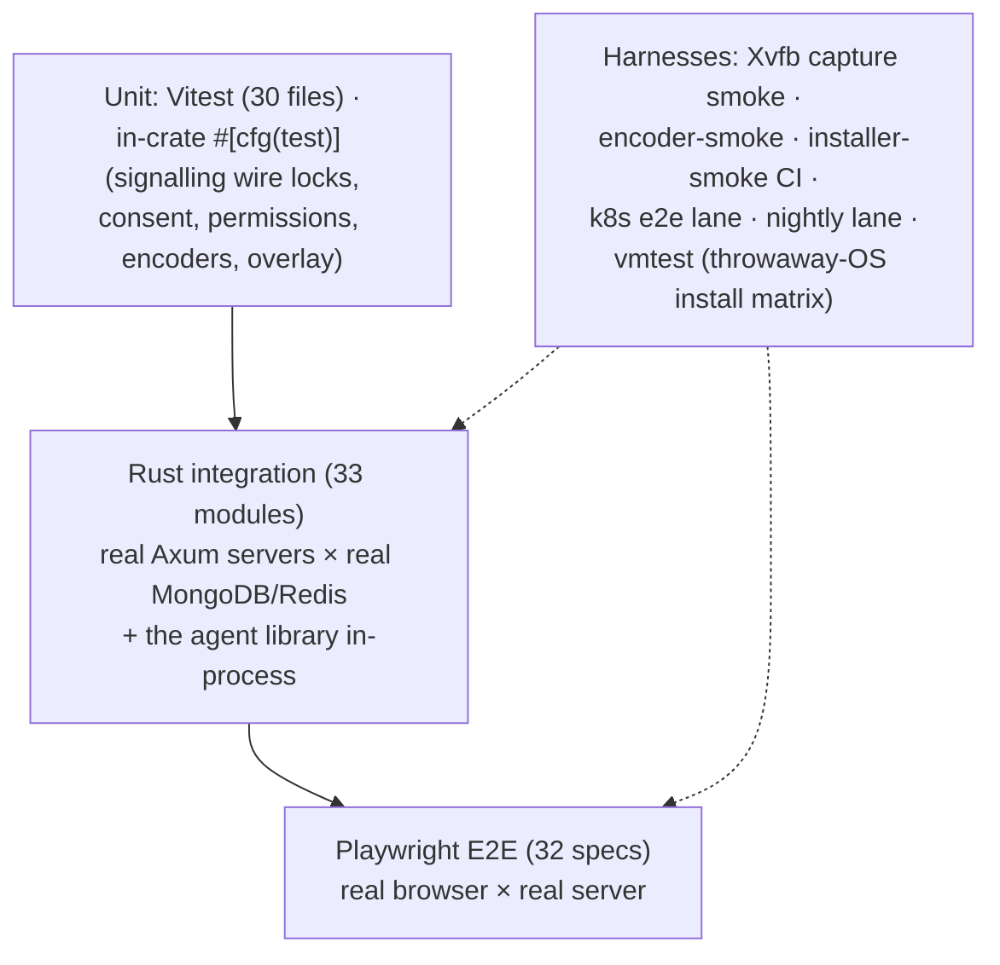
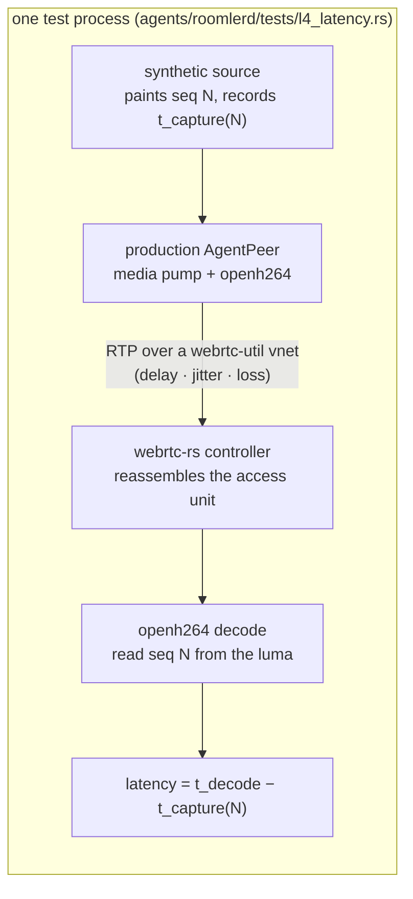
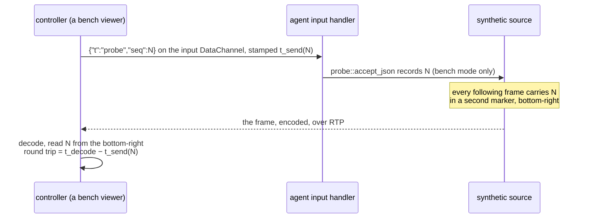
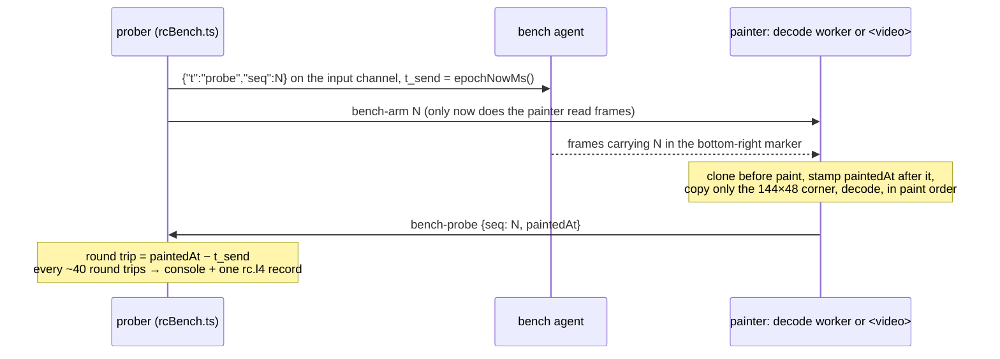
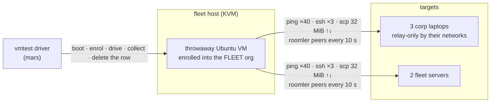

# Testing

Four layers, plus purpose-built harnesses for the parts a normal test runner can't
reach (screen capture, hardware encoders, installers, the k8s topology).
*As of 0.3.0-rc.381: 33 integration modules · 30 Vitest spec files · 32 Playwright
specs — the totals drift, the commands don't.*



## Commands (most specific first)

| Layer | Command | Needs |
|---|---|---|
| Backend integration | `cargo test -p roomler-ai-tests` | MongoDB `localhost:27019`, Redis `6379` |
| Remote-control crate | `cargo test -p roomler-ai-remote-control --lib` | nothing (wire-format locks, Hub, consent) |
| Agent library | `cargo test -p roomlerd --lib` | nothing (default features) |
| Agent w/ media+input | `cargo test -p roomlerd --lib --features full` | libxcb*-dev on Linux |
| Agent overlay tests | add `--features overlay-l3` | ⚠️ feature-gated — the default `--lib` run silently skips them |
| Frontend types+build | `cd ui && bun run build` | includes `vue-tsc --noEmit` |
| Frontend unit | `cd ui && bun run test:unit` (`:coverage`) | jsdom |
| E2E | `cd ui && bun run e2e` | dev stack on :5000/:5001 (`E2E_BASE_URL`, `E2E_API_URL`, `E2E_MAILPIT_URL` to point elsewhere) |
| Capture smoke | `./scripts/dev-xvfb.sh` | Xvfb — paints an xterm, runs the scrap-capture path headless |
| Encoder smoke | `roomlerd encoder-smoke --encoder hardware [--codec hevc]` | the host's GPU — 10 synthetic frames, prints the cascade's decisions |

## Rust integration tests (`crates/tests/`)

Each test spawns a **real Axum server** on a random port against a **unique
UUID-named database** (dropped on teardown). The agent-facing modules drive the
actual `roomlerd` library in-process for full `rc:*` round-trips against a
TestApp — enrollment, sessions, tunnels, overlay joins, exec.

Coverage areas: auth · tenant (+archive) · member · role · room/channel · message ·
reaction · recording · file · invite · notification · oauth · billing ·
multi-tenancy · pagination · rate-limit · CORS · export (xlsx/pdf) · conference
(+messages) · cluster · stats · relay-region · remote-control · agent
(+e2e, +crash, +exec, +presence) · overlay · tunnel · hive.

> [!NOTE]
> **`tests/hive_canary.rs` is a second test binary, on purpose.** FR-90's
> canary test (AC2) drives a real in-process device with the Hive supervisor
> on, and that supervisor is process-global. In the lib's binary every other
> in-process agent would re-point it at its own socket. `cargo test -p
> roomler-ai-tests` runs both binaries, and the lane's count sums them. The
> test is Linux-only and turns on `roomlerd`'s `hive-test-launcher` feature
> through a Linux-only dev-dependency. That feature launches sessions as the
> test's own account and refuses to run as root. Its log checks run under a
> thread-default subscriber around a current-thread runtime, so they see
> every task of the server and the device without `RUST_LOG`.
>
> **Since P2d-6 it starts a second device, a member, as a child process: the
> same binary**, running its `member_device_process` test with
> `HIVE_CANARY_MEMBER` set, a no-op in an ordinary run (so it counts one
> passed test). A `[[bin]]` could not do it: binaries get no
> dev-dependencies, and the test launcher is one on purpose. Under that
> feature a device takes its checkpoints in process, because the binary is a
> test's and knows no `hive-checkpoint`.
>
> **`tests/hive_drivers.rs` is a third, for the same reason** (FR-90 P1c-2b,
> AC6): a reader's message in the session's room and a prompt over their own
> viewer peer must reach no harness, while the owner's and a named driver's
> do, each labelled `[Name] …`. Its harness writes every line it reads on
> stdin to a file — what a model would be sent — and the test reads that
> file. The scaffolding both binaries share (the server, the in-process
> device, a browser's socket and viewer peer, the harness's side of a
> toolbelt) is `tests/hive_support/mod.rs`, a module each includes, not a
> test target of its own.
>
> **`tests/hive_memory.rs` and `tests/hive_memory_off.rs` are a fourth and a
> fifth** (FR-90 P1e-4, AC8): the same device, with its owner's
> `hive_core_memory` on and then off. The gate is read once, when the
> supervisor starts, and a process has one supervisor. The harness
> (`MEMORY_HARNESS`) copies out what it finds where Claude Code reads core
> memory — `$CLAUDE_CONFIG_DIR/CLAUDE.md` and the auto-memory `MEMORY.md` —
> when it starts and at every turn.
>
> | gate | what the test asserts |
> |---|---|
> | on | An org fact kept before a session starts is in its `CLAUDE.md`, and a device fact is in its `MEMORY.md`. A fact kept while it runs is not, even at its next turn. The next session has both, at a later revision. A write past the org's budget is `409 over_budget` with the numbers, and nothing is evicted |
> | off | The transcript shows the frame arrived (its revision, and that the gate is off). Nothing reached the session's config directory, nor even the daemon's own disk |

## Frontend tests

- **Vitest** (`ui/src/__tests__/`): stores (auth, messages, rooms, ws — including
  the `rc:*` channel — notifications, conference, tenants, files, agents…),
  composables (`useRemoteControl` HID + button-mapping locks, validation,
  markdown, snackbar), API client, plugins.
- **Playwright** (`ui/e2e/`): auth, chat (multi-client, pagination, reactions,
  threads, mentions), rooms + files panel, conference (list/chat/multi),
  websocket + connection status, billing, invite, oauth, email flows,
  notifications, observability, profile, responsive, 404 — plus the
  remote-control lane: `remote-session-smoke`, `remote-file-upload-smoke`,
  `rc-vp9-444` (needs an agent built with the feature),
  `remote-recording-refused` and `remote-recording-smoke` (FR-85; the second
  needs an agent that advertises `record`), and a field-host upload spec. Chromium runs with fake media devices for WebRTC.

## In-crate Rust unit tests

The load-bearing ones: `remote_control` locks the **wire format** (every `rc:*`
tag pinned, ObjectId-as-hex, pipe-separated `Permissions`) so a rename is a
deliberate break; agent-side crates cover encoder cascades, config migration,
ACLs, and overlay internals under their feature flags. `roomlerd`'s Hive
supervisor tests (`--features hive -- hive::`) run twice: on Linux in the agent job, and on macOS
in the macOS job (FR-90 P1h-1), which before it never compiled the supervisor for a Mac.

## CI & special lanes

| Lane | What it does |
|---|---|
| `ci.yml` | fmt + clippy (`--workspace --all-targets --all-features -D warnings`) + tests + frontend build on every push |
| `installer-smoke.yml` | Installs and uninstalls the freshly-built per-user MSI on a Windows runner |
| k8s e2e (`scripts/e2e-k8s.sh`, `Dockerfile.agent-e2e`) | The suite against a standing cluster namespace — validates the real multi-pod topology |
| Nightly (`scripts/e2e-nightly.sh`) | Full E2E against the current prod tag, diffed against an expected-failures list; regressions file an issue |
| vmtest (`roomler-ai-deploy/vmtest/vmtest.sh`, on demand) | Installs the product the way users do on throwaway Win11 / Ubuntu-Wayland / ARM / macOS VMs, enrols against prod, proves remote desktop + overlay + `roomler-desktop`, destroys the VM; one issue per failing condition, closed on green — [vmtest.md](vmtest.md) |
| **Overlay stress lane** (FR-81, `vmtest.sh run --lane stress`) | A throwaway VM enrolled into the **fleet** org measures latency distributions, SSH success, bulk transfer and carrier stability against the real fleet, on a direct and a forced-relay arm — [below](#the-overlay-stress-lane-fr-81) |
| **L0 latency harness** (FR-16, `ci.yml` recorder job) | A real remote-desktop session in one process measures capture → decode latency, and the bench probe's input → decoded-frame round trip (L4 in process), on one clock, over a simulated link, and proves it can fail — [below](#the-l0-latency-harness-fr-16) |

Known environmental failures (conference specs without forwarded RTC ports,
mailpit-dependent flows, the containerized-Chromium Google-OAuth redirect test)
are tracked in `scripts/e2e-expected-failures.txt` rather than papered over.

## The L0 latency harness (FR-16)

Remote-desktop latency had no measurement that a change could be held to: the viewer's paint
age starts at capture, and every field read went through a person moving a window. L0 is the
first layer of [FR-16](fr/FR-16-rc-quality-benchmark.md)'s benchmark. It is a real session
in one test process, measured on one clock, so a regression in the pipeline fails CI.



- **The agent side is production code:** `AgentPeer`, its media pump and the openh264 encoder,
  on the synthetic source. The test's only seam is `peer::l0::set_setting_engine_hook`, which
  puts the session on a vnet. It is compiled only into the test-only `synthetic-frame-source`
  build.
- **The marker** (`capture/synthetic_backend.rs`, `marker`) is the frame's 12-bit sequence
  number and a CRC-4, painted as a 2×8 grid of 16×16 luma blocks. It survives 4:2:0, a high
  QP and a 4× downscale, and a misread is a miss, never a wrong number. The browser half of
  FR-16 (L4) reads the same layout.
- **The controller reassembles access units itself.** webrtc-rs' `SampleBuilder` holds a
  frame until the next one's first packet arrives, which would add a whole frame interval to
  every reading.

| Cell | Link | Must show |
|---|---|---|
| `clean` | no delay | ≥ 0.75× the source's 30 fps decoded; no freeze |
| `delay100` | +100 ms one way | p50 up by ≥ 80 ms: the metric sees the network |
| `gate50` | a planted 50 ms hold in the capture stage | p50 up by ≥ 20 ms: the metric sees the pipeline. **The negative control** |
| `lossy` | +20 ms, 5 ms jitter, 3 % of media packets dropped | the session survives and keeps decoding; its numbers are printed |
| `gate_lgcy` / `gate_slot` | no delay; the source emulates an event-driven backend (a 25 fps "compositor", frames landing ¾ of a period ahead of the legacy gate's cadence) behind each capture gate | the slot-first gate's p50 is lower by ≥ a quarter period ([FR-98](fr/FR-98-input-to-photon-budget.md) C1, AC3). The clock starts when a frame lands in the slot, so a frame the gate holds counts its wait |
| `playout0` | no delay; the agent's `playout-delay` 0/0 switch on ([FR-98](fr/FR-98-input-to-photon-budget.md) C6) | the extension is negotiated and on every video packet at 0/0, without costing frames. Every other cell runs with the switch off, and its answer must not negotiate the extension at all, though the controller offers it the way Chrome does |

Run it locally (it prints one `L0 …` line per cell):

```bash
cargo test -p roomlerd --features openh264-encoder,synthetic-frame-source --test l4_latency -- --nocapture
```

Reference run (2026-10-13, unoptimised, Windows dev box):

| Cell | fps | p50 | p95 | freezes | IDRs |
|---|---|---|---|---|---|
| `clean` | 30.2 | 10.2 ms | 14.8 ms | 0 | 4 |
| `delay100` | 30.2 | 122.3 ms | 124.9 ms | 0 | 4 |
| `gate50` | 15.1 | 63.3 ms | 77.9 ms | 0 | 3 |
| `lossy` | 25.2 | 46.6 ms | 62.1 ms | 3 | 7 |

With `gate50`'s hold set to zero the test fails on `gate50: p50 rose by 0.4 ms, want ≥ 20`. That
run is the proof that the gate can fail. The CI runner (Linux) on the merged head read `clean`
p50 12.7 ms, `delay100` +101 ms, `gate50` +52 ms, and `lossy` 1 freeze and 7 IDRs.

⚠️ The numbers come from an **unoptimised** build on whatever machine runs it, so the bounds are
deltas and generous ceilings, not targets. Field numbers come from L4 in the real viewer.
⚠️ CI has no FFmpeg, so the session uses the RTP track. A data-channel cell needs a decoder
binding the test does not have yet.
⚠️ On Windows a delayed vnet link costs about 10 ms more per direction than it is set to:
`delay100` reads +112 ms on the dev box and +101 ms on the Linux runner. The likely cause is the
router's sleep until each packet is due, which overshoots on Windows timers. The bounds leave
room for it.

### L4 in process: the bench probe

L0 starts the clock at capture, but input to photon starts at the viewer's input. So L4 adds a
**probe** that travels the input path, and the same test file runs it in process, in two more
cells. The browser half of L4 reads the same probe out of real decoded frames
([FR-16](fr/FR-16-rc-quality-benchmark.md#l4--input-to-photon-in-the-real-viewer)).



| Cell | Link | Must show |
|---|---|---|
| `probe` | no delay, probes on | ≥ 20 probe round trips measured: a probe reaches the source and comes back in the picture |
| `probe50` | +50 ms one way, probes on | the round trip up by ≥ 80 ms. Either half alone would add 50, so only a probe that crosses the link **both** ways passes |

- **Gated at every entry point on the agent.** The probe path exists only in the test-only
  `synthetic-frame-source` build; no release profile has it. The input handler
  ([`peer.rs`](../agents/roomlerd/src/peer.rs), `attach_input_handler`) hands a probe to
  `synthetic_backend::probe` before it parses input, so a probe never reaches an injector. It
  is recorded only with `ROOMLERD_BENCH=1`. The hello advertises `bench` in `AgentCaps.video`
  only when the synthetic source is selected **and** bench mode is on. Only a session holding
  INPUT gets the input handler at all.
- **The two markers never overlap.** The frame's own number stays bottom-left. The probe's
  grid goes bottom-right only in a frame at least 288 px wide, and is refused, never squeezed,
  in a narrower one.
- ⚠️ **Probes go out at a jittered interval.** A 100 ms period is exactly three 30 fps frames.
  Every probe then lands on the same phase of the capture clock, and a cell reports one
  arbitrary point of the 0–33 ms wait for the next capture instead of its distribution. The
  viewer half must jitter too: 250 ms is exactly 15 frames at 60 fps.

Reference run of the probe cells (2026-10-13, unoptimised, Windows dev box):

| Cell | round trips | p50 | p95 |
|---|---|---|---|
| `probe` | 43 | 45.6 ms | 65.9 ms |
| `probe50` | 45 | 169.4 ms (+124) | 223.9 ms |

With the probe dropped in the input handler before it reaches the source, the test fails on
`probe: 0 round trips measured, want ≥ 20`.

### L4 in the real viewer

The same probe, timed by the browser that a person would actually use, on whatever paints the
frames. That is one of the three decode workers, or the plain `<video>` element on the RTP
track.



**Run it.** Start an agent built with `synthetic-frame-source` with `ROOMLERD_SYNTHETIC_FRAMES=1`
and `ROOMLERD_BENCH=1`; its hello then advertises `bench` in `AgentCaps.video`. In the viewer's
browser, set `localStorage['roomler-rc-bench'] = '1'`, reload, and connect with input. About
every ten seconds the console prints `[rc] bench L4 n=… lost=… p50=… p95=… max=… path=…`, and
the same batch is posted as one `rc.l4` line to `agent_logs`.

| Piece | File | What it does |
|---|---|---|
| Marker decoder | `ui/src/workers/rc-bench-marker.ts` | The Rust `marker` module ported bit for bit. Both test suites pin the same CRC words, so a drift on either side fails one of them |
| Worker sampler | `ui/src/workers/rc-bench-sampler.ts` | Armed per probe. Clones the frame before paint and reads only the corner region after. Reads one frame at a time in paint order; an unanswered probe expires after 2 s |
| Prober, `<video>` sampler, upload | `ui/src/composables/rcBench.ts` | Sends probes 250 ms apart plus up to 34 ms of jitter. Reads the `<video>` through `requestVideoFrameCallback`, stamped with its `presentationTime`. Posts `rc.l4` through FR-22's route, capped at 6 records a minute |

- **Gated at every entry point in the viewer.** The knob is honoured only when the hello
  advertises `bench`. Each worker samples only when its `init-canvas` says `bench: true`.
  Probes ride the input channel's own gates, so a view-only session sends none.
- ⚠️ **The paint stamp is not the photon.** A worker stamps right after `drawImage`, and
  `<video>` uses the moment the frame was submitted for composition. The display's own latency
  (a vsync or two, and the panel) comes after both. That gap is what the FR-16 AC compares
  against a 240 fps camera.
- ⚠️ **Readbacks are paid only while a probe is out.** A GPU-backed frame reads back whole
  however small the rect, so sampling every frame would tax the path being measured.

**Mining it** (the same place and the same 7-day TTL as `rc.connect`, above in
[remote-control.md](remote-control.md)):

```js
// Every L4 round trip per device and paint path: the distribution, not batch medians.
db.agent_logs.aggregate([
  { $match: { source: 'browser', 'lines.target': 'rc.l4' } },
  { $unwind: '$lines' },
  { $unwind: '$lines.fields.rtt_ms' },
  { $group: { _id: { agent: '$lines.fields.agent_id', paths: '$lines.fields.paths' },
              n: { $sum: 1 },
              p: { $percentile: { input: '$lines.fields.rtt_ms', p: [0.5, 0.95], method: 'approximate' } } } } ])

// Probes that never came back, per device: one count per record, so before any $unwind of rtt_ms.
db.agent_logs.aggregate([
  { $match: { source: 'browser', 'lines.target': 'rc.l4' } },
  { $unwind: '$lines' },
  { $group: { _id: '$lines.fields.agent_id', answered: { $sum: '$lines.fields.n' },
              lost: { $sum: '$lines.fields.lost' } } } ])
```

## The overlay stress lane (FR-81)

Everything the mesh promises is a **latency and stability** claim, and before this lane nothing
measured either: the install matrix proves a device installs and pings once, the profile matrix
(FR-75) that a build carries traffic once. This lane asks the mesh to keep working for over an
hour under real traffic, against the machines people actually use — corporate laptops behind
middleboxes and the fleet servers — and records **distributions**, not a single ping.



### The two arms

| arm | how the VM gets its carrier | why it exists |
|---|---|---|
| `direct` | the overlay's defaults — the carrier ladder picks the best path that works | the real-world numbers |
| `relay` | `overlay_direct = false` on the VM only ([`config.rs:324`](../crates/agent-core/src/config.rs#L324)), which leaves only relayed carriers | the relayed baseline for every target, including the servers that the direct arm reaches directly |

The direct arm's corp-laptop rows are the **control** for the relay arm: those laptops have no
direct path at all, so where both arms relay, matching numbers show the forcing knob is not what
the relay arm measures.

### What each measurement means — and why none asserts which carrier won

| column | what it measures | how |
|---|---|---|
| `carrier` | the carrier in use, with its `why` evidence | `roomler peers` / `roomler why` |
| latency | p50 / p95 / max / loss over 40 samples | `roomler ping` |
| SSH | grant-issued session success, 3 per target | `roomler ssh <t> -- <trivial>` |
| throughput | 32 MiB up and down, sha256-verified, per-direction ms timing | `scp` over `roomler proxy` with a client key in the target's `ssh_authorized_keys` |
| stability | carrier **transitions** over the arm | `roomler peers` sampled every 10 s from the VM |

⚠️ **The carrier is reported, never asserted.** The recon behind FR-81 found two of the corp
laptops with no UDP egress at all and the third behind a symmetric NAT with the relay band
blocked, so `direct` is structurally unreachable for them. A matrix demanding `direct` would report
three permanent reds for a mesh behaving correctly. The lane asserts only what must hold on every
carrier: the target is reachable, the bytes arrive intact, and the carrier stays put.

⚠️ **Stability counts transitions from an allow-list of carrier shapes** (`direct`, `lan`,
`relay:*`). The `CONN` column of `roomler peers` also carries *states* — `upgrading` (a
make-before-break probe on a relayed peer, [`localclient.rs:1259`](../agents/roomler-cli/src/localclient.rs#L1259)),
`stalled`, `offline` — and counting those as carriers once reported a healthy peer as flapping.
They are tallied separately, and any value outside both lists is **reported, never counted**.
A result reads `transitions=<n>/<k>samples`: for three runs the lane printed
`carrier_transitions=0` over **zero** samples (the sampler's output was never collected), so a
zero is only a measurement next to its sample count.

⚠️ **Throughput is VM-sender-limited**, about 1 MiB/s on any carrier, while bare-metal
server-to-server over the same mesh does ~56–66 MiB/s. The column proves integrity and
both-direction completion; it is not a capacity figure, and the lane says so in-line
(`throughput_is=vm-sender-limited`).

### What it found

The lane has paid for itself in product bugs — each invisible to CI, because each needs a real
corporate laptop, a real relay path, or both:

| found | defect | fix |
|---|---|---|
| round 2 | `scp` exited 1 after every *successful* transfer: the sftp subsystem never sent an exit status | #1559 — the pump waits for the child and reports it ([`ssh.rs:1065`](../agents/roomlerd/src/ssh.rs#L1065)) |
| round 2 | a device whose stored SSH host key was unreadable published **no** key, permanently, so no caller could verify it | #1565 — an unreadable key counts as no key and is replaced ([`ssh.rs:404`](../agents/roomlerd/src/ssh.rs#L404)) |
| round 3 | a caller with a faster control path than the target dialled before the target had its grant: `Permission denied (publickey)`, 0/3 on one laptop | FR-83 (#1597) — the server answers only after the device confirms the grant ([`agent_ssh.rs:435`](../crates/modules/network/src/routes/agent_ssh.rs#L435)) |
| round 3 | `roomler proxy`'s own `--help` recipe could not work (`%h` arrives as `<name>.roomler`) | #1573 — the suffix and the MagicDNS domain are stripped ([`localclient.rs:598`](../agents/roomler-cli/src/localclient.rs#L598)) |

### Reference run — `20260924-155559`, every target on agent 0.4.101

| target | carrier (direct · relay) | loss | p50 / p95 ms (direct) | SSH (both arms) | scp 32 MiB | transitions (per arm) |
|---|---|---|---|---|---|---|
| CORPLAP-1 | relay · relay | 0 % | 43 / 70 | 6/6 | ✅ sha256 | 0 / 189 samples |
| CORPLAP-2 | relay · relay | 0 % | 56 / 79 | 6/6 | ✅ sha256 | 0 / 189 |
| CORPLAP-3 | relay · relay | 0 % | 47 / 90 | 6/6 | ⛔ the target has no `sftp-server` | 0 / 189 |
| fleet server A | relay · relay | 0 % | 2 / 3 | 6/6 | ✅ sha256 | 0 / 189 |
| fleet server B | **direct** · relay | 0 % | 0 / 0 | 6/6 | ✅ sha256 | 0 / 189 |

### The rails

- **It enrols into the fleet org** — the one lane that does, because the mesh is tenant-scoped and a
  test-org VM cannot see a fleet-org laptop at all. The org does not allow ephemeral keys, so the
  VM joins with a standard single-use token and there is **no self-cleaning net**: the cell deletes
  its own device row from an `EXIT` trap and the run asserts the device count is back at baseline.
- **Nothing on a corp laptop is configured, restarted or left behind.** Carrier pinning happens
  only on the VM; the transfer payload is deleted and the deletion verified as the identity that
  wrote it.
- ⚠️ `PUT …/agent/{id}/ssh-policy` is a **full replace**. The lane grants the VM `can_originate`
  through that object, so any probe that writes a partial policy onto a live lane VM revokes it —
  measured: a whole arm's SSH column read 0/15 *"not permitted to originate"* while the verdict
  stayed green. Read the stored policy, change one field, restore the original.
- It is **opt-in** (`--lane stress`) and takes about 2 h 50 min for both arms. The target list,
  credentials and the client key live in a private env file on the driver host, never in git — they
  name real machines.
