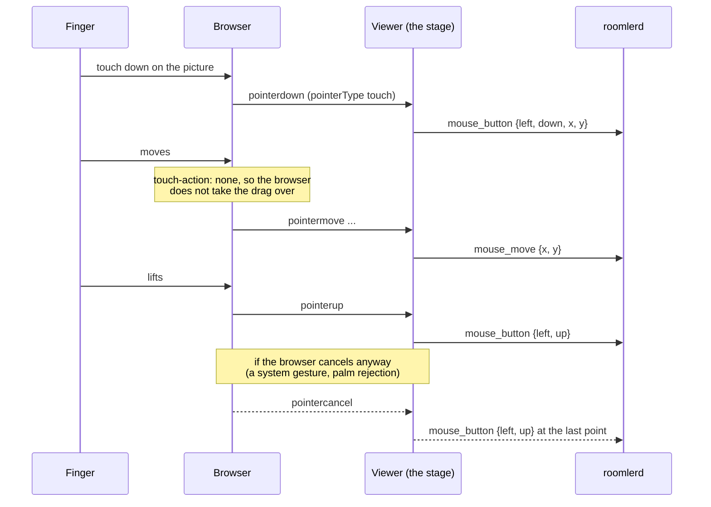

# Touch controls — a phone or tablet as a real controller

> **Status** (FR-111, [#2359](https://github.com/gjovanov/roomler-ai/issues/2359); spec:
> [`docs/fr/FR-111-touch-controls.md`](fr/FR-111-touch-controls.md))
>
> | Phase | What | State |
> |---|---|---|
> | P1a | the stage keeps every touch: `touch-action: none`, and a cancelled pointer still lets go of its press | built (viewer only) |
> | P1 | gestures in direct mode: the right button, two-finger scroll, pinch zooming only the viewer | not built |
> | P2 | a trackpad mode | not built |
> | P3 | on-screen keys, a d-pad, a stick, built-in presets | not built |
> | P4 | an editor, macros, tenant presets | not built |

## Why it exists

The controller is the browser, so a phone or a tablet is a controller with nothing to install. Until FR-111,
the viewer treated a finger as a mouse: a touch moved the host's pointer to that point and pressed the left
button there. That still holds in direct mode. What it lacked was everything else a touch screen needs, and
one thing it got wrong:

**A drag the browser took over left the host's button down.** A touch browser decides for itself whether a
moving finger is a pan or a zoom. When it decides so, it ends the pointer with `pointercancel` and never
sends `pointerup`. The viewer had already forwarded the press, had no `pointercancel` handler, and so never
sent the release. On a vmtest Win11 host the left button stayed down until a later tap let go, and in the
meantime every touch moved into a drag. FR-111's P0 measured it: the browser cancelled 69 ms into the drag,
and the host's raw input read the press and then no release (the spec's §8 row 1).

## How a touch reaches the host

- **The stage keeps every touch.** It sets `touch-action: none`
  ([`RemoteControl.vue:994`](../ui/src/views/remote/RemoteControl.vue#L994), decided by
  [`touchInput.ts:17`](../ui/src/composables/touchInput.ts#L17) `stageTouchAction`). The browser no longer
  pans or zooms the page under a finger on the picture. The page around the stage still scrolls as usual.
- **A cancelled pointer still lets go.** The viewer remembers which button each pointer pressed
  ([`touchInput.ts:36`](../ui/src/composables/touchInput.ts#L36) `createPointerPressTracker`). A
  `pointercancel` releases exactly that button
  ([`useRemoteControl.ts:10152`](../ui/src/composables/useRemoteControl.ts#L10152) `onPointerCancel`). A
  pointer that pressed nothing releases nothing. A cancel's position is not worth trusting, so the release
  goes at the last point the pointer reached. In relative mode (FR-109) it is `mouse_release`, which lets go
  wherever the host's pointer is
  ([`touchInput.ts:57`](../ui/src/composables/touchInput.ts#L57) `releaseForCancelledPointer`).
- Both work with every deployed agent: the frames are the ones a mouse sends.

## Switching it off

| Where | How |
|---|---|
| One browser | `localStorage['roomler-rc-touch'] = 'legacy'` gives the stage back to the browser's own pan and zoom ([`touchInput.ts:10`](../ui/src/composables/touchInput.ts#L10)). A cancelled pointer is released either way: that is a fix, not a mode |

## What it does not do yet

- No right button, scroll or pinch gesture in direct mode (P1).
- No trackpad mode (P2) and no on-screen keys or presets (P3, P4).
- No native touch on the host: `InputMsg::Touch` is still dropped by every injector (P5, optional).

## Related

- [FR-111](fr/FR-111-touch-controls.md): the spec, the phases, the field log.
- [`relative-mouse.md`](relative-mouse.md): `mouse_rel`, which the trackpad mode will use.
- [`remote-control.md` §6](remote-control.md): the input plane this rides on.
