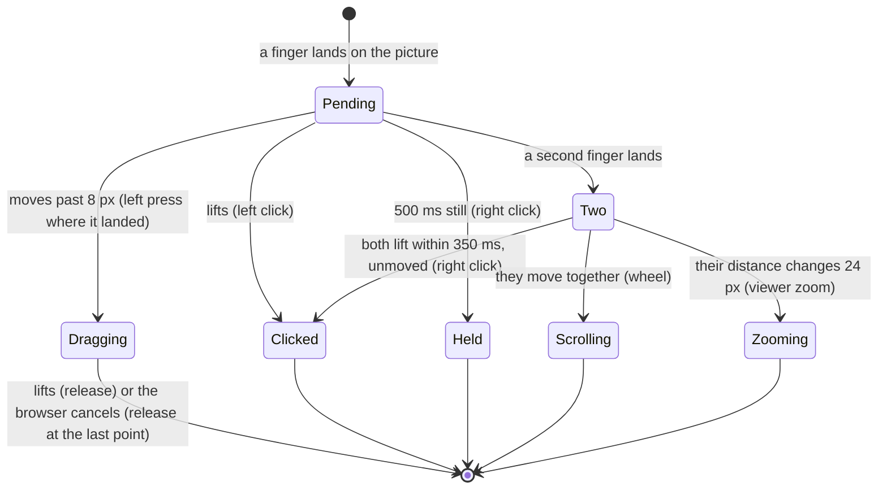
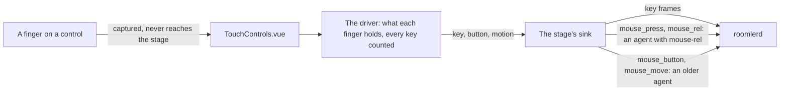
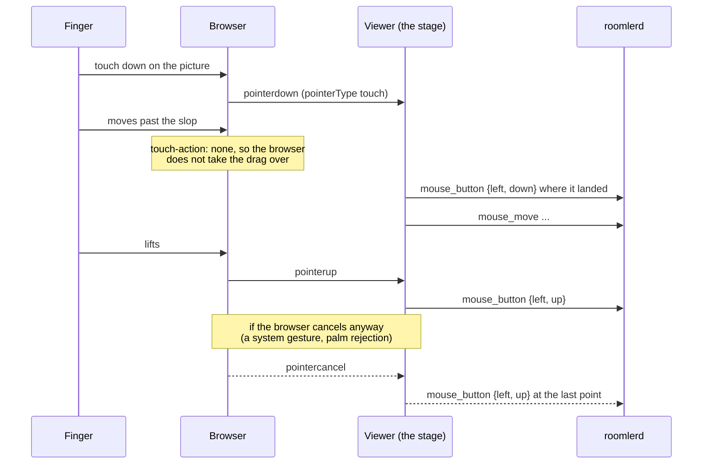

# Touch controls — a phone or tablet as a real controller

> **Status** (FR-111, [#2359](https://github.com/gjovanov/roomler-ai/issues/2359); spec:
> [`docs/fr/FR-111-touch-controls.md`](fr/FR-111-touch-controls.md))
>
> | Phase | What | State |
> |---|---|---|
> | P1 | touch on the stage: it keeps every touch (`touch-action: none`), a cancelled pointer still lets go, and the gestures of direct mode (the right button, two-finger scroll, pinch zooming only the viewer) | built (viewer only) |
> | P2 | a trackpad mode: the finger moves the host's pointer, a tap clicks where it is | built (viewer only); the default stays direct until the operator decides |
> | P3 | on-screen controls: rows of keys, a d-pad, a mouse stick, in three built-in presets remembered per device | built (viewer only); the presets follow the recommendation until the operator decides |
> | P4 | an editor, macros, tenant presets | not built |

## Why it exists

The controller is the browser, so a phone or a tablet is a controller with nothing to install. Until FR-111,
the viewer treated a finger as a mouse: a touch moved the host's pointer to that point and pressed the left
button there. It offered nothing else a touch screen needs, and it got one thing wrong:

**A drag the browser took over left the host's button down.** A touch browser decides for itself whether a
moving finger is a pan or a zoom. When it decides so, it ends the pointer with `pointercancel` and never
sends `pointerup`. The viewer had already forwarded the press, had no `pointercancel` handler, and so never
sent the release. On a vmtest Win11 host the left button stayed down until a later tap let go, and in the
meantime every touch moved into a drag. FR-111's P0 measured it: the browser cancelled 69 ms into the drag,
and the host's raw input read the press and then no release (the spec's §8 row 1).

## The gestures (direct mode)

The finger is still the mouse: a tap clicks where it lands, and a drag drags from where it landed. What is new
is that the viewer **waits for the finger to say what it is** before it presses anything. So a long press
never starts as a left press, and a second finger never drags along with the first
([`touchGestures.ts:168`](../ui/src/composables/touchGestures.ts#L168) `createDirectGestures`, a pure state
machine with its own tests).

| Gesture | Reaches the host as |
|---|---|
| a tap | a left click where the finger landed (a lifting finger jitters, so not where it lifted) |
| a finger that moves more than 8 px | a left press where it landed, the moves, a release where it lifted ([`touchGestures.ts:37`](../ui/src/composables/touchGestures.ts#L37) `SLOP_PX`) |
| a finger held still for 500 ms | a right click where it is ([`touchGestures.ts:39`](../ui/src/composables/touchGestures.ts#L39) `LONG_PRESS_MS`) |
| two fingers lifted within 350 ms, unmoved | a right click between them ([`touchGestures.ts:42`](../ui/src/composables/touchGestures.ts#L42)) |
| two fingers moving together | the wheel, one notch per 100 px the fingers travel. The picture follows the fingers, so fingers moving up scroll down |
| two fingers spreading or pinching | **nothing**: the viewer zooms its own picture around the point between the fingers |

- **The zoom** switches the viewer to Custom zoom, starting from the size the picture is shown at, and scrolls
  the stage so the point between the fingers stays under them
  ([`RemoteControl.vue:3178`](../ui/src/views/remote/RemoteControl.vue#L3178) `onPinchZoom`). Zooming
  out and back in somewhere else is how a phone moves around a zoomed picture today (open decision 4 in the
  spec).
- ⚠️ **The scroll goes out in whole steps.** The agent turns a `mouse_wheel` in pixels into wheel steps at
  100 px a step and rounds every frame on its own (`enigo_backend.rs` `wheel_to_steps`), so a frame under
  50 px scrolls nothing, and a finger's scroll arrives a few pixels at a time. The viewer gathers the
  gesture's pixels and sends only whole steps, carrying the rest
  ([`touchGestures.ts:147`](../ui/src/composables/touchGestures.ts#L147) `createWheelSteps`). On the
  field run that turned 21 frames of about 6 px, which the host never saw, into one step it did.
- A mouse and a pen keep their own paths. Only a pointer whose `pointerType` is `touch` goes through the
  gestures ([`useRemoteControl.ts:10357`](../ui/src/composables/useRemoteControl.ts#L10357)).
- Every gesture is made of frames a mouse already sends (`mouse_button`, `mouse_move`, `mouse_wheel`), so
  it works with every deployed agent.

## Trackpad mode

On a phone the finger covers what it points at. In trackpad mode the screen is a laptop's trackpad instead.
The finger **moves** the host's pointer, which stays where it is between touches, and a tap clicks where the
pointer is, not under the finger. A toolbar control switches between direct and trackpad, shown only on a
device with touch and remembered per browser (`localStorage['roomler-rc-touch-mode']`,
[`touchInput.ts:78`](../ui/src/composables/touchInput.ts#L78) `readTouchMode`). **Direct is the default**
until the operator settles the spec's open decision 1.

| Gesture (trackpad) | Reaches the host as |
|---|---|
| a finger that moves | the pointer moves by the same share of the screen as the finger moved across the picture |
| a tap | a left click where the pointer is |
| a finger held 500 ms, then moved | a left drag, let go when the finger lifts |
| two fingers | as in direct mode: a quick tap is the right button, moving together is the wheel, a pinch zooms the viewer |

([`touchGestures.ts:333`](../ui/src/composables/touchGestures.ts#L333) `createTrackpadGestures`, the same
two-finger handling as direct mode.)

- **Two ways to move the pointer**, picked by what the agent advertises
  ([`useRemoteControl.ts:10440`](../ui/src/composables/useRemoteControl.ts#L10440) `runTrackpad`):
  - **An agent that advertises `mouse-rel`** gets the travel as FR-109's `mouse_rel` and presses with
    `mouse_press` / `mouse_release`, which act where its pointer is.
  - **An older agent** gets absolute moves. The viewer starts from where the host's pointer is (its last
    `cursor:pos`, divided by the picture's size), adds the finger's travel, and presses at that point
    ([`useRemoteControl.ts:10424`](../ui/src/composables/useRemoteControl.ts#L10424) `hostPointerNorm`).
    It re-reads `cursor:pos` at the start of each gesture, so it follows a pointer that someone else moved.
- **The travel** is measured in the picture's own normalised space, the same mapping the stage's clicks use,
  so letterbox and zoom are already accounted for
  ([`useRemoteControl.ts:10432`](../ui/src/composables/useRemoteControl.ts#L10432) `padTravel`).
- The whole stage is the pad: in trackpad mode a finger may land on the letterbox too.

## On-screen controls

A phone has no keys for Esc, Tab, the arrows or a chord, and a game wants WASD under one thumb and the
mouse under the other. The **On-screen controls** menu in the toolbar, shown on a device with touch, lays
a preset over the stage: rows of keys, a d-pad, a mouse stick
([`TouchControls.vue`](../ui/src/components/remote/TouchControls.vue)). Every control sends frames every
deployed agent already takes: `key` for a key, and the mouse frames for a mouse button and for the stick.

| Preset | Controls |
|---|---|
| **Office keys** | one row along the bottom: Esc, Tab, Alt+Tab, Ctrl+C, Ctrl+V, Ctrl+Z |
| **Arrows** | an arrow d-pad bottom left; PgUp, PgDn, Space, Enter and Esc bottom right |
| **WASD + mouse look** | a W/A/S/D d-pad bottom left; a mouse stick bottom right, with Fire (the left button), Aim (the right button) and Jump (Space) above it; Esc, E, R, Shift and Ctrl along the top |

([`touchControls.ts:116`](../ui/src/composables/touchControls.ts#L116) `BUILTIN_PRESETS`. They follow the
spec's recommendation for open decision 2 until the operator settles it.)

- **A touch on a control stays with it.** The control captures its pointer and stops its events, so the
  stage's gestures never see it. A touch anywhere else reaches the stage as before
  ([`TouchControls.vue:32`](../ui/src/components/remote/TouchControls.vue#L32)).
- **A button holds its keys** while the finger is down: a chord presses in order and lets go in reverse.
  **Every key and button is counted**, so two fingers holding one key send one press and one release
  ([`touchControls.ts:362`](../ui/src/composables/touchControls.ts#L362) `createControlsDriver`).
- **The d-pad** has eight sectors. Each direction covers 135° around its axis, so a diagonal holds two keys,
  and a finger near the centre holds none
  ([`touchControls.ts:287`](../ui/src/composables/touchControls.ts#L287) `dpadKeys`). A finger sliding
  round it lets go of a key it left before it presses one it reached.
- **The stick** moves the pointer while it is pushed, at a share of the picture's width a second. The speed
  grows with the square of the push past a deadzone, so a small push is precise
  ([`touchControls.ts:305`](../ui/src/composables/touchControls.ts#L305) `stickVelocity`). An agent that
  advertises `mouse-rel` gets the motion as `mouse_rel`, so a game camera turns. An older agent gets
  absolute moves from where its pointer is, as in trackpad mode. Fire and Aim press the same two ways.
- **Nothing stays held.** The overlay lets go of everything when the preset changes, the window blurs, the
  tab is hidden or the overlay closes
  ([`TouchControls.vue:227`](../ui/src/components/remote/TouchControls.vue#L227) `releaseAll`). The stage's
  own release on a blur or a detach covers the controls' presses too, and a release for something already
  let go is dropped ([`useRemoteControl.ts:10513`](../ui/src/composables/useRemoteControl.ts#L10513)
  `stageControls`).
- **Ctrl on a Mac host** goes out as the keyboard's would (FR-13): with the viewer turning Ctrl into Cmd,
  Ctrl+C reaches the Mac as Cmd+C, and the button says ⌘C
  ([`touchControls.ts:274`](../ui/src/composables/touchControls.ts#L274) `controlLabel`).
- **Per device, in this browser.** The choice is kept under
  `localStorage['roomler-rc-touch-controls:<device id>']`, so a host that runs a game keeps its WASD and a
  work laptop its office row
  ([`touchControls.ts:227`](../ui/src/composables/touchControls.ts#L227) `readControlsPreset`). The
  default is off.
- **In fullscreen and in a zoomed picture.** The overlay lives inside the stage, which is the fullscreen
  element, and follows the stage's scroll, so it stays over the part of the picture on screen
  ([`RemoteControl.vue:3162`](../ui/src/views/remote/RemoteControl.vue#L3162) `onStageScroll`).
- ⚠️ **Alt+Tab is the host's own chord.** On a Windows host it opens the task switcher and moves the focus,
  as the physical keys do. On a Mac host it is Option+Tab, not the app switcher (Cmd+Tab). A preset cannot
  bind a chord per host OS until P4's editor.

## The stage keeps every touch

- The stage sets `touch-action: none`
  ([`RemoteControl.vue:1048`](../ui/src/views/remote/RemoteControl.vue#L1048), decided by
  [`touchInput.ts:17`](../ui/src/composables/touchInput.ts#L17) `stageTouchAction`). The browser no longer
  pans or zooms the page under a finger on the picture, and the page around the stage still scrolls as usual.
- **A cancelled pointer still lets go.** A cancelled drag is released at its last point; a press the gestures
  had not made yet is dropped. A mouse or pen pointer the browser cancels releases exactly the button it
  pressed ([`touchInput.ts:36`](../ui/src/composables/touchInput.ts#L36) `createPointerPressTracker`,
  [`useRemoteControl.ts:10232`](../ui/src/composables/useRemoteControl.ts#L10232) `onPointerCancel`). In
  relative mode (FR-109) the release is `mouse_release`, which lets go wherever the host's pointer is
  ([`touchInput.ts:57`](../ui/src/composables/touchInput.ts#L57) `releaseForCancelledPointer`).

## Switching it off

| Where | How |
|---|---|
| One browser | `localStorage['roomler-rc-touch'] = 'legacy'` gives the stage back to the browser's own pan and zoom, and sends a finger down the mouse's path as before FR-111 ([`touchInput.ts:10`](../ui/src/composables/touchInput.ts#L10)). A cancelled pointer is released either way: that is a fix, not a mode |
| One device, in one browser | The on-screen controls are off until a preset is chosen. The menu's **Off** removes them and remembers that (`'off'`). Under the `legacy` switch the menu is not offered and no overlay shows |

## What it does not do yet

- No layout editor, no macros and no presets shared across a tenant (P4). G1's three presets are built in.
- No panning of a zoomed picture by touch: two fingers moving together scroll the host. Zoom out and in again
  to move around, until open decision 4 settles it.
- No native touch on the host: `InputMsg::Touch` is still dropped by every injector (P5, optional).

## Related

- [FR-111](fr/FR-111-touch-controls.md): the spec, the phases, the field log.
- [`relative-mouse.md`](relative-mouse.md): `mouse_rel` and `mouse_press`, which the trackpad mode and the
  mouse stick use on an agent that advertises them.
- [`remote-control.md` §6](remote-control.md): the input plane this rides on.
