# Tunnels — Concepts & Protocol

How a port on your laptop becomes any `host:port` an enrolled machine can reach.
This is the concepts/reference page; the step-by-step runbook is
[tunnel-install.md](tunnel-install.md), the 5-minute overview is
[agent-tunnel-architecture.md](agent-tunnel-architecture.md), and the L3 mesh the
tunnels increasingly ride on is [overlay-communication.md](overlay-communication.md).
*As of 0.3.0-rc.381.*

## Roles and flow types

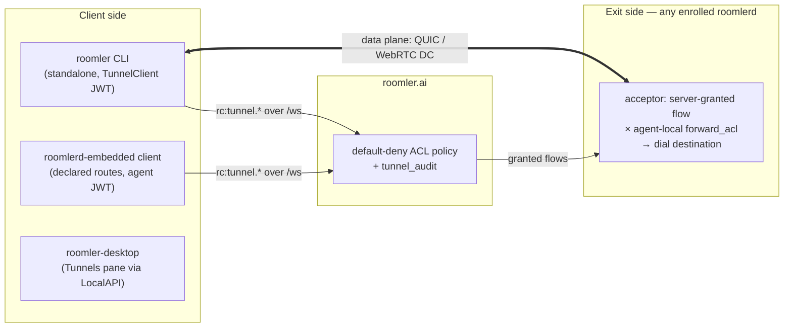

| Flow type | What it does |
|---|---|
| **TCP forward** | `roomler forward --agent <name> --local 127.0.0.1:5432 --remote db:5432` — a local listener whose connections come out of the chosen agent |
| **SOCKS5 (single agent)** | `roomler socks5 --agent <name> --local 127.0.0.1:1080` — RFC 1928 proxy exiting through one agent. CONNECT **and UDP ASSOCIATE** are supported (one UDP flow per destination, idle-reaped); BIND is not |
| **SOCKS5 mesh** | `roomler socks5 --local …` (no `--agent`) — one proxy for the whole tenant: address an agent *by name or id as the SOCKS hostname*, and LAN-IP targets route by longest-prefix match against the subnets agents advertise |
| **Declared routes** | `[[tunnel_routes]]` in the daemon config — `roomlerd` supervises the listeners itself, restart-safe, managed via `roomler route add/rm/ls/enable/disable` or the desktop app |
| **Overlay netstack SOCKS** | a loopback SOCKS5 front into the WireGuard mesh itself (peer names / MagicDNS / overlay IPs, TCP + UDP) — no OS TUN device required |

Declared routes live in a supervisor with explicit state — a revoked or
cross-tenant route parks as `failed` and never hammers the server:

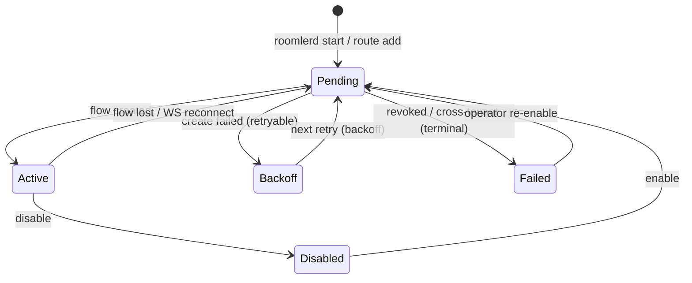

## Data-plane transports

Signalling always rides the control WebSocket (`rc:tunnel.*`,
[real-time.md](real-time.md)); flow bytes ride one of the negotiated transports:

| Transport | Wire | Properties |
|---|---|---|
| `quic-v1` (preferred) | quinn; one bidirectional stream per flow | Ephemeral self-signed certs, **SHA-256 fingerprint pinned over signalling** (no CA); low overhead, stream-multiplexed |
| `webrtc-dc-v1` (fallback) | SCTP DataChannel pool with 4-byte flow-mux framing | `bufferedAmountLow` backpressure; the native⇄native SCTP window is raised to 8 MiB (vendored fork) so throughput stays link-bound at high BDP |

QUIC climbs a relay ladder — each side picks its tier independently, so one
NAT-ed side doesn't drag both onto a relay:

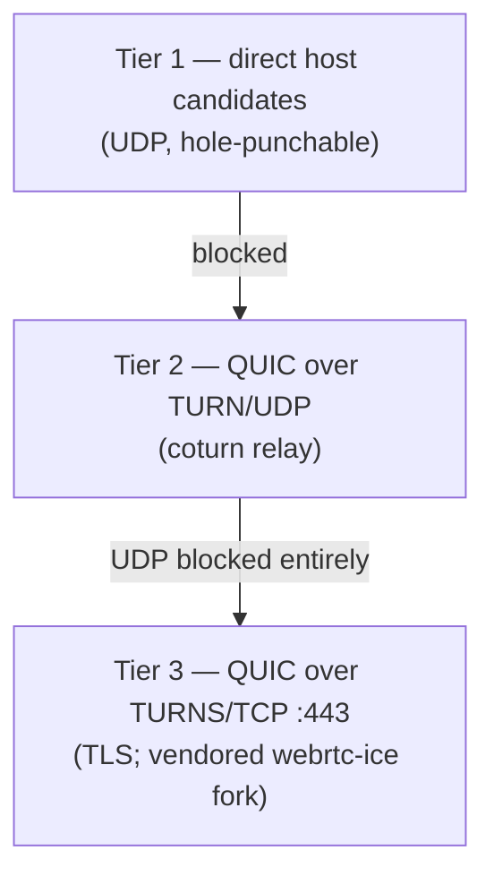

Two force-multipliers:

- **Loopback TURN host**: every agent runs an in-process TURN server on loopback
  + its overlay IP (coturn-REST-shaped ephemeral creds). A viewer or client on
  the same machine/LAN gets a "relayed" path with zero WAN round-trip — which is
  why relayed-but-local flows are exempt from the relay bitrate caps.
- **Overlay as carrier**: when both nodes are in the mesh, tunnel flows can ride
  the WireGuard data plane (`wireguard-v1` capability) instead of building their
  own P2P session.

Feature negotiation is version-gated (`agent_supports_quic` / `…_overlay`), so
mixed-version fleets degrade to the transports both ends speak.

### ⚠️ A WebRTC peer MUST be `close()`d — dropping it frees NOTHING

Fixed 2026-08-22. An `RTCPeerConnection`'s UDP sockets — one host candidate per
local address, plus webrtc-ice's mDNS listener on `0.0.0.0:5353` — are owned by
**tasks the ICE agent spawned**, not by the struct, so an `Arc` drop leaves every
one of them live.

`tunnel_core::transport::webrtc_dc::TunnelPeer` had no `close()` and no `Drop`,
and `run_tunnel_session` has many `?` early returns, so **every failed tunnel
session leaked its whole socket set**.

Measured on devbox: `roomlerd` held **15,446 UDP sockets after 12 h** (10,367 on
`:5353`) — the entire 16,384-port ephemeral range. Every socket allocation on the
**host** then failed `WSAENOBUFS`/10055 and **the whole machine lost DNS**, while
`ping 1.1.1.1` stayed at 3 ms.

⚠️ **That signature — names unresolvable, IPs fine, `nslookup` "No response" even
from a reachable server — is a socket-exhaustion tell, not a DNS-server problem.**
Check this first:

```bash
netstat -ano -p UDP | awk '{print $NF}' | sort | uniq -c | sort -rn | head
```

⚠️ It also masquerades as flaky tests: the QUIC/relay-probe loopback tests fail
with the same 10055 when the host is starved.

The fix is an explicit `close()` plus a `Drop` net that spawns it, mirroring
`AgentPeer`. mDNS is additionally `Disabled` in the tunnel `SettingEngine` — it is
a browser privacy feature, both ends here are ours, and `MulticastDnsMode`
defaults to `QueryOnly`, which still binds 5353.

**The amplifier is fixed alongside**: the flow supervisor reset its retry ladder
on *any* clean session end, so a flow that opened and died on arrival span hammered
at the 1 s floor forever. A reset now requires `SESSION_RAN_THRESHOLD` (30 s) of
actual uptime — the condition the code comment already assumed.

### ⚠️ The same trap, a second time: the TURN client (FR-48)

Fixed in `agent-v0.4.100` ([#1556](https://github.com/gjovanov/roomler-ai/pull/1556),
[FR-48](fr/FR-48-roomlerd-ice-socket-leak.md)). Every overlay node leaked **~9 UDP
sockets an hour**, never reclaimed within a daemon's life, and it was the rule above
in a different crate.

`turn::Client` has **no `Drop` anywhere**. `listen()` spawns a read loop that owns a
clone of the underlay socket's `Arc`, and that loop exits only when `close_notify` is
cancelled — which only `Client::close()` does. So dropping the client, or the
`TurnRelayConn` wrapping it, freed nothing; the comment on that field claimed
*"dropping it closes the allocation on coturn"*, and the claim was the leak.

⚠️ **The dominant path was cancellation, not an error return.** Every caller wraps an
allocation in `tokio::time::timeout`, so on a node that cannot reach coturn the usual
outcome is not an `Err` a `?` could catch — it is the whole future being **dropped**
mid-`allocate()`. A fix that closed only on the error paths would pass a happy-path
test and leak exactly the case that happens in the field.

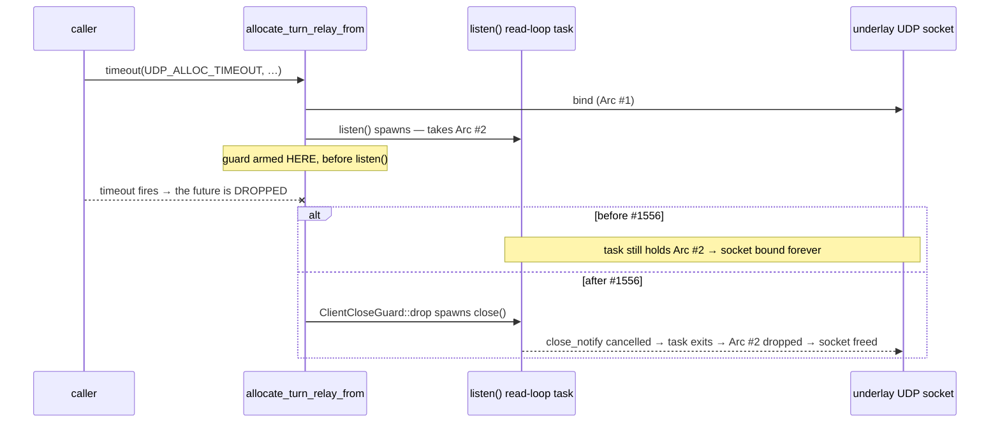

The fix is `ClientCloseGuard`, armed **before** `listen()` — the call that spawns the
task holding the `Arc` — so cancellation, `?` and panic all close; `disarm()` hands the
client to `TurnRelayConn`, whose own `Drop` spawns the close when a live connection
goes away. Both allocators are covered: UDP, and TURNS/TCP, where the stranded
resource is a TLS connection and its task, invisible to `ss -uanp` — the same bug.

**Measured after the fix** — an hourly census over 24 h on four fleet hosts, counting only
the daemon's own pid. The "after" column is the longest single daemon lifetime:

| host | before (`0.4.99`) | after (`0.4.100`, 20.0 h) |
|---|---|---|
| jupiter | 134 sockets @ 14.5 h ≈ **9.2/h** | 5 → 5, **0.000/h** |
| zeus | 300 @ 38 h | 5 → 5, **0.000/h** |
| mars | 1269 @ 288 h | 6 → 6, **0.000/h** |
| asahi | 849 @ 292 h | 5 → 5, **0.000/h** |

At the old rate, 20 hours would have added ~180 sockets per host; no host exceeded 7 at any
sample in the full 24 h. The lifetime is 20 h rather than 24 because an unrelated release
auto-updated the fleet mid-window and restarted every daemon — it carried the fix too, and
stayed flat.

#### What made it hard to find — each worth keeping

- ⚠️ **It was eliminated early by counting the wrong event.** "TURN re-allocation"
  was ruled out at 4 events/day against ~11 sockets per 2 h — but that counted
  *successful* re-allocations. The leak came from *cancelled* attempts, which never
  register as one.
- ⚠️ **A snapshot of a long-uptime host is worthless.** The count resets on every
  control-WS reconnect, so a daemon up for 175 h can show 58 sockets while leaking at
  the full rate. Only growth measured **within one daemon lifetime** means anything —
  and one host's uptime ran 175 → 200 h *without* restarting while its count reset
  twice, which is how that was proven.
- ⚠️ **The leak had a period.** Sockets arrived in pairs ~60 s apart every ~20 minutes.
  A 14-minute uprobe window cannot observe a 20-minute period, and one suspect was
  "eliminated" by exactly that. Measure the period before trusting an elimination.
- ⚠️ **`bpftrace` on `comm == "roomlerd"` sees almost nothing.** The daemon runs ~19
  threads named `tokio-rt-worker` and one named `roomlerd`; `comm` is per-thread and
  every socket call happens on a worker. Filter on `pid`.
- 🔑 **`ustack` cannot unwind this binary** (no frame pointers — the frame above
  `__GI_socket` resolves into `[heap]`), **but at function entry the return address is
  at `[rsp]`**, so a uprobe plus one dereference names the caller with no unwinding at
  all. Chaining that walked the stack one reliable level per probe:
  `socket() ← mio::UdpSocket::bind ← tokio::UdpSocket::bind_addr ←
  tunnel_core::transport::relay::allocate_turn_relay_from`.
- ⚠️ **A socket census must count only the daemon's own pid.** A host can run a second
  `roomlerd` inside a container; `pgrep -x roomlerd | head -1` returns whichever comes
  first, and a bare `grep -c roomlerd` sums both. Ask systemd for `MainPID`.

### ⚠️ The same trap, a third time: a closed ICE agent kept by its mDNS resolution (#1740)

Fixed in the vendored `webrtc-ice` ([#1740](https://github.com/gjovanov/roomler-ai/issues/1740)).
Here the peer **was** `close()`d, and the close did run to the end. It still freed
nothing below the ICE agent.

A browser hides its LAN host candidates behind `<uuid>.local` names. `roomlerd`'s
`mdns_resolve` asks the OS resolver first. When that gets no answer within 750 ms, which
is the normal case for a browser that is not on the agent's LAN, the candidate goes
unmodified to webrtc-ice. webrtc-ice resolves it itself: a task that asks `224.0.0.251`
**once a second until someone answers**. The query has no deadline and never notices the
agent closing, and the task held a strong `Arc` of the agent's internals. So every
ended session left its ICE agent alive for the life of the daemon, together with every
UDP socket its candidates owned, the mDNS socket, and the query itself.

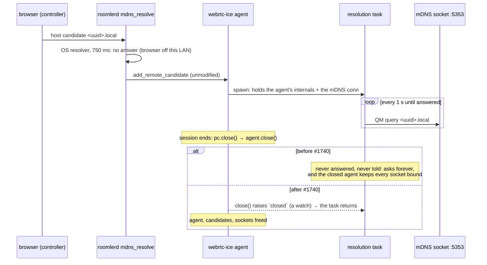

The fix, in the vendored crate (`crates/vendored/webrtc-ice.patch`), is to race the
resolution against the agent's close. The task now holds the agent only weakly, which
is what pion does when it closes the agent's mDNS conn. The same patch also closes a
narrower door: a candidate whose gathering finished **after** `close()` (a late STUN or
TURN answer). It was started and kept, and its receive loop held the agent. Now it is
closed on arrival. Both are locked by `agents/roomlerd/src/ice_lifetime_tests.rs`, which
counts the tasks alive on a runtime of its own. Without the patch, a closed agent
leaves one behind in each test; with it, none. CI runs them in its Linux lib-test
lane, where a host that cannot open the mDNS socket fails the mDNS test instead of
passing it vacuously. They also pass natively on Windows, where the mDNS socket opens
too, so Windows hosts had the leak as well.

**Measured** on a vmtest Ubuntu root daemon with the #1730 drop harness (the production
viewer's container SIGKILLed once it streams): three ended sessions on each build, same
guest, same harness. The "before" build is master with #1739, i.e. what the next release
would have shipped without this fix.

| | UDP sockets | on `:5353` | mDNS queries in 10 s | ctx switches/s |
|---|---|---|---|---|
| before, no session yet | 3 | 0 | 1 (not the daemon's) | 13.5 |
| before, after 3 ended sessions | **54**, +17 each | **3**, +1 each | **61**, +20 each | 27.1, ≈ +4.5 each |
| after, no session yet | 3 | 0 | 1 | 11.3 |
| after, after 3 ended sessions | **3** | **0** | **1** | 11.4 once idle |

The "before" rows are what every ended session cost, cumulatively, until the daemon
restarted, which in practice means until the next update. At this guest's 17 sockets a
session, Windows' default 16,384-port ephemeral range would last about a thousand
sessions, the same exhaustion as the 08-22 note above. (The per-session count depends on
the host's interfaces. It was measured on this guest, not on a Windows host.)

The signature, one line on the host: the daemon asking, once a second, for the same
`<uuid>.local` names, names that belong to sessions which ended long ago.

```bash
sudo timeout 10 tcpdump -ni any 'udp dst port 5353' | grep -oE '[0-9a-f-]{36}\.local' | sort | uniq -c
```

#### What made it hard to find

- ⚠️ **The peer's own objects were all freed**, and that made "the session leaked"
  look disproven. Weak probes on the `RTCPeerConnection` and on its SCTP and DTLS
  transports all read 0 ten seconds after the close. The leak was one level down,
  in an ICE agent that nothing in the peer referenced any more.
- ⚠️ **The noise at every close looked like the evidence.** Each session end logs
  `Failed to close candidate … the agent is closed`. Those are the *browser's*
  candidates: they were never started and never had a socket.
- 🔑 **The task dump named no crate at all.** Release inlining left only the leaf
  shape: one task per unanswered name, `PollFn → {Sleep, mpsc::recv, mpsc::recv}`.
  That is exactly `webrtc_mdns::DnsConn::query`'s loop, and the `tcpdump` above
  confirmed it: four names, ten queries each, two sessions after they ended.
- ⚠️ **It was filed as a per-*drop* residue, but nothing about it is specific to a
  drop.** The drop harness was simply the only thing measuring it. The unit test
  closes an agent that never had a session at all.

The same investigation found the control channel owning itself: its `on_message`
closure held a strong clone of the channel it is stored in, so a session's control
channel, and everything its handler captures, was never freed. It now holds a `Weak`.

### ⚠️ The same trap, a fourth time: a close that never reaches the ICE agent (#3716)

Fixed in the vendored `webrtc`, `webrtc-sctp` and `webrtc-ice`, with a net in the agent
([#3716](https://github.com/gjovanov/roomler-ai/issues/3716)). Here the peer **was**
`close()`d, but the close stopped partway and was then dropped. Everything it had not
reached yet stayed alive until the daemon exited.

The agent waits for a peer's close at most `PEER_CLOSE_BUDGET` (5 s,
`agents/roomlerd/src/signaling.rs:207`), through `close_within_budget`
(`signaling.rs:314`, #1738). `RTCPeerConnection::close` marks the peer closed at its first
step, so a later close returns at once. Before #3716 a close that overran was dropped
where it stood: the ICE agent, every socket and the SCTP association it had not reached
lived on.

**Field:** 17 UDP sockets per ended session on a Linux system install after a 15 s network
drop, on every build back to 0.4.213. On Windows, a UDP socket and four TCP sockets (one per
TURNS relay) after the viewer's tab closed on a `tcp-turn` session. In both cases the
association went on retransmitting into the dead link once a minute
(`failed to write packets on net_conn … SCTP retransmits (N in this run)`).

**The stall:** a session's video rides a data channel, written by a send task of its own. When
the path dies, no SACK comes back, SCTP's 128 KiB send queue fills, and the send task parks in
flow control. The peer's close then waited behind it, before the SCTP stop
(`crates/vendored/webrtc/src/peer_connection/mod.rs:1969-1977`), and never got any further.

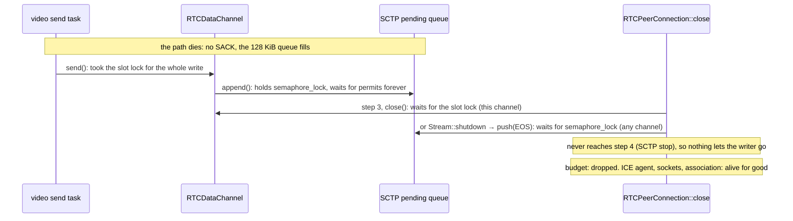

Three links had to break, one in each place that owned it:

| Where | Change | Anchor |
|---|---|---|
| `webrtc` | `send`/`send_text` take the channel out of its slot instead of holding the slot's lock across the write. They take turns on a `send_lock` of their own, which `close()` and `buffered_amount()` never take: the slot lock was the only thing ordering a channel's writes, and two at once shared a stream sequence number or split a message | `crates/vendored/webrtc/src/data_channel/mod.rs:378`, `:89` |
| `webrtc-sctp` | a stream's reset (the EOS a channel's close queues) is queued at once if no writer is parked in flow control, otherwise right after it, on a task. The close goes on either way. A write holds its stream's `write_turn` from its shutdown check until its chunks are queued, and the reset waits for that turn too, so it never goes ahead of a write the check let through | `crates/vendored/webrtc-sctp/src/stream/mod.rs:547`, `:287`, `queue/pending_queue.rs:118` |
| `webrtc-sctp` | the association's close closes the pending queue's semaphore, which lets every parked writer go with an error instead of waiting forever | `src/association/association_internal.rs:264`, `queue/pending_queue.rs:111` |

#1856's comment expected a transport that is really gone to fail the association's `recv`.
Nothing below SCTP ever fails it on a dead path, because the ICE agent's conn ends only when
the agent is closed. So it is the peer's close that ends the association, and that close
can no longer stall before it.

**The Mac's stall point** is a different one. A supervised Mac overran about 1 close in 15 to 26
plain sessions on a healthy network, on every build. Its DTLS stop was reached, and it waited
in the ICE agent's candidate sweep. That was not reproduced here. Its two suspects are closed
off in `crates/vendored/webrtc-ice/src/agent/agent_internal.rs`:

- `add_candidate` closed a late or duplicate candidate while holding `local_candidates`, the
  lock the sweep takes (`:585`).
- `delete_all_candidates` closed the local candidates one at a time under that lock, so one
  close that waits on the network (a relay's TURN client) held the agent's close, and every
  other socket with it (`:709`).

Now no candidate is closed under the lock. Each local candidate closes on a task of its own,
and one still closing after 5 s is named in a `closing candidate … is taking over 5s` warning.
That line names the ICE role and the candidate, not the session, which the ICE agent never
learns. A remote-desktop session logs each of its local candidates with the session
(`ICE: gathered local candidate`, `agents/roomlerd/src/peer.rs:903`), and the candidate's
address and port join the two lines.

**The net under the rest:** `AgentPeer::close` and `TunnelPeer::close` run `pc.close()` through
`agents/roomlerd/src/peer_close.rs:32`, on a task of its own, bounded by
`PEER_CLOSE_CEILING` (60 s, `:26`). The caller still waits at most the 5 s budget. A close
past the budget now goes on to its end, and logs `peer close finished in the background, past
its budget` (or, at the ceiling, `peer close did not finish within its ceiling`). The overrun
line now reads `peer close overran its budget — it goes on in the background (#3716)`. A close
that panicked logs `peer close panicked` with its session and the panic from its own task, so
the line comes even after the caller stopped waiting, and a caller still waiting gets an error,
not a clean close.

**Tests** (`agents/roomlerd/src/peer_close_tests.rs`, two plain webrtc-rs peers on a vnet,
black-box: close time, the parked writer, packets on the wire, the agent's tasks alive on a
runtime of its own, what the receiver gets):

| Test | Holds | Before the fix |
|---|---|---|
| `a_dead_path_under_a_data_channel_writer_does_not_stall_the_close` (`:353`) | the wire is cut under a 16 KiB-message writer, then the agent's close runs inline under the budget: it ends within 2 s, lets the writer go, leaves no task, and from 250 ms after it (`IN_FLIGHT`, `:77`) sends nothing for 2 s | took 5.01 s, `stuck at data channel closing, sctp connected, dtls connected, ice disconnected` |
| `a_healthy_close_still_takes_milliseconds` (`:421`) | the same close with the path alive | passes, 1 ms here |
| `a_close_its_caller_stopped_waiting_for_still_finishes` (`:462`) | the caller polls `peer_close::close` once and drops it; nothing is left | an inline close cut the same way leaves 18 tasks alive |
| `many_writers_share_one_ordered_channel` (`:578`) | eight writers send 60 messages each at once on one ordered channel to a webrtc-rs receiver, every other one big enough to fragment: every message arrives whole, once, and in its writer's order | with the slot lock taken off `send` and nothing in its place, 1 of 480 arrived in 15 s and the other 479 never did |

The stand-in viewer runs on a runtime of its own (`on_viewer`, `:95`), so the agent's runtime
counts the agent's tasks alone. The viewer's peer, the one that offers, now and then keeps two
tasks alive after its close: in 6 runs of 60 with the agent closing first, and 3 of 30 with the
viewer first. On a runtime both peers shared, the healthy-close test read them as the agent's
and failed (`3 tasks alive after both closes, 1 before the peers`). The agent's runtime never
kept a task past its baseline in those 90 runs.

**How the dead-path test reads the wire.** The vnet router counts a packet on a task of its own,
after the send that queued it has returned. On a loaded CI runner that task started late, and
the close's own DTLS close_notify, sent before `close()` returned, was counted inside the 2 s
window: `the closed peer still put 1 packets on the wire in 2 s`, about one run in three on
Linux and Windows alike, with nothing sent after the close. So the test reads the wire through
a probe:

| Piece | What it does |
|---|---|
| `ROUTER_LAG` (`:64`) | the test's router holds every packet 20 ms, so the counting lag is there on every run, not one run in three: without the probe the test fails 12 runs of 12 |
| `Wire::sent_by_agent` (`:138`) | a third host on the wire (`PROBE_IP`, `:47`) sends a marker; the router's queue is first in, first out, so once the marker is counted, so is everything the agent sent before it |
| `IN_FLIGHT` (`:77`) | the count starts 250 ms after the close. After `close()` the ICE agent's conn refuses every write, so only the ICE connectivity loop can still send: it sees the close between two passes, and a pass under way still sends its STUN check, within 1 ms of the close (3 runs of 120 that closed while the keepalive checks ran) |

The task count is asserted before the wire. When packets went out, it says whether the close
left something running (a leak) or a last send landed late.

The reset's order has a unit test of its own, on one thread:
`test_stream_reset_waits_for_a_write_turn`
(`crates/vendored/webrtc-sctp/src/stream/stream_test.rs:240`). While a write holds its turn,
the shutdown returns at once and queues nothing. Once the write has queued its message and let
go of the turn, the reset follows it. Without the reset task's wait for the turn, the queue
ends [reset, data]. CI runs the vendored crate's tests in the `vendored-sctp` job, beside its
drift check; how to run them by hand is in [the next section](#%EF%B8%8F-a-send-cut-short-leaves-its-stream-whole-3755).

**Not covered:** a TURNS/TCP leg that is dead but never reset. Its writes block until the OS
gives the connection up (`crates/tcp-turn-conn/src/lib.rs:257`), with the TURN client's lock
held across them. Its read side does report a reset or EOF, to the TURN client's read loop
only: that loop exits, and nothing above it hears. Every field case had the link reset
(`os error 10054`, `Broken pipe`), so its writes failed fast.

Nor the viewer's two tasks: they were not named, since tokio's task dump runs on Linux only.
The agent answers in these tests, as it does a browser, and its peer never kept them. As a
tunnel client the daemon offers too (`crates/tunnel-core/src/driver.rs:1172`), a role these
tests do not give it.

### ⚠️ A send cut short leaves its stream whole (#3755)

Fixed in the vendored `webrtc-sctp`
([#3755](https://github.com/gjovanov/roomler-ai/issues/3755)). It was found by reading the
code and has not been seen in the field; the tests below are its reproduction.

Every data-channel send ends in `Stream::write_sctp`
(`crates/vendored/webrtc-sctp/src/stream/mod.rs:287`), which can wait twice before its
chunks are queued: for the pending queue's lock, and for room in the queue (128 KiB, shared
by every stream of the association). Upstream spent the write's stream sequence number (SSN)
and added its bytes to `buffered_amount` in `packetize`, **before** those waits. A caller that
dropped the write while it waited (a timeout, a `select!` arm, a task abort) kept both
changes and lost the message. The receiver of an ordered stream delivers SSN *n*+1 only
after *n* (RFC 4960 §6.6), so it waited for the lost number forever, and every later message
on that stream waited behind it. The receiver is a browser's SCTP stack, so the fix is on the
sending side only.

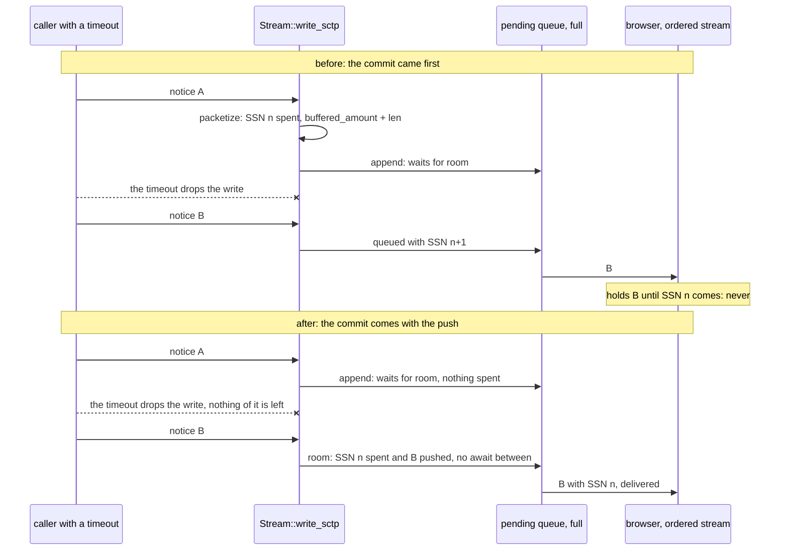

The agent drops send futures on purpose. On the control channel, `send_control_notice`
(`agents/roomlerd/src/peer.rs:6225`) bounds each attempt with a timeout and retries, and the
idle warning (`agents/roomlerd/src/session_idle.rs:465`) and the session's `rc:ended`
(`agents/roomlerd/src/session_table.rs:362`) each have a 2 s budget. Other sends race the
session's end in a `select!` or die with an aborted pump. A tunnel flow's cancel cuts its
write on a `tunnel-N` channel, and the eight channels are shared by every flow of the tunnel,
round-robin (`crates/tunnel-core/src/driver.rs:628`), so one cut flow stalled the flows that
shared its channel. Each of those cuts loses a message only while the queue is full, which is
what a congested or dying path makes.

**The class** is a future that changes shared protocol state before its last await. Every
layer above (`RTCDataChannel::send`, `webrtc-data`, `PollStream`) ends in this one write, so
the fix is there and no caller changed:

| Where | Change | Anchor |
|---|---|---|
| `stream/mod.rs` | `packetize` only reads the SSN. `commit_write` spends it and adds the write's bytes to `buffered_amount`; the queue calls it once the first chunk has room. A write refused because the association is not established commits nothing either | `crates/vendored/webrtc-sctp/src/stream/mod.rs:358`, `:380`, `:519` |
| `queue/pending_queue.rs` | `append` takes the queue's lock and the room, then commits and pushes, with no await between the two. The commit runs before the push, so an acknowledgement can never release bytes not yet counted | `crates/vendored/webrtc-sctp/src/queue/pending_queue.rs:182`, `:205` |
| `queue/pending_queue.rs` | a message of two thirds of the queue (87,381 bytes) or more is queued chunk by chunk. Once its first chunk is queued, it is begun: dropped before its last chunk, `BegunMessage` queues the rest at once, in place, under the lock it still holds, so the peer reads it whole and once. The rest takes the free room and owes the shortfall (`overdraft`), which `pop` pays back before it gives room again | `queue/pending_queue.rs:448`, `:456`, `:401` |
| `queue/pending_queue.rs` | an append that must wait for room wakes the write loop first (`take_room`). The loop woke only after a whole append, so a message larger than the free room, on an association with nothing in flight, waited forever with its first chunks queued and never sent. That was a separate bug, which the same tests found | `queue/pending_queue.rs:217` |

**What a cut write means now** (`write_sctp`'s doc comment, `stream/mod.rs:276`):

- dropped at any await before its first chunk is queued, a write leaves no trace: the SSN and
  `buffered_amount` are as if it had never been called, nothing of it is sent, and the next
  write is delivered;
- a write that returned `Ok` was queued whole, in order;
- a write of 87,381 bytes or more, dropped after its first chunk was queued, is delivered
  whole, once, in its place. A caller that retries it may deliver it twice.

⚠️ **The product reaches only the first two.** The agent's associations keep the default
maximum message size of 65,536 bytes: the vendored `webrtc` passes 0
(`crates/vendored/webrtc/src/sctp_transport/mod.rs:162`), which means the default
(`crates/vendored/webrtc-sctp/src/association/association_internal.rs:105`,
`association/mod.rs:61`), and `prepare_write` refuses a larger write before it waits
(`stream/mod.rs:313`). So every agent and tunnel send is below the large threshold and is all
or nothing: a cut send was never sent. `send_control_notice`'s retry therefore sends its notice
once, and a tunnel write (at most 65,535 bytes, `crates/tunnel-core/src/forward.rs:68`) is the
same. The begun-message path and its overdraft are reached only by the tests. The overdraft is
at most the rest of one cut message, plus one more for each `pop` that runs on another worker
thread alongside a cut message's drop, and it only shrinks as the queue drains. At rest the
accounting is exact: room + queued bytes − overdraft = the queue's size.

**On the success path** nothing was added that a send pays for: no lock, allocation or task.
The same two atomic updates run later, the first try for room is a `try_acquire_many` (cheaper
than building the semaphore's wait when there is room), the commit is a closure call, and a
`pop` makes one more atomic load while nothing is owed.

**Tests** (`crates/vendored/webrtc-sctp/src/`; the association tests run a pair over the
crate's in-memory bridge, with a queue of a few KiB, and close the pair at the end):

| Test | Holds | On master's code |
|---|---|---|
| `test_assoc_a_write_cut_by_its_timeout_leaves_no_gap` (`association/association_test.rs:2866`) | video fills the queue while the link holds every packet; a timeout cuts a notice on the ordered control stream; once the link moves, the next notice is read, and `buffered_amount` is what it was before the cut, then 0 | `the next notice never arrived: the peer waits for the cut notice's stream sequence number`; `buffered_amount` 1,500 once everything was acknowledged |
| `test_assoc_a_large_write_cut_part_way_is_never_read_in_part` (`:3002`) | a 20,000-byte write cut after its first chunks: the peer reads it whole, once, then the next message | the next message never arrived; `buffered_amount` 12,800 at rest |
| `test_assoc_writes_cut_at_any_wait_keep_the_stream_whole` (`:3494`) | seeded: writers share one ordered stream, each write awaited or cut at a random wait (turn, lock, room, a later chunk's room): only whole messages, each writer's in order, none twice, every `Ok` write read | seed `0x3755`: 37 of the 47 writes that returned `Ok` were never read |
| `test_assoc_writes_cut_on_two_threads_keep_the_queue_accounting` (`:3523`) | the same on two worker threads, and the queue's accounting exact once drained; the overdraft sampled under two of the largest messages while writers run | uses the fix's accessors |
| `test_assoc_a_message_larger_than_the_queue_goes_out_on_a_quiet_association` (`:3134`) | the wake: a message larger than the free room, on an idle association, goes out | `the write never finished: its first chunks were never sent` |
| `test_stream_a_write_dropped_at_any_await_leaves_no_trace` (`stream/stream_test.rs:354`) | the stream's SSN, `buffered_amount` and queue after a drop at each await | each drop spent an SSN and the write's bytes |
| `test_pending_queue_an_append_cut_before_it_has_room_leaves_no_trace` and the four `test_pending_queue_a_begun_message_dropped_*` (`queue/queue_test.rs:517`, `:543`, `:609`, `:647`, `:677`) | the queue alone: a cut append leaves no trace; a begun message's drop queues its rest and owes the room, queues nothing once the queue is closed, and works outside any runtime and while unwinding | uses the fix's accessors |

**CI** runs these in the `vendored-sctp` job (`.github/workflows/ci.yml:2977`), which is not
yet one of the checks the `rust` aggregator needs. The fork is not a workspace member, so no
other `cargo test` builds it. The job seeds the fork's standalone build with the workspace's
`Cargo.lock`, so the tests run against the tokio the agent ships, and skips the two
`fuzz_artifact_test` tests, which fail on any checkout: the crates.io tarball ships no
`fuzz/` tree. By hand:

```bash
cp Cargo.lock crates/vendored/webrtc-sctp/Cargo.lock
cargo test --manifest-path crates/vendored/webrtc-sctp/Cargo.toml --lib -- --skip fuzz_artifact_test
rm crates/vendored/webrtc-sctp/Cargo.lock   # before a revendor --regen or --check, which would read it as drift
```

The fork's deltas, #3755's among them, are listed in its `Cargo.toml` header, and
`crates/vendored/webrtc-sctp.patch` is the ledger `scripts/revendor-webrtc-sctp.sh` checks.

### ⚠️ Every client path that ends a session must tell the exit agent (#1754)

The leaks above are the *client* failing to free its own sockets. This one is the
mirror image: the client frees itself cleanly, but the **exit agent** never learns
the session ended, so *its* per-session `AgentTunnelPeer` — the ICE sockets plus
the DataChannel pool (WebRTC) or the quinn endpoint (QUIC) — lives forever.

The exit agent builds that peer when it sees the client's offer / QUIC setup, and
drops it **only** when told: the client sends `rc:tunnel.terminate`, the server
relays it on to the agent
([`relay_tunnel_client_msg_from_agent`](../crates/modules/network/src/tunnel.rs)
→ `send_to_agent`). There is **no idle timeout** on the agent side. So a client
path that ends a session without sending a terminate leaks one agent-side peer,
and a declared route whose target never comes up does it *once per retry* (every
1–30 s), unbounded.

⚠️ **Field-measured on `0.4.110`.** A daemon-run WebRTC forward
(`roomler forward --daemon --agent … --transport webrtc`), used once then stopped
with `roomler kill fl-N`: the macOS root exit agent's UDP socket count climbed
**5 → 11 → 16 across five kills** — its `AgentTunnelPeer` map only ever grew.

The audit (against `origin/master` 9532fdeee) found the client ends a session
**without** `ClientMsg::TunnelTerminate` on:

| Client path | Where | Why it sent nothing |
|---|---|---|
| `kill_flow` (LocalAPI `KillFlow`, and every route-reconciler kill) | [`client_mgr.rs`](../agents/roomlerd/src/tunnel/client_mgr.rs) `kill_flow`; [`route_reconciler.rs`](../agents/roomlerd/src/tunnel/route_reconciler.rs) | it only `abort()`ed the supervisor task — an abort frees the client peer via `TunnelPeer::drop`, but sends no wire message |
| every `?` early return after `rc:tunnel.opened` | [`driver.rs`](../crates/tunnel-core/src/driver.rs) `run_webrtc_session` / `run_quic_session` | `PEER_READY_TIMEOUT` (30 s, DC pool never opens), a failed local bind, an `accept_answer` error, a QUIC-setup soft-fall — all returned straight up |

**The fix (layer A — client side).** A `TerminateOnDrop` guard, created in
[`run_tunnel_session`](../crates/tunnel-core/src/driver.rs) the moment the session
id is known, sends `rc:tunnel.terminate { ClientShutdown }` on **every** way the
driver stops owning the session — the normal return, any early `?`, a
`QuicSetupFailed` soft-fall, **and the future being aborted by `kill_flow`**. It
is [`AbortOnDrop`](../crates/tunnel-core/src/driver.rs)'s lesson one layer up: the
rule lives in a type, not in each call site that kept forgetting it.

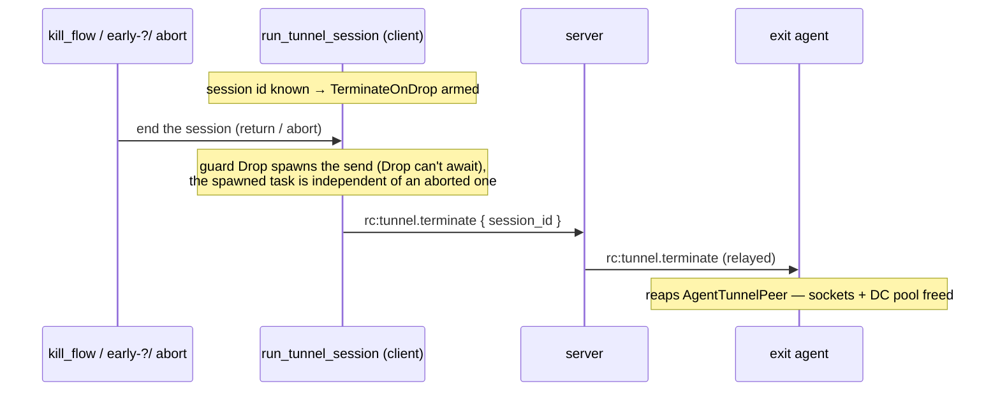

⚠️ **`Drop` cannot await, and it must work from an aborted task.** It uses
`tokio::runtime::Handle::try_current()` + `spawn`, never `.await` — the same shape
as `TunnelPeer::drop`. The spawned task is independent of the aborted supervisor,
so the abort that ended the session can't kill the delivery.

⚠️ **`kill_flow` also sends the terminate synchronously** (`sink_now().try_send`)
before it drops the session's demux entry — the guard's abort-driven send is
best-effort *timing*, this one is deterministic. The two together are at most one
**harmless** duplicate: the server's terminate handling is idempotent
(`sessions.remove` is a no-op once reaped; an unknown session's terminate is
dropped), which is also why the existing explicit sends (the `session_dead`
backstop and the dispatch loops' session-gone / server-terminate / revoked arms)
are left as-is rather than re-plumbed.

> A client that never sends its terminate (an older version, a crash, a network
> that vanished) is covered from the other side: the exit agent reaps a peer
> whose client is gone, next section.

### ⚠️ The exit agent reaps a peer whose client is gone (#1754)

The `close()` rule above has a precondition nobody had written down: **something has
to decide to call it.** On the exit agent, only two things ever removed a tunnel peer
from the signaling loop's session maps — a `rc:tunnel.terminate` from the server
(`agents/roomlerd/src/signaling.rs`, the `ServerMsg::TunnelTerminate` arm) and the
control WS ending (`close_all_tunnel_peers`). Nothing observed the data plane. A client
that never sent its terminate left its peer in the map, `close()`d by nobody, for the
life of the connection.

**Field, 0.4.110, a macOS exit agent**: a daemon-run WebRTC forward, used once, then
`roomler kill fl-N` on the client. The agent never received a terminate. Its UDP
sockets went **5 → 11 → 16 over five kills** and were still held minutes later — each
kill stranded the ICE sockets and the 8-channel DC pool of one `AgentTunnelPeer`. On
the relayed QUIC flavours the stranded object is the TURN allocation too.

Two layers fix it. Layer A makes the client always send its terminate. This section is
**layer B**: the agent reaps a peer whose client is gone **whether or not a terminate
ever arrives** — older clients stay in the field, clients crash, networks vanish.

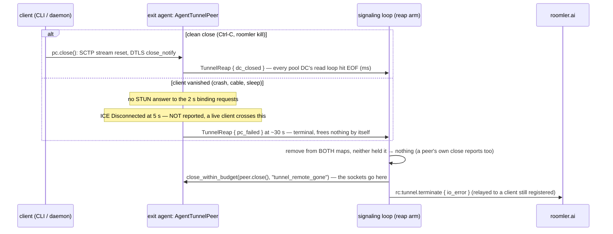

The peer's own report travels a per-org channel (`agents/roomlerd/src/tunnel/reap.rs`),
created beside the overlay "Disconnect" channel in `signaling::run` and borrowed into
every connection, so a report that lands during a reconnect gap is drained by the next
connection rather than lost. Per org, not per process: a process-global sender would
land a secondary org's reap in the primary's maps.

| Signal | Where it is armed | Latency | What it means |
|---|---|---|---|
| `dc_closed` | `on_close` on all eight pool DCs, `AgentTunnelPeer::accept_offer` (`agents/roomlerd/src/tunnel/peer.rs`) | milliseconds | the client closed its peer cleanly; a DC read loop only starts when the channel opens, so arming before the handshake leaves no window |
| `pc_failed` | `on_peer_connection_state_change`, same place | ~30 s of silence | ICE gave the remote up: `disconnected_timeout` 5 s + `failed_timeout` 25 s in the vendored `webrtc-ice` (`crates/vendored/webrtc-ice/src/agent/agent_config.rs`) with binding requests every 2 s. **Terminal** — tunnel-core has no ICE restart — and it **frees nothing**: only `close()` does |
| `pc_closed` | same handler | — | reachable only through a local `close()`; the net under any close that skipped the map |
| `quic_conn_ended` | the accept task's end, `spawn_accept_loop` (`agents/roomlerd/src/tunnel/quic_peer.rs`) | ms after a close; ≤ 30 s after silence | the ONE connection the peer serves is over — closed by the client, or idle-timed out by quinn once the client's 8 s keepalives stopped |

⚠️ **Not `Disconnected`.** That is five seconds without a packet — a relay hiccup, a
laptop's Wi-Fi roam, a CGNAT rebind — and ICE recovers from it on its own. Reaping there
would tear down healthy tunnels, which is the one thing this pillar must never do. The
remote-control watchdog gives a *disconnected* RC session 20 s of grace for the same
reason (`agents/roomlerd/src/peer.rs`, `DISCONNECTED_GRACE`); a tunnel gets ICE's full
30 s and the certainty of `Failed`.

⚠️ **Idle is not gone.** A declared SOCKS5 route with no traffic for hours still
exchanges ICE binding requests every 2 s, DC keepalive frames every 20 s
(`crates/tunnel-core/src/forward.rs`, `DC_KEEPALIVE_INTERVAL`) and, on QUIC, quinn
keepalives every 8 s under a 30 s idle timeout (`crates/tunnel-core/src/transport/quic.rs`).
None of the four signals can fire while the client lives. The positive control
`an_idle_but_live_client_is_never_reaped` idles a pair for 35 s — past the whole
`Failed` horizon — asserts silence, then closes the client and asserts the same channel
reports it at once, so the silence was the design and not a harness that cannot hear.

Three details that matter:

- **Handlers hold a sender, the session id and a latch — never the peer.** A closure
  stored inside the peer connection that holds an `Arc` of it is the cycle #1740 found in
  the RC control channel. The latch makes a peer report **once**, however many of its
  nine handlers fire.
- **The arm removes from BOTH maps and does nothing for a session neither held**
  (`take_reaped_tunnel_peer`). That is the ordinary case, not an error: a peer closed by
  the terminate arm reports its own close (the DCs' EOF, then `Closed`), and a parked QUIC
  peer's report can arrive after the R3 reclaim already dropped it. Removing, not reading,
  is what makes the second report a no-op rather than a second close and terminate.
- **R3 parking reclaims no corpses.** `reclaim_survived_quic_peers` drops a parked QUIC
  peer whose accept task ended while it was parked (`AgentQuicPeer::accept_ended`) — the
  client gave up during the outage, and re-adopting its endpoint and TURN allocation would
  keep them until a terminate that never comes.

⚠️ **What changes for a live session:** a relay outage longer than ~30 s now ends a
WebRTC tunnel session at the agent, and the client's flow supervisor re-opens it — the
same path it already takes when the agent's control WS drops. Nothing that used to work
is lost: such a session was `Failed` forever anyway (no ICE restart), only now its sockets
are freed and the client is told.

Locked by lib tests (`cargo test -p roomlerd --lib tunnel`), each shown red with its
fix commented out: `a_client_that_closes_cleanly_is_reaped_at_once` (2 s budget),
`a_client_that_vanishes_is_reaped_when_ice_fails` (the client runs on a runtime of its
own whose only thread is parked — no keepalive answers, no clean close, sockets still
bound — and must be reported as `pc_failed` no earlier than 20 s in),
`a_client_that_drops_its_connection_is_reaped` (QUIC),
`a_reap_for_an_unknown_or_already_reaped_session_takes_nothing` and
`the_reclaim_drops_a_parked_quic_peer_whose_connection_ended`
(`agents/roomlerd/src/signaling.rs`).

### ⚠️ A session that ends with a live flow ends that flow, both halves (#2129)

The two #1754 sections free the per-session *peer* when a session ends. They do
not free a *flow* still live at that moment — and that is the same leak again,
one layer in. A `webrtc-dc-v1` session torn down mid-flow left the flow's
[`run_flow`](../crates/tunnel-core/src/forward.rs) `forward.rs:581` hanging
**forever** on both ends: `pump_dc_to_tcp` ends only when its mailbox closes,
and the one sender lives in the DC's `on_message` closure that the flow's own
`dc: Arc<RTCDataChannel>` keeps alive; `pump_tcp_to_dc` ends only on a `read`
that an idle app never completes. So closing the peer could not actually free
its sockets — the live flow's DC reference kept the whole ICE/DTLS/SCTP set
bound. Field-measured client→exit on 0.4.133: **+13 UDP sockets per occurrence**
on a many-interface exit (the closed peer's whole host-candidate set), still
bound minutes later, with the dst socket left in **CLOSE-WAIT** and the app
getting no EOF.

**The rule: when a WebRTC-DC session ends, its live flows end — both halves,
promptly.** A session-scoped cancellation —
[`FlowCanceller`](../crates/tunnel-core/src/forward.rs) `forward.rs:508` →
[`FlowCancel`] `forward.rs:536` — is handed to every `run_flow`, which `select`s
it against its two pumps. When it fires both pumps are aborted: dropping each
pump's `TcpStream` half closes the local socket in **both** directions (the app
or the dst sees EOF/RST, no CLOSE-WAIT), and `run_flow` returns, releasing this
flow's DC reference so the peer's sockets are freed once the peer is closed. The
flow's `rc:tunnel.tcp.closed` reason is **`ServerTerminated`** — the session was
torn down, which is neither a clean `Eof` nor a socket `IoError`.

⚠️ **A mailbox close alone is not enough.** The demux's in-band
`HALF_CLOSE_MAGIC` path ends only `pump_dc_to_tcp`; `pump_tcp_to_dc` stays parked
on an idle `read`. Cancellation is what drives **both** halves — an idle app or a
target holding a half-open connection would otherwise still pin the flow.

Where it fires:

| End | Trigger | Where |
|---|---|---|
| exit | `AgentTunnelPeer::close` — the one method every real teardown reaches: the `rc:tunnel.terminate` arm, the #1754 reap, and the WS-disconnect sweep (`close_all_tunnel_peers`) | [`peer.rs:347`](../agents/roomlerd/src/tunnel/peer.rs), the handle passed to the flow at [`acceptor.rs:186`](../agents/roomlerd/src/tunnel/acceptor.rs) |
| client | the DC carrier being dropped (`kill_flow`, the session dying, a re-upgrade drain reaching zero, the standalone CLI's session end) — a `CancelOnDrop` in `Plane::Dc` fires it from `Drop` | [`driver.rs:486`](../crates/tunnel-core/src/driver.rs) · installed at `driver.rs:1269` |

⚠️ **The exclusion is `close`, not the loop exit.** The cancel is tied to
`AgentTunnelPeer::close`, so a peer that is **kept** — never closed, e.g. one
preserved across a control-WS reattach (R3, `tunnel_peers_survive_reattach`) —
keeps its live flows. Only a real teardown, which closes the peer, ends them.

⚠️ **An FR-86 drain is unaffected.** A draining carrier is dropped only once its
`active()` reaches 0 (§"Re-upgrade: probe → promote → drain"), so when its
`CancelOnDrop` fires there is no live flow to cancel — make-before-break still
never cuts an established connection.

Locked by lib tests, each shown red with a one-line `// NC2129-*` negative
control: `forward::tests::a_live_flow_ends_on_both_ends_when_its_session_is_cancelled`
(a real two-peer DC flow, both ends idle, cancelled → both see EOF within 2 s),
`driver::tests::dropping_a_dc_carrier_ends_its_live_connection` (the client
carrier drop), and `tunnel::peer::tests::closing_the_peer_ends_its_live_flows`
with its exclusion control `a_kept_peer_keeps_its_live_flows`
(`agents/roomlerd/src/tunnel/peer.rs`).

### ⚠️ The exit never awaits a TURN allocation on its signaling loop (#1761)

An exit agent serves every session of its org from **one** signaling loop
(`connect_once` in `agents/roomlerd/src/signaling.rs`): the control WS, the
outbound pump, the reap arm, every `rc:*` message. Until 0.4.112 the
`ServerMsg::TunnelQuicSetup` arm awaited `allocate_relay_from_ice` **inline** on
that loop whenever the server had minted coturn credentials (QUIC-over-TURN). On a
network where the relay ladder is slow — every UDP tier timing out before the
TLS tier answers — one allocation is ~20 s, and for those 20 s the loop reads
nothing: pings go unanswered, nothing is sent, no other session's setup runs, no
ICE, no terminate, no remote-control signaling. N routes opened together were
N × 20 s of backlog.

**Field, 2026-09-28, both ends 0.4.112.** A Windows client daemon holding four
declared routes to a corporate-laptop exit whose network blocks UDP (the overlay
reaches it over DERP/TCP — expected there). Its routes churned every ~90 s. The
exit's own log:

| Exit time (UTC) | Event |
|---|---|
| 18:32:39.9 · 18:33:00.2 · 18:33:20.5 · 18:33:40.8 | `agent QUIC peer ready` (QUIC-over-TURN) for four sessions — **exactly 20.3 s apart, strictly serial** |
| 18:33:40.76 | `agent QUIC-over-DERP peer ready` for a session the client opened at **18:33:02** and abandoned at **18:33:32** — the quic-derp branch is synchronous and instant, and still answered 38 s late, past the client's 30 s `QUIC_READY_TIMEOUT` (`crates/tunnel-core/src/driver.rs:285`) |
| 18:33:40.77–.80 | the WebRTC fallbacks' SDP answers, in the same burst, also late |
| 18:32:09 | `torn down agent QUIC tunnel peers on ws disconnect count=4` — the exit's control WS had dropped mid-backlog, its keepalives unanswered |

So the routes cycled QUIC → quic-derp → webrtc-dc → dead → re-open, and the
first diagnosis — "the quic-derp setup never reaches the exit" — was wrong: it
arrived, and answered after the client had given up.

**The fix.** The TURN branch spawns its allocation and returns at once; the peer
comes back to the loop on a per-org channel, and the loop inserts it and sends the
ready. The direct-bind and quic-derp branches are synchronous and stay inline.

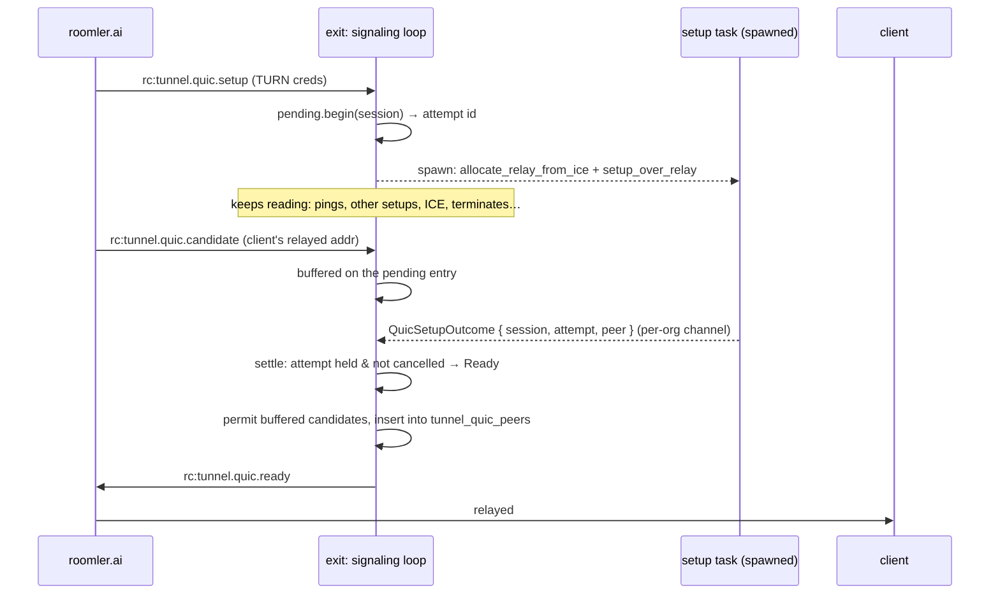

The channel (`signaling.rs:800`) has the #1754 reap channel's shape: created in
`signaling::run` **per org loop** — a process-global sender would land a secondary
org's peer in the primary's maps — borrowed into every `connect_once`, a sender
retained for the loop's life so the receiver never closes. The in-flight
bookkeeping is `PendingQuicSetups` (`agents/roomlerd/src/tunnel/quic_setup.rs`),
fresh per connection (`signaling.rs:1707`) like the session maps, and free of I/O
so tests drive it directly:

| While a setup is in flight… | Rule | Where |
|---|---|---|
| `rc:tunnel.quic.candidate` for the session | **buffered** on the entry (≤ 16), permitted on the peer the moment it lands, **before** the ready goes out — without its TURN permission coturn drops the client's opening Initials, so a dropped candidate is a session that silently never connects | `signaling.rs:4380`, `quic_setup.rs:243` |
| `rc:tunnel.terminate` for the session | **cancel**: the result is `close()`d, never inserted (a peer in no map is closed by nobody — the #1754 class) | `signaling.rs:4612`, `quic_setup.rs:258` |
| the result belongs to an attempt this connection does not hold — it finished after the control WS reconnected, or after a cancel-and-retry | **late**: `close()`d. Every attempt carries a process-unique id, checked on completion, so a stale result never evicts a newer attempt for the same session | `quic_setup.rs:272`, `signaling.rs:3194` |
| a second `rc:tunnel.quic.setup` for a session whose first is live | **refused** (`AlreadyPending`, a warn, no ready): the server sends one setup per open, the first attempt already answers the session, and a second ~20 s allocation per duplicate would be an amplifier. After a cancel a new attempt may start; the old one's result is late | `quic_setup.rs:210` |
| more than 64 setups in flight on one connection | **refused** (`AtCapacity`, a warn, no ready — the client soft-falls back exactly as after a failed allocation). Each in-flight setup is one task and one allocation, so the cap is a socket bound: above the largest legitimate burst (every client daemon re-opening every declared route to this exit after a server roll), two orders of magnitude under the port-range exhaustion above | `quic_setup.rs:61` |
| the control WS ends | the entry map dies with the connection (one log line names how many were in flight); the results reach the next connection and are closed there. The #1754 teardown and R3 parking of the **maps** are unchanged | `quic_setup.rs:335` |

⚠️ **Closing a discarded peer is an abort, not a drop.** An `AgentQuicPeer` dropped
without `close()` keeps its accept task, its endpoint socket and its TURN allocation
until its one connection ends — never, for a client that never dials. And `close()`
aborts the accept task, so a late attempt's peer can never later report a
`quic_conn_ended` reap for a session id the maps by then hold a *newer* peer under.
A result the loop cannot receive at all (the org loop is gone) is closed by the task
itself (`quic_setup.rs:403`).

⚠️ **The task has its own deadline (120 s, `quic_setup.rs:74`) as a slot-leak guard
only.** The ladder bounds every step itself (~65 s worst case) and the client gave up
at 30 s; the deadline exists so a future ladder change that stalls cannot pin an
in-flight slot forever.

Locked by lib tests (`cargo test -p roomlerd --lib tunnel`, `tunnel::quic_setup`), each
shown red with a one-line negative control: `a_slow_turn_allocation_never_holds_the_loop`
(the allocator for session A parks until released; the TURN branch must return within
1 s regardless, session B's setup completes and is ready while A is parked, A lands
when released with its buffered candidate — red when the task's work is awaited inline
instead of spawned), `candidates_buffered_before_completion_are_returned_on_insert`
(red with the buffer's push removed), `a_cancel_before_completion_closes_never_inserts`
and `settle_closes_a_cancelled_or_late_peer_and_returns_the_held_one` (red when a
cancelled attempt inserts instead of closing — the latter watches the peer's accept
task actually end), `a_completion_with_no_entry_or_a_stale_attempt_is_closed_late`,
`a_duplicate_setup_is_refused_while_live_and_allowed_after_a_cancel`,
`the_in_flight_bound_refuses_the_extra_setup_until_one_completes` and
`a_result_the_loop_cannot_receive_is_closed_by_the_task`.

### The flow owns the listener; a session is a carrier (FR-86 P1)

Until 0.4.113 a tunnel session bound the route's loopback port itself and ran its
own accept loop (`run_webrtc_session` / `run_quic_session` in
`crates/tunnel-core/src/driver.rs`), spawning one task per accepted connection that
held `Arc`s to *that* session's DC pool or QUIC connection. Two consequences, both
field-visible on 2026-09-28 ([FR-86](fr/FR-86-tunnel-transport-reupgrade.md),
[#1769](https://github.com/gjovanov/roomler-ai/issues/1769)):

| Consequence | Why |
|---|---|
| A route that fell back to `webrtc-dc-v1` stayed there for hours while `quic-v1` through the same exit worked | a second session could never be established beside the first — both would bind `127.0.0.1:<port>` — so the only way to try the better transport was to end the session, which cuts every connection it carries |
| A client got `connection refused` during every reconnect | the port lived and died with the session: unbound from the moment one ended until the next reached its bind, which comes *after* `rc:tunnel.opened` and the 30 s pool-open / QUIC-ready wait — the whole ladder toward a slow or busy exit |

P1 splits the session in two and moves the port to the flow. It changes no wire
and nothing on the exit; its one visible effect is that a route no longer refuses
connections while it reconnects. What it enables is P2: a second carrier
established beside the first, promoted, the first drained.

| Piece | What it is | Where |
|---|---|---|
| `establish_tunnel_session` | everything a session did up to (not including) its bind — hello/open, the transport handshake, the DC pool open or the QUIC connection authenticated, the dispatcher task, the keepalive, the #1754 terminate guard — returning `Establishment::Established(carrier)`, or the same `QuicSetupFailed` soft-fall the ladder always keyed on | [`driver.rs:955`](../crates/tunnel-core/src/driver.rs) |
| `Carrier` | **one type for both transports** — they differ only in the plane they pump on, everything else (sink, session id, target, reply registry, the P7 backstop, the dispatcher, the guard) is the same object. `carry(tcp, peer_addr)` spawns exactly the per-connection task the accept loop used to; `active()` counts connections in flight; `dead()` is the accept loop's old exit arms (the dispatcher exited · the P7 backstop tripped · QUIC `conn.closed()`), sending the same `io_error` terminate the loops sent; **dropping it is the old end of the session function** — dispatcher aborted, peer closed, terminate sent | [`driver.rs:445`](../crates/tunnel-core/src/driver.rs) · `carry` `:606` · `dead` `:770` |
| `FlowListener` | the flow's port: bound **once**, an accept task hands each connection to the current carrier — or **holds** it while there is none — under one lock, so "no carrier ⇒ hold" and "install ⇒ drain the hold" cannot interleave to strand one, and (#1816) the hand-off itself — `carry`, which counts the connection — runs under that lock too, so it cannot interleave with a promotion's swap | [`flow_listener.rs:90`](../crates/tunnel-core/src/flow_listener.rs) · `install` `:150` · `offer` `:197` |
| `HoldPolicy` | the hold's bounds: at most **64** connections, each for at most **30 s**; past either bound the connection is **closed** (the client sees EOF), never refused | [`flow_listener.rs:67`](../crates/tunnel-core/src/flow_listener.rs) |
| the daemon's flow | binds once when its supervisor starts (a failed bind retries on the same ladder a failed session did), runs the transport ladder to a carrier, installs it, waits for `dead()`, clears, backs off — the port bound throughout | [`client_mgr.rs:1202`](../agents/roomlerd/src/tunnel/client_mgr.rs) `run_flow_supervisor` · `:1364` `run_flow_cycle` |
| the standalone CLI | `run_tunnel_session` composes establish + a private accept loop with a per-session bind, so `roomler forward` / `socks5` behave exactly as before | [`driver.rs:893`](../crates/tunnel-core/src/driver.rs) |

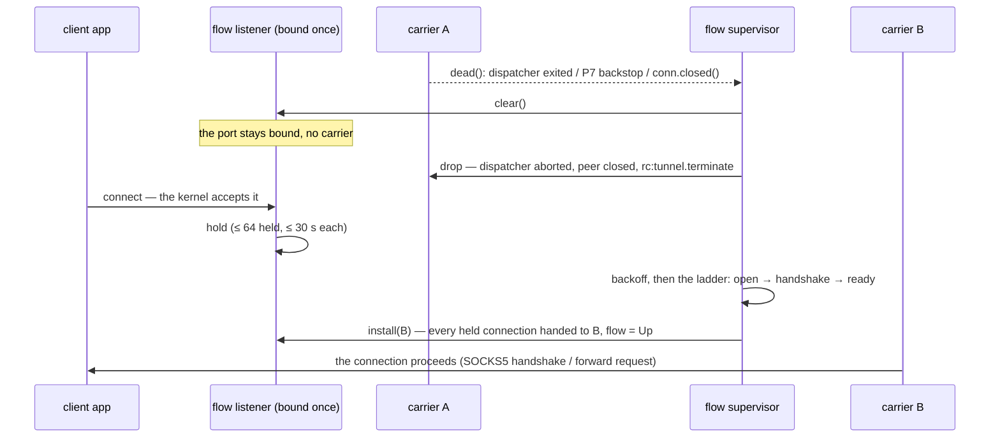

⚠️ **`Up` still means "it serves", not "it is bound".** The flow's port is bound
before any session exists, so #1685's rule had to move one step: `FlowLive::mark_listening`
([`client_mgr.rs:195`](../agents/roomlerd/src/tunnel/client_mgr.rs)) now fires when a
carrier is **installed** — the same call that hands it the held connections — not from a
bind hook. A route to an offline node reads `backoff` exactly as before; a held connection
is not a serving route. (`SessionParams::on_listening` stays for `run_tunnel_session`'s
own per-session bind; the daemon passes `None`.)

⚠️ **Held is a different failure from refused, and the client sees it.** A connect now
succeeds at once and the first byte waits — up to 30 s — where before it got
`ECONNREFUSED` immediately. A client with an application timeout shorter than the
reconnect sees that timeout instead; one that retried on refusal no longer has to.

⚠️ **The bounds are the design.** 64 is above the burst a desktop app opening its pooled
connections makes, and small enough that a client hammering a route whose exit never
comes back cannot pile up sockets on the daemon. 30 s covers a full re-establishment (the
open's 15 s and the ready's 30 s are caps a healthy exit cuts to 1–5 s) and is under any
client timeout worth waiting out. Both are constants in P1, not config.

⚠️ **Nothing about #1754 moved.** The terminate guard is created at the same point
([`driver.rs:1056`](../crates/tunnel-core/src/driver.rs), the moment the session id is
known) and *moves into the carrier*, so an early `?`, a `QuicSetupFailed` soft-fall, the
carrier's drop and the `kill_flow` abort all still tell the exit, and `kill_flow`'s
synchronous fast path is unchanged. A killed flow drops its listener — the accept task is
an `AbortOnDrop` — and every held connection with it.

⚠️ **One dead signal came back.** The R4 derp-lead (`quic_over_turn_failing`, the
"lead with `quic-derp-v1` once QUIC-over-TURN failed on this path" heuristic) read the
flow's `transport` cell *after* `drive_one` had already cleared it — since it was written
(#711) — so it never fired. The supervisor now reads the carrier's own transport. It is
behind `TUNNEL_DERP_FALLBACK`, default off, so nothing changes on a default fleet.

Locked by lib tests, each shown red with a one-line negative control (`// NC86A`…):

| Test | What it locks | Red with |
|---|---|---|
| `flow_listener::tests::a_client_connecting_between_carriers_is_held_then_carried_never_refused` | the port is bound once across a carrier replacement; a client connecting in the gap is accepted and held — never refused, never closed — then carried by the next carrier with its bytes intact | NC86A: the accept task aborted on `clear()` (the listener dies with the session); NC86B: no hold (closed on arrival) |
| `…a_connection_held_past_the_wait_bound_is_closed` | the time bound: closed after `max_wait`, never handed to a later carrier | NC86D: no expiry |
| `…a_connection_beyond_the_count_bound_is_closed_and_the_held_ones_are_carried` | the count bound, and hand-off in arrival order | NC86C: no count bound |
| `…dropping_the_listener_releases_held_connections_and_unbinds_the_port` | a killed flow releases what it held and frees the port | NC86E: the accept task outlives the listener |
| `driver::tests::a_quic_carrier_carries_counts_dies_and_terminates`, `…is_dead_when_its_connection_closes` | a real QUIC carrier over a loopback pair: `carry` round-trips bytes through the real dispatcher, `active()` counts, `dead()` stays pending while healthy and resolves on the control channel closing / the connection closing (with the `io_error` terminate), the drop sends the guard's terminate | — (the refactor's own safety net: the pre-existing suites, unchanged) |
| `tunnel::client_mgr::tests::a_client_connecting_before_any_carrier_is_held_and_released_by_kill_flow` | the daemon path: `create_forward` binds before any session; a client is held while the flow reads `connecting`; `kill_flow` releases it and unbinds | NC86B · NC86E |
| `tunnel_tests::agent_daemon_originated_forward_reaches_target` (integration) | the real daemon-originated flow accepts a client while its open is in flight, and `kill_flow` releases it | NC86B |

### Re-upgrade: probe → promote → drain (FR-86 P2)

P1 makes a second carrier able to open beside the first. P2 uses that: a **declared
route** (`[[tunnel_routes]]`) that fell back to a lower transport probes for the best
one in the background and, when it works, switches to it **make-before-break** — an
established connection is never cut, and a new connection is never refused during the
switch. This is the field bug it fixes: after a client-daemon restart during an exit's
restart, two routes sat on `webrtc-dc-v1` for hours while `quic-v1` through the same
exit worked ([#1769](https://github.com/gjovanov/roomler-ai/issues/1769)).

Only the daemon's supervised flows re-upgrade (the standalone `roomler forward` CLI is
unchanged). The transport order is **`quic-v1` > `quic-derp-v1` > `webrtc-dc-v1`**
(`quic-derp-v1` counts only where `TUNNEL_DERP_FALLBACK` is on), and only an `auto`
flow probes — a pinned `--transport` is a decision and never probes.

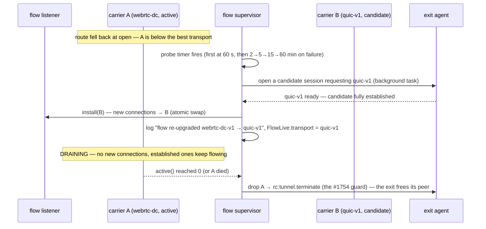

The schedule (a pure [`ReupgradeBackoff`](../agents/roomlerd/src/tunnel/client_mgr.rs) ·
[`client_mgr.rs:778`], mapped to deadlines by [`ProbeTimer`] `:815`), reset on a netwatch
**Major** and after a **promotion**, at most **one candidate per flow** in flight:

| Failed probes | Next probe after |
|---|---|
| 0 (fresh below-best carrier) | 60 s |
| 1 | 2 min |
| 2 | 5 min |
| 3 | 15 min |
| 4+ | 60 min (cap) |

| Piece | What it is | Where |
|---|---|---|
| the probe gate | `auto` flow **and** kill switch on (`reupgrade_active`); a pinned transport never probes | [`client_mgr.rs:858`](../agents/roomlerd/src/tunnel/client_mgr.rs) · ranking `better_transports` `:878` |
| the candidate | a background task that runs the restricted ladder — only transports **better** than the active one, best first — over the shared agent WS, into a throwaway `FlowLive` so a failed/aborted probe never touches the live route's demux | [`spawn_candidate` `:1074`](../agents/roomlerd/src/tunnel/client_mgr.rs) · `establish_candidate` `:1111` · `CandidateGuard` `:1038` |
| promotion | `listener.install(candidate)` (new connections → candidate, atomically) + `FlowLive.transport`/`session_id` updated + one info line; the old carrier becomes draining | [`run_flow_cycle` `:1364`](../agents/roomlerd/src/tunnel/client_mgr.rs) |
| the drain | the old carrier keeps its established connections until `active()` hits 0 (or it dies), then is dropped → terminate → the exit frees its peer, and its demux entry is reaped — both from a guard, so an aborted reaper ends the same way | [`drain_carrier` `:1001`](../agents/roomlerd/src/tunnel/client_mgr.rs) · `DrainGuard` `:972` · `spawn_drain` `:1029` · [`Carrier::drained`](../crates/tunnel-core/src/driver.rs) `driver.rs:586` |

⚠️ **A draining connection is NEVER cut, and there is no maximum drain time.** An RDP
session that lives for hours keeps its old carrier for hours. The old carrier is dropped
only when its own `active()` reaches 0 — signalled by a `Notify` the RAII in-flight
counter fires on the last decrement ([`Carrier::drained`], `driver.rs:586`), not by any
timer. Cutting it would defeat the whole point.

⚠️ **A draining carrier's end runs on every exit of its reaper — abort included**
([#1816](https://github.com/gjovanov/roomler-ai/issues/1816)). The end is two steps in
one order: drop the carrier (its terminate goes out, the #1754 guard), THEN reap its
demux entry. Both live in the `DrainGuard` the reaper owns, so `kill_flow` — which
aborts the supervisor, whose `drains` abort each reaper mid-`select!` — and the
supervisor's own returns end a draining carrier exactly as a finished drain does.
Before the guard the reap was the reaper's last line: an aborted reaper told the exit
but left `client_sessions[old_sid]` behind for the life of the daemon, and nothing
reaps such an entry lazily — the server forgets a session the client terminated and
never sends for it again.

⚠️ **The listener counts a connection on a carrier under the same lock that swaps
carriers** (#1816). `offer` calls `carry` — which counts the connection
(`InFlight::new`) synchronously, before it spawns — while holding the slot lock
`install` swaps under. So a connection is either counted on the old carrier before a
promotion, and that carrier's drain waits for it, or offered to the new one: a promotion
can never hand a connection to a carrier whose drain has already seen it at zero. (Before
this, `offer` cloned the `Arc`, released the lock, then carried; in those few µs
`install(new)` + `spawn_drain(old)` could close the old carrier under the very connection
it was about to count — the one cut P2 promises never happens.) The `Carry` contract
follows from it: `carry` must not block and must not call back into the listener.

⚠️ **A pinned `--transport` never probes.** `reupgrade_active` gates on
`pref == Auto`; `quic`/`webrtc` are decisions the operator made. `better_transports`
returns empty for an already-best (`quic-v1`) carrier, so a best carrier never probes
either.

⚠️ **Failure is isolated.** A candidate establishes into its own throwaway `FlowLive`
and its own `c`-prefixed nonce namespace, so a probe that fails, errors or is aborted
mid-flight never touches the live carrier, the listener or the flow's demux — its
`CandidateGuard` reaps its own pending-open / session entries, and its `TerminateOnDrop`
tells the exit. Only the backoff grows.

⚠️ **The kill switch is `ROOMLERD_TUNNEL_REUPGRADE=0`** (or the `tunnel_reupgrade`
config key). Off ⇒ no probe is ever opened and the flow behaves exactly as after P1.
Read once per serving epoch, so the env var flips it on the next cycle; the config key
applies on the next daemon restart.

⚠️ **The `--start-transport` flag is a TEST PIN, not an operational knob.**
`roomler forward --daemon --start-transport webrtc` forces the daemon's FIRST session
onto `webrtc-dc-v1` so the probe has a below-best carrier to upgrade, without restarting
daemons (later sessions and the probe behave as `auto`). It exists for the field
verification of AC7/AC8; normal routes omit it and start on the ladder.

⚠️ **After a promotion, the Flows table's byte/active counters are approximate for that
flow** until it next reconnects: the promoted (candidate) carrier keeps its own
throughput aggregate, deliberately, so a probe never disturbs the live route's counters
during the frequent probe-and-fail case. The **transport** column — the re-upgrade's
actual signal — updates immediately on promotion.

Locked by lib tests, each shown red with a one-line negative control:

| Test | What it locks | Red with |
|---|---|---|
| `client_mgr::tests::reupgrade_backoff_ladder_and_reset` | 60 s → 2/5/15/60 min cap, reset to 60 s | NC86P2N: `on_failure` a no-op |
| `…probe_timer_deadlines_follow_the_ladder` | the ladder mapped onto injected-time deadlines | — |
| `…transport_ranking_and_better_set` | the order, and "below best" only for webrtc-dc / quic-derp | — |
| `…reupgrade_gate_respects_pinned_and_kill_switch` | pinned never probes; kill switch off disables it | NC86P2K: gate ignores `pref` · NC86P2S: gate ignores the switch |
| `…kill_switch_reads_the_env` | `ROOMLERD_TUNNEL_REUPGRADE=0` turns probing off | NC86P2E: `reupgrade_enabled` hardcoded true |
| `…drain_carrier_keeps_the_old_carrier_until_active_reaches_zero` | the old carrier is not dropped while it carries a connection, and IS dropped at 0 | NC86P2P: drop the old carrier at promotion (promote-by-cut) |
| `…an_aborted_drain_reaper_still_reaps_its_demux_entry_carrier_first` | an ABORTED reaper drops the carrier AND reaps its demux entry — the carrier first (#1816) | NC1816-1: the reap on the reaper's last line (master) · NC1816-1b: the entry reaped before the carrier drops |
| `flow_listener::tests::install_cannot_complete_while_a_carry_on_the_old_carrier_is_in_progress` | `install(B)` waits for a `carry` in progress on A — the count and the swap serialise (#1816) | NC1816-2: carry after releasing the lock (master) |
| `driver::tests::make_before_break_a_keeps_flowing_while_b_takes_new_connections` | two real QUIC carriers behind one listener: A keeps flowing bytes after B is promoted; a new connection rides B; A drains | NC86P2A (listener ignores the promotion) |
| `driver::tests::a_carrier_is_drained_when_idle_and_pends_until_its_last_connection_ends` | `Carrier::drained` resolves only at 0 in-flight | — |

## Policy — two independent gates

1. **Server-side ACL** (`tunnel_policies`, default-deny): evaluated per flow open
   as *subject* (user / role / tunnel client / agent / all users) ×
   *target* (agent) × *destination* (`host:port`, protocol), the originator
   matched as [below](#who-a-forward-is-matched-as-3635). Read and written
   only by holders of `MANAGE_AGENTS` (the org's owner and admins), on the
   **Network → ACL** page's Tunnel ACL tab, as the overlay ACL is; every route, the
   list included, refuses a member without it 403 `forbidden`
   ([security-baseline.md](security-baseline.md#a-tunnel-policy-is-a-grant-manage_agents-reads-included)).
   The forward itself reads no permission bit: the policy is the grant, made to let
   people who hold no management bit reach what a holder named them for
   (`crates/modules/network/src/tunnel.rs:1114`). Every decision lands in
   `tunnel_audit` (90 d). A device the org
   removed is refused as a target while it is removed; if its machine enrolls
   again, the device is taken out of every live policy's subjects and targets
   before its row comes back, because it comes back as a new device (#3627). A
   policy left naming nobody grants nothing and stays in the list to edit.
2. **Agent-local `forward_acl`** (config.toml): the exit machine's own last word —
   it survives a compromised server. Empty-but-enabled means "trust the server".

### Who a forward is matched as (#3635)

A forward is matched in the org whose policies decide it, the target device's
(`policy_tenant`, `crates/modules/network/src/tunnel.rs:1108`); a forward from
another org is refused `cross_tenant` whatever those policies say. In that org the
originator is matched as the person it acts for, its `owner_user_id`:

| Originator | `UserId` | `RoleId` | `TunnelClientId` / `AgentId` | `AllUsers` |
|---|---|---|---|---|
| A tunnel client: `roomler` on its own socket, with its tunnel-client credential | the person who enrolled it; for a paired client, whoever approved the pairing | a role that person holds in the org | `TunnelClientId` = this client; an `AgentId` never matches it | yes |
| A device opening forwards over its own device socket: `forward --daemon`, a declared route, a supervised SOCKS5 listener ([tunnel-install.md](tunnel-install.md#declared-routes-daemon-supervised--p6)) | the device's owner, as read when the device's socket connected | a role the device's owner holds in the org | `AgentId` = this device; a `TunnelClientId` never matches it | yes |

The roles come from `forward_role_ids` (`crates/modules/network/src/tunnel.rs:1000`),
through `TenantDao::member_live_role_ids` (`crates/services/src/dao/tenant.rs:757`),
the same read every gate that matches a role makes
([permissions.md](permissions.md#which-roles-count-the-orgs-own-read-where-they-are-used)):

- **On every forward request**, never at enrollment or when the socket connects. A
  role given counts from the person's next forward, on a tunnel that is already open
  too; a role taken back, or the person's removal from the org, refuses the next one
  (`acl_denied`).
- **Only roles that org has count**: a role of another org, or one this org no longer
  has, satisfies no policy here.
- **Only when a live policy names a role.** Otherwise no role list could change the
  decision, and nothing is read.
- **A read that fails gives no roles**, with a WARN naming the origin
  (`tunnel forward: roles unreadable; role subjects will not match this forward`).
  Role subjects then match nobody on that forward, every other subject kind evaluates
  as before, and it never becomes an allow.
- **A device acts for its owner**, so it matches its owner's roles, and stops matching
  them once the owner is no longer a member of the org: they hold no role there. The
  device itself stays, because removing one is a device manager's decision.
- **A role is a group of people here.** The forward reads which roles the person
  holds, never a role's permission bits: the policy is the grant (item 1).

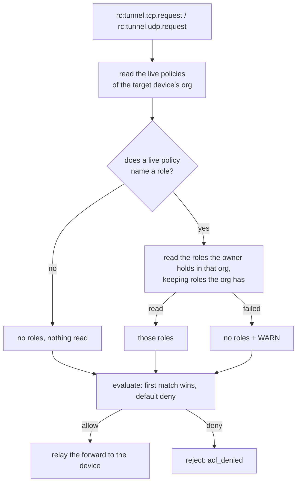

| Test | What it locks |
|---|---|
| `tunnel_role_subject_tests::a_role_subject_forwards_for_a_member_who_holds_the_role_and_for_no_one_else` (`crates/tests/src/tunnel_role_subject_tests.rs:297`) | a holder of the role forwards; a member without it is refused `acl_denied` |
| `…::the_role_is_read_on_every_forward_so_losing_it_or_the_org_stops_the_next_one` (`:342`) | on one open session: the role taken back refuses, given back allows, the person removed from the org refuses |
| `…::a_device_forwards_on_its_owners_roles_until_its_owner_leaves_the_org` (`:398`) | a device forwards on its owner's role, and is refused once the owner left the org |
| `…::a_role_of_another_org_or_one_the_org_deleted_satisfies_no_policy_here` (`:455`) | a role of another org, and a role the org deleted, grant nothing here; the rule naming the other org's role is a stored one, because a policy write takes only the org's roles |
| `…::the_other_subject_kinds_forward_as_before` (`:539`) | user, tunnel client, all users and device subjects as before; a role-or-user policy still forwards through the user |
| `tunnel::tests` (`crates/modules/network/src/tunnel.rs:2188`) | no live role subject: no read; only a deleted role policy: no read; the roles read decide the role policy; a failed read: no roles, the WARN, no allow, while a user subject still allows |

### A retired agent-session grant is refused (FR-137)

Parked FR-90 let an agent session open a tunnel under a grant its vault signed,
presented as `net_grant` on `rc:tunnel.open`. That code is off master, but a
0.4.199 device still sends the field, and `ClientMsg` ignores a field it does not
know. Dropped from the wire, such an open would parse as the device's own and
reach whatever the device may reach. So:

- `net_grant` stays on `ClientMsg::TunnelOpen`, parse-only
  (`crates/remote_control/src/signaling.rs:1363`), and no build sends it;
- the server refuses any open that carries one, at step 3c
  (`crates/modules/network/src/tunnel.rs:698`), before a tunnel session exists
  (step 4, `:780`), with `rc:error {code: net_grant_refused}`
  (`NET_GRANT_REFUSED`, `signaling.rs:102`). An old device reads that code as the
  end of its grant, never as a reason to retry.

`a_tunnel_open_with_a_net_grant_is_refused`
(`crates/tests/src/parked_wire_tests.rs:89`) locks it. The field may go once no
agent at 0.4.199 or older is left (FR-137 D8). The other surfaces FR-90 left
reserved are listed in
[retired-names.md](retired-names.md#reserved-after-fr-90-was-parked-fr-137).

## What ends a tunnel client

A tunnel client acts for the person whose enrollment token enrolled it, its
`owner_user_id`: the gate above matches it as that person (`AllUsers`, their
`UserId` grants, and the roles they hold in the org for `RoleId` grants), and its
overlay node is a peer of the org's mesh. For a paired client that person is
whoever approved the pairing, so an admin who mints the token for someone else's
laptop, or approves its pairing, owns that client.

Three things end one, all through one removal (`end_tunnel_client`,
`crates/modules/network/src/routes/tunnel.rs`): the row is tombstoned and its
`token_gen` advanced, THEN its overlay node is released, so the peers hear
`removes` and the address goes back to the pool. Tombstone first, because from there
a join on the socket the client still holds takes no address, and the release
cannot be followed by a lease nothing would release.

| What ends it | Where |
|---|---|
| A device manager removes it: `DELETE …/tunnel-client/{cid}` (`MANAGE_AGENTS`) | `delete_tunnel_client` |
| Its owner stops being a member of the org: an admin removes them, or they leave | `network`'s `MembershipLifecycle` hook, `crates/modules/network/src/membership.rs` |
| The org is archived (#3042) | `network`'s `TenantLifecycle` hook, `crates/modules/network/src/hooks.rs` |

From the tombstone on, a reconnect is told `rc:tunnel.revoked` and stops, a renewal
and the agent roster answer 401, and the client takes no address. Its open socket
closes at the next 60 s revocation poll, on whichever pod holds it; until then it can
still open forwards, the window a `DELETE` has always had. A grant through a role has
no such window: the forward reads the owner's roles in the org on every request, and
a person who is no longer a member holds none there, so their next forward through a
`RoleId` grant is refused `acl_denied`
([above](#who-a-forward-is-matched-as-3635)).

- **The membership hook never stops the removal's cascade.** It tries every client,
  and logs one it could not finish at ERROR with `alert = membership_tunnel_end`: a
  tunnel-client write that failed must not keep the person in a live call or on the
  org's rooms, the holders after it in `HOOK_ORDER`. It also releases a lease one of
  the person's already removed clients still holds, so a second run finishes a first
  one that failed half-way.
- **An enrollment token acts for the person it was minted for**, so once they are no
  longer a member it enrolls nothing: 403, before the token is spent, nothing written.
  A pairing's token is the approver's and is refused the same way. The enrollment asks
  again after its write, so one that raced the removal leaves no row behind.
- **Clients whose owner is no longer a member**, left by a removal before this or by
  one the hook could not finish, are ended by
  [`POST /api/admin/tunnel-clients/prune`](api.md#platform-admin-platform_admins-objectid-allowlist-404-on-miss),
  an operator step that runs the removal's own cascade per (org, person).
- **Devices the person enrolled are not removed with them.** A device is not a tunnel
  client, and removing one stays a device manager's decision. Tunnel policies naming
  the person are left in place for an admin to edit. A device the person owns stops
  matching `RoleId` grants at once, because the forward reads its owner's roles in
  the org on every request and its owner holds none there any more.

## LocalAPI

The on-host control surface — how `roomler`, `roomler-desktop`, and scripts talk
to a running `roomlerd` without any token:

- **Endpoints**: Windows named pipe `\\.\pipe\roomler` (SYSTEM + Admins + the
  daemon's own account in full; Interactive Users read and write data only,
  never a new instance; no-write-up); Unix socket `/var/run/roomler/roomler.sock`
  for a system daemon, else `$XDG_RUNTIME_DIR/roomler.sock` (the per-user temp
  folder's `roomler/roomler.sock` on macOS), 0600, and only in a directory
  private to the daemon's account.
- **Who a client keeps** (#3736): an endpoint served by its own account, root
  or SYSTEM (on Windows, a pipe owned by SYSTEM, the Administrators group or
  its own account). Any other is refused by name, and on Unix the client goes
  on to the system socket. The pipe client opens with read and write data
  only, at identification level. Detail: [security-baseline.md](security-baseline.md).
- **Protocol**: newline-delimited JSON, `{"t": "<verb>", "d": {…}}`.

| Verbs | Purpose |
|---|---|
| `Status` · `Peers` · `Flows` | Node status, mesh peers (carrier, RTT, upgrade state), live flows |
| `Ping {target, timeout_ms, prefer_v6}` | Overlay reachability probe |
| `CreateForward` · `CreateSocks5` · `KillFlow` | Imperative flow control |
| `RouteList` · `RouteAdd` · `RouteUpdate` · `RouteRemove` · `RouteSetEnabled` | Declared-route management (`RouteDescriptor` is one type for wire + disk). `RouteUpdate` replaces a route in one save; an invalid replacement leaves the old route running. A row's `state` is the port's truth (#1685): `active` = the local listener is bound; a flow whose tunnel session is retrying reads `backoff` **with** `flow_id`, `attempts` and `last_error` (additive fields — the tag set is unchanged so an older reader still parses it), `pending` with `flow_id` while its first attempt is in flight |
| `ConsentPending` · `ConsentDecide` | Remote-desktop consent prompts (how the tray approves sessions under a SYSTEM service) |
| `SetDeviceName` | Rename the node |
| `ConfigGet` · `ConfigSet` | The config surface, grouped (FR-84 D2) |
| `RestartDaemon` | "Apply now" — restart only under a proven supervisor (FR-84 D3) |
| `EncoderCaps` · `Devices` · `Mesh` | What the companion's Overview and Devices pages show (FR-84 D4, D5) |

⚠️ **On Windows the pipe keeps a pool of listening instances** (`localapi_pipe_pool`,
default 4; `1` is the pre-FR-84 single instance). With one instance, a client that
opened the pipe while another was being served got `ERROR_PIPE_BUSY` at once — the
companion's three simultaneous polls lost 60 of 60 bursts on the reporting host, and
its Routes page blanked. Clients retry a busy pipe on a bounded backoff (≤ 315 ms).
The companion's side of this is [desktop-companion.md](desktop-companion.md) §3.

## CLI

`roomler` is the tunnel CLI on every platform; on daemon hosts the installed
`roomler` binary is a ~150 KB shim that re-execs `roomlerd cli` — one command
surface, no version skew. On macOS the shim lands at `/usr/local/bin/roomler`
and resolves the daemon inside the `.app` bundle, since there the two binaries
cannot be siblings. (Before rc.454 the macOS `.pkg` shipped **no** CLI at all.) Highlights (run `roomler --help` for the full set):

| Verb | Purpose |
|---|---|
| `enroll --server --token --name` | Enroll this machine as a tunnel client |
| `forward` / `socks5` | Open flows (above); `--transport auto\|quic\|webrtc`; `--daemon` hands ownership to `roomlerd` |
| `route add/rm/ls/enable/disable/edit` | Declared routes |
| `status` / `peers` / `flows` / `ping` (`--json`) | Live node state via LocalAPI |
| `devices` | The devices this node's mesh can see, with display names, from the server (FR-84) |
| `restart` | Restart the daemon through its supervisor — refused when it has none it can prove (FR-84) |
| `kill <flow-id>` · `rename <name>` · `logs` · `config ls/set/clear` | Node management |
| `exec` | Run a command on a fleet device — four default-deny gates, full audit ([fleet-rpc.md](fleet-rpc.md)) |
| `diag host` / `diag pair` | Diagnostic evidence bundles (CLI-side, so new probes don't need a fleet rollout) |
| `self-update` | Tunnel-only hosts update in place; on daemon hosts the MSI/.deb owns the binaries and the shim refuses |

**`enroll` spends its token once** (#3328). A tunnel enrollment token enrolls one
client; a second use answers 401 `This enrollment token has already been used`, and
a retryable 503 means the server could not check, with the token still good. The
client's `machine_id` is a hash of `--name`, the host name, the OS and the
architecture (`derive_machine_id`, `agents/roomler-cli/src/cli.rs:1228`), so running
`enroll` again with the same name re-enrolls the same client. That takes a fresh token
minted by the client's owner while the client is live, or by a holder of
`MANAGE_AGENTS`, the only way a removed client comes back (as the holder's own: the
token acts for them). Anyone else's token is
refused 409 with a sentence the CLI prints, nothing is written, and that token still
enrolls the machine under a different `--name` as a new client. The server side is in
[api.md](api.md#authentication) and [security-baseline.md](security-baseline.md#an-enrollment-token-is-spent-once-through-one-owner-3328).

## Corporate-network behaviour

The whole stack is built to work from inside strict networks: outbound-only WSS
control links, TURNS/TCP on :443 as the transport of last resort, the DERP
fallback for the overlay, and installer downloads proxied through `roomler.ai`
(not `github.com`) so AV allow-lists trust them. The field-tested walkthrough —
including TLS-inspecting middleboxes and UDP-free networks — is
[tunnel-install.md](tunnel-install.md).
