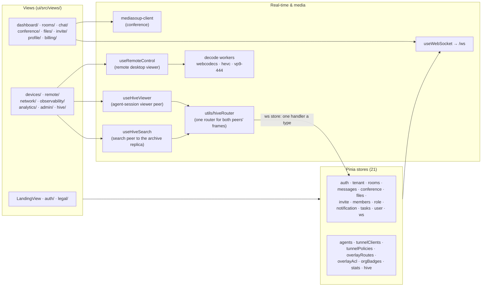
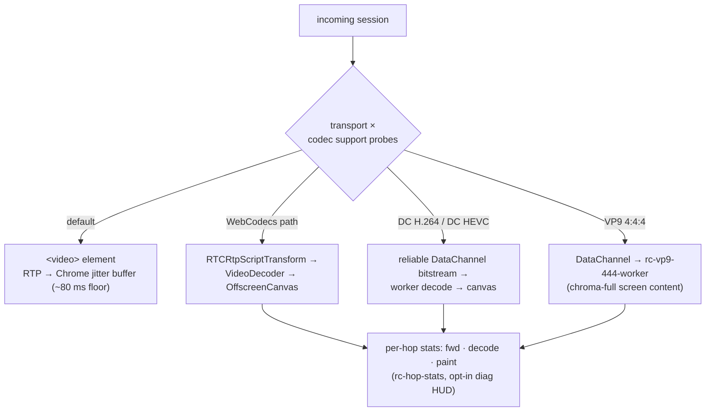
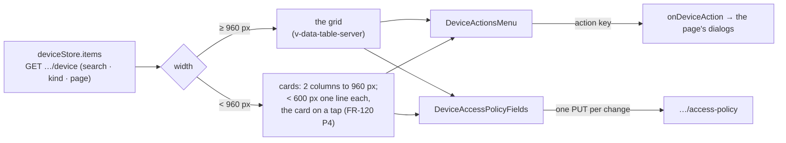
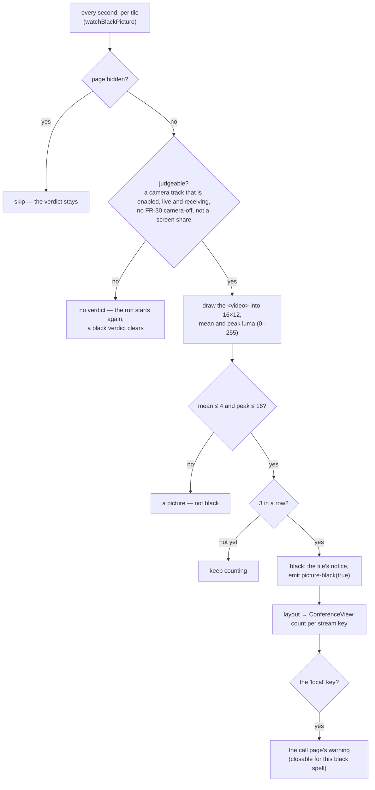
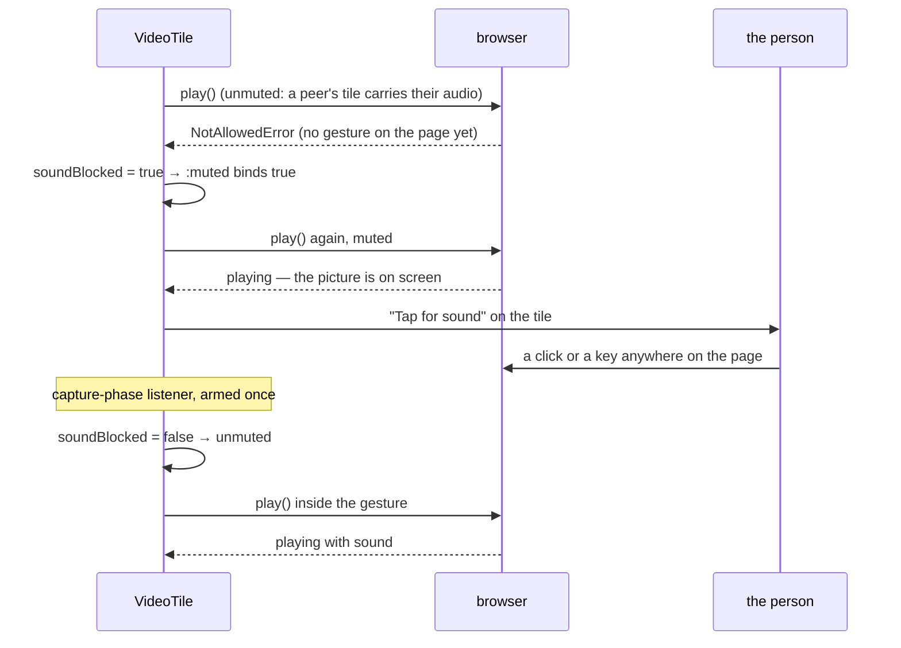
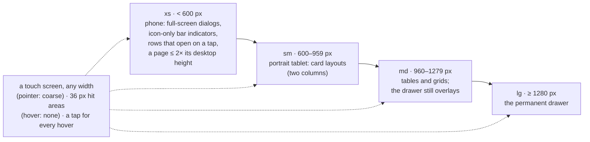
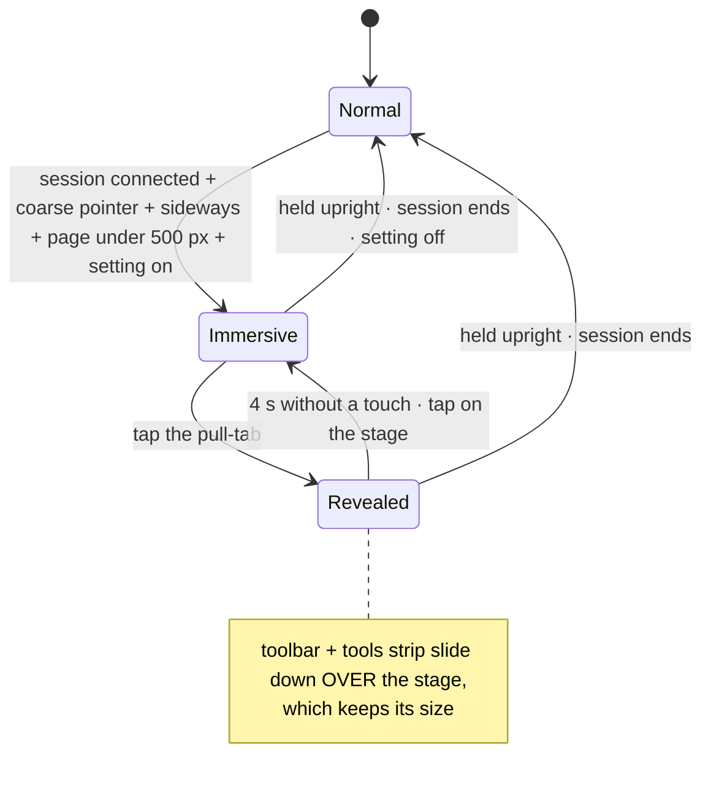
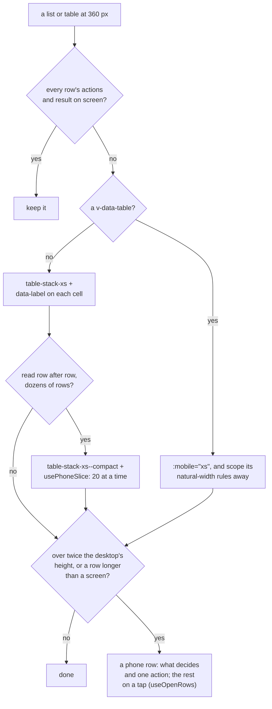

# Frontend

Vue 3 + Vuetify 3 SPA — Vite 7, TypeScript, Pinia (setup-store pattern),
vue-router, vue-i18n (wired, but English-only today). *As of 0.3.0-rc.381.*
Plugin order in `main.ts`: i18n → vuetify → pinia → router.



## Views

| Area | Views | Notes |
|---|---|---|
| Marketing / auth | `LandingView`, `auth/{Login,Register,OAuthCallback}View`, `legal/{Terms,PrivacyPolicy}View` | |
| Collaboration | `dashboard/{DashboardView,TenantDashboard}`, `rooms/{RoomList,ExploreView}`, `chat/ChatView`, `conference/ConferenceView`, `files/FilesBrowser`, `invite/{InviteLanding,InviteManage}View`, `profile/{Profile,ProfileEdit}View`, `billing/BillingView` | `ChatView`/`ConferenceView` own their layout (no `v-container`) |
| Fleet | `devices/DevicesView` (enrolled machines), `remote/RemoteControl` (the viewer), `remote/ConsentView`, `network/NetworkPanel` (overlay mesh), `observability/ObservabilityView`, `analytics/AnalyticsView`, `admin/AdminPanel` | |
| Agent sessions (FR-90, module `hive`) | `hive/HiveSessionsView` (your sessions, start dialog, stop; P2j-3: where sessions are copied, each of your own rows' **Delete for good** (never on a session of someone else's the list holds from its room or a hit), `components/hive/HivePurgeDialog`: the session's title typed to confirm, then the purge followed device by device, read again every 5 s until each answered; P2i-3: a **search box**, shown only where the organization's copies can be searched, `search` in `GET …/hive`, asked again at each visit; a query is asked 300 ms after the last keystroke, over `useHiveSearch`, and its hits replace the list while it stands: each with its session's title from your list, else "A session you can read", its snippet's `[` `]` drawn as `<mark>` from text, never `v-html`, and a click opening the session's room), `hive/HiveMemoryView` (P1e — **Agent memory**: the facts kept for the org's sessions by scope — organization, yours, a chosen device — each with its character budget; add, edit at the version read, archive; a refusal, `409 over_budget` or a 403 on a scope you may not write, shows in the server's words with the draft kept), `hive/HiveCopiesView` (P2h-2 — **Agent copies**: the org's replica policy read back, and its archive replicas: every device that offers itself as one (its `hive-archive` word, matched by equality) or is designated, with a **Designated** switch for administrators that writes the whole policy from the revision read (a stale write is read again and said so); P2j-4: an administrator edits the rules in place on the policy card (at least and at most, archive replicas, then the owner's own devices, the restricted tags with the org's device tags offered, the days kept), the whole policy written from the revision the form was opened on with everything it does not edit as read, the switches locked meanwhile; a stale write is read again and shown as stored now, any other refusal in the server's words with the draft kept; **Add an archive replica** mints an enrollment token and shows `docker run` and compose for the archive replica image, the token gone when the dialog closes; shown, and in the nav, only where the server copies sessions at all, `replicaset` in `GET …/hive`) | a session's own page is its chat room: `ChatView` opens `components/hive/HiveTranscript` as a side panel when the room's `binding.module` is `hive`. Its header's **People** button is `components/hive/HiveParticipants` (P1c): who takes part — the owner adds people as readers or drivers, changes their part, takes them out; everyone else sees the list. Its **Copies** button, only for a record that carries a replicaset, is `components/hive/HiveCopies` (P2j-1): each device that holds a copy, its role and state, and how far behind the primary's its copy is, by the server's own count (`holds`, read through `utils/hiveCopies.ts`); a move in flight; and the owner's **Move**, to the copy that holds the most, preselected, the answer in the server's words. Beside it (P2j-2), **Move elsewhere**, a teleport to an online device that holds no copy, and **Fork**, a new session from its conversation in a folder of its own, its room offered once made; both read the organization's devices once, matching each device's words by equality. Beside them (P2j-5), `components/hive/HiveManage`: an ended terminal session's owner makes it a managed one, offered where sessions are copied on an adopted session its terminal ended (`mayBecomeManaged`), its folder sent only when it is not its terminal's, the answer in the server's words, the word its device refused the last asking with said, and the asking in flight shown to anyone in the room (`isBecomingManaged`). The transcript's "ask the agent" composer is a driver's; the room's own composer is ordinary chat, which never reaches the agent. P1f: a tool call is drawn by its tool — `components/hive/HiveToolCall` and `HiveToolInput` over `utils/toolView.ts`: a command line, an edit as a diff (`utils/lineDiff.ts`), a new file's first lines, a file range, a search, a to-do list; its result (`HiveToolResult`) folded under it. A call that waited for an approval is drawn by its approval card, with the same input view, and its result after the answer. P1f-2: following the newest, the transcript keeps at most 1,000 events (`keep`; the oldest a "load earlier" away, never trimmed while someone reads further up). Output is coloured from SGR by `HiveAnsi` (`utils/ansi.ts`), as text: no `v-html` but assistant markdown. P1j: an adopted session (`origin: adopted`, a terminal's, `isAdopted`) is marked **Adopted** in the list, its Stop reads **Stop mirroring**, its transcript says it runs in a terminal and is read-only (the server's grant gives no composer), and its People dialog offers readers only; `ChatView` reads the record (`fetchSession`) to tell. P3-4e-3: a message the vault binds to an approval (`binding.module` `vault`, its `ref` the approval's id) carries `components/vault/VaultApprovalCard` under its text, through `MessageBubble`: where the approval stands, and **Approve** / **Deny** for a driver who may answer it now, **Approve** only where the policy would take their yes (`may_approve` in `GET …/vault/approval/{id}`, else off with why); a refusal in the server's words, and the approval read again whenever the vault edits its card (a new `updated_at` on the message) |
| Fallback | `NotFoundView` | |

## Stores (21)

`auth` · `tenant` · `user` · `rooms` · `messages` · `conference` · `files` ·
`invite` · `members` · `role` · `notification` · `tasks` · `ws` — the
collaboration core — plus the fleet set: `agents`, `tunnelClients`,
`tunnelPolicies`, `overlayRoutes`, `overlayAcl`, `orgBadges` (multi-org
indicators), `stats` (observability series) — and `hive` (FR-90: the
server's RECORD of your agent sessions, never their content; and the
facts kept for them, `fetchBrain`/`keepFact`/`editFact`/`archiveFact`; P2h-2: whether sessions are copied there, `copied`, and the replica policy, `fetchPolicy`/`putPolicy`, with its bounds since P2j-4, `HIVE_MAX_MEMBERS`/`HIVE_MAX_RETENTION_DAYS`; P2i-3: whether they can be searched there now, `searchable`, from the same answer, which `checkSearchable` asks again at every call; P2j-1: a session's `replicaset` and `promotion` typed, and `promote`, a move to a copy; P2j-2: `teleport` and `fork`; P2j-3: `purge`, which takes a purged session out of the list, and `fetchPurge`; P2j-5: `manage`, which keeps the answer's record, and the record's `from_terminal`).

⚠️ `hive` is the one module the server switches OFF by default, so the
capability gate (`stores/capabilities.ts`) fails **closed** for it while
`/api/capabilities` is unknown (`modules/registry.ts` `DEFAULT_OFF`), where every other
module fails open.

## Composables

| Composable | Purpose |
|---|---|
| `useAuth` | Session + token lifecycle |
| `useWebSocket` | The `/ws` connection + event dispatch into stores |
| `useRemoteControl` | The entire remote-desktop viewer engine (below) |
| `useRemoteRecording` | The viewer's half of the session's `record` channel: start/stop, the device's list, a checked, resumable download ([recording.md](recording.md) §10) |
| `useHiveViewer` | FR-90 — the browser's half of the agent-session viewer peer: `hive:view.*` signalling on the user socket, a data-only `RTCPeerConnection` dialled only after the device confirmed the grant, the `hive` DataChannel in `utils/hiveFraming.ts` frames (SCTP drops a message over 64 KiB), history + live follow + "ask the agent". A grant ended `role_changed` (the owner changed our part, P1c) is asked for again at once, and so is every grant at a redial, taken from the socket's drop: the store clears its connection id at a close, so a new id never follows an old one (P2i-3); `drivingRefused` carries the device's words when it keeps a driver the server named read only (P1c-2). ⚠️ The peer is `close()`d on every way out — a dropped peer frees nothing. Its frames come through `utils/hiveRouter.ts` (Everything else, below) |
| `useHiveSearch` | FR-90 P2i-3 — a search's peer to the archive replica that holds the organization's copies: `hive:search.open` at the first search, then a viewer's handshake by the grant; over the `hive` channel `hello`, then `search {id, q, limit: 20}`, the query and its hits never through the server (P2i-1, P2i-2). `run(tenantId, q)` lands only the latest query's answer, waits out one `too_soon`, and asks once more on a fresh grant when the grant ends mid-search; a refusal (`status`, `reason`, `detail`) is not asked again for 10 s. `snippetParts` splits a hit's snippet at the device's `[` `]` marks, as text. ⚠️ The peer is `close()`d on every way out, after two minutes with no search included: a device serves 8 searches || `useConferenceLayout` / `useActiveSpeaker` / `useAudioPlayback` / `usePictureInPicture` | Conference UX |
| `useMarkdown` | markdown-it + DOMPurify rendering |
| `usePush` | Web-push subscribe/unsubscribe. #2817 — **an opt-in**: a sign-in or page load only re-subscribes where the browser already granted permission (`shouldSubscribeOnLoad`). The prompt comes only from `enablePushNotifications`, behind the notification panel's *Turn on* click. A browser that blocked it is told where to undo that. #2827 — clicking a push notification (`public/sw.js`) focuses a window **already on** its page, and otherwise opens a new one. It never navigates an open window away: the first roomler window may be a live remote session or a call, and on 2026-10-24 a consent request's own toast hung up the session it was asking about. |
| `usePageViews` | SPA route-change beacon (`/api/stats/pageview`) |
| `usePolling` | Shared polling helper |
| `useSnackbar` / `useValidation` | UX utilities |

## The remote-desktop viewer (`useRemoteControl.ts`)

The largest module in the frontend — the browser side of the pipeline documented in
[encoders.md](encoders.md).

**Render paths** (user-switchable, persisted, feature-probed):



- **Decode workers** (`ui/src/workers/`): `rc-webcodecs-worker`, `rc-hevc-worker`,
  `rc-vp9-444-worker`, with `rc-hop-stats` shared hop-timing instrumentation.
- **Support probes** per codec (H.264/HEVC/AV1/VP9): software + hardware decode
  detection; HEVC-over-DC is offered only when *agent hardware encode × viewer
  hardware decode* both hold.
- **Transport control**: auto-pick, priority dial (balanced / sharper / smoother),
  keyframe requests, decoder-stats feedback to the agent (`rc:decodestat` — drives
  its frame-skip rate control), agent-local loopback-TURN probe for fast relayed
  paths on the same LAN.
- **Input**: HID-mapped keyboard (keyboard-lock, Ctrl-Alt-Del / SAS chord),
  letterboxed + direct coordinate normalization, multi-monitor layout + display
  match, resolution/scale control. The key listener is on the `window` in the
  capture phase, so a key typed into one of the viewer's **own** inputs — the
  files drawer's path field, a dialog's field — reaches it first and it steps
  aside (`isViewerOwnInput`, #2869); the stage and the soft keyboard's
  textarea (`MobileKeyboard.vue`, `data-rc-capture`) are the host's and keep
  forwarding — and for the textarea every key has ONE owner (#2888): a HID
  frame is the listener's, forwarded with its default prevented and its
  propagation stopped; a printable character is the textarea's, typed through
  its `input` handler, where the toolbar's sticky Ctrl / Alt / Win become a
  chord; what the listener drops (an IME keydown, the OS keyboard's own
  code-less keys) the component's `input` / `compositionend` / `keydown` path
  carries — so a hardware keyboard beside an open soft keyboard types once
  (`routeKeyEvent` / `applyKeyRoute` / `routeDeferredPaste`, pure; proven in a
  real Chromium by `ui/e2e-harness/`, [testing.md](testing.md)).
- **Clipboard bridge**: text / HTML / image / native formats, chunked over a DC,
  hash + echo-gate dedupe, auto-sync on focus; optional local-agent loopback
  bridge for full-fidelity RTF.
- **File transfer**: chunked uploads/downloads, folder download (streamed zip),
  resumable, cancellable; the Remote files drawer browses the host — its roots
  view is the empty path (the drives on Windows, a single `/` on Unix), and `/`
  itself is a directory (`isRootsRequest`, #2870).
- **Recording** (FR-85): Record, the REC chip and the device's recordings,
  over a `record` channel opened only when the grant kept `RECORD`; a stripped
  grant shows a disabled control that says why
  ([recording.md](recording.md) §10).
- **Remote apps**: list / focus / launch on the controlled host — and, on a
  host that cannot, the reason ([`remote-apps.md`](remote-apps.md)).
- **Diagnostics**: stats polling, jank detector, long-task observer, inbound-RTP
  diagnostics, agent-log fetch — surfaced in an opt-in HUD.
- **Resilience**: reconnect with backoff, decode-pressure shedding.

### The frame-rate picker (FR-119)

The Video tab of the viewer's settings offers **Frame rate**, with 60, 120 and
144, only for an agent whose hello carries `fps-high`
(`views/remote/RemoteControl.vue:1712`). The agent's side, the grant and its
step-down, is in [`remote-control.md` §5.4](remote-control.md#54-above-60-fps-the-viewer-asks-the-host-proves-it-fr-119).

- **The options** (`frameRateOptions`, `composables/frameRate.ts:52`): 60 is
  always on. 120 and 144 are disabled, with the reason as text, when the host
  reported a screen slower than the rate ("the host's screen refreshes at
  60 Hz").
- **The pick** is stored per browser (`roomler-rc-fps`,
  `composables/frameRate.ts:30`) and sent again each time the control channel
  opens (`sendFrameRatePreference`, `composables/useRemoteControl.ts:7469`), so
  a reload asks again without a click.
- **The hint under it is the agent's answer**, from `rc:video-info`
  (`frameRateSummary`, `composables/frameRate.ts:147`): "120 fps"; "120 fps, on
  trial until this host has shown it can keep up"; "60 fps (144 fps not granted:
  this host hasn't shown it can sustain that rate yet)"; or, while the rate
  below a refused ask runs as a trial, "120 fps on trial (144 fps not granted:
  …)". A reason word from a newer agent is shown as it came. With no session
  open, the hint reads "Above 60 only where this device has shown it can sustain
  it".
- **"Try N fps again"** (`views/remote/RemoteControl.vue:1722`) appears under
  the picker for an `unproven` refusal, from an agent that advertises
  `fps-retry` (`frameRateCanRetry`, `composables/frameRate.ts:164`). It re-sends
  the pick with `retry: true`, and the agent trials the step-down again from the
  top. ⚠️ It is a text button inside the Video tab. The page's own blue "Try
  again", shown after a session fails, has the same icon and reconnects
  instead.

## Observability components

`ui/src/components/stats/`: `MeshGraph` (d3 force graph of overlay edges +
carrier types), `TimeSeriesChart`, `UptimeStrip`, `UsagePanel`, `UsageTable`,
`UsageTimeline`, `RangePicker` — fed by the `stats` store from
`/api/tenant/{tid}/stats/*` and `/api/admin/stats/*`.

## Admin components (`ui/src/components/admin/`)

`AgentsSection` (device management: caps chips, exec policy, join-org, update) ·
`AgentCrashesDialog` · `AgentLogsDialog` · `DeviceConsoleDialog` (fleet-RPC exec) ·
`ExecAuditSection` · `ExecPolicyDialog` · `AclSection` + `OverlayAclSection`
(overlay L3 ACL + mode) · `OverlaySubnetRoutesSection` (approved routes / exit
nodes) · `MagicDnsSection` · `TunnelPoliciesSection` · `MembersSection` ·
`RolesSection` · `SettingsSection`.

### The devices list's "needs a person" chips

`AgentsSection` shows these in both its table and its cards. Each appears only when someone has to act, and
stays silent when the data is missing:

| chip | when | rule |
|---|---|---|
| `credential expires in N d` · `credential expired` | the agent token is within 60 days of expiry, so it is not renewing (FR-103) | `ui/src/utils/credentialExpiry.ts` |
| `not updating` | the device is online, and the **oldest** release it has not installed has been out for 24 h (FR-106). The tooltip names that release and the remedy for the OS. On Linux, a per-user install made before 0.4.138 needs one install by a person. A failed release fetch, or a version that does not parse, shows nothing | `ui/src/utils/updateStall.ts`; the list comes from `useAgentStore().fetchReleases()` (`/api/agent/latest-release`, cached 30 min) |

⚠️ The age is the oldest missed release's, not the newest's. Releases can come 12 h apart: measured from the
newest, a device stalled for weeks would lose its chip at every release.

### The Devices page at every width (FR-116 P1)

One feed, one menu, one set of policy controls; only the presentation changes with the width.



| piece | role |
|---|---|
| `components/admin/DeviceActionsMenu.vue` | the only action menu for a device row. It emits an action key and opens nothing itself, so the grid and the cards cannot offer different things (the cards' own copy had lost "Edit name & tags", and its overlay links the tenant id) |
| `components/admin/DeviceAccessPolicyFields.vue` | the six access-policy controls: `variant="plain"` in the grid's Consent cell, `outlined` and labelled in a card's **Access** panel, where the hints that live in `title=` (never shown on touch) are spelled out on demand |
| `components/admin/devicePolicy.ts` | the choices, the hints, and `policySummary()` — the collapsed **Access** panel's one line: the consent mode always, then only what differs from the defaults |
| a card | the device's identity (`deviceLabel()`, then the machine name unless hidden, OS, version, last seen), its status, every "needs a person" chip, its tags; **Access** and **Details** (overlay addresses, MagicDNS, keys, ids, codecs) open on demand; Connect and the menu. **On a phone** (&lt; 600 px) it starts as one line, the name, the OS, the status chip and one action (Connect, or a tunnel client's menu), and its head, a `stack-toggle` button, opens the rest (`isCardOpen`, FR-120 P4, D2); a tablet never sees the closed line. Ten open cards were 3.7× the desktop grid at 360 px |
| `components/admin/EnrollKeysSection.vue` | below the cards: the ephemeral enrollment keys. On a phone one line a key (its label, its state, Revoke), opened on a tap for its uses, expiry, device deadline and mint date, 20 at a time (FR-120 P4); with every device folded, its six labelled blocks a key still held the page at 2.5× |

Tunnel clients are rows of the same feed (the kind filter), never a separate table. The grid did not change:
master and P1 screenshot to the same pixels at 1300 and 2400 px.

⚠️ **A device is named by `deviceLabel()`** (`composables/useHideDeviceName.ts`): its display name when one is
set, else the machine name — in every list, card, dialog title and notice a person reads. The technical `name`
stays wherever a machine reads it back: a MagicDNS label, an `overlay_exit_node = "…"` line, a CLI selector.

## Calls: a black tile says why (FR-124)

A call tile that shows black says why, on the screen of the person who can fix it
([FR-124](fr/FR-124-black-call-tile-says-why.md), #2945). Two causes looked identical before, a black square
with no reason given:

| cause | what the tile does | where else it shows |
|---|---|---|
| **The camera sends a black picture**: a covered lens, a closed privacy shutter, a camera-off key that blanks the sensor while the device stays attached | a notice over the picture, in text. Your own tile: *"Your camera is sending a black picture · Is the lens covered?"*. A peer's: *"Black picture from this camera · Its lens may be covered"*. A compact tile: *"Black picture"* | for YOUR camera only, a closable warning over the call (`call.blackPicture`): you are the one who can uncover it |
| **The browser refused to start the tile** (its autoplay policy: audible playback before the page has had a gesture) | the picture plays muted at once, with *"Tap for sound"*; if even muted playback is refused, *"Tap to play"* | — the next click or key anywhere on the page brings the sound back |

Found on 2026-10-26: a covered webcam on neo16 was reported as the *MacBook's* camera not working. Both devices
were signed in to one account, so both tiles carried the same name, and nothing on screen said which picture was
black. Every layer under it was healthy. The hour that took is in the FR's §2.1.

### The black-picture detector



- **The bar is "no light at all", not "dim".** A covered lens measured mean luma 0 and peak 1–3 over the 16×12
  sample. A dim room under auto-exposure reads far brighter, and a dark screen with text has bright peaks.
  `utils/blackPicture.ts:22-28` holds the three numbers. `blackPicture.spec.ts` pins each of them with a case on
  either side.
- **The samples never leave the tab**, and nothing goes on the wire. The sender judges its own picture and each
  viewer judges what it decodes, so an older client changes nothing for anyone.
- ⚠️ **A camera that is OFF is not a covered camera.** A disabled track (your own camera turned off) still paints
  black at full size, so the tile's own `hasVideoTrack` stays true. Only `cameraTrackLive()`
  (`VideoTile.vue:446`) stands between "camera off" and "lens covered": it requires the track to be `enabled`,
  `live` and not `muted`. A peer's own word that their camera is off (FR-30's `videoPaused`) also wins: the avatar
  shows, never the notice. A shared screen is never judged, because a black slide is not a lens.
- ⚠️ **A count per stream key, not a flag** (`composables/useBlackPictureTiles.ts:15`). Alone in a call with a
  floating self-view you are on two tiles at once. When someone joins, the spotlight tile unmounts and reports
  `false` while the floating one is still black, so a flag would drop your warning there. Each tile reports
  changes only, and `false` on unmount if it was black (`VideoTile.vue:466`), so the count stays honest.

### A refused start



- `startPlayback()` (`VideoTile.vue:317`) replaces the two `play().catch(() => {})` calls that swallowed the
  refusal. Before FR-124, a refused tile stayed black until its stream changed.
- `AbortError` (a newer `srcObject` or `play()` took over) is not a refusal and is ignored. Anything else is
  logged with `console.warn` and never hidden.
- ⚠️ **`:muted="isLocal || soundBlocked"`** (`VideoTile.vue:29`): a binding, not just an assignment, so a
  re-render can't unmute the element behind the browser's back.
- ⚠️ **`click`, not `pointerdown`** (`armGestureRetry`, `VideoTile.vue:368`): on a touch screen the activation
  comes with the pointer's release, so a `play()` at `pointerdown` would be refused again. The listener sits in the
  capture phase, so a click that a control stops on its way still counts, and it is removed once used and on
  unmount.

Not covered by FR-124: `MiniConference.vue`'s own `<video>` elements. They never call `play()`, and the mini view
is reached only after a Join click. A related gap, read from the code and left for its own fix: remote audio plays
only through a rendered tile, so a participant whose tile is hidden or past the tiled maximum is not heard.

## Everything else

- **Chat**: TipTap v3 editor (markdown, mentions, emoji via emoji-mart, Giphy
  picker), threads, reactions, pins.
- **Conference**: mediasoup-client composables + `VideoTile`, layout modes,
  active-speaker tracking, PiP. A black tile says why (above).
- **Theming**: Vuetify light/dark with localStorage persistence.
- **API client**: `ui/src/api/client.ts` — token injection + refresh handling.
- **Dev proxy**: Vite proxies `/api` + `/ws` to `http://localhost:5001`.
- **Agent-session peers' frames** (FR-90): `utils/hiveRouter.ts` routes the `hive:*` frames of
  every peer in the tab, a viewer's and a search's: an open's answer (`hive:view.ready`/`refused`,
  `hive:search.ready`/`refused`) by the `ref` it was asked with, the rest of a handshake by its
  grant. ⚠️ The ws store holds ONE handler per frame type (`onMediaMessage` is a `Map.set`), so a
  peer that registered a type itself would take every other peer's frames of that type away.

## Conventions

**Plugin order** (`main.ts`): i18n → vuetify → pinia → router.

**A view that owns per-subject state remounts when its subject changes.** Vue Router
reuses the mounted component when only a param changes, so a view that resolves its
subject once in `onMounted` kept showing the previous subject under the new URL (#1631:
the remote viewer stayed on device A after the nav picked B, and Connect dialled A).
The fix is route meta, not per-view watchers: `meta.remountOn: '<param>'`
(`plugins/router.ts`), read by `components/layout/KeyedRouterView.vue`, keys the view by
that one param. Every other route stays unkeyed on purpose — several views rewrite
`route.query` in place and must not remount — so never key by `fullPath`.

**A link clicked inside the app never takes a tab away from a live session (#2841).** A
page that holds one carries `meta.liveSession`: both remote viewers (`agent-remote`,
`connect-session`) and the call (`room-call`). `openInAppLink` (`utils/inAppLink.ts`) opens
a link from such a page in a new tab. Anywhere else it navigates in place, and a link to
the page already showing does nothing. The bell (`components/layout/NotificationPanel.vue`)
goes through it. It is the in-app half of #2827's rule for a push card's click. Measured on
2026-10-24: a consent request clicked in the bell moved a live viewer to the consent page,
and the device hung that session up 3 s later. ⚠️ A new view that owns a live session needs
the flag, or the bell will navigate it away. `inAppLink.spec.ts` locks the three records.

**Stores** use the Pinia setup pattern: `defineStore('name', () => { … })`.

**Vuetify** runs light + dark themes with auto-import tree-shaking via
`vite-plugin-vuetify`.

### Responsive page padding

| Surface | Class |
|---|---|
| Top-level view | `<v-container fluid class="pa-2 pa-md-4 pa-xl-6">` — 8 px mobile / 16 px tablet+ / 24 px ≥1920 px |
| Empty-state block | `pa-4 pa-md-6 pa-lg-8` |
| Heading | `text-h5 text-md-h4` — shrinks one step on phone |
| Section CTA | `size="large"` — **not** `x-large`, which overflows narrow viewports |
| Marketing / legal (`LandingView`, `Terms`, `Privacy`) | `py-6 py-md-12` / `py-8 py-md-16` in place of fixed `py-12` / `py-16` |

Hide secondary toolbar items below `sm` with `d-none d-sm-inline-flex`, and
surface a phone fallback alongside.

### Phones and tablets (FR-116)

Three widths matter, and each has its own job. Vuetify's own `mobile` means **narrower than 1280 px**
here (`plugins/vuetify.ts` sets no `mobileBreakpoint`), so it is the drawer's switch and nothing else's:



FR-120 added four rules to FR-116's, each in the table below: **a disabled control says why, as text**; **nothing
is hover-only**, facts included; **a touch target is at least 36 px**; and **a page at 360 px is at most twice
its desktop height** for the same data.

| rule | where | why |
|---|---|---|
| **The page never scrolls sideways.** `v-main` clips horizontal overflow; a wide table scrolls inside its own box. A page outside AppLayout clips its own gutters with `.page-no-sideways` (`overflow-x: clip`, never `hidden`, which would make the page a second vertical scroller) | `AppLayout.vue` `.app-main-no-scroll`; `styles/responsive.css` `.page-no-sideways` on sign-in, sign-up, the OAuth callback, the invite landing, the newsletter pages and Not Found (FR-120 P5) | the house `pa-2` (8 px) is narrower than a `v-row`'s 12 px gutters, so every page with a row swayed 4 px under a finger — sign-in and sign-up still did, at 360 and 390 px, until FR-120 |
| **A new page opens at its top.** A path change scrolls `v-main` to 0; a query or hash change keeps the place. A view that moves the reader within itself scrolls the target into view (`el.scrollIntoView`, with a `scroll-margin-top` clearing the app bar), never the window | `AppLayout.vue`, the `route.path` watcher; `TutorialView.vue` `go()` (FR-120 P5) | `v-main` is the scroller, not the window, so `window.scrollTo` and a router `scrollBehavior` do nothing: the tutorial's chapter navigation changed the content off-screen on a phone |
| **The bar's phone budget** (&lt; 600 px): ☰ · title · your call · other calls · unread · search · bell · avatar. The tutorial `?` and the theme toggle move into the avatar menu, and the call and unread indicators become icons with a badge | `AppLayout.vue` `<v-app-bar>` | past ~344 px the avatar menu — and Logout with it — was pushed off-screen |
| **What the drawer signals reaches the bar** when the drawer is closed: a dot on ☰ for another org's activity, and your call's controls (Return · Mute · Camera · Hang up) as a menu off the call page | `AppLayout.vue`; `composables/useCallControls.ts`, shared with `MiniConference` | the drawer is temporary below 1280 px, so a call kept a live mic with nothing on screen saying so |
| **A dialog of any substance is full screen below 600 px** and carries its own close control. Its title never clips silently: a label then a name ("Agent logs — …") may shrink with an ellipsis to keep its buttons on screen, but **a question to confirm wraps**, because the name in it is what the reader confirms | `composables/useResponsiveDialog.ts` · the Devices page's evict, update-all, delete, add-to-an-org and routes dialogs, and its rotate-key question (`AgentsSection.vue`) · a member's roles · the viewer's agent log (its line count rides a second toolbar row on a phone) · GIFs | a centred dialog leaves 264 px of content at 360 px; a full-screen one has no scrim to tap. At 360 px the evict question was cut off before the device's name began, and the rotate-key one partway through it (FR-120 P3, measured); by its toolbar's own sizes the agent log's select and three buttons filled its 312 px dialog, leaving the title 0 px |
| **A disabled control says why, as text** — a caption under it, or a list item's subtitle, never only its `title`. A toolbar icon that has no room for a caption says why on a tap: it sits in a span that takes the tap a disabled button does not, and the reason shows in the snackbar | the viewer's Settings toggles (each `rc-*-why` caption reads the reason its title holds) · the viewer's toolbar: clipboard, Record and Privacy, refused or not ready (`explainRefusal`, `RemoteControl.vue`) · its touch-mode control (a tap says how the new mode works) · a failed transfer's error · Vault's Approve (`VaultApprovalCard.vue`) | a disabled `v-btn` takes no pointer events, so its `title` reached **no one**, on any device; the touch-mode help, offered only to a finger, was a `title` a finger never sees (FR-120 P1b) |
| **A plain `v-table` with actions or results on its right is a card per row below 600 px**: `class="table-stack-xs"` on the table and `data-label="…"` on each cell. One template for both widths; above 600 px nothing changes. A `v-data-table` uses Vuetify's own mobile rows instead (next row) | `styles/responsive.css` (imported in `main.ts`); the ACL lists, Overlay routes, the audit lists, Roles, enrollment keys, the usage panel's Calls and Tunnel sessions, the keep-busy history (FR-120 P4b) | the rightmost columns — Save, Edit/Delete, Result, the command — sat off-screen behind a sideways scroll nobody finds |
| **A list read row after row is compact on a phone, a screenful at a time**: `table-stack-xs--compact` puts a short cell's label beside its value (`stack-block` keeps a long cell's label above it), `usePhoneSlice()` shows 20 rows and then **Show N more**, and each card shows what decides and opens on a tap for the rest (next row but one): an audit card is the device, when and the result, plus an exec command's first two lines | `ExecAuditSection.vue`, `SshAuditSection.vue` (FR-116 P3d, FR-120 P4), `SshActivitySection.vue` (FR-116 P3d) | 100 audit rows as full cards were 43,398 px at 360 px on production; one script alone took 1,936 px. FR-116 made them 20 cards of ~205–270 px, still 3.3–3.6× the desktop's height; FR-120's summary cards are 68–128 px, and the audits measure 1.6–1.7× |
| **A `v-data-table(-server)` takes `:mobile="xs"`**, and any natural-width rule on it (`width: max-content`, `white-space: nowrap`) is scoped to `:not(.<table>--stacked)`, with `overflow-wrap: anywhere` on a stacked value. **On a phone its row is one line**, through the table's `#item` slot (`<template v-if="xs" #item>`): what decides and at most one action, the rest on a tap. The row is `<tr class="v-data-table__tr">` with one `<td class="v-data-table__td stack-row">`, never `v-data-table__tr--mobile`, whose cells are a label \| value grid | `MembersSection.vue` (a name and roles), `InviteManageView.vue` (who for, the state, Copy link), `FilesBrowser.vue` (the name, the size, Download) (FR-120 P4b) | with the desktop rules left on, every stacked value sat past the right edge — the rows showed their titles and nothing else — and one unbroken email widened a row past the screen. Every column stacked made a row ~250–290 px: with 20 rows, Files was 4.65× its desktop height, Invites 4.72× and Members 3.81×; one line a row brings them to 1.28–1.36× (FR-120 P4b, the same rows served to both builds). ⚠️ In `v-data-table__tr--mobile` the line was squeezed into half the width ("An/yo/ne") and the opened details sat beside it |
| **A page of independent settings is one expansion panel per setting below 600 px, titled with its current state** ("On", "Allowed", "Files: ask · Audio: off"); an unknown state shows nothing, never a guess | `components/admin/SettingsGate.vue`, used by `SettingsSection.vue` | Settings was ~4 screens of warnings and captions before its last switch; now one screen of decisions, each opening on demand. From 600 px up the gate renders the card it always was |
| **Nothing is hover-only on a touch screen** (`(hover: none)`): what a tooltip or a hover reveals is reachable by a tap, or shown as a persistent hint — and a control hidden until hover takes no taps while hidden (`pointer-events: none`) | `RolesSection.vue` (grants on tap; descriptions as hints) · `MessageBubble.vue` (a ⋮ menu) · `VideoTile.vue` (a tap shows the tile's actions) · the viewer's files drawer (a › into a folder, "Upload here") · **a chip that explains itself is a `FactChip`** (`components/common/FactChip.vue`: its meaning in a small menu on a tap, its `title` kept for a mouse) — every titled chip on the Devices page, unless its tap already opens what explains it · **a chart reads a datum on a tap**: the uptime strip and the viewing windows report the period under a tap (or a mouse pointing, or the arrow keys) in a line below them, and the mesh graph gives each carrier a 14 px hit line whose tap pins its carrier and round trip | a permission's description was a tooltip on its label, so the tap meant to read it toggled the permission; a message's invisible hover buttons pinned it for the whole room; a tap on a face in a call hit an invisible picture-in-picture button. At 360 px the Devices cards held 10 dots and 19 chips that explained themselves only by hover, and Analytics 498 uptime segments (FR-120 P1a, measured) |
| **On a touch screen a target is at least 36 × 36 px — a hit area, not a size.** Under `(pointer: coarse)` every `v-btn` and every tappable chip (`.v-chip--link`) gets an invisible `::before` grown to 36 px, centred, inside its own stacking context (`isolation: isolate`) and under its own content, so a chip's close button keeps its taps; a tappable chip clips its label instead of itself. A chip group, which scrolls sideways and so clips vertically, gives its chips the room their hit areas need | `styles/responsive.css` · `MeshGraph.vue` (the carrier filter's chips, 10 px above and below on a touch screen) (FR-120 P6) | `size="small"` buttons are 28 px tall and x-small chips 20 px: at 360 px the rooms list had 43 targets under 36 px and Devices 32 (FR-120 P6, measured on production). A mouse matches none of it, so a desktop is pixel-identical. ⚠️ A hit area cannot leave a box that clips (`overflow: hidden`, a scroller): give the target room inside it |
| **On a phone, show what decides and open the rest on a tap — and a page at 360 px is at most twice its desktop height for the same data**: a row shows its name, its state, its total, and at most one action; access, details, grants and breakdowns open on demand. `useOpenRows()` holds which rows are open; the row's head is a `stack-toggle` button the width of the line, and in a `table-stack-xs` table a `stack-detail` cell shows only while its row is `stack-open` | `composables/useOpenRows.ts`, `styles/responsive.css` · the Devices cards (one line each until tapped, `AgentsSection.vue`) and the enrollment keys under them · the audits' cards · Billing's plans (users, devices and sessions at a time; the other six limits on a tap) · Members, Invites and Files (one line a row; the `v-data-table` row above) · the agent log (its newest 200 lines, then 200 more: `usePhoneSlice`) · the rooms list (a search lists the matching rooms, each with its path) · the Devices cards' Access / Details panels · `SettingsGate.vue` · `UsageTable.vue` (User · Total; a row opens the breakdown) · a role's grants · an agent session's row (`HiveSessionsView.vue`: its state is a word in the subtitle, its actions a ⋮) · agent memory's scopes (`HiveMemoryScope.vue`, each titled with how full it is) | the Devices page was ~11,900 px of open selects and checkboxes at 390 px; Settings was ~3,600 px before its last switch. At 360 px on production, Devices was still 3.66× its desktop height, the audits 3.3–3.6× and Billing 2.24×; FR-120 P4 brought them to 1.26×, 1.6–1.7× and 1.52× (measured) |
| **A device is named by its display name everywhere a person reads one**: `deviceLabel()` (`composables/useHideDeviceName.ts`) and `useNodeLabel()` on the client, and the server sends the friendly name beside the machine's (`display_name`, `agent_display_name`; additive, `null` when none) | the Devices page and its dialogs, the audit and overlay pages, the Tunnel ACL, `crates/api/src/routes/stats.rs` (uptime), `crates/api/src/routes/usage.rs` (D4), the agent-session rows and dialogs (`HiveSessionsView.vue`, `HiveManage.vue`, `HiveCopies.vue`: the session's kept `device_name` only for a device the org no longer lists), and what the server writes into a session's room: the author line `Claude · <device>` and its notes (`crates/modules/hive/src/room.rs`, `for_people`; the record and the device's harness keep the machine's name, which the CLI's selectors resolve) | the device list said "Reception PC" while the dialogs, the audit lists, the uptime strip, the usage timeline and each agent session said `DESKTOP-…` |
| **A side panel that would squeeze the main view overlays it below 960 px**, one at a time, with a close button | `ConferenceView.vue` (chat, files) | a 320 px chat column left the call ~70 px wide and cut off the pre-join pickers; the chat now starts closed there, with a dot on its button when someone writes |
| **A drawer that can cover a phone takes the full width and carries its own close button** | `GrowthView.vue` (org timeline), the viewer's files drawer | a 440 px temporary drawer on a 390 px screen leaves no scrim to tap — no way out |
| **A tab window over wide content takes `:touch="false"`; a tab row that can overflow takes `show-arrows`** | `GrowthView.vue`, `AnalyticsView.vue`, the viewer's Settings tabs | a sideways swipe across a wide table switched the **tab**; and below 1280 px Vuetify hides the arrows unless asked, so tabs past the edge gave no sign of themselves |
| **A number or caption that must be read never sits at the end of a card title** on a phone — it moves into the card's text | `GrowthView.vue` (the weekly-active-orgs north star) | a title never wraps: at 360 px the caption pushed the number off the card |
| **While a session runs, the remote viewer's toolbar holds only Back, the device's name, Disconnect and Fullscreen**, at every width; the session's state chips and every tool ride their own row under it (`#rc-tb-strip`, one `<Teleport>`: one instance of each control, moved, never copied), state first, scrolling sideways; from 960 px the stats readout comes last, in whole pills only, so it never pushes a tool out of view. Connect's phases keep the one row (below 960 px its items in flex `order`). The stage's alerts overlay the stage | `RemoteControl.vue` (`rc-tb-*`, `sessionToolsOnStrip`, `.rc-stage-alerts`) | the title went to 0 px and Disconnect started off-screen; with every tool still in that one row, the row overflowed and the name was held at its 96 px minimum on a phone ("FR-…" at 360 px) and at 0 px on a 1300 px desktop, with the state chips past the edge or squeezed to stubs (FR-116 P5c); each alert's coming and going resized the frame, re-sent `rc:resolution` and rebuilt the agent's encoder |
| **On a phone held sideways, a running session takes the whole screen** (FR-125): with a coarse pointer, a page wider than tall and under 500 px tall (`isPhoneSideways`, `composables/useImmersiveViewer.ts:31`), the app bar hides (`AppLayout.vue:434`), the viewer's toolbar and tools strip become an overlay out of view (still mounted: the strip is the session tools' Teleport target), and the stage card loses its margin, border and corners. A pull-tab at the stage's top edge slides the bars back down **over** the stage; they hide again after 4 s without a touch, or on a tap on the stage. A per-browser setting in Settings → Display turns the mode off | `useImmersiveViewer.ts`, `RemoteControl.vue` (`immersive`, `:2690`; the pull-tab, `:934`; `.rc-immersive`, `:5758`) | the bars took 149 of a 340–412 px page, leaving the remote desktop 146–254 px, and every built-in touch preset ran off the stage's top (measured on production at six sizes, FR-125 §2) |
| **Text that cannot break still wraps** (`overflow-wrap: anywhere`) | message content (`MessageBubble.vue`), stacked table values | one long URL or email widened a whole list past the screen |
| **Sign-in fields say what they are**: `autocapitalize="none"`, `autocorrect="off"`, `spellcheck="false"` on the username, `autocomplete` on every credential | `LoginView.vue`, `RegisterView.vue` | iOS capitalised the username, and the server matches it exactly |
| **The public landing page's sections are a ☰ menu below 960 px**, and its wordmark never shrinks (`flex-0-0` on the title) | `LandingView.vue` | the links were hidden below 600 px with no other way to them, and the wordmark was clipped to "Roo" |
| **A toolbar's search takes a row of its own below 600 px** (`order-*` and `flex: 1 1 100%`); the buttons take the next | Members, Invites, Files | beside the title and the buttons it was left ~100 px ("Searc") |
| **A title row with buttons wraps** (`flex-wrap ga-2`), and its caption is a `v-card-subtitle class="text-wrap"`, never text inside the title | e.g. `OverlayAclSection.vue` | `v-card-title` and `v-card-subtitle` never wrap: Overlay ACL's caption pushed **New rule** off the card below ~800 px |
| **A row of form fields wraps**: `flex-wrap` on the row and a `flex: 1 1 <basis>` on each field | the ACL editors | without wrap a Vuetify field shrinks instead — the Tunnel ACL host field rendered 0 px wide |
| **An overlay node, or an audit row's device, is named by `useNodeLabel()`** — joined on the wire's `agent_id` / `tunnel_client_id`, never on the node's name | `composables/useNodeLabel.ts` | `OverlayNode.name` is a lossy DNS label, and audit rows carry the stored machine name: the device a person had just tapped on Devices came back under another name |

The remote viewer on a phone held sideways (FR-125) moves between three states. Revealing the bars
never resizes the stage, because a resized stage re-sends `rc:resolution`:



A list or a table on a phone goes through one decision:



⚠️ **A phone-only line never sits between a `v-if` and its `v-else`.** Vue pairs
`v-else` with the nearest `v-if` sibling. P3a put the refusal's reason line (a
`d-sm-none` element with its own `v-if`) between the SSH audit's refusal chip and
its "granted" chip, so a refusal without a message read **granted** as well, on
every width. Wrap the branch and its phone-only extras in one `<template v-if>`
(fixed in P3d; `auditPhoneLists.spec.ts` fails on the old template).

⚠️ **Prove "the desktop is unchanged" with pixels, against the branch's own
base served beside it** — and grep each dev server's served module for a
marker only its branch has before any screenshot: a dev server that lost its
port to another one dies silently, and a before/after pair from ONE server
diffs at 0 px while proving nothing (FR-116 P3c, recorded in its PR).

⚠️ `ChatView` and `ConferenceView` own their own custom-flex layout and
**intentionally do not use `<v-container>`** — do not "fix" them to match.

## Build & test

```bash
cd ui
bun run dev            # Vite dev server :5000
bun run build          # vue-tsc --noEmit + production build
bun run test:unit      # Vitest (jsdom)
bun run e2e            # Playwright (32 spec files)
```

Test layout: unit specs in `ui/src/__tests__/` (stores, composables — including
the `rc:*` ws channel and `useRemoteControl` HID/button-mapping locks), E2E specs
in `ui/e2e/` with fixtures in `ui/e2e/fixtures/test-helpers.ts` — see
[testing.md](testing.md).
