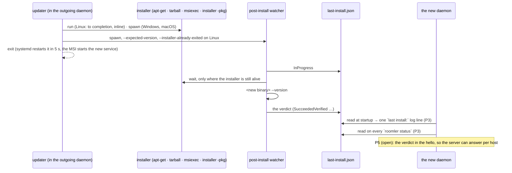

# An update's outcome — the record, who writes it, who reads it

**Status:** the read half is built (FR-67 P3, #2924) on top of the two fixes
that made a verdict reach the disk at all on Linux — P1 (#1400, the watcher no
longer waits on its own parent's pid) and P2 (#1427, the `.deb` path spawns a
watcher at all). The fleet half (P5: the verdict reported to the server) is
open; §8 says what it needs. Field, 2026-10-26: three systemd `.deb` hosts and
one Windows perMachine host (attended), read on 0.4.172 and again on 0.4.174,
§7.

Claims about behaviour were checked against the code at `b0953868e` plus
#2924; anchors say where a check would need repeating.

## 1. The problem

Every self-update ends in a verdict. The updater spawns a **post-install
watcher** beside the installer (`updater::spawn_installer_with_watch`,
`agents/roomlerd/src/updater.rs:1891` → `spawn_watcher`, `:2832`), the watcher
waits the installer out where there is anything to wait for, runs the new
binary's `--version`, and writes a typed record to `<log_dir>/last-install.json`
(`post_install::watch`, `agents/roomlerd/src/post_install.rs:229`).

Then nothing read it. `post_install::read_outcome` (`post_install.rs:180`) had
no caller on any platform; the module doc's "the new binary reads
`last-install.json` at startup" described a wire that was never run. The only
hosts anyone ever looked at were the ones somebody SSHed into — which is how a
record frozen at `InProgress` for `agent-v0.4.16`, written 2026-08-29, sat on a
host running 0.4.50 for a month before it was found (FR-67, #1267).

Two defects kept the Linux verdict off the disk in the first place, and the
reading was wrong about which mattered:

| | What | Fixed |
|---|---|---|
| 1 | Both Linux install paths complete **inside the daemon** (the tarball path inline, the `.deb` path `wait()`ing on `apt-get`), so the pid handed to the watcher was the daemon's own or a corpse. Polling it made the watcher's only exit condition **its parent's death**, which is also what tears down the unit's cgroup (`KillMode=control-group`) and kills it | P1, #1400: `should_wait_for_installer` skips the wait for an install that already finished (`post_install.rs:220`); #1457 dropped the 2 s settle for the same case, the whole remaining window |
| 2 | On the `.deb` path there was **no watcher to kill**: `apt` replaces `/usr/bin/roomlerd`, the running image is unlinked, `current_exe()` reads `/usr/bin/roomlerd (deleted)`, and `Command::spawn` on that path fails ENOENT. 21 `post-install watcher spawn failed` in seven days against zero `post-install watcher started` | P2, #1427: `strip_deleted_suffix` recovers the path and the spawn refuses a path that is not there (`updater.rs:2774`) |

## 2. The record

`<log_dir>/last-install.json`, one file, rewritten at every attempt
(`post_install::write_outcome`, `post_install.rs:166`; `InstallOutcome`,
`:117`):

| Field | What |
|---|---|
| `status` | `InProgress` · `SucceededVerified` · `SucceededUnverified` · `InstallerFailed` · `Timeout` (`InstallStatus`, `post_install.rs:131`) |
| `expected_version` | the release tag the install was for, `agent-v0.4.172` |
| `started_unix` / `finished_unix` | when the watcher started and when it wrote its verdict; `finished_unix` is null while `InProgress` |
| `installer_pid`, `installer_path`, `installer_exit_code` | the installer as the watcher saw it. ⚠️ On Linux the pid is the daemon's own or already reaped — forensic, never waited on (§1) |
| `new_binary_path`, `new_binary_version` | the binary the version probe ran, and what it printed |
| `note` | the watcher's own sentence: the probe's answer, the exit code, on Windows the service settle's verdict (`service Roomler: running (0 starts; seen Running)`) |

`<log_dir>` is `logging::resolve_log_dir`'s
(`crates/agent-core/src/logging.rs:500`): the process's per-user data dir plus
`logs`, except the Windows SCM host, which logs under
`%PROGRAMDATA%\Roomler\roomler\service-logs`. Where that lands:

| Who | `<log_dir>` |
|---|---|
| Linux root daemon (`.deb` or tarball system install) | `/root/.local/share/roomler/logs` |
| Linux per-user daemon | `~/.local/share/roomler/logs` |
| Windows, the console-session worker (where the updater runs) | `%LOCALAPPDATA%\roomler\roomler\data\logs` of the worker's account — the signed-in user on an attended perMachine install, SYSTEM under SystemContext (§5) |
| Windows, the SCM host (`service-run`) | `%PROGRAMDATA%\Roomler\roomler\service-logs` — **never written**: it spawns no watcher (§5) |

## 3. The life of a verdict



> ⚠️ **On Windows the new daemon starts before the verdict exists.** The MSI
> starts the new service mid-install, and the watcher is still waiting on
> msiexec and then settling the service (#2711). Field, this dev box, 0.4.172:
> the daemon's `started_at_ms` is 1792967954; the watcher's `finished_unix` is
> 1792967960. For those seconds the record honestly reads `InProgress`, which
> is why the daemon reads the file **on every answer** rather than once at
> startup (`DaemonState::status`, `agents/roomlerd/src/localapi_state.rs:858`),
> and why a fresh `InProgress` is "still at work", not a failure (§4).

## 4. The seven words

The daemon reports the record as `NodeStatus.last_install`
(`crates/localapi/src/lib.rs:439`), a `LastInstallStatus` (`:465`) whose
`status` is one of seven words — the five the watcher writes, spelled exactly
as the file and the watcher's `post-install verdict:` log line spell them so
one grep finds all three surfaces (locked by
`install_status_words_match_the_file_spelling`), plus two only the reader can
say:

| Word | Meaning | `roomler status` says | Startup log |
|---|---|---|---|
| `Absent` | no record: this daemon's updater has installed nothing yet, or the record sits in another process role's log dir (`path` says where this one looked, §5) | `none recorded — this daemon's updater has not installed anything yet` | INFO |
| `InProgress`, younger than 25 min | the watcher is still at work (Windows: waiting on msiexec, settling the service) | `in progress — agent-v0.4.172 started 17s ago; the post-install watcher has not reported yet` | INFO |
| `InProgress`, older | an install that **never reported**: the watcher was killed before it could write a verdict. The bug FR-67 was opened on | `NEVER REPORTED — agent-v0.4.16 started 3d ago and no verdict followed: the watcher was killed before it could write one (<path>)` | **WARN** |
| `SucceededVerified` | installer exited 0, the new binary's `--version` answered the expected tag | `ok — agent-v0.4.172 installed 2h ago, verified: roomlerd 0.4.172` — and `— but this daemon runs 0.4.175` when the record is for another release than the one running | INFO |
| `SucceededUnverified` | installer exited 0, the version probe did not confirm it | `UNVERIFIED — … the installer exited 0 but the version probe did not confirm it (<note>)` | WARN |
| `InstallerFailed` | installer exited non-zero | `FAILED — … the installer exited 1603 (<note>)` | WARN |
| `Timeout` | the installer did not exit within the watcher's budget (Windows: nor after the kill-and-retry) | `TIMED OUT — … (<note>)` | WARN |
| `Unreadable` | a file is there and does not parse; `note` carries the error chain | `record UNREADABLE — <error> (<path>)` | WARN |

The 25 min line is `LastInstallStatus::STALE_AFTER_SECS` (`lib.rs:503`): the
watcher's whole life is bounded — 10 min on the installer, 10 more on a
Windows wedge retry, 2 min settling the service — so nothing is still writing
a record older than that (`never_reported`, `:513`).

> ⚠️ **Three states must stay apart, and they do by construction.** A daemon
> that predates the field sends no `last_install` key, and the CLI prints
> **nothing** — silence is never read as "never updated". A daemon with no
> record says `Absent`. A record whose verdict never came says `InProgress`
> and, once stale, `NEVER REPORTED`. Folding any two of these into one
> "nothing to show" recreates the original bug one layer up: an operator
> would read a frozen record as a quiet host. The split is pinned by
> `summarize_keeps_absent_and_in_progress_apart` (daemon) and
> `absent_never_reported_and_in_progress_are_three_sentences` (CLI).

## 5. Who reads it, and from which process

The reader resolves the **same** `<log_dir>` the watcher wrote to only when it
runs in the process role that spawned the watcher
(`post_install::last_install_status`, `post_install.rs:1168`). That holds on
every platform's plain daemon. Two topologies split roles:

- **Windows perMachine host — an SCM service plus a console-session worker.**
  The SCM host (`roomlerd service-run`, session 0, SYSTEM) spawns a worker in
  the console session (`roomlerd run --supervisor scm`, session 1). The
  **worker** runs the signaling loop, the updater — and so the watcher — and
  the LocalAPI `roomler status` reaches, so `<log_dir>` is the worker's
  account's `%LOCALAPPDATA%…\logs`. Which account is the install mode's
  (`docs/installation.md` §Windows): the **signed-in user** on an attended
  install, **LocalSystem** under SystemContext — `WorkerRole` classifies the
  worker's own token, and only the S-1-5-18 SID is `SystemContext`
  (`agents/roomlerd/src/system_context/worker_role.rs:208`); `roomler status`
  shows the same fact as `privileged` (`process_is_privileged`,
  `agents/roomlerd/src/localapi_state.rs:401`), `service (per-user)` when it is
  false. The dev box is the attended case (`privileged: false`): the 0.4.172
  and 0.4.174 records sit under the signed-in user's profile, while the SYSTEM
  profile's copy is a July `InProgress` for `agent-v0.3.0-rc.183` — a watcher
  spawned under SYSTEM before the worker existed, frozen exactly the way P3
  would report as `NEVER REPORTED` had a SystemContext worker read it. ⚠️ The
  SystemContext mode itself is unread this cycle: there the reader and the
  record are both the SYSTEM profile's, which the design covers and no field
  read has yet confirmed. A reader in the SCM host would answer `Absent` —
  honestly, with `path` naming `service-logs` — which is why nothing reads it
  there.
- **A two-half Mac.** The root half's installs are the root update helper's
  (`com.roomler.update`, FR-96 / P4); the per-user half answers its own
  `<log_dir>`, where no root install ever writes. `roomler status` as the
  console user therefore reads `Absent` for the per-user half, and
  `with_machine_network` (`agents/roomlerd/src/person_socket.rs:213`) lends it
  the root half's **network** fields only, never its install record — the
  verdict is per daemon, and the half that answers must not claim another's.

## 6. Reading it

Three surfaces, no SSH needed for any of them:

```text
$ roomler status
● mars
  node id     6a074fe5…
  version     0.4.172
  last update ok — agent-v0.4.172 installed 2h ago, verified: roomlerd 0.4.172
  mode        service (root)
  …
```

- **Over the control plane**, from anywhere: `roomler exec <device> -- roomler
  status` (fleet RPC, `docs/fleet-rpc.md`), or `roomler status --json` and read
  `.last_install`. The line sits right under `version` — the record and the
  binary it produced, together — and is printed only when the daemon reports
  the field (`print_status`, `agents/roomler-cli/src/localclient.rs:2429`;
  the sentence per word, `last_install_line`, `:2819`).
- **The startup log**: one line, always prefixed `last install:`, right after
  `agent starting` (`post_install::log_at_startup`, `post_install.rs:1238`,
  called from `run_cmd`, `agents/roomlerd/src/main.rs:3679`). `journalctl -u
  roomlerd -g "last install"`, `roomler logs --grep "last install"`, or the
  dashboard's log viewer, since WARN lines ride the centralized upload. The
  level is `startup_level`'s (`:1222`): the two quiet states and a watcher
  still at work are INFO; everything else is WARN.
- **The watcher's own line**, written as the verdict lands: `post-install
  verdict: SucceededVerified (new binary at /usr/bin/roomlerd reports roomlerd
  0.4.172)` on the watcher's stdout, which journald captures on a systemd host
  (`post_install_watch_cmd`, `main.rs:2342`). This is the line the P7 field
  log read on 2026-10-19; it was the only reader before P3 and it only exists
  where stdout goes somewhere. ⚠️ It is printed **after** the record is
  written, and until #2935 the print itself could kill the watcher: under
  `roomler exec … roomlerd self-update` the watcher inherits the exec's stdout
  pipe, the install closes it, and `println!` panicked (`failed printing to
  stdout: The pipe is being closed. (os error 232)`) — a panic log and a false
  crash report after a clean install, on every exec-driven Windows update
  (#2934; three on the dev box, 10-25 → 10-26, each ~10 ms after its record).
  The record was complete every time, so P3's readers never saw it; #2935
  writes the line without panicking.

## 7. What is field-verified, and what is not yet

| Date | Where | Read | Result |
|---|---|---|---|
| 2026-09-05 | three Ubuntu cluster nodes, 0.4.70, **before** P1/P2 | `last-install.json` | all `InProgress`: two for `agent-v0.4.16` (written 2026-08-29), one for `agent-v0.4.13` (08-28), ~54 releases stale |
| 2026-10-26 | mars, jupiter, zeus — systemd, `KillMode=control-group`, the `.deb` path, 0.4.172 | `last-install.json` + the unit's journal | every record `SucceededVerified` for `agent-v0.4.172`, `installer_exit_code 0`, `started_unix == finished_unix`, mtime = the journal's verdict line (22:39:17–26Z). On mars, **13 consecutive organic updates** (0.4.155 → 0.4.172) each logged `post-install watcher started … already_exited=true` → `post-install verdict: SucceededVerified`. Every one began with `rc:agent.update — operator-triggered self-update` → `new release available — spawning installer and exiting` → `update install: package installed bin="apt-get"`: the auto-update path through the daemon's own updater, not a foreground `roomlerd self-update` |
| 2026-10-26 | the dev box, Windows perMachine, attended (the worker as the signed-in user, `privileged: false`; first written up as "SystemContext" — corrected, §5), 0.4.172 | the worker's `last-install.json` | `SucceededVerified`, `started_unix` 1792967937 → `finished_unix` 1792967960: the Windows watcher **kept its 23 s wait** on msiexec and then settled the service (`note: … service Roomler: running (0 starts; seen Running)`). The Windows path is as it was. Beside it, `panic-30080-1792967976.log`: the #2934 stdout panic, 16 s after the verdict, once the record was complete |
| 2026-10-26, 09:40Z | mars, jupiter, zeus again, now on **0.4.174** | `roomler exec <host> -- cat …/last-install.json`, `stat`, `journalctl -u roomlerd -g post-install` | every record `SucceededVerified` for `agent-v0.4.174`, `installer_exit_code 0`, `started_unix == finished_unix` (1793005414 · 1793005401 · 1793005402), mtime = the journal's verdict line (09:03:34Z · 09:03:21Z · 09:03:22Z). Each host took **two** more organic updates since the row above: 0.4.173 at 02:39Z and 0.4.174 at 09:03Z, each `spawning installer and exiting` → `package installed bin="apt-get"` → `watcher started … already_exited=true` → `SucceededVerified`. ⚠️ The 0.4.173 one had **no `rc:agent.update` push at all** on mars (its pushes: 10-25 22:39Z, 10-26 07:35Z and 09:03Z) — the daemon's own poll, the purest form of the auto-update path. mars: **15 of 15** since 0.4.155 |
| 2026-10-26, 08:01Z | the dev box again, on 0.4.174 | the worker's `last-install.json` + the logs dir | `SucceededVerified` for `agent-v0.4.174`, `started_unix` 1793001660 → `finished_unix` 1793001677 (17 s on msiexec), `note: … service Roomler: running (0 starts; seen Running)`, the file written at 1793001692 once the service had settled — and `panic-58744-1793001692.log` in the same second: `failed printing to stdout: The pipe is being closed. (os error 232)` at `std/src/io/stdio.rs:1165`, the #2934 signature, after the record. Neither 0.4.173 nor 0.4.174 carries #2935 (merged 09:27Z, after the 0.4.174 tag) |
| 2026-10-26, 09:55Z | the dev box's released 0.4.174 daemon (pre-P3), read by the branch's CLI | `roomler status`, `roomler status --json` | no `last update` line, no `last_install` key: a daemon that predates the field is **silent**, never `none recorded` — the third state of §4's callout, on a live daemon |
| — | the release that carries P3 | `roomler exec <host> -- roomler status`, `journalctl -g "last install"` | **owed**: the `last update` line and the startup line on a fleet host; then a synthetic stale `InProgress` and a deleted record on one host, to read `NEVER REPORTED` and `none recorded` apart in the field |

## 8. Not built

- **P5 — the fleet answer.** No wire message carries the verdict yet; the
  server still infers success from a changed `agent_version` on the next
  hello. The shape that fits is P7's: stamp `last_install` into the caps at
  every announcement (`stub_caps`, `agents/roomlerd/src/signaling.rs:7208`,
  where `update_mode` is stamped), additive `#[serde(default)]` on
  `AgentCaps`, stored wholesale by `AgentDao::update_capabilities`. One thing
  P7's shape does not cover: on Windows the first hello after an update carries
  `InProgress` (§3), and caps re-announce only when they change, so the agent
  has to re-announce once the verdict lands.
- **P4 — macOS.** `com.roomler.update` sets no `AbandonProcessGroup`, so launchd
  may reap the watcher where the installer genuinely is asynchronous. Open
  question on a real Mac, in the FR.
- **P6 — a transient systemd unit**, only if P1 leaves a measurable race. The
  10-26 reads say it does not on the `.deb` path: 15 of 15 on one host, and
  the last two on each of three.
