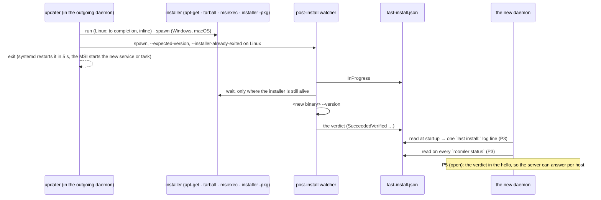

# An update's outcome — the record, who writes it, who reads it

**Status:** the read half is built (FR-67 P3, #2924) on top of the two fixes
that made a verdict reach the disk at all on Linux — P1 (#1400, the watcher no
longer waits on its own parent's pid) and P2 (#1427, the `.deb` path spawns a
watcher at all). The fleet half (P5: the verdict reported to the server) is
open; §8 says what it needs. Field, 2026-10-26: three systemd `.deb` hosts and
one Windows perMachine host (attended), read on 0.4.172 and again on 0.4.174
and 0.4.177, §7.

Claims about behaviour were checked against the code at `5f126955b` plus
#2924; anchors say where a check would need repeating.

## 1. The problem

Every self-update ends in a verdict. The updater spawns a **post-install
watcher** beside the installer (`updater::spawn_installer_with_watch`,
`agents/roomlerd/src/updater.rs:1920` → `spawn_watcher`, `:2892`), the watcher
waits the installer out where there is anything to wait for, runs the new
binary's `--version`, and writes a typed record to `<log_dir>/last-install.json`
(`post_install::watch`, `agents/roomlerd/src/post_install.rs:297`).

Then nothing read it. `post_install::read_outcome` (`post_install.rs:258`) had
no caller on any platform; the module doc's "the new binary reads
`last-install.json` at startup" described a wire that was never run. The only
hosts anyone ever looked at were the ones somebody SSHed into — which is how a
record frozen at `InProgress` for `agent-v0.4.16`, written 2026-08-29, sat on a
host running 0.4.50 for a month before it was found (FR-67, #1267).

Two defects kept the Linux verdict off the disk in the first place, and the
reading was wrong about which mattered:

| | What | Fixed |
|---|---|---|
| 1 | Both Linux install paths complete **inside the daemon** (the tarball path inline, the `.deb` path `wait()`ing on `apt-get`), so the pid handed to the watcher was the daemon's own or a corpse. Polling it made the watcher's only exit condition **its parent's death**, which is also what tears down the unit's cgroup (`KillMode=control-group`) and kills it | P1, #1400: `should_wait_for_installer` skips the wait for an install that already finished (`post_install.rs:288`); #1457 dropped the 2 s settle for the same case, the whole remaining window |
| 2 | On the `.deb` path there was **no watcher to kill**: `apt` replaces `/usr/bin/roomlerd`, the running image is unlinked, `current_exe()` reads `/usr/bin/roomlerd (deleted)`, and `Command::spawn` on that path fails ENOENT. 21 `post-install watcher spawn failed` in seven days against zero `post-install watcher started` | P2, #1427: `strip_deleted_suffix` recovers the path and the spawn refuses a path that is not there (`updater.rs:2834`) |

## 2. The record

`<log_dir>/last-install.json`, one file, rewritten at every attempt
(`post_install::write_outcome`, `post_install.rs:182`; `InstallOutcome`,
`:118`):

| Field | What |
|---|---|
| `status` | `InProgress` · `SucceededVerified` · `SucceededUnverified` · `InstallerFailed` · `Timeout` · `WatcherStopped` (`InstallStatus`, `post_install.rs:140`) |
| `expected_version` | the release tag the install was for, `agent-v0.4.172` |
| `started_unix` / `finished_unix` | when the watcher started and when it wrote its verdict; `finished_unix` is null while `InProgress` |
| `installer_pid`, `installer_path`, `installer_exit_code` | the installer as the watcher saw it. ⚠️ On Linux the pid is the daemon's own or already reaped — forensic, never waited on (§1) |
| `new_binary_path`, `new_binary_version` | the binary the version probe ran, and what it printed |
| `note` | the watcher's own sentence: the probe's answer, the exit code, on Windows the service settle's verdict (`service Roomler: running (0 starts; seen Running)`) |

`<log_dir>` is `logging::resolve_log_dir`'s
(`crates/agent-core/src/logging.rs:721`): the process's per-user data dir plus
`logs`, except a Windows process with a service role, which logs under
`%PROGRAMDATA%\Roomler\roomler\service-logs`: the SCM host, the SystemContext
worker and `netd` (`ServiceLogRole`). The watcher never has one, so the record
always lands in its own account's data dir. Where that lands:

| Who | `<log_dir>` |
|---|---|
| Linux root daemon (`.deb` or tarball system install) | `/root/.local/share/roomler/logs` |
| Linux per-user daemon | `~/.local/share/roomler/logs` |
| Windows per-user daemon | `%LOCALAPPDATA%\roomler\roomler\data\logs` of the signed-in person |
| Windows, the console-session worker (where the updater runs), attended perMachine | `%LOCALAPPDATA%\roomler\roomler\data\logs` of the signed-in user (§5) |
| Windows, the SystemContext worker (LocalSystem) | its own log in `%PROGRAMDATA%\Roomler\roomler\service-logs`. The record is in SYSTEM's profile, `%LOCALAPPDATA%\roomler\roomler\data\logs` as SYSTEM: its watcher writes it there and the reader reads it there too (§5) |
| Windows, the SCM host (`service-run`) | `%PROGRAMDATA%\Roomler\roomler\service-logs` — **never written**: it spawns no watcher (§5) |

## 3. The life of a verdict



> ⚠️ **On Windows the new daemon starts before the verdict exists.** The MSI
> starts the new service mid-install, and the watcher is still waiting on
> msiexec and then settling the service (#2711). Field, this dev box, 0.4.172:
> the daemon's `started_at_ms` is 1792967954; the watcher's `finished_unix` is
> 1792967960. For those seconds the record honestly reads `InProgress`, which
> is why the daemon reads the file **on every answer** rather than once at
> startup (`DaemonState::status`, `agents/roomlerd/src/localapi_state.rs:987`),
> and why a fresh `InProgress` is "still at work", not a failure (§4).

## 4. The eight words

The daemon reports the record as `NodeStatus.last_install`
(`crates/localapi/src/lib.rs:471`), a `LastInstallStatus` (`:510`) whose
`status` is one of eight words — the six a record can hold, spelled exactly
as the file and the watcher's `post-install verdict:` log line spell them so
one grep finds all three surfaces (locked by
`install_status_words_match_the_file_spelling`), plus two only the reader can
say:

| Word | Meaning | `roomler status` says | Startup log |
|---|---|---|---|
| `Absent` | no record: this daemon's updater has installed nothing yet, or the record sits in another process role's log dir (`path` says where this one looked, §5) | `none recorded — this daemon's updater has not installed anything yet` | INFO |
| `InProgress`, younger than 25 min | the watcher is still at work (Windows: waiting on msiexec, settling the service) | `in progress — agent-v0.4.172 started 17s ago; the post-install watcher has not reported yet` | INFO |
| `InProgress`, older | an install that **never reported**: the watcher was killed before it could write a verdict. The bug FR-67 was opened on | `NEVER REPORTED — agent-v0.4.16 started 3d ago and no verdict followed: the watcher was killed before it could write one (<path>)` | **WARN** |
| `SucceededVerified` | the new binary answers the expected tag: by the watcher's probe after an installer that went through (0, 3010, 1641) or was gone before its exit could be read, or, when the watcher left nothing, by the next daemon being that version (`docs/remote-control.md` §19.2) | `ok — agent-v0.4.172 installed 2h ago, verified: roomlerd 0.4.172` — and `— but this daemon runs 0.4.175` when the record is for another release than the one running | INFO |
| `SucceededUnverified` | the installer went through, the version probe did not confirm it. On macOS the 0 is a stand-in: nothing there reads the installer's exit | `UNVERIFIED — … the installer exited 0 but the version probe did not confirm it (<note>)` | WARN |
| `InstallerFailed` | the installer exited with anything else, or it was gone before its exit could be read and the expected version is not on disk: `installer_exit_code` is then null, never a stand-in 0 | `FAILED — … the installer exited 1603 (<note>)`, or `exited with no code` | WARN |
| `Timeout` | the installer did not exit within the watcher's budget (Windows: nor after the kill-and-retry) | `TIMED OUT — … (<note>)` | WARN |
| `WatcherStopped` | nothing wrote a verdict in the watcher's whole life, and the daemon that settled the record is not the version it was for (#3302) | `WATCHER STOPPED — agent-v0.4.172 started 3d ago: <note>` | WARN |
| `Unreadable` | a file is there and does not parse; `note` carries the error chain | `record UNREADABLE — <error> (<path>)` | WARN |

The 25 min line is `LastInstallStatus::STALE_AFTER_SECS` (`lib.rs:549`): the
watcher's whole life is bounded — 10 min on the installer, 10 more on a
Windows wedge retry, 2 min settling the service — so nothing is still writing
a record older than that (`never_reported`, `:557`).

> ⚠️ **Three states must stay apart, and they do by construction.** A daemon
> that predates the field sends no `last_install` key, and the CLI prints
> **nothing** — silence is never read as "never updated". A daemon with no
> record says `Absent`. A record whose verdict never came says `InProgress`
> and, once stale, `NEVER REPORTED`. Folding any two of these into one
> "nothing to show" recreates the original bug one layer up: an operator
> would read a frozen record as a quiet host. Since #3302 a healthy daemon
> settles a frozen record, so `NEVER REPORTED` lasts only until that daemon
> reaches its clean-run threshold. The split is pinned by
> `summarize_keeps_absent_and_in_progress_apart` (daemon) and
> `absent_never_reported_and_in_progress_are_three_sentences` (CLI).

## 5. Who reads it, and from which process

The reader has to look where the watcher wrote. On every platform's plain
daemon that is the reader's own `<log_dir>`. It reads two places
(`post_install::last_install_status`, `post_install.rs:1450`, through
`outcome_paths`, #3302): its own `<log_dir>` first, then its account's
profile data dir. It reports the record written last, and `path` names that
record's file. Two topologies split roles:

- **Windows perMachine host — an SCM service plus a console-session worker.**
  The SCM host (`roomlerd service-run`, session 0, SYSTEM) spawns a worker in
  the console session (`roomlerd run --supervisor scm`, session 1). The
  **worker** runs the signaling loop, the updater — and so the watcher — and
  the LocalAPI `roomler status` reaches, so the record is in the worker's
  account's `%LOCALAPPDATA%…\logs`. Which account is the install mode's
  (`docs/installation.md` §Windows): the **signed-in user** on an attended
  install, **LocalSystem** under SystemContext — `WorkerRole` classifies the
  worker's own token, and only the S-1-5-18 SID is `SystemContext`
  (`agents/roomlerd/src/system_context/worker_role.rs:208`); `roomler status`
  shows the same fact as `privileged` (`process_is_privileged`,
  `agents/roomlerd/src/localapi_state.rs:486`), `service (per-user)` when it is
  false. The dev box is the attended case (`privileged: false`): the 0.4.172
  and 0.4.174 records sit under the signed-in user's profile, while the SYSTEM
  profile's copy is a July `InProgress` for `agent-v0.3.0-rc.183` — a watcher
  spawned under SYSTEM before the worker existed, frozen exactly the way P3
  would report as `NEVER REPORTED` had a SystemContext worker read it.
  ⚠️ **Under SystemContext the worker and its watcher log apart.** The
  worker takes the `service-logs` role (S1b,
  `agents/roomlerd/src/app.rs:1630`). The watcher it spawns has none and
  writes the record into SYSTEM's profile. Read on a per-machine guest, a
  real self-update from candidate 0.4.220 to 0.4.221 left the record
  `InProgress` in SYSTEM's profile past the clean-run threshold, with no
  record in `service-logs`. So a reader of its own `<log_dir>` alone answers
  `none recorded` after every update. Reading both, candidate 0.4.223 settled
  that record, and `roomler status` read `ok` with `path` in SYSTEM's profile
  (§7). The SCM host reads nothing: it spawns no watcher, and `roomler status`
  reaches the worker.
- **A two-half Mac.** The root half's installs are the root update helper's
  (`com.roomler.update`, FR-96 / P4); the per-user half answers its own
  `<log_dir>`, where no root install ever writes. `roomler status` as the
  console user therefore reads `Absent` for the per-user half, and
  `with_machine_network` (`agents/roomlerd/src/person_socket.rs:245`) lends it
  the root half's **network** fields only, never its install record — the
  verdict is per daemon, and the half that answers must not claim another's.

## 6. Reading it

Three surfaces, no SSH needed for any of them:

```text
$ roomler status
● mars
  node id     6a074fe5…
  version     0.4.172
  last update ok — agent-v0.4.172 installed 2h ago, verified: roomlerd 0.4.172
  mode        service (root)
  …
```

- **Over the control plane**, from anywhere: `roomler exec <device> -- roomler
  status` (fleet RPC, `docs/fleet-rpc.md`), or `roomler status --json` and read
  `.last_install`. The line sits right under `version` — the record and the
  binary it produced, together — and is printed only when the daemon reports
  the field (`print_status`, `agents/roomler-cli/src/localclient.rs:2474`;
  the sentence per word, `last_install_line`, `:2869`).
- **The startup log**: one line, always prefixed `last install:`, right after
  `agent starting` (`post_install::log_at_startup`, `post_install.rs:1526`,
  called from `run_cmd`, `agents/roomlerd/src/app.rs:4204`). `journalctl -u
  roomlerd -g "last install"`, `roomler logs --grep "last install"`, or the
  dashboard's log viewer, since WARN lines ride the centralized upload. The
  level is `startup_level`'s (`:1265`): the two quiet states and a watcher
  still at work are INFO; everything else is WARN.
- **The watcher's own line — a surface that ends at 0.4.176.** Written as
  the verdict lands: `post-install verdict: SucceededVerified (new binary at
  /usr/bin/roomlerd reports roomlerd 0.4.172)` on the watcher's stdout
  (`post_install_watch_cmd`, `app.rs:2537`), which journald captured on a
  systemd host, beside the watcher's `post-install watcher started` tracing
  line on its stderr. This is the line the P7 field log read on 2026-10-19
  and the rows of §7 read on 10-26; it was the only reader before P3.
  ⚠️ It is printed **after** the record is written, and until #2935 the print
  itself could kill the watcher: under `roomler exec … roomlerd self-update`
  the watcher inherited the exec's stdout pipe, the install closed it, and
  `println!` panicked (`failed printing to stdout: The pipe is being closed.
  (os error 232)`) — a panic log and a false crash report after a clean
  install, on every exec-driven Windows update (#2934; three on the dev box,
  10-25 → 10-26, each ~10 ms after its record). The record was complete every
  time, so P3's readers never saw it. #2935 (0.4.175+) writes the line without
  panicking; **#2943 (0.4.176+) then takes the watcher's stdio away
  altogether** — the same inherited pipe kept the exec's reader from EOF and
  made the outgoing worker overrun its stop budget — so `spawn_watcher` gives
  it `/dev/null` for all three on every platform (`without_caller_stdio`,
  `agents/roomlerd/src/updater.rs:2862`, called at `:2963`). From the first
  update a 0.4.176+ daemon spawns, the journal shows the daemon's own
  `post-install watcher spawned` line and nothing from the watcher; the
  verdict reaches the record file and P3's two readers, and nothing else.
  As of 2026-10-26 17:32Z every watcher on the three fleet hosts was still a
  ≤0.4.175 daemon's (mars went 0.4.175 → 0.4.177 directly), so that end is
  read off the code, not yet observed.

## 7. What is field-verified, and what is not yet

| Date | Where | Read | Result |
|---|---|---|---|
| 2026-09-05 | three Ubuntu cluster nodes, 0.4.70, **before** P1/P2 | `last-install.json` | all `InProgress`: two for `agent-v0.4.16` (written 2026-08-29), one for `agent-v0.4.13` (08-28), ~54 releases stale |
| 2026-10-26 | mars, jupiter, zeus — systemd, `KillMode=control-group`, the `.deb` path, 0.4.172 | `last-install.json` + the unit's journal | every record `SucceededVerified` for `agent-v0.4.172`, `installer_exit_code 0`, `started_unix == finished_unix`, mtime = the journal's verdict line (22:39:17–26Z). On mars, **13 consecutive organic updates** (0.4.155 → 0.4.172) each logged `post-install watcher started … already_exited=true` → `post-install verdict: SucceededVerified`. Every one began with `rc:agent.update — operator-triggered self-update` → `new release available — spawning installer and exiting` → `update install: package installed bin="apt-get"`: the auto-update path through the daemon's own updater, not a foreground `roomlerd self-update` |
| 2026-10-26 | the dev box, Windows perMachine, attended (the worker as the signed-in user, `privileged: false`; first written up as "SystemContext" — corrected, §5), 0.4.172 | the worker's `last-install.json` | `SucceededVerified`, `started_unix` 1792967937 → `finished_unix` 1792967960: the Windows watcher **kept its 23 s wait** on msiexec and then settled the service (`note: … service Roomler: running (0 starts; seen Running)`). The Windows path is as it was. Beside it, `panic-30080-1792967976.log`: the #2934 stdout panic, 16 s after the verdict, once the record was complete |
| 2026-10-26, 09:40Z | mars, jupiter, zeus again, now on **0.4.174** | `roomler exec <host> -- cat …/last-install.json`, `stat`, `journalctl -u roomlerd -g post-install` | every record `SucceededVerified` for `agent-v0.4.174`, `installer_exit_code 0`, `started_unix == finished_unix` (1793005414 · 1793005401 · 1793005402), mtime = the journal's verdict line (09:03:34Z · 09:03:21Z · 09:03:22Z). Each host took **two** more organic updates since the row above: 0.4.173 at 02:39Z and 0.4.174 at 09:03Z, each `spawning installer and exiting` → `package installed bin="apt-get"` → `watcher started … already_exited=true` → `SucceededVerified`. ⚠️ The 0.4.173 one had **no `rc:agent.update` push at all** on mars (its pushes: 10-25 22:39Z, 10-26 07:35Z and 09:03Z) — the daemon's own poll, the purest form of the auto-update path. mars: **15 of 15** since 0.4.155 |
| 2026-10-26, 08:01Z | the dev box again, on 0.4.174 | the worker's `last-install.json` + the logs dir | `SucceededVerified` for `agent-v0.4.174`, `started_unix` 1793001660 → `finished_unix` 1793001677 (17 s on msiexec), `note: … service Roomler: running (0 starts; seen Running)`, the file written at 1793001692 once the service had settled — and `panic-58744-1793001692.log` in the same second: `failed printing to stdout: The pipe is being closed. (os error 232)` at `std/src/io/stdio.rs:1165`, the #2934 signature, after the record. Neither 0.4.173 nor 0.4.174 carries #2935 (merged 09:27Z, after the 0.4.174 tag) |
| 2026-10-26, 09:55Z | the dev box's released 0.4.174 daemon (pre-P3), read by the branch's CLI | `roomler status`, `roomler status --json` | no `last update` line, no `last_install` key: a daemon that predates the field is **silent**, never `none recorded` — the third state of §4's callout, on a live daemon |
| 2026-10-26, 23:20Z | mars, jupiter, zeus, now on **0.4.177** | the same files + the journal over `roomler exec` | every record `SucceededVerified` for `agent-v0.4.177`, `started_unix == finished_unix` (1793035976 · 1793035969 · 1793035969), mtime = the journal's verdict line (17:32:56Z · 17:32:49Z · 17:32:49Z). Two more organic updates each since the 0.4.174 row — 0.4.175 at 13:03Z and 0.4.177 at 17:32Z; mars and zeus **skipped 0.4.176** (`current=0.4.175 latest=agent-v0.4.177`; jupiter's journal not read) — each `spawning installer and exiting` → `package installed bin="apt-get"` → `watcher started … already_exited=true` → the verdict. mars: **17 of 17** since 0.4.155. ⚠️ Every watcher so far was a ≤0.4.175 daemon's, so the journal still carries its lines; §6 says why it will not from 0.4.176 on |
| 2026-10-26, 15:34Z | the dev box, on **0.4.177** | the worker's `last-install.json` + the logs dir | `SucceededVerified` for `agent-v0.4.177`, `started_unix 1793028879 → finished_unix 1793028892` (13 s on msiexec), the service settled — and **no panic log beside it**, the first Windows record this FR has read without one: the watcher was the 0.4.175 daemon's (the box went 0.4.175 → 0.4.177 directly), and 0.4.175 is the first release with #2935. #2943 (0.4.176+) goes further and gives the watcher no stdio at all, §6 |
| 2026-11-03 | a Win11 guest, per-user, a standard user at the console; candidate 0.4.223 (#2924 with #3345 and the `WatcherStopped` word), after a self-update from 0.4.221 | `roomler status`, `--json`, the startup line | the watcher's own verdict: `ok — agent-v0.4.223 installed 6m ago, verified: roomlerd 0.4.223`, INFO. An hour-old `InProgress` for the running version, written by hand: `NEVER REPORTED`, WARN, and after the clean-run threshold the daemon settled it to `ok`. A two-hour-old `InProgress` for another release: `WATCHER STOPPED`, WARN. The record deleted: `none recorded`, INFO. `--json` carried `last_install` with `path` in every state |
| 2026-11-03 | a Win11 guest, per-machine SystemContext; released 0.4.197 updated itself to candidate 0.4.223 | the startup line; `roomler status`, elevated | 0.4.197's watcher was stopped before its verdict. The new daemon logged `last install: in progress` at its start and settled the record at its threshold, and `roomler status` read `ok — agent-v0.4.223 installed 6m ago, verified: roomlerd 0.4.223` with `path` in SYSTEM's profile (§5) |
| 2026-11-03 | an Ubuntu guest, a root `.deb` daemon under systemd, candidate 0.4.223 installed by hand | `roomler status`, `journalctl -u roomlerd` | `none recorded` with no record, INFO; `NEVER REPORTED` for an hour-old `InProgress`, WARN. A crash loop rolled the device back to 0.4.197 on a real `dpkg` downgrade, and the candidate went in again by hand: `ok — agent-v0.4.197 installed 4m ago, verified: roomlerd 0.4.197 — but this daemon runs 0.4.223`, from the record the rollback's own watcher wrote. `none recorded` after the delete |
| — | the release that carries P3 — none yet: 0.4.198, the newest at this writing, predates #2924, and the three rows above are candidates | `roomler exec <host> -- roomler status`, `journalctl -g "last install"` | **owed**: the `last update` line and the startup line on a fleet host; then a synthetic stale `InProgress` and a deleted record on one host, to read `NEVER REPORTED` and `none recorded` apart in the field |

## 8. Not built

- **P5 — the fleet answer.** No wire message carries the verdict yet; the
  server still infers success from a changed `agent_version` on the next
  hello. The shape that fits is P7's: stamp `last_install` into the caps at
  every announcement (`stub_caps`, `agents/roomlerd/src/signaling.rs:7430`,
  where `update_mode` is stamped), additive `#[serde(default)]` on
  `AgentCaps`, stored wholesale by `AgentDao::update_capabilities`. One thing
  P7's shape does not cover: on Windows the first hello after an update carries
  `InProgress` (§3), and caps re-announce only when they change, so the agent
  has to re-announce once the verdict lands.
- **P4 — macOS.** `com.roomler.update` sets no `AbandonProcessGroup`, so launchd
  may reap the watcher where the installer genuinely is asynchronous. Open
  question on a real Mac, in the FR.
- **P6 — a transient systemd unit**, only if P1 leaves a measurable race. The
  10-26 reads say it does not on the `.deb` path: 17 of 17 on one host, and
  the last four on each of three.
