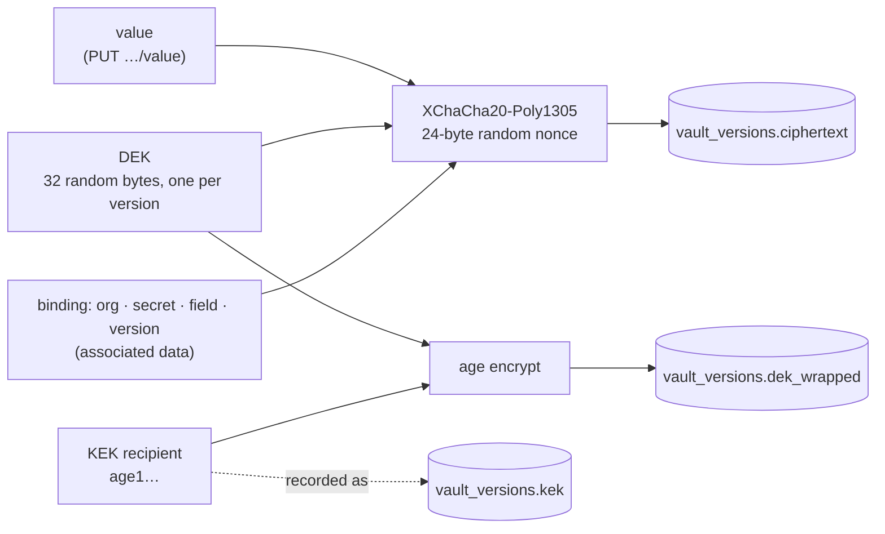
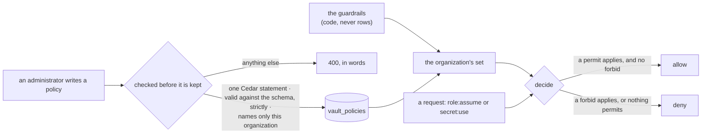

# Vault: IAM for secrets

The vault keeps an organization's secrets: database passwords, API tokens,
kubeconfigs, signing keys. Every value is encrypted at rest under a key of its
own, named by an RRN, and every decision about it is recorded. It is built for
Hive's agent sessions, which use a secret without the model ever reading it.
People use it too.

> Spec, steps and the field log: [`fr/FR-90-hive-agent-sessions.md`](fr/FR-90-hive-agent-sessions.md)
> §3e (#1827). The whole design (roles, Cedar policies, leases, the modes a
> session gets a secret in) is [`roomler-hive-design.md`](roomler-hive-design.md)
> §8. **This page describes what is built: P3-1, the store, and P3-2a, roles
> and Cedar policies (§7).** No device and no session reaches a value yet, and
> no session assumes a role yet (P3-2b).

## 1. Custody: who can read a secret

> [!WARNING]
> **Managed custody.** The vault module holds the key-encryption key (KEK)
> and can decrypt every secret it stores. Whoever controls the server, or
> holds both the KEK and a copy of the database, can read them all. That is
> the v1 model.

What that means in practice:

| Who | Can read values? | Why |
|---|---|---|
| the server process | yes | it holds the KEK ([`KekState`](../crates/modules/vault/src/crypto.rs#L242)) |
| the cluster's operator | yes | the KEK is a secret on the cluster (§3) |
| someone with a database dump only | no | every value is sealed; the data keys are wrapped to the KEK |
| someone with a database dump **and** the KEK | yes | that is all it takes, so keep the KEK out of every backup the database goes into |
| a member of the organization, an administrator included | no | no route answers a value in P3-1 (§6) |
| a session or a device | no, not yet | a session's use is P3-3's lease; the value will cross to the device sealed to that device's own key |

Customer-managed keys (the KEK in the organization's own KMS, revocable by it)
and sovereign custody (only the organization's devices can unwrap) are P7.

## 2. Envelope encryption

Every value written gets a fresh 32-byte data key (DEK). The value is sealed
under it with XChaCha20-Poly1305, and the DEK is wrapped to the KEK with
[`age`](https://age-encryption.org). The KEK is an `age` X25519 identity, so a
wrapped DEK is an ordinary `age` file and `age-keygen` makes the KEK.



| Stored with a version | What it is |
|---|---|
| `ciphertext` | the value under the DEK |
| `nonce` | 24 random bytes, one per version |
| `dek_wrapped` | the DEK, `age`-encrypted to the KEK |
| `kek` | the KEK's recipient (`age1…`): public, kept so a rotation can tell which key wraps which version |

> [!IMPORTANT]
> **A seal is bound to its place.** The associated data names the
> organization, the secret, the field and the version number
> ([`Binding`](../crates/modules/vault/src/crypto.rs#L46)). Whoever can write
> the database can copy a ciphertext from one row into another. With the
> binding, the copied value fails to open, instead of answering for the
> secret it was moved into. The KEK is not in the binding: a rotation re-wraps
> the DEKs and leaves every value alone.

The vault brings its own keys. It derives nothing from the JWT secret or the
DERP ticket key.

**Recovery without the server.** `age -d -i kek.txt` decrypts a version's
`dek_wrapped` to its DEK, and the DEK opens the `ciphertext` with the binding
as associated data: `roomler-vault/v1`, the organization id, the secret id,
the field and the version number, NUL-separated
([`a_wrapped_data_key_is_an_ordinary_age_file`](../crates/modules/vault/src/crypto.rs#L451)
is that recipe as a test).

## 3. The KEK

| Setting | Env | Holds |
|---|---|---|
| `vault.kek` | `ROOMLER__VAULT__KEK` | the identity, `AGE-SECRET-KEY-1…`, or an `age-keygen` file's whole text |
| `vault.kek_file` | `ROOMLER__VAULT__KEK_FILE` | the path of an `age-keygen` file |

```sh
age-keygen -o kek.txt          # keep it out of every backup the database is in
```

- A self-hoster keeps the KEK in a file. Hosted roomler.ai keeps it in a sealed
  secret on the cluster, which has no cloud KMS under it.
- Exactly one identity. Blank lines and `#` comments are skipped, as
  `age-keygen` writes them. More than one identity is refused: a KEK rotation
  is not built yet.
- **Both settings set is refused**, not guessed: the two may disagree.
- **Never a boot refusal.** With no KEK, or one that does not parse, the vault
  still mounts. Its metadata routes work, and the two routes that need the
  key (`PUT …/value`, `POST …/verify`) answer **503** with the reason. The
  reason is always a fixed sentence and never repeats the setting.
- The KEK never prints. `VaultSettings`' `Debug` is written by hand
  ([`settings.rs`](../crates/config/src/settings.rs#L96)), and so is the
  KEK's ([`crypto.rs`](../crates/modules/vault/src/crypto.rs#L121)). The boot
  log names the recipient only.
- `GET …/vault` reports `other_kek`: how many versions were wrapped to a KEK
  other than the one loaded. Above zero after a key change, that count is
  every value the old key held, now unreadable. `POST …/verify` names them.

## 4. Secrets, versions, RRNs

A **secret** is a name and its rules, and never a value:

| Field | Meaning |
|---|---|
| `path` | unique among the organization's live secrets; lowercase segments of `a-z 0-9 . _ -` joined by `/`. Never changes |
| `kind` | `static` (one field, `value`) or `structured` (named fields: `username`, `password`…). `dynamic`, `template` and `llm_credential` come with the steps that give them meaning |
| `audiences` | where a value may be presented: host patterns, a knowhow entity, a named upstream. Stored in P3-1; the daemon holds a use to them from P3-5 |
| `exec_allow` | the programs a value may be handed to, as `argv[0]` (P3-4's `vault_exec`) |
| `tags`, `owner_id`, `rotation_days`, `description` | metadata; tags get one spelling, because a policy matches them by equality |
| `disabled` | P3-5's per-secret kill switch: a disabled secret is never used. An administrator still reads its metadata and writes its value |

Its **RRN** is `rrn:{org slug}:secret:{path}`
([`rrn.rs`](../crates/modules/vault/src/rrn.rs)). The organization's slug is
part of the name, so a reference to another organization's secret cannot be
written down. The RRN is rendered when shown, and never stored, so the name and
the row cannot disagree.

> [!NOTE]
> **One spelling per name.** Paths, fields and tags are lowercase by rule, not
> folded. Two paths that differ only in case would be one name to a person and
> two to an index. A field name is a key in the stored document
> (`fields.<name>`), so `.` and `$` are refused: either would make it a path or
> an operator to the database.

A **version** is one value written to one field. Each field counts on its own:

- **The number comes from an `$inc` on the secret**, so two writers never get
  one number. A write that fails after it leaves a gap; a number is never
  reused.
- **`current` moves by `$max`** once the row is stored, so a slower writer of an
  older number never moves it back.
- **A field keeps its last 10 versions.** Older ones are destroyed: an old value
  is no less sensitive for being old.
- `expires_at`, when given, is honoured by the first step that uses a value:
  P3-3's leases never hand out an expired version.

**Deleting a secret** tombstones it with a compare-and-set, so of two deletes
one acts, and then destroys every version. There is no undo. The path is free
again, and a new secret there gets a new id. The tombstone comes first: a
version delete that fails after it leaves ciphertext no route reaches, a leak
to sweep, never a secret brought back.

## 5. The org gate and the switch

| Switch | Effect |
|---|---|
| `[modules] vault` (`ROOMLER__MODULES__VAULT`) | **default OFF**, like `hive`: no route is mounted |
| `vault.tenants` (`ROOMLER__VAULT__TENANTS=<id>,<id>`) | the organizations the vault serves. A list alone mounts the module, the form a hosted server uses, because no older image reads it. Clearing it is the kill switch |

`vault.tenants` reads like `hive.tenants`: empty or `*` is every organization,
and an entry that is not an organization id matches nothing
([`scope.rs`](../crates/modules/vault/src/scope.rs)). A member of an
organization the vault does not serve is told `404 the vault is not available
to this organization` on every route. Someone outside the organization is
told `403 not_a_member` first, and so learns nothing about whether it is
served.

## 6. Routes

All under `/api/tenant/{tenant_id}/vault`, for the organization's
`ADMINISTRATOR`s only ([`routes.rs`](../crates/modules/vault/src/routes.rs)).

| Method | Path | Does | Needs the KEK | Recorded as |
|---|---|---|---|---|
| GET | `` | the KEK's state (`ready` with its recipient, `missing`, `invalid` with the reason), the counts, `other_kek` | no | — |
| GET | `/secret` | the live secrets, by path; `?prefix=staging/` lists a folder | no | `secret:list` · `list` |
| POST | `/secret` | declare one: path, kind, rules. ⚠️ `value` here is an unknown field, refused **422**, so a value has one way in | no | `secret:write` · `create` |
| GET | `/secret/{id}` | one secret and its versions' metadata: number, KEK, author, expiry. The read never loads the sealed bytes | no | `secret:list` · `describe` |
| PATCH | `/secret/{id}` | change its rules. `path` and `kind` are unknown fields (**422**): a policy names a secret by its RRN, and a rename would quietly re-point every policy that names it | no | `secret:write` · `update` |
| DELETE | `/secret/{id}` | tombstone it and destroy every version | no | `secret:delete` · `delete` |
| PUT | `/secret/{id}/value` | write a field's next version, `{field?, value, expires_at?}`; answers the number | **yes** | `secret:write` · `value`, with the number |
| POST | `/verify` | open every version the organization holds (up to 10,000) and answer which do not open: `other_kek`, `dek_unreadable`, `tampered`. Never a value | **yes** | `vault:verify` · `verify` |
| GET | `/audit` | the decisions, newest first (`?before=`, `?limit=` up to 200) | no | — |
| GET | `/schema` | P3-2a — the Cedar schema policies are written against, and the actions, modes and OSes it names | no | — |
| GET · POST | `/role` | P3-2a — the vault roles; declare one `{name, description?}` | no | `policy:write` · `role_create` |
| DELETE | `/role/{name}` | P3-2a — tombstone a role; **409** while a live policy names it | no | `policy:write` · `role_delete` |
| GET · POST | `/policy` | P3-2a — the guardrails, then the organization's policies; add one `{name, description?, text}` | no | `policy:write` · `policy_create` |
| GET · PUT · DELETE | `/policy/{id}` | P3-2a — one policy; replace it `{…, rev}` from the revision read (**409** if it moved); tombstone it. A `guardrail:*` id is **400** for both writes | no | `policy:write` · `policy_update` / `policy_delete` |
| POST | `/simulate` | P3-2a — decide a request as the vault would, and say which policies decided it; `with` / `without` for a change not yet made | no | — (decides nothing for real) |

> [!WARNING]
> **No route answers a value.** In P3-1 a value goes in through `PUT …/value`
> and comes out nowhere. A session's use is P3-3's lease. A person's
> `secret:read`, which puts the value in front of a human, is a later step with
> its own gate.

## 7. Roles and policies (P3-2a)

A session will assume one **role** at its start (P3-2b), and the
organization's **policies**, written in [Cedar](https://www.cedarpolicy.com),
say what each role may do. The mapping to AWS IAM is design §8.1; what is
built is the language, the checks, the guardrails and `simulate`
([`policy.rs`](../crates/modules/vault/src/policy.rs)).



**The schema** ([`policy.cedarschema`](../crates/modules/vault/src/policy.cedarschema)),
namespace `Roomler`:

| Entity | What it is |
|---|---|
| `User` `in Group` | a person; one `Group` per roomler role they hold (`owner`, `admin`, `member`, … and the organization's own) |
| `Role` | a vault role, `Roomler::Role::"dev"` |
| `Session` `in Role` | an agent session in the role it assumed; `owner`, and `playbook` when it runs one |
| `Secret` `in SecretFolder` | `rrn:{org}:secret:{path}`, with `path`, `kind`, `tags`; a folder per path prefix, each in the one above |

| Action | Principal → resource | Context |
|---|---|---|
| `role:assume` | `User` → `Role` | `device {os, tags, owner}` |
| `secret:use` | `Session` → `Secret` | `mode`, `audience`, `ttl_s`, `device {os, tags, owner}`, `approval? {approver}` |

`os` is `linux`, `macos` or `windows`, exactly as the device rows store it; any
other spelling is refused, never lowercased into a match. A device's tags are
lowercased, because they are free-form and a policy compares by equality.

**The guardrails** are in every organization's set from its first decision.
They are code, not rows, so no organization can edit or lose one, and their
text names no organization:

| Guardrail | Forbids |
|---|---|
| `guardrail:windows-proxy-only` | any `secret:use` on Windows in a mode other than `proxy`: there is no Claude Code sandbox there (AC13; decision 17) |
| `guardrail:prod-never-materializes` | `secret:use` in `file`, `env` or `exec` for a secret tagged `prod` or under `prod/` |

**A policy is checked before it is kept** ([`check_policy`](../crates/modules/vault/src/policy.rs)):
exactly one static Cedar statement, valid against the schema in strict mode,
and naming only its organization:

- a `Secret` or `SecretFolder` literal must carry the organization's RRN
  prefix, with a valid path after it;
- a `Role` must be one of its vault roles;
- a `Group` must be one of its roomler roles;
- a `User` must be one of its members;
- a `Session` is never named: sessions come and go, and a policy for one would
  outlive it.

> [!IMPORTANT]
> - **Default deny; a `forbid` beats every `permit`.**
> - **A set that does not build is a deny, never an allow.** A stored policy
>   that no longer parses fails the whole set, rather than being skipped: the
>   one skipped could be a `forbid`.
> - **A role a live policy names cannot be deleted.** A role re-created under
>   the old name would inherit every policy that still named it. Whether a
>   policy names a role is read from the parsed policy, so no spacing or escape
>   in the text hides it.

**`simulate`** decides a request as the vault would and answers which policies
decided it: the permits that allowed it, the forbid or guardrail that denied
it, or nothing (the default deny). With `with` (policies as if added, each
checked as a write) and `without` (stored policies as if deleted, never a
guardrail), it answers for a change before it is made. It decides nothing for
real and records nothing. Replaying a change against the last 7 days of
recorded decisions waits for P3-2b, the first step that records a Cedar
decision.

## 8. Audit

`vault_audit` holds every `secret:*` and `vault:verify` decision, allow and
deny. Each row has the principal (`user` in P3-1), the action as a policy
names it, the operation, the decision and its reason (`administrator` or
`not_administrator`), and the RRN, field and version number where there is
one. Rows expire after 90 days, like the other audits.

- **An allow is recorded before it is acted on, and fails closed.** A decision
  the vault cannot record is answered 500 and not acted on.
- A refusal is recorded too, on a best-effort basis: the caller is refused
  whatever the database says.
- The status and the audit read are not decisions about a secret, and are not
  recorded.
- A request refused for its content (400, 422) or for want of a KEK (503) acts
  on nothing, so it records no allow.
- A device's own report of using a value is a different claim, made by a host
  that may be compromised. From P3-3 it goes to `vault_activity`, never here,
  as `ssh_audit` and `ssh_activity` are kept apart.

## 9. Collections

| Collection | One row per | Indexes | Retention |
|---|---|---|---|
| `vault_secrets` | secret | unique `(tenant_id, path)` over live rows (partial on `deleted_at: {$type: "null"}`, so a live row stores an explicit `null`); `(tenant_id, deleted_at, path)` | tombstoned, kept |
| `vault_versions` | value written | unique `(secret_id, field, n)`; `(tenant_id, kek)` | the last 10 per field; all go with their secret |
| `vault_audit` | decision | `(tenant_id, at desc)`, `(secret_id, at)` | 90 days (TTL on `at`) |
| `vault_roles` | vault role (P3-2a) | unique `(tenant_id, name)` over live rows | tombstoned, kept |
| `vault_policies` | policy (P3-2a): one Cedar statement, its effect, a revision | unique `(tenant_id, name)` over live rows; `(tenant_id, deleted_at, created_at)` | tombstoned, kept |

## 10. What comes next

| Step | Builds |
|---|---|
| P3-2b | `role:assume` at a session's start, decided again whenever a session moves to another device; Cedar decisions recorded with their request, so `simulate` can replay a change against the last 7 days |
| P3-3 | the device's own X25519 vault key, leases (requested, revoked by a push and by TTL, bound to the fence), a value sealed to the device and held in daemon memory, `vault_activity` |
| P3-4 | the toolbelt's vault tools and the approval card a policy can ask for |
| P3-5 to P3-9 | `proxy` mode, `short-lived` credentials, session SOCKS, `ssh_run` and `fleet_exec` as tools, `roomler connect` |
| P3k | the field run in the test organization |
