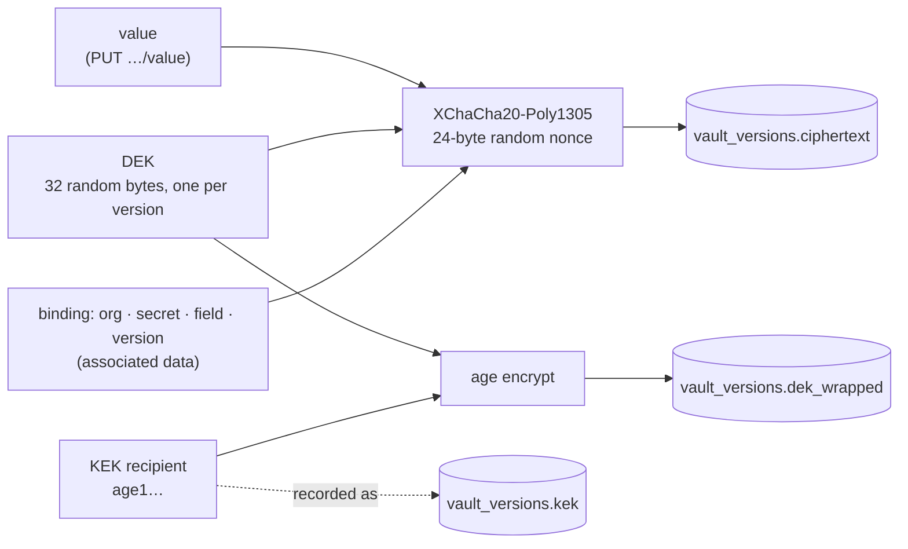
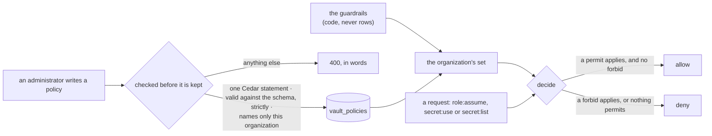
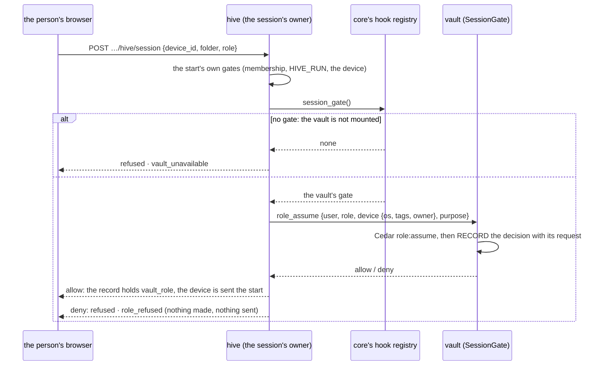
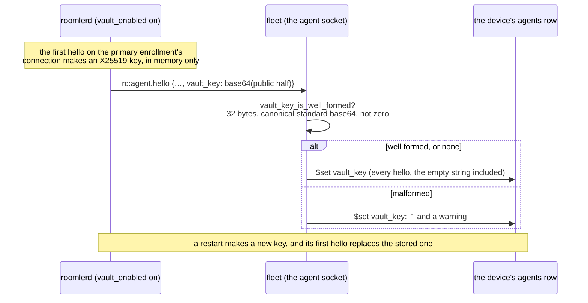
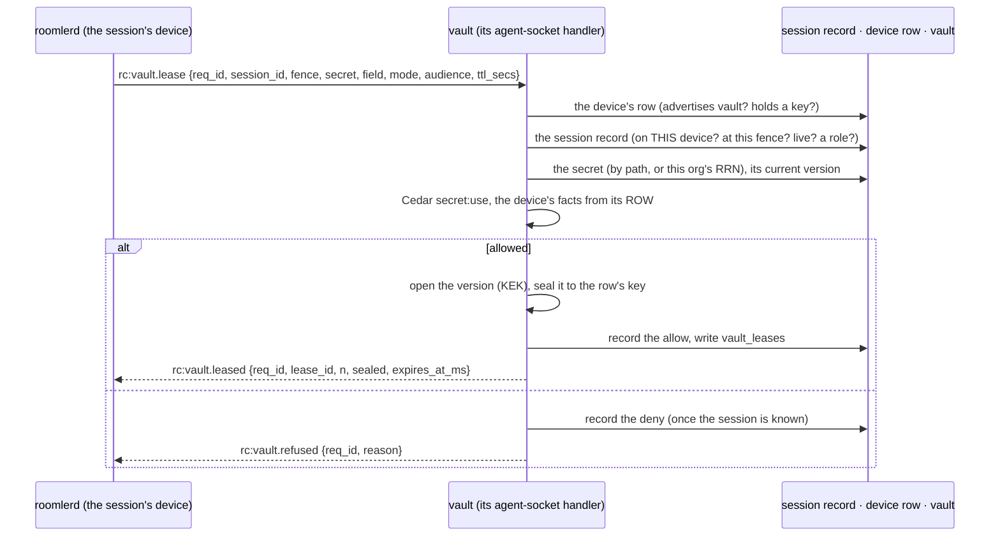
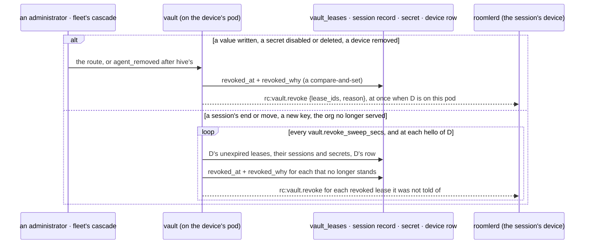
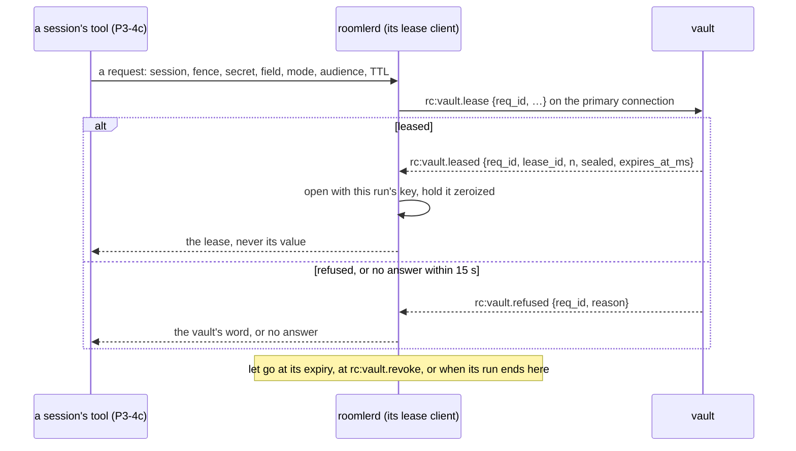
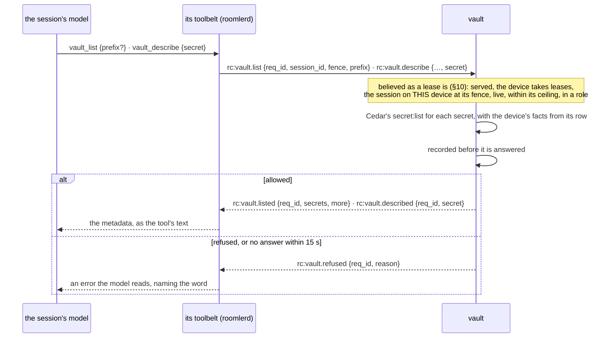
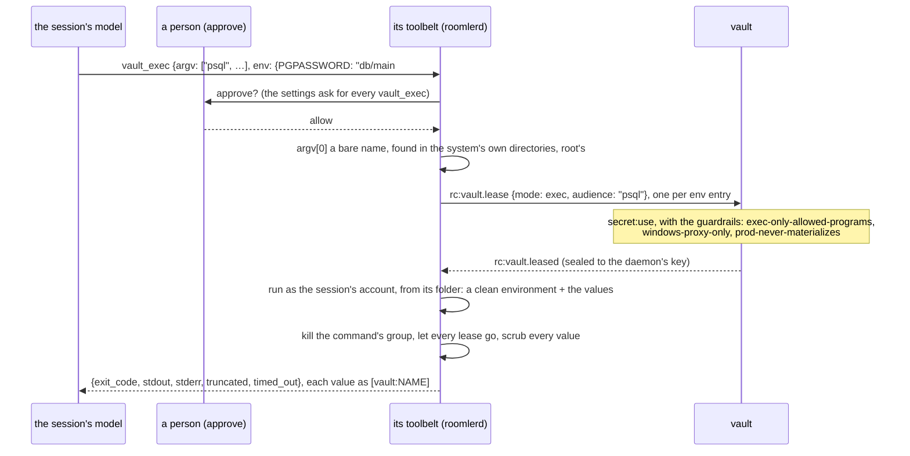
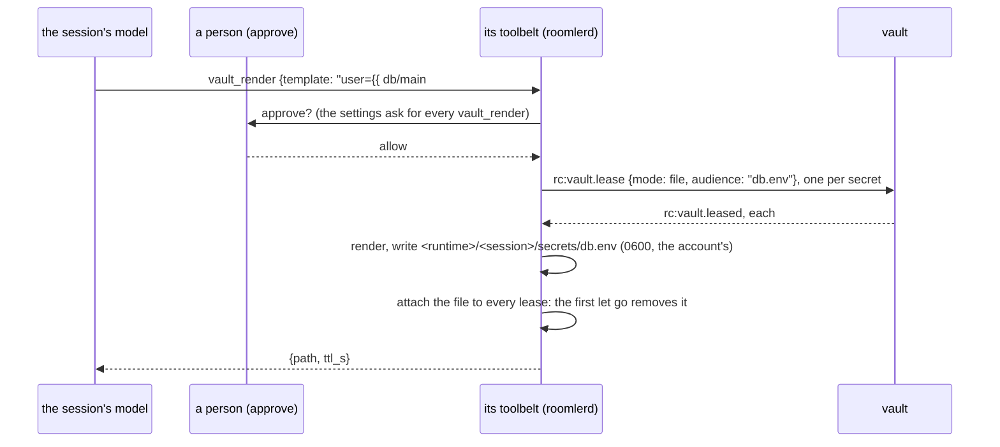

# Vault: IAM for secrets

The vault keeps an organization's secrets: database passwords, API tokens,
kubeconfigs, signing keys. Every value is encrypted at rest under a key of its
own, named by an RRN, and every decision about it is recorded. It is built for
Hive's agent sessions, which use a secret without the model ever reading it.
People use it too.

> Spec, steps and the field log: [`fr/FR-90-hive-agent-sessions.md`](fr/FR-90-hive-agent-sessions.md)
> §3e (#1827). The whole design (roles, Cedar policies, leases, the modes a
> session gets a secret in) is [`roomler-hive-design.md`](roomler-hive-design.md)
> §8. **This page describes what is built: P3-1, the store; P3-2a, roles and
> Cedar policies (§7); P3-2b, a session's role, decided at its start and at
> every move (§8); P3-3a, the key a device's daemon holds for the values it is
> leased (§9); P3-3b, the vault's half of a lease (§10); P3-3c, how the
> vault takes a lease back (§11); P3-4a, the daemon's lease client (§12);
> P3-4b, what a session may know of the vault: its metadata tools, decided
> by Cedar's own `secret:list` (§13); P3-4c-1, `vault_exec`, the first
> tool that uses a value: one command run with values in its environment
> (§14); and P3-4c-2, `vault_render`: a template written with values into the
> session's secrets directory, for as long as its leases (§15).** No released
> agent asks for a lease yet: no release build carries the `vault` feature.

## 1. Custody: who can read a secret

> [!WARNING]
> **Managed custody.** The vault module holds the key-encryption key (KEK)
> and can decrypt every secret it stores. Whoever controls the server, or
> holds both the KEK and a copy of the database, can read them all. That is
> the v1 model.

What that means in practice:

| Who | Can read values? | Why |
|---|---|---|
| the server process | yes | it holds the KEK ([`KekState`](../crates/modules/vault/src/crypto.rs#L242)) |
| the cluster's operator | yes | the KEK is a secret on the cluster (§3) |
| someone with a database dump only | no | every value is sealed; the data keys are wrapped to the KEK |
| someone with a database dump **and** the KEK | yes | that is all it takes, so keep the KEK out of every backup the database goes into |
| a member of the organization, an administrator included | no | no route answers a value in P3-1 (§6) |
| the daemon running a session | from P3-4, what a lease releases | the vault answers a lease (§10) with the value sealed to the key that daemon holds (§9); no released agent asks for one yet |
| the session's own process, or its model | no, except what a materializing mode hands it | a leased value is opened in the daemon, never in the harness's process, which runs as another account. `exec` and `file` hand a value on: to one command run as the session's account (§14), or in a file that account reads (§15). That is why each takes a permit, passes the guardrails, and waits for a person's approval |

Customer-managed keys (the KEK in the organization's own KMS, revocable by it)
and sovereign custody (only the organization's devices can unwrap) are P7.

## 2. Envelope encryption

Every value written gets a fresh 32-byte data key (DEK). The value is sealed
under it with XChaCha20-Poly1305, and the DEK is wrapped to the KEK with
[`age`](https://age-encryption.org). The KEK is an `age` X25519 identity, so a
wrapped DEK is an ordinary `age` file and `age-keygen` makes the KEK.



| Stored with a version | What it is |
|---|---|
| `ciphertext` | the value under the DEK |
| `nonce` | 24 random bytes, one per version |
| `dek_wrapped` | the DEK, `age`-encrypted to the KEK |
| `kek` | the KEK's recipient (`age1…`): public, kept so a rotation can tell which key wraps which version |

> [!IMPORTANT]
> **A seal is bound to its place.** The associated data names the
> organization, the secret, the field and the version number
> ([`Binding`](../crates/modules/vault/src/crypto.rs#L46)). Whoever can write
> the database can copy a ciphertext from one row into another. With the
> binding, the copied value fails to open, instead of answering for the
> secret it was moved into. The KEK is not in the binding: a rotation re-wraps
> the DEKs and leaves every value alone.

The vault brings its own keys. It derives nothing from the JWT secret or the
DERP ticket key.

**Recovery without the server.** `age -d -i kek.txt` decrypts a version's
`dek_wrapped` to its DEK, and the DEK opens the `ciphertext` with the binding
as associated data: `roomler-vault/v1`, the organization id, the secret id,
the field and the version number, NUL-separated
([`a_wrapped_data_key_is_an_ordinary_age_file`](../crates/modules/vault/src/crypto.rs#L478)
is that recipe as a test).

## 3. The KEK

| Setting | Env | Holds |
|---|---|---|
| `vault.kek` | `ROOMLER__VAULT__KEK` | the identity, `AGE-SECRET-KEY-1…`, or an `age-keygen` file's whole text |
| `vault.kek_file` | `ROOMLER__VAULT__KEK_FILE` | the path of an `age-keygen` file |

```sh
age-keygen -o kek.txt          # keep it out of every backup the database is in
```

- A self-hoster keeps the KEK in a file. Hosted roomler.ai keeps it in a sealed
  secret on the cluster, which has no cloud KMS under it.
- Exactly one identity. Blank lines and `#` comments are skipped, as
  `age-keygen` writes them. More than one identity is refused: a KEK rotation
  is not built yet.
- **Both settings set is refused**, not guessed: the two may disagree.
- **Never a boot refusal.** With no KEK, or one that does not parse, the vault
  still mounts. Its metadata routes work, and the two routes that need the
  key (`PUT …/value`, `POST …/verify`) answer **503** with the reason. The
  reason is always a fixed sentence and never repeats the setting.
- The KEK never prints. `VaultSettings`' `Debug` is written by hand
  ([`settings.rs`](../crates/config/src/settings.rs#L102)), and so is the
  KEK's ([`crypto.rs`](../crates/modules/vault/src/crypto.rs#L121)). The boot
  log names the recipient only.
- `GET …/vault` reports `other_kek`: how many versions were wrapped to a KEK
  other than the one loaded. Above zero after a key change, that count is
  every value the old key held, now unreadable. `POST …/verify` names them.

## 4. Secrets, versions, RRNs

A **secret** is a name and its rules, and never a value:

| Field | Meaning |
|---|---|
| `path` | unique among the organization's live secrets; lowercase segments of `a-z 0-9 . _ -` joined by `/`. Never changes |
| `kind` | `static` (one field, `value`) or `structured` (named fields: `username`, `password`…). `dynamic`, `template` and `llm_credential` come with the steps that give them meaning |
| `audiences` | where a value may be presented: host patterns, a knowhow entity, a named upstream. Stored in P3-1; the daemon holds a use to them from P3-5 |
| `exec_allow` | the programs a value may be handed to in `exec` mode, each by its **bare** name (`psql`, never a path: a path is refused on write, since a device asks by name and resolves it itself). `vault_exec` runs nothing else (§14) |
| `tags`, `owner_id`, `rotation_days`, `description` | metadata; tags get one spelling, because a policy matches them by equality |
| `disabled` | P3-5's per-secret kill switch: a disabled secret is never used. An administrator still reads its metadata and writes its value |

Its **RRN** is `rrn:{org slug}:secret:{path}`
([`rrn.rs`](../crates/modules/vault/src/rrn.rs)). The organization's slug is
part of the name, so a reference to another organization's secret cannot be
written down. The RRN is rendered when shown, and never stored, so the name and
the row cannot disagree.

> [!NOTE]
> **One spelling per name.** Paths, fields and tags are lowercase by rule, not
> folded. Two paths that differ only in case would be one name to a person and
> two to an index. A field name is a key in the stored document
> (`fields.<name>`), so `.` and `$` are refused: either would make it a path or
> an operator to the database.

A **version** is one value written to one field. Each field counts on its own:

- **The number comes from an `$inc` on the secret**, so two writers never get
  one number. A write that fails after it leaves a gap; a number is never
  reused.
- **`current` moves by `$max`** once the row is stored, so a slower writer of an
  older number never moves it back.
- **A field keeps its last 10 versions.** Older ones are destroyed: an old value
  is no less sensitive for being old.
- `expires_at`, when given, is honoured by the first step that uses a value:
  P3-3's leases never hand out an expired version.

**Deleting a secret** tombstones it with a compare-and-set, so of two deletes
one acts, and then destroys every version. There is no undo. The path is free
again, and a new secret there gets a new id. The tombstone comes first: a
version delete that fails after it leaves ciphertext no route reaches, a leak
to sweep, never a secret brought back.

## 5. The org gate and the switch

| Switch | Effect |
|---|---|
| `[modules] vault` (`ROOMLER__MODULES__VAULT`) | **default OFF**, like `hive`: no route is mounted |
| `vault.tenants` (`ROOMLER__VAULT__TENANTS=<id>,<id>`) | the organizations the vault serves. A list alone mounts the module, the form a hosted server uses, because no older image reads it. Clearing it is the kill switch |

`vault.tenants` reads like `hive.tenants`: empty or `*` is every organization,
and an entry that is not an organization id matches nothing
([`scope.rs`](../crates/modules/vault/src/scope.rs)). A member of an
organization the vault does not serve is told `404 the vault is not available
to this organization` on every route. Someone outside the organization is
told `403 not_a_member` first, and so learns nothing about whether it is
served.

## 6. Routes

All under `/api/tenant/{tenant_id}/vault`, for the organization's
`ADMINISTRATOR`s only ([`routes.rs`](../crates/modules/vault/src/routes.rs)).

| Method | Path | Does | Needs the KEK | Recorded as |
|---|---|---|---|---|
| GET | `` | the KEK's state (`ready` with its recipient, `missing`, `invalid` with the reason), the counts, `other_kek` | no | — |
| GET | `/secret` | the live secrets, by path; `?prefix=staging/` lists a folder | no | `secret:list` · `list` |
| POST | `/secret` | declare one: path, kind, rules. ⚠️ `value` here is an unknown field, refused **422**, so a value has one way in | no | `secret:write` · `create` |
| GET | `/secret/{id}` | one secret and its versions' metadata: number, KEK, author, expiry. The read never loads the sealed bytes | no | `secret:list` · `describe` |
| PATCH | `/secret/{id}` | change its rules. `path` and `kind` are unknown fields (**422**): a policy names a secret by its RRN, and a rename would quietly re-point every policy that names it | no | `secret:write` · `update` |
| DELETE | `/secret/{id}` | tombstone it and destroy every version | no | `secret:delete` · `delete` |
| PUT | `/secret/{id}/value` | write a field's next version, `{field?, value, expires_at?}`; answers the number | **yes** | `secret:write` · `value`, with the number |
| POST | `/verify` | open every version the organization holds (up to 10,000) and answer which do not open: `other_kek`, `dek_unreadable`, `tampered`. Never a value | **yes** | `vault:verify` · `verify` |
| GET | `/audit` | the decisions, newest first (`?before=`, `?limit=` up to 200) | no | — |
| GET | `/schema` | P3-2a — the Cedar schema policies are written against, and the actions, modes and OSes it names | no | — |
| GET · POST | `/role` | P3-2a — the vault roles; declare one `{name, description?}` | no | `policy:write` · `role_create` |
| DELETE | `/role/{name}` | P3-2a — tombstone a role; **409** while a live policy names it | no | `policy:write` · `role_delete` |
| GET · POST | `/policy` | P3-2a — the guardrails, then the organization's policies; add one `{name, description?, text}` | no | `policy:write` · `policy_create` |
| GET · PUT · DELETE | `/policy/{id}` | P3-2a — one policy; replace it `{…, rev}` from the revision read (**409** if it moved); tombstone it. A `guardrail:*` id is **400** for both writes | no | `policy:write` · `policy_update` / `policy_delete` |
| POST | `/simulate` | P3-2a — decide a request as the vault would, and say which policies decided it; `with` / `without` for a change not yet made | no | — (decides nothing for real) |
| POST | `/simulate/replay` | P3-2b — `{with?, without?, days?}`: the last 1 to 7 days of recorded Cedar decisions decided again under the change; `{replayed, unreadable, flipped, flips[…], truncated}` | no | — (decides nothing for real) |

> [!WARNING]
> **No route answers a value.** In P3-1 a value goes in through `PUT …/value`
> and comes out nowhere. A session's use is P3-3's lease. A person's
> `secret:read`, which puts the value in front of a human, is a later step with
> its own gate.

## 7. Roles and policies (P3-2a)

A session will assume one **role** at its start (P3-2b), and the
organization's **policies**, written in [Cedar](https://www.cedarpolicy.com),
say what each role may do. The mapping to AWS IAM is design §8.1; what is
built is the language, the checks, the guardrails and `simulate`
([`policy.rs`](../crates/modules/vault/src/policy.rs)).



**The schema** ([`policy.cedarschema`](../crates/modules/vault/src/policy.cedarschema)),
namespace `Roomler`:

| Entity | What it is |
|---|---|
| `User` `in Group` | a person; one `Group` per roomler role they hold (`owner`, `admin`, `member`, … and the organization's own) |
| `Role` | a vault role, `Roomler::Role::"dev"` |
| `Session` `in Role` | an agent session in the role it assumed; `owner`, and `playbook` when it runs one |
| `Secret` `in SecretFolder` | `rrn:{org}:secret:{path}`, with `path`, `kind`, `tags` and (P3-4c-1) `exec_allow`; a folder per path prefix, each in the one above |

| Action | Principal → resource | Context |
|---|---|---|
| `role:assume` | `User` → `Role` | `device {os, tags, owner}` |
| `secret:use` | `Session` → `Secret` | `mode`, `audience`, `ttl_s`, `device {os, tags, owner}`, `approval? {approver}` |
| `secret:list` (P3-4b, §13) | `Session` → `Secret` | `device {os, tags, owner}` |

`secret:list` is an action of its own, not a member of `secret:use`: an
action group would make "use implies list" hold only for policies written
with `in`, never for `==`. So a role lists nothing until a permit says it may,
and a listing permit uses nothing.

`os` is `linux`, `macos` or `windows`, exactly as the device rows store it; any
other spelling is refused, never lowercased into a match. A device's tags are
lowercased, because they are free-form and a policy compares by equality.

**The guardrails** are in every organization's set from its first decision.
They are code, not rows, so no organization can edit or lose one, and their
text names no organization:

| Guardrail | Forbids |
|---|---|
| `guardrail:windows-proxy-only` | any `secret:use` on Windows in a mode other than `proxy`: there is no Claude Code sandbox there (AC13; decision 17) |
| `guardrail:prod-never-materializes` | `secret:use` in `file`, `env` or `exec` for a secret tagged `prod` or under `prod/` |
| `guardrail:exec-only-allowed-programs` (P3-4c-1, §14) | `secret:use` in `exec` mode whose audience, the program a device hands the value to, is not on the secret's `exec_allow` |

No guardrail stops a listing: all three are about using a value.

**A policy is checked before it is kept** ([`check_policy`](../crates/modules/vault/src/policy.rs)):
exactly one static Cedar statement, valid against the schema in strict mode,
and naming only its organization:

- a `Secret` or `SecretFolder` literal must carry the organization's RRN
  prefix, with a valid path after it;
- a `Role` must be one of its vault roles;
- a `Group` must be one of its roomler roles;
- a `User` must be one of its members;
- a `Session` is never named: sessions come and go, and a policy for one would
  outlive it.

> [!IMPORTANT]
> - **Default deny; a `forbid` beats every `permit`.**
> - **A set that does not build is a deny, never an allow.** A stored policy
>   that no longer parses fails the whole set, rather than being skipped: the
>   one skipped could be a `forbid`.
> - **A role a live policy names cannot be deleted.** A role re-created under
>   the old name would inherit every policy that still named it. Whether a
>   policy names a role is read from the parsed policy, so no spacing or escape
>   in the text hides it.

**`simulate`** decides a request as the vault would and answers which policies
decided it: the permits that allowed it, the forbid or guardrail that denied
it, or nothing (the default deny). With `with` (policies as if added, each
checked as a write) and `without` (stored policies as if deleted, never a
guardrail), it answers for a change before it is made. It decides nothing for
real and records nothing. **`simulate/replay`** (P3-2b) takes the same
`with` / `without` and decides the last 1 to 7 days of recorded Cedar decisions
again. Each one is decided with the request as it was then: the groups, the
device, the mode. It answers the ones that would come out the other way, and
counts the rows it cannot read rather than guessing at them.

## 8. A session's role (P3-2b)

A session takes a role at its start, as an option on the start
(`{device_id, folder, role}`). The vault decides it with the `role:assume`
policies, for the starter, on that device. A session that started with no role
holds none, and nothing in the vault is allowed it.



**Hive never calls the vault.** The module graph has `vault → hive`, so hive
asks through core's hook registry: [`SessionGate`](../crates/core/src/hooks.rs),
which only the vault registers ([`gate.rs`](../crates/modules/vault/src/gate.rs)).
Hive's side is [`vault_gate.rs`](../crates/modules/hive/src/vault_gate.rs).

| When | Who is asked about | The device in the question | Refused as |
|---|---|---|---|
| a start that names a role | the starter | the device it starts on | `role_refused` · `vault_unavailable` · `role_undecided` |
| a promote or a teleport of a session with a role | the person moving it | the device it moves **to** | the same, on the move's answer |
| a fork of a session with a role | the person forking it | the device the fork runs on | the same, on the fork's answer |

> [!WARNING]
> - **A role is decided with its device, again at every move.** A policy may
>   say "on a build box only". A session that moved with its role unchecked
>   would carry the build box's powers to a laptop.
> - **No vault is a refusal, never a pass.** A start or a move that names a
>   role is refused when no vault is mounted to decide it.
> - **The decision is recorded before it is answered.** A decision the vault
>   cannot record is `role_undecided`, and the session does not start or move.

What the gate answers:

| The ask | Answer, and the reason recorded |
|---|---|
| the vault does not serve the organization | deny · `not_served` |
| the role is not one of its live roles | deny · `unknown_role` |
| the device's `os` is not a spelling the rows store | deny · `device: …` |
| otherwise | Cedar's `role:assume`: the policies that decided it, or `default_deny` |

Every decision is a `vault_audit` row with `action: role:assume`, `op` the
purpose (`start` · `promote` · `teleport` · `fork`), `target: role:<name>`,
the session and the device, and the **request** exactly as it was decided. A
fork's row names the session it forks, because the fork has no id until it is
made. `simulate/replay` decides those requests again.

## 9. The device's key (P3-3a)

A value the vault leases to a session will cross to the session's device as a
sealed box (libsodium's `crypto_box_seal`: X25519 and XSalsa20-Poly1305) for a
key that device's daemon holds. P3-3a makes that key and tells the server
about it. No value crosses yet: leases are P3-3b.



| The device | Its hello's `vault_key` | The row's `vault_key` |
|---|---|---|
| `vault_enabled` off (the default) | none | empty |
| on, the primary enrollment's connection | the public half of this run's key | that key |
| on, a secondary organization's connection | none | empty, on that organization's row |
| a build without the `vault` feature, or an agent before P3-3a | none | empty |
| a key that is not well formed | as sent | empty, and the fleet logs a warning |

> [!IMPORTANT]
> - **The key lives in daemon memory, and every start makes a new one.** A
>   leased value lives in daemon memory for its lease only, so a restart ends
>   every lease whatever becomes of the key. A key kept on disk, where the
>   overlay and SSH keys live, would add one thing: a way for whoever reads
>   the config, or a backup of it, to open a sealed value captured earlier.
>   Those two keys are identities a peer pins across restarts; nothing pins
>   this one.
> - **The primary enrollment's connection only.** A key given to two
>   organizations' servers would tie the device's enrollments together
>   ([`multi-org.md`](multi-org.md)), and agent sessions run for the primary
>   organization only.
> - **Never the WireGuard key**, and never derived from it.
> - **The row names the running process.** The fleet writes the key on every
>   hello, the empty string included, so a key never outlives the daemon that
>   made it. The vault will seal only to the key on the row of the device a
>   session runs on.

| Piece | Where |
|---|---|
| the device's switch | `vault_enabled` ([`config.rs:492`](../crates/agent-core/src/config.rs#L492)), off, never pushable: [`the_device_owned_refusals_are_not_pushable`](../crates/remote_control/src/models.rs#L8112) |
| the key, and its half in the hello | [`vault.rs:35`](../agents/roomlerd/src/vault.rs#L35) `hello_key`, feature `vault` (it implies `hive`, and no release build carries it yet); the hello at [`signaling.rs:1570`](../agents/roomlerd/src/signaling.rs#L1570) |
| the wire | `AgentHello::vault_key` ([`signaling.rs:363`](../crates/remote_control/src/signaling.rs#L363)) and [`vault_key_is_well_formed`](../crates/remote_control/src/signaling.rs#L120) |
| what the fleet stores | [`socket.rs:104`](../crates/modules/fleet/src/socket.rs#L104), [`AgentDao::update_hello`](../crates/services/src/dao/agent.rs#L479), `Agent::vault_key` ([`models.rs:2048`](../crates/remote_control/src/models.rs#L2048)); no route answers it |

## 10. Leases (P3-3b)

A session gets a value as a **lease**: released to the daemon that runs it,
sealed to that daemon's key (§9), for at most 15 minutes. The session's device
asks over its own control connection, and the vault answers on that
connection. P3-3b builds the vault's half; a device asks from P3-4, which
brings the daemon's half and the session's tools.



| Check, in order | Refused as | Recorded |
|---|---|---|
| the request within its bounds (`lease_limits`), in a mode that releases a stored value: `proxy`, `file`, `env`, `exec` | `bad_request` | no |
| the vault serves the organization | `not_served` | no |
| the device takes leases: its hello advertised `vault` and carried a key | `unsupported` | no |
| a session of the organization whose record places it on THIS device | `not_located` | no |
| at the record's fence | `stale_fence` | yes |
| live: starting, idle, running or awaiting an approval | `ended` | yes |
| within the session's 120 requests a minute | `busy` | no |
| holding a vault role (§8) | `no_role` | yes |
| the secret, by path or by this organization's RRN, live | `no_secret` | yes |
| not disabled | `disabled` | yes |
| its field holding a value | `no_value` | yes |
| a usable KEK | `unavailable` | yes |
| Cedar's `secret:use`, the guardrails included | `denied` | yes, with the request |
| its version not past the `expires_at` its writer gave (P3-3c) | `no_value` | yes, as `version_expired` |
| opened, and sealed to the device's key | `unavailable` | yes |
| the allow recorded and the lease written | `undecided` | — |

> [!WARNING]
> - **Believed only from the session's device, at its fence.** The vault reads
>   the session's RECORD: a device cannot lease for a session it does not
>   run, and a run that lost its session to a move cannot lease for it any
>   more. Hive's frames follow the same rule.
> - **The device's facts are its ROW's**, never the request's: a device
>   cannot claim to be a build box, or not to be a Windows machine.
> - **Recorded before released.** The allow is recorded and the lease written
>   before the sealed value is sent; a lease the vault could not record is
>   never released (`undecided`).
> - **`identity`, `short-lived` and `placeholder` release no stored value.**
>   A policy that permits `identity` means "authenticate as the session",
>   and a lease in that mode would hand over the raw value instead, so the
>   vault refuses it as `bad_request`.
> - **Until the session is identified, a refusal is logged, not recorded**:
>   there is no session to name yet, and a device's flood must not become
>   audit rows. The per-session ceiling answers `busy` unrecorded for the
>   same reason.
> - **One word, never a reason that names a policy.** A device is told
>   `denied`; which policy decided is in `vault_audit` for an administrator.

Each connection has its own queue (16 requests), answered in order by one
task, so a slow decision never holds the agent socket's read loop, and one
more request than the queue holds is answered `busy`. A TTL outside
30 s to 900 s is clamped, and a policy reads the clamped value
(`context.ttl_s`), so it can hold a lease shorter still. From P3-3c a lease
also ends at its version's `expires_at` when that comes first, so a policy
that read the asked TTL allowed at least what was granted.

| Piece | Where |
|---|---|
| the wire | `rc:vault.lease` · `rc:vault.leased` · `rc:vault.refused` ([`signaling.rs`](../crates/remote_control/src/signaling.rs)), the refusal words and bounds ([`vault.rs`](../crates/remote_control/src/vault.rs)), `RpcCap::Vault` |
| the handler | [`lease.rs`](../crates/modules/vault/src/lease.rs): `LeaseSocket` (one queue per connection), `lease` (the checks above) |
| sealing | [`crypto.rs`](../crates/modules/vault/src/crypto.rs) `seal_for_device`: libsodium's `crypto_box_seal`, a fresh ephemeral key per box |
| the edge | `vault → hive` (`crates/core/src/graph.rs`): the session record through hive's own stateless DAO |

## 11. Revocation (P3-3c)

A lease ends at its TTL, or at its version's `expires_at` when that comes
first. The vault takes it back sooner once it stops standing, and tells the
device on its own control connection: `rc:vault.revoke {lease_ids, reason}`.
The device drops every lease the frame names, whatever the word (§12).



| Reason | When | Told |
|---|---|---|
| `session_ended` | the session's record is gone, or past the statuses it is leased in: a stop was ordered, or it ended, was refused or lost | at the next sweep of the device's pod |
| `session_moved` | the record is at another fence, or on another device | at that sweep |
| `value_changed` | the field has a newer version | at once on the device's pod; from another pod, at that pod's next sweep |
| `secret_disabled` · `secret_deleted` | the secret was disabled, or deleted | the same |
| `key_changed` | the device's row holds another key than the one the value was sealed to: its daemon restarted, and the lease died with its memory | at its hello |
| `device_removed` | the device is being removed: fleet's cascade, after hive's in `HOOK_ORDER` | at once, before its row and socket go |
| `not_served` | the vault no longer serves the organization (`vault.tenants`) | at the next sweep or hello |

> [!WARNING]
> - **Each pod looks after the devices connected to it.** It holds their
>   connections (the lease socket's) and checks the leases of those holding a
>   live one every `vault.revoke_sweep_secs` (10 s by default). Nothing crosses
>   pods: a change made on another pod writes the lease's row at once, and the
>   device's own pod tells it at its next sweep. So revocation works with
>   Redis down, and needs nothing from fleet's Hub.
> - **A session is not followed, it is read again.** Hive must never call the
>   vault (`vault → hive`), and a session ends or moves on many paths: its
>   device's report, a stop, a purge, a promote, a teleport, a fork. Each check
>   reads the record and asks whether the lease still stands.
> - **No acknowledgement.** Every hello is told again of each revoked lease that
>   has not expired, so a frame lost to a pod roll, or a device that was away,
>   costs a repeat.
> - **An expired lease is its own revocation**: never taken back, never told.
> - **Told only to a build that can read the frame**: a connection whose row
>   advertises `vault` and holds a key. An older build back on the device is
>   not sent it, and its leases are taken back all the same (its key changed).
> - **A removed device's leases never hold up its removal.** A failure is
>   logged, never the cascade's refusal: a device being removed, possibly a
>   compromised one, must not stay because the vault could not write. What it
>   holds expires within 15 minutes whatever happens.
> - **A version's own expiry is kept.** A version past the `expires_at` its
>   writer gave is never released (`no_value`, recorded `version_expired`),
>   and no lease outlives its version. P3-1 promised this of the first step to
>   use a value; P3-3b did not keep the promise, and P3-3c does.

| Piece | Where |
|---|---|
| the wire | `rc:vault.revoke` ([`signaling.rs`](../crates/remote_control/src/signaling.rs)); the words (`RevokeReason`) and `lease_limits::MAX_REVOKE_IDS`, 64 a frame ([`vault.rs`](../crates/remote_control/src/vault.rs)) |
| the checks | [`revoke.rs`](../crates/modules/vault/src/revoke.rs): `verdict` (pure), `check_device`, `sweep_once`, `reconcile` at a hello, `secret_changed`, `device_removed` |
| the connections | `Revoker` in `revoke.rs`, fed by the lease socket's lifecycle ([`lease.rs`](../crates/modules/vault/src/lease.rs)): a hello links its connection and reconciles the device, a close unlinks it unless a newer connection took over |
| the setting | `vault.revoke_sweep_secs` (`ROOMLER__VAULT__REVOKE_SWEEP_SECS`); 0 or absent is 10 |

## 12. The daemon's lease client (P3-4a)

The device's half of a lease: the daemon asks on its primary connection,
opens what the vault sends with its key (§9), and holds the value in memory
until the lease is over. P3-4a builds the client; P3-4c's tools are the first
to ask.



| When | The daemon |
|---|---|
| `vault_enabled` on, a build with `vault` that runs sessions, the primary connection | advertises `vault` in its hello and in every re-announcement, exactly where the hello carries its key |
| a tool asks | sends `rc:vault.lease` with a random `req_id`, and waits 15 s: a server without the vault never answers |
| `rc:vault.leased` | opens the box with this run's key, holds the value zeroized, and answers the tool with the lease, never the value |
| `rc:vault.refused` | answers the tool with the vault's word |
| the lease's expiry passes | lets it go: checked at every use, and every 5 s |
| `rc:vault.revoke` (§11) | lets go of every lease the frame names; an id it does not hold is ignored |
| the session's run ends here | lets go of that run's leases, wherever the run stopped being live |
| one of these frames on a secondary org's connection | drops it unopened |

> [!WARNING]
> - **A value never leaves the daemon.** A tool borrows it inside a closure
>   (`with_value`) and nothing returns it; it is zeroed when let go.
> - **Held no longer than the longest lease the vault grants** (900 s),
>   whatever the server's clock says: a device whose clock runs behind cannot
>   keep a value past its lease by more than that.
> - **The word follows the key.** The vault answers only a connection that
>   advertises `vault` and whose hello carried a key, so the daemon applies the
>   word from the same inputs as the key, and every re-announcement carries it:
>   the server replaces its stored caps with each.
> - **A run's leases die with the run**, at its fence: another fence of the
>   same session is another run.

| Piece | Where |
|---|---|
| the client | [`vault.rs`](../agents/roomlerd/src/vault.rs): `Client` (`request`, `on_leased`, `on_refused`, `on_revoke`, `drop_run`, `with_value`), `takes_leases`, `apply_word` |
| the frames | their arms in `handle_server_msg` ([`signaling.rs`](../agents/roomlerd/src/signaling.rs)), on the primary connection only |
| a run's end | `Supervisor::unlive` ([`supervisor.rs`](../agents/roomlerd/src/hive/supervisor.rs)), which every way a run stops being live passes through |

## 13. A session's view of the vault (P3-4b)

Before a session's model asks for a value, it needs to know what there is to
ask for: which secrets its role may use, their kinds and fields, where a value
may be presented, and the programs it may be handed to. P3-4b answers that,
and nothing more: a name and its rules, never a value, nor a version's number,
nor who wrote it (`VaultSecretMeta`,
[`vault.rs:75`](../crates/remote_control/src/vault.rs#L75)).



| | `vault_list` | `vault_describe` |
|---|---|---|
| Asks for | the live secrets under a folder (`prefix`), or all of them | one secret, by its path or this organization's RRN |
| Decided by | Cedar's `secret:list`, secret by secret; only the permitted are answered | `secret:list`, for that secret |
| Answers | at most 200 ([`MAX_LISTED`](../crates/remote_control/src/vault.rs#L52)), with `more` when a bound left some out; never which were refused, nor how many | its metadata, or `denied` · `no_secret` |
| Recorded | one `vault_audit` row a call: op `list`, `listed N of M`, no request | one row: op `describe`, allow or deny, with the request a replay decides again |

The toolbelt (FR-90 P1a, [`hive.md`](hive.md) §4) offers the two tools only
where the device takes leases: its owner's `vault_enabled` on, a build with
`vault`, the primary connection
([`daemon_vault`](../agents/roomlerd/src/hive/toolbelt.rs#L338)). Wherever it
offers them, the session's settings allow them (`permissions.allow`,
[`launch.rs:410`](../crates/hive-node/src/launch.rs#L410)), so no person is
asked to approve each one: they only read, and their gate is the vault's own
policy, decided and recorded by the server. A call the harness cancels gets
no answer, and the daemon stops waiting for it.

> [!IMPORTANT]
> - **Listing is its own permission.** A role allowed to use a secret lists
>   nothing until a policy lets it list, and listing uses nothing: neither
>   action implies the other (§7). Neither guardrail stops a listing.
> - **A listing never says what it left out**, only that a bound did
>   (`more`). A narrower prefix finds the rest.
> - **Believed exactly as a lease is**: the same identity checks in the same
>   order, the same refusal words and the same per-session ceiling
>   ([`identify`](../crates/modules/vault/src/lease.rs#L498)), so a device that
>   floods the vault with listings is refused as one flooding it with leases
>   is.
> - **Offered and allowed together.** The daemon decides once, at a run's
>   launch, whether its toolbelt offers the tools, and writes the settings'
>   allow from the same answer
>   ([`supervisor.rs:4200`](../agents/roomlerd/src/hive/supervisor.rs#L4200)).
>   It records whether the primary connection takes leases before it resumes
>   any run ([`signaling.rs:1617`](../agents/roomlerd/src/signaling.rs#L1617)).

| Piece | Where |
|---|---|
| the frames | `rc:vault.list` · `rc:vault.describe` ([`signaling.rs:1262`](../crates/remote_control/src/signaling.rs#L1262)) and `rc:vault.listed` · `rc:vault.described` ([`:4034`](../crates/remote_control/src/signaling.rs#L4034)); refusals reuse `rc:vault.refused` |
| the decisions | `list` and `describe` ([`meta.rs:106`](../crates/modules/vault/src/meta.rs#L106)); `secret:list` in [`policy.cedarschema`](../crates/modules/vault/src/policy.cedarschema) and `Ask::ListSecret` ([`policy.rs:358`](../crates/modules/vault/src/policy.rs#L358)) |
| the daemon's asks | `Client::list` and `Client::describe` ([`vault.rs:356`](../agents/roomlerd/src/vault.rs#L356)) |
| the tools | `vault_list` and `vault_describe` ([`toolbelt.rs:674`](../agents/roomlerd/src/hive/toolbelt.rs#L674)), answered by `vault_tool` ([`toolbelt.rs:762`](../agents/roomlerd/src/hive/toolbelt.rs#L762)) |

## 14. A command with values: `vault_exec` (P3-4c-1)

The first tool that USES a value. A session asks for one command to run with
values from the vault in its environment. The daemon leases each value for
that program, runs the command as the session's account, and answers with its
output, every value scrubbed. The model sees the result, never the values.



| Step | What holds | Where |
|---|---|---|
| the call | `argv`: 1 to 64 strings, `argv[0]` a program's **bare** name; `env`: 1 to 8 `NAME: handle` (a path or this org's RRN, `#field` for a structured secret's field); `timeout_s` 1 to 300, default 60. Never `PATH`, `HOME`, `USER`, `LOGNAME`, `SHELL`, `IFS`, `ENV`, `BASH_ENV`, nor `LD_*` / `DYLD_*`: those would steer what runs | [`vault_exec.rs:143`](../agents/roomlerd/src/hive/vault_exec.rs#L143) |
| the program | looked for only in `/usr/local/sbin`, `/usr/local/bin`, `/usr/sbin`, `/usr/bin`, `/sbin`, `/bin`, and refused unless root (or this daemon) owns it and neither group nor other can write it: a program the session's account could replace is never handed a value | [`vault_exec.rs:202`](../agents/roomlerd/src/hive/vault_exec.rs#L202) |
| the leases | one per `env` entry, mode `exec`, audience the program's bare name, TTL the timeout + 30 s; all asked before anything runs, and one refusal runs nothing | [`vault_exec.rs:410`](../agents/roomlerd/src/hive/vault_exec.rs#L410) |
| the run | as the session's account (decision 13: no administrator groups, on Linux no privilege gained by exec), from the session's folder, in its own process group, stdin closed, a clean environment (`HOME`, `USER`, `LOGNAME`, `PATH` = those directories, `LANG`) plus the values | [`vault_exec.rs:291`](../agents/roomlerd/src/hive/vault_exec.rs#L291) |
| the end | at its exit, its timeout, or the call cancelled: the whole group killed and every lease let go, each by a guard that runs however the call ends | [`vault_exec.rs:249`](../agents/roomlerd/src/hive/vault_exec.rs#L249), [`:455`](../agents/roomlerd/src/hive/vault_exec.rs#L455) |
| the answer | the exit code (and signal), stdout and stderr, at most 64 KiB each; each value replaced by `[vault:NAME]`, the longest first, then the daemon's own redactor (agent tokens, bearer and JWT shapes). A value shorter than 4 bytes cannot be masked without shredding the output, and the answer names it under `not_scrubbed` | [`vault_exec.rs:376`](../agents/roomlerd/src/hive/vault_exec.rs#L376) |

**`exec_allow` is a guardrail.** `guardrail:exec-only-allowed-programs`
([`policy.rs:110`](../crates/modules/vault/src/policy.rs#L110), §7) forbids
every `exec` lease whose audience is not on the secret's `exec_allow`. The
`Secret` entity carries `exec_allow`, so the refusal is a Cedar decision:
`simulate` names it, it is recorded with its request, and no organization can
drop it. A request recorded before the attribute existed reads back naming no
program. `exec_allow` holds bare names only
([`program_name_ok`](../crates/remote_control/src/vault.rs#L63), the one
definition the vault's write check
([`routes.rs:375`](../crates/modules/vault/src/routes.rs#L375)) and the
device share): a path could match nothing a device asks for.

> [!WARNING]
> - **`exec` is a materializing mode** (design §8.5): the program holds the
>   value, and a program that prints or sends it can leak it. Hence the
>   permit, `exec_allow`, and a person approving every call.
> - **Scrubbing is a seatbelt, not a boundary.** A value printed in another
>   encoding (base64, split across lines) passes it.
> - **Windows runs nothing.** The vault refuses `exec` there first
>   (`windows-proxy-only`), and the refusal is in `vault_audit` (AC13). A
>   Windows daemon never runs a materialized value even if a lease came back.
> - **Homebrew's programs are refused** on macOS: `/opt/homebrew` belongs to
>   a person, who could replace what a value is handed to.

> [!IMPORTANT]
> **A person approves every use because the settings ASK for it.** Keeping
> it out of the allow list is not enough. The session's settings list
> `vault_exec` and `vault_render` under `permissions.ask`
> ([`VAULT_USE_TOOLS`](../agents/roomlerd/src/hive/toolbelt.rs#L332), written
> by [`vault_use_tools`](../agents/roomlerd/src/hive/supervisor.rs#L4654)).
> - **Why an ask:** a repository's own `.claude/settings.json` loads too (the
>   FR-90 spec's open decision 7), and an allow there would skip the person.
>   Claude Code reads deny, then ask, then allow, across every settings file,
>   so an ask prompts whatever another file allows. Until this was found,
>   while `vault_render` was written, the uses were only kept out of `allow`.
> - ⚠️ **Not by marking the tools as requiring user interaction**
>   ([`launch.rs:420`](../crates/hive-node/src/launch.rs#L420)). A
>   `--permission-prompt-tool` can never approve such a tool: Claude Code
>   turns its allow into a deny, and `approve` is that tool.

| Piece | Where |
|---|---|
| the tool | `vault_exec` in [`toolbelt.rs:707`](../agents/roomlerd/src/hive/toolbelt.rs#L707), offered with the reads where the device takes leases, and asked for in the settings |
| where it runs | the run's `ExecTarget`, made at launch from the session's account, home and folder ([`supervisor.rs:4234`](../agents/roomlerd/src/hive/supervisor.rs#L4234)); none on Windows |
| letting go | `Client::release` ([`vault.rs:504`](../agents/roomlerd/src/vault.rs#L504)) |

## 15. A file with values: `vault_render` (P3-4c-2)

Some programs read a credential only from a file: a kubeconfig, an `.env`, a
`.pgpass`. A session asks for a template to be written with values from the
vault into its secrets directory, and gets the file's path, never a value. The
file lives exactly as long as its leases.



| Step | What holds | Where |
|---|---|---|
| the call | `template`: at most 64 KiB, each secret as `{{ handle }}` (a path or this org's RRN, `#field` for a field), 1 to 8 secrets; a `{{` never closed is refused, never kept as text. `dest`: a bare file name, by the rule `exec_allow` holds. `ttl_s`: 30 to 900, default 300 | [`vault_render.rs:106`](../agents/roomlerd/src/hive/vault_render.rs#L106), [`:70`](../agents/roomlerd/src/hive/vault_render.rs#L70) |
| the leases | one per distinct secret, mode `file`, audience the file's name, all asked before anything is written; one refusal writes nothing and lets the others go | [`vault_render.rs:261`](../agents/roomlerd/src/hive/vault_render.rs#L261) |
| the directory | `<runtime>/<session>/secrets/`, made by the daemon, its own, `0711`: the session's account opens a file whose name it knows, and lists nothing. A link or a file in its place is refused, never followed | [`vault_render.rs:178`](../agents/roomlerd/src/hive/vault_render.rs#L178) |
| the file | rendered into a buffer sized once (a vector that grew would leave copies of a value behind), written whole: a temporary made with `create_new`, `0600`, handed to the account, renamed into place | [`vault_render.rs:151`](../agents/roomlerd/src/hive/vault_render.rs#L151), [`:200`](../agents/roomlerd/src/hive/vault_render.rs#L200) |
| its life | attached to each of its leases, so it is removed the moment the first is let go: at its expiry, at `rc:vault.revoke`, or when the run ends here. The leases are kept, not released, when the call returns | [`vault.rs:179`](../agents/roomlerd/src/vault.rs#L179), [`:511`](../agents/roomlerd/src/vault.rs#L511) |
| a restart | the daemon removes every `secrets/` an earlier process left: no lease outlives the process that held it | [`supervisor.rs:725`](../agents/roomlerd/src/hive/supervisor.rs#L725), [`vault_render.rs:242`](../agents/roomlerd/src/hive/vault_render.rs#L242) |
| the Read tool | the session's settings deny it the secrets directory where the vault tools are offered | [`supervisor.rs:4627`](../agents/roomlerd/src/hive/supervisor.rs#L4627) |

> [!WARNING]
> - **`file` is a materializing mode** (design §8.5). The session's account
>   reads the file, which is what it is for, so a Bash command can print it.
>   The Read tool's deny is UX. The gates are the permit, the guardrails
>   (`prod-never-materializes` refuses a production secret in `file` mode) and
>   a person approving every call.
> - **Windows writes nothing.** The vault refuses `file` there
>   (`windows-proxy-only`), recorded, and a Windows daemon never writes a
>   materialized value even if a lease came back.
> - **A file with several values dies with its shortest lease.**

| Piece | Where |
|---|---|
| the tool | `vault_render` in [`toolbelt.rs:738`](../agents/roomlerd/src/hive/toolbelt.rs#L738), offered with the reads, and asked for in the settings as `vault_exec` is (§14) |
| keeping the leases | `Releasing::keep` ([`vault_exec.rs:463`](../agents/roomlerd/src/hive/vault_exec.rs#L463)) |

## 16. Audit

`vault_audit` holds every `secret:*` and `vault:verify` decision, allow and
deny. Each row has the principal (`user` in P3-1), the action as a policy
names it, the operation, the decision and its reason (`administrator` or
`not_administrator`), and the RRN, field and version number where there is
one. P3-2a adds every `policy:write` (a role's or a policy's), with its
`target`. P3-2b adds every `role:assume` (§8), with the session, the device
and the request it decided. P3-3b adds every lease decision once its session
is identified (§10): `secret:use`, op `lease`, principal `session` (the row's
user is the session's owner), the session, the device, the request a Cedar
decision decided, and a `target` of `lease:<id>` on an allow, or of
`asked:<name>` when the name resolved to no secret. P3-3c adds every
revocation (§11): op `revoke`, decision `revoke`, principal `vault`, the
reason word, and a `target` of `lease:<id>`; one row per lease, written by the
pod whose compare-and-set took it back. P3-4b adds every `secret:list` (§13),
principal `session`: op `describe`, allow or deny, with the secret and the
request a replay decides again; op `list`, one row a call, the reason
`listed N of M` and a `target` of `asked:<prefix>` (`asked:*` for all), with
no request, since an aggregate is not a decision a replay could make again.
P3-4c-1's `exec` leases are `secret:use` rows like any lease, the program as
the request's audience; an `exec` refused for its program names
`guardrail:exec-only-allowed-programs` as its reason (§14). P3-4c-2's `file`
leases are recorded the same way, the file's name as the audience (§15).
Rows expire after
90 days, like the other audits.

- **An allow is recorded before it is acted on, and fails closed.** A decision
  the vault cannot record is answered 500 and not acted on.
- A refusal is recorded too, on a best-effort basis: the caller is refused
  whatever the database says.
- The status and the audit read are not decisions about a secret, and are not
  recorded.
- A request refused for its content (400, 422) or for want of a KEK (503) acts
  on nothing, so it records no allow.
- A device's own report of using a value is a different claim, made by a host
  that may be compromised. From P3-4d it goes to `vault_activity`, never here,
  as `ssh_audit` and `ssh_activity` are kept apart.

## 17. Collections

| Collection | One row per | Indexes | Retention |
|---|---|---|---|
| `vault_secrets` | secret | unique `(tenant_id, path)` over live rows (partial on `deleted_at: {$type: "null"}`, so a live row stores an explicit `null`); `(tenant_id, deleted_at, path)` | tombstoned, kept |
| `vault_versions` | value written | unique `(secret_id, field, n)`; `(tenant_id, kek)` | the last 10 per field; all go with their secret |
| `vault_audit` | decision | `(tenant_id, at desc)`, `(secret_id, at)` | 90 days (TTL on `at`) |
| `vault_roles` | vault role (P3-2a) | unique `(tenant_id, name)` over live rows | tombstoned, kept |
| `vault_policies` | policy (P3-2a): one Cedar statement, its effect, a revision | unique `(tenant_id, name)` over live rows; `(tenant_id, deleted_at, created_at)` | tombstoned, kept |
| `vault_leases` | value released (P3-3b): the secret, field and version; the session, its fence, its owner and its device; the key it was sealed to (`sealed_to`); the mode and audience; issued and expiry times; `revoked_at`/`revoked_why` from P3-3c (§11). Never the value | `(tenant_id, session_id)`; P3-3c `(device_id, expires_at)` (a pod's checks, a hello) and `(secret_id, expires_at)` (a change to a secret) | a week past `expires_at` (TTL); the decision stays in `vault_audit` for 90 days |

P3-3a adds no collection: a device's key is a field on fleet's `agents` row
(`vault_key`, §9). Neither do P3-4a to P3-4c-2: a lease the daemon holds
lives in its memory (§12), a listing is a decision recorded in `vault_audit`,
and a rendered file is on the device, for its lease (§15).

## 18. What comes next

| Step | Builds |
|---|---|
| P3-4c-3 | `vault_request`: a lease asked for ahead, which `vault_exec` and `vault_render` take by its id |
| P3-4d | `vault_activity`: the device's own report of using a value, a claim kept apart from `vault_audit` |
| P3-4e | the approval card a policy can ask for |
| P3-5 to P3-9 | `proxy` mode, `short-lived` credentials, session SOCKS, `ssh_run` and `fleet_exec` as tools, `roomler connect` |
| P3k | the field run in the test organization |
