# Vault: IAM for secrets

The vault keeps an organization's secrets: database passwords, API tokens,
kubeconfigs, signing keys. Every value is encrypted at rest under a key of its
own, named by an RRN, and every decision about it is recorded. It is built for
Hive's agent sessions, which use a secret without the model ever reading it.
People use it too.

> Spec, steps and the field log: [`fr/FR-90-hive-agent-sessions.md`](fr/FR-90-hive-agent-sessions.md)
> §3e (#1827). The whole design (roles, Cedar policies, leases, the modes a
> session gets a secret in) is [`roomler-hive-design.md`](roomler-hive-design.md)
> §8. **This page describes what is built: P3-1, the store; P3-2a, roles and
> Cedar policies (§7); P3-2b, a session's role, decided at its start and at
> every move (§8); P3-3a, the key a device's daemon holds for the values it is
> leased (§9); P3-3b, the vault's half of a lease (§10); P3-3c, how the
> vault takes a lease back (§11); P3-4a, the daemon's lease client (§12);
> P3-4b, what a session may know of the vault: its metadata tools, decided
> by Cedar's own `secret:list` (§13); P3-4c-1, `vault_exec`, the first
> tool that uses a value: one command run with values in its environment
> (§14); P3-4c-2, `vault_render`: a template written with values into the
> session's secrets directory, for as long as its leases (§15); P3-4c-3,
> `vault_request`: a lease asked for ahead, which a use takes (§16);
> P3-4d, what a device reports doing with its leases where its owner has it
> report, kept apart from the decisions (§17); P3-4e, the approval a policy
> may ask for: a card in the session's room that one of its drivers
> answers, a session's tools that wait for the answer, and the card's
> buttons in the web app (§18); P3-5a, a secret's `audiences` held to for
> `proxy` mode, the first step of the proxies (§7); P3-5b-1, the Postgres
> engine a proxy endpoint serves, and P3-5c-1 the MongoDB one, which
> P3-5c-2 serves; P3-5b-2, `vault_connect` and its
> endpoint, which signs in to a database as a secret's user for the
> session's account; P3-5b-3, the exchange bound to the certificate the
> proxy verified; P3-5b-4, the endpoint on Windows, a loopback port
> that serves only the session's account; P3-5d-1, the HTTP engine,
> which sends a client's requests on to one upstream with the secret's
> credential added; and P3-5d-2, `vault_connect` serving it, git through
> `insteadOf`, on a loopback port whose every connection's account Linux
> reads from the kernel; P3-5d-3, macOS reading it from the descriptors
> each process holds; P3-5e-1, what the HTTP engine carries for a
> Kubernetes API server; P3-5e-2, `vault_connect` serving one, a
> kubeconfig with no credential in its answer; P3-5f-1, the SSH agent,
> which signs only a sign-in to a host the secret names; P3-5f-2,
> `vault_connect` serving it, `SSH_AUTH_SOCK` and the host's keys in its
> answer; P3-5f-3, the same agent on Windows, on a named pipe (§19);
> P3-6b-1, the vault's half of `short-lived`: dynamic secrets, their
> providers, and a lease sealed as one bundle (§20); P3-6b-2a, the
> daemon's Postgres minter; P3-6b-2b, its caller: `vault_exec` and
> `vault_render` serving a dynamic secret; P3-6d-1a, a MySQL minter;
> P3-6d-1b, `mysql` a provider that caller serves (§20); P3-7-1a, the
> Cedar half of a session's own egress: `net:socks` and `net:forward` over a
> `Node` (§7); P3-7-1b, its answer: `rc:vault.net` granted as a token
> under an audience of its own (§21); and P3-2c, a policy that can never
> apply refused when it is written (§7).**
> No released
> agent asks for a lease yet: no release build carries the `vault` feature.

## 1. Custody: who can read a secret

> [!WARNING]
> **Managed custody.** The vault module holds the key-encryption key (KEK)
> and can decrypt every secret it stores. Whoever controls the server, or
> holds both the KEK and a copy of the database, can read them all. That is
> the v1 model.

What that means in practice:

| Who | Can read values? | Why |
|---|---|---|
| the server process | yes | it holds the KEK ([`KekState`](../crates/modules/vault/src/crypto.rs#L242)) |
| the cluster's operator | yes | the KEK is a secret on the cluster (§3) |
| someone with a database dump only | no | every value is sealed; the data keys are wrapped to the KEK |
| someone with a database dump **and** the KEK | yes | that is all it takes, so keep the KEK out of every backup the database goes into |
| a member of the organization, an administrator included | no | no route answers a value in P3-1 (§6) |
| the daemon running a session | from P3-4, what a lease releases | the vault answers a lease (§10) with the value sealed to the key that daemon holds (§9); no released agent asks for one yet |
| the session's own process, or its model | no, except what a materializing mode hands it | a leased value is opened in the daemon, never in the harness's process, which runs as another account. `exec` and `file` hand a value on: to one command run as the session's account (§14), or in a file that account reads (§15). That is why each takes a permit, passes the guardrails, and waits for a person's approval |

Customer-managed keys (the KEK in the organization's own KMS, revocable by it)
and sovereign custody (only the organization's devices can unwrap) are P7.

## 2. Envelope encryption

Every value written gets a fresh 32-byte data key (DEK). The value is sealed
under it with XChaCha20-Poly1305, and the DEK is wrapped to the KEK with
[`age`](https://age-encryption.org). The KEK is an `age` X25519 identity, so a
wrapped DEK is an ordinary `age` file and `age-keygen` makes the KEK.

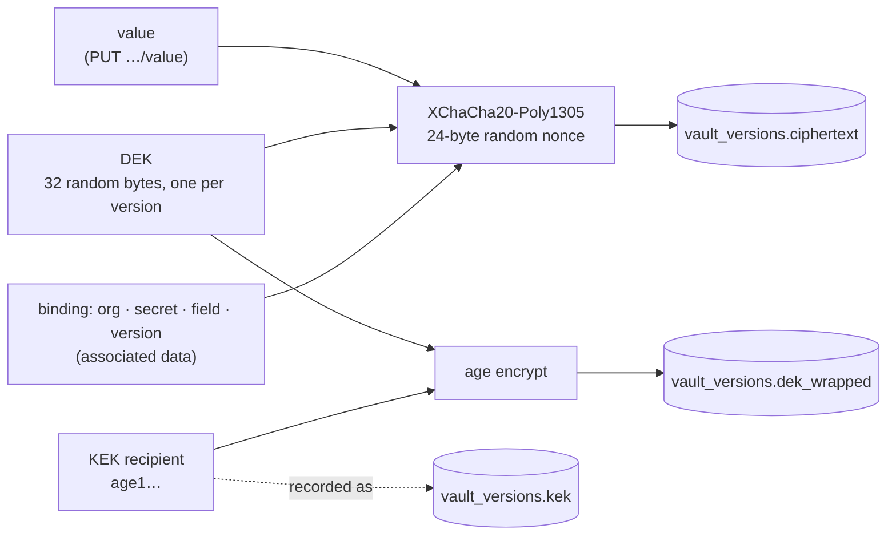

| Stored with a version | What it is |
|---|---|
| `ciphertext` | the value under the DEK |
| `nonce` | 24 random bytes, one per version |
| `dek_wrapped` | the DEK, `age`-encrypted to the KEK |
| `kek` | the KEK's recipient (`age1…`): public, kept so a rotation can tell which key wraps which version |

> [!IMPORTANT]
> **A seal is bound to its place.** The associated data names the
> organization, the secret, the field and the version number
> ([`Binding`](../crates/modules/vault/src/crypto.rs#L46)). Whoever can write
> the database can copy a ciphertext from one row into another. With the
> binding, the copied value fails to open, instead of answering for the
> secret it was moved into. The KEK is not in the binding: a rotation re-wraps
> the DEKs and leaves every value alone.

The vault brings its own keys. It derives nothing from the JWT secret or the
DERP ticket key.

**Recovery without the server.** `age -d -i kek.txt` decrypts a version's
`dek_wrapped` to its DEK, and the DEK opens the `ciphertext` with the binding
as associated data: `roomler-vault/v1`, the organization id, the secret id,
the field and the version number, NUL-separated
([`a_wrapped_data_key_is_an_ordinary_age_file`](../crates/modules/vault/src/crypto.rs#L478)
is that recipe as a test).

## 3. The KEK

| Setting | Env | Holds |
|---|---|---|
| `vault.kek` | `ROOMLER__VAULT__KEK` | the identity, `AGE-SECRET-KEY-1…`, or an `age-keygen` file's whole text |
| `vault.kek_file` | `ROOMLER__VAULT__KEK_FILE` | the path of an `age-keygen` file |

```sh
age-keygen -o kek.txt          # keep it out of every backup the database is in
```

- A self-hoster keeps the KEK in a file. Hosted roomler.ai keeps it in a sealed
  secret on the cluster, which has no cloud KMS under it.
- Exactly one identity. Blank lines and `#` comments are skipped, as
  `age-keygen` writes them. More than one identity is refused: a KEK rotation
  is not built yet.
- **Both settings set is refused**, not guessed: the two may disagree.
- **Never a boot refusal.** With no KEK, or one that does not parse, the vault
  still mounts. Its metadata routes work, and the two routes that need the
  key (`PUT …/value`, `POST …/verify`) answer **503** with the reason. The
  reason is always a fixed sentence and never repeats the setting.
- The KEK never prints. `VaultSettings`' `Debug` is written by hand
  ([`settings.rs`](../crates/config/src/settings.rs#L109)), and so is the
  KEK's ([`crypto.rs`](../crates/modules/vault/src/crypto.rs#L121)). The boot
  log names the recipient only.
- `GET …/vault` reports `other_kek`: how many versions were wrapped to a KEK
  other than the one loaded. Above zero after a key change, that count is
  every value the old key held, now unreadable. `POST …/verify` names them.

## 4. Secrets, versions, RRNs

A **secret** is a name and its rules, and never a value:

| Field | Meaning |
|---|---|
| `path` | unique among the organization's live secrets; lowercase segments of `a-z 0-9 . _ -` joined by `/`. Never changes |
| `kind` | `static` (one field, `value`) or `structured` (named fields: `username`, `password`…). `dynamic`, `template` and `llm_credential` come with the steps that give them meaning |
| `audiences` | where a value may be presented: host patterns, a knowhow entity, a named upstream. Stored in P3-1; the daemon holds a use to them from P3-5 |
| `exec_allow` | the programs a value may be handed to in `exec` mode, each by its **bare** name (`psql`, never a path: a path is refused on write, since a device asks by name and resolves it itself). `vault_exec` runs nothing else (§14) |
| `tags`, `owner_id`, `rotation_days`, `description` | metadata; tags get one spelling, because a policy matches them by equality |
| `disabled` | P3-5's per-secret kill switch: a disabled secret is never used. An administrator still reads its metadata and writes its value |

Its **RRN** is `rrn:{org slug}:secret:{path}`
([`rrn.rs`](../crates/modules/vault/src/rrn.rs)). The organization's slug is
part of the name, so a reference to another organization's secret cannot be
written down. The RRN is rendered when shown, and never stored, so the name and
the row cannot disagree.

> [!NOTE]
> **One spelling per name.** Paths, fields and tags are lowercase by rule, not
> folded. Two paths that differ only in case would be one name to a person and
> two to an index. A field name is a key in the stored document
> (`fields.<name>`), so `.` and `$` are refused: either would make it a path or
> an operator to the database.

A **version** is one value written to one field. Each field counts on its own:

- **The number comes from an `$inc` on the secret**, so two writers never get
  one number. A write that fails after it leaves a gap; a number is never
  reused.
- **`current` moves by `$max`** once the row is stored, so a slower writer of an
  older number never moves it back.
- **A field keeps its last 10 versions.** Older ones are destroyed: an old value
  is no less sensitive for being old.
- `expires_at`, when given, is honoured by the first step that uses a value:
  P3-3's leases never hand out an expired version.

**Deleting a secret** tombstones it with a compare-and-set, so of two deletes
one acts, and then destroys every version. There is no undo. The path is free
again, and a new secret there gets a new id. The tombstone comes first: a
version delete that fails after it leaves ciphertext no route reaches, a leak
to sweep, never a secret brought back.

## 5. The org gate and the switch

| Switch | Effect |
|---|---|
| `[modules] vault` (`ROOMLER__MODULES__VAULT`) | **default OFF**, like `hive`: no route is mounted |
| `vault.tenants` (`ROOMLER__VAULT__TENANTS=<id>,<id>`) | the organizations the vault serves. A list alone mounts the module, the form a hosted server uses, because no older image reads it. Clearing it is the kill switch |

`vault.tenants` reads like `hive.tenants`: empty or `*` is every organization,
and an entry that is not an organization id matches nothing
([`scope.rs`](../crates/modules/vault/src/scope.rs)). A member of an
organization the vault does not serve is told `404 the vault is not available
to this organization` on every route. Someone outside the organization is
told `403 not_a_member` first, and so learns nothing about whether it is
served.

## 6. Routes

All under `/api/tenant/{tenant_id}/vault`, for the organization's
`ADMINISTRATOR`s only ([`routes.rs`](../crates/modules/vault/src/routes.rs)).

| Method | Path | Does | Needs the KEK | Recorded as |
|---|---|---|---|---|
| GET | `` | the KEK's state (`ready` with its recipient, `missing`, `invalid` with the reason), the counts, `other_kek` | no | — |
| GET | `/secret` | the live secrets, by path; `?prefix=staging/` lists a folder | no | `secret:list` · `list` |
| POST | `/secret` | declare one: path, kind, rules. ⚠️ `value` here is an unknown field, refused **422**, so a value has one way in | no | `secret:write` · `create` |
| GET | `/secret/{id}` | one secret and its versions' metadata: number, KEK, author, expiry. The read never loads the sealed bytes | no | `secret:list` · `describe` |
| PATCH | `/secret/{id}` | change its rules. `path` and `kind` are unknown fields (**422**): a policy names a secret by its RRN, and a rename would quietly re-point every policy that names it | no | `secret:write` · `update` |
| DELETE | `/secret/{id}` | tombstone it and destroy every version | no | `secret:delete` · `delete` |
| PUT | `/secret/{id}/value` | write a field's next version, `{field?, value, expires_at?}`; answers the number | **yes** | `secret:write` · `value`, with the number |
| POST | `/verify` | open every version the organization holds (up to 10,000) and answer which do not open: `other_kek`, `dek_unreadable`, `tampered`. Never a value | **yes** | `vault:verify` · `verify` |
| GET | `/audit` | the decisions, newest first (`?before=`, `?limit=` up to 200) | no | — |
| GET | `/schema` | P3-2a — the Cedar schema policies are written against, and the actions, modes and OSes it names | no | — |
| GET · POST | `/role` | P3-2a — the vault roles; declare one `{name, description?}` | no | `policy:write` · `role_create` |
| DELETE | `/role/{name}` | P3-2a — tombstone a role; **409** while a live policy names it | no | `policy:write` · `role_delete` |
| GET · POST | `/policy` | P3-2a — the guardrails, then the organization's policies; add one `{name, description?, text}` | no | `policy:write` · `policy_create` |
| GET · PUT · DELETE | `/policy/{id}` | P3-2a — one policy; replace it `{…, rev}` from the revision read (**409** if it moved); tombstone it. A `guardrail:*` id is **400** for both writes | no | `policy:write` · `policy_update` / `policy_delete` |
| POST | `/simulate` | P3-2a — decide a request as the vault would, and say which policies decided it; `with` / `without` for a change not yet made | no | — (decides nothing for real) |
| POST | `/simulate/replay` | P3-2b — `{with?, without?, days?}`: the last 1 to 7 days of recorded Cedar decisions decided again under the change; `{replayed, unreadable, flipped, flips[…], truncated}` | no | — (decides nothing for real) |

> [!WARNING]
> **No route answers a value.** In P3-1 a value goes in through `PUT …/value`
> and comes out nowhere. A session's use is P3-3's lease. A person's
> `secret:read`, which puts the value in front of a human, is a later step with
> its own gate.

## 7. Roles and policies (P3-2a)

A session will assume one **role** at its start (P3-2b), and the
organization's **policies**, written in [Cedar](https://www.cedarpolicy.com),
say what each role may do. The mapping to AWS IAM is design §8.1; what is
built is the language, the checks, the guardrails and `simulate`
([`policy.rs`](../crates/modules/vault/src/policy.rs)).

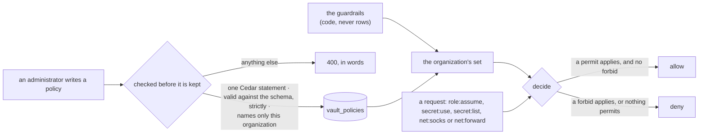

**The schema** ([`policy.cedarschema`](../crates/modules/vault/src/policy.cedarschema)),
namespace `Roomler`:

| Entity | What it is |
|---|---|
| `User` `in Group` | a person; one `Group` per roomler role they hold (`owner`, `admin`, `member`, … and the organization's own) |
| `Role` | a vault role, `Roomler::Role::"dev"` |
| `Session` `in Role` | an agent session in the role it assumed; `owner`, and `playbook` when it runs one |
| `Secret` `in SecretFolder` | `rrn:{org}:secret:{path}`, with `path`, `kind`, `tags`, (P3-4c-1) `exec_allow` and (P3-5a) `audiences`; a folder per path prefix, each in the one above |
| `Node` (P3-7-1a) | a device a session's flow exits through, named by its id: `os`, `tags` and `owner`, read from its row |

| Action | Principal → resource | Context |
|---|---|---|
| `role:assume` | `User` → `Role` | `device {os, tags, owner}` |
| `secret:use` | `Session` → `Secret` | `mode`, `audience`, `ttl_s`, `device {os, tags, owner}`, `approval? {approver}` |
| `secret:list` (P3-4b, §13) | `Session` → `Secret` | `device {os, tags, owner}` |
| `net:socks` (P3-7-1a) | `Session` → `Node` | `device {os, tags, owner}`: the device the session runs on |
| `net:forward` (P3-7-1a) | `Session` → `Node` | `device {os, tags, owner}`, `host`, `port`: the one destination |

`secret:list` is an action of its own, not a member of `secret:use`: an
action group would make "use implies list" hold only for policies written
with `in`, never for `==`. So a role lists nothing until a permit says it may,
and a listing permit uses nothing.

`net:socks` and `net:forward` (P3-7-1a) decide a session's own egress, as
designed in the spec's §3e, "P3-7, a session's own egress, as designed".
They are two actions for the same reason as the listing. A SOCKS listener
reaches whatever the tunnel policies allow through its exit; a forward
reaches one destination. A permit for one opens nothing for the other. A
policy names exits by their tags, as `resource.tags.contains("office")`, or
one exit by its device's id. A session's device asks for either with
`rc:vault.net`, answered with a grant they decide (P3-7-1b, §21). No
guardrail applies to them.

From P3-4e (§18) the approver is read in a `Group` per roomler role they
hold, as a person assuming a role is: `context.approval.approver in
Roomler::Group::"admin"` holds for an admin's yes.

> [!NOTE]
> Only the approver is read in their groups. A session's `owner` and a
> device's `owner` are named without them, so `principal.owner in
> Roomler::Group::…` never holds.

`os` is `linux`, `macos` or `windows`, exactly as the device rows store it; any
other spelling is refused, never lowercased into a match. A device's tags are
lowercased, because they are free-form and a policy compares by equality.

**The guardrails** are in every organization's set from its first decision.
They are code, not rows, so no organization can edit or lose one, and their
text names no organization:

| Guardrail | Forbids |
|---|---|
| `guardrail:windows-proxy-only` | any `secret:use` on Windows in a mode other than `proxy`: there is no Claude Code sandbox there (AC13; decision 17) |
| `guardrail:prod-never-materializes` | `secret:use` in `file`, `env` or `exec` for a secret tagged `prod` or under `prod/` |
| `guardrail:exec-only-allowed-programs` (P3-4c-1, §14) | `secret:use` in `exec` mode whose audience, the program a device hands the value to, is not on the secret's `exec_allow` |
| `guardrail:proxy-only-named-audiences` (P3-5a) | `secret:use` in `proxy` mode whose audience, the upstream the daemon authenticates to with the value, is not on the secret's `audiences`, exactly as written |

No guardrail stops a listing: all four are about using a value.

> [!WARNING]
> **Before P3-5a a secret's `audiences` were kept and shown, and enforced nowhere.** No device asked
> for a `proxy` lease before then, but one would have been released toward any audience. A
> `proxy` lease now reaches only an upstream its secret names, and a recorded request from before
> the field reads back naming none, so a replay refuses it as today's vault would. Matching is exact:
> `db.internal:5432` is not `db.internal`, `DB.internal:5432` or `db.internal:6432`.

**A policy is checked before it is kept** ([`check_policy`](../crates/modules/vault/src/policy.rs)):
exactly one static Cedar statement, valid against the schema in strict mode,
one that can apply (P3-2c), and naming only its organization:

- a `Secret` or `SecretFolder` literal must carry the organization's RRN
  prefix, with a valid path after it;
- a `Role` must be one of its vault roles;
- a `Group` must be one of its roomler roles;
- a `User` must be one of its members;
- a `Node` (P3-7-1a) must be one of its live devices, named by its id: a policy
  naming another organization's device is refused, so it learns nothing of
  whether that device exists
  ([`policy_routes.rs:118`](../crates/modules/vault/src/policy_routes.rs#L118));
- a `Session` is never named: sessions come and go, and a policy for one would
  outlive it.

> [!WARNING]
> **A policy that can never apply is refused** (P3-2c,
> [`policy.rs:205`](../crates/modules/vault/src/policy.rs#L205)). Cedar
> reports two shapes of one only as warnings: a scope no action applies to,
> such as a `Node` named as the resource of `secret:use`, and a condition
> that is always false. Kept, such a policy would decide nothing: a `permit`
> would fail closed, but a `forbid` would forbid nothing its writer meant it
> to. So a write refuses it with Cedar's own words, and so does `simulate`,
> which checks its `with` policies as writes. A policy stored before P3-2c
> is not checked again; it decides nothing, as it always did. Found in
> P3-7-1a.
>
> Cedar cannot see a condition that holds for no request the vault makes:
> `context.host == "DB.internal"` never holds, because a forward's host is
> decided in its one spelling (§21). `simulate` the requests a policy is
> meant for.

> [!IMPORTANT]
> - **Default deny; a `forbid` beats every `permit`.**
> - **A set that does not build is a deny, never an allow.** A stored policy
>   that no longer parses fails the whole set, rather than being skipped: the
>   one skipped could be a `forbid`.
> - **A role a live policy names cannot be deleted.** A role re-created under
>   the old name would inherit every policy that still named it. Whether a
>   policy names a role is read from the parsed policy, so no spacing or escape
>   in the text hides it.

**`simulate`** decides a request as the vault would and answers which policies
decided it: the permits that allowed it, the forbid or guardrail that denied
it, or nothing (the default deny). From P3-7-1a it decides `net:socks` and
`net:forward` too. The node is named by `resource.node_id`, a live device of
the organization whose facts are read from its row, and a forward gives
`host` and `port`, the host taken in its one spelling as the vault decides
a request (§21). With `with` (policies as if added, each
checked as a write) and `without` (stored policies as if deleted, never a
guardrail), it answers for a change before it is made. It decides nothing for
real and records nothing. **`simulate/replay`** (P3-2b) takes the same
`with` / `without` and decides the last 1 to 7 days of recorded Cedar decisions
again. Each one is decided with the request as it was then: the groups, the
device, the mode. It answers the ones that would come out the other way, and
counts the rows it cannot read rather than guessing at them.

## 8. A session's role (P3-2b)

A session takes a role at its start, as an option on the start
(`{device_id, folder, role}`). The vault decides it with the `role:assume`
policies, for the starter, on that device. A session that started with no role
holds none, and nothing in the vault is allowed it.

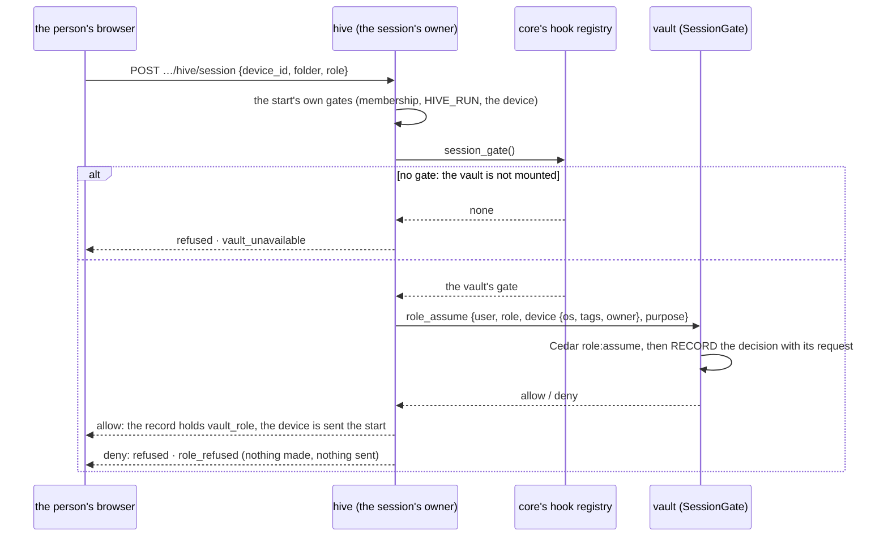

**Hive never calls the vault.** The module graph has `vault → hive`, so hive
asks through core's hook registry: [`SessionGate`](../crates/core/src/hooks.rs),
which only the vault registers ([`gate.rs`](../crates/modules/vault/src/gate.rs)).
Hive's side is [`vault_gate.rs`](../crates/modules/hive/src/vault_gate.rs).

| When | Who is asked about | The device in the question | Refused as |
|---|---|---|---|
| a start that names a role | the starter | the device it starts on | `role_refused` · `vault_unavailable` · `role_undecided` |
| a promote or a teleport of a session with a role | the person moving it | the device it moves **to** | the same, on the move's answer |
| a fork of a session with a role | the person forking it | the device the fork runs on | the same, on the fork's answer |

> [!WARNING]
> - **A role is decided with its device, again at every move.** A policy may
>   say "on a build box only". A session that moved with its role unchecked
>   would carry the build box's powers to a laptop.
> - **No vault is a refusal, never a pass.** A start or a move that names a
>   role is refused when no vault is mounted to decide it.
> - **The decision is recorded before it is answered.** A decision the vault
>   cannot record is `role_undecided`, and the session does not start or move.

What the gate answers:

| The ask | Answer, and the reason recorded |
|---|---|
| the vault does not serve the organization | deny · `not_served` |
| the role is not one of its live roles | deny · `unknown_role` |
| the device's `os` is not a spelling the rows store | deny · `device: …` |
| otherwise | Cedar's `role:assume`: the policies that decided it, or `default_deny` |

Every decision is a `vault_audit` row with `action: role:assume`, `op` the
purpose (`start` · `promote` · `teleport` · `fork`), `target: role:<name>`,
the session and the device, and the **request** exactly as it was decided. A
fork's row names the session it forks, because the fork has no id until it is
made. `simulate/replay` decides those requests again.

## 9. The device's key (P3-3a)

A value the vault leases to a session will cross to the session's device as a
sealed box (libsodium's `crypto_box_seal`: X25519 and XSalsa20-Poly1305) for a
key that device's daemon holds. P3-3a makes that key and tells the server
about it. No value crosses yet: leases are P3-3b.

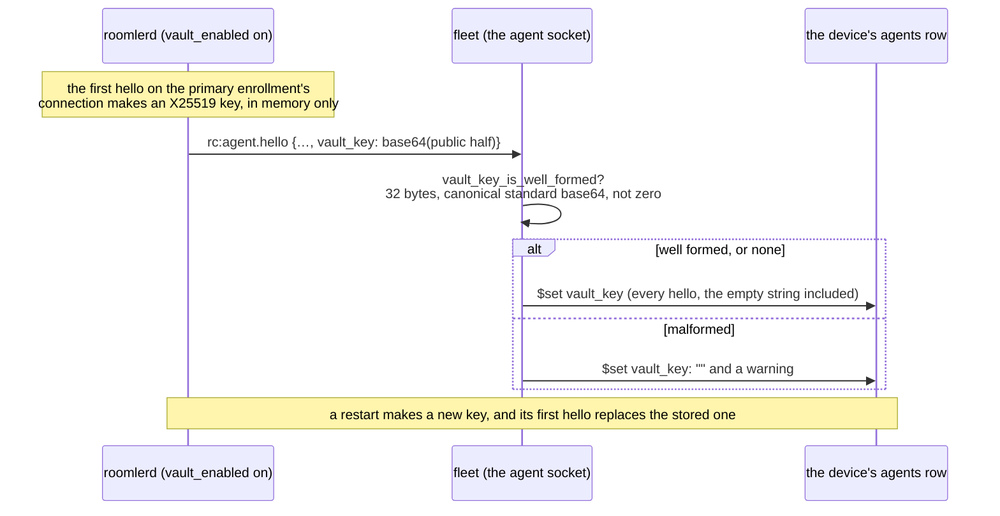

| The device | Its hello's `vault_key` | The row's `vault_key` |
|---|---|---|
| `vault_enabled` off (the default) | none | empty |
| on, the primary enrollment's connection | the public half of this run's key | that key |
| on, a secondary organization's connection | none | empty, on that organization's row |
| a build without the `vault` feature, or an agent before P3-3a | none | empty |
| a key that is not well formed | as sent | empty, and the fleet logs a warning |

> [!IMPORTANT]
> - **The key lives in daemon memory, and every start makes a new one.** A
>   leased value lives in daemon memory for its lease only, so a restart ends
>   every lease whatever becomes of the key. A key kept on disk, where the
>   overlay and SSH keys live, would add one thing: a way for whoever reads
>   the config, or a backup of it, to open a sealed value captured earlier.
>   Those two keys are identities a peer pins across restarts; nothing pins
>   this one.
> - **The primary enrollment's connection only.** A key given to two
>   organizations' servers would tie the device's enrollments together
>   ([`multi-org.md`](multi-org.md)), and agent sessions run for the primary
>   organization only.
> - **Never the WireGuard key**, and never derived from it.
> - **The row names the running process.** The fleet writes the key on every
>   hello, the empty string included, so a key never outlives the daemon that
>   made it. The vault will seal only to the key on the row of the device a
>   session runs on.

| Piece | Where |
|---|---|
| the device's switch | `vault_enabled` ([`config.rs:579`](../crates/agent-core/src/config.rs#L579)), off, never pushable: [`the_device_owned_refusals_are_not_pushable`](../crates/remote_control/src/models.rs#L9034) |
| the key, and its half in the hello | [`vault.rs:35`](../agents/roomlerd/src/vault.rs#L35) `hello_key`, feature `vault` (it implies `hive`, and no release build carries it yet); the hello at [`signaling.rs:1574`](../agents/roomlerd/src/signaling.rs#L1574) |
| the wire | `AgentHello::vault_key` ([`signaling.rs:593`](../crates/remote_control/src/signaling.rs#L593)) and [`vault_key_is_well_formed`](../crates/remote_control/src/signaling.rs#L120) |
| what the fleet stores | [`socket.rs:103`](../crates/modules/fleet/src/socket.rs#L103), [`AgentDao::update_hello`](../crates/services/src/dao/agent.rs#L491), `Agent::vault_key` ([`models.rs:2096`](../crates/remote_control/src/models.rs#L2096)); no route answers it |

## 10. Leases (P3-3b)

A session gets a value as a **lease**: released to the daemon that runs it,
sealed to that daemon's key (§9), for at most 15 minutes. The session's device
asks over its own control connection, and the vault answers on that
connection. P3-3b builds the vault's half; a device asks from P3-4, which
brings the daemon's half and the session's tools.

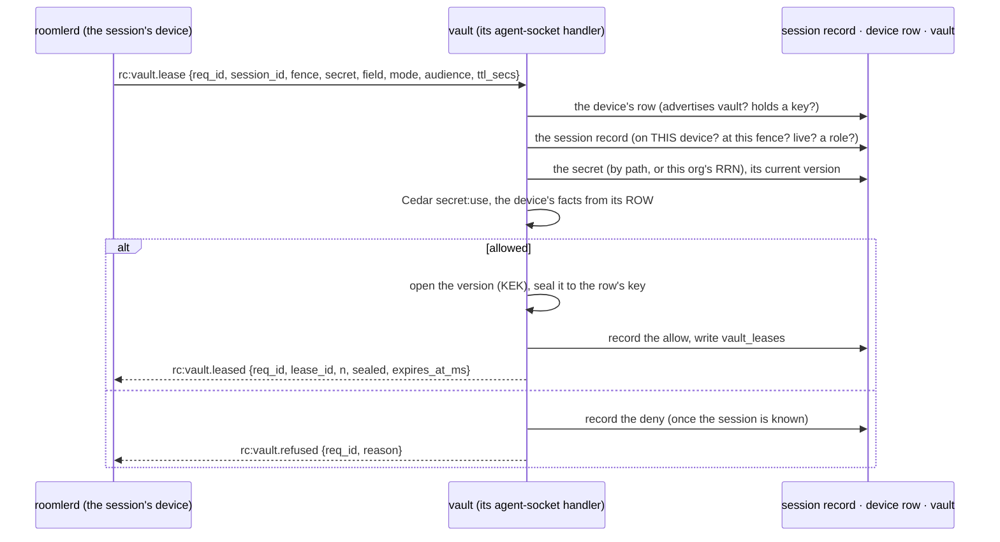

| Check, in order | Refused as | Recorded |
|---|---|---|
| the request within its bounds (`lease_limits`), in a mode that releases a stored value: `proxy`, `file`, `env`, `exec` | `bad_request` | no |
| the vault serves the organization | `not_served` | no |
| the device takes leases: its hello advertised `vault` and carried a key | `unsupported` | no |
| a session of the organization whose record places it on THIS device | `not_located` | no |
| at the record's fence | `stale_fence` | yes |
| live: starting, idle, running or awaiting an approval | `ended` | yes |
| within the session's 120 requests a minute | `busy` | no |
| holding a vault role (§8) | `no_role` | yes |
| the secret, by path or by this organization's RRN, live | `no_secret` | yes |
| not disabled | `disabled` | yes |
| its field holding a value | `no_value` | yes |
| a usable KEK | `unavailable` | yes |
| Cedar's `secret:use`, the guardrails included | `denied` | yes, with the request |
| P3-4e — where it denied: a driver's yes to this very request lifts it; otherwise a card waits for one, or a driver said no (§18) | `awaiting_approval` · `denied` | yes, with the request |
| its version not past the `expires_at` its writer gave (P3-3c) | `no_value` | yes, as `version_expired` |
| opened, and sealed to the device's key | `unavailable` | yes |
| P3-4e — the yes that allowed it, spent by compare-and-set | `denied` | yes, as `approval_spent` |
| the allow recorded and the lease written | `undecided` | — |

> [!WARNING]
> - **Believed only from the session's device, at its fence.** The vault reads
>   the session's RECORD: a device cannot lease for a session it does not
>   run, and a run that lost its session to a move cannot lease for it any
>   more. Hive's frames follow the same rule.
> - **The device's facts are its ROW's**, never the request's: a device
>   cannot claim to be a build box, or not to be a Windows machine.
> - **Recorded before released.** The allow is recorded and the lease written
>   before the sealed value is sent; a lease the vault could not record is
>   never released (`undecided`).
> - **`identity`, `short-lived` and `placeholder` release no stored value.**
>   A policy that permits `identity` means "authenticate as the session",
>   and a lease in that mode would hand over the raw value instead, so the
>   vault refuses it as `bad_request`.
> - **Until the session is identified, a refusal is logged, not recorded**:
>   there is no session to name yet, and a device's flood must not become
>   audit rows. The per-session ceiling answers `busy` unrecorded for the
>   same reason.
> - **One word, never a reason that names a policy.** A device is told
>   `denied`; which policy decided is in `vault_audit` for an administrator.

Each connection has its own queue (16 requests), answered in order by one
task, so a slow decision never holds the agent socket's read loop, and one
more request than the queue holds is answered `busy`. A TTL outside
30 s to 900 s is clamped, and a policy reads the clamped value
(`context.ttl_s`), so it can hold a lease shorter still. From P3-3c a lease
also ends at its version's `expires_at` when that comes first, so a policy
that read the asked TTL allowed at least what was granted.

| Piece | Where |
|---|---|
| the wire | `rc:vault.lease` · `rc:vault.leased` · `rc:vault.refused` ([`signaling.rs`](../crates/remote_control/src/signaling.rs)), the refusal words and bounds ([`vault.rs`](../crates/remote_control/src/vault.rs)), `RpcCap::Vault` |
| the handler | [`lease.rs`](../crates/modules/vault/src/lease.rs): `LeaseSocket` (one queue per connection), `lease` (the checks above) |
| sealing | [`crypto.rs`](../crates/modules/vault/src/crypto.rs) `seal_for_device`: libsodium's `crypto_box_seal`, a fresh ephemeral key per box |
| the edge | `vault → hive` (`crates/core/src/graph.rs`): the session record through hive's own stateless DAO |

## 11. Revocation (P3-3c)

A lease ends at its TTL, or at its version's `expires_at` when that comes
first. The vault takes it back sooner once it stops standing, and tells the
device on its own control connection: `rc:vault.revoke {lease_ids, reason}`.
The device drops every lease the frame names, whatever the word (§12).

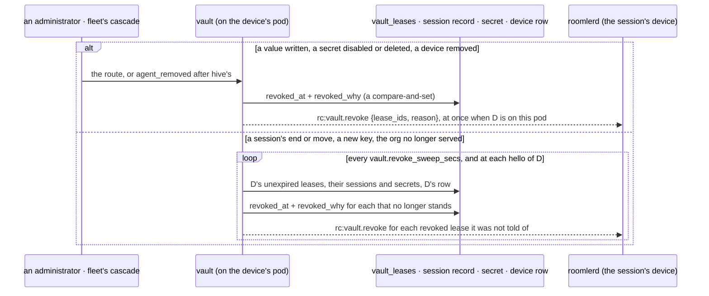

| Reason | When | Told |
|---|---|---|
| `session_ended` | the session's record is gone, or past the statuses it is leased in: a stop was ordered, or it ended, was refused or lost | at the next sweep of the device's pod |
| `session_moved` | the record is at another fence, or on another device | at that sweep |
| `value_changed` | the field has a newer version | at once on the device's pod; from another pod, at that pod's next sweep |
| `secret_disabled` · `secret_deleted` | the secret was disabled, or deleted | the same |
| `key_changed` | the device's row holds another key than the one the value was sealed to: its daemon restarted, and the lease died with its memory | at its hello |
| `device_removed` | the device is being removed: fleet's cascade, after hive's in `HOOK_ORDER` | at once, before its row and socket go |
| `not_served` | the vault no longer serves the organization (`vault.tenants`) | at the next sweep or hello |

> [!WARNING]
> - **Each pod looks after the devices connected to it.** It holds their
>   connections (the lease socket's) and checks the leases of those holding a
>   live one every `vault.revoke_sweep_secs` (10 s by default). Nothing crosses
>   pods: a change made on another pod writes the lease's row at once, and the
>   device's own pod tells it at its next sweep. So revocation works with
>   Redis down, and needs nothing from fleet's Hub.
> - **A session is not followed, it is read again.** Hive must never call the
>   vault (`vault → hive`), and a session ends or moves on many paths: its
>   device's report, a stop, a purge, a promote, a teleport, a fork. Each check
>   reads the record and asks whether the lease still stands.
> - **No acknowledgement.** Every hello is told again of each revoked lease that
>   has not expired, so a frame lost to a pod roll, or a device that was away,
>   costs a repeat.
> - **An expired lease is its own revocation**: never taken back, never told.
> - **Told only to a build that can read the frame**: a connection whose row
>   advertises `vault` and holds a key. An older build back on the device is
>   not sent it, and its leases are taken back all the same (its key changed).
> - **A removed device's leases never hold up its removal.** A failure is
>   logged, never the cascade's refusal: a device being removed, possibly a
>   compromised one, must not stay because the vault could not write. What it
>   holds expires within 15 minutes whatever happens.
> - **A version's own expiry is kept.** A version past the `expires_at` its
>   writer gave is never released (`no_value`, recorded `version_expired`),
>   and no lease outlives its version. P3-1 promised this of the first step to
>   use a value; P3-3b did not keep the promise, and P3-3c does.

| Piece | Where |
|---|---|
| the wire | `rc:vault.revoke` ([`signaling.rs`](../crates/remote_control/src/signaling.rs)); the words (`RevokeReason`) and `lease_limits::MAX_REVOKE_IDS`, 64 a frame ([`vault.rs`](../crates/remote_control/src/vault.rs)) |
| the checks | [`revoke.rs`](../crates/modules/vault/src/revoke.rs): `verdict` (pure), `check_device`, `sweep_once`, `reconcile` at a hello, `secret_changed`, `device_removed` |
| the connections | `Revoker` in `revoke.rs`, fed by the lease socket's lifecycle ([`lease.rs`](../crates/modules/vault/src/lease.rs)): a hello links its connection and reconciles the device, a close unlinks it unless a newer connection took over |
| the setting | `vault.revoke_sweep_secs` (`ROOMLER__VAULT__REVOKE_SWEEP_SECS`); 0 or absent is 10 |

## 12. The daemon's lease client (P3-4a)

The device's half of a lease: the daemon asks on its primary connection,
opens what the vault sends with its key (§9), and holds the value in memory
until the lease is over. P3-4a builds the client; P3-4c's tools are the first
to ask.

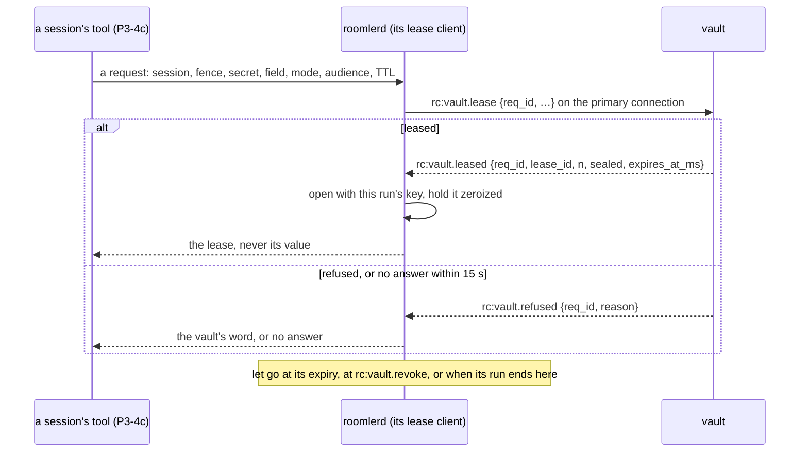

| When | The daemon |
|---|---|
| `vault_enabled` on, a build with `vault` that runs sessions, the primary connection | advertises `vault` in its hello and in every re-announcement, exactly where the hello carries its key |
| a tool asks | sends `rc:vault.lease` with a random `req_id`, and waits 15 s: a server without the vault never answers |
| `rc:vault.leased` | opens the box with this run's key, holds the value zeroized, and answers the tool with the lease, never the value |
| `rc:vault.refused` | answers the tool with the vault's word |
| `rc:vault.refused` with `awaiting_approval` (P3-4e-2, §18) | asks again while the card waits: after 2 s, the pause doubling to 15 s, for at most the card's 10 minutes. A lease, any other word, or the card's end is the tool's answer |
| the lease's expiry passes | lets it go: checked at every use, and every 5 s |
| `rc:vault.revoke` (§11) | lets go of every lease the frame names; an id it does not hold is ignored |
| the session's run ends here | lets go of that run's leases, wherever the run stopped being live |
| a lease is let go, whichever way | zeroes its value, removes every file written with it (P3-4c-2, §15), and stops everything served with it: a proxy endpoint and its connections (P3-5b-2, §19) |
| one of these frames on a secondary org's connection | drops it unopened |

> [!WARNING]
> - **A value never leaves the daemon.** A tool borrows it inside a closure
>   (`with_value`) and nothing returns it; it is zeroed when let go.
> - **Held no longer than the longest lease the vault grants** (900 s),
>   whatever the server's clock says: a device whose clock runs behind cannot
>   keep a value past its lease by more than that.
> - **The word follows the key.** The vault answers only a connection that
>   advertises `vault` and whose hello carried a key, so the daemon applies the
>   word from the same inputs as the key, and every re-announcement carries it:
>   the server replaces its stored caps with each.
> - **A run's leases die with the run**, at its fence: another fence of the
>   same session is another run.

| Piece | Where |
|---|---|
| the client | [`vault.rs`](../agents/roomlerd/src/vault.rs): `Client` (`request`, `request_until_approved`, `on_leased`, `on_refused`, `on_revoke`, `drop_run`, `with_value`, `attach`, `stop_with`), `takes_leases`, `apply_word` |
| the frames | their arms in `handle_server_msg` ([`signaling.rs`](../agents/roomlerd/src/signaling.rs)), on the primary connection only |
| a run's end | `Supervisor::unlive` ([`supervisor.rs`](../agents/roomlerd/src/hive/supervisor.rs)), which every way a run stops being live passes through |

## 13. A session's view of the vault (P3-4b)

Before a session's model asks for a value, it needs to know what there is to
ask for: which secrets its role may use, their kinds and fields, where a value
may be presented, and the programs it may be handed to. P3-4b answers that,
and nothing more: a name and its rules, never a value, nor a version's number,
nor who wrote it (`VaultSecretMeta`,
[`vault.rs:110`](../crates/remote_control/src/vault.rs#L110)).

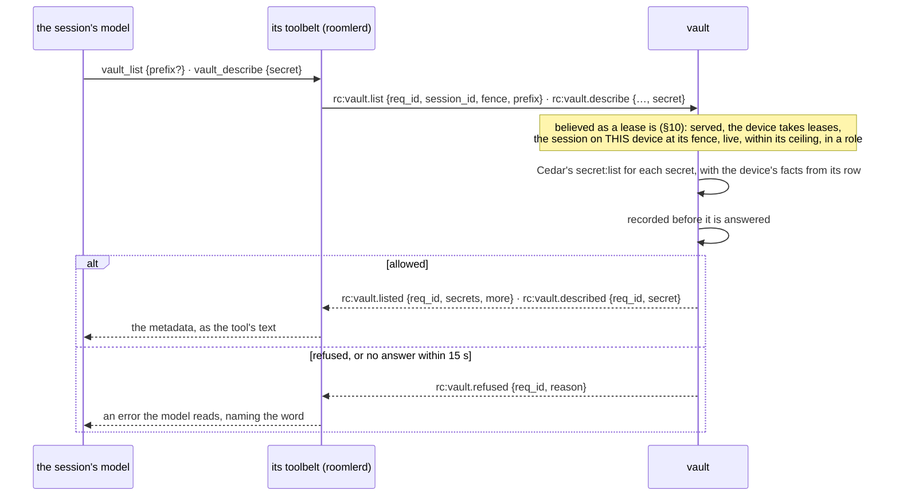

| | `vault_list` | `vault_describe` |
|---|---|---|
| Asks for | the live secrets under a folder (`prefix`), or all of them | one secret, by its path or this organization's RRN |
| Decided by | Cedar's `secret:list`, secret by secret; only the permitted are answered | `secret:list`, for that secret |
| Answers | at most 200 ([`MAX_LISTED`](../crates/remote_control/src/vault.rs#L70)), with `more` when a bound left some out; never which were refused, nor how many | its metadata, or `denied` · `no_secret` |
| Recorded | one `vault_audit` row a call: op `list`, `listed N of M`, no request | one row: op `describe`, allow or deny, with the request a replay decides again |

The toolbelt (FR-90 P1a, [`hive.md`](hive.md) §4) offers the two tools only
where the device takes leases: its owner's `vault_enabled` on, a build with
`vault`, the primary connection
([`daemon_vault`](../agents/roomlerd/src/hive/toolbelt.rs#L430)). Wherever it
offers them, the session's settings allow them (`permissions.allow`,
[`launch.rs:410`](../crates/hive-node/src/launch.rs#L410)), so no person is
asked to approve each one: they only read, and their gate is the vault's own
policy, decided and recorded by the server. A call the harness cancels gets
no answer, and the daemon stops waiting for it.

> [!IMPORTANT]
> - **Listing is its own permission.** A role allowed to use a secret lists
>   nothing until a policy lets it list, and listing uses nothing: neither
>   action implies the other (§7). Neither guardrail stops a listing.
> - **A listing never says what it left out**, only that a bound did
>   (`more`). A narrower prefix finds the rest.
> - **Believed exactly as a lease is**: the same identity checks in the same
>   order, the same refusal words and the same per-session ceiling
>   ([`identify`](../crates/modules/vault/src/lease.rs#L737)), so a device that
>   floods the vault with listings is refused as one flooding it with leases
>   is.
> - **Offered and allowed together.** The daemon decides once, at a run's
>   launch, whether its toolbelt offers the tools, and writes the settings'
>   allow from the same answer
>   ([`supervisor.rs:4226`](../agents/roomlerd/src/hive/supervisor.rs#L4226)).
>   It records whether the primary connection takes leases before it resumes
>   any run ([`signaling.rs:1625`](../agents/roomlerd/src/signaling.rs#L1625)).

| Piece | Where |
|---|---|
| the frames | `rc:vault.list` · `rc:vault.describe` ([`signaling.rs:1510`](../crates/remote_control/src/signaling.rs#L1510)) and `rc:vault.listed` · `rc:vault.described` ([`:4666`](../crates/remote_control/src/signaling.rs#L4666)); refusals reuse `rc:vault.refused` |
| the decisions | `list` and `describe` ([`meta.rs:116`](../crates/modules/vault/src/meta.rs#L116)); `secret:list` in [`policy.cedarschema`](../crates/modules/vault/src/policy.cedarschema) and `Ask::ListSecret` ([`policy.rs:481`](../crates/modules/vault/src/policy.rs#L481)) |
| the daemon's asks | `Client::list` and `Client::describe` ([`vault.rs:637`](../agents/roomlerd/src/vault.rs#L637)) |
| the tools | `vault_list` and `vault_describe` ([`toolbelt.rs:883`](../agents/roomlerd/src/hive/toolbelt.rs#L883)), answered by `vault_tool` ([`toolbelt.rs:1094`](../agents/roomlerd/src/hive/toolbelt.rs#L1094)) |

## 14. A command with values: `vault_exec` (P3-4c-1)

The first tool that USES a value. A session asks for one command to run with
values from the vault in its environment. The daemon leases each value for
that program, runs the command as the session's account, and answers with its
output, every value scrubbed. The model sees the result, never the values.

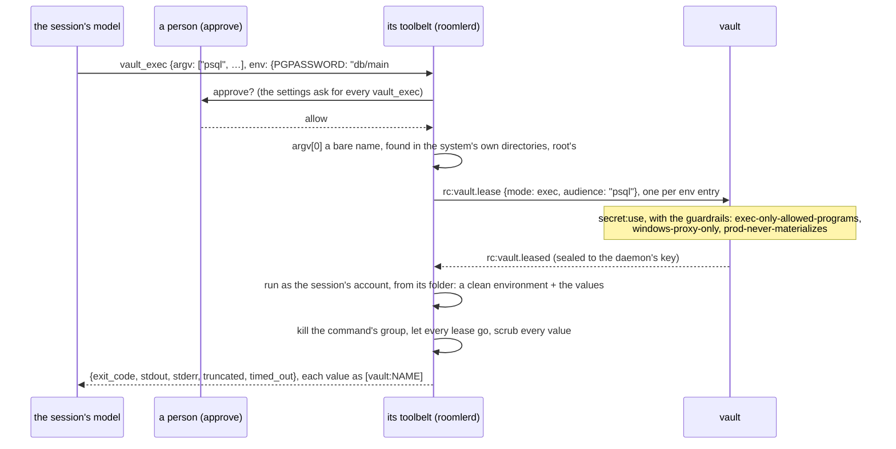

| Step | What holds | Where |
|---|---|---|
| the call | `argv`: 1 to 64 strings, `argv[0]` a program's **bare** name; `env`: 1 to 8 `NAME: handle` (a path or this org's RRN, `#field` for a structured secret's field); `timeout_s` 1 to 300, default 60. Never `PATH`, `HOME`, `USER`, `LOGNAME`, `SHELL`, `IFS`, `ENV`, `BASH_ENV`, nor `LD_*` / `DYLD_*`: those would steer what runs | [`vault_exec.rs:156`](../agents/roomlerd/src/hive/vault_exec.rs#L156) |
| the program | looked for only in `/usr/local/sbin`, `/usr/local/bin`, `/usr/sbin`, `/usr/bin`, `/sbin`, `/bin`, and refused unless root (or this daemon) owns it and neither group nor other can write it: a program the session's account could replace is never handed a value | [`vault_exec.rs:215`](../agents/roomlerd/src/hive/vault_exec.rs#L215) |
| the leases | one per `env` entry, mode `exec`, audience the program's bare name, TTL the timeout + 30 s; all asked before anything runs, and one refusal runs nothing | [`vault_exec.rs:423`](../agents/roomlerd/src/hive/vault_exec.rs#L423) |
| the run | as the session's account (decision 13: no administrator groups, on Linux no privilege gained by exec), from the session's folder, in its own process group, stdin closed, a clean environment (`HOME`, `USER`, `LOGNAME`, `PATH` = those directories, `LANG`) plus the values | [`vault_exec.rs:304`](../agents/roomlerd/src/hive/vault_exec.rs#L304) |
| the end | at its exit, its timeout, or the call cancelled: the whole group killed and every lease let go, each by a guard that runs however the call ends | [`vault_exec.rs:262`](../agents/roomlerd/src/hive/vault_exec.rs#L262), [`:485`](../agents/roomlerd/src/hive/vault_exec.rs#L485) |
| the answer | the exit code (and signal), stdout and stderr, at most 64 KiB each; each value replaced by `[vault:NAME]`, the longest first, then the daemon's own redactor (agent tokens, bearer and JWT shapes). A value shorter than 4 bytes cannot be masked without shredding the output, and the answer names it under `not_scrubbed` | [`vault_exec.rs:389`](../agents/roomlerd/src/hive/vault_exec.rs#L389) |

**`exec_allow` is a guardrail.** `guardrail:exec-only-allowed-programs`
([`policy.rs:123`](../crates/modules/vault/src/policy.rs#L123), §7) forbids
every `exec` lease whose audience is not on the secret's `exec_allow`. The
`Secret` entity carries `exec_allow`, so the refusal is a Cedar decision:
`simulate` names it, it is recorded with its request, and no organization can
drop it. A request recorded before the attribute existed reads back naming no
program. `exec_allow` holds bare names only
([`program_name_ok`](../crates/remote_control/src/vault.rs#L98), the one
definition the vault's write check
([`routes.rs:379`](../crates/modules/vault/src/routes.rs#L379)) and the
device share): a path could match nothing a device asks for.

> [!WARNING]
> - **`exec` is a materializing mode** (design §8.5): the program holds the
>   value, and a program that prints or sends it can leak it. Hence the
>   permit, `exec_allow`, and a person approving every call.
> - **Scrubbing is a seatbelt, not a boundary.** A value printed in another
>   encoding (base64, split across lines) passes it.
> - **Windows runs nothing.** The vault refuses `exec` there first
>   (`windows-proxy-only`), and the refusal is in `vault_audit` (AC13). A
>   Windows daemon never runs a materialized value even if a lease came back.
> - **Homebrew's programs are refused** on macOS: `/opt/homebrew` belongs to
>   a person, who could replace what a value is handed to.

> [!IMPORTANT]
> **A person approves every use because the settings ASK for it.** Keeping
> it out of the allow list is not enough. The session's settings list
> `vault_exec` and `vault_render` under `permissions.ask`
> ([`VAULT_USE_TOOLS`](../agents/roomlerd/src/hive/toolbelt.rs#L410), written
> by [`vault_use_tools`](../agents/roomlerd/src/hive/supervisor.rs#L4719)).
> - **Why an ask:** a repository's own `.claude/settings.json` loads too (the
>   FR-90 spec's open decision 7), and an allow there would skip the person.
>   Claude Code reads deny, then ask, then allow, across every settings file,
>   so an ask prompts whatever another file allows. Until this was found,
>   while `vault_render` was written, the uses were only kept out of `allow`.
> - ⚠️ **Not by marking the tools as requiring user interaction**
>   ([`launch.rs:420`](../crates/hive-node/src/launch.rs#L420)). A
>   `--permission-prompt-tool` can never approve such a tool: Claude Code
>   turns its allow into a deny, and `approve` is that tool.

| Piece | Where |
|---|---|
| the tool | `vault_exec` in [`toolbelt.rs:916`](../agents/roomlerd/src/hive/toolbelt.rs#L916), offered with the reads where the device takes leases, and asked for in the settings |
| where it runs | the run's `ExecTarget`, made at launch from the session's account, home and folder ([`supervisor.rs:4268`](../agents/roomlerd/src/hive/supervisor.rs#L4268)); none on Windows |
| letting go | `Client::release` ([`vault.rs:862`](../agents/roomlerd/src/vault.rs#L862)) |

## 15. A file with values: `vault_render` (P3-4c-2)

Some programs read a credential only from a file: a kubeconfig, an `.env`, a
`.pgpass`. A session asks for a template to be written with values from the
vault into its secrets directory, and gets the file's path, never a value. The
file lives exactly as long as its leases.

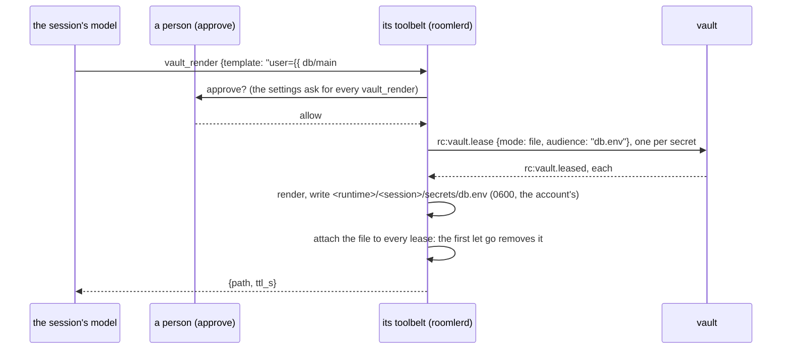

| Step | What holds | Where |
|---|---|---|
| the call | `template`: at most 64 KiB, each secret as `{{ handle }}` (a path or this org's RRN, `#field` for a field), 1 to 8 secrets; a `{{` never closed is refused, never kept as text. `dest`: a bare file name, by the rule `exec_allow` holds. `ttl_s`: 30 to 900, default 300 | [`vault_render.rs:98`](../agents/roomlerd/src/hive/vault_render.rs#L98), [`:62`](../agents/roomlerd/src/hive/vault_render.rs#L62) |
| the leases | one per distinct secret, mode `file`, audience the file's name, all asked before anything is written; one refusal writes nothing and lets the others go | [`vault_render.rs:253`](../agents/roomlerd/src/hive/vault_render.rs#L253) |
| the directory | `<runtime>/<session>/secrets/`, made by the daemon, its own, `0711`: the session's account opens a file whose name it knows, and lists nothing. A link or a file in its place is refused, never followed | [`vault_render.rs:170`](../agents/roomlerd/src/hive/vault_render.rs#L170) |
| the file | rendered into a buffer sized once (a vector that grew would leave copies of a value behind), written whole: a temporary made with `create_new`, `0600`, handed to the account, renamed into place | [`vault_render.rs:143`](../agents/roomlerd/src/hive/vault_render.rs#L143), [`:192`](../agents/roomlerd/src/hive/vault_render.rs#L192) |
| its life | attached to each of its leases, so it is removed the moment the first is let go: at its expiry, at `rc:vault.revoke`, or when the run ends here. The leases are kept, not released, when the call returns | [`vault.rs:246`](../agents/roomlerd/src/vault.rs#L246), [`:869`](../agents/roomlerd/src/vault.rs#L869) |
| a restart | the daemon removes every `secrets/` an earlier process left: no lease outlives the process that held it | [`supervisor.rs:725`](../agents/roomlerd/src/hive/supervisor.rs#L725), [`vault_render.rs:234`](../agents/roomlerd/src/hive/vault_render.rs#L234) |
| the Read tool | the session's settings deny it the secrets directory where the vault tools are offered | [`supervisor.rs:4677`](../agents/roomlerd/src/hive/supervisor.rs#L4677) |

> [!WARNING]
> - **`file` is a materializing mode** (design §8.5). The session's account
>   reads the file, which is what it is for, so a Bash command can print it.
>   The Read tool's deny is UX. The gates are the permit, the guardrails
>   (`prod-never-materializes` refuses a production secret in `file` mode) and
>   a person approving every call.
> - **Windows writes nothing.** The vault refuses `file` there
>   (`windows-proxy-only`), recorded, and a Windows daemon never writes a
>   materialized value even if a lease came back.
> - **A file with several values dies with its shortest lease.**

| Piece | Where |
|---|---|
| the tool | `vault_render` in [`toolbelt.rs:949`](../agents/roomlerd/src/hive/toolbelt.rs#L949), offered with the reads, and asked for in the settings as `vault_exec` is (§14) |
| keeping the leases | `Releasing::keep` ([`vault_exec.rs:493`](../agents/roomlerd/src/hive/vault_exec.rs#L493)) |

## 16. A lease asked for ahead: `vault_request` (P3-4c-3)

A session can ask for a lease before it uses one. It learns early that the
vault refuses, or uses one value in several commands without asking each
time. The lease is held in daemon memory and never handed to the session. A
later `vault_exec` or `vault_render` that names the same secret toward the
same audience takes it.

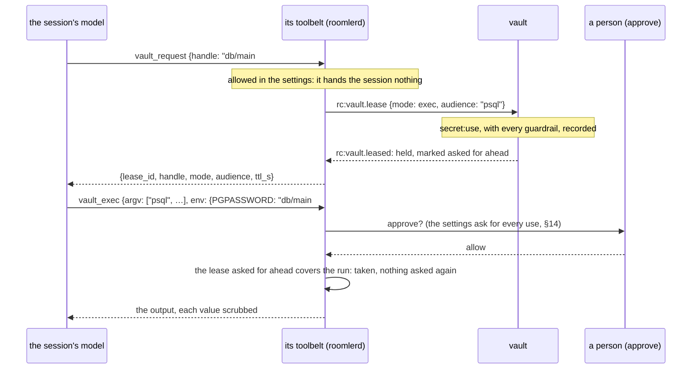

| Step | What holds | Where |
|---|---|---|
| the call | `handle`: a path or this org's RRN, `#field` for a field. `mode`: `exec`, `file` or (P3-5b-2) `proxy`, the modes a use takes. `audience`: a bare name, by the rule `exec_allow` holds; the program `vault_exec` will run, or the file `vault_render` will write; for `proxy`, the upstream `vault_connect` will sign in to, `host:port` by that tool's own rule (§19). `ttl_s`: 30 to 900, default 300 | [`vault_request.rs:36`](../agents/roomlerd/src/hive/vault_request.rs#L36) |
| the lease | asked for once, decided by `secret:use` with every guardrail, recorded, and held in daemon memory marked as asked for ahead; the answer names it and how long it lasts, never its value | [`vault_request.rs:102`](../agents/roomlerd/src/hive/vault_request.rs#L102), [`vault.rs:159`](../agents/roomlerd/src/vault.rs#L159) |
| its use | `vault_exec` takes it when it names the same secret and field for the same program, and the lease covers the command's whole timeout. `vault_render` takes it when it names the same secret toward the same file, and the lease lasts at least the file's `ttl_s`. Otherwise a call asks for its own, as before | [`vault.rs:898`](../agents/roomlerd/src/vault.rs#L898), [`vault_exec.rs:615`](../agents/roomlerd/src/hive/vault_exec.rs#L615), the lookup both tools share (`leased_values`, P3-6b-2b) |
| its end | its expiry, `rc:vault.revoke`, or the run's end: no call lets it go. A file written with it goes with it (§15), so a render's `ttl_s` answers how long the file truly lives: until the first of its leases ends | [`vault_render.rs:293`](../agents/roomlerd/src/hive/vault_render.rs#L293) |
| the settings | allowed, with the reads. The vault decides and records it, and it hands the session nothing. Each use of the lease still asks a person (§14) | [`supervisor.rs:4703`](../agents/roomlerd/src/hive/supervisor.rs#L4703) |

> [!IMPORTANT]
> **A use takes the lease by what it is, not by its id.** The design had the
> use tools take a lease by its id. But a call naming `lease:…` would hide
> from the person approving it which secret it hands on. So a call still
> names the secret, and the daemon finds the lease that matches: the same
> run, secret, field, mode and audience, lasting long enough. A lease a call
> asked for itself is never taken by another.

> [!NOTE]
> The vault cannot tell a lease asked for ahead from one a use asks for: it
> decides and records both as any `secret:use`. Being asked for ahead lives
> only on the device.

| Piece | Where |
|---|---|
| the tool | `vault_request` in [`toolbelt.rs:1014`](../agents/roomlerd/src/hive/toolbelt.rs#L1014), offered with the reads, allowed in the settings with them ([`VAULT_AHEAD_TOOLS`](../agents/roomlerd/src/hive/toolbelt.rs#L419)) |
| finding the lease | `Client::find_ahead` ([`vault.rs:898`](../agents/roomlerd/src/vault.rs#L898)); how long one has left, `Client::left` ([`vault.rs:919`](../agents/roomlerd/src/vault.rs#L919)) |

## 17. What a device reports doing: `vault_activity` (P3-4d)

The vault's own decisions are in `vault_audit` (§22). What a device says it
DID with its leases is a different claim, made by a host that may be
compromised, so it is kept apart in `vault_activity`, as `ssh_activity` is
kept apart from `ssh_audit` ([`roomler-ssh.md`](roomler-ssh.md)). P3-4d-1
built the server's half: the frame, the check, the collection and the read.
P3-4d-2 builds the device's: its owner's `vault_activity_log` switch, and a
report after each command `vault_exec` ran and each file `vault_render`
wrote.

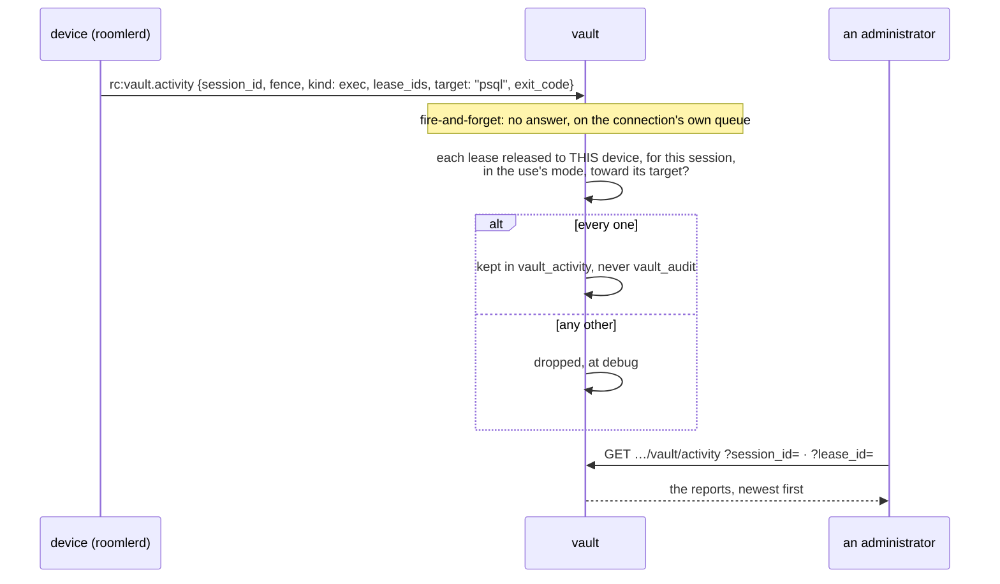

| Step | What holds | Where |
|---|---|---|
| the switch | the device's own `vault_activity_log`, default off, read at each primary hello. Never pushable: like `ssh_activity_log`, it is the device's word about itself, and a test holds every remote configuration to leaving it out | [`config.rs:588`](../crates/agent-core/src/config.rs#L588), [`config_surface.rs:509`](../crates/agent-core/src/config_surface.rs#L509), [`models.rs:9101`](../crates/remote_control/src/models.rs#L9101) |
| the report | after a `vault_exec` that ran its command (the program, and its exit code or its timeout) and a `vault_render` that wrote its file (its name), naming every lease the use took, asked for there or ahead. A call refused before anything ran or was written reports nothing. Fire-and-forget: a full connection drops the report rather than hold the call | [`vault.rs:516`](../agents/roomlerd/src/vault.rs#L516), [`vault_exec.rs:470`](../agents/roomlerd/src/hive/vault_exec.rs#L470), [`vault_render.rs:300`](../agents/roomlerd/src/hive/vault_render.rs#L300) |
| the frame | `rc:vault.activity {session_id, fence, kind, lease_ids, target, exit_code?, timed_out?}`. `kind` is `exec` (a command `vault_exec` ran: the program as the target, and how it ended) or `render` (a file `vault_render` wrote: its name as the target); 1 to 8 leases. Fire-and-forget, like `rc:ssh.activity`: no answer, and an older server ignores it | [`signaling.rs:1545`](../crates/remote_control/src/signaling.rs#L1545), [`vault.rs:307`](../crates/remote_control/src/vault.rs#L307) |
| the queue | the connection's own lease queue: a flood is dropped at its bound like a flood of requests, and each connection's reports are handled in order. At most 120 a minute per session on its device | [`lease.rs:393`](../crates/modules/vault/src/lease.rs#L393) |
| the check | every lease the report names was released to this device, for this session in this organization, in the use's mode (`exec` for `exec`, `file` for `render`) and toward its target. Otherwise, or for a kind this server cannot name or a target that is not a bare name, the report is dropped | [`lease.rs:433`](../crates/modules/vault/src/lease.rs#L433), [`dao.rs:572`](../crates/modules/vault/src/dao.rs#L572) |
| the row | the device from the socket, the session, the kind, the leases, the target, and for a command its exit code and whether it timed out (never kept for a file), with when it arrived. 90 days | [`model.rs:309`](../crates/modules/vault/src/model.rs#L309), [`lib.rs:330`](../crates/modules/vault/src/lib.rs#L330) |
| the read | `GET …/vault/activity`, administrators only, newest first: `?session_id=` for one session's, `?lease_id=` for those naming one lease, which is where a use joins its decision | [`routes.rs:1096`](../crates/modules/vault/src/routes.rs#L1096) |

> [!WARNING]
> - **A claim, not a decision.** A compromised device can report a use that
>   never happened, or leave one out. The lease's decision in `vault_audit` is
>   what survives a device that lies or goes quiet.
> - **An empty answer is not evidence of disuse.** A device reports only while
>   its owner's `vault_activity_log` is on, and that defaults off. A server
>   can never make a device describe itself honestly; the switch says so out
>   loud.

## 18. Approvals: the yes a policy asks for (P3-4e)

A policy can allow a use only with a person's approval:
`when { context has approval }`, or, naming whose yes counts,
`context.approval.approver in Roomler::Group::"admin"`. P3-4e-1 builds the
vault's half. When Cedar denies a lease that a yes could allow, the vault
posts a card into the session's room and answers `awaiting_approval`. One of
the session's drivers answers the card, and the session's next ask for the
same thing is leased. P3-4e-2 builds the device's half: a tool whose lease
waits on a card asks again until the answer, so the session's call simply
takes longer, and the model is told plainly when a person said no or nobody
answered. P3-4e-3 builds the card's answer in the web app: under the card's
text, where it stands, and **Approve** / **Deny** for a driver who may answer it
now ([`ui.md`](ui.md)). Any other chat client shows the card's text, and its
route answers it.

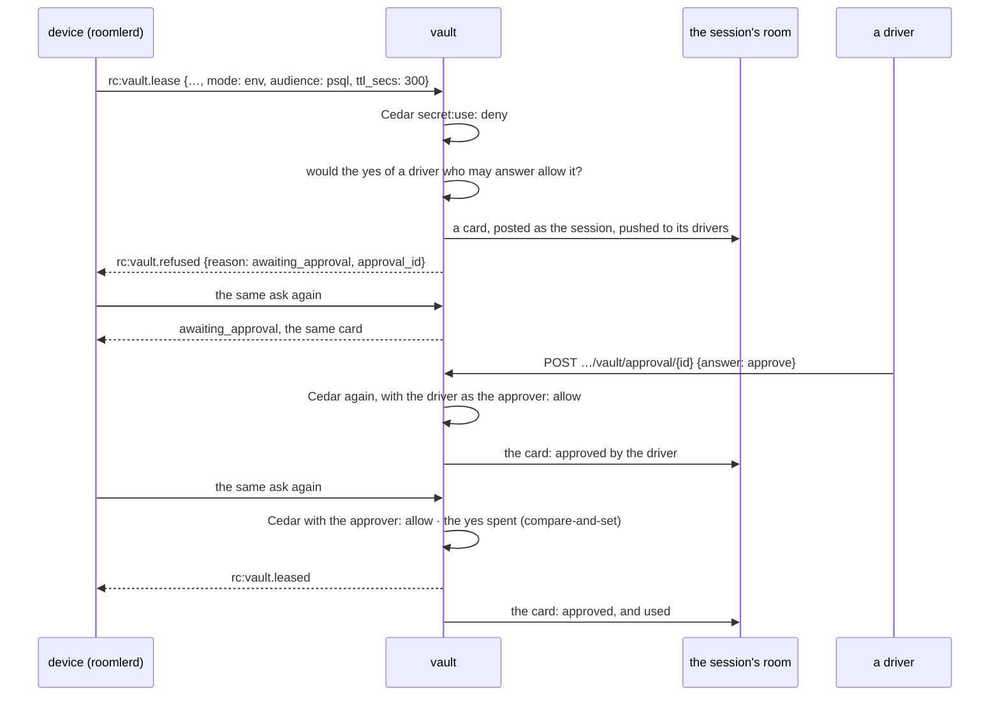

| Cedar denied a lease, and the vault finds for this very request | It answers |
|---|---|
| a driver's yes, usable, for at least the TTL asked | Cedar decides again with them as the approver; an allow spends the yes and releases the lease |
| a card waiting for an answer | `awaiting_approval`, naming that card: no second card |
| a driver's no, within the card's deadline | `denied` |
| nothing, and the yes of a driver who may answer now would allow it | a new card, and `awaiting_approval` |
| nothing, and no driver's yes would | `denied`, as before P3-4e |

"This very request" is one session at its fence on its device, one secret's
field, one mode and one audience, for no longer than the TTL the card named.
A yes to `env` toward `psql` for five minutes is no yes to `file`, to another
program, or to fifteen minutes.

Whose yes counts is the policy's to say, as anything else is. Four eyes, for
instance: a session's owner may not approve their own session's use, and any
other driver may.

```cedar
forbid (principal, action == Roomler::Action::"secret:use", resource)
when { context has approval && context.approval.approver == principal.owner };
```

The vault then posts a card only when the session has a driver besides its
owner.

| Piece | What holds | Where |
|---|---|---|
| the refusal | `awaiting_approval`, retryable. `rc:vault.refused` carries `approval_id` with it, and with no other word | [`vault.rs:178`](../crates/remote_control/src/vault.rs#L178), [`signaling.rs:4640`](../crates/remote_control/src/signaling.rs#L4640), [`lease.rs:722`](../crates/modules/vault/src/lease.rs#L722) |
| the decision | after Cedar's deny: a usable yes, a waiting card, a no, or a new card where a driver's yes would allow it | [`lease.rs:923`](../crates/modules/vault/src/lease.rs#L923), [`approval.rs:93`](../crates/modules/vault/src/approval.rs#L93) |
| the approver | Cedar reads `context.approval.approver` in a `Group` per roomler role they hold, as a person assuming a role is. A recorded request keeps the groups (`approver_groups`), so a replay decides it as it was decided | [`policy.rs:455`](../crates/modules/vault/src/policy.rs#L455), [`policy.rs:848`](../crates/modules/vault/src/policy.rs#L848), [`policy.rs:670`](../crates/modules/vault/src/policy.rs#L670) |
| who may answer | a driver who reads the session, while it is live: hive's own rule for its approvals. Their yes must be one the policy accepts, decided by Cedar with them as the approver when it is given, and again when a lease would spend it. A card is posted only where some driver could give one | [`access.rs:70`](../crates/modules/hive/src/access.rs#L70), [`approval.rs:151`](../crates/modules/vault/src/approval.rs#L151), [`approval.rs:622`](../crates/modules/vault/src/approval.rs#L622) |
| the card | a message the session authors in its room, bound to `{module: "vault", ref: <approval id>}` and pushed to its drivers as hive's own approvals are. It names the secret's handle, the mode, the audience, the TTL and the deadline, and is edited as the approval moves on: approved, used, denied, expired, withdrawn | [`room.rs:654`](../crates/modules/hive/src/room.rs#L654), [`approval.rs:286`](../crates/modules/vault/src/approval.rs#L286) |
| the routes | `GET …/vault/approval/{id}`: the approval as the session's readers see it, with `may_answer` (the caller drives it now) and `may_approve` (and the policy would take their yes) for the caller. `POST …/vault/approval/{id}` `{answer: "approve" \| "deny"}` | [`approval.rs:595`](../crates/modules/vault/src/approval.rs#L595), [`approval.rs:622`](../crates/modules/vault/src/approval.rs#L622) |
| one yes, one lease | the lease spends the yes by compare-and-set (`approved` → `used`) before its allow is recorded | [`lease.rs:1007`](../crates/modules/vault/src/lease.rs#L1007), [`dao.rs:820`](../crates/modules/vault/src/dao.rs#L820) |
| the windows | a card waits 10 min for an answer (`APPROVAL_ANSWER_SECS`); a yes is usable for 5 min from the answer (`APPROVAL_USE_SECS`) | [`vault.rs:83`](../crates/remote_control/src/vault.rs#L83) |
| the device's wait (P3-4e-2) | `awaiting_approval` reaches the lease client with its approval's id, and a tool's lease (`vault_exec`, `vault_render`, `vault_request`) asks again while the card waits: after 2 s, the pause doubling to 15 s, for at most the card's 10 minutes. Each ask is a decision the vault records, which is why the pause grows. A lease goes on as any lease does; a `denied` tells the model a driver may have said no; a card nobody answered in time names its approval and says to ask again once a driver can answer a new card. A cancelled tool call stops the asking | [`vault.rs:592`](../agents/roomlerd/src/vault.rs#L592), [`vault.rs:787`](../agents/roomlerd/src/vault.rs#L787), [`toolbelt.rs:443`](../agents/roomlerd/src/hive/toolbelt.rs#L443), [`toolbelt.rs:527`](../agents/roomlerd/src/hive/toolbelt.rs#L527) |
| the web app (P3-4e-3) | under a message bound to `{module: "vault"}`, the approval as `GET …/vault/approval/{id}` gives it: where it stands, the deadline while it waits, and **Approve** / **Deny** for a driver who may answer it now, **Approve** only where the policy would take their yes (`may_approve`, else off with why). A refusal is shown in the server's words. The vault edits the card's message whenever the approval moves on, and the new `updated_at` reads it again. The buttons only reflect what the route says; every decision stays the server's | [`VaultApprovalCard.vue`](../ui/src/components/vault/VaultApprovalCard.vue), [`MessageBubble.vue`](../ui/src/components/chat/MessageBubble.vue) |
| the row | `vault_approvals`, one per card: its request, its status (`pending` · `approved` · `denied` · `used` · `expired` · `withdrawn`), who answered and when, the lease that spent it, and the card's message. A unique index holds one pending card per request | [`model.rs:359`](../crates/modules/vault/src/model.rs#L359), [`lib.rs:343`](../crates/modules/vault/src/lib.rs#L343) |

| The answer route says | When |
|---|---|
| 200, the approval | a driver's answer, recorded |
| 400 | an answer that is neither `approve` nor `deny` |
| 403 | the caller does not drive the session now, or the policy does not accept their yes |
| 404 | no such approval in the organization, or the caller does not read its session: the same answer for both |
| 409 | answered already, or used; past its deadline (now `expired`); its session moved or ended (now `withdrawn`); its secret or its device gone since |

> [!WARNING]
> - **A card is a stub.** It names the secret's handle, the mode, the
>   audience and the TTL, which the vault holds anyway, and never why the
>   session asked: that step is in the transcript, which streams from a
>   replica (design §5.2). The audience is the session's own word, so the
>   card escapes it.
> - **One yes, one lease.** The compare-and-set comes before the allow is
>   recorded: a lost race releases nothing, and a failure after it only ever
>   wastes a yes. The next ask needs a new one.
> - **A yes is decided twice**: when it is given, and when a lease spends it.
>   A policy or a role that changed in between allows nothing.
> - **A card belongs to its session at its fence, on its device.** One past
>   its deadline expires, and one whose session moved or ended is withdrawn,
>   when it is next read or answered. A new card for the same request first
>   ends a stale one, which would otherwise hold the request's one pending
>   place in the unique index.
> - **Only drivers answer**, as with hive's own approvals. A policy narrows
>   whose yes counts among them; it cannot let anyone else answer. There is no
>   approver role outside the drivers: such a person is named a driver first.

## 19. `proxy` mode (P3-5)

In `proxy` mode the daemon serves an endpoint that authenticates upstream
with the leased value, so the session, its model and its transcript never
hold the value (AC12). A secret's `audiences` say which upstreams it may
reach (§7). The design is the spec's §3e, "P3-5, `proxy` mode, as designed".
P3-5b-1 builds the first engine, Postgres's, in `roomlerd`'s module
`vault_proxy` (`agents/roomlerd/src/vault_proxy/mod.rs`), and P3-5b-2 serves
it: `vault_connect` and its endpoint, below.

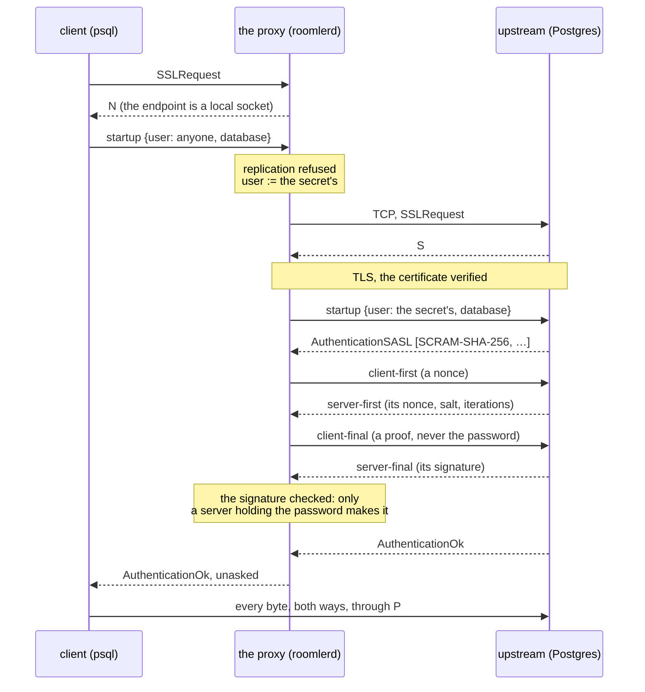

| Step | What the engine does | Where |
|---|---|---|
| the client's `SSLRequest`, `GSSENCRequest` | answered `N`: the endpoint is a local socket | `agents/roomlerd/src/vault_proxy/pg.rs:100` |
| its `CancelRequest` | sent to the upstream as it came, over TLS: the key it names is the upstream's own, relayed unchanged | `pg.rs:107`, `pg.rs:467` |
| its startup | `replication` refused, each one it names (Postgres takes the last, so a "no" first is no cover); `user` replaced by the secret's; everything else kept | `pg.rs:119`, `pg.rs:136` |
| the upstream | TCP, an `SSLRequest` it must accept, and TLS verified against the system's roots and the secret's `ca` | `pg.rs:431`, `agents/roomlerd/src/vault_proxy/tls.rs:72` |
| its authentication | SCRAM-SHA-256 only, and the server's signature checked before the session starts; bound to the certificate the proxy verified where the upstream offers `-PLUS` (P3-5b-3) | `pg.rs:198`, `pg.rs:210`, `pg.rs:216`, `pg.rs:258` |
| what it says meanwhile | a protocol negotiation passed on at once, since a client takes one only before its `AuthenticationOk`; a notice held until after it | `pg.rs:280`, `pg.rs:290` |
| then | `AuthenticationOk` to the client, and every byte both ways | `pg.rs:153` |

> ⚠️ **The client never authenticates.** The endpoint is its credential: a
> socket only the session's account can reach (P3-5b-2). The client is never
> asked for a password, and the secret's never crosses the endpoint, in
> either direction.

**What it refuses**, each before the password could leave:

| What | The refusal says |
|---|---|
| an upstream that declines TLS | "the upstream declined TLS" (`pg.rs:454`) |
| a certificate that no root and no `ca` vouches for | "TLS to *host*: …" |
| a cleartext or MD5 password asked for, or Kerberos, GSSAPI or SSPI | "the upstream asked for …; the proxy authenticates with SCRAM-SHA-256 only" |
| SASL without SCRAM-SHA-256 | "the upstream offers no SCRAM-SHA-256" |
| a server that signs wrong: it never held the password | "… it does not hold the password" |
| a server that began SCRAM and lets the session in unsigned | "… without proving it holds the password" |
| a client asking for a replication connection | refused before any upstream is dialled |

The proxy's refusals reach the client as Postgres writes a fatal error
(`FATAL`, SQLSTATE `08004`), saying why (`pg.rs:558`). An upstream's own
error, such as a wrong password or an unknown database, is relayed as the
upstream wrote it.

**SCRAM-SHA-256** (RFC 5802, RFC 7677), the client's half
(`agents/roomlerd/src/vault_proxy/scram.rs`):

| Rule | Why | Where |
|---|---|---|
| the password SASLprepped (RFC 4013) | both ends derive the key from the same form: a no-break space is a space, a control character is refused | `scram.rs:108` |
| the server's nonce must extend this exchange's | a server first message from another exchange is refused | `scram.rs:145` |
| at most 10,000,000 iterations | past that, an exchange is a way to make the daemon burn CPU (Postgres and MongoDB default to 4096 and 15000) | `scram.rs:33`, `scram.rs:155` |
| a mandatory extension (`m=`) refused | as the RFC requires of a client that does not know it | `scram.rs:140` |
| the server's signature compared in constant time | a server that cannot sign never had the password | `scram.rs:185`, `scram.rs:199` |
| bound to the channel (P3-5b-3) | where the upstream offers `-PLUS`, `p=tls-server-end-point`: the certificate the proxy verified, hashed with the hash its signature names (RFC 5929: MD5 and SHA-1 become SHA-256), inside what the proof covers. Where it offers none, `y`. `n` only where the certificate defines no binding data (Ed25519, RSASSA-PSS) | `scram.rs:38`, `tls.rs:171` |

> ⚠️ **What binding catches.** Inside verified TLS, SCRAM proves that both
> ends hold the password; binding adds the certificate the proxy saw to
> what the proof covers. Behind a TLS terminator the system also trusts (an
> inspection proxy whose CA is in the OS store), the real upstream compares
> the binding with its own certificate and refuses ("SCRAM channel binding
> check failed"). A relay that strips `-PLUS` from the offer meets the
> proxy's `y`, which an upstream that binds refuses as a downgrade ("SCRAM
> channel binding negotiation error"). Both refusals are the upstream's,
> relayed in its words. An upstream that cannot bind (an older server, a
> pooler) takes `y`, so nothing that worked stops working.
>
> ⚠️ **TLS is never unverified.** A proxy authenticates with a value, and a
> value presented to an upstream nobody verified is presented to whoever
> answered. The system's roots are trusted (a corporate CA in the OS store
> included, as the daemon's own connection trusts it), and so is the
> secret's `ca` when it holds one (`tls.rs:74`, `tls.rs:78`). Only `ring` is
> linked: `tokio-rustls` without its default `aws-lc-rs`.

**Bounds.** A session has 30 s to start, both sides together, and an
upstream has 10 s to accept a connection (`pg.rs:50`, `pg.rs:52`). A
client's startup packet is at most 10,000 bytes (Postgres's own limit), and
an upstream's message before the session at most 64 KiB (`pg.rs:46`,
`pg.rs:48`).

**Tested** against a fake upstream over real TLS, with a certificate made
for each test:
- the whole road, with a client that sends no password;
- the upstream's own refusal, relayed;
- each refusal above, with what the upstream saw after it searched for the
  password;
- a trusting upstream, told nothing;
- a cancel;
- the order of a negotiation and a notice;
- RFC 7677's exchange, byte for byte;
- (P3-5b-3) the exchange bound where the upstream offers `-PLUS`, and `y`
  where it offers none; a stripped offer and a relayed channel, each
  refused by the upstream; the binding's hash for P-256 and P-384
  certificates made in the test, none for Ed25519 or RSASSA-PSS, and SHA-1
  made SHA-256.

### The MongoDB engine (P3-5c-1)

The second engine, in `agents/roomlerd/src/vault_proxy/mongo.rs`: one
client connection on the endpoint, one upstream connection the proxy signs
in itself. P3-5c-2 serves it from `vault_connect`, below.

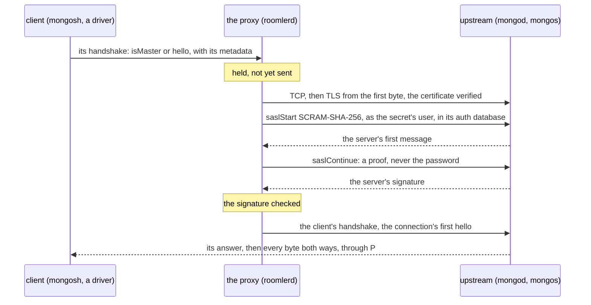

| Step | What the engine does | Where |
|---|---|---|
| the client's first message | read whole, at most 1 MiB: its handshake, `hello` or the legacy `isMaster`, as `OP_MSG` or `OP_QUERY`; held until the session starts | `mongo.rs:80`, `mongo.rs:50` |
| the upstream | TCP, then TLS from its first byte, verified against the system's roots and the secret's `ca` | `mongo.rs:123` |
| its authentication | SCRAM-SHA-256 by `saslStart` and `saslContinue` in the auth database, the user named in the exchange (MongoDB takes it from there, not from a startup), `skipEmptyExchange` asked for, and the empty exchange given to a server before 4.4 that still asks for it | `mongo.rs:145`, `mongo.rs:186` |
| the server's signature | checked before a byte of the client's is sent: a server that cannot sign is refused | `mongo.rs:183` |
| then | the client's first message, then every byte both ways | `mongo.rs:106` |
| a refusal | answers the client's first message as a server would: an `OP_REPLY` to an `OP_QUERY`, an `OP_MSG` to an `OP_MSG`, `ok: 0` with the reason and the code of a failed sign-in (18) | `mongo.rs:373` |

> [!WARNING]
> - **The proxy sends no `hello` of its own.** A server takes client
>   metadata only in the first `hello` a connection sees, and refuses it in
>   any later one (`ClientMetadataCannotBeMutated`). The design had the
>   proxy run `hello` first; it does not, so the client's handshake, sent
>   after the sign-in, is the connection's first.
> - **No channel binding.** MongoDB's SCRAM has none, so a MongoDB upstream
>   relies on verified TLS alone.
> - **One host.** The client connects with `directConnection=true`, so it
>   never discovers another member to dial around the proxy. SRV discovery
>   and replica-set failover come later.

**Tested** against a fake MongoDB over real TLS: the whole road (signed in
first, no `hello` of the proxy's own, the client's handshake with its
metadata the connection's first, then a command); a wrong password's
refusal answering the client's first message in each kind, which never
reaches the upstream; a server that cannot sign; a server before 4.4 given
its empty exchange; and a first message past its bound, and an upstream no
root vouches for.

### The HTTP engine (P3-5d-1, P3-5e-1)

The third engine, in `agents/roomlerd/src/vault_proxy/http.rs`: one client
connection on the endpoint, each of its requests sent on to one upstream
origin with the secret's credential added. P3-5d-2 serves it from
`vault_connect`, with git through `insteadOf`, below (the spec's §3e,
"P3-5d, HTTP named upstreams, as designed"). From P3-5e-1 it also carries
what a Kubernetes API server needs ("P3-5e, the Kubernetes API, as
designed"); P3-5e-2 serves it so, below.

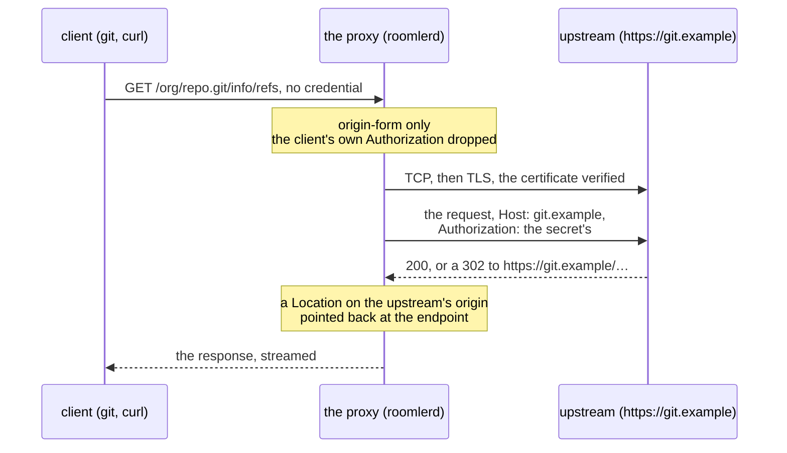

| Step | What the engine does | Where |
|---|---|---|
| a request | origin-form only: `CONNECT` answered `405`, an absolute or authority form and `*` answered `400`; nothing reaches the upstream | `http.rs:334`, `http.rs:340` |
| its headers | the client's `Authorization` and `Proxy-Authorization` dropped, with every hop-by-hop header and those its `Connection` names; `Host` the upstream's; the secret's `Authorization` added, marked sensitive | `http.rs:355`, `http.rs:389` |
| the credential | `Basic` from the secret's `user` and `password`, or `Bearer` from its `token`. A user with a colon, or a token that is empty or holds a space, a control character or a byte that is not ASCII, is never sent: the client is answered `502` | `http.rs:69`, `http.rs:98` |
| the upstream | TCP and TLS within 10 s, verified against the system's roots and the secret's `ca`; HTTP/1.1, one connection per client connection, dialled at its first request and again when the upstream closes it, a request it never wrote sent once more | `http.rs:502`, `http.rs:473` |
| the response | streamed back; a `Location` on the upstream's own origin pointed back at the endpoint; `Alt-Svc`, `Strict-Transport-Security` and the hop-by-hop headers dropped | `http.rs:371`, `http.rs:419` |
| a refusal | the client's request answered `503` with the reason, and the connection closed | `http.rs:193` |
| for Kubernetes (P3-5e-1): a client certificate | presented in the TLS handshake, by a connector made for the one connection, so no header carries it and TLS proves the key without sending it. An identity is a certificate (and any intermediates) and a key, both PEM | `http.rs:80`, `tls.rs:37`, `tls.rs:52` |
| for Kubernetes: an upgrade | to `websocket` or `SPDY/3.1`, what `kubectl exec`, `attach` and `port-forward` stream over, relayed on a connection of its own. On the API server's `101` the two ends are joined, and carried within the client connection's own session, so they end with it. Any other protocol (`h2c`), and any upgrade on a plain HTTP endpoint, is never relayed | `http.rs:255`, `http.rs:298`, `http.rs:162` |
| for Kubernetes: impersonation | every `Impersonate-User`, `Impersonate-Group`, `Impersonate-Uid` and `Impersonate-Extra-*` dropped | `http.rs:315`, `http.rs:62` |

> [!WARNING]
> - **`Authorization` shows the upstream the value.** SCRAM never shows a
>   database the password; an HTTP credential is presented whole, inside
>   TLS the proxy verified. An upstream that echoes the header back hands
>   the value to the session, so the secret's `audiences` are the trust.
> - **The session never names a header.** The form (`Basic` or `Bearer`) is
>   the call's; the header is always `Authorization`. A header the session
>   could name is one an upstream might reflect.
> - **The proxy never follows a redirect.** The client does. A redirect to
>   the upstream's own origin comes back through the endpoint, the origin
>   matched whole, never as a prefix; one anywhere else reaches the client
>   unchanged and is followed with no value.
> - **Only `Location` is rewritten.** URLs in a body, or in a `Link`
>   header, still name the upstream: a client follows them through the
>   endpoint by their path.
> - **A Kubernetes endpoint never forwards impersonation** (P3-5e-1). The
>   session acts as the secret's identity, and never through it as
>   another (`kubectl --as`), whatever that identity's RBAC would allow.
> - **A tunnel lives as long as its client connection's session.** An
>   upgraded connection is carried within the session that switched it,
>   so the endpoint's stop, the first lease let go, ends it too.

**Tested** against a fake HTTPS upstream over real TLS:
- the secret's token in the one `Authorization` the upstream sees, `Host` its own, and none of the
  client's credentials or hop-by-hop headers; `Basic` from the user and password;
- a value no header can carry, never sent;
- `CONNECT`, an absolute form (even one naming the upstream) and `*`, refused with nothing sent;
- redirects pointed back only to the whole origin; the upstream's hop-by-hop and origin headers
  dropped;
- a chunked body streamed both ways, with no length added;
- an upstream no root vouches for, and one that answers in the clear, sent nothing;
- one upstream connection for a client connection's requests, until the upstream closes it;
- a refused client told why;
- (P3-5e-1) a client certificate presented in the handshake to an upstream that asks for one,
  no header carrying it, and no request reaching it without one; an identity that is not one
  refused;
- an upgrade relayed and the two ends joined, bytes echoed back through the tunnel; none on a
  plain endpoint, nor to `h2c`; the tunnel ended with its session;
- impersonation dropped for Kubernetes, and passed on by a plain endpoint.

### The SSH agent (P3-5f-1)

The fourth engine, in `agents/roomlerd/src/vault_proxy/ssh_agent.rs`: one
client connection on the endpoint, answered as an SSH agent that holds the
secret's one key (the spec's §3e, "P3-5f, the SSH agent, as designed"). It
relays nothing. The session's own `ssh` connects to the host; the agent only
signs, and only a sign-in to a host the secret names. P3-5f-2 serves it from
`vault_connect`.

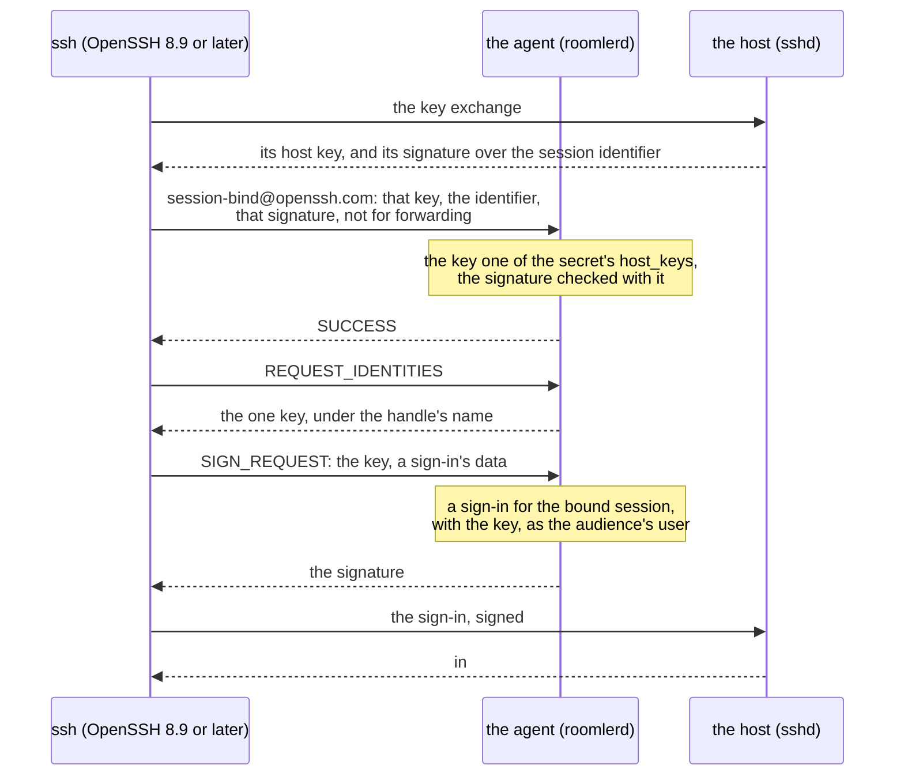

| Step | What the engine does | Where |
|---|---|---|
| the secret's `key` | one OpenSSH private key, unencrypted (`PROTOCOL.key`: `openssh-key-v1`, cipher and KDF `none`, its two check words equal, its padding `1, 2, 3, …`, the public half it lists its own), Ed25519 or ECDSA on P-256 or P-384. A key of any other type is refused for its type, an encrypted one for its passphrase | `agents/roomlerd/src/vault_proxy/ssh_agent.rs:503`, `ssh_agent.rs:521`, `ssh_agent.rs:555`, `ssh_agent.rs:588` |
| the secret's `host_keys` | one key per line, `<type> <base64>`: Ed25519, ECDSA on P-256 or P-384, or RSA. A line with host names before the key, as `known_hosts` writes one, is refused rather than read past | `ssh_agent.rs:596` |
| `REQUEST_IDENTITIES` | the one key, under the handle's name; no key on a connection whose binding was refused | `ssh_agent.rs:193` |
| `session-bind@openssh.com` | taken once per connection, and never for forwarding: the session identifier 1 to 128 bytes, the host's key one of `host_keys`, its signature over the identifier checked with that key. Any other binding refuses the connection, and nothing more is listed or signed on it | `ssh_agent.rs:308`, `ssh_agent.rs:334` |
| a host's signature | checked by `ring`: `ssh-ed25519`; `ecdsa-sha2-nistp256` and `-nistp384`; RSA as `rsa-sha2-256` or `rsa-sha2-512`, never `ssh-rsa`'s SHA-1 | `ssh_agent.rs:435`, `ssh_agent.rs:472` |
| `SIGN_REQUEST` | signed only on a bound connection, and only a sign-in (RFC 4252 §7): `SSH_MSG_USERAUTH_REQUEST` for the bound session, service `ssh-connection`, method `publickey` or `publickey-hostbound-v00@openssh.com` (its host key the bound one), a signature to follow, the key's own algorithm and key, nothing after; as the audience's user, where it names one | `ssh_agent.rs:206`, `ssh_agent.rs:371` |
| the signature | Ed25519 (RFC 8709), or ECDSA with its curve's hash, the two halves as `mpint`s (RFC 5656) | `ssh_agent.rs:242` |
| everything else | `SSH_AGENT_FAILURE`: adding or removing keys, `LOCK`, smartcards, every other extension. A message over 256 KiB, OpenSSH's own agent's limit, or an empty one, ends the connection | `ssh_agent.rs:295`, `ssh_agent.rs:649` |

> [!WARNING]
> - **A connection that never binds is signed nothing.** OpenSSH 8.9 and
>   later binds each agent connection before it signs, so a signature is
>   good for one SSH session with a host the secret names: OpenSSH's own
>   destination constraint (`ssh-add -h`), made the only mode. An older
>   `ssh`, `libssh2` and Paramiko do not bind, and get no signature.
> - **Only a sign-in is signed.** An `SSHSIG` (`ssh-keygen -Y sign`, git's
>   commit signing), a challenge, anything else a session hands over as
>   data would be the key's signature on the session's say-so, good
>   wherever the key is trusted.
> - **No forwarding.** A binding for forwarding (`ssh -A` from the session)
>   is refused, so no host the session reaches can sign through it.
> - **The key never crosses the endpoint.** Its bytes are zeroized where
>   the engine holds them; `ring`'s key pair, which holds the key while the
>   connection lasts, is not zeroed when it is dropped.

**Tested** against a client that asks as OpenSSH's `ssh` asks, with every key
made for the test:
- each key type the agent signs with, to a host of each type, in both
  sign-in methods, each signature checked by `ring`;
- nothing signed on a connection never bound; each bad binding refused, and
  the connection with it; a second binding refused;
- on a bound connection, each wrong sign-in refused (another session,
  service, method, algorithm, key or host; bytes after it; an `SSHSIG`), and
  the right one signed after them; the audience's user alone;
- everything else refused; a message past its bound, or an empty one, ending
  the connection;
- the secret's `key` and `host_keys` read strictly, a refusal naming no byte
  of the key;
- `ssh-keygen`'s own keys: Ed25519, P-256 and P-384 read; RSA and P-521
  refused for their type, an encrypted one for its passphrase; an RSA host
  it made, bound by `rsa-sha2-512` and `-256` but not by `ssh-rsa`;
  `ssh-add` listing the one key, and unable to remove it;
- **OpenSSH's own `ssh` signing in through the agent**, for each key type, to
  a host in the test (russh, on Linux, where the `ssh-server` feature builds
  it), its log saying it bound the agent; and refused for a host the secret
  does not name.

### The endpoint and `vault_connect` (P3-5b-2, P3-5b-4, P3-5c-2, P3-5d-2, P3-5d-3, P3-5e-2, P3-5f-2, P3-5f-3)

`vault_connect` is the toolbelt's tool for `proxy` mode. The daemon leases the
secret's fields toward the upstream (`user` and `password`, for `bearer`
its `token`, for `ssh` its `key` and `host_keys`), serves the call's engine on an endpoint that serves only the
session's account, and answers how to connect, with no credential anywhere in
the answer (`agents/roomlerd/src/hive/vault_connect.rs`). A database's endpoint
is below; git's, through an HTTP endpoint, is the second diagram,
`kubectl`'s, through a Kubernetes one, the third, and `ssh`'s the fourth.

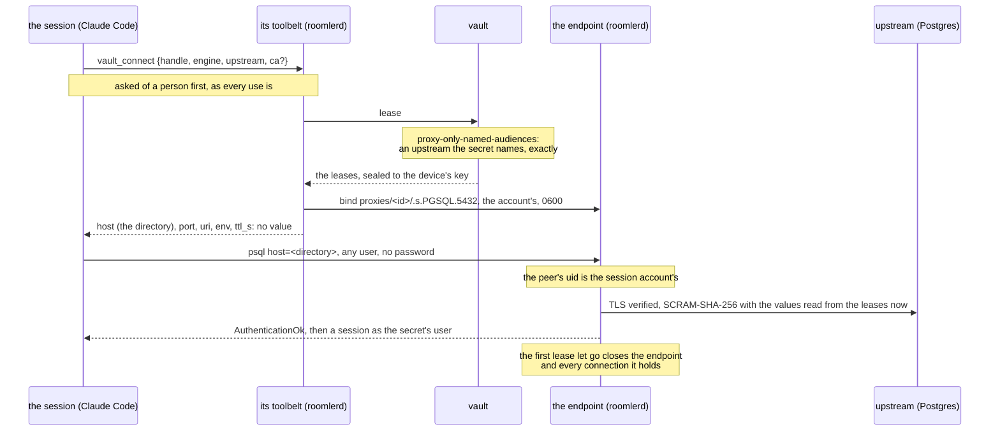

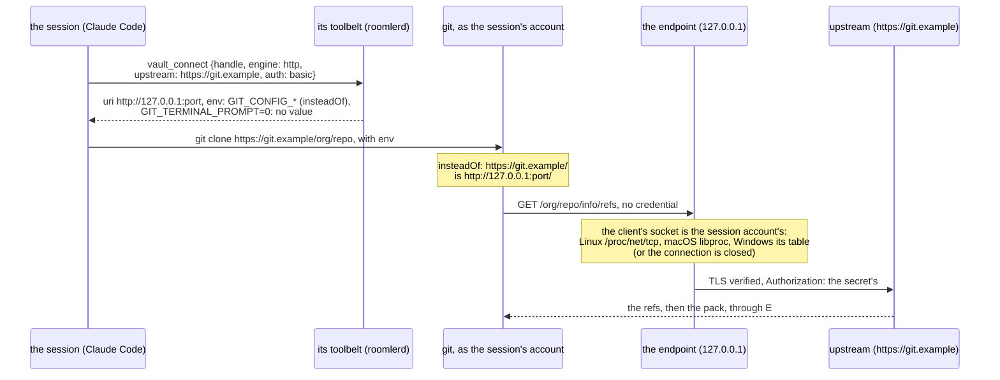

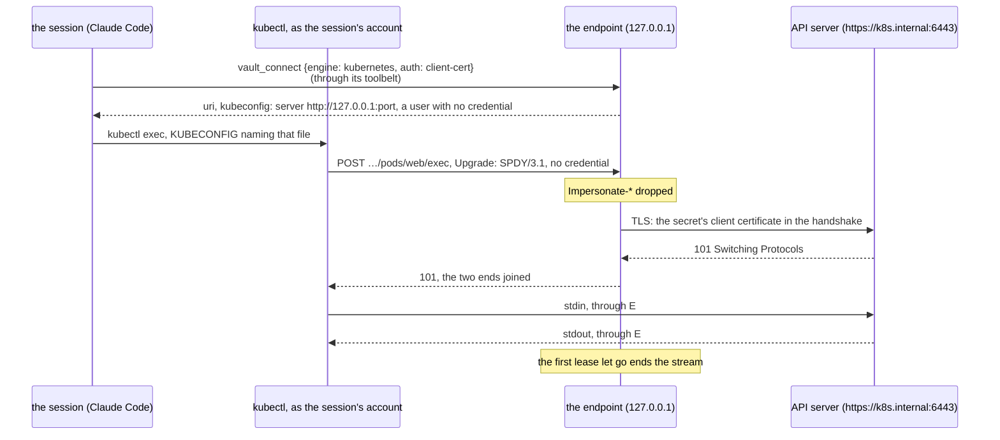

The fourth: `ssh`'s, through an agent the endpoint is. It relays nothing:
the session's own `ssh` dials the host, and only signs through the agent.

```mermaid
sequenceDiagram
    participant M as the session (Claude Code)
    participant S as ssh (the session's own)
    participant A as the agent (roomlerd)
    participant H as the host (ssh://git@build.internal)
    M->>A: vault_connect {engine: ssh, upstream: ssh://git@build.internal}<br/>(through its toolbelt)
    A-->>M: env SSH_AUTH_SOCK, known_hosts: the host's keys, no key
    M->>S: ssh git@build.internal, SSH_AUTH_SOCK set,<br/>UserKnownHostsFile naming that file
    S->>H: the key exchange, the host checked by known_hosts
    S->>A: session-bind: the host's key, its signature
    Note over A: one of the secret's hosts, the signature good
    A-->>S: SUCCESS
    S->>A: SIGN_REQUEST: the sign-in
    A-->>S: the signature; the key stays in the agent
    S->>H: the sign-in, signed
    H-->>S: in, as git
    Note over A: the first lease let go closes the agent
```

| Step | What holds | Where |
|---|---|---|
| the call | `handle`: a structured secret, by its path or this org's RRN, with no `#field`. `engine`: `postgres`, (P3-5c-2) `mongodb`, (P3-5d-2) `http`, (P3-5e-2) `kubernetes`, or (P3-5f-2) `ssh`. `upstream`, exactly as the secret's `audiences` names it: a database's `host:port` (a host name, an IPv4 address or a bracketed IPv6 one; one spelling per port); for `http` and `kubernetes` an origin, `https://host` or `https://host:port` (TLS always; no path, query or user; the port only where it is not 443); for `ssh`, `ssh://host`, `ssh://host:port` or `ssh://user@host` (no path; the port only where it is not 22; a user in it, a POSIX account name, is the one account the key signs in as). `auth`: required for `http` and `kubernetes`, refused for a database and for `ssh`: `basic` (the secret's `user` and `password`; `http` only, since no API server takes it) or `bearer` (its `token`), sent as `Authorization`, or (P3-5e-2) `client-cert` (its `cert` and `key`, PEM), presented in the TLS handshake. `database`: optional, a database's, named in the connection string. `ca`: optional, a secret whose value is the upstream's CA (PEM); refused for `ssh`, whose host is checked by the secret's own `host_keys`. `auth_source`: MongoDB's, the database the secret's user is defined in, default `admin` (refused in any other call). `ttl_s`: 30 to 900, default 300 | `vault_connect.rs:231`, `agents/roomlerd/src/vault_proxy/mod.rs:60`, `agents/roomlerd/src/vault_proxy/mod.rs:112`, `vault_connect.rs:178` |
| its place | at most 8 endpoints per run, taken before the vault is asked, so a call past it asks the vault nothing | `vault_connect.rs:795` |
| the leases | the secret's `user` and `password` (for `bearer`, its `token`; for `client-cert`, its `cert` and `key`; for `ssh`, its `key` and `host_keys`), and the CA's, each in `proxy` mode toward the upstream: `proxy-only-named-audiences` refuses an upstream the secret does not name (§7), recorded. A lease `vault_request` asked for ahead toward the same upstream (§16) is taken as it is | `vault_connect.rs:1015` |
| the values | read once to check them: a user the database takes; a value `Authorization` can carry (a user with no colon, a token of visible ASCII); a cert and key TLS can present, proven by making a connector with them, the refusal naming no parser's words, which could quote the key; (P3-5f-2) a key and hosts the SSH agent takes, read as it reads them, its refusals naming no byte of either; a CA that parses. Then again from the leases as each connection starts, never kept by the endpoint: a client certificate goes into that one connection's TLS, and an agent's key into that one connection's agent | `vault_connect.rs:1058`, `vault_connect.rs:1081`, `vault_connect.rs:1089`, `vault_connect.rs:896`, `vault_connect.rs:938` |
| the endpoint | a database's, on Unix: `<runtime>/<session>/proxies/<id>/.s.PGSQL.5432`, both directories the daemon's (`0711`), the socket handed to the session's account (`0600`); a Postgres client dials it as `host=<that directory>`, port 5432. For MongoDB the socket is `…/mongodb-27017.sock`, which a driver dials by its path (a host that ends in `.sock`). (P3-5f-2) An SSH agent's is `…/ssh-agent.sock`, on Linux and macOS; (P3-5f-3) on Windows it is a named pipe, `\\.\pipe\roomler-vault-<id>`, its DACL the session's account's to open as Win32-OpenSSH opens an agent, for reading and writing whole (`agent_pipe_sddl`; the toolbelt pipe's grant would refuse a session's `ssh.exe`), local clients only, its first instance made before the session is told its name. Either is named in `SSH_AUTH_SOCK`, as OpenSSH and Win32-OpenSSH dial it. Every database endpoint on Windows (P3-5b-4), and an HTTP or Kubernetes one everywhere (P3-5d-2, P3-5e-2; macOS from P3-5d-3), since neither git nor `kubectl` can dial a Unix socket: `127.0.0.1`, on a port the system picks. A system that cannot say who connected serves no loopback endpoint, refused before anything is leased | `vault_connect.rs:1496`, `vault_connect.rs:1628`, `vault_connect.rs:1157`, `vault_connect.rs:1916`, `vault_connect.rs:1901` |
| a connection | from the session's account only, root's refused too. On a socket its peer uid is checked again. On a pipe (P3-5f-3), past its DACL, the client's process is read from the pipe (`GetNamedPipeClientProcessId`) and its token's SID compared with the session's, and the next instance is made before the client is looked at, so a second connection always finds one listening. On a loopback port, Windows finds its process in the connection table (`GetExtendedTcpTable`) and compares its token's SID with the session's; Linux (P3-5d-2) reads `/proc/net/tcp` and `tcp6`, whose row for the connection's client end names the uid that owns the socket, and never believes a row in TIME_WAIT or with no inode; macOS (P3-5d-3) reads every process's descriptors (`proc_listpids`, `PROC_PIDLISTFDS`) and each socket's ends (`PROC_PIDFDSOCKETINFO`), and serves the connection only where its client end is held, and held only, by processes running as the session's account; macOS cannot say who made a socket. At most 16 at once, one engine session each | `vault_connect.rs:1405`, `vault_connect.rs:1597`, `vault_connect.rs:1704`, `vault_connect.rs:450`, `vault_connect.rs:632`, `vault_connect.rs:715`, `agents/roomlerd/src/hive_win.rs:348`, `hive_win.rs:318` |
| its life | the first of its leases to be let go (its expiry, `rc:vault.revoke`, the run's end) cancels the endpoint's stop, which closes its socket, pipe or port and every connection it holds, an upgraded stream (`kubectl exec`) and an agent's connection included. The leases the call asked for itself are then let go too, rather than held to their expiry. An earlier process's endpoints go at the daemon's start | `vault_connect.rs:1182`, `vault_connect.rs:1337`, `vault_connect.rs:413` |
| the answer | `host`, `port`, `database`, a `uri` and `env` (`PGHOST`, `PGPORT`, `PGDATABASE`), `ttl_s`: no `PGPASSWORD`, no value. On Unix the `uri` is `postgresql:///<db>?host=<dir>&port=5432`; on Windows `postgresql://127.0.0.1:<port>/<db>?sslmode=disable`, with `PGSSLMODE=disable` (the loopback leg is plain; the upstream's is TLS). For MongoDB it is `mongodb://<the socket's path, %-encoded>/<db>?directConnection=true` on Unix, with no `port`, and `mongodb://127.0.0.1:<port>/<db>?directConnection=true` on Windows, in `MONGODB_URI` too; `directConnection` keeps a driver on the one host, never discovering a member to dial around the proxy. For `http` (P3-5d-2) the `uri` is the endpoint's origin, `http://127.0.0.1:<port>`, and `env` holds git's own configuration by environment (`GIT_CONFIG_COUNT=1`, `GIT_CONFIG_KEY_0` = `url.<uri>/.insteadOf`, `GIT_CONFIG_VALUE_0` = `<upstream>/`) and `GIT_TERMINAL_PROMPT=0`: `git clone <upstream>/<repo>` goes through the endpoint with no change to the session's configuration, and a credential the upstream refuses fails at once. For `kubernetes` (P3-5e-2) the `uri` is the endpoint's origin, and the answer carries a `kubeconfig`: one cluster whose `server` is the endpoint, one context, one user with no credential. For `ssh` (P3-5f-2) `host` is the agent's socket, or (P3-5f-3) on Windows its pipe's name, and `env` names it in `SSH_AUTH_SOCK`; the `uri` is the upstream, which the session's own `ssh` dials; and `known_hosts` holds the hosts' keys under the upstream's name (`[host]:port` where the port is not 22), so `ssh` checks the host by the very keys the agent binds to. Nothing in any of them is secret: the session writes a `kubeconfig` or a `known_hosts` to a file of its own | `vault_connect.rs:1237`, `vault_connect.rs:1833`, `vault_connect.rs:1259`, `vault_connect.rs:1428`, `vault_connect.rs:1613`, `vault_connect.rs:1251` |

> [!WARNING]
> - **The settings ASK for every call.** `vault_connect` hands the session no
>   value, but the endpoint acts as the secret's user, so it is asked for with
>   the other uses (`permissions.ask`, §14), and a repository's own settings
>   cannot allow it past the person.
> - **What closes an endpoint is the lease client's own let-go.** The daemon's
>   lease client cancels the stop token of every endpoint served with a lease
>   whenever it lets that lease go (`stop_with`, §12), as it removes a rendered
>   file (§15). A connection therefore never outlives its lease.
> - **A loopback port can be reached by any process on the device; only
>   the session's account is served** (P3-5b-4, P3-5d-2). Windows' database
>   clients mostly cannot dial a Unix socket, and git cannot anywhere, so
>   those endpoints are loopback TCP, and who connected is read from the
>   system: Windows' connection table and the process's token, Linux's
>   `/proc/net/tcp`, macOS's descriptors of each process (P3-5d-3). The
>   port cannot be taken over by another account's
>   socket. Windows shares a bound port only where its first socket asked
>   for that (`SO_REUSEADDR`), which this one does not, and the daemon's own
>   account (SYSTEM) is the only exception. Linux shares one only between
>   sockets of one owner that all set `SO_REUSEPORT`, and macOS only
>   between sockets that all set it, which this one does not.
> - **A refusal speaks the engine's wire** (P3-5c-2). A Postgres client is
>   sent a fatal error; a MongoDB client, which speaks first, has its first
>   message answered with the reason, as a server answers it; an HTTP client
>   (P3-5d-2), its first request, `503`. An SSH agent's protocol carries
>   no reason (P3-5f-2): its client is hung up on, and `ssh` moves on to
>   its other methods (`vault_connect.rs:1356`).
> - **A use is not reported yet.** `vault_activity` (§17) takes `exec` and
>   `render`; a `proxy` endpoint's opening is a later step's report.

## 20. `short-lived` mode (P3-6)

A session gets a credential minted for its lease. `proxy` gave it an endpoint,
and `file`, `env` and `exec` a stored value. Here the vault stores the
*issuer*: what can mint, and what a minted credential may do. The session names
the secret as it names any other. What it gets lives as long as its lease and
reaches only what the issuer's configuration lets it. The session can read it
for that long; it never sees the issuer. The design is the spec's §3e "P3-6,
`short-lived`, as designed".

P3-6b-1 builds the vault's half: dynamic secrets, their providers, and a lease
sealed as one bundle. P3-6b-2a builds the daemon's first provider, a Postgres
minter, and P3-6b-2b its caller: `vault_exec` and `vault_render` serve a
dynamic secret. P3-6d-1a builds a MySQL minter, and P3-6d-1b makes `mysql` a
provider the caller serves.

```mermaid
sequenceDiagram
    participant S as the session's tool
    participant D as device (roomlerd)
    participant V as vault
    S->>D: vault_exec {env: {PGUSER: "db/dyn#user", PGPASSWORD: "db/dyn#password"}}
    D->>V: rc:vault.lease {secret: db/dyn, mode: short-lived} (no field: the secret as a whole)
    V->>V: the pairing guardrails, then Cedar's secret:use toward the secret's one audience
    V-->>D: rc:vault.leased {provider: postgres, n: 0, sealed: {audience, fields}}
    Note over D: a user minted with the issuer's fields,<br/>and only that user handed to the command
```

| Piece | Built |
|---|---|
| the secret | `kind: "dynamic"`, naming a `provider` this build knows, and exactly one audience: where the provider mints. Both are given at its creation; `PATCH` keeps the audience one. Its fields are its issuer's, under its provider's names, and a write of any other is refused ([`routes.rs:549`](../crates/modules/vault/src/routes.rs#L549), [`:839`](../crates/modules/vault/src/routes.rs#L839)). No other kind names a provider |
| the providers | [`vault::providers`](../crates/remote_control/src/vault.rs#L428), in the wire crate, so the server and the daemon agree on each one's names: its issuer's fields, those no mint can do without, and its minted credential's. `postgres` ([`vault.rs:457`](../crates/remote_control/src/vault.rs#L457)) and, since P3-6d-1b, `mysql`, with the same fields ([`vault.rs:469`](../crates/remote_control/src/vault.rs#L469)) |
| what a session is told | `vault_list` and `vault_describe` name the provider, and the minted credential's fields as the ones it may name, never its issuer's ([`meta.rs:45`](../crates/modules/vault/src/meta.rs#L45)) |
| the pairing | two guardrails in every organization's set: `dynamic-only-short-lived`, a dynamic secret in no other mode, and `short-lived-only-dynamic`, nothing else in `short-lived` ([`policy.rs:144`](../crates/modules/vault/src/policy.rs#L144)). Each refusal is recorded with its guardrail |
| a lease | for the secret as a whole: naming a field is refused `no_value`. Then, each refusal recorded: a provider this build knows (`no_value`) and the server serves (`not_served`), its one audience (`no_value`), and every field no mint can do without (`no_value`, `issuer_lacks_<field>`). Cedar decides toward the secret's own audience ([`lease.rs:1095`](../crates/modules/vault/src/lease.rs#L1095)) |
| the bundle | every issuer field that holds a value, each opened at its version ([`lease.rs:1132`](../crates/modules/vault/src/lease.rs#L1132)), in one JSON object, `{"audience": …, "fields": {…}}`, sealed to the device's key. The frame says `provider`, and `n: 0`. The buffer is sized for the worst escaping before it is written, so it never grows and leaves no copy behind ([`dynamic.rs:144`](../crates/modules/vault/src/dynamic.rs#L144)) |
| its row | `field: ""`, `n: 0`, and `bundle`: each field at the version it carried. It ends at its TTL, or at the first of its versions' `expires_at` |
| its standing | a new version of any of the issuer's fields takes it back. The write takes back every lease of the secret at once, and a sweep compares each field with the bundle's ([`revoke.rs:236`](../crates/modules/vault/src/revoke.rs#L236)). A provider this build cannot name stands for nothing |
| the kill switch | `vault.providers` (`ROOMLER__VAULT__PROVIDERS`): empty or `*` is every provider built, and a list only those ([`dynamic.rs:31`](../crates/modules/vault/src/dynamic.rs#L31)). A word that names none serves nothing, so `none` turns them all off. Per secret, `disabled` |
| the daemon | holds the bundle of a provider it mints for (`postgres`, `mysql`), lent to no tool ("The caller", below), and refuses any other provider's unopened, as `unsupported`: it never takes a bundle for a stored value ([`vault.rs:727`](../agents/roomlerd/src/vault.rs#L727)) |

- ⚠️ **The vault never mints.** For `postgres` the device does: only it
  reaches the database, as for `proxy`. The bundle carries the issuer's fields
  to it, and they stay in daemon memory, as a `proxy` value does. Where a
  GitHub App token is minted is decision 18.
- ⚠️ **Windows is refused** by `windows-proxy-only`: `short-lived` materializes
  a credential, and Windows has no sandbox to keep it in.
- ⚠️ **The prod guardrail does not refuse it.** That guardrail keeps a stored
  value from materializing; a credential minted for minutes is what it pushes
  toward.

### The Postgres minter (P3-6b-2a)

`vault_proxy::pg_mint` mints a Postgres user for one lease, and takes it back.
Its caller is the daemon's lease client ("The caller", below).

```mermaid
sequenceDiagram
    participant D as device (roomlerd)
    participant P as Postgres at the secret's audience
    D->>P: TLS against the issuer's ca, SCRAM-SHA-256 as admin_user, to its database
    D->>P: the expired: named roomler_…, past VALID UNTIL, commented "roomler lease …"
    D->>P: each of them dropped, as a revocation drops one
    D->>P: CREATE ROLE roomler_(lease id) LOGIN PASSWORD (its verifier) VALID UNTIL (the lease's end) IN ROLE (the grants), with its COMMENT, in one transaction
    Note over D: the session gets user, password, host, port, database
    D->>P: at the lease's end: the role looked up, NOLOGIN, its sessions ended, REASSIGN and DROP OWNED, DROP ROLE
```

| Step | Built |
|---|---|
| the issuer | the bundle's `admin_user` and `admin_password`, signed in by SCRAM-SHA-256 over TLS verified against its `ca` (or the system's roots), to its `database`, at the secret's one audience. A bundle that does not parse, or lacks one of those three, is refused before anything is dialled, in words that name no value ([`pg_mint.rs:51`](../agents/roomlerd/src/vault_proxy/pg_mint.rs#L51)). Since P3-6d-1a the bundle is opened by one reader every minter shares, whose parsed fields are zeroed when they drop, so the parse leaves no copy of the password behind ([`bundle.rs:29`](../agents/roomlerd/src/vault_proxy/bundle.rs#L29)). The sign-in is the proxy's own handshake, with no client behind it ([`pg.rs:310`](../agents/roomlerd/src/vault_proxy/pg.rs#L310)) |
| the sweep | first, at every mint: each role named `roomler_…`, past its `VALID UNTIL`, whose comment is `roomler lease …`, dropped where the issuer may. That is what a daemon that died before revoking left ([`pg_mint.rs:173`](../agents/roomlerd/src/vault_proxy/pg_mint.rs#L173)) |
| the mint | `CREATE ROLE "roomler_<lease id>" LOGIN PASSWORD '<verifier>' VALID UNTIL '<the lease's end>' IN ROLE <grants>`, and `COMMENT ON ROLE … IS 'roomler lease <lease id>'`, sent as one query and so run as one transaction ([`pg_mint.rs:123`](../agents/roomlerd/src/vault_proxy/pg_mint.rs#L123)). The grants are the issuer's `grants` field, one role per line |
| the password | 32 random bytes, base64url, one per lease. Postgres is sent its SCRAM-SHA-256 verifier, `SCRAM-SHA-256$4096:<salt>$<StoredKey>:<ServerKey>`, never the password, so a database that logs its statements logs no password ([`scram.rs:239`](../agents/roomlerd/src/vault_proxy/scram.rs#L239)) |
| the revocation | the role looked up, and a role already gone is done; `NOLOGIN`; its sessions ended (`pg_terminate_backend`); what it owns in the issuer's database given to the issuer (`REASSIGN OWNED`, then `DROP OWNED`); `DROP ROLE` ([`pg_mint.rs:202`](../agents/roomlerd/src/vault_proxy/pg_mint.rs#L202)). Ending its sessions and giving back what it owns are best effort, each refusal logged: `NOLOGIN` has already refused any new session |
| the names | every name quoted as an identifier, and every value as a literal. A role is dropped only if its name is `roomler_` and 24 hex characters, a lease's id. That is checked before a revocation dials, and again before each drop, which covers whatever the sweep's query returns ([`pg_mint.rs:102`](../agents/roomlerd/src/vault_proxy/pg_mint.rs#L102)) |

- ⚠️ **The issuer needs `CREATEROLE`**, and on Postgres 16 and later
  `ADMIN OPTION` on each role in `grants`. Ending a minted role's sessions
  needs `pg_signal_backend` (or the role's own privileges). Without it, a
  revocation still drops the role, but a session open at that moment runs
  until it closes.
- ⚠️ **`VALID UNTIL` bounds the password, not a session.** Postgres checks it
  only at sign-in. Revoking at the lease's end is what takes the role away.

### The caller (P3-6b-2b)

`vault_exec` and `vault_render` serve a dynamic secret as they serve a stored
one. The session names its credential's fields (`db/dyn#user`). The daemon
leases the secret as a whole, mints one credential for the lease, and takes
the credential back when the lease is let go.

```mermaid
sequenceDiagram
    participant S as the session's tool call
    participant D as device (roomlerd)
    participant V as vault
    participant P as the issuer's database
    S->>D: vault_exec, env DBU = db/dyn#user and DBP = db/dyn#password
    D->>V: rc:vault.describe db/dyn
    V-->>D: kind dynamic, provider postgres or mysql, its credential's fields
    D->>V: rc:vault.lease db/dyn in short-lived, once for both names
    V-->>D: rc:vault.leased, the bundle sealed to the device
    D->>P: the mint, once for the lease, by the minter its provider names
    Note over D: DBU and DBP from the one credential, and the command runs
    D->>P: the call ends and its lease is let go, so the user is dropped
```

| Step | Built |
|---|---|
| the kind | each secret a call names is described first. Its metadata says whether it is dynamic, and names its credential's fields ([`vault_exec.rs:520`](../agents/roomlerd/src/hive/vault_exec.rs#L520)). A secret the session's role may not describe is leased as a stored one |
| the lease | every name a call gives one dynamic secret shares ONE lease of the secret as a whole, in `short-lived`, with no field and no audience: the vault decides toward the secret's own. A stored secret's names are leased as before ([`vault_exec.rs:573`](../agents/roomlerd/src/hive/vault_exec.rs#L573)) |
| a field | only the credential's: `#user`, `#password`, `#host`, `#port`, `#database`. Any other, an issuer's included, or the secret named whole, is refused before anything is leased |
| the bundle | held in daemon memory and lent to no tool: `with_value` answers nothing for it, and a tool reads only the credential's fields ([`vault.rs:962`](../agents/roomlerd/src/vault.rs#L962)). The bundle of a provider this build mints nothing for is refused unopened, as `unsupported`. The providers it mints for are the minters' own list, `postgres` and `mysql` ([`minter.rs:24`](../agents/roomlerd/src/vault_proxy/minter.rs#L24)) |
| the mint | at the lease's first use, once: a use that comes while the mint runs waits for its credential ([`vault.rs:976`](../agents/roomlerd/src/vault.rs#L976)). The minter is the one the bundle's provider names (P3-6d-1b, [`minter.rs:37`](../agents/roomlerd/src/vault_proxy/minter.rs#L37)), and the credential ends with the lease: a Postgres role's `VALID UNTIL`, a MySQL user's event, each given in the form its database takes ([`minter.rs:50`](../agents/roomlerd/src/vault_proxy/minter.rs#L50)) |
| the revocation | whenever the lease is let go (its expiry, `rc:vault.revoke`, the run's end, or the end of the call that asked for it), in the background, with nothing waiting on it. A mint that ends after its lease was let go takes its own credential back at once ([`vault.rs:246`](../agents/roomlerd/src/vault.rs#L246)) |
| asked ahead | `vault_request` asks for a dynamic secret whole, in `short-lived`, for `exec` or `file` alike. Its first use mints, and every later use that takes the lease shares the credential. Not for `proxy` ([`vault_request.rs:112`](../agents/roomlerd/src/hive/vault_request.rs#L112)) |
| the report | a use's report names the short-lived lease once, and the vault keeps it for any use: the lease's audience is where the credential was minted, never the use's target ([`dao.rs:572`](../crates/modules/vault/src/dao.rs#L572)) |

- ⚠️ **`exec_allow` does not bound a dynamic secret.** Its credential is the
  session's to hold for its lease (§3e, "What `short-lived` cannot promise").
  What bounds it is its lifetime and its issuer's grants.
- ⚠️ **A session's role needs `secret:list` on a dynamic secret it uses.** The
  tools learn the kind from the secret's metadata. A role that may use a
  dynamic secret but not list it gets a stored mode's lease, which
  `dynamic-only-short-lived` refuses.
- ⚠️ **A daemon that restarts forgets what it minted.** Those credentials end
  as their database ends them (a Postgres role's `VALID UNTIL`, a MySQL user's
  event), and the issuer's next mint sweeps them.
  A revocation that fails is logged on the device, not reported to the vault.
- ⚠️ **`vault_connect` serves no dynamic secret yet.**

### The MySQL minter (P3-6d-1a)

`vault_proxy::mysql_mint` mints a MySQL user for one lease, and takes it back.
Since P3-6d-1b its caller is the lease client ("The caller", above), through
`vault_proxy::minter`, which picks the minter a bundle's provider names. The
design is the spec's §3e "P3-6d, MySQL, SQL Server and Redis users, as
designed".

```mermaid
sequenceDiagram
    participant D as device (roomlerd)
    participant M as MySQL at the secret's audience
    M-->>D: the greeting, which must offer TLS, or nothing is sent
    D->>M: SSLRequest, then TLS against the issuer's ca
    D->>M: caching_sha2_password as admin_user, to its database
    D->>M: the ended: roomler_… users whose ATTRIBUTE says their lease is over, each dropped
    D->>M: CREATE USER roomler_(lease id) AS (its password's form) ATTRIBUTE (its lease, its end)
    D->>M: each grant, SET DEFAULT ROLE ALL, then CREATE EVENT at its end, DO DROP USER
    Note over D: the session gets user, password, host, port, database
    D->>M: at the lease's end: ACCOUNT LOCK, KILL its connections, DROP USER, DROP EVENT
```

| Step | Built |
|---|---|
| the client | MySQL's client protocol, a client of its own (`vault_proxy::mysql`). The server's greeting must offer TLS and the 4.1 protocol, or the client sends it nothing at all. Then an `SSLRequest`, and TLS verified against the issuer's `ca` (or the system's roots), before a byte of the sign-in ([`mysql.rs:240`](../agents/roomlerd/src/vault_proxy/mysql.rs#L240)). The sign-in is `caching_sha2_password`: its scramble, and, from a server that has not cached the account, the password itself inside that TLS. A switch to `sha256_password` is followed inside the TLS too: MySQL answers so for an account under it, and for one that is not there. Any other plugin is refused ([`mysql.rs:304`](../agents/roomlerd/src/vault_proxy/mysql.rs#L304)) |
| a query | `COM_QUERY`, text rows, the server's error in its own words. At most 1 MiB a packet and 10,000 rows an answer. `CLIENT_LOCAL_FILES` is never offered ([`mysql.rs:40`](../agents/roomlerd/src/vault_proxy/mysql.rs#L40)), which the daemon's build checks: since P3-6d-1b, a `CAPS` that offered it does not compile ([`mysql.rs:51`](../agents/roomlerd/src/vault_proxy/mysql.rs#L51)). A server that asks for a local file anyway is refused and sent nothing ([`mysql.rs:353`](../agents/roomlerd/src/vault_proxy/mysql.rs#L353)) |
| the issuer | the bundle's `admin_user` and `admin_password`, to its `database`, at the secret's one audience. The bundle is opened by the reader the Postgres minter uses: refused before anything is dialled when it does not parse or lacks a field no mint can do without, and zeroed when it drops ([`bundle.rs:43`](../agents/roomlerd/src/vault_proxy/bundle.rs#L43)). The `database` and each grant must be names the minter quotes: no quote, backtick, backslash or control character ([`mysql_mint.rs:49`](../agents/roomlerd/src/vault_proxy/mysql_mint.rs#L49)) |
| the sweep | first, at every mint: each `roomler_…` user whose `ATTRIBUTE` says its lease has ended, dropped where the issuer may ([`mysql_mint.rs:186`](../agents/roomlerd/src/vault_proxy/mysql_mint.rs#L186)). That covers an event that never ran: the scheduler off, or an end already past when the mint ran |
| the mint | `CREATE USER 'roomler_<lease id>'@'%' IDENTIFIED WITH caching_sha2_password AS '<form>' ATTRIBUTE '{"roomler": {"lease": "<id>", "until": <end>}}'` ([`mysql_mint.rs:143`](../agents/roomlerd/src/vault_proxy/mysql_mint.rs#L143)). Then each of the issuer's `grants` (`role` or `role@host`, one per line) as its own `GRANT`, and `SET DEFAULT ROLE ALL`. Then its end, in the issuer's database: `CREATE EVENT … ON SCHEDULE AT FROM_UNIXTIME(<end>) ON COMPLETION NOT PRESERVE DO DROP USER IF EXISTS …` ([`mysql_mint.rs:162`](../agents/roomlerd/src/vault_proxy/mysql_mint.rs#L162)). The end is a count of seconds (`FROM_UNIXTIME`), so it names the same instant whatever the server's time zone |
| a step refused | MySQL commits each statement as it runs. A grant or the event refused takes the user back at once, and the mint is refused in MySQL's words: no user is left without its end ([`mysql_mint.rs:112`](../agents/roomlerd/src/vault_proxy/mysql_mint.rs#L112)) |
| the password | 32 random bytes, base64url, one per lease. MySQL is sent its `caching_sha2_password` form, never the password: `$A$005$`, a 20-character salt, and the SHA-256 crypt digest at 5,000 rounds, which is what MySQL keeps ([`sha_crypt.rs:132`](../agents/roomlerd/src/vault_proxy/sha_crypt.rs#L132)). The salt is drawn from crypt's own alphabet, so the form holds nothing a SQL literal must escape ([`sha_crypt.rs:122`](../agents/roomlerd/src/vault_proxy/sha_crypt.rs#L122)) |
| the revocation | the user looked up, and a user already gone is done, its event dropped all the same. Otherwise `ACCOUNT LOCK`; its connections listed and ended where the issuer may (`KILL`, sent only for a thread id of digits); `DROP USER`; `DROP EVENT` ([`mysql_mint.rs:213`](../agents/roomlerd/src/vault_proxy/mysql_mint.rs#L213)). Ending its connections is best effort, each refusal logged: the lock has already refused any new sign-in |
| the names | a user is dropped only if its name is `roomler_` and 24 hex characters, a lease's id: the Postgres minter's rule, and its code ([`pg_mint.rs:102`](../agents/roomlerd/src/vault_proxy/pg_mint.rs#L102)). That is checked before a revocation dials ([`mysql_mint.rs:175`](../agents/roomlerd/src/vault_proxy/mysql_mint.rs#L175)), and again before each drop, whatever the sweep's query returns |

- ⚠️ **The issuer needs** `CREATE USER`, `EVENT` on its database, and each
  role in `grants` granted to it `WITH ADMIN OPTION`. To end a minted user's
  connections it also needs `PROCESS` (to see them) and `CONNECTION_ADMIN` (to
  end them). Without those two, a revocation still drops the user, but a
  connection open at that moment runs until it closes.
- ⚠️ **The end is the event's, and only where the scheduler runs**
  (`event_scheduler`, on by default in MySQL 8). MySQL keeps no end of its own
  for an account: a password's expiry counts in days, and a client that signs
  in with an expired password may set a new one. With the scheduler off, a
  user whose daemon died before revoking signs in until the issuer's next mint
  sweeps it.
- ⚠️ **`mysql_native_password` is refused.** Its proof is SHA-1, and MySQL 8.4
  turns it off by default. An issuer account under it cannot mint.
- ⚠️ **MySQL 8.0.21 or later.** `ATTRIBUTE`, the sweep's mark, arrived in
  8.0.21. Tested against MySQL 8.4.11.

### The Kubernetes minter (P3-6f-1)

`vault_proxy::k8s_mint` mints a service account's token for one lease, bound
to a Secret made for the lease, and takes it back by deleting the Secret.
Nothing calls it yet: P3-6f-2 adds `kubernetes` to the providers and the
lease client's minters. The design is the spec's §3e "P3-6f, a Kubernetes
`TokenRequest`, as designed".

```mermaid
sequenceDiagram
    participant D as device (roomlerd)
    participant K as API server at the secret's audience
    D->>K: GET its namespace's Secrets labelled roomler.ai/lease (where the issuer may list)
    D->>K: DELETE each one whose end has passed, on its uid
    D->>K: POST an empty Secret roomler-(lease id), its lease labelled, its end annotated
    K-->>D: its uid
    D->>K: POST serviceaccounts/(account)/token, bound to that Secret by name and uid
    K-->>D: the token
    Note over D: the session gets token, server, ca, namespace
    D->>K: at the lease's end: DELETE the Secret, on its uid
```

| Step | Built |
|---|---|
| the client | one request per connection, over TLS verified against the issuer's `ca` (or the system's roots), on the HTTP/1 client the `http` engine dials with. The issuer signs in by `admin_token` in `Authorization`, or by `admin_cert` and `admin_key` in the handshake, the key read again for each connection's TLS alone ([`k8s_mint.rs:465`](../agents/roomlerd/src/vault_proxy/k8s_mint.rs#L465)). Each request has ten seconds, and an answer at most 4 MiB, read into memory that is zeroed when it drops, and that grows without leaving a copy behind ([`:540`](../agents/roomlerd/src/vault_proxy/k8s_mint.rs#L540)) |
| the issuer | the bundle's one audience, an origin as the `http` engine reads one, `origin_of` ([`mod.rs:112`](../agents/roomlerd/src/vault_proxy/mod.rs#L112)), moved from `hive::vault_connect` for it as `upstream_of` was. Its `namespace` must be a name Kubernetes gives a namespace and its `service_account` one it gives an account, since both go into a request's path; one credential, never both; `audiences` one per line ([`k8s_mint.rs:93`](../agents/roomlerd/src/vault_proxy/k8s_mint.rs#L93)) |
| the sweep | first, at every mint: the namespace's Secrets labelled `roomler.ai/lease`, and each whose name is a minted one and whose `roomler.ai/until` has passed, deleted on its uid. An issuer that may not list is not swept, and the mint goes on ([`k8s_mint.rs:356`](../agents/roomlerd/src/vault_proxy/k8s_mint.rs#L356)) |
| the mint | an empty `Opaque` Secret `roomler-<lease id>`, labelled with its lease and annotated with its end (RFC 3339); then a `TokenRequest` bound to it by name and uid (`boundObjectRef`), `expirationSeconds` the lease's TTL or 600, whichever is longer, and the issuer's `audiences` where it names some. A token refused takes the Secret back on its uid, and the mint is refused in the API server's words ([`k8s_mint.rs:250`](../agents/roomlerd/src/vault_proxy/k8s_mint.rs#L250)) |
| the credential | `token`, `server` (the audience), `ca` (the issuer's, or empty where the system's roots verify the API server) and `namespace`; no issuer field ([`k8s_mint.rs:195`](../agents/roomlerd/src/vault_proxy/k8s_mint.rs#L195)) |
| the revocation | the Secret deleted on the uid it was made with. One already gone is a revocation done; another object under its name (a `409` on the uid) is left alone, since ours went with its token ([`k8s_mint.rs:326`](../agents/roomlerd/src/vault_proxy/k8s_mint.rs#L326)) |
| the names | a Secret is deleted only if its name is `roomler-` and a lease's 24 lowercase hex characters, a name Kubernetes takes, checked before the revocation dials and before each of the sweep's deletes ([`k8s_mint.rs:223`](../agents/roomlerd/src/vault_proxy/k8s_mint.rs#L223)) |

- ⚠️ **The issuer needs** `create` on `serviceaccounts/token` for its
  account, and `create` and `delete` on `secrets` in its namespace; `list` on
  `secrets` only for the sweep. Give it a namespace of its own: `list`
  returns every Secret's data there, and `create` can make a legacy account
  token that never expires.
- ⚠️ **A token's end is the Secret's deletion**, within the seconds the API
  server caches a sign-in; a request already streaming runs on until it
  closes. A daemon that dies first leaves the token to its own expiry, 600 s
  or the lease's TTL.

## 21. A session's own egress: `rc:vault.net` (P3-7-1b)

A session reaches a private subnet behind a device, or the internet from a
chosen place, through Roomler's own tunnels. It asks the vault, not the
network module:
- only the vault can believe a session, because it reads the session's
  record (§10);
- the network module may not ask the vault, because `hive ↔ network` is
  forbidden both ways
  ([`graph.rs:103`](../crates/core/src/graph.rs#L103)).

So the vault decides, with Cedar's `net:socks` or `net:forward` (§7). It
answers with a **grant**: a token signed by core's auth service under an
audience of its own, `net_grant`. The network module verifies it at
`rc:tunnel.open` without calling a module, and holds every flow of that
tunnel to it (P3-7-2a,
[tunnels.md](tunnels.md#an-agent-sessions-grant-fr-90-p3-7-2a)). P3-7-1b
builds the vault's half; no device asks before P3-7-3.

```mermaid
sequenceDiagram
    participant D as roomlerd (the session's device)
    participant V as vault (its agent-socket handler)
    participant DB as session record · device rows · vault
    participant A as core's auth service
    D->>V: rc:vault.net {req_id, session_id, fence, exit, kind, host?, port?, ttl_secs}
    V->>DB: the device's row (advertises vault? holds a key?)
    V->>DB: the session record (on THIS device? at this fence? live? a role?)
    V->>DB: the exit's row (a live device of THIS organization?)
    V->>V: Cedar net:socks or net:forward, the node's and the device's facts from their ROWS
    alt allowed
        V->>A: sign the grant (net_grant)
        V->>DB: record the allow, naming the grant
        V-->>D: rc:vault.net.granted {req_id, grant_id, grant, expires_at_ms, host?, port?}
    else
        V->>DB: record the deny (once the session is known)
        V-->>D: rc:vault.refused {req_id, reason}
    end
```

| Check, in order | Refused as | Recorded |
|---|---|---|
| the request within its bounds: a kind this build names (`socks`, `forward`); a forward's host one `canonical_net_host` spells, and a port; SOCKS naming neither | `bad_request` | no |
| the vault serves the organization | `not_served` | no |
| the device takes leases: its hello advertised `vault` and carried a key | `unsupported` | no |
| a session of the organization whose record places it on THIS device | `not_located` | no |
| at the record's fence | `stale_fence` | yes |
| live: starting, idle, running or awaiting an approval | `ended` | yes |
| within the session's 120 requests a minute, which its leases share | `busy` | no |
| holding a vault role (§8) | `no_role` | yes |
| the exit a live device of THIS organization | `no_exit` | yes |
| Cedar's `net:socks` or `net:forward` | `denied` | yes, with the request |
| signed | `unavailable` | yes |
| the allow recorded | `undecided` | — |

**The grant** names exactly what was decided
([`NetGrantClaims`, `auth/mod.rs:163`](../crates/services/src/auth/mod.rs#L163)):

| Claim | What |
|---|---|
| `sub`, `fence` | the session, at the fence its record held |
| `tenant_id`, `owner_user_id` | its organization, and the person it acts for |
| `origin_agent_id` | the device it runs on: the only one that may use it |
| `exit_agent_id` | the device its flows leave through |
| `net` | `socks` or `forward` |
| `dst_host`, `dst_port` | a forward's one destination, the host canonical; nothing for SOCKS |
| `jti` | the grant's id, as its allow names it (`grant:<id>`) |
| `iat`, `exp` | its start and its end: the asked TTL, clamped to 30 s to 900 s, in whole seconds |

> [!WARNING]
> - **One spelling per destination.** A policy compares `context.host` by
>   equality, so the vault decides, and grants, a forward's host as
>   `canonical_net_host` spells it
>   ([`vault.rs:393`](../crates/remote_control/src/vault.rs#L393)):
>   lowercase, without the root's dot, an address in its canonical form, an
>   IPv4-mapped IPv6 address as its IPv4. `DB.internal.` is decided as
>   `db.internal`, so no spelling steps around a `forbid`. **Write hosts in
>   a policy the same way**: `context.host == "DB.internal"` never holds, so
>   as a `forbid` it forbids nothing.
> - **A name a resolver would read as an address is refused**: one whose
>   last label is a number (`10.0.0`, `167772165`, `0xa000005`,
>   `010.0.0.5`). `inet_aton` reads `010.0.0.5` in octal, as `8.0.0.5`, so a
>   forward permitted toward a name could be dialled to an address no
>   policy saw.
> - **A name is not its address.** A `forbid` on `db.internal` does not
>   forbid `10.0.0.5`. Name what may be reached in a `permit`, and leave
>   reachability to the exit's own gates: the tunnel policies and its
>   `forward_acl`.
> - **The grant is checked as it was signed**: its kind, its destination,
>   its ids, a life of at most 900 s, and **no leeway past its end**, none
>   of the minute every other verifier gives (`verify_net_grant`,
>   [`auth/mod.rs:806`](../crates/services/src/auth/mod.rs#L806)). No other
>   gate takes it, and it takes no other credential.
> - **A grant is no lease**: no `vault_leases` row, nothing `rc:vault.revoke`
>   names. The device closes its listener when the session's run ends
>   there (P3-7-3), and the grant's end bounds the rest.
> - **Recorded before given**, as a lease is: a grant whose allow was not
>   recorded is never sent (`undecided`).

> [!NOTE]
> An exit dials as its daemon, SYSTEM or root. A session's flow to
> `localhost` through an exit reaches that exit's own loopback as its
> daemon, and an exit that is the session's own device would make its
> loopback the daemon's too. Whether a session's flow may reach an exit's
> loopback is the network module's to decide, at the flow (P3-7-2b): the
> vault decides by policy, and Cedar's context does not name the
> session's device by id. Until P3-7-2b a session's flow reaches nothing,
> loopback or not: no tunnel policy names a session yet (P3-7-2a).

`simulate` (§7) decides a forward's host as the vault decides a
request's: in its one spelling, and refused where a request would be.

| Piece | Where |
|---|---|
| the wire | `rc:vault.net` ([`signaling.rs:1577`](../crates/remote_control/src/signaling.rs#L1577)) · `rc:vault.net.granted` ([`:4686`](../crates/remote_control/src/signaling.rs#L4686)) · `rc:vault.refused`; `NetKind`, `canonical_net_host` and `no_exit` ([`vault.rs`](../crates/remote_control/src/vault.rs)) |
| the handler | [`net.rs`](../crates/modules/vault/src/net.rs) `grant` ([`net.rs:93`](../crates/modules/vault/src/net.rs#L93): the checks above), answered in order on the lease queue (§10) |
| the grant | [`auth/mod.rs`](../crates/services/src/auth/mod.rs): `TokenType::NetGrant`, `issue_net_grant`, `verify_net_grant`, `net_grant_holds` |
| the network module's half | P3-7-2a ([tunnels.md](tunnels.md#an-agent-sessions-grant-fr-90-p3-7-2a)): the grant bound at `rc:tunnel.open` only from the device it names and toward the exit it names, else the open is refused; its flows `Principal::Session`, held to the grant before any policy, and named in `tunnel_audit` (`session_id`, `grant_id`) |
| the device's asking | P3-7-3a ([tunnels.md](tunnels.md#the-devices-half-asking-and-opening-under-the-grant-p3-7-3a)): `vault::net` sends `rc:vault.net` on the primary connection and uses a grant only for exactly what it asked (`NotAsked` otherwise), held to the vault's end on this clock and never past the ceiling; a flow's tunnels present it at every open, and end for good when the server refuses it or opens without its echo |
| the device's listeners | P3-7-3b ([tunnels.md](tunnels.md#the-devices-listeners-p3-7-3b)): one on loopback per flow, at a port the system picks, serving the session's account alone by the check `vault_connect`'s endpoints make; SOCKS5 with RFC 1929, the listener's own credential and CONNECT alone; gone with its flows at the grant's end |
| the device's tools | P3-7-3c ([tunnels.md](tunnels.md#the-tools-net_socks-and-net_forward-p3-7-3c)): `net_socks` and `net_forward` on the session's toolbelt, offered where the device's owner turned on `hive_net` beside `vault_enabled`, and asked of a driver before every call; each call one grant and one listener, at most 8 a run, every one ended with the run here as well as at its grant's end |
| what comes next | P3-7-2b: the tunnel policies a session's flows match (decision 20), and whether one may reach an exit's loopback |

## 22. Audit

`vault_audit` holds every `secret:*` and `vault:verify` decision, allow and
deny. Each row has the principal (`user` in P3-1), the action as a policy
names it, the operation, the decision and its reason (`administrator` or
`not_administrator`), and the RRN, field and version number where there is
one. P3-2a adds every `policy:write` (a role's or a policy's), with its
`target`. P3-2b adds every `role:assume` (§8), with the session, the device
and the request it decided. P3-3b adds every lease decision once its session
is identified (§10): `secret:use`, op `lease`, principal `session` (the row's
user is the session's owner), the session, the device, the request a Cedar
decision decided, and a `target` of `lease:<id>` on an allow, or of
`asked:<name>` when the name resolved to no secret. P3-3c adds every
revocation (§11): op `revoke`, decision `revoke`, principal `vault`, the
reason word, and a `target` of `lease:<id>`; one row per lease, written by the
pod whose compare-and-set took it back. P3-4b adds every `secret:list` (§13),
principal `session`: op `describe`, allow or deny, with the secret and the
request a replay decides again; op `list`, one row a call, the reason
`listed N of M` and a `target` of `asked:<prefix>` (`asked:*` for all), with
no request, since an aggregate is not a decision a replay could make again.
P3-4c-1's `exec` leases are `secret:use` rows like any lease, the program as
the request's audience; an `exec` refused for its program names
`guardrail:exec-only-allowed-programs` as its reason (§14). P3-4c-2's `file`
leases are recorded the same way, the file's name as the audience (§15).
P3-4c-3's leases asked for ahead are recorded as any lease is (§16).
P3-4e adds the approvals (§18). A lease denied while a card waits is a
`secret:use` deny with the reason `awaiting_approval`, and one a driver said
no to has `approval_denied`; each has a `target` of `approval:<id>` and its
request. A lease a yes allowed records the approver and their groups in its
request, and one whose yes was spent in a race is refused as
`approval_spent`. Each answer is a row of its own: op `approval`, principal
`user` (the person answering), the reason `approved` or `denied`, or a
refusal (`not_a_driver`, `approver_refused: …`), a `target` of
`approval:<id>`, and no request: the lease a yes allows is the decision a
replay decides again. P3-7-1b adds every egress decision once its session
is identified (§21): `net:socks` or `net:forward`, op `grant`, principal
`session`, the session, the device, the request a Cedar decision decided
(the node by its id, a forward's host and port), and a `target` of
`grant:<id>` on an allow, or of `asked:<the exit's id>` otherwise.
Rows expire after
90 days, like the other audits.

- **An allow is recorded before it is acted on, and fails closed.** A decision
  the vault cannot record is answered 500 and not acted on.
- A refusal is recorded too, on a best-effort basis: the caller is refused
  whatever the database says.
- The status and the audit read are not decisions about a secret, and are not
  recorded.
- A request refused for its content (400, 422) or for want of a KEK (503) acts
  on nothing, so it records no allow.
- A device's own report of using a value is a different claim, made by a host
  that may be compromised. It goes to `vault_activity` (§17), never here, as
  `ssh_audit` and `ssh_activity` are kept apart.

## 23. Collections

| Collection | One row per | Indexes | Retention |
|---|---|---|---|
| `vault_secrets` | secret | unique `(tenant_id, path)` over live rows (partial on `deleted_at: {$type: "null"}`, so a live row stores an explicit `null`); `(tenant_id, deleted_at, path)` | tombstoned, kept |
| `vault_versions` | value written | unique `(secret_id, field, n)`; `(tenant_id, kek)` | the last 10 per field; all go with their secret |
| `vault_audit` | decision | `(tenant_id, at desc)`, `(secret_id, at)` | 90 days (TTL on `at`) |
| `vault_roles` | vault role (P3-2a) | unique `(tenant_id, name)` over live rows | tombstoned, kept |
| `vault_policies` | policy (P3-2a): one Cedar statement, its effect, a revision | unique `(tenant_id, name)` over live rows; `(tenant_id, deleted_at, created_at)` | tombstoned, kept |
| `vault_leases` | value released (P3-3b): the secret, field and version; the session, its fence, its owner and its device; the key it was sealed to (`sealed_to`); the mode and audience; issued and expiry times; `revoked_at`/`revoked_why` from P3-3c (§11). Never the value | `(tenant_id, session_id)`; P3-3c `(device_id, expires_at)` (a pod's checks, a hello) and `(secret_id, expires_at)` (a change to a secret) | a week past `expires_at` (TTL); the decision stays in `vault_audit` for 90 days |
| `vault_activity` | a device's report of a use (P3-4d, §17): the device, the session and its fence, the kind (`exec` · `render`), the leases, the target, an exec's exit code and timeout. A claim, never a decision | `(tenant_id, at desc)`, `(tenant_id, session_id, at desc)`, `(lease_ids)` | 90 days (TTL on `at`) |
| `vault_approvals` | approval card (P3-4e, §18): its request (the session, its fence and device, the secret's field, the mode, the audience, the TTL), its status, who answered and when, the lease that spent it, the card's message | unique `(session_id, fence, device_id, secret_id, field, mode, audience)` over pending rows; `(session_id, secret_id, requested_at desc)` | 90 days (TTL on `requested_at`) |

P3-3a adds no collection: a device's key is a field on fleet's `agents` row
(`vault_key`, §9). Neither do P3-4a to P3-4c-3: a lease the daemon holds,
asked for ahead or not, lives in its memory (§12, §16), a listing is a
decision recorded in `vault_audit`, and a rendered file is on the device, for
its lease (§15).

## 24. What comes next

| Step | Builds |
|---|---|
| P3-6c to P3-9 | GitHub App tokens, where decision 18 says; SQL Server and Redis users, as decision 19 says; AWS STS, a role's credential per lease, ended at the lease's end by a session policy AWS enforces and minted where decision 21 says (its design: the FR-90 spec, §3e "P3-6e, AWS STS, as designed"); a Kubernetes `TokenRequest`, a service account's token per lease bound to a Secret made for the lease, so deleting the Secret ends it, minted on the device (its design: §3e "P3-6f, a Kubernetes `TokenRequest`, as designed"); the rest of a session's own egress (the tunnel policies a session's flows match, P3-7-2b); `ssh_run` as a tool, one command on another device over Roomler SSH under a ticket of the session's own that Cedar's `ssh:run` decides (its design: §3e "P3-8, `ssh_run`, as designed", and decision 22); `fleet_exec` as decision 5 says; `roomler connect` |
| P3k | the field run in the test organization |
