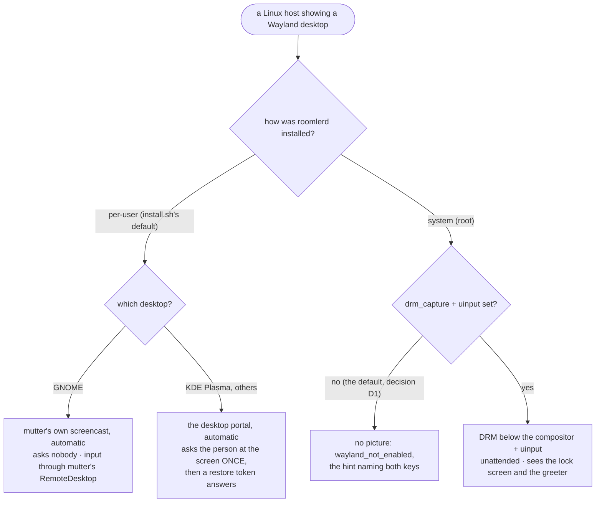

# Wayland — what works out of the box, and what the viewer says when it cannot

The support matrix for Linux Wayland desktops: for each desktop and install
type, whether a controller gets a picture, input and a cursor, whether anyone
at the screen is asked, what each session state does to the picture, and which
release carries each piece. This page is FR-93's
([spec](fr/FR-93-wayland-out-of-the-box.md), #1972). The mechanics behind
every row (the capture cascade, the helper, the PipeWire consumer, the DRM
worker) are in [`linux-capture.md`](linux-capture.md); this page links into it
rather than repeating it.

The shape of the problem, in one line: Wayland gives no process a readable
screen. Each way to get pixels sees something the others cannot, so **which
one a host uses depends on the desktop and on who runs the daemon**, and a
stock install picks for itself where it safely can.

## 1. The short answer



- **Per-user installs capture by themselves** (FR-93 P2, decision D1). The
  daemon runs inside the user's own Wayland session, so it can use the
  session's own screencast: mutter on GNOME, which asks nobody, else the
  desktop portal, which asks the person at the screen once.
- **System installs stay opt-in.** A root daemon sits in no session. Its arms
  (DRM for the picture, `uinput` for input) work below the compositor, see the
  lock screen and the greeter, and inject into whatever has focus, so they are
  switched on by the owner, never by the daemon. Until then the viewer is told
  `wayland_not_enabled`, with the two keys to set. Switching them on by default
  is [FR-95](fr/FR-95-system-installs-on-by-default-on-wayland.md) (#2041).
- **Every refusal names itself.** A Wayland desktop that no arm may capture
  says so, never a black stream and never "headless"
  ([`linux-capture.md`](linux-capture.md) §1.1).

## 2. The matrix

| Desktop | Install | Picture | Input | Cursor | Asks the person at the screen | Lock screen / greeter | Verified on |
|---|---|---|---|---|---|---|---|
| GNOME (mutter) | per-user, stock | ✅ mutter's ScreenCast, automatic ([`linux-capture.md`](linux-capture.md) §5) | ✅ mutter's RemoteDesktop, native windows included | ✅ drawn into the frames | **no** | ❌ GNOME shares no locked screen: the viewer waits for the unlock (§3 below) | 0.4.132 (picture, input, cursor) |
| KDE Plasma 6 | per-user, stock | ✅ the desktop portal, automatic ([`linux-capture.md`](linux-capture.md) §4) | ✅ the portal's RemoteDesktop (KDE's *Remote Control* dialog) | ✅ drawn into the frames | **once**: one dialog, then the restore token | ✅ KDE's portal streams the lock screen | picture 0.4.132 · input and cursor 0.4.133 |
| GNOME, KDE | system, stock | ❌ `wayland_not_enabled`, naming `drm_capture` + `uinput` | — | — | — | — | 0.4.130 |
| GNOME, KDE | system, `drm_capture` + `uinput` | ✅ DRM: the scanout plane, below the compositor | ✅ `uinput`: host-global, it types into whatever has focus | ✅ the cursor plane, on the cursor channel | **no** | ✅ both are pixels on the scanout | picture 0.4.130 · input 0.4.128 · cursor 0.4.134 · idle cost 0.4.135 |
| wlroots (sway and others) | per-user, `portal_capture` | ⚠️ the portal through `xdg-desktop-portal-wlr`: proven only to the handshake (no GPU on the host measured) | ❌ the wlr portal has no RemoteDesktop | — | — | — | unproven |
| any | either, `ROOMLERD_VIRTUAL_DESKTOP=1` | ✅ the daemon's own Xvfb, which it captures over X11 | ✅ | ✅ | no | — | (X11, not Wayland) |

"Verified on" names the released build each cell was measured on in the lab.
An idle DRM session costs **6.3 % of a core** on 0.4.135 (FR-93 AC8), where
0.4.133 spent 57.9 %: a frame nothing changed in is skipped
([`linux-capture.md`](linux-capture.md) §3.2).

⚠️ **The system arms are host-global by construction.** `uinput` injects below
the compositor into whatever has focus, the greeter included, and the DRM arm
shows whoever is at the screen. That is exactly why a system install never
switches them on by itself.

## 3. Session states

What each event does to a session in progress, measured with the lab's
lifecycle oracle (the viewer sampled every 500 ms; the spec's §4.6 and field
log). "Next" is the release after 0.4.135.

| Event | DRM (system, opt-in) | mutter (per-user GNOME) | portal (per-user KDE) |
|---|---|---|---|
| **lock → unlock** | keeps streaming: the lock screen is pixels | *"Waiting for this computer's screen to be unlocked"* within ~1.5 s, the desktop ~2 s after the unlock (0.4.135) | keeps streaming |
| **display switched off** (the idle blank) → wake | *"This computer's display is asleep"*, a picture ~1 s after the viewer's own mouse wakes it (0.4.135) | GNOME's idle blank also locks: as the lock | — |
| **resolution change** | follows in ~1.1 s | re-records the monitor at its new size in ~4.5 s (0.4.135) | renegotiates in place in ~1.5 s |
| **user switch** | follows the seat: the login screen in 3.3 s, back in 0.4 s | *"This computer is showing another session"* ~4 s in; the picture 0.5 s after the switch back (next) | watched the same way (next); not measured |
| **a viewer that connects during a user switch** | not measured | waits with the same notice, then the picture 1.6 s after the switch back; through GNOME's *Switch User*, the unlock notice in turn (next) | the same wait (next) |
| **logout → login** | follows the seat to the greeter and back | *Reconnecting* during the logout; the daemon starts with the next login, a picture ~5 s after it (0.4.135) | the same, a picture ~12 s after the login (0.4.135) |
| **compositor crash** | not measured | GNOME's shell crash ends the session like a logout, then as the login (next) | KWin restarts, and the portal reopens from its token: a new picture ~4 s after the crash (next) |
| **suspend → resume** | not measured | not measured | not measured |

The lab guests have suspend-to-RAM off, so suspend is owed (FR-93 AC7).

⚠️ On 0.4.135 a running DRM session's *display asleep* notice can be lost to its own last
frame: the notice travels on the control channel and the last frame on the video one, and the viewer clears a
notice at the first frame it counts. The viewer then reconnects once, and the new session's notice holds. The next
release tells the viewer only after 2 s with nothing sent, and the viewer counts only frames after the notice
([`linux-capture.md`](linux-capture.md) §5.6, P5f).

```mermaid
sequenceDiagram
    participant H as the host
    participant D as roomlerd
    participant V as the viewer
    H->>D: the screen locks / the display goes dark / another session takes the seat
    D->>V: rc:media-waiting (what for, a hint)
    Note over V: the overlay says why; the media watchdog holds
    H->>D: unlocked / woken / back on the seat
    D->>V: frames — the first one clears the notice
```

## 4. What the viewer tells you

When a session has no picture, the overlay says why, in the agent's words.
Two messages carry it (`useRemoteControl.ts`, `mediaWaitingCopy`).

| Message | `code` / `for` | Means | What to do |
|---|---|---|---|
| `rc:media-unavailable` | `wayland_not_enabled` | a Wayland desktop that no arm may capture; the hint names the keys **this install** can use | per-user: `portal_capture` (+ `mutter_capture` on GNOME) if the automatic arm is off; system: `drm_capture` + `uinput` |
| `rc:media-unavailable` | `backend_error` | an arm that was on, or that switched itself on, failed; the detail is its own error | read the detail: it names the arm and the cause |
| `rc:media-unavailable` | `backend_error`: *"…the person at the screen declined the request"* (the release after 0.4.135; before it, *"…exited before announcing a stream"*) | the person at the screen said no to remote control and then to a screen share | ask them; the next session asks again |
| `rc:media-unavailable` | `backend_error`: *"…the portal ended the request on its own…"* (the same release) | the portal refused without a dialog: its backend for this desktop is stopped or missing | restart the backend the detail names, then `xdg-desktop-portal` (`systemctl --user restart …`) |
| `rc:media-unavailable` | `backend_error`: *"…reading the scanout needs CAP_SYS_ADMIN (root)…"* (the same release; before it, the session re-created itself with no reason) | `drm_capture` is set on a per-user install, which cannot read the scanout | `roomler config clear drm_capture`: the desktop's own screencast takes over |
| `rc:media-waiting` | `person_at_screen` | the desktop portal is asking the person at the screen to share it (or to allow remote control) | someone at the computer answers; the viewer waits for the dialog's deadline instead of reconnecting |
| `rc:media-waiting` | `screen_unlock` | GNOME's screen is locked, and GNOME shares no locked screen | unlock it at the computer; the picture comes back by itself |
| `rc:media-waiting` | `display_wake` | the display is off, so DRM has no scanout to read | move the viewer's mouse, or any input at the computer |
| `rc:media-waiting` | `session_away` (the release after 0.4.135) | the computer shows the login screen or another user's session, and a per-user install shares only its own user's | switch back to that session at the computer |

An older viewer shows an unknown `for` under the dialog's title, with the
agent's hint below it, so a newer agent's words still read.

## 5. Choosing an install

| | per-user | system + `drm_capture` + `uinput` |
|---|---|---|
| who must be signed in | the user whose install it is, on screen | nobody: the greeter is captured too |
| the lock screen | GNOME: waits for the unlock; KDE: streams | streams, and the viewer can unlock it |
| consent | GNOME: none (mutter asks nobody); KDE: one dialog, remembered | none |
| input reach | that user's session | the whole host, the greeter included |
| idle cost | the compositor sends a frame only when something changes (not measured the way AC8 was) | ~6 % of a core idle (0.4.135) |
| typical host | a workstation someone uses | an unattended machine, a kiosk, a server with a display |

A per-user install follows its user: a user switch, a logout or the login
screen leaves it without a picture until that user is back (§3 says what the
viewer shows meanwhile). A system install sees the seat, whoever is on it.

## 6. Where it has been proven

Every row above was measured on the FR-93 lab: persistent GNOME 50 and Plasma
6.7.5 guests, per-user and system installs, driven from outside the guest so
the harness, not the product, plays the person at the screen (the spec's §3.2;
how to run it: [`vmtest.md`](vmtest.md#the-wayland-lab-fr-93)).
Release builds were checked against their published digest and signature. The
arm-by-arm field record is [`linux-capture.md`](linux-capture.md) §6, and every
run, including the wrong turns, is in the spec's field-verification log.

Still owed (FR-93's open acceptance criteria): suspend and resume; KDE's
lifecycle on a release; a real GPU and Asahi on a release (AC12); the indicator
and consent prompt on every desktop (AC10, with FR-27); and X11, Windows and
macOS unchanged (AC11).

## 7. Configuration

The keys and kill switches are [`linux-capture.md`](linux-capture.md) §7. The
ones that decide this page:

| Key | Env | Default | Effect |
|---|---|---|---|
| `wayland_auto` | `ROOMLERD_WAYLAND_AUTO` | **on** | a per-user daemon in its own Wayland session switches capture on by itself; off = everything opt-in, as before FR-93 P2 |
| `wayland_aware` | `ROOMLERD_WAYLAND_AWARE` | **on** | a Wayland desktop no arm may capture says `wayland_not_enabled`; off = the behaviour before FR-93, with no input-reach warning either (P1a) |
| `drm_capture`, `uinput` | `ROOMLERD_DRM_CAPTURE`, `ROOMLERD_UINPUT` | off | the system arms (§1) |
| `portal_capture`, `mutter_capture` | `ROOMLERD_PORTAL_CAPTURE`, `ROOMLERD_MUTTER_CAPTURE` | off | the per-user arms, explicitly; any capture key hands the choice back to the operator |
| — | `ROOMLERD_MEDIA_WAITING` | on | the `rc:media-waiting` notices (§4); off = the viewer is told nothing and reconnects as before |
| — | `ROOMLERD_SESSION_WATCH` | on | the user-switch notice (`session_away`); off = the last frame stays, with no reason |
